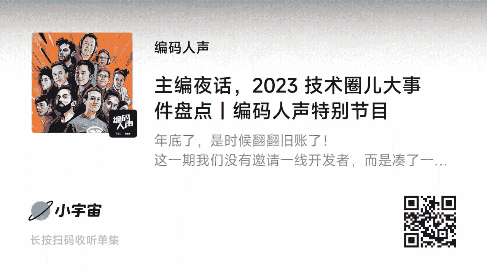

# 主编夜话，2023 技术圈儿大事件盘点丨 RTE 开发者日报 Vol.115

> 来源：[https://docs.feishu.cn/docx/MwzbdNlDSour0vxR47RcMajMnKf](https://docs.feishu.cn/docx/MwzbdNlDSour0vxR47RcMajMnKf)

开发者朋友们大家好：

这里**是「RTE 开发者日报**」，每天和大家一起**看新**闻、聊八卦。

**

我**们的社区编辑团**队会**整理分享 RT**E **（Real T**im**e Engagement） 领域内「有话题的新闻」、「有态度的观点」、「有意思的数据」、「有思考的文章」、「有看点的会议」，但内容仅代表编辑的个人观点，欢迎大家留言、跟帖、讨论。

年底了，是时候翻翻旧账了！

RTE 开发者社区旗下有一档播客节目「编码人声」，关注行业发展变革、开发者职涯发展、技术突破以及创业创新，由开发者来分享开发者眼中的工作与生活。录制嘉宾覆盖信通院 & 科委专家、国内外资深投资人、VR/AR & 虚拟人 & AIGC 等新兴技术领域头部创业者、一线网红 & 硬核开发者、跨界画家 & 作家 & 酿酒师等。

最新的一期我们没有邀请一线开发者，而是凑了一桌技术领域的“主编”，在一个夜黑人静的晚上，凑到一起聊一聊行业的八卦，聊一聊这一年中的技术发展、行业变革、公司兴衰，以及我们这些媒体 & 社区人眼中，有血有肉的开发者。

**欢迎扫码收听 + 关注。**

本期编辑：@Asui，@CY

---

### **一、有话题的新闻**

1、特斯拉机器人暴起伤人，突袭工程师

据报道，在特斯拉汽车公司位于美国得克萨斯州首府奥斯汀附近的工厂，曾发生一起残暴血腥的事故，有一名工程师遭到机器人袭击。当时这名工程师正在为附近两台出故障的特斯拉机器人编写软件程序，该机器人突然压住他，然后将其金属爪伸向这名工程师的背部和手臂，并在工厂地面上留下了一道“血迹”。另据报道，工人保护方面的律师 Hannah Alexander 进一步指出，特斯拉为了获得得州和联邦的补贴，显然粉饰了工人受伤的情况。与她交谈过的很多工人称，他们的受伤情况并未出现在报告之中。据调查，2022 年特斯拉工厂差不多每 21 名工人中就有一人在工作中受伤，而行业平均水平为每 30 名工人中有一人受伤。（@每日经济新闻）

2、纽约时报起诉微软和 OpenAI 侵犯版权，索赔数十亿美元

美东时间 12 月 27 日，新闻资讯传媒集团纽约时报公司公布，向纽约南区联邦法院提起诉讼，指控微软及 OpenAI 侵犯版权，滥用该媒体的知识产权，「复制并使用了数以百万计」的该媒体文章，用于训练他们的大语言模型（LLM），现在直接向该报的内容发起竞争。

递交法院的文件显示，纽约时报寻求，让微软和 OpenAI 承担「数十亿美元的法定损害赔偿和实际损失」，认为这两家被告公司应该因为「非法复制并使用了纽约时报独有的有价值作品」而负法律责任。

纽约时报还认为，被告公司创建了一种基于「大规模侵权版权」的商业模式，指控他们的 AI 系统利用了纽约时报受版权保护的作品表达内容，并且在很多情况下，保留了其中大部分的内容。纽约时报指出，微软和 OpenAI 的 AI 模型损害了新闻媒体保护内容和将内容变现的能力，从而「对高质量的新闻报道构成威胁。」

纽约时报称，自身对新闻业务做出巨额投入，这两家公司却企图借助 Copilot 和 ChatGPT 搭便车，既未经许可也未付费，就利用纽约时报的投资制造替代该报的产品。（@华尔街见闻）

3、OPPO 首个 AI 大模型：安第斯 AndesGPT 发布

12 月 28 日消息，OPPO 举行了 Find X7 系列技术沟通会，在这次会议上，OPPO 首个 AI 大模型——安第斯大模型 AndesGPT 正式发布。据官方介绍，AndesGPT 具备功能全面、强大的生成式视觉模型，能够对图像进行精准语义理解，并在此基础上实现了对超过 120 类主体的识别与分割支持。

不但分割精度高至发丝级的，而且最多可以支持 6 个主体的分割与提取，并且能够针对超大面积图像进行填充和生成，甚至可以完美的生成图片中的自然光影。图像在本地生成时长低至 6s，耗时领先同平台其他模型 60%，让端侧也可以实现媲美云端的生成精度与质量。

另外，相比 10 亿参数大模型，AndesGPT 70 亿参数语言模型在带来更有「智商」的理解能力。以通话摘要功能举例，AndesGPT 可以帮助用户梳理通话内容的要点，并准确地输出带有主题、要点以及待办事项的通话内容摘要，精准程度明显优于 10 亿级别的端侧模型。（@快科技）

4、韩国明确 AI 生成内容不受版权保护

12 月 27 日消息，韩国文化体育观光部长官刘仁川今日在首尔西大门区摩达艺术剧场发表了包含这些内容的《实现版权强国的四大战略》，决定不允许对未经人类创作的 AI 生成内容进行版权登记。

该部门还补充说，只有能够明显传达人类思想和情感的创意才有可能登记。这一决定将很快在面向 AI 企业、版权所有者和用户的「AI 版权指南」中公布。为此，该部门还提出了四项战略，包括先发制人地应对人工智能、消除版权盲点、提高版权产业的透明度以及积极应对海外非法内容传播。

韩国希望在 2022 年至 2027 年间使其版权产业规模从 24.4 万亿韩元（IT 之家备注：当前约 1342 亿元人民币）增加到 430 万亿韩元（当前约 2.37 万亿元人民币），将版权出口产业规模从 155 亿美元（当前约 1106.7 亿元人民币）增加到 250 亿美元（当前约 1785 亿元人民币）。（@IT之家）

5、德国研究人员称攻破了特斯拉自动驾驶系统

德国柏林工业大学的 IT 安全研究人员表示，他们获取了特斯拉自动驾驶系统的访问权限，特斯拉的竞争对手可以利用这点重建自动驾驶系统的重要部分。但他们也表示，在实验室外攻击是做不到的，操纵他人停放的特斯拉汽车自动驾驶系统很难想象。对于这一漏洞，特斯拉没有回复。（@新浪科技）

---

### 二、有思考的文章

**1、《生成式 AI 的 2023：技术**[**突破、商业落地、政策监管与 A**](https://mp.weixin.qq.com/s/w2xS8mkg8SiVH1NaHGBMfg)I 恐慌》（@Founder Park）

2023 年是 AI 发展的关键一年，ChatGPT 以及 GPT-4 的发布引发了全社会对于大模型以及生成式 AI 的关注。

科技巨头微软、亚马逊、谷歌、Meta 等纷纷发力 AI；文本生成、文生图以及文生视频 AI 工具进展迅速；国内的「百模大战」；各国对于 AI 的监管逐渐加强；科学家们还在研究「涌现」的原理；还有年底的 OpenAI Drama 事件……

科技博客 Everypixel Journal 整理了 2023 年 AI 行业的产品以及商业进展，他们还梳理总结了由风投公司 Air Street Capital 发布的《2023 人工智能现状报告》，Founder Park 一并进行了编译。

[**2、《虚拟逐步成真：浅谈 **](https://mp.weixin.qq.com/s/2v1utZbJXgvNxTF7MX_1bw)VR 切入 MR 空间计算的基本逻辑》（@艾邦 VR 产业资讯）

空间计算是以现实的空间、真实的世界为基本核心，将空间信息来进行完全“数字化”的沉浸式的计算体验。苹果继开启了个人计算时代、移动计算时代以后，2023 年，苹果 Vision Pro 的发布正式开启了空间计算时代，它的结构和再造的空间使人能够同时进入一个多维度的时空，与此同时，Apple Vision Pro 的发布恰逢 AR/VR 向 MR 发展的时代拐点，Apple 围绕空间计算需求构建了三大能力：视觉显示效果、物理现实体验、人机认知交互。

这三大能力可以对应小派 VR3.0 的产品思路。本文来源小派科技副总裁李杰在艾邦第四届 AR/VR 产业论坛上的演讲。

---

**写在最后：**

我们欢迎更多的小伙伴参**与「RTE 开发者日报**」内容的共创，感兴趣的朋友请通过开发者社区或公众号留言联系，记得报暗号「共创」。

对于任何反馈（包括但不限于内容上、形式上）我们不胜感激、并有小惊喜回馈，例如你希望从日报中看到哪些内容；自己推荐的信源、话题、活动等；或者列举几个你喜欢看、平时常看的内容渠道；内容排版或呈现形式上有哪些可以改进的地方等。

---

