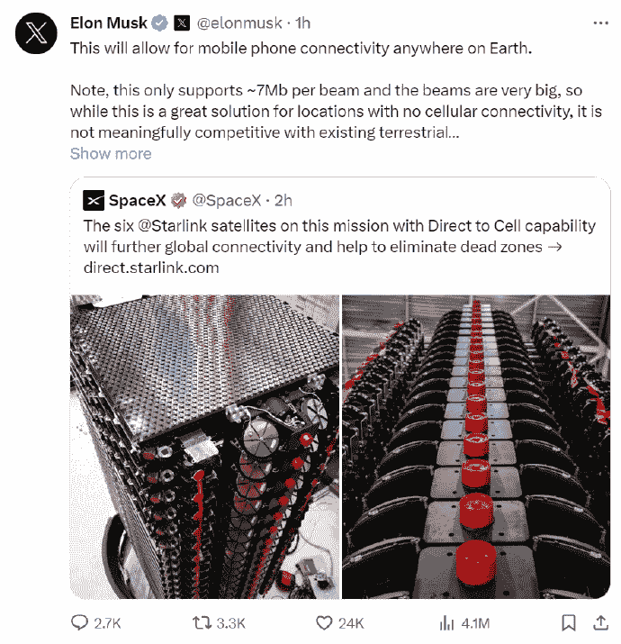

# 2024 AIGC 应用层十大趋势；iPhone 遭史上最复杂攻击！丨 RTE 开发者日报 Vol.119

> 来源：[https://docs.feishu.cn/docx/YLNNdJBlbozKXOxSXogcBR2cnUc](https://docs.feishu.cn/docx/YLNNdJBlbozKXOxSXogcBR2cnUc)

开发者朋友们大家好：

这里**是「RTE 开发者日报**」，每天和大家一起**看新**闻、聊八卦。

**

我**们的社区编辑团**队会**整理分享 RT**E **（Real T**im**e Engagement） 领域内「有话题的新闻」、「有态度的观点」、「有意思的数据」、「有思考的文章」、「有看点的会议」，但内容仅代表编辑的个人观点，欢迎大家留言、跟帖、讨论。

本期编辑：@Asui，@CY

---

### **一、有话题的新闻**

1、科技部发文规范 AI 使用，禁用 AIGC 直接生成申报材料

科技部监督司近日编制印发《负责任研究行为规范指引（2023）》，提出不得使用生成式人工智能直接生成申报材料，不得将生成式人工智能列为成果共同完成人，同时强调科研人员应把科技伦理要求贯穿到研究活动的全过程。针对成果发布问题，《指引》强调，公布突破性研究成果和重大研究进展应经所在科研单位同意。未经科学验证或同行评议的研究成果，科研人员不得向公众传播；不得将已发表的论文或其中的数据、图片等再次发表，不得将多篇已发表论文各取一部分拼凑出“新成果”后发表。

2、百度拟将量子实验室捐赠予北京量子院

百度计划将量子实验室及设备捐赠给北京量子信息科学研究院，双方正商讨具体细节。去年阿里达摩院也将量子实验室赠予浙江大学。（@CSDN）

3、2024 AIGC 应用层十大趋势

IDC 携手钉钉撰写《2024 AIGC 应用层十大趋势白皮书》，通过各方访谈与一手用户洞察，定位了 AIGC 应用十大趋势。IDC 认为，AI Agent、专属模型、超级入口、多模态、AI 原生应用、AI 工具化、AI 普惠化都将成为 2024 年 AIGC 应用的趋势关键词。（@通信世界）

4、iPhone 遭史上最复杂攻击！360 周鸿祎：国家级黑客编写

1 月 2 日消息，#iPhone 遭遇史上最复杂攻击#的话题登上热搜。据了解，今年 6 月份卡巴斯基发布报告称，发现了一个非常复杂的 iMessage 漏洞，可以向 iPhone 植入恶意程序，收集麦克风录音、照片、地理位置等数据。该漏洞自 2019 年就被使用，给数千部 iPhone 留下了一个非常隐蔽的后门。对此，360 董事长周鸿祎表示：这个漏洞利用了 iPhone 多个软硬件的漏洞，在 iPhone 里可以获得最高的权限，而且非常的隐秘。他表示，应该是利用了 Mac 系统大概 10 年都没有修复的一个字体漏洞。在周鸿祎看来，这个漏洞的攻击代码高达数万行，写得非常精巧复杂，绝对是国家级网军黑客的力量。（@凤凰网科技）

**5、用户抱怨 Win11 开始菜单“**显示所有程序”操作烦琐，微软高管承诺改进

1 月 1 日，有网友在𝕏平台向微软广告和网络服务部门首席执行官米哈伊尔・帕拉欣（Mikhail Parakhin）提出请求：请修理一下开始菜单。我想要通过滚动来查看所有应用程序，而不是还要再点击一次“所有程序”。

当天晚些时候，米哈伊尔・帕拉欣回复这名网友称：“你说得对极了！这个问题使我也觉得恼火。我们的团队需要上点强度，让开始菜单再次伟大！”据此前报道，微软 Windows 用户体验团队的项目管理前总监 Jensen Harris 就曾疯狂吐槽过 Windows 11 的设计，一连发了十几条，其中就包含关于新版本“开始”的吐槽。（@新浪科技）

6、SpaceX 将发射首批电话卫星，直接向手机提供服务

SpaceX 公司在𝕏平台上的官方账号当地时间周二晚间发帖称，将首次发射 6 颗具有直连手机能力的星链卫星，这将进一步促进全球连接并帮助消除死区。

马斯克转发了这条帖子，并写道：“这将允许移动电话连接到地球上的任何地方。注意，每个波束只能支持～7Mb，而且波束非常大。所以虽然对于没有蜂窝连接的地区来说，这是一个很好的解决方案，但它与现有的地面蜂窝网络没有明显的竞争力。”（@环球市场播报）

7、腾讯提出 3D 高质量纹理生成新方法

近日，来自腾讯平台与内容事业群（PCG）、浙江大学、上海科技大学的团队推出了一项名为 Paint3D 的生成式框架，它能够根据文本或图像输入，为无纹理的 3D 模型生成高分辨率、无光照且多样化的 2K UV 纹理贴图，对任何 3D 物体进行纹理绘制。据介绍，这项研究解决的关键挑战是在没有嵌入式照明信息的情况下生成高质量的纹理，使得纹理可在渲染管道中被重新照明或重新编辑，直接应用于现有的渲染管线，在艺术创作、数字媒体制作和游戏内容创作等领域发挥重要作用。（@机器之心）

---

### 二、有态度的观点

**1**、机构预测：华为 Harmony OS 将在 2024 年取代苹果 iOS，成为中国第二大智能手机操作系统

TechInsights 预测，2024 年全球智能手机销量将同比反弹 +3%。安卓和苹果 iOS 将继续在全球范围内保持双雄地位，但在中国市场上的份额将被华为鸿蒙操作系统蚕食。从 2024 年起，鸿蒙 Harmony OS 将成为中国市场上第二大智能手机操作系统。（@界面新闻）

2、马斯克预言 2024 年世界将更加疯狂

当地时间周一，有网友在𝕏平台上发帖提问称：“我们能在 2024 年过一个正常的年份吗？经过了疯狂的四年之后，我们不应该得到这样的待遇吗？”随后，马斯克对此回复称，“我预测 2024 年将更加疯狂。”

虽然马斯克没有明确预测任何可能发生的“疯狂”事件，但在那条推文下，人们讨论了美国总统大选、人工智能等一系列问题。有意思的是，虽然 2024 年仅仅过去了 2 天时间，但光是在日本和韩国的震撼性开局，也确实在印证着他的判断。（@财联社）

3、苹果：别争了，AI 时代的新「iPhone」，还是 iPhone！

苹果在 AI 领域具有巨大的发展潜力，主要基于以下三个因素：第一，苹果在全球拥有超过 20 亿运行 iOS 操作系统的设备，这为其未来发展 AI 应用奠定了庞大的用户基础。第二，苹果的 Siri 语音助手每月处理的请求量达 250 亿次，反映了消费者对语音助手等 AI 工具的强烈需求。如果苹果未来能推出类似 ChatGPT 的产品，那么来自其消费者端的 AI 数据和互动规模将会很庞大。第三，苹果付费订阅用户数量在快速增长，这一态势为苹果通过 AI 类应用实现收入增长奠定了坚实基础。（@极客公园）

---

**写在最后：**

我们欢迎更多的小伙伴参**与「RTE 开发者日报**」内容的共创，感兴趣的朋友请通过开发者社区或公众号留言联系，记得报暗号「共创」。

对于任何反馈（包括但不限于内容上、形式上）我们不胜感激、并有小惊喜回馈，例如你希望从日报中看到哪些内容；自己推荐的信源、话题、活动等；或者列举几个你喜欢看、平时常看的内容渠道；内容排版或呈现形式上有哪些可以改进的地方等。

---

