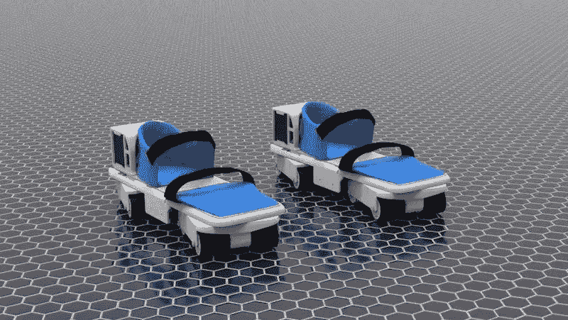
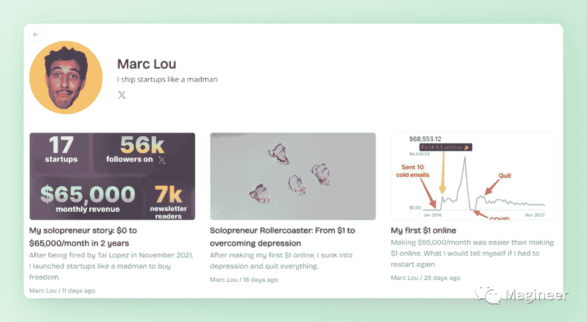

# 一个人，2 年时间，每月赚 6w 美金，独立开发者故事丨 RTE 开发者日报 Vol.120

> 来源：[https://docs.feishu.cn/docx/LBEfdtGXyoIJYBxWLe8cRzdenjc](https://docs.feishu.cn/docx/LBEfdtGXyoIJYBxWLe8cRzdenjc)

开发者朋友们大家好：

这里**是「RTE 开发者日报**」，每天和大家一起**看新**闻、聊八卦。

**

我**们的社区编辑团**队会**整理分享 RT**E **（Real T**im**e Engagement） 领域内「有话题的新闻」、「有态度的观点」、「有意思的数据」、「有思考的文章」、「有看点的会议」，但内容仅代表编辑的个人观点，欢迎大家留言、跟帖、讨论。

本期编辑：@Asui，@CY

---

### **一、有话题的新闻**

1、报告称北京程序员年收入中位数超 60 万元

职位网站 Levels.fyi 日前发布了一份《2023 年度程序员收入报告》，该报告据称基于 20 万份程序员薪资数据，主要反映程序员 2023 年薪酬总额中位数，其中包含工资、股票价值和奖金。从美国方面来看，程序员收入最高的地区是美国旧金山，中位数薪资为 24.9 万美元（当前约 178.3 万元人民币）。而在“热门国际城市（排除美国）”方面，中国北京位居全球第六，年中位收入为 9 万美元（当前约 64.4 万元人民币）。（@CSDN）

2、钉钉个人版全量上线，推出各类 AI 工具

1 月 4 日，钉钉个人版正式全量上线。钉钉用户点击手机或 PC 左上角的个人头像，即可进行「钉钉」与「钉钉个人版」的切换。钉钉个人版对 AI 交互进行了升级，支持悬浮语音交互。个人版相比内测期间更新了鹿班相机、灵动人像、涂鸦作画、法律助手等 AI 工具，并提供 AI 写真、数字分身、AI 作画、AI 律师等服务。目前，钉钉个人版的 iOS、Android、Mac、Windows 端，已向用户全面开放。（@IT之家）

3、全国首案一审判赔 500 元，“AI 文生图”著作权属于谁？

北京互联网法院审结了中国首例“AI 文生图”侵权案，明确了利用人工智能生成图片的“作品”属性和使用者的“创作者”身份。案件中，原告利用 AI 工具生成图片并发布在📕，被告未经许可使用该图片并删除原作者署名，被认定侵权。本案判决赋予 AI 生成内容的创作者权益，但强调，该类内容是否构成作品，需要个案判断，不能一概而论。（@北京商报）

4、OpenAI 拟下周推出 GPT 商店，抽取佣金比例成关注焦点

美国当地时间周四，OpenAI 宣布将于下周上线「GPT 商店」，允许客户使用 GPT Builder 构建第三方定制聊天机器人，并在商店中分享和销售。GPT 商店原定于 2023 年 11 月上线，但因公司领导层危机推迟至 2024 年 1 月。该商店的推出可能会对提供类似服务的小型初创公司构成威胁。 OpenAI 已向开发者发送邮件通知，要求他们查看使用政策和 GPT 品牌指南，并验证生成器配置文件。GPT 商店的详细发布信息尚未公布。值得注意的是，OpenAI 的 GPT 商店与苹果应用商店相似，但引发了关于分成和定价的争议。（@DoNews）

5、苹果 Siri 融入生成式 AI 或取得重大进展

据报道，苹果在将自研的 Ajax 生成式 AI 模型应用于 Siri 方面取得了重大进展，预计会在今年的 WWDC 上展示。彭博社记者古尔曼早在去年 7 月就曾提及该模型的存在。新版 Siri 据称将具备更自然的对话能力，并提供更加个性化的用户体验。值得关注的是，新功能预计将支持跨设备使用，这意味着新版 Siri 或许能够跨设备传递对话信息。此外，新版 Siri 还将引入一项全新的“苹果专属创作服务”，或许与之前传闻的 iOS 18 中基于 Siri 的快捷指令功能有关。（@网易新闻）

6、微软改变 PC 键盘，将新增人工智能键 Copilot

微软宣布将 Copilot 键引入 Windows 11 电脑。微软执行副总裁兼消费者首席营销官 Yusuf Mehdi 表示：“大约 30 年前，我们在 PC 键盘上引入了 Windows 键，使世界各地的人们都可以与 Windows 进行交互。” “我们认为这是我们 Windows 之旅中的另一个变革时刻，Copilot 将成为进入 PC 人工智能世界的切入点。”

据了解，这个新的 Copilot 键将取代几十年前与 Windows 键一起引入的菜单键（应用程序键）。在大多数键盘上，它将放置在右侧 alt 键旁边，位置因 OEM 和不同市场而异。与微软在 2019 年在自己的键盘上添加专用 Office 键的位置相同。Copilot 键只是启动 Windows 11 中内置的 Windows Copilot，提供类似 ChatGPT 的聊天机器人，可以回答查询甚至在 Windows 内执行操作。（@界面新闻）

7、斯坦福炒虾机器人爆火全网！由华人团队开发，能做满汉全席还会洗碗

斯坦福华人团队开发的炒菜机器人 Mobile ALOHA 凭借 50 个演示，成功完成各种复杂任务。该机器人可以自主操作，也支持全身远程操控，成本仅为 32000 美元。除了完成菜品制作外，还能擦拭洒在桌子上的酒，坐电梯等复杂任务，用户通过远程操控可以迅速接近专家级速度。（@新智元）

8、13 岁少年仅用 38 分钟通关俄罗斯方块

据美联社 4 日报道，来自美国俄克拉何马州的 13 岁少年威利斯·吉布森成为第一位「通关」任天堂版「俄罗斯方块」游戏的人类玩家。

吉布森日前在网上发布了一段挑战「俄罗斯方块」游戏的视频，在他花费 38 分钟玩到第 157 关时，游戏宕机，屏幕卡死。这一幕此前只有在人工智能玩游戏时发生过。吉布森完成游戏后直呼要昏过去，还称已经感觉不到手指的存在了。

据报道，吉布森从 11 岁开始玩「俄罗斯方块」，并在 2023 年经典「俄罗斯方块」游戏世界锦标赛上获得第 3 名。吉布森表示，他除了「通关」游戏之外，还打破了总成绩和其他 3 项「俄罗斯方块」世界纪录。许多游戏玩家正试图挑战吉布森创下的纪录。（@环球网）

**9、VR 鞋**

为了让玩家在虚拟空间里面，可以真实地走动，一家英国创业公司发明了“VR 鞋”。

这种鞋子底部有履带，玩家往前走时，履带向后滚动，可以让你停留在原地。它跟跑步机的原理是一样的。

穿上这种鞋，你既在走动，又能基本停留在原地，再配合传感器将动作传入 VR 世界，就真的在虚拟空间里走动。

虽然这种鞋子有很多问题，比如不能走得太快，而且旁边最好有人看着，防止出事，另外还经常需要充电。但是它表明，技术正在一步步让 VR 世界变得越来越像真实世界。（@阮一峰的网络日志）

**10、好莱坞首个因 AI 丢掉饭碗的**是狮子，AI 发展使动物面临“失业危机”

据报道，去年以来，好莱坞的演员和编剧们举行了旷日持久的大罢工，其中最核心的诉求之一就是要求限制资方用 AI 取代人类的工作岗位。不过如今演员们还没有面临失业危机，好莱坞的动物们先感受到了“下岗”的痛苦。

非洲狮“卢克”曾出演过多部影片，但它的主人马丁介绍说，“卢克”已经很久没有接到工作了，就连迪士尼重拍《狮子王》也没让它去试镜，而是选择了用 AI 生成狮子的图像。由于 AI 对动物毛发等关键细节的处理越发栩栩如生，如今好莱坞的动物们面临着全面的“失业危机”。（@红星新闻）

---

### 二、有思考的文章

**1、《第一批靠 AI 自学爆火的高中生：60**[** 天学完 1 **](https://mp.weixin.qq.com/s/RUxrsxal0__Ts3nJBSsD_A)年的课，而我却开心不起来》（@谷雨星球）

随着 ChatGPT 火爆全网，关于人工智能的讨论从未停止，从美国大学到好莱坞编剧，各行各业陆续掀起了反 AI 保卫战但不可否认的是，AI 已经在一点点改变学习性质和教育模式，本文的作者作为国内第一批用 AI 自学的高中生，却在学校的考试里遇到了不小的挑战，来看看这到底是怎么回事吧。

[**2、《一个人，2 年时**](https://mp.weixin.qq.com/s/pAdfDWyNjCUrmdAf32OZ_Q)间，每月赚 6w 美金，独立开发者故事》（@Magineer）

本文讲了一个独立开发者的故事：Marc Lou，**P**ieter Levels 的忠实粉丝，用 2 年时间，推出了 17 个产品，超过 10 个产品都在盈利。目前靠自己一人，便可实现 6w 美金的月收入。

Marc Lou 核心分享了他是成为一名独立开发者的、具体是如何做的，过程中遇到了哪些问题、以及如何克服的，非常值得 Indie Hacker 一读！

---

### 三、有态度的观点

1、Redis 作者长文总结 LLMs, 能够取代 99% 的程序员

Redis 创始人 antirez 写下了自己 2024 年的第一篇博文，他从一名普通程序员的角度谈了谈对大语言模型的感受，虽然他的成就并不普通。他在文章里犀利评价 Google 引擎已经成为垃圾的海洋，并客观评价了现在的 AIGC 能力：愚蠢但通晓古今。

另外，他在文章中发表观点，认为“LLMs 能够取代 99% 的程序员”，但“开发者们仍有生存的空间”。

“大语言模型确实能编写出自己没有原样接触到的程序形式，也表现出通过融合训练集内不同出现频率的思路来引导开发方向的初步能力。只是这种能力目前还存在很大的局限性，而种种微妙的推理任务总会令大语言模型遭遇灾难性的失败。但必须承认，大语言模型已经代表着 AI 技术从诞生至今最伟大的成就，这一点应该成为所有讨论的前提。”（@红点新闻）

---

**写在最后：**

我们欢迎更多的小伙伴参**与「RTE 开发者日报**」内容的共创，感兴趣的朋友请通过开发者社区或👸号留言联系，记得报暗号「共创」。

对于任何反馈（包括但不限于内容上、形式上）我们不胜感激、并有小惊喜回馈，例如你希望从日报中看到哪些内容；自己推荐的信源、话题、活动等；或者列举几个你喜欢看、平时常看的内容渠道；内容排版或呈现形式上有哪些可以改进的地方等。

---

