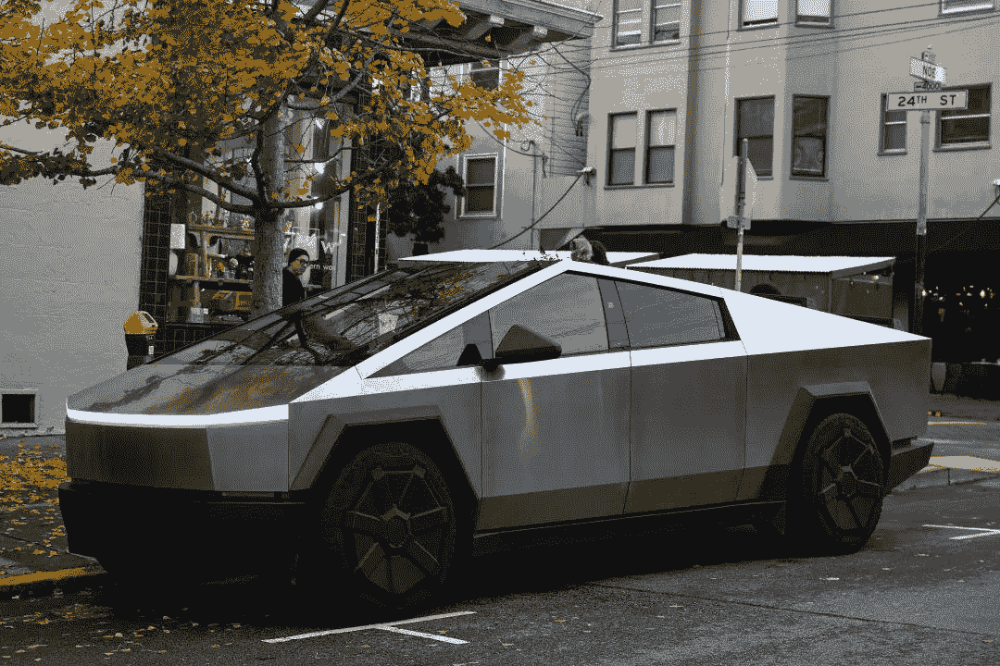

# GPT Store 的未来，是“竞价排名”的灰色产业链？丨 RTE 开发者日报 Vol.126

> 来源：[https://docs.feishu.cn/docx/I9tudWMaxohNNRxdT83cKJ9FnVd](https://docs.feishu.cn/docx/I9tudWMaxohNNRxdT83cKJ9FnVd)

开发者朋友们大家好：

这里**是「RTE 开发者日报**」，每天和大家一起**看新**闻、聊八卦。

**

我**们的社区编辑团**队会**整理分享 RT**E **（Real T**im**e Engagement） 领域内「有话题的新闻」、「有态度的观点」、「有意思的数据」、「有思考的文章」、「有看点的会议」，但内容仅代表编辑的个人观点，欢迎大家留言、跟帖、讨论。

本期编辑：@Asui，@CY

---

### **一、有话题的新闻**

1、Meta 承认使用盗版书籍来训练 AI，并拒绝赔偿作家

近日，Meta（前身为 Facebook）因使用包含大量盗版书籍的“Books3”数据集训练其 LLAM 1 和 LLAM 2 模型而面临包括喜剧演员 Sarah Silverman 和作家 Richard Kadrey 在内的一众作者的集体诉讼。 Meta 虽承认使用了 Books3 数据集，却对诉讼作为集体诉讼的合法性提出异议，拒绝向提起诉讼的作家或其他参与 Books3 争议的人士提供任何形式的经济“补偿”。（@IT 之家）

2、中国 AI 大模型专利数全球第一

近日，《博鳌亚洲论坛创新报告 2023》指出，中国已经成为 AI 大模型专利最多产出国，亚洲已成为 AI 大模型技术的主要产出区。随着国产大模型数量不断增加、功能不断丰富，人工智能产业发展加速，人工智能 ETF（159819）等产品可助力投资者高效布局 AI 程序和应用发展带来的投资机遇。

**3、罗永浩暂缓 AR 业务转做大**模型？内部人士：不实，仍专注 AR 研发

据报道，罗永浩的细红线 AR 业务软硬件研发放缓、AR 相关业务裁员，或将转向大模型行业。有行业高管透露，罗永浩已不再做 AR 硬件，可能打算去做大模型，“他就是投机分子。”前述高管透露。“硬件的、算法的人基本都裁了。”一位被裁员的细红线前员工表示，元旦前细红线的 AR 业务确实有一轮裁员且并非首轮裁员。不过，针对媒体报道“罗永浩的细红线公司业务从 AR 转型大模型”一事，该公司人士称，报道不实，罗永浩仍专注于 AR 软硬件。一个月前，罗永浩在直播时谈及了其创业项目细红线的进展。他表示，已经埋头研发了一年，故意没有声音。（@搜狐科技、@新浪科技）

4、刚上线三天，OpenAI GPT 商店的「AI 女友」就已泛滥

1 月 14 日消息，OpenAI 三天前悄然上线了「GPT 商店」，这是一个让用户分享、发现和售卖自定义聊天机器人的平台。 图片 据 Quartz 报道，GPT 商店刚刚上线便被「AI 虚拟女友」机器人淹没。搜索关键词「girlfriend」，琳琅满目的「虚拟甜心」、「你的女友 Scarlett」等机器人便映入眼帘。甚至，有些机器人的首页还引导用户向机器人提出「告诉我你最黑暗的秘密」等问题。 虽然这些机器人的存在并不令人意外，毕竟 AI 伴侣的概念早在 ChatGPT 诞生之前就已存在，但这还是暴露了 OpenAI 在全新商店内容审核方面的困境。更值得注意的是，这些机器人似乎已经触犯了 OpenAI 的使用条款，该条款明确禁止上架「用于培养浪漫关系或进行受监管活动」的 GPT 程序。（@IT 之家）

**5、谷歌 AI 通过图灵测试，大模型医生来了？GP**T-4 竟诊断出难倒 17 个医生的怪病

谷歌 DeepMind 团队发布的全新诊断对话式 AI 框架 AMIE 在测试中胜过医生，通过了图灵测试，引领医疗 AI 革命。AMIE 采用强化学习算法的"自我博弈"方法，能自我对弈并通过自动反馈机制，在各种疾病、医学专科和环境中进行扩展学习。在测试中，AMIE 在诊断呼吸系统和心血管疾病等方面胜过医生，并显示出同理心。（@新智元）

**6、欧盟正在制定《人工智能责任指令》**，或让被 AI 技术伤害的人获得经济补偿

欧盟近期就《人工智能法案》基本达成一致，这是世界上第一部全面的人工智能法律。随着欧洲各国和欧盟议会在 2024 年上半年陆续走完批准流程，该法案将很快生效。在最乐观的情况下，针对某些人工智能用例的禁令最快可能在年底实施。（@DeepTech 深科技）

---

### 二、有态度的观点

**1、奥特曼：未来 5-10 年大模型**都处于“陡峭成长曲线”，成本下降也是如此

OpenAI 的 CEO 萨姆·奥特曼称 AI（人工智能）至少在未来的五到十年内，技术正处于“一个非常陡峭的成长曲线上”，其成本也在飞快地下降。展望未来两年的 AI 技术发展，奥特曼表示自己看好能支持语音、图像和视频输入输出的多模态 AI，并相信 AI 技术最重要的进步将围绕其推理能力展开，以及为用户提升回答的可靠性。（@澎湃）

2、马斯克：特斯拉 Cybertruck 在中国很难合法上路

近日，有消息称特斯拉正在筹备 Cybertruck 电动皮卡，于一季度国内亮相的话题，引起网友关注热议。社交媒体上有网友发文称，特斯拉 Cybertruck 将在中国展厅亮相，其将会吸引许多消费者参观实车。

对此，马斯克回应称，让 Cybertruck 在中国合法上路会非常困难，但我们可以运送一些车型进行静态展示。

据悉，此前有欧盟汽车专家表示，欧盟最新的汽车安全标准，要求车辆的保险杠和引擎盖必须能够吸收能量保护行人等。但对特斯拉 Cybertruck 来说，其车身不锈钢材质，以及接近直角的车头造型，可能无法满足保护行人的规定。（@快科技）

**3、GPT Store 的未来，是“竞价**排名”的灰色产业链？（@数字生命卡兹克）

GPT Store 是 GPTs 的一个市场合集。而 GPTs，就是用户们自己根据自己的需求，进行定制化魔改的 ChatGPT，里面内置了已经预设好的 Prompt。

本质上，就是一个更降低使用门槛的功能形式而已，我不知道大家有没有经历过 3、4 月份 GPT 套壳网站群魔乱骂的时代。那时候很多的小网站，都是基于 GPT 的 API 去做 Prompt 工程，号称是某一个领域的特异化助手。其实这就是 GPTs 的雏形。

从 OpenAI 的消息看，今天 GPT Store 上线的时候，GPTs 的数量达到了 300 万。 要知道，现在的 APP Store，这么多年了，也才 200 万应用，你就能想象到做一个 GPTs 的门槛有多低，随手写个 Prompt，发上去，就是一个 GPTs。这不叫生态，这叫垃圾堆。

最骚的是，你有这么多 GPTs 了，但是 OpenAI 的知识产权保护特别烂。 大多数的 GPTs，随手一个 Prompt，就能把它的 Stystem 和知识库给套出来。你可以用同样的头像、同样的名称、同样的 Prompt，原地复制一个。

**4**、贾扬清：“一个像用户一样通过点击 app 来做事情的 AI，要怎么去取代它点击的那个 app 呢...?”

Rabbit 发布后，贾扬清在朋友圈转发并发表了一段吐槽：“认真吐槽。一方面，rabbit 说自己是‘像人一样接受了普通用户界面的操作训练’也就是说是用了其他的 app 或者网页，另一方面，rabbit 说‘要取代 app’。所以一个像用户一样通过点击 app 来做事情的 AI，要怎么去取代它点击的那个 app 呢...?”

---

**写在最后：**

我们欢迎更多的小伙伴参**与「RTE 开发者日报**」内容的共创，感兴趣的朋友请通过开发者社区或👸号留言联系，记得报暗号「共创」。

对于任何反馈（包括但不限于内容上、形式上）我们不胜感激、并有小惊喜回馈，例如你希望从日报中看到哪些内容；自己推荐的信源、话题、活动等；或者列举几个你喜欢看、平时常看的内容渠道；内容排版或呈现形式上有哪些可以改进的地方等。

---

