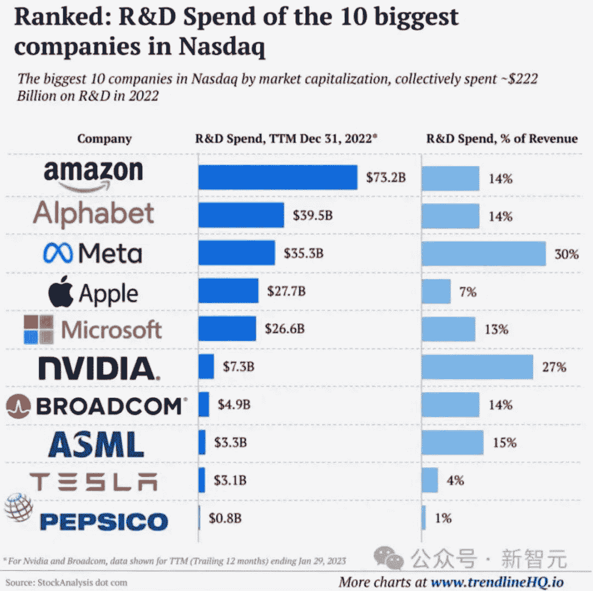

# 美国科技 5 巨头，研发狂烧 2020 亿刀！亚马逊 732 亿全球第一丨 RTE 开发者日报 Vol.127

> 来源：[https://docs.feishu.cn/docx/A4thdkKzgo7kSqxdlT0cdX7Pnpf](https://docs.feishu.cn/docx/A4thdkKzgo7kSqxdlT0cdX7Pnpf)

开发者朋友们大家好：

这里**是「RTE 开发者日报**」，每天和大家一起**看新**闻、聊八卦。

**

我**们的社区编辑团**队会**整理分享 RT**E **（Real T**im**e Engagement） 领域内「有话题的新闻」、「有态度的观点」、「有意思的数据」、「有思考的文章」、「有看点的会议」，但内容仅代表编辑的个人观点，欢迎大家留言、跟帖、讨论。

本期编辑：@Asui，@CY

---

### **一、有话题的新闻**

**1、全球智能手机换机周期继续拉长**到 51 个月，中国市场超过 40 个月

调研机构 BCI 数据显示，去年中国一共卖出 2.7 亿部智能手机，而苹果成为了最畅销的手机。对比 2022 年的名次，最大变化就是平均售价超 7000 元的苹果超过了 vivo。另外，研究机构 TechInsights 预计，2023 年全球智能手机换机周期继续拉长到历史最长的 51 个月，其中中国消费者换得更勤一些，但也超过 40 个月。（@cnBeta）

2、华为纯血鸿蒙首批开发者预览版 Beta 招募

日前，纯血版鸿蒙系统终于迎来了官宣。据@华为终端官宣，“#鸿蒙千帆起#， 1 月 18 日，鸿蒙生态千帆启航仪式，邀你见证鸿蒙生态的新里程。百川奔腾入海，千帆共进有为，鸿蒙与你共未来！” 另外，据华为 HarmonyOS 开发者社区官方公告，华为 HarmonyOS NEXT 开发者预览版首批 Beta 招募正式开启。首批共三款机型支持，分别是 Mate60、Mate60 Pro、Mate X5。（@TechWeb）

3、微软推出 Copilot Pro，售价 20 美元

1 月 16 日，微软正式发布了一项针对个人消费者的订阅服务 Copilot Pro。Copilot Pro 一个用户的月费为 20 美元。用户可以在 Windows、macOS 和 iPad 上访问 Office 应用程序中的 Copilot，如 Word、Excel、PowerPoint、Outlook 和 OneNote（目前为预览版，仅支持英语，而且用户需要订阅 Microsoft 365）。订阅后，用户可以优先使用最新版本的模型，比如 OpenAI 的 GPT-4 Turbo。 除 Copilot Pro 外，微软还正式发布了适用于 iOS 和 Android 的 Copilot 应用程序，并将 Copilot for Microsoft 365 的适用范围扩大到中小企业，取消了商业套餐的最低成员数要求。(@cnBeta)

4、人形机器人新进展，马斯克展示“擎天柱”叠衣服

马斯克在 X 平台上发布了一段新视频，展示了该公司人形机器人“擎天柱”正在做家务。在视频中，可以看到“擎天柱”从篮子里拿出一件衬衫，小心翼翼地折叠起来，然后放在一边。尽管这个机器人的动作似乎比人类慢一些，但这次演示标志着机器人发展的一个重要里程碑，突显了它处理日常任务的潜力。（@investing）

**5、美国科技 5 巨头，研发狂烧 2**020 亿刀！亚马逊 732 亿全球第一

2022 年科研经费排名，亚马逊、谷歌、Meta 位列前三，但在科研经费占收入比中，Meta 和英伟达以 30%、27%居首。同时，亚马逊、谷歌、Meta、苹果和微软在 2022 年的研发支出总计为 2020 亿美元，较 2021 年增长了 28.4%。在 AI 领域，这五大科技公司拥有约 33,000 名 AI 相关工作人员。（@新智元）

**6、苹果 Vision Pro 头显即**将发售，消费者 25 分钟试戴流程全曝光

据知名科技记者 Mark Gurman 报道，苹果即将在 2 月 2 日迎来其近十年来最重大的新产品发售：混合现实头显 Apple Vision Pro。然而，苹果正面临着史上最严峻的营销挑战之一：如何说服消费者为一款售价 3499 美元、续航有限、设计笨重且缺乏杀手级应用的头显买单？为了应对这一挑战，苹果准备了史上最复杂的演示流程，时长高达 25 分钟，比看一部情景喜剧还要长。2 月 2 日起，美国所有苹果零售店都将提供 Vision Pro 试戴服务，早上 8 点开始预约。苹果最大的零售店计划同时提供 12 个以上的演示设备，并设置专门的坐式演示区域。（@搜狐新闻）

---

### 二、有态度的观点

1、IMF 总裁：AI 会影响全球约 40%的就业机会

在参加瑞士达沃斯世界经济论坛前，IMF 总裁指出，人工智能将影响全球约 40%的就业岗位。在发达经济体，60%的工作岗位可能受 AI 影响，其中一半可能提高生产率，一半可能被 AI 取代。在新兴市场和低收入国家，受 AI 影响的就业岗位预计分别为 40%和 26%。他呼吁各国政策制定者警惕 AI 带来的潜在不平等及社会紧张，需建立全面社会安全网，为弱势工人提供再培训计划。（@全天候科技）

2、马斯克：SpaceX 每年保持 50%发射增速，八年内送人类上火星

马斯克在 SpaceX 公司年度演讲中总结了 2023 年的进展和成就，并展望了未来计划。他提到了猎鹰火箭的大量发射，龙飞船的成功记录，以及星链卫星系统的部署。马斯克强调了火星计划的重要性，希望最终建立一个自给自足的火星基地。他还谈到了星舰的设计、月球基地阿尔法的构想，并强调将电动驱动引擎和热分离技术应用于星舰的改进。马斯克表示，通过可重复使用的火箭和星舰，人类将能够实现多行星化，将地球上的生命拓展到其他星球。（@瓦砾村夫）

**3、Canalys：2023 年全球 PC** 出货 2.47 亿台，同比下降 13%

研究机构 Canalys 发布最新统计数据，2023 年第四季度全球个人电脑（PC）市场出货量同比增长 3%，结束了连续七个季度的同比下滑。2023 年全年，全球个人电脑出货总量 2.47 亿台，较 2022 年下降 13%。机构认为，目前市场增长蓄势待发，AI PC 将在接下来的电脑更新周期及之后提供额外动力。预测到 2027 年，AI PC 出货量将超过 1.7 亿台，其中近 60%将部署在商用领域。（@凤凰网）

---

**写在最后：**

我们欢迎更多的小伙伴参**与「RTE 开发者日报**」内容的共创，感兴趣的朋友请通过开发者社区或公众号留言联系，记得报暗号「共创」。

对于任何反馈（包括但不限于内容上、形式上）我们不胜感激、并有小惊喜回馈，例如你希望从日报中看到哪些内容；自己推荐的信源、话题、活动等；或者列举几个你喜欢看、平时常看的内容渠道；内容排版或呈现形式上有哪些可以改进的地方等。

---

