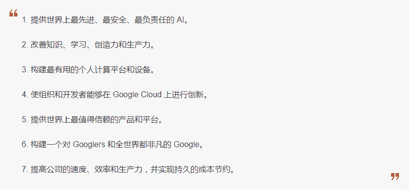

# 谷歌 2024 新年目标曝光：一边做地表最强 AI，一边裁更多员工丨 RTE 开发者日报 Vol.132

> 来源：[https://docs.feishu.cn/docx/EBUUda39GoU1TEx3t6wcvSm8nub](https://docs.feishu.cn/docx/EBUUda39GoU1TEx3t6wcvSm8nub)

开发者朋友们大家好：

这里**是「RTE 开发者日报**」，每天和大家一起**看新**闻、聊八卦。

**

我**们的社区编辑团**队会**整理分享 RT**E **（Real T**im**e Engagement） 领域内「有话题的新闻」、「有态度的观点」、「有意思的数据」、「有思考的文章」、「有看点的会议」，但内容仅代表编辑的个人观点，欢迎大家留言、跟帖、讨论。

本期编辑：@Asui，@CY

---

### **一、有话题的新闻**

**1、阿里巴巴发布开源代码库 SCEP**TER ，为 AIGC 用户提供全面工具

据 GitHub 页面显示，阿里巴巴近日发布开源代码库 SCEPTER，致力于生成训练、微调和推理，包括图像生成、传输、编辑等一系列下游任务。阿里巴巴表示，SCEPTER 集成了流行的社区驱动实现以及阿里巴巴集团统一实验室的专有方法，为 AIGC 领域的研究人员和从业人员提供了一个全面的工具包。（@品玩）

2、百度文心大模型落地吉利银河 L6 车型，支持 AI 对话功能

据 Apollo 智能驾驶消息，近日，百度 IDG 与吉利汽车合作的 AI 对话产品，在银河 L6 车型上成功量产，这是汽车行业首个基于大语言模型底座能力落地的 AI 车载对话产品。

从去年 3 月份文心一言大模型发布以来，IDG 智舱团队就开始了座舱大模型产品重构方向的探索，经过了近 10 个月的产品设计和体验打磨，百度打造的车载 AI 原生应用 "小度车载智慧助手" 成功的完成 0 到 1 阶段，进入到规模化商业落地阶段。据介绍，吉利银河 L6 的 AI 对话主打四个核心功能点：知识问答、高情商回复、行程规划、美食推荐。（@IT之家）

**3、小米超越苹果登顶中国第一，2023** 年 12 月小米销量市占率 16.5%

供应链消息，权威市调机构统计数据显示，2023 年 12 月，小米实现 348.09 万台的激活量以 16.5% 的销量市占率，超越苹果，位列中国智能手机市场第一；苹果和荣耀分别实现 336.21 万台和 335.21 万台的激活量，分列第二和第三位（两者销量市占率都为 15.9%）。（@华尔街见闻）

4、苹果公司庆祝 Mac 产品线诞生 40 周年

苹果公司庆祝 Mac 产品线诞生 40 周年，高管们回顾了其发展历程，强调了创新和设计在苹果成功中的关键作用。Macintosh 在 40 年前被推出，被誉为计算机的未来。苹果目前拥有涵盖不同产品类别的 Mac 系列，并正在积极探索 AI 领域，预计将推出搭载自家 AI 芯片的 Mac 电脑，以进一步整合其生态系统并影响 AI 计算趋势。（@网易）

5、谷歌 2024 新年目标曝光：一边做地表最强 AI，一边裁更多员工

外**媒**曝出谷歌 2024 年公司目标：做全球最强 AI，同时要再裁更多的员工。网友吐槽，CEO 拿巨额工资，产品无故取消，却只知道开人。

对于科技公司来说，持久的成本节约几乎就约等于是裁员。而从 2024 年第一天开始，谷歌就开始了这项工作。1 月 10 号以来，谷歌已经有多部门的近 1000 名员工被裁。谷歌硬件、广告销售、搜索、购物、地图、政策、核心工程和 YouTube 团队，都已经或即将接受裁员和重组。CEO 在内部邮件中也明确表示，裁员将会是贯穿谷歌 2024 年的年度活动。（@新智元）

**6、人工智能语音克隆初创企业 ElevenLabs 获**得 8000 万美元融资，成为独角兽企业

2024 年 1 月 22 日，声誉日益升高的人工智能语音克隆初创公司 ElevenLabs 宣布成功完成 8000 万美元的 B 轮融资，该轮融资由著名投资者共同领投，包括安德森·霍洛维茨（Andreessen Horowitz）、前 GitHub CEO Nat Friedman 和企业家 Daniel Gross。该轮融资还包括红杉资本（Sequoia Capital）、Smash Capital、SV Angel、BroadLight Capital 和 Credo Ventures 的参与，使 ElevenLabs 的总筹资额达到 1.01 亿美元，公司估值超过 10 亿美元（去年 6 月约为 1 亿美元）。

首席执行官 Mati Staniszewski 表示，新资金将用于产品开发、扩展 ElevenLabs 的基础设施和团队、AI 研究以及“加强安全措施，确保 AI 技术的负责任和道德发展”。

ElevenLabs 于 2022 年由前谷歌机器学习工程师 Piotr Dabkowski 和前 Palantir 部署策略师 Mati Staniszewski 共同创立，约一年前推出测试版。Staniszewski 表示，他和 Dabkowski 在波兰长大，受到翻译不佳的美国电影的启发，决定创造语音克隆工具。

如今，ElevenLabs 最知名的是其基于浏览器的语音生成应用，该应用能够创建逼真的语音，并可调整语调、情感、节奏等关键声音特征。用户可以免费输入文本，由几种默认语音之一朗读该文本。付费用户可以上传语音样本，使用 ElevenLabs 的语音克隆技术制作新的风格。（@TechVerse）

---

### 二、有态度的观点

1、周鸿祎：不能跟员工空谈奋斗精神、只给一个低工资，重赏之下必有勇夫

近日，360 周鸿祎谈到创业时表示，创业者不能只给员工画饼，空谈奋斗精神，只给一个低工资。他提到，创业者要跟员工讲奋斗精神，且不能抽象的讲。他认为，在市场经济领域，人都是自私的，员工追随创业者是希望能跟着创业者一起分享创业成果，所以就不能只给员工发低工资。“创业公司早期（不挣钱的时候），创业者也不可能给员工发出大企业那样的高薪，这个时候就应该实现早期员工全员持股，一定要把公司的股份分给员工”。

周鸿祎称，虽然这个股份不如花的钱管用，但是做成了这个股份可能就是员工实现财富自由的一张船票。重赏之下必有勇夫，创业者把长期利益给予员工的时候，很多员工还是需要去改变自己的人生，只是没有机会。（@雷锋网）

2、联想高管称摩托罗拉 3 年将为全球前三：我以我的薪水打赌

2014 年联想从谷歌手中收购了摩托罗拉品牌，意图与三星和苹果等巨头争夺市场份额。多年来，摩托罗拉已站稳了智能手机市场的一席之地，但联想显然不满足于此。联想集团执行副总裁兼国际市场总裁马特・齐林斯基（Matthew Zielinski）对摩托罗拉的未来信心满满。近日，他在接受采访时表示：“我可以拿我的薪水打赌，三年内，摩托罗拉将成为全球第三大手机厂商。”（@财经网科技）

**3、英特尔 CEO 基辛格：服务器和 PC 产品让**步，定制芯片将在 2025 年后引领潮流

1 月 22 日，在英特尔 Meteor Lake 芯片发布会上，其首席执行官帕特基辛格（Pat Gelsinger）指出公司正按计划在四年内完成五个节点，最终将在 2025 年达到顶峰，包括 Intel 7、Intel 4、Intel 3、Intel 20A 和 Intel 18A 工艺。

但目前来看，英特尔似乎已经准备放缓，或者说不会再像以前那般重视传统的服务器 / PC 芯片发布节奏。英特尔表示，这有助于其通过同时销售多代芯片为客户提供更多选择，同时满足定制产品的需求。

基辛格在接受 HPCwire 采访时表示：定制芯片将在 2025 年之后成为潮流，服务器和 PC（芯片）的定时发布届时可能就会变得不那么重要。（@凤凰科技）

---

**写在最后：**

我们欢迎更多的小伙伴参**与「RTE 开发者日报**」内容的共创，感兴趣的朋友请通过开发者社区或👸号留言联系，记得报暗号「共创」。

对于任何反馈（包括但不限于内容上、形式上）我们不胜感激、并有小惊喜回馈，例如你希望从日报中看到哪些内容；自己推荐的信源、话题、活动等；或者列举几个你喜欢看、平时常看的内容渠道；内容排版或呈现形式上有哪些可以改进的地方等。

---

