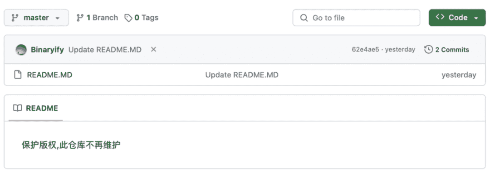
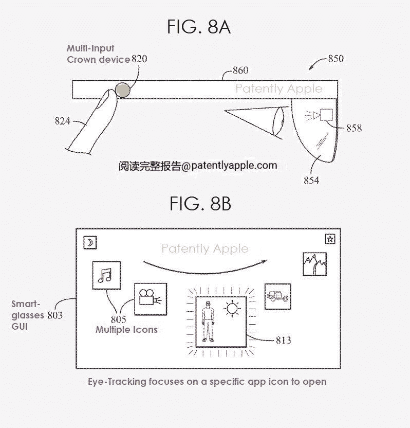

# 《幻兽帕鲁》爆火，大厂坐不住了：这游戏是 AI 设计的？丨 RTE 开发者日报 Vol.134

> 来源：[https://docs.feishu.cn/docx/SSIodR07Fow2vRxetOOcOrrVn0S](https://docs.feishu.cn/docx/SSIodR07Fow2vRxetOOcOrrVn0S)

开发者朋友们大家好：

这里**是「RTE 开发者日报**」，每天和大家一起**看新**闻、聊八卦。

**

我**们的社区编辑团**队会**整理分享 RT**E **（Real T**im**e Engagement） 领域内「有话题的新闻」、「有态度的观点」、「有意思的数据」、「有思考的文章」、「有看点的会议」，但内容仅代表编辑的个人观点，欢迎大家留言、跟帖、讨论。

本期编辑：@Asui，@CY

---

### **一、有话题的新闻**

1、《幻兽帕鲁》爆火，大厂坐不住了：这游戏是 AI 设计的？

《幻兽帕鲁》是当下最热门的开放世界生存游戏，刚上线体验版本 24 小时内销量超 200 万份，并突破 600 万，成为 Steam 历史在线玩家峰值第二的游戏。玩家在游戏中可以自由收集生物“帕鲁”，并指派他们战斗、建造，因设计元素抄袭疑似引起网友热议。游戏出自一个“小作坊”，并在开发过程中遇到许多困难。有网友质疑游戏中元素的生成可能使用了 AI，但直到目前为止，这一观点并未得到证实。（@机器之心）

**2、消息称蚂蚁集团成立 AI 创新部 NextE**vo，前谷歌 AI 工程师徐鹏担任负责人

据报道，蚂蚁集团已在内部成立了 AI 创新研发与应用部门 NextEvo，由蚂蚁集团副总裁徐鹏担任负责人。徐鹏曾在谷歌工作 11 年，负责和领导了谷歌翻译的核心技术研发，并参与了谷歌显示广告系统的算法研发。 NextEvo 是蚂蚁内部的 AI 精锐部门，承担了蚂蚁 AI 的所有核心技术研发，包括蚂蚁百灵大模型的所有研发工作。（@36氪）

**3、谷歌 Chrome 浏览器 12**1 稳定版发布，新增 3 项 AI 功能

谷歌近日升级 Chrome 浏览器，在最新 121 版本中添加了实验性的生成式人工智能功能，帮助用户组织标签页、创建主题和起草内容。

+   标签管理工具在整合生成式 AI 之后，能够分析当前已打开的标签，并提供有针对性的建议，用户可以右键单击标签并选择“组织类似标签”选项访问。如果您同时在 Chrome 浏览器中处理多个任务，比如计划旅行、研究课题和购物，这项 AI 功能可以给你带来帮助。

+   通过文本到图像的扩散模型，Chrome 浏览器用户可以根据主题、情绪、视觉风格和颜色生成自定义主题，自定义 Chrome 浏览器侧边栏中有“Create with AI”主题选项。

+   在网络上（如论坛）撰写文章时，Chrome 浏览器将能帮助用户生成内容。用户可以用右键单击任何文本框或字段来访问“Help me write”选项。

Chrome 浏览器计划在 2024 年全年增加更多此类功能，"包括整合新的人工智能模型 Gemini，帮助你更轻松、更快速地浏览网页"。（@Zaker 新闻）

**4、出于“保护版权”，网易云音乐第**三方开源 API GitHub 删库停更

NeteaseCloudMusicApi 是一款由开发者 Binaryify 使用 Node.js 编写的非官方网易云音乐 API，可用于获取网易云音乐平台的歌曲信息。该项目完全开源，在 GitHub 上的 star 数超过 3 万。不过近日开发者清空了 NeteaseCloudMusicApi 仓库中所有代码，同时删除了 commit 记录等一系列信息，仅剩一封写有“保护版权，此仓库不再维护”的 README.MD 文件。（@CSDN）

5、通过相关收购和招聘，苹果悄悄布局 AI 技术

苹果正在进行一系列收购和招聘，为下一代 iPhone 增强本地 AI 技术。苹果已收购多家 AI 初创公司，包括加州公司 WaveOne，此外近一半 AI 招聘岗位提及“深度学习”。苹果旨在开发可以在设备本身上运行的生成式 AI，正优化 LLM 模型以更适应移动硬件。今年 6 月全球开发者大会上或将宣布一系列基于生成式 AI 的工具，iOS 18 可能支持生成式 AI，提升用户的智能体验。（@IT之家）

6、用 AI 将自拍照 P 进不同艺术作品，谷歌发布「艺术自拍 2」

1 月 24 日消息，谷歌旗下「艺术与文化」应用今日宣布，2018 年推出的「艺术自拍」功能在时隔近六年后，借助生成式 AI 的力量回归。官方表示，「艺术自拍 2」将再次使用户与艺术面对面，重新探访世界各地的艺术、历史和文化，「让您成为焦点」。

用户可准备一张自拍照，随后通过该功能选择一种艺术风格，生成式 AI 就能够在人物周边创建风格化的背景，将人物的自拍无缝融入选定场景中。

官方表示，「艺术自拍 2」不仅能够创作出适合分享的自拍照，它也是学习艺术、文化的入口。在生成图片的同时，该功能还会为每种风格提供相关背景知识。（@CSDN）

**7、谷歌裁员政策引发内部不满，多名**员工控诉公司“作恶”“混乱”“失去创新”

1 月 24 日消息，谷歌近来频繁进行裁员，去年 1 月至今该公司已裁去 1.2 万名员工，而今年 1 月谷歌 CEO Sundar Pichai 更是透露将进一步裁去“千名员工”。如此裁员行动引发谷歌公司内部员工强烈震动，部分员工选择主动跳槽，并在各大社交媒体平台上发布长文“控诉”谷歌。 一位据称曾在谷歌任职 18 年的前软件工程师声称谷歌公司内部文化已经“逐渐变质”，从关注用户利益逐渐转变为只考虑公司内部利益及决策者的利益，而透明度也消失了。前谷歌 AR 软件主管也在去年中旬发文抨击谷歌，声称他离职的主要原因是谷歌高管们“频繁人事变动”、“办公室政治”以及领导层“朝三暮四”不愿兑现承诺。（@IT之家）

8、苹果智能眼镜数字表冠专利获批：灵活交互控制 VR / MR 内容

1 月 25 日消息，根据美国商标和专利局（USPTO）近日公示的清单，苹果公司获得了一项设计专利，展示了在未来的智能眼镜中，使用定制的数字表冠（Digital Crown）控制 VR / MR 内容。根据专利描述，装备在智能眼镜上的数字表冠可以朝多个方向平移、旋转、倾斜等，可用于生成与运动相对应的预定输入信号。 根据描述，数字表冠可以检测用户的交互输入，并配合眼动追踪等其他输入技术，增强用户体验，控制头显用户界面和 VR / MR 内容。（@abvr360）

---

### 二、有思考的文章

[**1、《从**](https://mp.weixin.qq.com/s/1uKg8QulI7AmWLqS9Q8toA)** **GPT-5 是什么说起》（@信息平权）

这篇文章讨论了 GPT-5 的潜在发展和对未来的影响。文章提到，GPT-4 相较于 GPT-5 存在明显的缺点，预计 GPT-5 将在解决人类任务的能力上有所提升，可能达到 15%至 20%。文章强调，AI 的通用性增强和更强大的模型是推动进步的关键因素。

作者预测，AI 将加速科学发现的速度，并在数据处理和推理能力上有所提高。同时，AI 的进步可能会降低社会智力成本，从而产生巨大的商业价值。文章还探讨了 AI 与互联网的不同，指出 AI 的价值拐点在于其能够替代人类智力，这可能导致社会和商业形态的显著变化。

作者提出，如果 AI 能够实现质的飞跃，比如达到 AGI（人工通用智能），那么它将带来前所未有的变革。文章最后提到，尽管目前 AI 的应用还处于早期阶段，但随着技术的进步，AI 可能会在 2025 年左右开始实质性地渗透到各个领域。文章还讨论了 AI 的指数增长趋势，以及这种增长是否会持续。作者认为，尽管存在不确定性，但目前的迹象表明 AI 正处于指数增长的早期阶段。

最后，文章通过一系列历史上对新技术的误判，提醒读者保持谦卑和开放的心态，对未来的 AI 发展保持乐观。（@推荐语由 AIGC 生成后人工微调）

**2、《韦青：“本分”》（**[**@混沌学园**](https://mp.weixin.qq.com/s/OKsLPieeTFGzNR488-mkwg)**）**

本文为课程内容整理。韦青老师不仅讲述一个关于技术的故事，更是在探索一种全新的生活方式。作为技术官、管理者、实践者，他以自身为案例，分享对过去一年技术发展的真实感受、思考、探索。

并探讨了在人工智能和大语言模型快速发展的背景下，人类如何保持自我认知和本分。韦青提出，在技术变革的时代，人们应少一些对历史的见证，多一些对历史的创造。他强调，了解技术发展的底层规律至关重要，以便更好地驾驭技术潮流。

文章中，韦青分享了他对技术进步的真实感受、思考和探索，以及如何在新人-机时代中找到自己的位置。他提倡，我们应该通过实证来把握未来，而不是被信息茧房所困。文章还讨论了技术落地的次第论，以及如何在信息爆炸的时代中找到适合自己的答案。

推荐阅读这篇文章的理由是，它提供了对当前技术发展和人类角色的深刻洞察，鼓励读者在快速变化的世界中找到自己的定位，并思考如何利用技术进步来提升个人和社会的价值。文章内容富有哲理，适合对人工智能、技术进步以及个人成长感兴趣的读者。（@推荐语由 AIGC 生成后人工微调）

---

**写在最后：**

我们欢迎更多的小伙伴参**与「RTE 开发者日报**」内容的共创，感兴趣的朋友请通过开发者社区或👸号留言联系，记得报暗号「共创」。

对于任何反馈（包括但不限于内容上、形式上）我们不胜感激、并有小惊喜回馈，例如你希望从日报中看到哪些内容；自己推荐的信源、话题、活动等；或者列举几个你喜欢看、平时常看的内容渠道；内容排版或呈现形式上有哪些可以改进的地方等。

---

