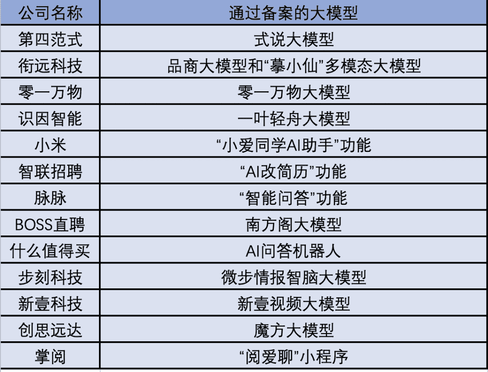
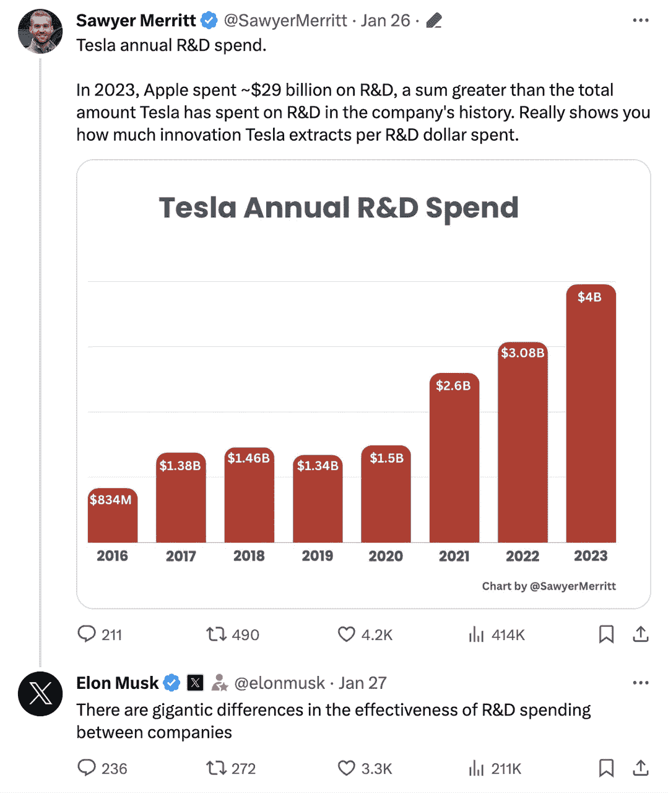

# 美国宣布启动 NAIRR 计划打造 AI 帝国；Siri 将获大语言模型支持丨 RTE 开发者日报 Vol.136

> 来源：[https://docs.feishu.cn/docx/Gf7fd6LBDoZX35xvEuZcurvEnXG](https://docs.feishu.cn/docx/Gf7fd6LBDoZX35xvEuZcurvEnXG)

开发者朋友们大家好：

这里**是「RTE 开发者日报**」，每天和大家一起**看新**闻、聊八卦。

**

我**们的社区编辑团**队会**整理分享 RT**E **（Real T**im**e Engagement） 领域内「有话题的新闻」、「有态度的观点」、「有意思的数据」、「有思考的文章」、「有看点的会议」，但内容仅代表编辑的个人观点，欢迎大家留言、跟帖、讨论。

本期编辑：@Asui，@CY

---

### **一、有话题的新闻**

1、美国宣布启动 NAIRR 计划打造 AI 帝国

近日，美国国家科学基金会 NSF 与合作机构共同推出了国家人工智能研究资源（NAIRR）试点项目，与其他 10 个联邦机构以及 25 家私营、非营利和慈善组织合作，NAIRR 试点将为美国研究人员和教育工作者提供使用先进计算、数据集、模型、软件、培训和用户支持的机会，迈出实现共享研究基础设施愿景的第一步。该项目的目标是加强对关键资源的访问，从而推动人工智能发现和创新，毫不夸张的说美国要整合所有资源 all in 人工智能，打造 AI 帝国。（财联社）

2、特斯拉将斥资 5 亿美元，在纽约建造 Dojo 超级计算机

特斯拉将在纽约州布法罗超级工厂投资 5 亿美元（当前约 35.9 亿元人民币），打造 Dojo 超级计算机。纽约州州长凯西・霍楚尔（Kathy Hochul）于周五举行了关于该州经济发展情况的听证会，正式宣布特斯拉计划在其位于布法罗的超级工厂建造其下一个 Dojo 超级计算机集群。霍楚尔表示，该项目将投资 5 亿美元，同时还将在纽约州立大学（SUNY）建造另一台独立的人工智能（AI）超级计算机。（新浪科技）

**3、苹果 iOS 17.4 测试版出现 **AI 代码，Siri 将获大语言模型支持

1 月 28 日消息，据彭博社报道，苹果将在今年 6 月的 WWDC 中推出带有重磅 AI 功能的 iOS 18。 9to5Mac 在 iOS 17.4 首个测试版中发现，苹果已经开始测试其 AI 功能，例如新版 Siri 语音助手，至少代码显示苹果正在进行相关测试，并在内部将其结果与 ChatGPT 进行对比。 iOS 17.4 代码中包含了一个名为 SiriSummarization 的新框架，这个框架会调用 OpenAI 的 ChatGPT API。苹果还在 iOS 17.4 中为 SiriSummarization 框架加入了多个提示语，包括像是「请总结...」、「请回答（这个问题）」和「请总结（给定文本）」这样的案例。

iOS 17.4 系统提示中还出现了以 iMessage 或 SMS 形式进行输入的应对方式，而彭博社之前也报道称苹果正在开发带有 AI 集成 Messages 应用，可以「回答问题并自动完成句式」。（IT 之家）

4、新一批国产大模型通过备案，多家垂直领域厂商入列

近期又有新的一批国产大模型通过备案。经梳理，此批共有 13 家企业共计 14 款国产大模型入列。图片大模型产品通过备案的企业中，既有第四范式、零一万物、衔远科技、识因智能等人工智能企业，也有小米、智联招聘、Boss 直聘、脉脉、什么值得买、步刻科技、新壹科技、创思远达、掌阅等垂直领域的厂商。（证券时报）

**5、谷歌将与 Hugging Fa**ce 合作，帮助开发人员训练 AI 模型

据 TheVerge 报道，Google Cloud 与 AI 模型存储库 Hugging Face 建立了新的合作伙伴关系，让开发人员无需支付 Google Cloud 订阅费用即可构建、训练和部署 AI 模型。现在，使用 Hugging Face 平台的外部开发人员将能够“经济高效”地访问谷歌的张量处理单元 (TPU)   和 GPU 超级计算机，其中包括数千台 Nvidia 的热门且出口受限的 H100。

谷歌表示，Hugging Face 用户可以在“2024 年上半年”开始使用人工智能应用程序构建平台 Vertex AI 和 Kubernetes 引擎，帮助训练和微调模型。（CSDN）

---

### 二、有态度的观点

1、周鸿祎说企业家要学做网红，和董宇辉间隔着 100 个俞敏洪

1 月 26 日，在亚布力论坛成长计划公开课上，周鸿祎表示自己最近去东方甄选学习，意识到自己的思维也落后了，对网红的理解比较肤浅，跟董宇辉之间还隔着 100 个俞敏洪。（澎湃）

2、马斯克回应特斯拉研发支出远低于苹果：研发支出效率不同

1 月 28 日消息，特斯拉本周公布了 2023 年研发支出总额为 39.69 亿美元，是迄今为止最高的一年，但仍远低于其他一些科技巨头。有分析师表示，2023 年苹果在研发上花费了约 290 亿美元，比特斯拉历史上的研发总花费还要多。

对此，马斯克回应称：「特斯拉每投入一美元研发经费，就能获得多少创新。在研发支出的有效性方面，企业之间存在巨大差异。」（凤凰科技）

---

**写在最后：**

我们欢迎更多的小伙伴参**与「RTE 开发者日报**」内容的共创，感兴趣的朋友请通过开发者社区或👸号留言联系，记得报暗号「共创」。

对于任何反馈（包括但不限于内容上、形式上）我们不胜感激、并有小惊喜回馈，例如你希望从日报中看到哪些内容；自己推荐的信源、话题、活动等；或者列举几个你喜欢看、平时常看的内容渠道；内容排版或呈现形式上有哪些可以改进的地方等。

---

