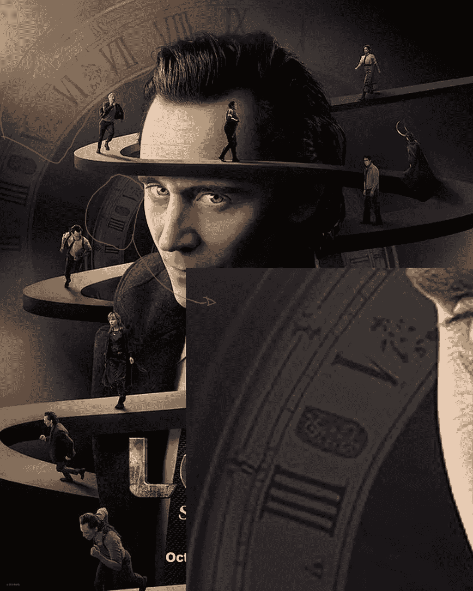
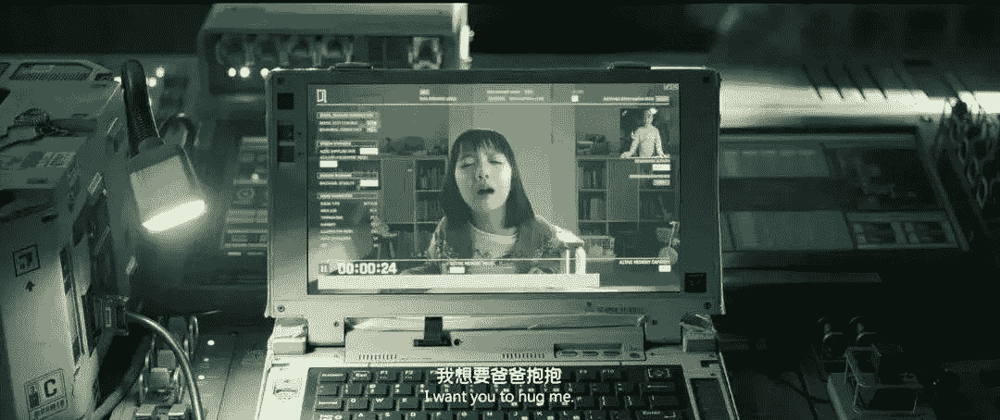
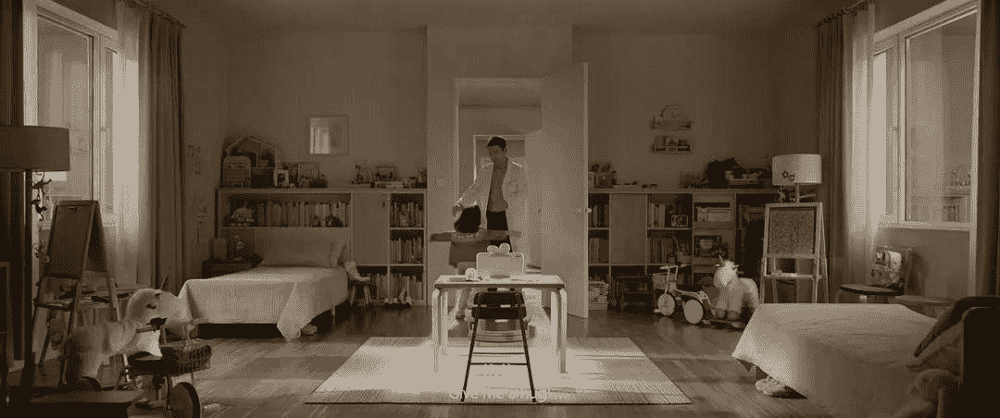

# RTE 开发者日报

# 比特币有助减少腐败；微软 Copilot 每月赔 20 美元；AIGC 明年会“洗冷水澡”丨 RTE 开发者日报 Vol.64

> 来源：[https://docs.feishu.cn/docx/K5vYdarjroNDy9xxIoXc0fKdnoG](https://docs.feishu.cn/docx/K5vYdarjroNDy9xxIoXc0fKdnoG)

开发者朋友们大家好：

这里**是「RTE 开发者日报**」，每天和大家一起**看新**闻、聊八卦。

**

我**们的社区编辑团**队会**整理分享 RT**E **（Real T**im**e Engagement） 领域内「有话题的新闻」、「有态度的观点」、「有意思的数据」、「有思考的文章」、「有看点的会议」，但内容仅代表编辑的个人观点，欢迎大家留言、跟帖、讨论。

本期编辑：@Asui，@CY

---

### **一、有话题的新闻**

1、75 倍能效提升！我国研制出首颗支持片上学习忆阻器存算一体芯片

近期，清华大学集成电路学院吴华强教授、高滨副教授基于存算一体计算范式在支持片上学习的忆阻器存算一体芯片领域取得重大突破，研究成果发表在《科学》上。在相同任务下，该芯片实现片上学习的能耗仅为先进工艺下专用集成电路（ASIC）系统的 1/35，同时有望实现 75 倍的能效提升。（@观察者网）

**2、搞大模型巨亏：微软 Copilo**t 每月收 10 美元，倒赔 20 美元

全球科技巨头在大模型 AI 上投入巨大，但成果却常常赔钱。

微软的 AI 编程工具 GitHub Copilot 虽然每月收取每个用户 10 美元的会员费，但背后所需的运行总成本却要为每个用户上倒贴 20-80 美元，月亏损达 3000 万美元。硬件、维护等成本也相对高昂，用户留存率和日活较低，AI 产品的落地应用价值仍待挖掘。（@虎嗅App）

3、微软 AR 眼镜新专利：热插拔电池设计，解决续航焦虑

10** 月 10 日消息，微软正在深入研究增强现**实（AR）领域，最近申请了一项「热插拔电池」相关专利。该专利于 2023 年 10 月 5 日发布，描述了采用模块化设计的 AR 眼镜，热插拔电池放置在了镜腿部分，可以直接拿下替换，对于 AR 眼镜的续航来说大有提升。

不仅如此，可拆卸电池（无论是在镜腿还是可拆卸的听筒部分）都为用户提供了在没有电池的情况下佩戴眼镜的选择，可以减轻重量并减少设备的体积，确保长时间工作时的舒适度。（@IT之家）

4、迪士尼的《洛基》因使用生成人工智能而遭到强烈反对

Lokion Disney Plus 第二季的一张宣传海报引发了专业设计师的争议，设计师认为海报中至少部分是使用生成式人工智能创建的。插画家 Katria Raden 上周在 X（以前的 Twitter）上标记了这张图片，声称背景中螺旋时钟的图片「给出了所有人工智能的迹象，就像东西随机变成毫无意义的曲线」。

迪士尼此前因其在另一部漫威系列《秘密入侵》中使用生成式人工智能而受到强烈反对，尽管该工作室坚称使用人工智能工具并不会减少真正设计师在该项目中的角色。一些 X 用户（包括 Raden）指出，Loki 艺术品的背景似乎是从 Shutterstock 上名为「超现实无限时间螺旋空间古董」的相同库存图片中提取的。

根据 Shutterstock 的贡献者规则，人工智能生成的内容不得在平台上获得许可，除非它是使用 Shutterstock 自己的人工智能图像生成工具创建的。几个扫描 Stock 图像的 AI 图像检查器已经将图片标记为 AI 生成。（@The Verge）

5、研究机构最新预测：AIGC 已被过度炒作 明年将会“洗冷水澡”

全球科技研究及咨询公司 CCS Insight 报告预测，因成本上升、监管呼声增高，生成式人工智能领域将在 2024 年遇冷，投资者热情可能降低。报告指出，这类人工智能需要大量计算能力，导致运行成本高昂，并且监管出台也会带来障碍。此外，人工智能的误导风险也引发公众担忧。（@财联社）

6、弯道追赶三星，消息称 vivo 和传音明年推出卷轴手机

据韩媒报道，中国手机制造商传音和 vivo 正积极筹备卷轴手机，计划在明年年底之前投产商用。传音计划于 2024 年年底商业化此产品。另一方面，vivo 也在开发卷轴手机，可能同期发布。（@IT之家）

---

### 二、有态度的观点

**1、华为胡厚崑：5G 网络仅用 3 年**覆盖 10 亿用户，已是移动网络流量主力

承载华为轮值董事长胡厚崑日前在 2023 全球移动宽带论坛上表示，5G 是所有代际技术中发展速度最快的，4G 用了 6 年发展了 10 亿用户，5G 仅用了 3 年就达成了这个里程碑。以视频应用为代表的全新消费行为已经形成，5G 成为移动网络流量的主力承载，流量经营已经形成商业循环。（@腾讯新闻潜望）

2、OpenAI 创始人：比特币有助减少腐败

OpenAI 创始人 Sam Altman 日前表示，他对比特币持支持态度。他认为，拥有一种不受任何政府控制的全球货币的想法，是科技树上超级符合逻辑和重要的一步，并有助于减少腐败。同时，Sam Altman 预测，神经设备将改变人机交互模式，未来神经接口可能与 GPT-5、GPT-6 等 AI 技术结合。（@腾讯科技）

3、AI 教父再次警告：AI 可能会取代人类

被誉为「AI 教父」的英国计算机科学家 Geoffrey Hinton 警告说，AI 的危险可能会变得比小说中更现实。

Hinton 在 Google 工作了十年，于今年 5 月离职，原因是担心人工智能的风险以及不良行为者使用这项技术的可能性。Hinton 表示，人工智能可能有好有坏，接下来会发生什么还不得而知。他认为，理解技术的思维方式就像读懂人类的心思一样困难。

他在采访中再次警告称，**“**AI 有可能会取代人类。我并不是说这一定会发生。如果我们能够阻止它们这样做，那就太好了。但目前还不清楚我们是否可以阻止它们想要这样做。”

Hinton 相信 AI 将有助于提高生产力和效率，但他也担心许多人可能因 AI 而失业，而且可能没有足够的工作岗位来替代那些失去的工作岗位。他表示，现在是进行实验来更好地理解人工智能，并通过法律来确保技术被合理使用的时候了。( @APPSO)

---

### 三、有思考的文章

**1、《诺兰和郭帆，全输给他》**[（@影探）](https://mp.weixin.qq.com/s/kQwAHz-LTDeFXkzzZBnX9A)

> “**肉体苦弱，便拥抱数字生命。这是勇敢，还是退缩，我**无法作答。因为与我所爱，只想永不告别。”

“丫丫的生命只有两分钟，我要给她完整的一生。”在《流浪地球 2》中，这句台词几乎概述了图恒宇的整条故事线，这是他的执念，也是他的信仰。

女儿丫丫意外离世**。身为“数字生命世界”架构师的图恒宇存储丫丫**的数字信息，并希望凭此构建女儿完整的一生。

**

当别人试图辩论数字生命还是生**命吗？他怒道：“你没有资格定义什么是现实。”

当我们以科幻视角观看与理解电影，“虚构”二字始终隔阂着故事**与**你我。而图恒宇，只是被我们审视的客体。但回归于真实世界，肉体也置身其中，才恍然大悟，原来现实比电影更具有张力，电影再超前再离奇，也被现实逐一演绎。

从诺兰最为人熟知的《星际穿越》到《流浪地球 2》，即使是在《名侦探柯南·贝克街的亡灵》抑或《瑞克和莫蒂》系列剧，或是《超体》，或是《西部世界》，或是《超验骇客》......

不管想象力如何飘远，最终都被“爱”所牵住。所有最高端的技术，都是为了回到人类情感。这是最俗套，也是最本真。而所有的电影，都是为了帮人类处理现实问题。

---

**写在最后：**

我们欢迎更多的小伙伴参**与「RTE 开发者日报**」内容的共创，感兴趣的朋友请通过开发者社区或👸号留言联系，记得报暗号「共创」。

对于任何反馈（包括但不限于内容上、形式上）我们不胜感激、并有小惊喜回馈，例如你希望从日报中看到哪些内容；自己推荐的信源、话题、活动等；或者列举几个你喜欢看、平时常看的内容渠道；内容排版或呈现形式上有哪些可以改进的地方等。

---

