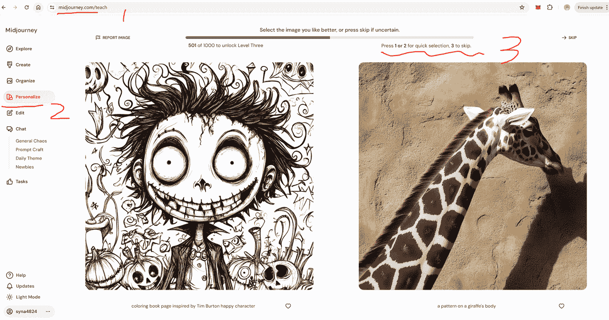
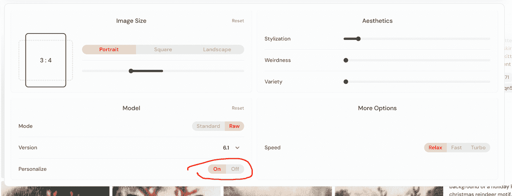

# AI小白QA区

> 来源：[https://aigclena.feishu.cn/docx/XRWldRr2xoMCifxaehScKunjnec](https://aigclena.feishu.cn/docx/XRWldRr2xoMCifxaehScKunjnec)

# AI绘画

## Q：有没有好用的绘画软件？

A：推荐以下软件：mj、sd、ideogram、flux、即梦等，每个平台都有新用户注册的免费初始额度，可以试用完了再决定付费哪家，蓝色需要🪜访问

| 1 | Midjourney | https://www.midjourney.com/ | 绘画界王者，出图效果得到大众认可 |  |
| --- | --- | --- | --- | --- |
| 2 | Stable diffusion | https://space.bilibili.com/12566101 | [秋葉aaaki](https://space.bilibili.com/12566101)安装包 本地下载安装，对电脑性能有要求，上手难度稍高，可控性强 |  |
| 3 | ideogram | https://ideogram.ai/ | 做英文海报能力特别强 |  |
| 4 | flux | https://blackforestlabs.ai/#get-flux | 出图效果媲美mj，有在线使用和本地安装 |  |
| 5 | 即梦 | https://jimeng.jianying.com/ | 可以文生图、图生视频以及故事创作 |  |
| 6 | liblib | https://www.liblib.art/ | 云端sd，可以训练lora，一个模型分享社区 |  |
| 7 | 豆包 | https://www.doubao.com/ | 文生图、可垫图 |  |
| 8 | 海艺 | https://www.haiyi.art/ | 功能强大，文生图、文生视频、视频换脸、去背景等，训练lora，模型分享 |  |
| 9 | 通义万相 | https://tongyi.aliyun.com/wanxiang/ | 文生图、文生视频、图生视频 |  |

[30余款热门AI绘画测评 一直更](https://aigclena.feishu.cn/wiki/ZVfrwpU2jiDphEkGb0qc7rfSnoh)里可以查看更多，还有不同AI绘画平台的测评：

## Q:Sref和P 有什么主要区别？实际应用上谁好用？

A：Sref是风格参考，使用方法2种：1垫图，2后缀加上sf码

P是个人审美累积形成的风格，p风格的形成需要自己先在社区做选择让系统记住你的视觉偏好

使用时这里打开即可

没有谁更好用，都差不多，搭配使用也可。取决出图需求，能快速达成需求就是好用的。

https://www.shakker.ai/aigenerator?controlnet=ip_adapter

### 联系我们

> [互联网设计](https://aigclena.feishu.cn/wiki/PD10wBb5yiRVE7kTFZdcuzUBnth)   [国际站/独立站](https://aigclena.feishu.cn/wiki/TmfowYzfMisIShkNU7ncEBMingh)  [AI商业定制](https://aigclena.feishu.cn/wiki/BsQHwI5saiYGbOkUG2mceW15nHg)

