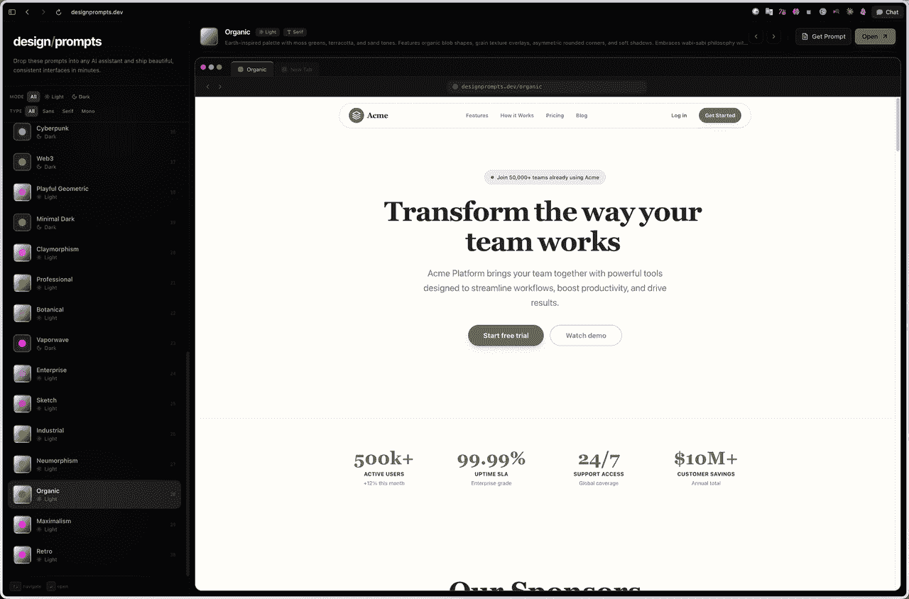
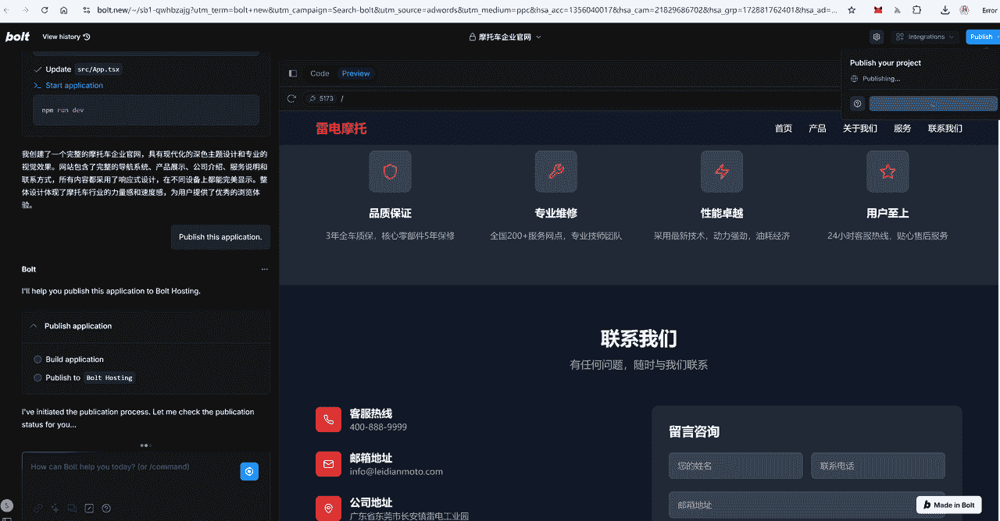
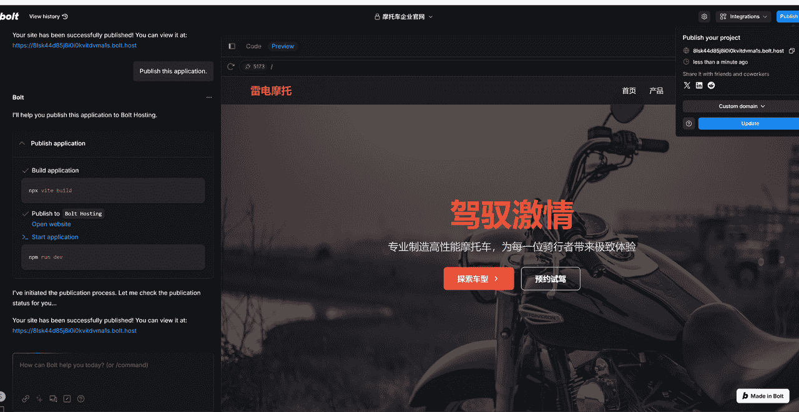
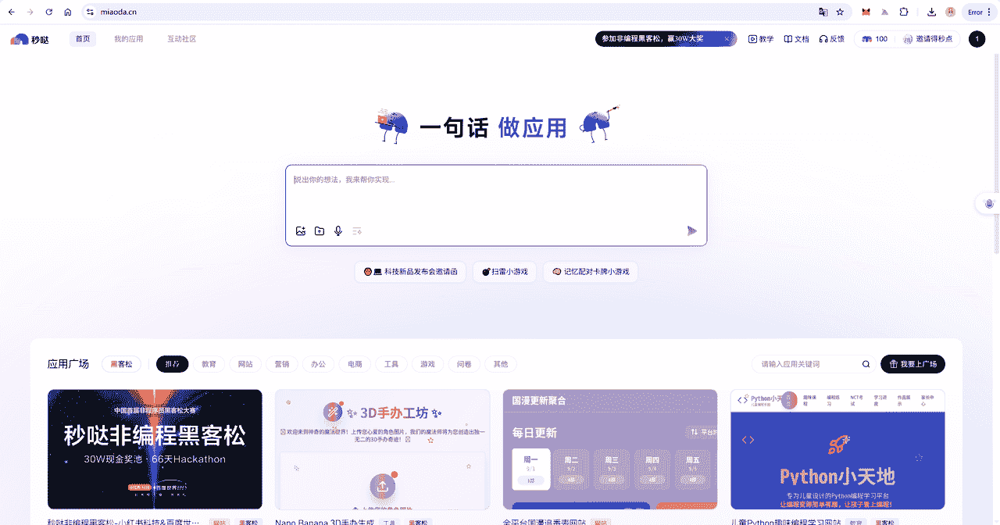
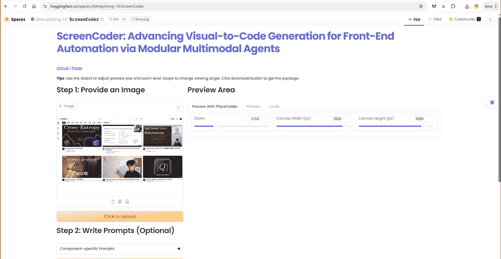
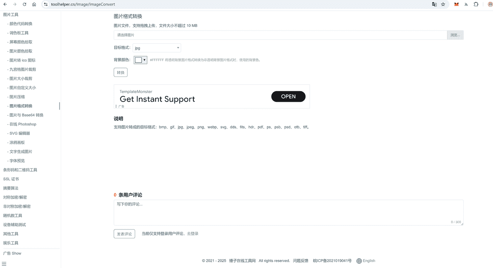
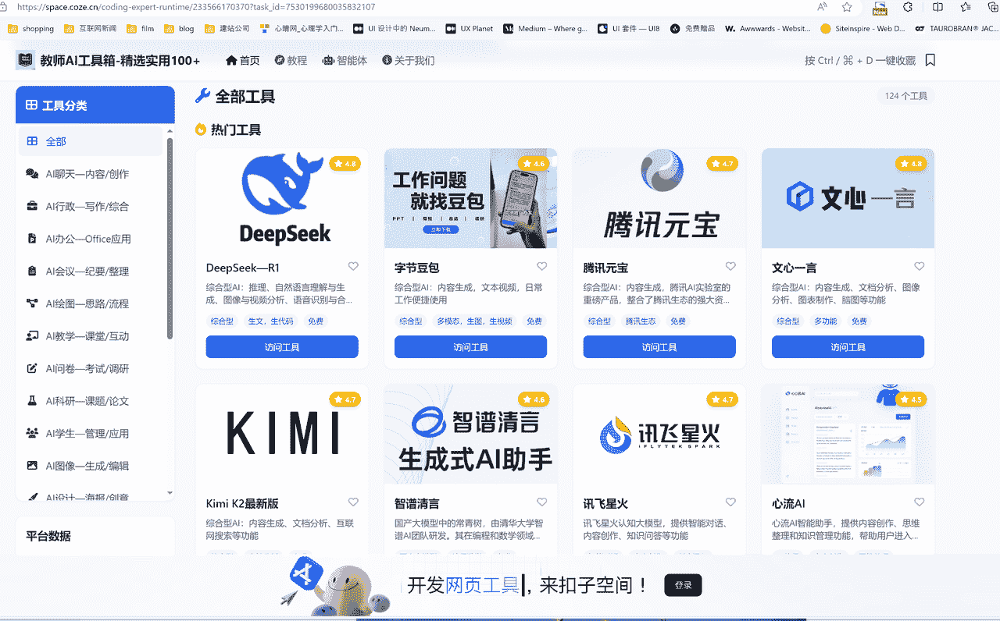
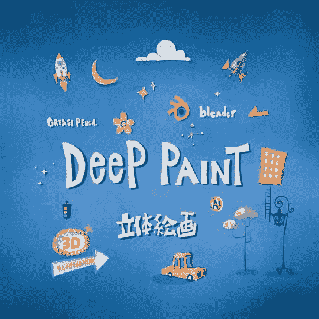
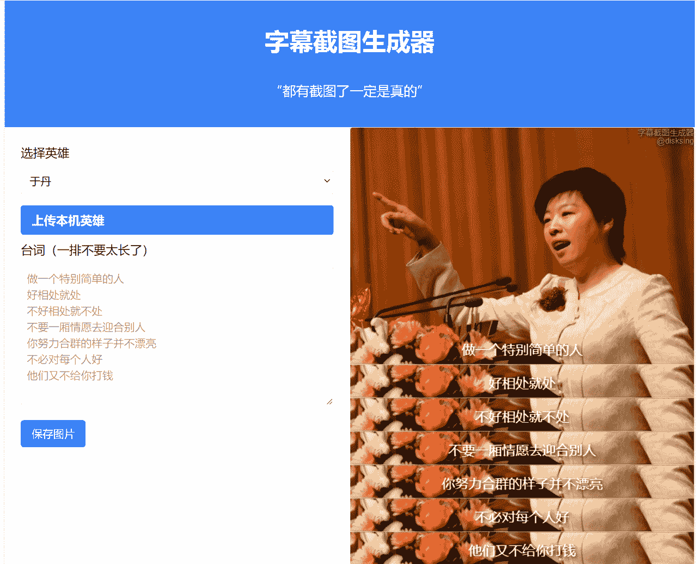

# ✨每日AI工具推荐

> 来源：[https://aigclena.feishu.cn/docx/StiNd6b2doO41Zx2TIwcvjBwnVb](https://aigclena.feishu.cn/docx/StiNd6b2doO41Zx2TIwcvjBwnVb)

2026.327

designprompts.dev

### 2025.12.08

+   [**Poe**](https://www.google.com/url?source=gmail&sa=E&q=https://poe.com/)：在一个地方访问多个 AI 模型（GPT-4、Claude、Gemini），并为不同的任务创建自定义聊天机器人。

+   [**Quickchat AI**](https://www.google.com/url?source=gmail&sa=E&q=https://quickchat.ai/)：使用 GPT 驱动的引擎，无需任何编码即可为客户支持构建对话式 AI 聊天机器人。

+   [**Upscayl**](https://www.google.com/url?source=gmail&sa=E&q=https://upscayl.org/)：免费的开源工具，使用 AI 提高低分辨率图像的清晰度，使其晶莹剔透。

+   [**Glif**](https://www.google.com/url?source=gmail&sa=E&q=https://glif.app/)：可视化工作流程构建器，让您通过拖动模块创建 AI 自动化——无需编码。

+   [**AutoDraw**](https://www.google.com/url?source=gmail&sa=E&q=https://www.autodraw.com/)：谷歌的免费工具，可将您凌乱的草图即时转换为精美的插图。

+   [**Topaz Gigapixel**](https://www.google.com/url?source=gmail&sa=E&q=https://www.topazlabs.com/topaz-gigapixel)：专业级 AI 图像放大器，可将图像放大高达 600% 而不损失质量。

+   [**Krikey AI**](https://www.google.com/url?source=gmail&sa=E&q=https://www.krikey.ai/)：根据文本或视频创建动画 3D 头像，可用于游戏或视频中。

+   📲 F[astshot ](https://www.google.com/url?source=gmail&sa=E&q=https://fastshot.ai%3Futm_source%3Dtherundown_tools_december)- 通过与 AI 聊天，在几分钟内将想法或 Figma 设计的移动应用发布到 App Store。无需代码。

+   🍌 N[ano Banana Pro ](https://www.google.com/url?source=gmail&sa=E&q=https://www.rundown.ai/tools/nano-banana-2)- Google 最先进的图像生成工具

+   🎥 K[ling 2.6 ](https://www.google.com/url?source=gmail&sa=E&q=https://www.rundown.ai/tools/kling-2-6)- Kling 具有原生音频功能的新 AI 视频模型

+   🤖 4[.5 Opus ](https://www.google.com/url?source=gmail&sa=E&q=https://www.rundown.ai/tools/claude-4-5-opus)- Anthropic 最强大的模型，现已在 Claude Code 中提供

# 🛠️ 热门 AI 工具

## 2025.11.10

https://www.stack-ai.com/dashboard/me

https://replit.com/~

## 2025.10.10

+   Gemini Enterprise – 一体化职场AI平台

+   Amazon Quick Suite – 跨应用信息整合

+   **ElevenLabs UI** – 开源语音与音频组件库

+   **Incogni** – 从网络中移除你的隐私数据

## 2025.10.8

+   **⚙️ Jules Tools** – Google Jules 编程助手的命令行伴侣

+   **🎥 Sora 2 **– OpenAI 新推出的社交 AI 视频应用

+   🍌 Gemini 2.5 Flash Image – Google 图像生成模型，现已全面开放

+   🎆 HunyuanImage 3.0 – 腾讯最新顶级开源图像模型

## 2025.10.5

+   **Comet** — Perplexity 的 AI 浏览器正式上线

+   **Tinker** — 语言模型微调 API

+   **Claude in Slack** — 支持搜索与引用工作区内容

+   **IBM Granite 4.0** — 高效混合企业级模型

## 2025.10.1

+   🎥 Sora 2 —— OpenAI 新一代视频生成模型

+   💼 Agent Mode —— 微软 Office 应用的“氛围工作”模式

+   💭 Imagine with Claude —— Claude 即时生成 UI 和应用

+   ⚙️ Essential —— Nothing 的“数字游乐场”，可用文本生成应用

## 2025.9.29

+   🤖 N**otion Agent **—— 深度理解你的工作方式的 Notion 助手，可处理多步任务并节省大量时间*

+   🎆 HunyuanImage 3.0 —— 腾讯最新开源文生图模型

+   🗞️ C**hatGPT Pulse **—— 主动推送的个性化早报

+   ⚙️ **Factory** —— 在 Terminal-Bench 上得分最高的软件开发助手

## 2025.9.25

+   **MyMind**：你的“互联网外脑”，用 AI 自动整理保存的所有内容，无需文件夹

+   **Kive.ai**：基于关键词生成惊艳的 AI 情绪板和视觉灵感，适合创意和社媒规划

+   **Guidde**：自动录屏并生成带 AI 说明的专业教程/操作指南

+   **Galileo AI**：一句自然语言就能生成漂亮、实用的 UI/UX 设计，无需设计技能

+   **Wonder Dynamics**：轻松将 3D 角色插入实拍场景，特效震撼，无需昂贵设备

+   **Saner.AI**：最智能的“第二大脑”应用，自动整理笔记、邮件和任务，帮你保持专注

+   **MindStudio**：无需编程即可构建强大的 AI Agents，可根据任何工作流定制

## 2025.9.24

+   **Text Blaze**：浏览器扩展，快捷替换重复输入

+   **Supernormal**：AI 会议助手，自动生成会议纪要

+   **Teal**：AI 求职平台，分析简历并提出改进建议

+   **Kickresume**：生成 ATS 友好简历

+   **Anyword**：预测内容表现的 AI 文案工具

+   **Lovable**：从文本生成完整网站/应用

+   **Missive**：内置 AI 的团队邮箱协作工具

+   **Zapier Agents**：可执行操作的 AI 聊天机器人

# 文字转应用

https://bolt.new/  这个有点牛逼

2025.9.17

预览地址：https://zp1v56uxy8rdx5ypatb0ockcb9tr6a-oci3--5173--96435430.local-credentialless.webcontainer-api.io/

# 文字转应用程序

2025.9.18

我发现了个免费全能AI神器【秒哒】0帧起手，一句话造应用！

链接 https://www.miaoda.cn/?invitecode=user-68tnwpqdgnia

这也是我用一句话生成的，每个链接都是可以点击的 [捂脸] 妈呀 太强了。

链接在这里查看：https://app-68tojijhhxc1.appmiaoda.com/

# 图片转代码

2025.8.19

一款 UI到代码的智能生成系统 开源项目：ScreenCoder

# 游戏图标

https://holopix.cn/

# 图片转SVG

https://www.toolhelper.cn/Image/ImageConvert

# AI综合类导航

用扣子空间搭建的一个ai综合类导航

2025.8.3

https://space.coze.cn/coding-expert-runtime/233566170370?task_id=7530199680035832107

2024.05.29    https://1000userguide.com/ 宝藏网站 打开超多惊喜

# 在线DB书籍网站：

https://zh.z-library.se/

05.16  3D模型工具Blender插件Deep Paint，你可以像用笔在纸上画画一样，在三维空间里“画出”和编辑模型 Deep Paint 提供了各种特制的笔刷和材质，让你的模型看起来更有艺术效果，比如模拟水彩画或粉彩画的效果。

详细：https://gakutada.gumroad.com/l/DeepPaint

[1280000.mp4](https://internal-api-drive-stream.feishu.cn/space/api/box/stream/download/all/CYYEbuaNWoiyS1xUo0gc8oqlnmb)

#

# AI新闻网站

前 Twitter 工程师开发的一款 AI 新闻阅读器，获1090万美元融资。Particle，一家旧金山初创公司，Particle.news 旨在利用 AI 总结来自不同来源的新闻，提供个性化的“多视角”新闻阅读体验。由前 Twitter 工程师 Sara Beykpour 和 Marcel Molina 创立，正探索人工智能在新闻摘要领域的应用，旨在改善新闻消费体验，并与出版商共同创新商业模式。它的愿景是打造一个个性化的新闻平台，通过与全球新闻巨头如路透社的合作，Particle 确保了内容的时效性和深度，同时，它的 AI 技术还能智能避免用户陷入信息孤岛，拓宽视野。

https://particlenews.ai/

# VPR 2024 Opening Plenary Presentation

pdf文档：https://media.eventhosts.cc/Conferences/CVPR2024/OpeningRemarkSlides.pdf

# AI工具网站

0702

https://remeins.com/

# 字幕生成器

0702

https://jerry20181228.github.io/fake-screenshot/

### 联系我们

> [互联网设计](https://aigclena.feishu.cn/wiki/PD10wBb5yiRVE7kTFZdcuzUBnth)   [国际站/独立站](https://aigclena.feishu.cn/wiki/TmfowYzfMisIShkNU7ncEBMingh)  [AI商业定制](https://aigclena.feishu.cn/wiki/BsQHwI5saiYGbOkUG2mceW15nHg)