# 设计工具

> 来源：[https://aigclena.feishu.cn/docx/L9KodsjzEoLkrpxiiUGcbVGRnEe](https://aigclena.feishu.cn/docx/L9KodsjzEoLkrpxiiUGcbVGRnEe)

# 样机网站

1.  https://mockupbee.com/

免费下载psd等源文件

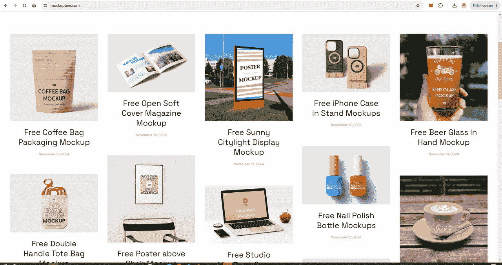

1.  https://mockupplanet.com/

种类很多，广告牌、书籍、瓶子、宣传册、名片、日历、咖啡、手机样机、包装等，免费下载psd等源文件

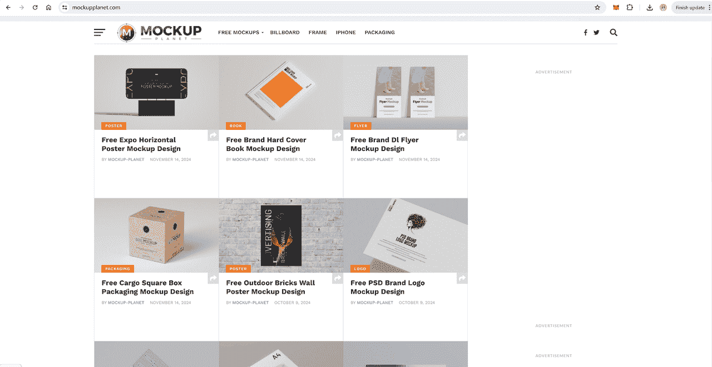

1.  https://freemockup.net/

5000多个免费样机网站，分类繁多，免费下载psd等源文件

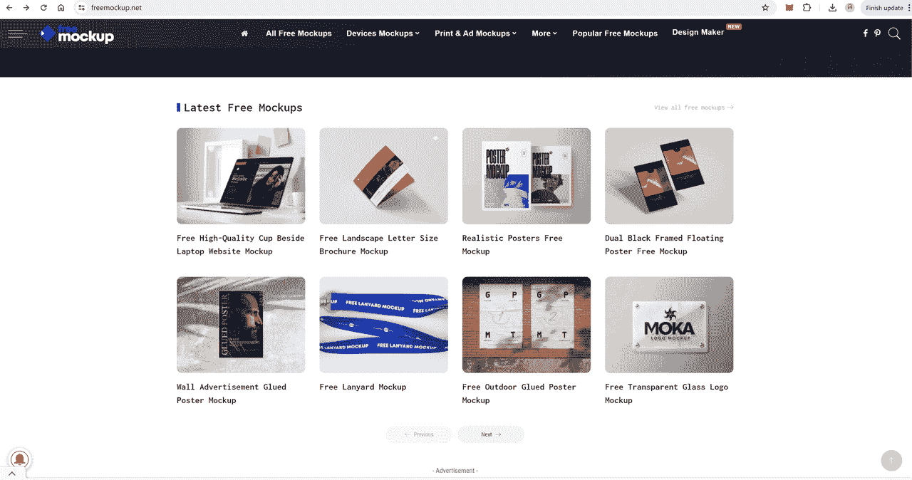

1.  https://graphicsfamily.com/

多达四五十个分类，3000多个免费图形图像资产，有logo、名片、证书、图标、字体、海报、传单等

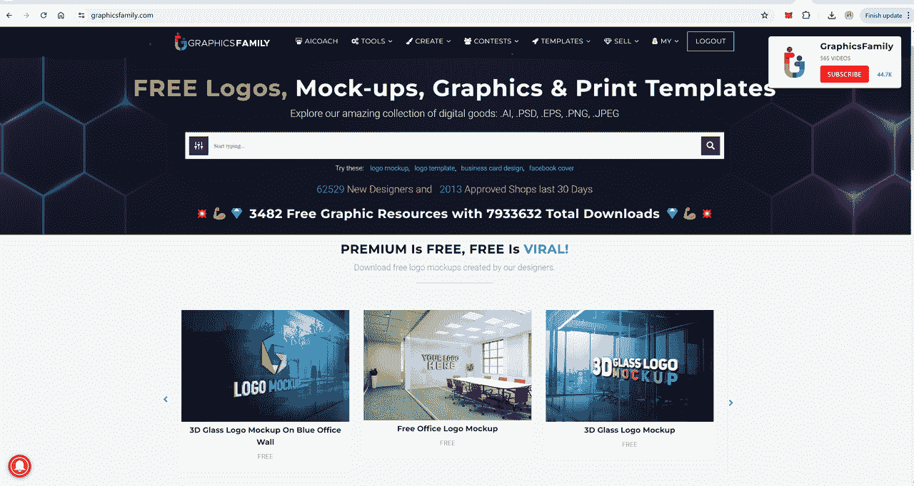

1.  https://freebiesbug.com/

顶级设计师和开发人员穿创建的2000多个免费的设计资产，包含字体、海报、网站模板等，文件格式也有多种，如psd、figma、sketh等

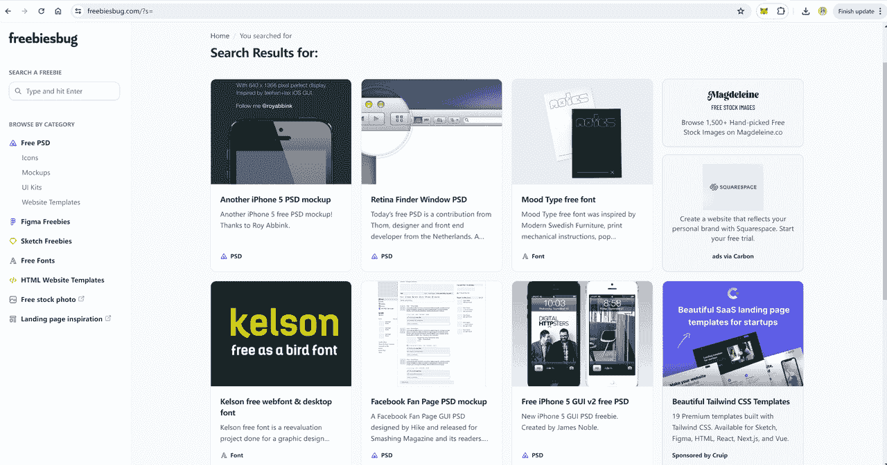

1.  https://smartymockups.com/

分类为瓶子、罐子、袋子、盒子等，质量很高，光影很棒，很精致，大部分是收费的，有少量免费资源

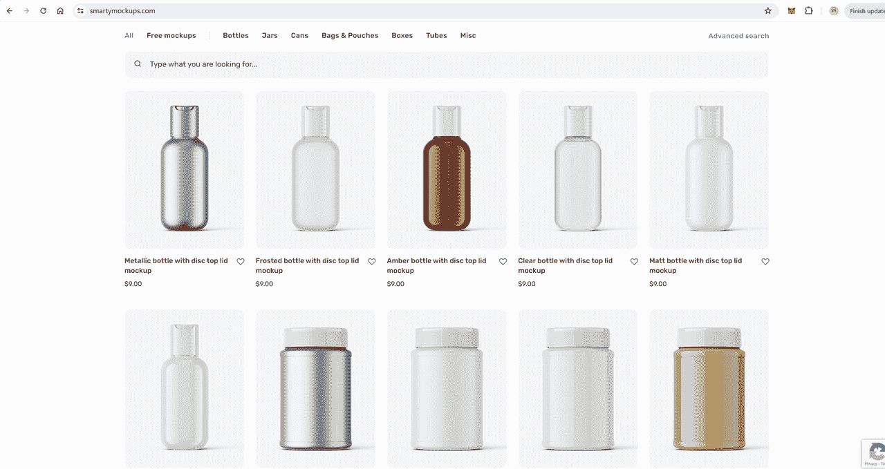

1.  https://graphicwave.net/

质量很高的产品模型样机，由一群3d艺术家和数字设计师组成的小团队，样机大部分需要付费，少部分免费样机。

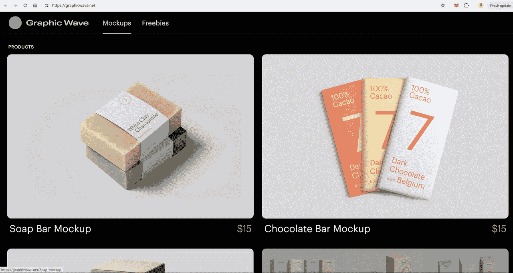

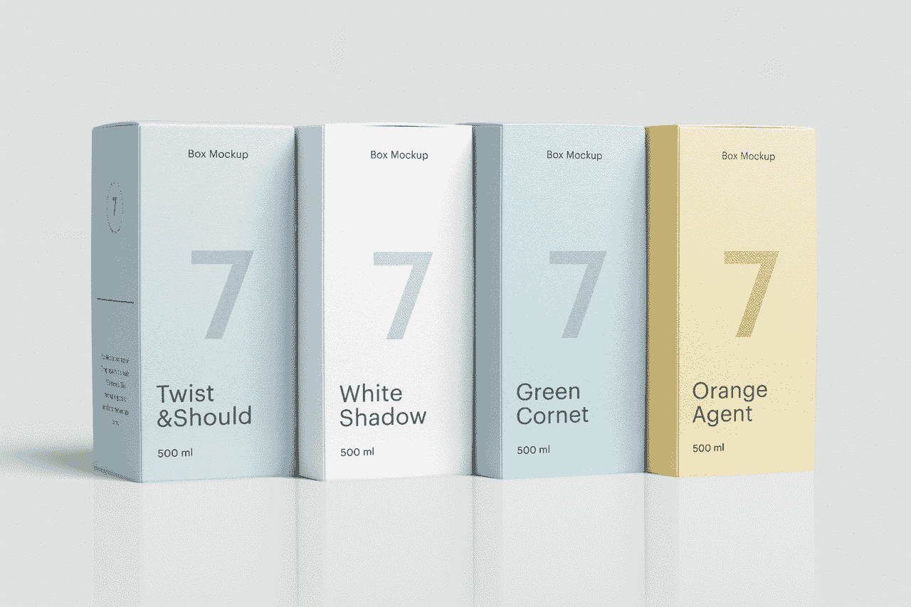

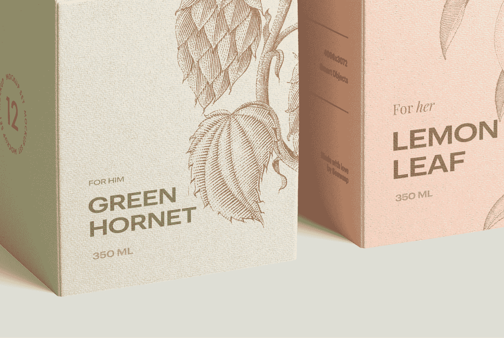

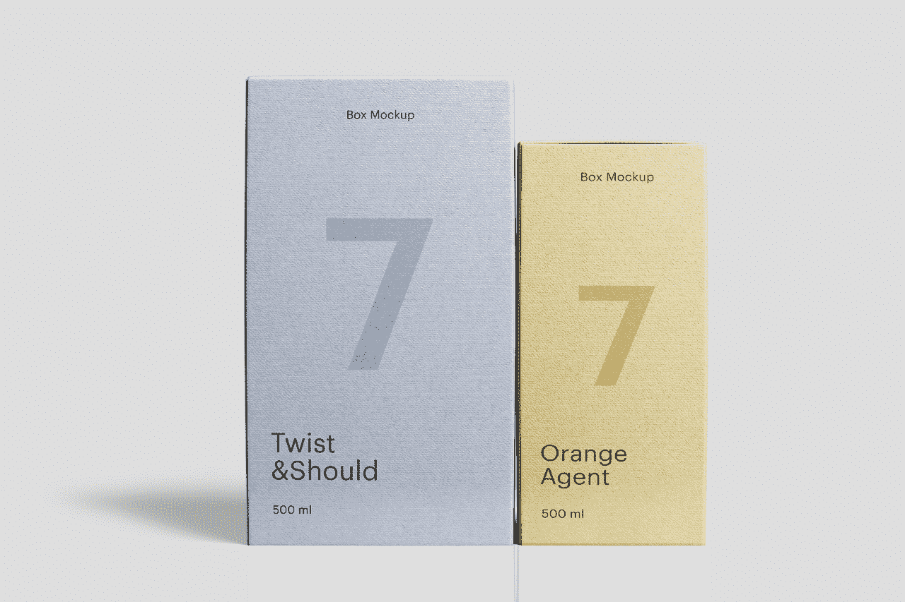

1.  https://yellowimages.com/

号称互联网最大的psd样机集合，质量真的很棒，免费的也有很多

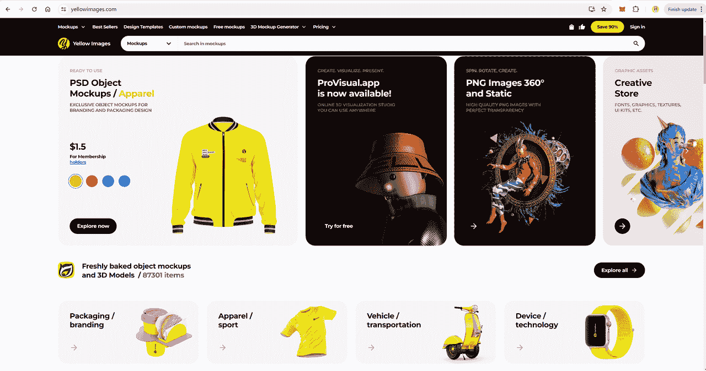

# 动图网站

https://ezgif.com/optimize?err=expired

# 在线地图

配色可以调整：https://datav.aliyun.com/portal/school/atlas/area_selector#&lat=30.332329214580163&lng=106.72278672066881&zoom=3.5

# 大屏素材

https://www.shuzixs.com/#/home

图表样式

+   https://www.highcharts.com/demo

+   https://www.chartjs.org/

# 随手存好玩的图

appui

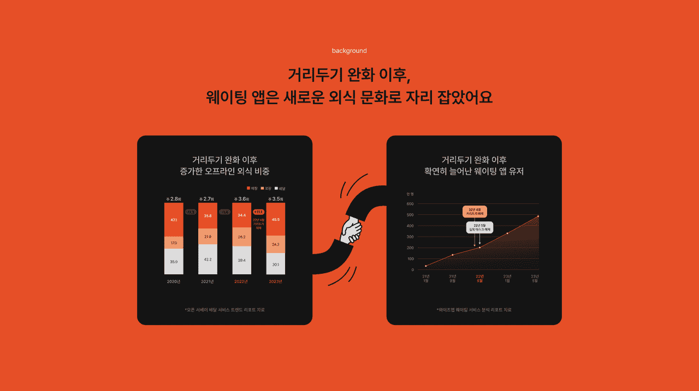