# 书影音推荐

> 来源：[https://aigclena.feishu.cn/docx/JqEVdcHj1omrQKxi8NTcsn5Un0L](https://aigclena.feishu.cn/docx/JqEVdcHj1omrQKxi8NTcsn5Un0L)

#  14部艺术设计类纪录片

1.  画廊外的天赋

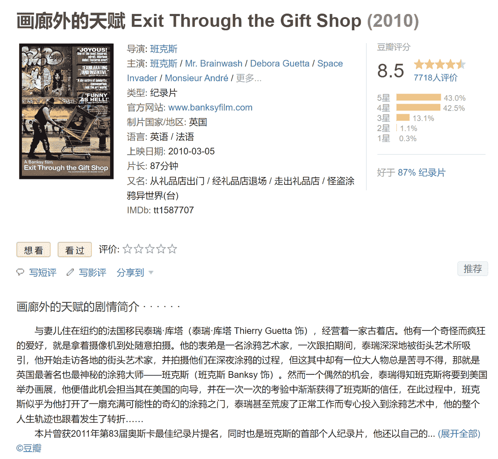

1.  观看之道

1.  壶中：日本现代建筑之美

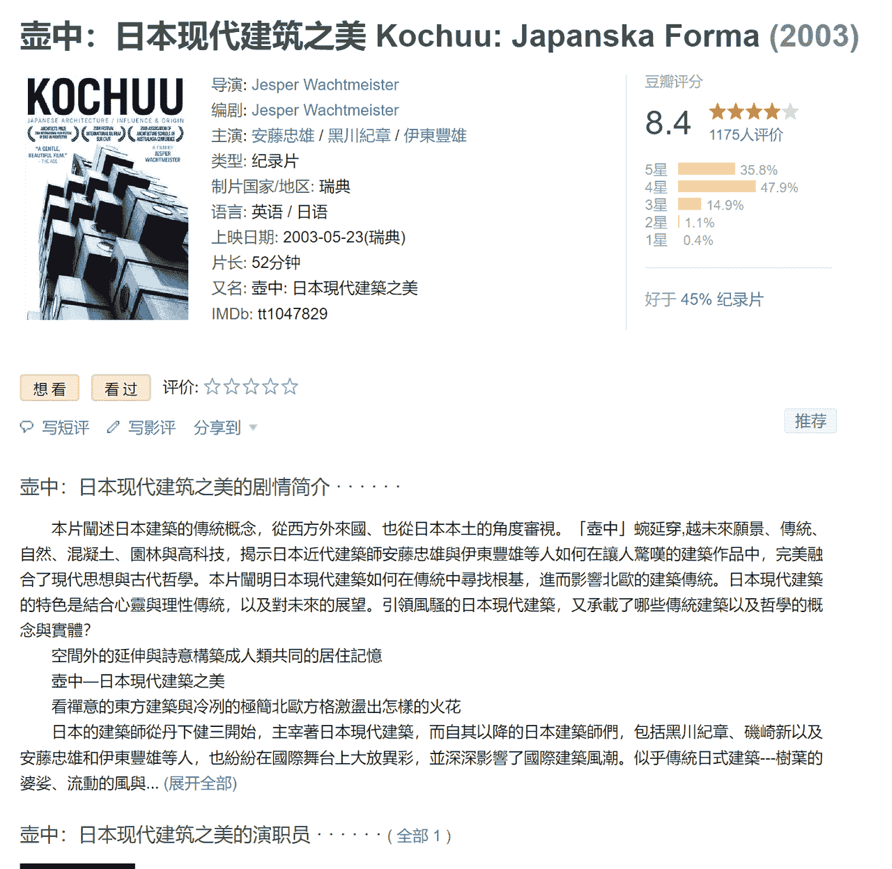

1.  拉姆斯

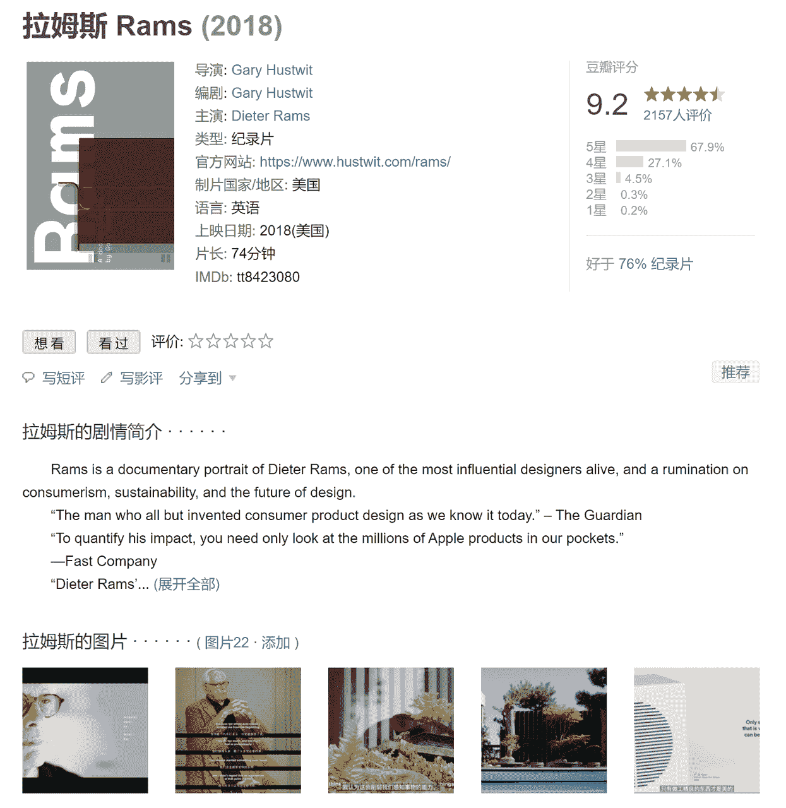

1.  安藤忠雄：武士建筑师

1.  旷世杰作的秘密

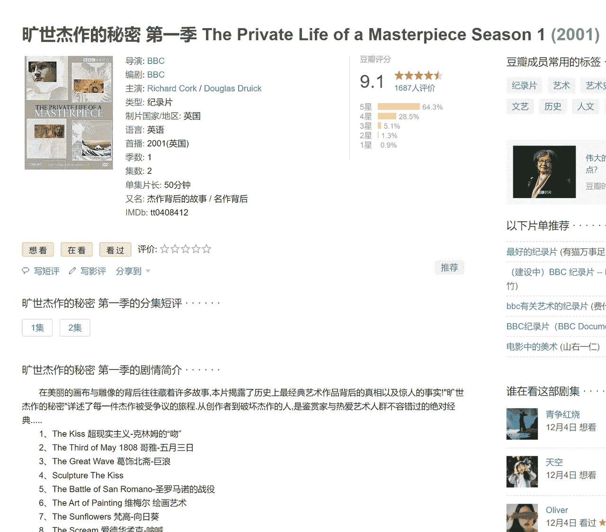

1.  洛可可“旅行，享乐，疯狂

1.  三色艺术史

1.  印象派 绘画与革命

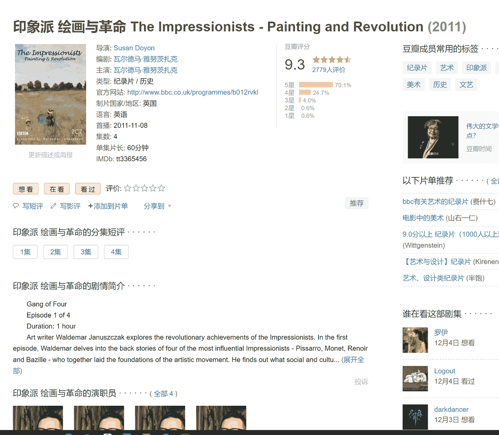

1.  局部

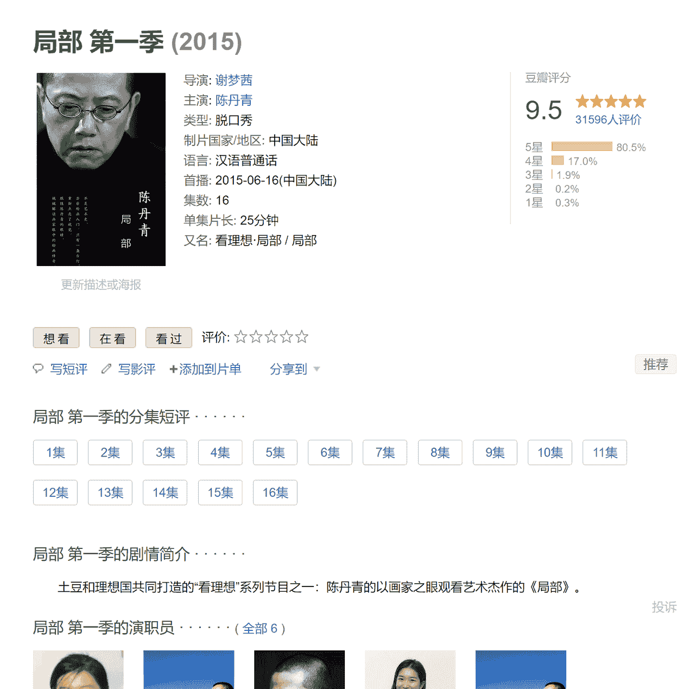

1.  抽象的艺术

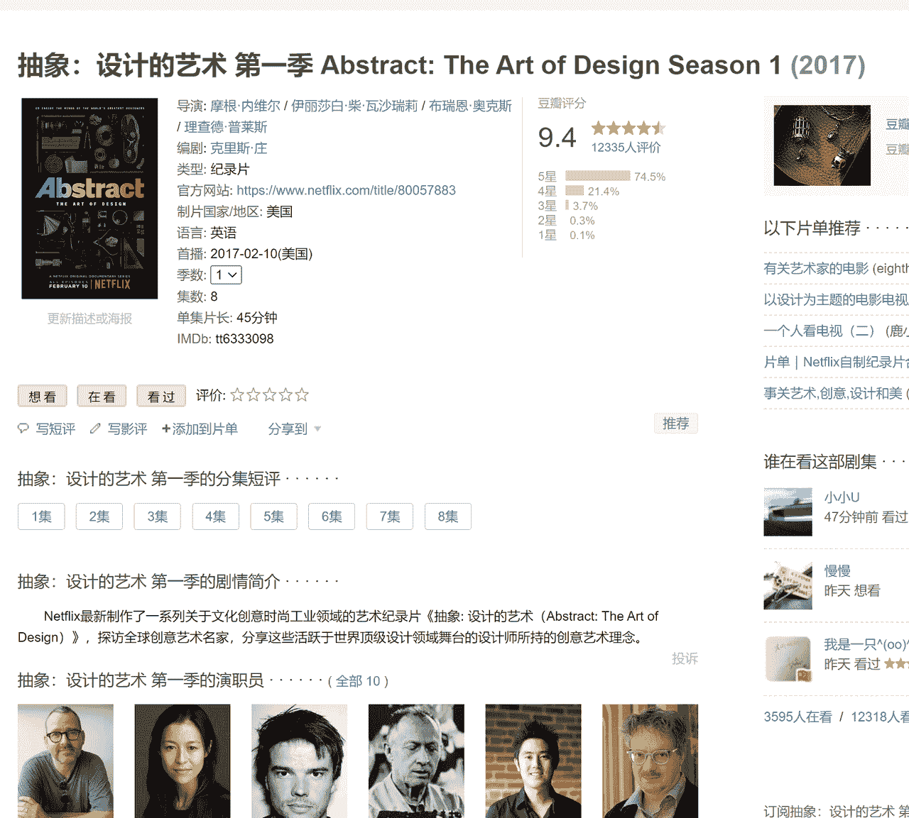

1.  文明

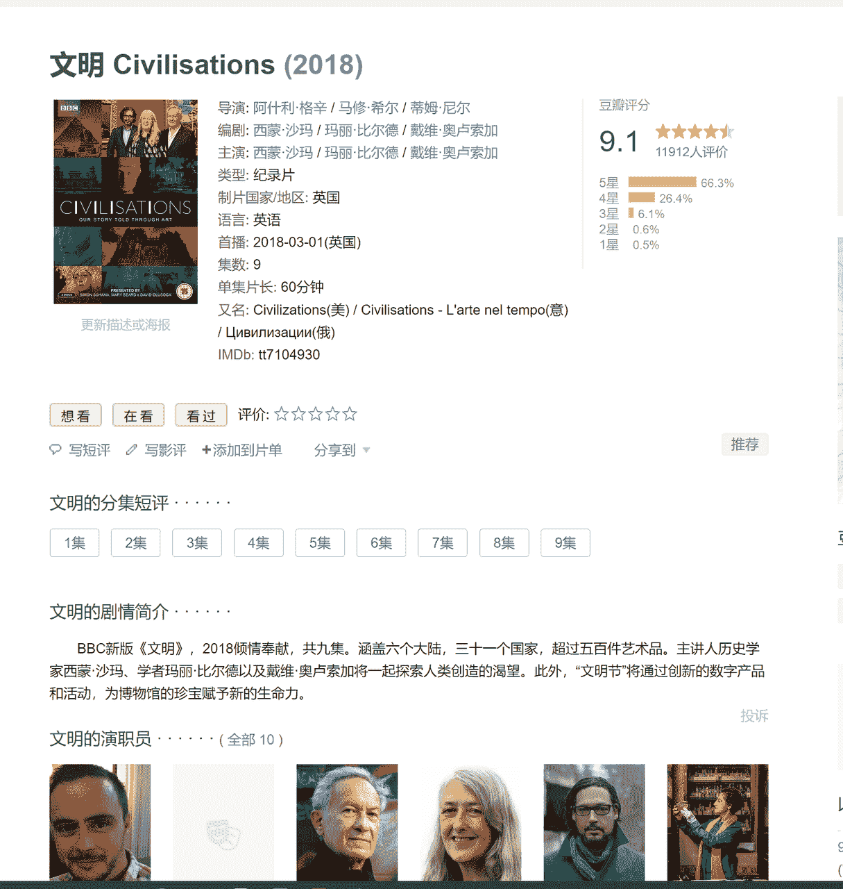

1.  艺术的力量

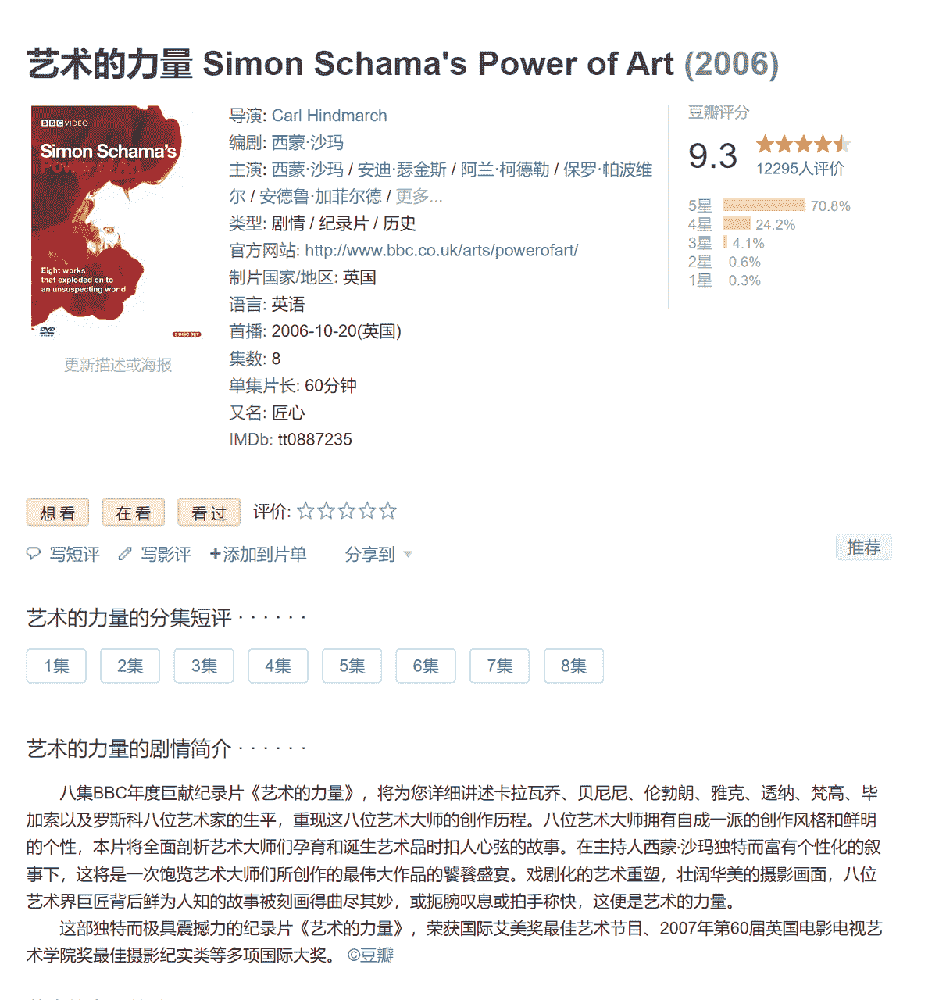

1.  现代艺术大师

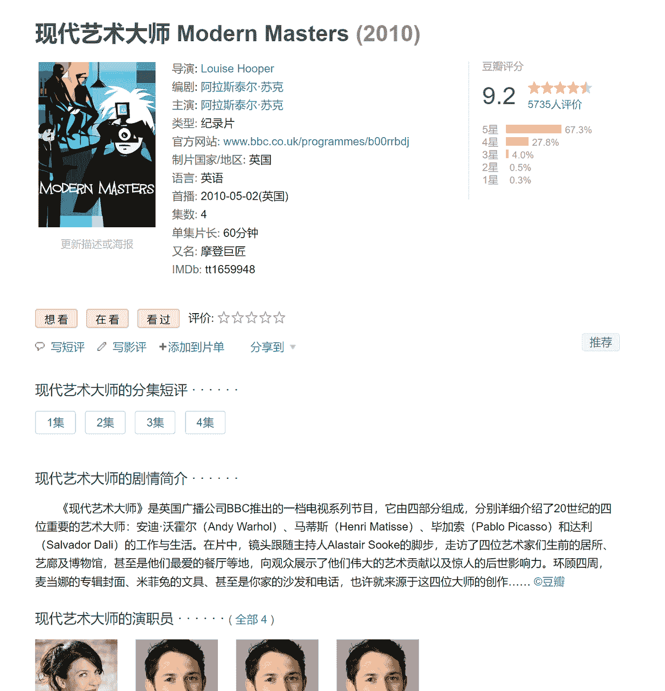

# 8 部与人工智能相关的 Netflix 电影

（2024-05-24）

1.  《隐形战机》

一架搭载人工智能的战斗轰炸机在执行任务时被闪电击中，意外获得自主意识。三名精英飞行员必须阻止这架轰炸机引发核战争。

1.  《超能查派》

查派是一个警用机器人，被犯罪分子偷走，并被当成自己的孩子。经过重新编程，查派成为第一个拥有感知和独立思考能力的机器人。

1.  《灭绝》

工程师彼得不断做关于外星人入侵的噩梦，决定寻求精神科医生的帮助。不久，他的梦境成为现实，UFO 袭击地球，他必须设法保护家人。

1.  《战地死神》

一名无人机飞行员被派往战区，意外与一位绝密的仿生人军官搭档，执行阻止核攻击的任务。

1.  《智能陷阱》

一部探讨人工智能与人类关系的电影。一名女子被绑架，被迫参与改进一个控制智能屋的 AI 程序。

1.  《太空旅客》

飞船前往遥远星球途中，吉姆的休眠舱出现故障提前唤醒了他。为防止飞船遭遇灾难，他必须与另一位乘客通力合作。

1.  《银翼杀手 2049》

在这个复制人沦为二等公民的未来，身为复制人的警官 K 深陷错综复杂的骗局之中，直面自我的人性和社会的道德困境。

1.  《星际清道夫》

在最新一次太空垃圾回收任务中，胜利号飞船的船员在一艘坠毁的飞行器内发现一名 7 岁女孩。

他们发现她是 UTS 太空警卫队通缉的类人机器人，决定以女孩为筹码索要赎金。

资源：

「Y 异星战境 Atlas (2024)[美国 动作 科幻 惊悚 冒险][詹妮弗·洛佩兹]」

链接：https://pan.quark.cn/s/e5aebed94c83

「银翼杀手2049（2017）」

链接：https://pan.quark.cn/s/ab28defcf5b3

# 7部与高科技相关的 Netflix 电影（2024-06-01）

1、The Social Dilemma 监视资本主义：智能陷阱 The Social Dilemma (2020) 豆瓣评分 8.7

This documentary-drama looks at how social media algorithms, driven by AI, impact society and people's behavior.

1.  Extinction  灭绝  豆瓣评分 5.5

A man goes on a risky journey across a ruined Earth to find his missing wife and daughter after a strange illness spreads worldwide.

1.  Archive  我在豆瓣没找到==

In a future ruined by climate change, a lonely archivist working on a new type of AI makes a shocking discovery that could ruin everything.

1.  Ex Machina  机械姬 豆瓣评分7.6

A programmer is picked to join a strange experiment at the home of a reclusive CEO.He has to test the human-like qualities of an advanced humanoid AI.

1.  I Am Mother    机械母亲 豆瓣评分7.4

In a world after disaster where humans are gone, a girl grows up alone with a robot called "Mother" who tells her going outside is dangerous.

1.  TAU 智慧囚屋 豆瓣评分6.1

A young woman wakes up in a fancy jail run by a mean AI. She has to get out before it's too late.

1.  Upgrade 升级 豆瓣评分8.2

A man who can't move his legs gets a special chip put in him so he can walk again. But then the chip starts controlling him and he becomes a mean fighter.

# GPT是如何工作的？通过图形化的方式来理解 Transformer 架构 | 深度学习

原文地址：https://www.youtube.com/watch?v=wjZofJX0v4M

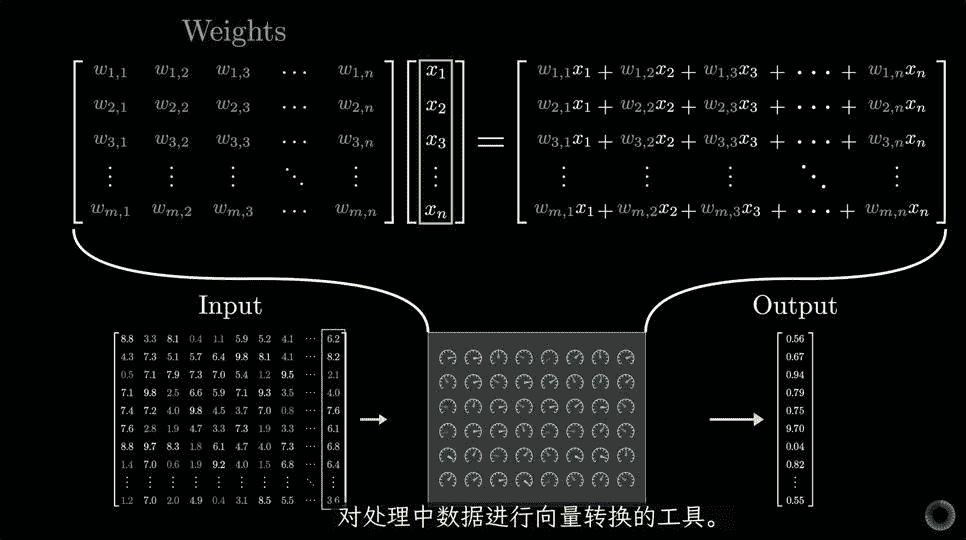

[[twi]@Geek _twi.mp4](https://internal-api-drive-stream.feishu.cn/space/api/box/stream/download/all/P1rcb7Hv8oJWfVx9kUJcBYgfn5e)

# 互联网档案馆 免费书籍

https://archive.org/details/texts

这是一个非盈利图书馆，提供了2000多万本免费下载的书籍和文本，还有230万本现代电子书可供借阅，还有其他的流媒体资源，甚至可以浏览到半个世纪以前的全球报纸和期刊，

### 联系我们

> [互联网设计](https://aigclena.feishu.cn/wiki/PD10wBb5yiRVE7kTFZdcuzUBnth)   [国际站/独立站](https://aigclena.feishu.cn/wiki/TmfowYzfMisIShkNU7ncEBMingh)  [AI商业定制](https://aigclena.feishu.cn/wiki/BsQHwI5saiYGbOkUG2mceW15nHg)