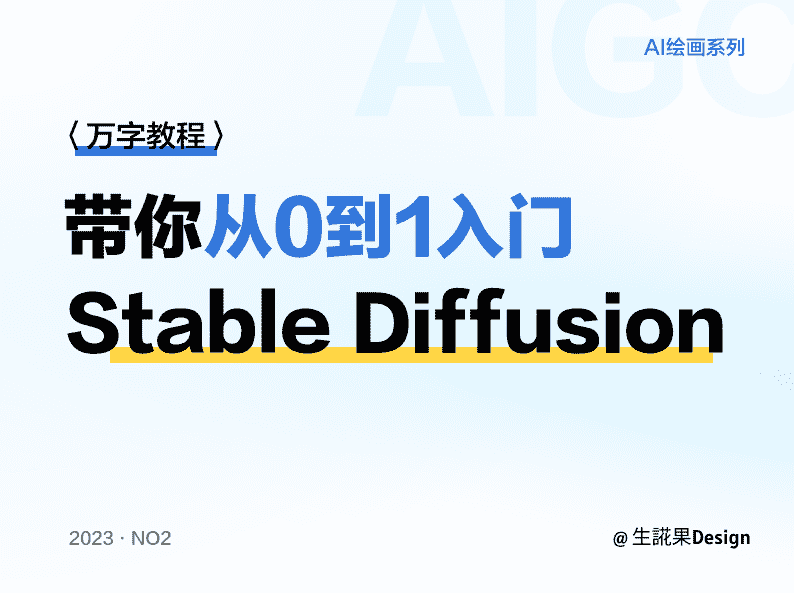
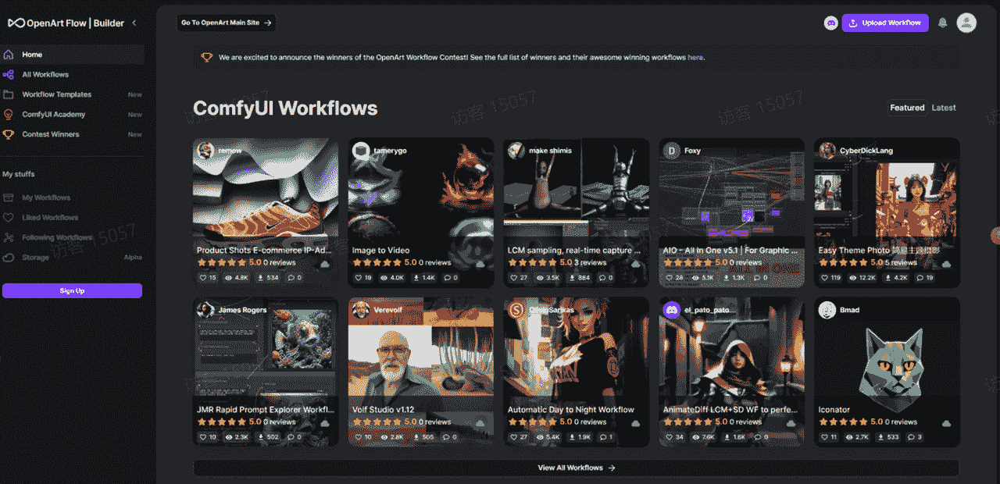
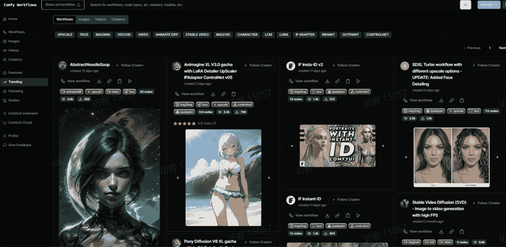
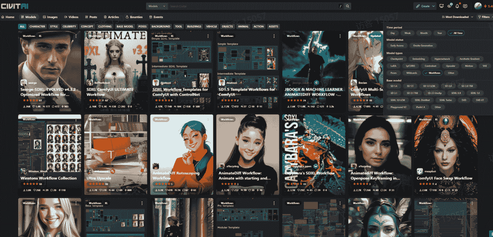
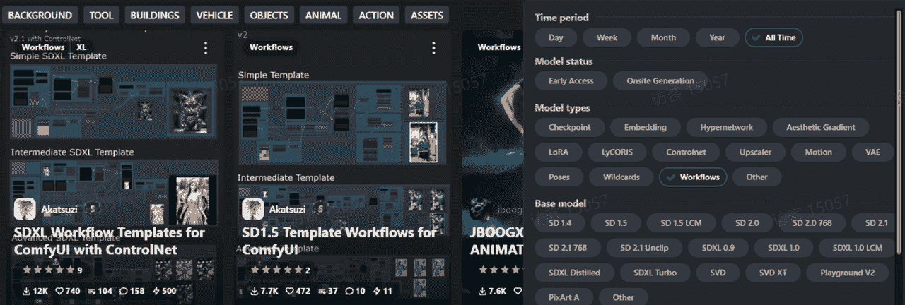
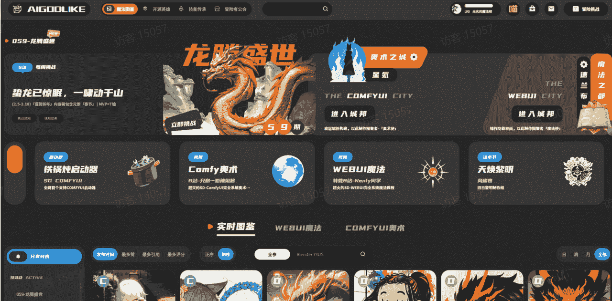

# 零基础stable Diffusion教程

> 来源：[https://aigclena.feishu.cn/docx/EuVIdLeAxo6FWwxpbVRcg8Zbnyd](https://aigclena.feishu.cn/docx/EuVIdLeAxo6FWwxpbVRcg8Zbnyd)

# 入门看这里：从0入门AI绘画教程

SD对电脑配置有比较高的要求，也有一定安装门槛。

### 视频教程

🔥强烈推荐，学完变大神系列

神级教程：Nenly同学的个人空间_哔哩哔哩_bilibili

神级教程：灵仙儿和二狗子个人空间_哔哩哔哩_bilibili

### 文字教程

https://zhuanlan.zhihu.com/p/622238031

### 云端SD

简单的效果可以用云端sd，推荐几个云端sd网站👇👇

1.  Esheep: https://www.esheep.com/

1.  青椒云：https://account.qingjiaocloud.com/signin

1.  阿里云：https://www.aliyun.com/ 前3个月免费体验

1.  Megaease: https://www.megaease.com.cn/  比较便宜 5毛左右/小时  看你选的配置

1.  CEP：https://cephalon.cloud/#/aigc 9毛左右/小时

1.  吐司： https://tusi.art/

1.  哩布：https://www.liblib.ai/

1.  https://www.autodl.com/register

### 算力平台

云端算力，需要自己部署、安装插件等

# 实操案例

## 工作流合集

1.  https://openart.ai/workflows/home

1.  Comfy Workflows:https://comfyworkflows.com

1.  ComfyIcU: https://comfy.icu

1.  C站工作流分区:https://civitai.com/models  在筛选项中选择“Workflows”

1.  AIGODLIKE https://www.aigodlike.com

下拉选取“ComfyUI奧术”，即可查看其他用户上传的ComfyUI生成图片，保存或复制参数皆可读取到图片中的工作流。

## 文生图

https://openart.ai/workflows/lailai/text-generates-images-mvp-workflow/ChYNJiXHkZrjyvg1yL9f

# 工具

传图片找模型 https://www.findsd.art/find-sd

10年+ UI设计师 | 出海电商

MJ/AIGC干货教程 | AI前沿资讯

创意内容生产 | 定制服务

* all设计/AI相关业务欢迎咨询