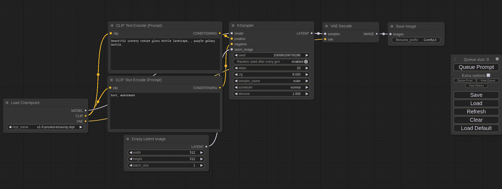
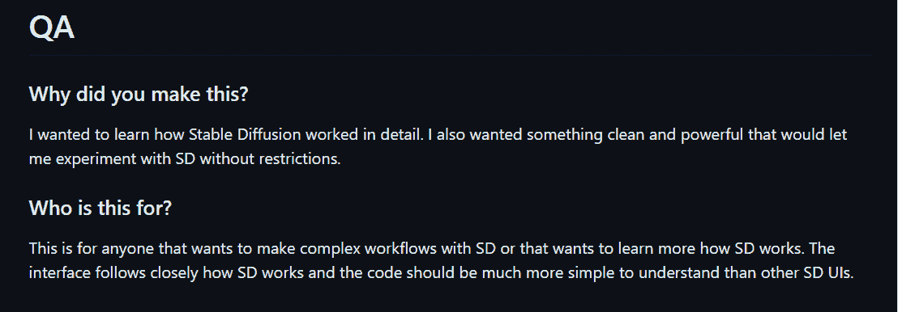
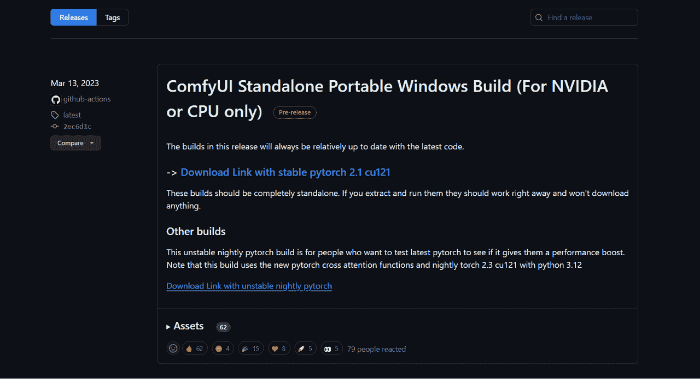
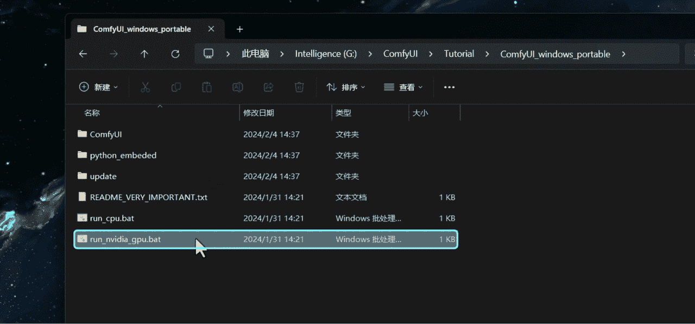
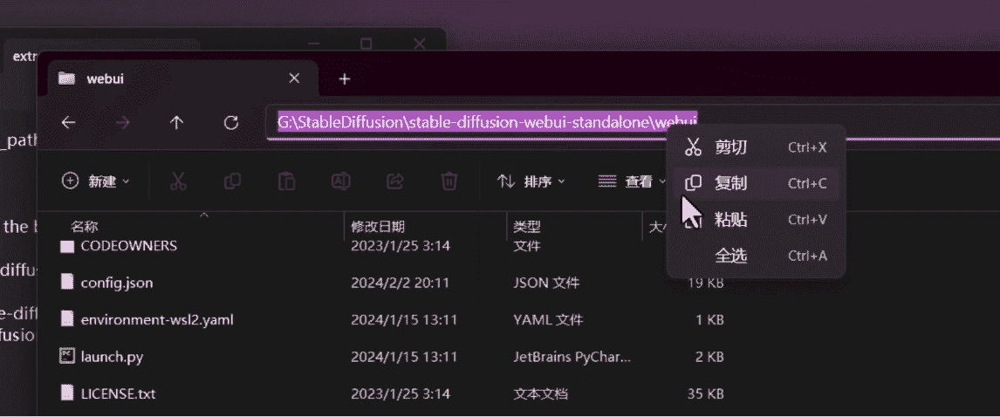
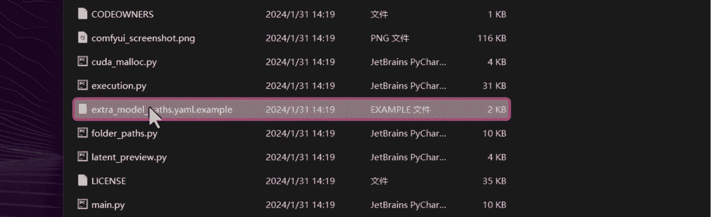
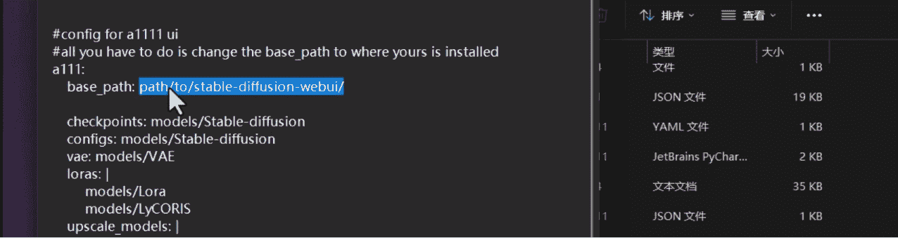
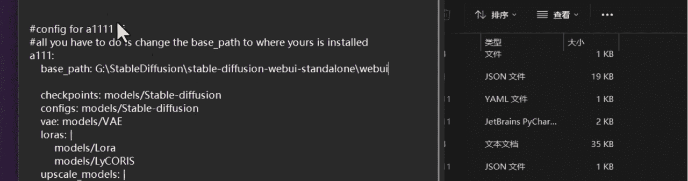
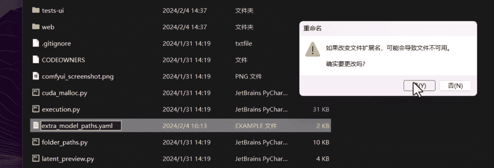

# 安装与配置

> 来源：[https://aigclena.feishu.cn/docx/MM2GdqgE6oB2GWxdIZycnY1snQe](https://aigclena.feishu.cn/docx/MM2GdqgE6oB2GWxdIZycnY1snQe)

详情：[ComfyUI安装完整攻略](https://gf66fxi6ji.feishu.cn/wiki/VYLwwS94JiZcpwkqZamc2DFHnDb)

> 完整安装的ComfyUI程序占用存储（含依赖文件）约2GB，请预留充足的磁盘空间。

> 在安装的过程中碰到了问题，请随时查阅文[第1课：初始界面与基础操作](https://gf66fxi6ji.feishu.cn/wiki/UzFfwaOx3iY3ZAksErvcBbrpnPb)内的对应步骤说明及常见问题区域。建议与 的视频教学内容搭配食用。

> **（重要）**如果你的计算机基础较为薄弱（或者懒得自己动手安装了XD），可以考虑下载由国内开发者二次打包分发的“整合包”。在本文档的最后一部分，我为你整理了一些整合包的下载地址。

ComfyUI简介

ComfyUI是一种新型的Stable Diffusion用户界面，因其独树一帜的“节点式”界面，逐渐成为了AI绘画领域进阶玩家的得力武器。搭配各式各样的自定义节点与功能强大的工作流，它得以用更低的配置实现许多在WebUI等常规界面里无法做到的复杂生成任务，并为基于Stable Diffusion搭建各类AIGC应用提供了便利。

> 项目主页：https://github.com/comfyanonymous/ComfyUI



其开发者[@ComfyAnonymous](https://github.com/comfyanonymous/) 在主页提到了制作这个项目的初衷：

> 我想更详细地了解 Stable Diffusion 是如何工作的，并且想要一些干净而强大的东西，让我可以不受限制地尝试Stable Diffusion。



# Windows（N卡）安装流程

如果你使用的是Windows平台且为N卡用户，只需要在项目主页的Release页面下载作者提供的“官方整合包”，即可一键开启ComfyUI探索之路：

> 下载地址：https://github.com/comfyanonymous/ComfyUI/releases



进入后，点击“[**Download Link with stab**](https://github.com/comfyanonymous/ComfyUI/releases/download/latest/ComfyUI_windows_portable_nvidia_cu121_or_cpu.7z)le pytorch 2.1 cu121”即可下载。

下载完毕后，解压文件夹至任意空白路径。双击“run_nvdidia_gpu.bat”，即可开启ComfyUI。



# 其他平台安装流程

> **摘录自官方项目页面，待测试**

> 更详细的安装指引，请参考项目主页的安装部分说明：https://github.com/comfyanonymous/ComfyUI?tab=readme-ov-file#installing

## **手动安装**

1.  Git clone 此存储库。

```
git clone https://github.com/comfyanonymous/ComfyUI.git
```

1.  把您的 SD 大模型（Checkpoint，ckpt/safetensors 文件）放在 models/checkpoints 文件夹中；

1.  将您的 VAE 放入 models/vae 文件夹中；

然后按照下面的指引，安装不同平台所需的依赖项：

---

### **AMD GPU（Linux）**

AMD users can install rocm and pytorch with pip if you don't have it already installed, this is the command to install the stable version:

如果您还没有安装 rocm 和 pytorch，AMD 用户可以使用 pip 安装 rocm 和 pytorch，这是安装稳定版本的命令：

pip install torch torchvision torchaudio --index-url https://download.pytorch.org/whl/rocm5.7

Install the dependencies by opening your terminal inside the ComfyUI folder and:

然后，在 ComfyUI 文件夹中打开终端，然后通过下面的命令来安装依赖项：

pip install -r requirements.txt

After this you should have everything installed and can proceed to running ComfyUI.

在此之后，您应该已经安装了所有内容，并可以继续运行 ComfyUI。

---

### **NVIDIA GPU**

Nvidia users should install stable pytorch using this command:

Nvidia 用户应使用以下命令安装稳定版本的 pytorch：

pip install torch torchvision torchaudio --extra-index-url https://download.pytorch.org/whl/cu121

> If you get the "Torch not compiled with CUDA enabled" error, uninstall torch with:

> 如果您收到“Torch 未在启用 CUDA 的情况下编译”错误，请使用以下命令卸载 torch：

> pip uninstall torch

> And install it again with the command above.

> 然后使用上面的命令重新安装它。

Install the dependencies by opening your terminal inside the ComfyUI folder and:

然后，在 ComfyUI 文件夹中打开终端，然后通过下面的命令来安装依赖项：

pip install -r requirements.txt

After this you should have everything installed and can proceed to running ComfyUI.

在此之后，您应该已经安装了所有内容，并可以继续运行 ComfyUI。

---

### Intel GPU

请参考如下链接：[**Intel Arc 英特尔锐炫**](https://github.com/comfyanonymous/ComfyUI/discussions/476)

---

### **Apple Mac 芯片**

You can install ComfyUI in Apple Mac silicon (M1 or M2) with any recent macOS version.

您可以在 Apple Mac 芯片（M1 或 M2）中安装任何最新 macOS 版本的 ComfyUI。

1.  Install pytorch nightly. For instructions, read the Accelerated PyTorch training on Mac Apple Developer guide (make sure to install the latest pytorch nightly).
安装 pytorch nightly。有关说明，请阅读 Mac 上的加速 PyTorch 培训 Apple 开发人员指南（确保安装最新的 pytorch nightly）。

1.  Follow the ComfyUI manual installation instructions for Windows and Linux.
按照适用于 Windows 和 Linux 的 ComfyUI 手动安装说明进行操作。

1.  [Install the ](https://github.com/comfyanonymous/ComfyUI#dependencies)ComfyUI dependencies. [If you have another Sta](https://github.com/comfyanonymous/ComfyUI#i-already-have-another-ui-for-stable-diffusion-installed-do-i-really-have-to-install-all-of-these-dependencies)ble Diffusion UI you might be able to reuse the dependencies.
安装 ComfyUI 依赖项。如果您有其他 Stable Diffusion UI，则可以重用依赖项。

1.  Launch ComfyUI by running python main.py --force-fp16. Note that --force-fp16 will only work if you installed the latest pytorch nightly.
通过运行 python main.py --force-fp16 启动 ComfyUI。请注意，--force-fp16 只有在安装最新的 pytorch nightly时才有效。

> **Note**: Remember to add your models, VAE, LoRAs etc. to the corresponding Comfy folders, as discussed in ComfyUI manual installation.

> 注意：请记住将您的模型、VAE、LoRA 等添加到相应的 Comfy 文件夹中，如 ComfyUI 手动安装中所述。

---

### DirectML（Windows 上的 AMD 卡）

pip install torch-directml

Then you can launch ComfyUI with: python main.py --directml

pip install torch-directml

然后，您可以使用以下命令启动ComfyUI： python main.py --directml

---

# 模型路径互通配置

在启动ComfyUI前，如果你有存储于Automatic1111 WebUI项目中的模型文件，则无需额外搬运至ComfyUI的文件夹内，只需通过如下步骤简单配置即可实现模型文件的“互通”：

1.  拷贝WebUI根目录的路径（即包含webui_user.bat文件的路径）：



1.  用记事本打开ComfyUI根目录下的extra_model_path.yaml.example文件，将路径粘贴至如下位置：







1.  保存文件，并将文件重命名，去除.example的后缀，使文件名变为如下图所示：



1.  正常启动ComfyUI。

# 整合包下载

> **温馨提示：****在使用整合包的过程中**，碰到问题请优先咨询整合包制作者/开发者。

> 提问时请礼貌发言，理解开源软件生态的不稳定性与因人而异的环境问题，并尊重开发者的辛勤付出。

由@[只剩一瓶辣椒酱](https://space.bilibili.com/35723238) 老师制作的 ComfyUI**铁锅炖启动器及整合包：**

视频地址：[国内首个COMFYUI启动器铁锅炖来辣！支持COM](https://www.bilibili.com/video/BV1mz4y1K7Jw/)FYUI更新/配置/一键优化/中英切换等

