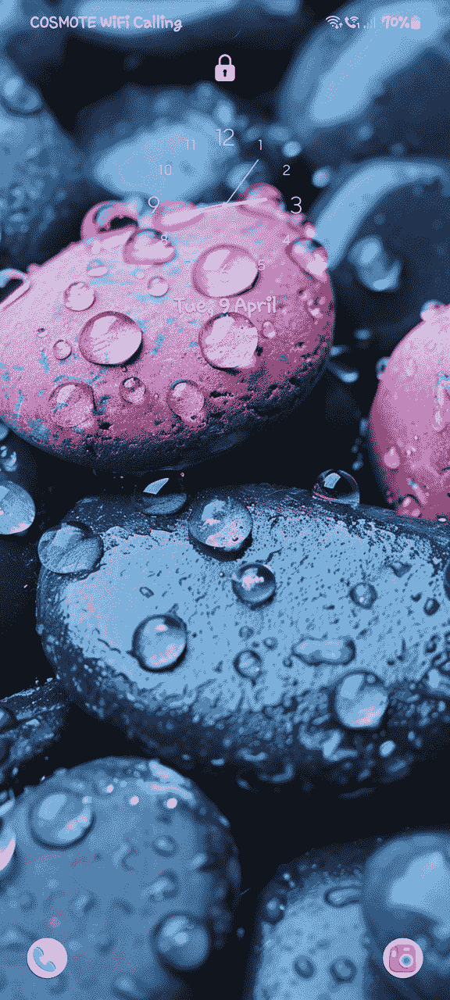
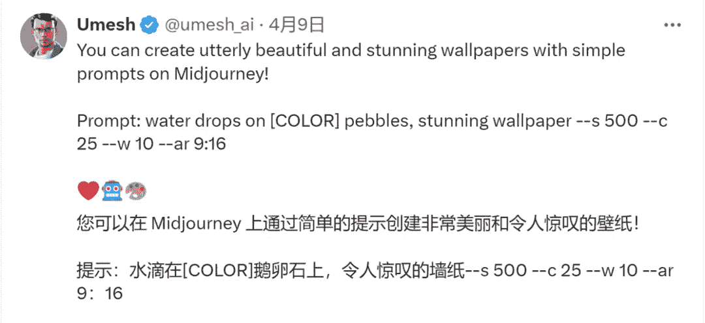
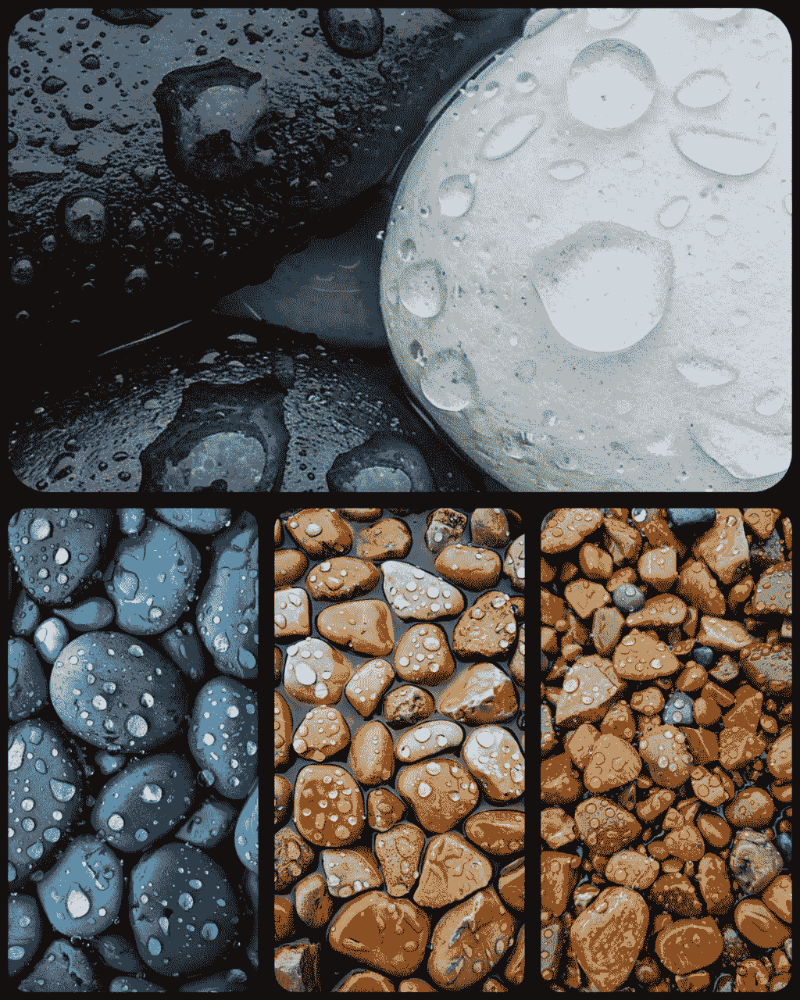
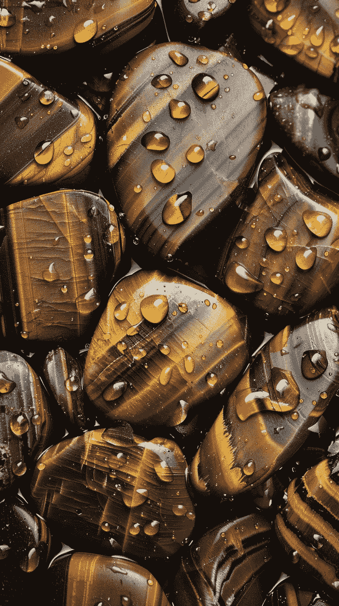
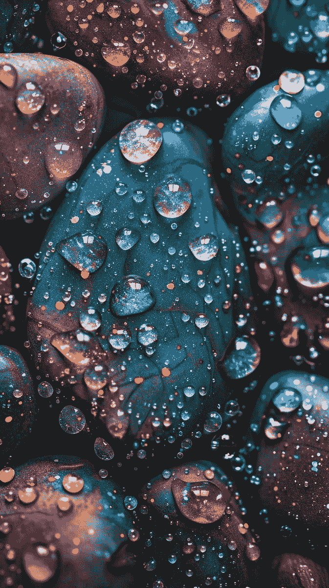
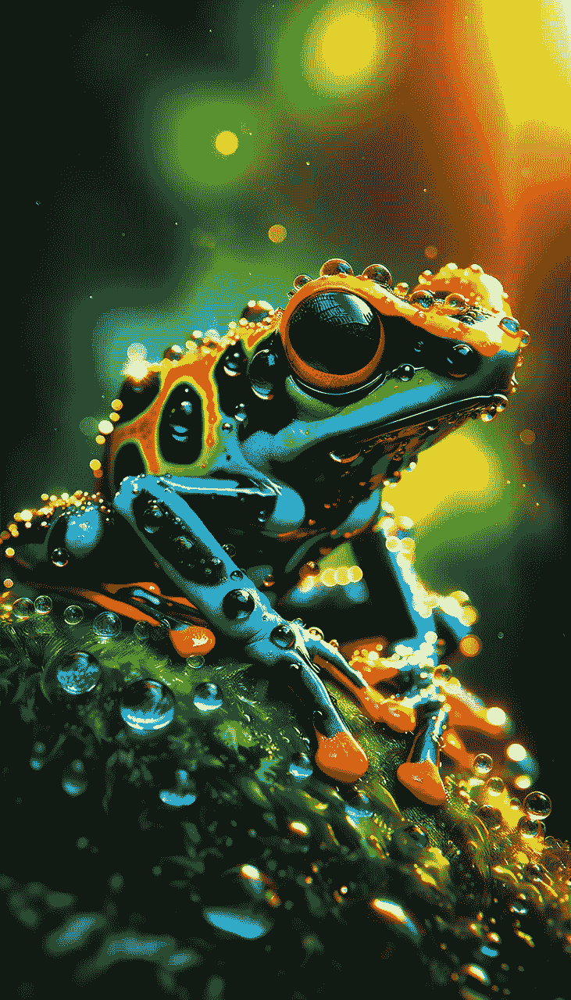
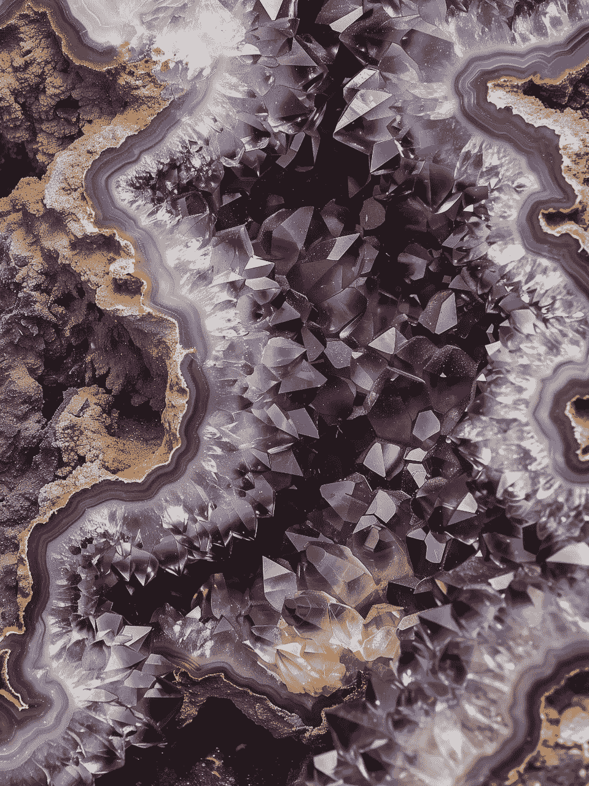
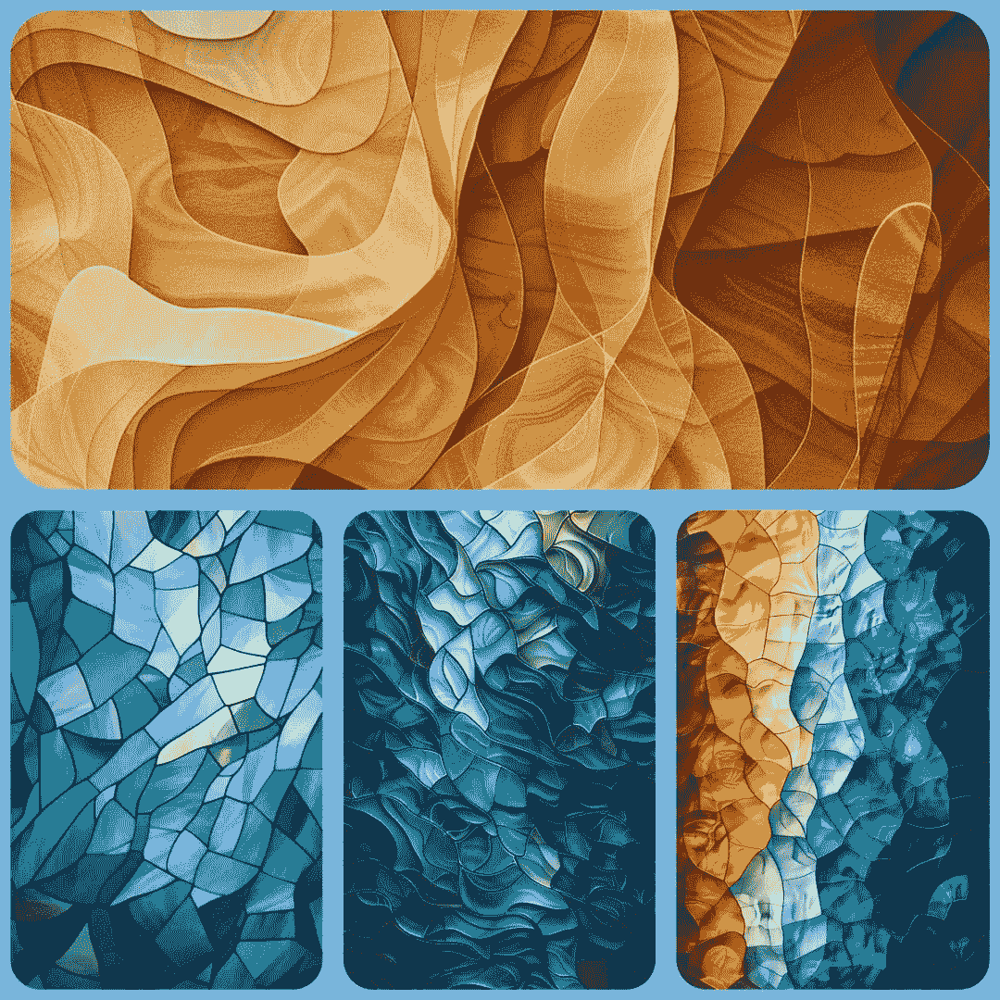
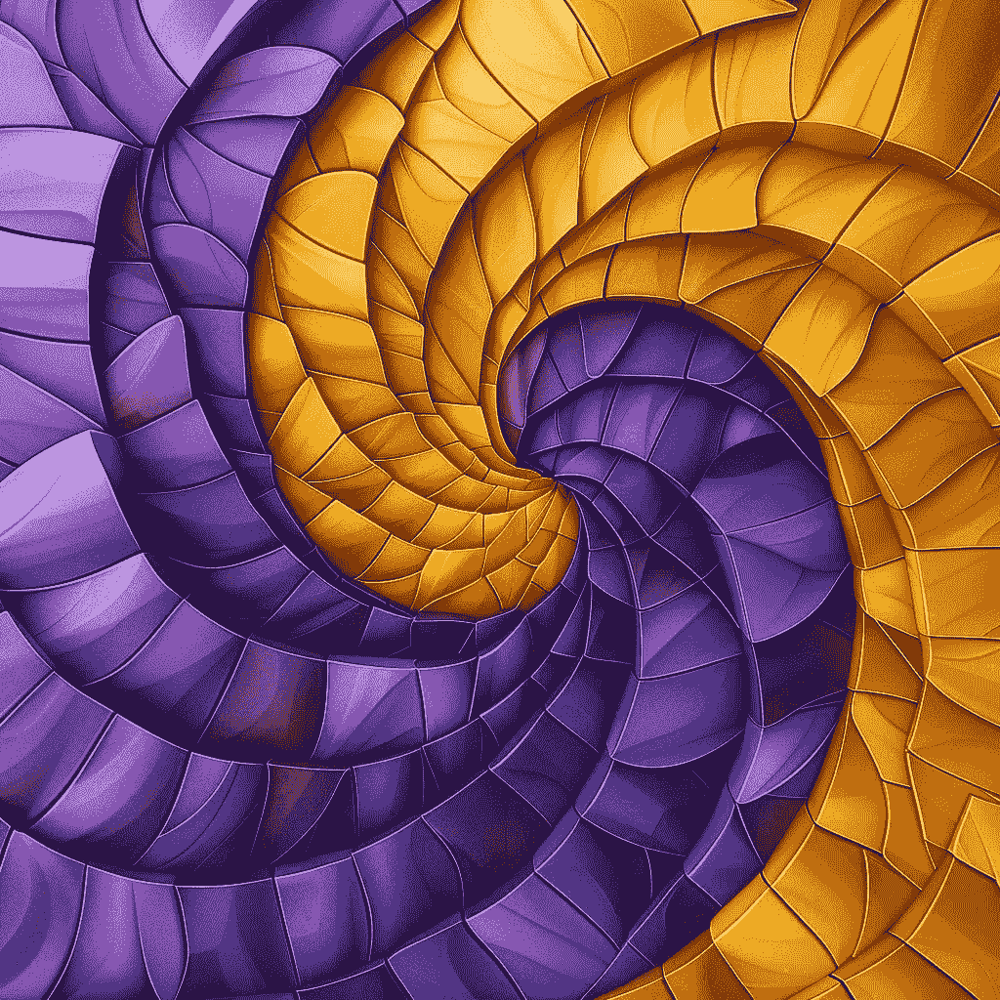

# 案例 | MJ画壁纸

> 来源：[https://aigclena.feishu.cn/docx/BFMAd9QoooSyHwx1FQGc6Lt3n8b](https://aigclena.feishu.cn/docx/BFMAd9QoooSyHwx1FQGc6Lt3n8b)

转自机器之心 https://www.jiqizhixin.com/articles/2024-04-12-4

周末了，我们分享一个轻松有趣的玩法——用图像生成器  Midjourney （v 6.0）DIY 漂亮壁纸。

来自X用户@eslwithtina

X 用户 @umesh_ai 用一个简单提示就创建非常美丽壁纸！

+   案例地址：https://twitter.com/umesh_ai/status/1777625262571614662

这是该用户分享的提示模板：

+   water drops on （你喜欢的颜色）pebbles, stunning wallpaper —s 500 —c 25 —w 10 —ar 9:16

+   水滴落在鹅卵石上（根据喜好选择石头颜色）。" stunning wallpaper " 暗示这个图像是用来作为壁纸或背景，" stunning " 意味着不是生成一张普通鹅卵石照片，而是令人赞叹的艺术作品。除了主题清晰，一个好的 Midjourney 提示还要合理设置内置参数，控制好图像细节和风格。

有人将鹅卵石变成自己喜欢的虎眼石，生成的壁纸同样美不胜收：

来自@fenlandcrafts

如果是全息鹅卵石（ glowing holographic rainbow pebbles ）呢？

来自@LudovicCreator

如果是箭毒蛙（ a poison dart frog ）呢？

@VRIs_Hugh

如果你喜欢矿物、石头主题壁纸，不妨试试这个提示，效果同样美妙绝伦：

+   highly detailed internal image of a large amethyst geode —ar 5:7 —v 6.0 —style raw

这个提示要求生成的图像展现出大型紫水晶晶洞的内部结构，细节水平要高（矿物类别可以根据喜好变化）。“ v 6.0 "表示使用 6.0 版本的模型来生成图像。不同版本模型可能在细节、质量和风格方面有所不同。" style raw " 表示图像应该以"原始"的风格生成，专注展示紫水晶晶洞的真实细节和质感。"ar ”设置为 5:7，是一个略微垂直的长方形比例，估计是为了更适合展示晶洞的垂直深度和内部结构。这是生成的结果：

来自@fenlandcrafts

喜欢其他花纹（比如马赛克）的同学，可以试试这个提示：

+   Abstract background with （你喜欢的）colors. The composition is made of overlapping organic shapes in various shades creating an intricate mosaic effect that resembles the surface of （物体）. It is a modern and artistic design —s 250 —ar 9:16 —v 6.0"

提示要求创作出一张色彩丰富、形状有机、构图像马赛克拼贴的抽象背景图。这是 X 用户 @umesh_ai  使用 Midjourney （ v 6.0 ）生成的结果：

来自@umesh_ai

左下角是使用 5.2 版创建，有人稍微修改了一下提示（可能是物体从类似水波纹变成了螺线），结果变成了马赛克螺线。

来自 @Doogz75

@AI设计师Lena

10年+ UI设计师 | 出海电商

MJ/AIGC干货教程 | AI前沿资讯

创意内容生产 | 定制服务

all设计/AI相关业务欢迎咨询

每天分享最新的AI工具及资讯的AIGC群，欢迎大家一起学习探讨，想进群的小伙伴儿，添加🛰️请备注“进群”