# 案例 | MJ换脸插件

> 来源：[https://aigclena.feishu.cn/docx/MiwWdsYzMonsvmxnaOhcvX94nIb](https://aigclena.feishu.cn/docx/MiwWdsYzMonsvmxnaOhcvX94nIb)

> Ai设计师lena发布了一篇📕笔记，快来看吧！ 😆 cCnpT3NqJ8gInjX 😆 http://xhslink.com/DVUrzH，复制本条信息，打开【📕】App查看精彩内容！

# 先看最后效果：

单人

一键换脸效果

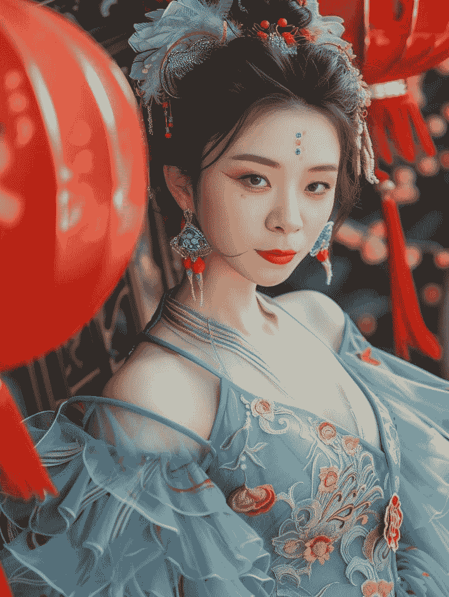

PS细微调整后

多人

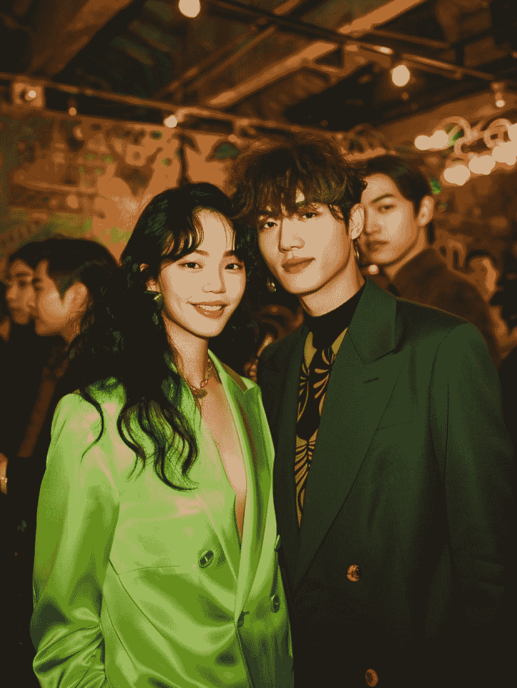

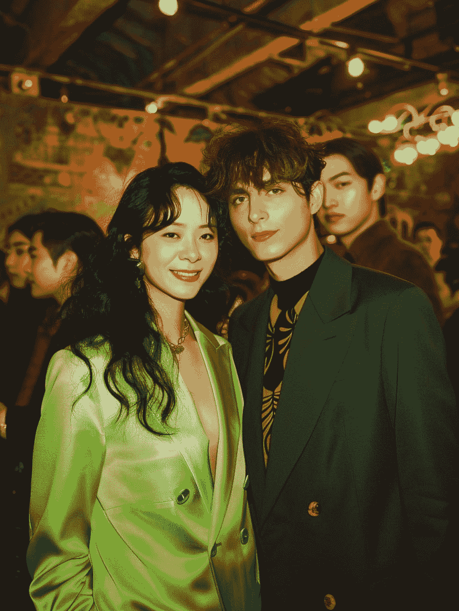

多人换脸效果

### 安装插件

点击[邀请链接](https://discord.com/oauth2/authorize?client_id=1090660574196674713&permissions=274877945856&scope=bot)，选择将其添加到自己的服务器，然后授权，验证身份即可。

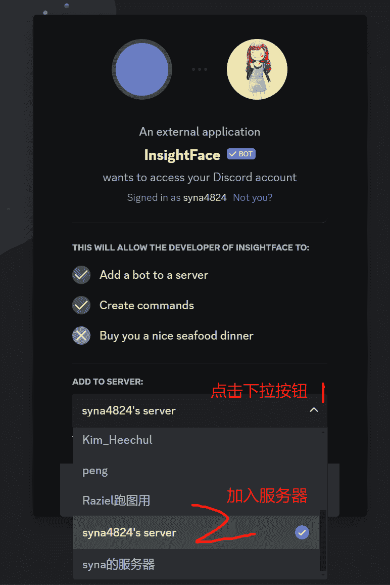

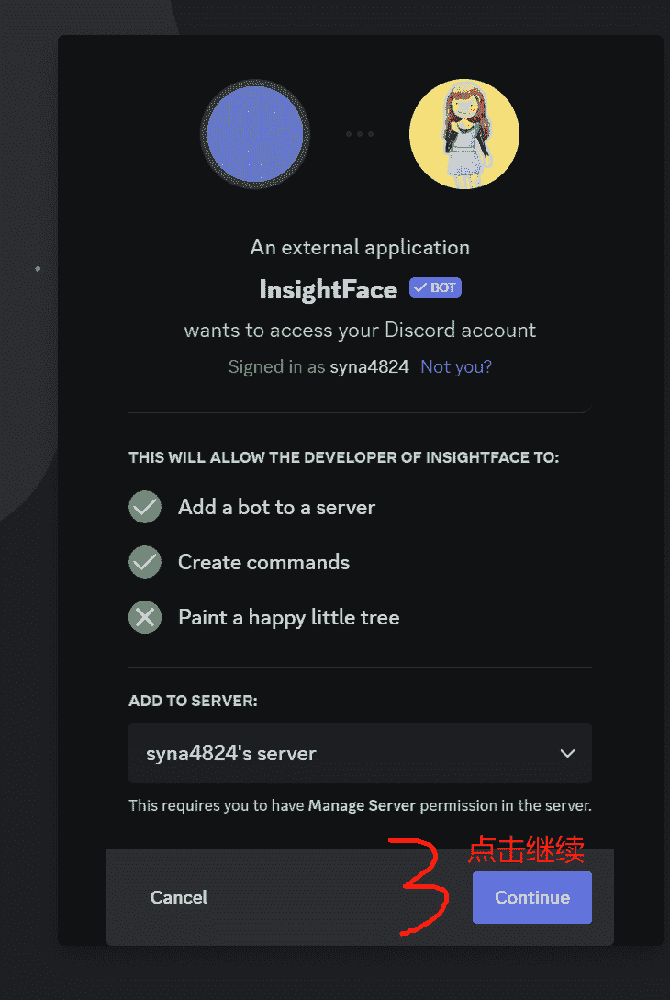

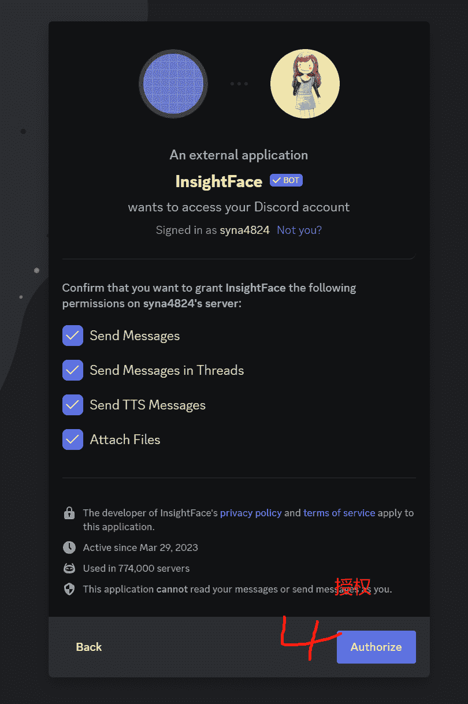

### 插件使用

①先在mj里生成图片

/imagine prompt:Girl with pink bun head, double ponytail, red and orange dress, pink bear doll,portrait, by style of henry twachtman --ar 3:4 --niji 6

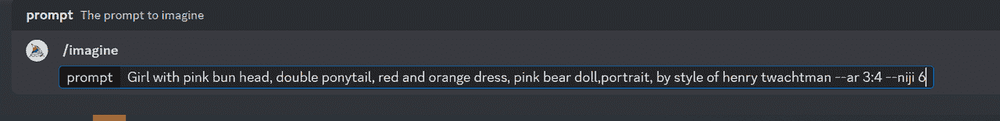

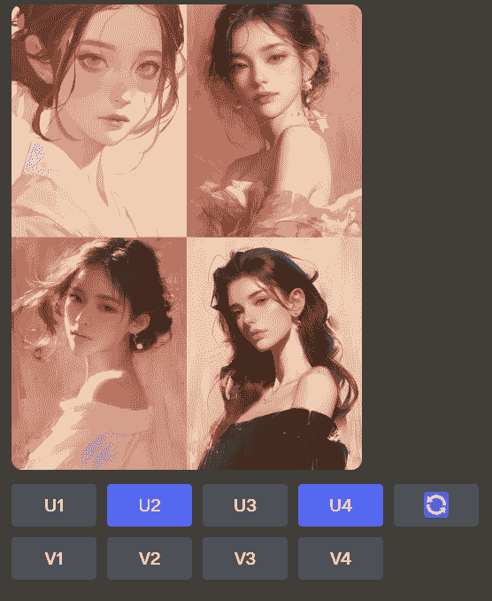

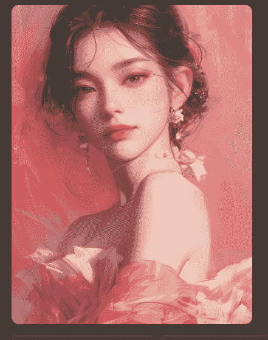

点击U2生成

②上传替换的头像

键入“/saveid”,起一个ID名字和上传一张你要换脸的照片；机器人回复“idname XXX created”说明创建成功。

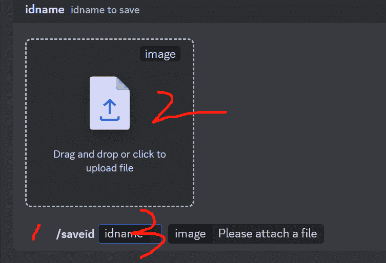

③一键替换

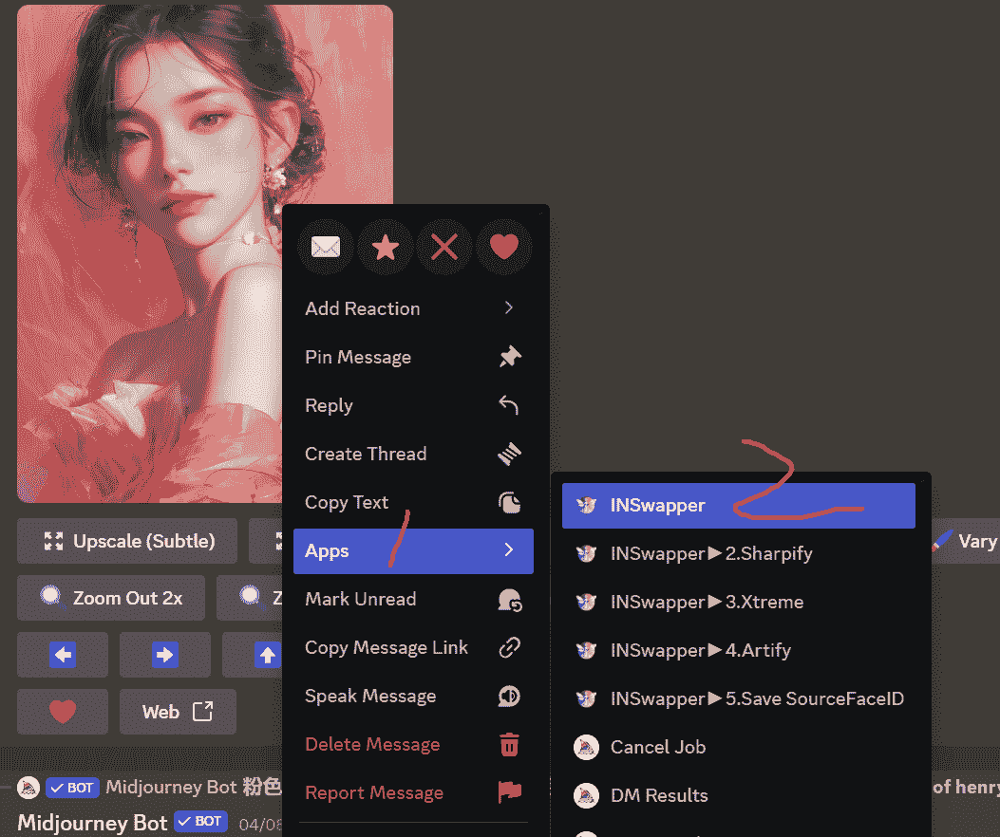

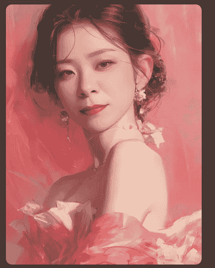

换脸成功

③多人一键换脸

多人换脸，得保证我们的库里有多张面部图片，确保有多个面部图片后。键入“/setid”后输入“lena,tc”，要换2个人就输入2个名字，中间用逗号隔开；

④swapid用法

键入swapid后，同时上传图片和idname，可一键换脸

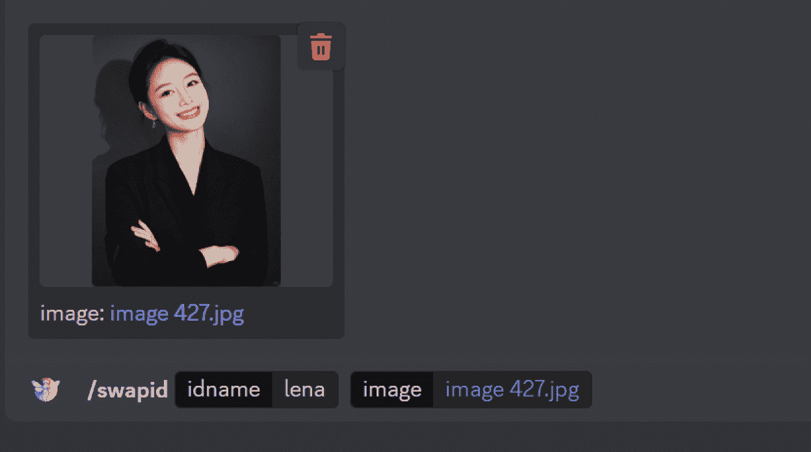

### 命令列表

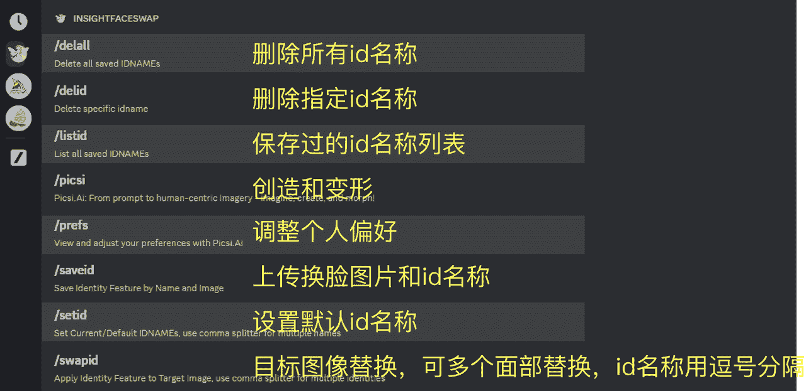

### 其他参数（需付费）

来自@Wade McMaster

+   --oldify 衰老  后面可加数值

不加值

300

1000

+   -s -f

+   -e 增加面部表情

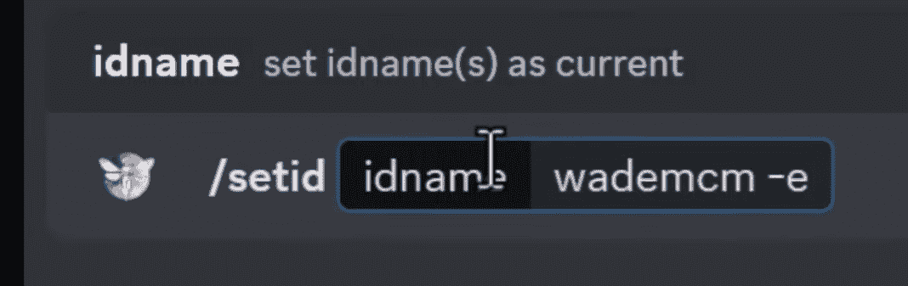

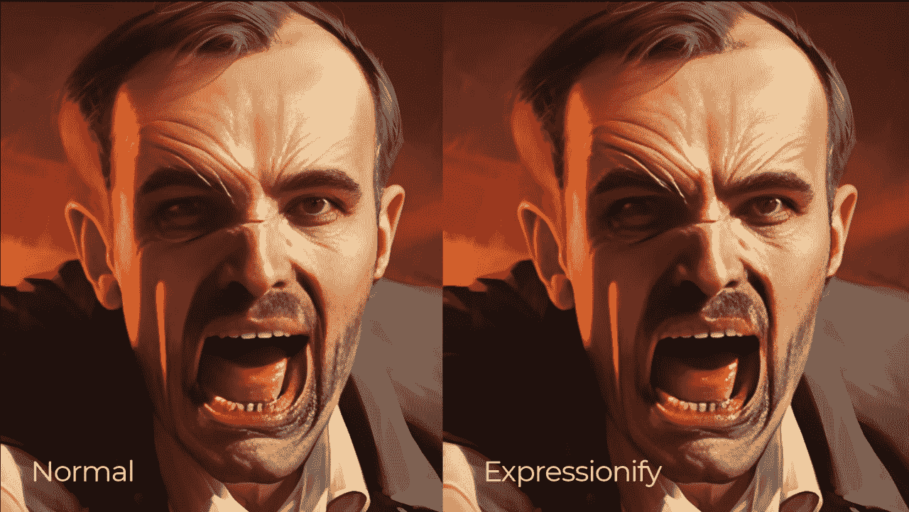

+   -c 卡通化，可加数值

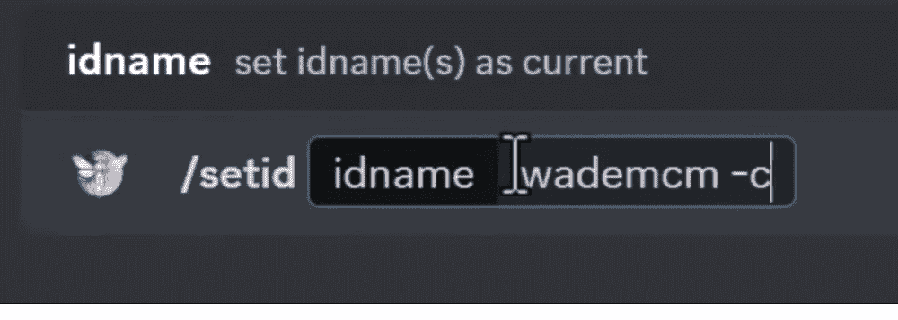

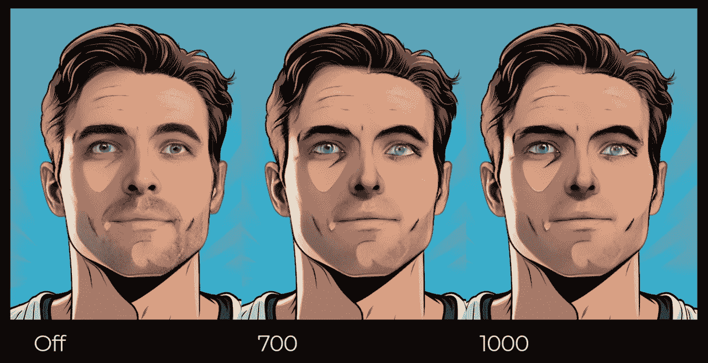

更多参数：https://github.com/deepinsight/insightface/tree/master/web-demos/swapping_discord

@AI设计师Lena

10年+ UI设计师 | 出海电商

MJ/AIGC干货教程 | AI前沿资讯

创意内容生产 | 定制服务

all设计/AI相关业务欢迎咨询

每天分享最新的AI工具及资讯的AIGC群，欢迎大家一起学习探讨，想进群的小伙伴儿，添加🛰️请备注“进群”