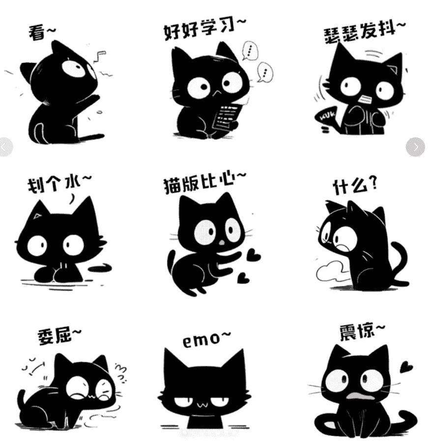
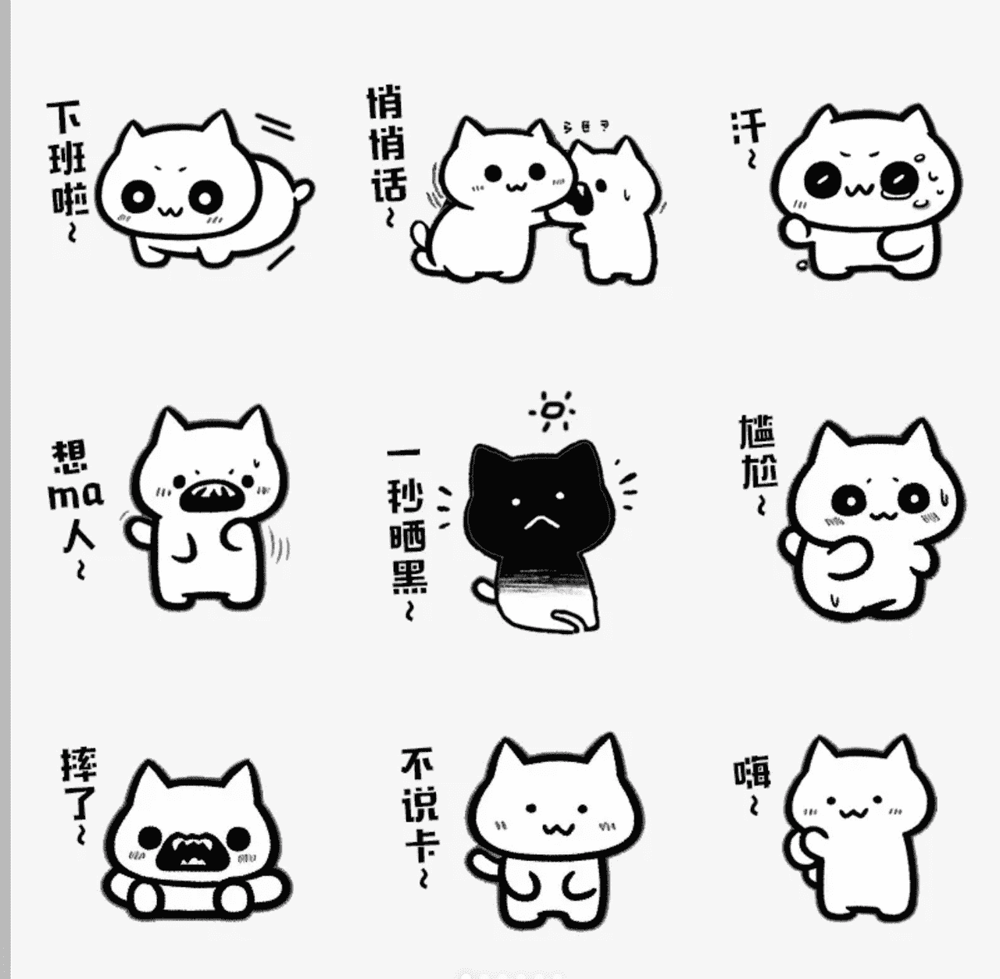
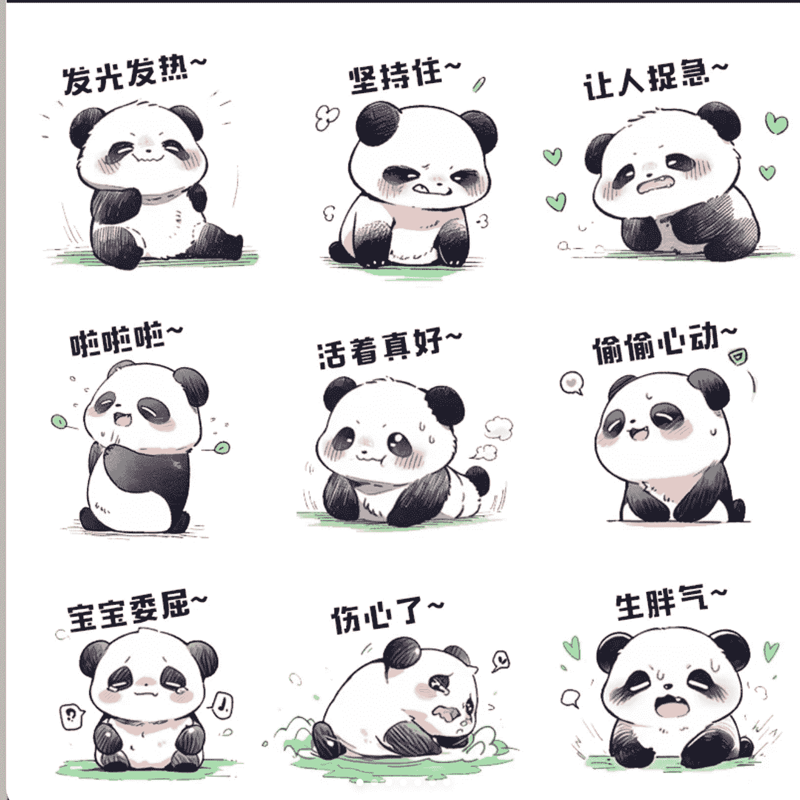
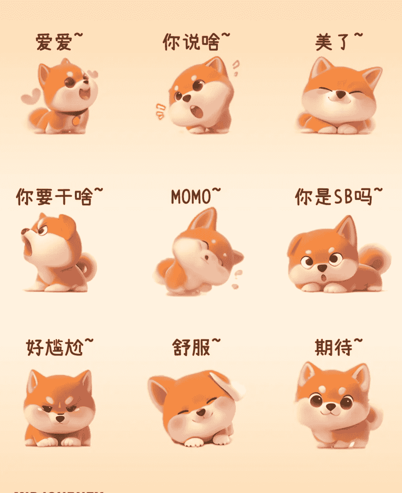
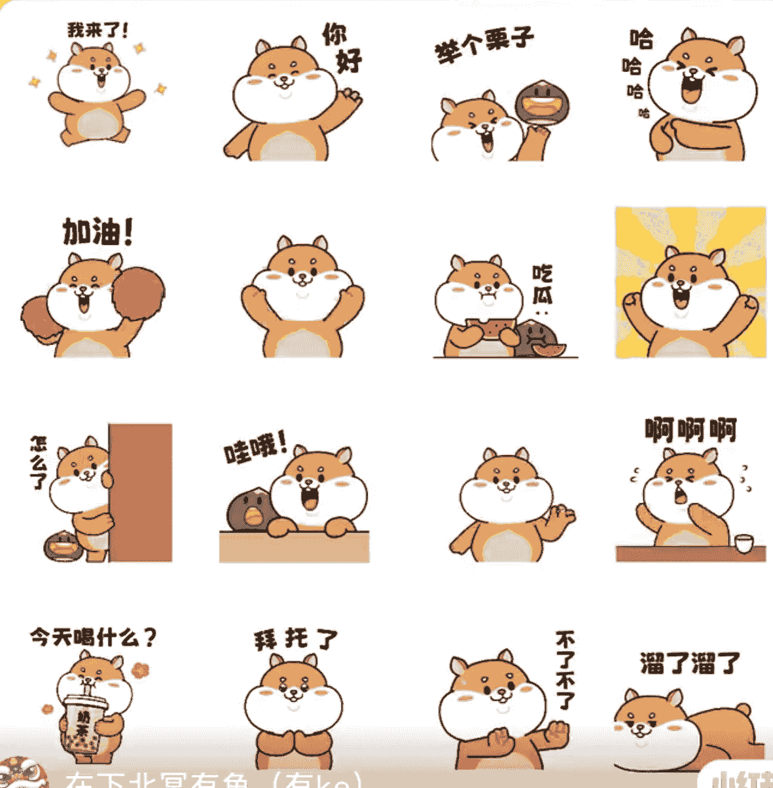
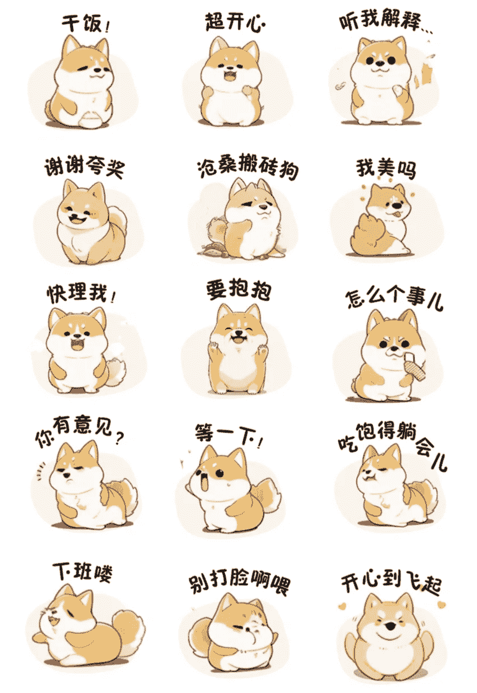
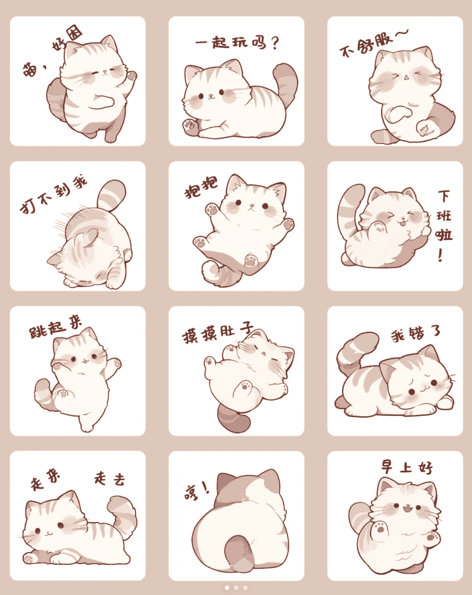
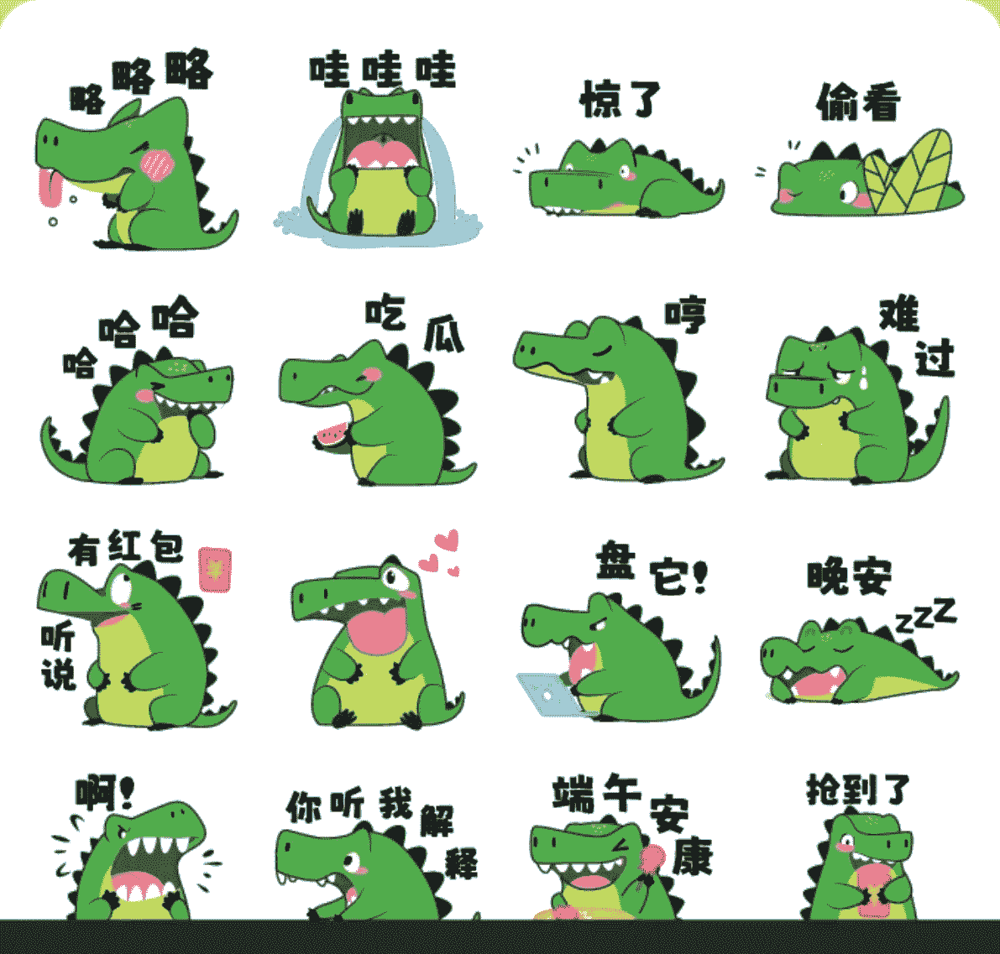
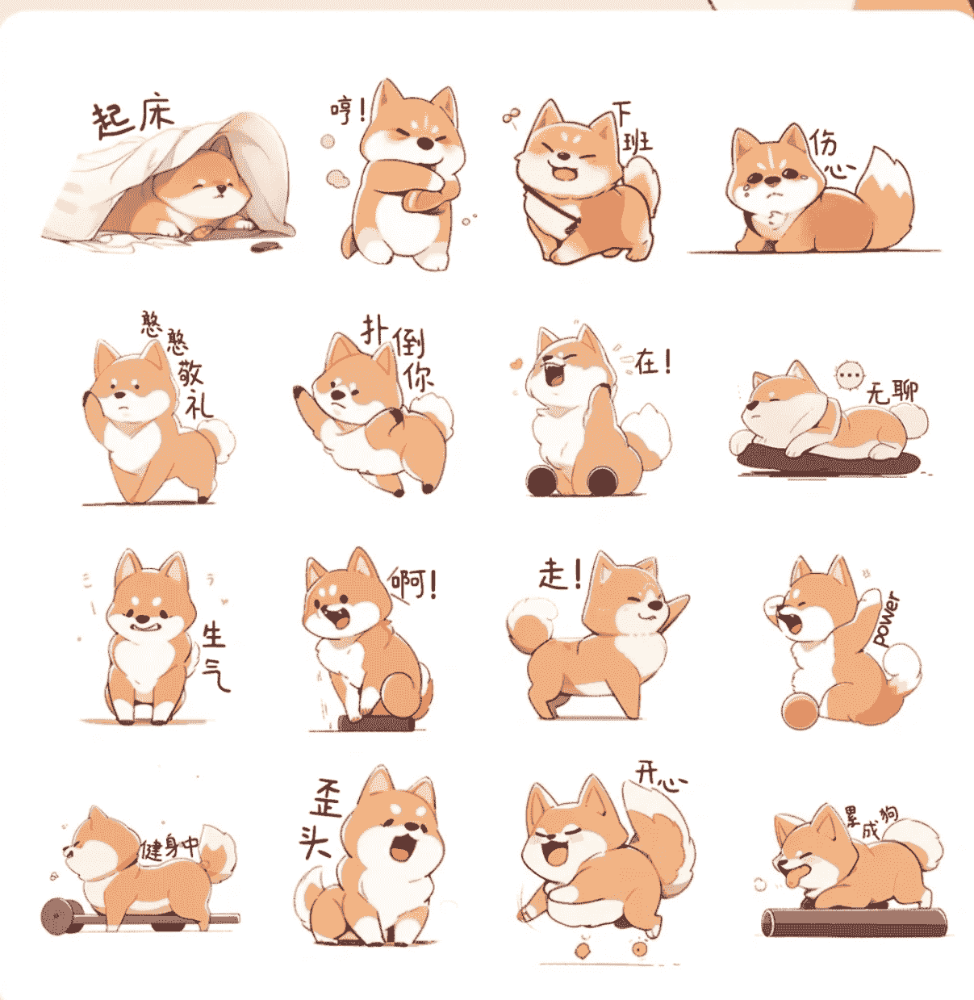

# 案例 | 表情包

> 来源：[https://aigclena.feishu.cn/docx/Wofwd2wQMoGRJbxVeOTcjdDNnge](https://aigclena.feishu.cn/docx/Wofwd2wQMoGRJbxVeOTcjdDNnge)

# 别人的表情包

网图侵删

# 动画工具

Animated drawings

# Midjourney表情包教程

# 即梦