# Midjourney官方更新

> 来源：[https://aigclena.feishu.cn/docx/XEDHd7b4PoCuCbxCqnocffl9nqc](https://aigclena.feishu.cn/docx/XEDHd7b4PoCuCbxCqnocffl9nqc)

# 官方指南更新

https://docs.midjourney.com/hc

2025.7.13

### ✨ 一、入门指南（Getting Started）

+   快速上手流程

+   基本操作与使用环境

---

### 🎨 二、提示词基础（Prompting Basics）

+   Prompt Basics —— 提示词基础

+   Modifying Your Creations —— 修改你的作品

+   Aspect Ratio —— 长宽比

+   Image Size & Resolution —— 图片尺寸与分辨率

+   Art of Prompting —— 提示词艺术

---

### 🖼️ 三、使用你自己的图像（Using Your Own Images）

+   Video —— 视频提示

+   Image Prompts —— 图像提示词

+   Style Reference —— 风格参考

+   Omni Reference —— 全能参考（多图/多元素融合）

+   Character Reference —— 角色参考

+   Describe —— 图像反向描述

+   Editor —— 编辑器功能

+   Managing Image Uploads —— 上传管理

---

### 🌐 四、使用网页端（Using Web）

+   Website Overview —— 网站概览

+   Creating on Web —— 在网页端创作

+   Draft & Conversational Modes —— 草图模式 & 对话模式

+   Personalization —— 个性化设置

+   Moodboards —— 灵感板

+   Organizing Your Creations —— 作品管理

+   Using Folders —— 文件夹整理

+   Complete Tasks —— 完成任务

---

### 🎛 五、控制功能（Midjourney Controls）

+   Parameter List —— 参数列表

+   Chaos / Variety —— 混乱度 / 多样性

+   Legacy Features —— 旧版功能

+   Multi-Prompts & Weights —— 多提示词与权重

+   No —— 排除元素

+   Pan —— 平移扩展

+   Permutations —— 组合生成

+   Quality —— 画质参数

+   Raw Mode —— 原始模式

+   Remix —— 重混模式

+   Repeat —— 重复生成

+   Seeds —— 随机种子

+   Stylize —— 风格化参数

+   Text Generation —— 文本生成

+   Tile —— 平铺模式

+   Upscalers —— 放大器

+   Variations —— 变体

+   Version —— 版本选择

+   Weird —— 奇异度参数

+   Zoom Out —— 画面缩小

---

### 💬 六、在 Discord 上使用（Using Discord）

+   Web vs Discord —— 网页端 vs Discord

+   Discord Quick Start —— 快速上手

+   Discord Overview —— 功能概览

+   Discord Direct Messages —— 私信使用

+   Add Midjourney to Your Discord Server —— 添加到服务器

+   Discord Command List —— 指令列表

+   Creation Settings in Discord —— 创作设置

+   Info Command —— 信息指令

+   Show Command —— 显示指令

+   Vary Region —— 区域变换

+   Blend Images on Discord —— 图像混合

+   Hosting Images on Discord —— 图像托管

---

### 📜 七、政策与支持（Midjourney Policies & Billing Support）

+   MidJourney 使用政策

+   订阅与账单支持

+

# V7已更新

2025.4.4

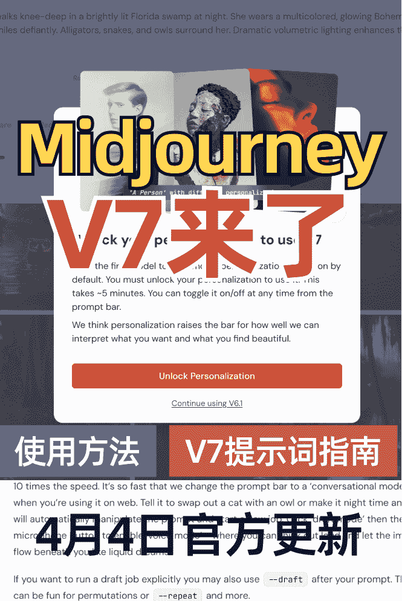

中午12点V7终于上线拉，从3.30起连续3天，3轮的图像打分测试，今天终于上了。

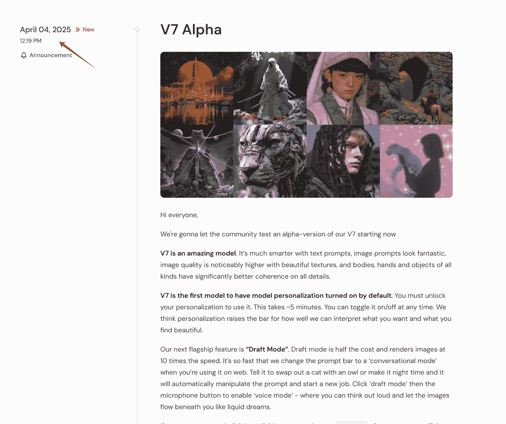

## 更新了什么

在 V7 中，你将得到更高的质量、细节、**深度、准确性**、主体丰富度，以及更强的提示词遵循性。

🚀此外，全**新交互模式来**了！DRAFT MODE（草稿模式）

核心功能是 “草稿模式（Draft Mode）”，运行速度快，支持专属 Midjourney LLM，让你可以通过文本或语音快速生成图像。草稿模式的渲染成本是标准模式的一半，但速度快 10 倍！它的速度快到在网页版上我们直接把提示栏变成了“对话模式”。

你可以说：“把猫换成猫头鹰”或“变成夜晚”，它就会自动修改提示词并开始新任务。点击“草稿模式”按钮，然后点麦克风图标可开启“语音模式”——你可以边说边生成图像。

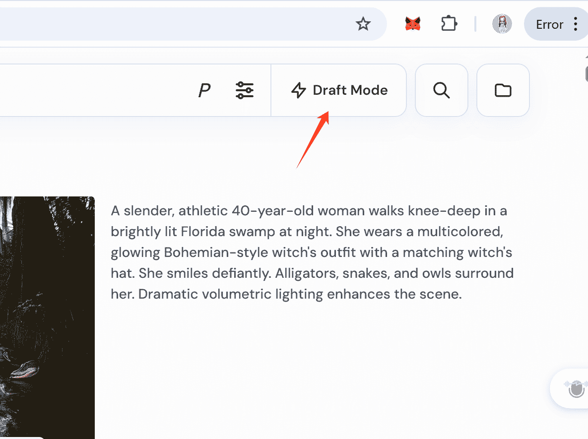

💡 语音命令可能需要一些练习，建议先用文本熟悉操作。

## 📗使用方法

V7 是首个默认启用模型个性化的版本。你需要先解锁你的个性化功能才能使用，大约只需 5 分钟。可以随时开关这个功能。

一、官网使用方法

1、出图时，版本选择V7，即会出现解锁个人风格弹窗

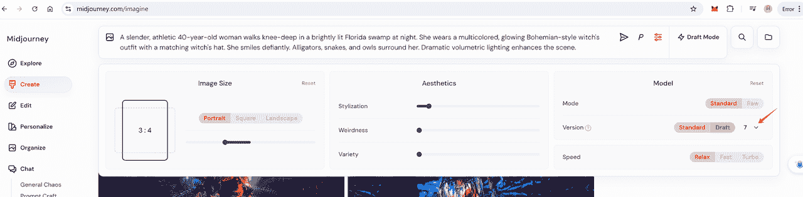

2、选择200张图片后即可解锁个人风格之后，然后就可以愉快的使用拉~~

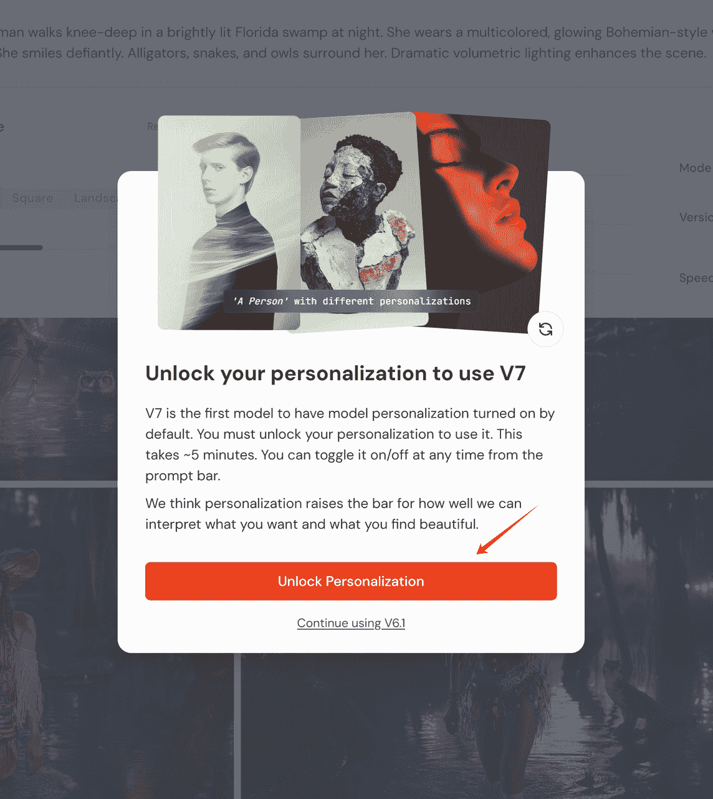

键盘数字选择，喜欢1按1，喜欢2按2，都不喜欢按3

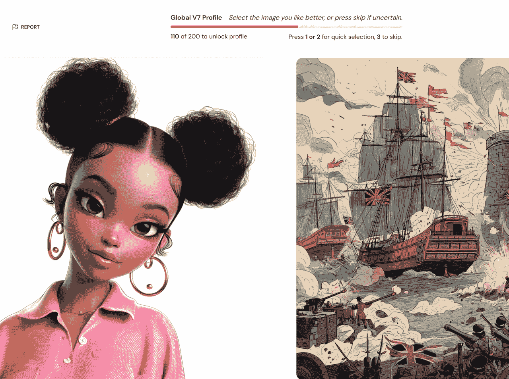

二、discord使用方法

出图时，提示词后跟--v7，在弹框中点击“解锁个人风格”

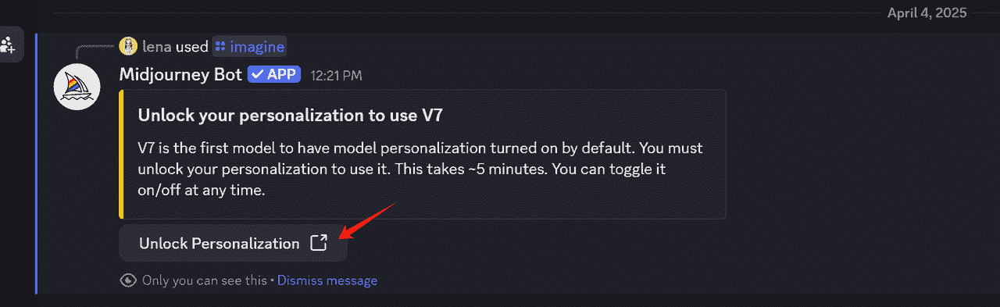

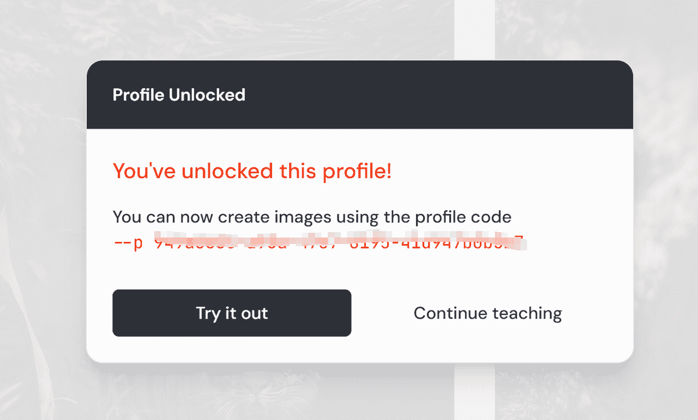

200张选择完后即可成功解锁个人风格👆

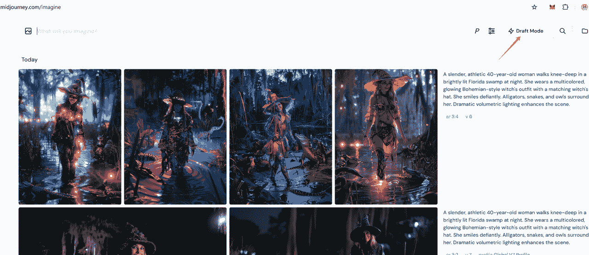

## 📗V**7 提示词指南**

💡在 V7 **版本中，生成**的图片质量高、细节、深度、准确性、主体丰富度，以及更强的提示词遵循性。

这一版本并没有彻底改变书写提示词规则，但它极大地改变了生成结果。

书写提示词核心原则是：“你想看到什么？那就写进提示词里！”

语音或文本输入都可，但重点是视觉描述：

“我想看到一幅……的图像。”

“想象一下……”

“我在考虑……”

“给我看看……”

“重新开始……”

“重置……”

可以指定当前图片编号（1, 2, 3, 4）进行调整：

“对 #3 进行变化。”

“将纵横比调整为横向。”（或“正方形”、“9:16”等）

“对 #2 进行放大。”

“增强 #1。”

“增强”并不等同于“放大”，它可能带来创意变化；

单图增强：不会严格遵循原图，而是基于原图进行创造性变化。

批量增强：在相同提示词和种子下进行全质量重绘，会产生一些微小变化。

### ⚡ 如何重置 DRAFT MODE 的上下文？

默认情况下，**之前的提示词会影响后续生成**，直到你明确告诉它“新主题”或“重新开始”——

+   make a charcoal sketch of a raven（设定上下文为“木炭素描”）

+   make an elephant（会继续以木炭素描风格生成）

+   start over, make an elephant（重新开始，新上下文不会再是木炭素描）

在文本模式下，你可以关闭 Draft Mode 后刷新页面，或者输入**“start over”** 作为新提示词的第一句话来清除上下文。

---

### ⚡ 在 DRAFT MODE 里需要说多少？

+   **不用太多，但尽量具体**。

+   Midjourney LLM **不会自动填充视觉细节**，但如果你输入开放性描述，它可能会发挥想象力。

+   例如：**“设计一座能抵御气**候变化威胁的建筑” 可能会让 Midjourney 生成漂浮平台或高架基础的建筑设计。

+   如果生成结果不符合预期，**尝试更具体的描述**。

---

### ⚡ DRAFT MODE 的使用场景

+   可以将 ChatGPT 生成的提示词粘贴进 Draft Mode，它会自动转换成适用于 V7.0 的提示词。

+   可以使用“Reimagine this:” 粘贴已有提示词，让 Midjourney LLM 重新创作新版本提示词。

---

### ⚡ 为什么 DRAFT MODE 里的脸和手会变形？

**Draft **Mode 不是用**来生成高质量**、精细图像的，而是为了快速实验想法。

但**它生成的提示词质量很高**，你可以用 D**raft Mode 生成提示词**，再在标准模式下运行，甚至使用 Upscale 提升质量，最终获得更清晰、更精准的图像。

---

### **你可以真正感受到提示词的力量**

在 Midjourney 中，专注于细节来修正画面一直是可行的，但在 v7.0 版本中，你能更直观地感受到提示词的强大影响力。看看这个工作流程吧！

如果你的 v7.0 提示词没有生成你想要的图像，可以尝试以下步骤：

+     先运行提示词，仔细观察生成的图像，找出问题点。有没有某个细节丢失了？那就是需要调整的地方。

+     修改提示词，使其针对该问题点进行优化。要具体，比如：

+   如果你想要“一名男子用双手捂脸哭泣”，但生成的图像中他的手放在腿上，就需要重新表达这个细节。

+   试试：a man crying into his hands covering his face（一名男子用双手捂脸哭泣）

+   你注意到我如何“强化”这个表达了吗？😆 通过重复强调（我们有时幽默地称之为“牛铃”方法），可以让模型更关注这个细节，提高它被保留在图像中的概率。

💡 提示词的重点是让模型理解，而不是给人类阅读的。

+     **建议一次只调整一个问题**，这样可以更好地控制模型的注意力。不要急于重写整个提示词，而是逐步调整画面中的不同部分，以引导最终的生成效果。

+     **建议在实验时尝试 ****--draft**** 或 ****--relax**** 模式**，这样可以更快速地测试不同的修改方式。

当这种方法不再奏效时，请从头重写你的提示词，并遵循以下指南：

1.  **以主要主体开头** - 把最重要的内容放在最前面

1.  **添加场景/背景** - 提供上下文，比如“在雾蒙蒙的森林中”

1.  **结尾加入风格细节** - 添加美学风格和氛围描述，如“电影感静帧”或“复古摄影”

重要提示：如果某些元素未被模型识别，可将它们移动到提示词的前面，因为提示词的前半部分通常会受到更多关注。（具体效果可能有所不同。）

这些技巧并不是 Midjourney v7.0 的新规则，它们在之前的版本中同样适用——但现在比以往任何时候都更有效、更值得使用！

## 效果对比

提示词：A slender, athletic 40-year-old woman walks knee-deep in a brightly lit Florida swamp at night. She wears a multicolored, glowing Bohemian-style witch's outfit with a matching witch's hat. She smiles defiantly. Alligators, snakes, and owls surround her. Dramatic volumetric lighting enhances the scene.

V7👇

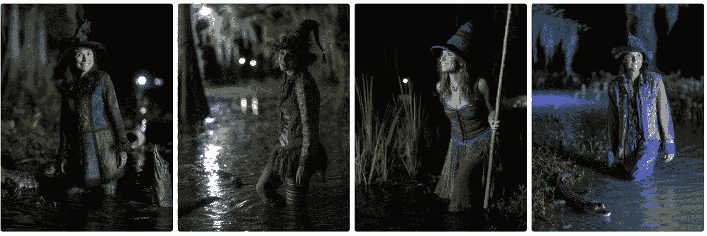

V6.1 👇

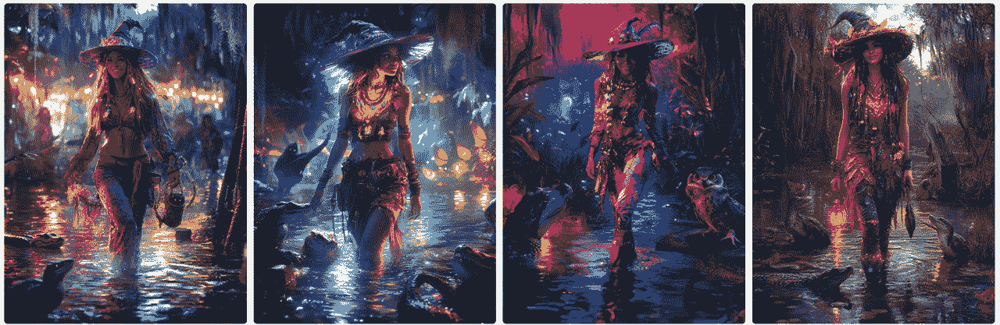

##

# V7 要更新啦

3.30起连续3天，3轮的图像打分测试，我们来看看质感很棒的图吧

2025.4.1

好的👇

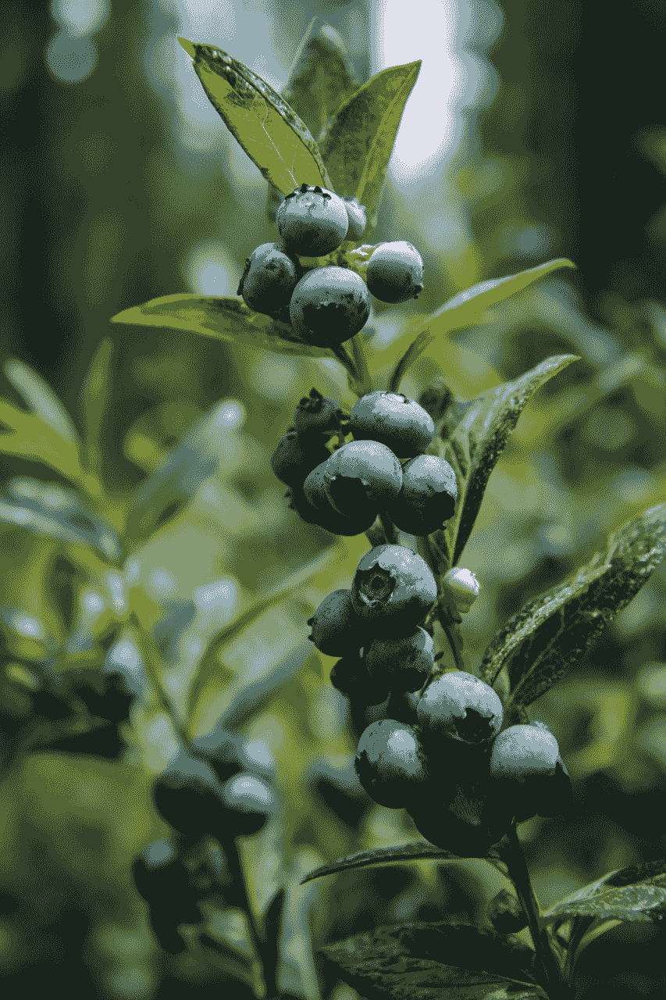

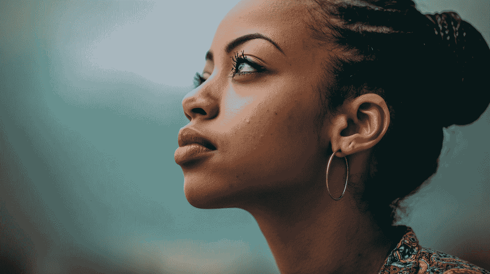

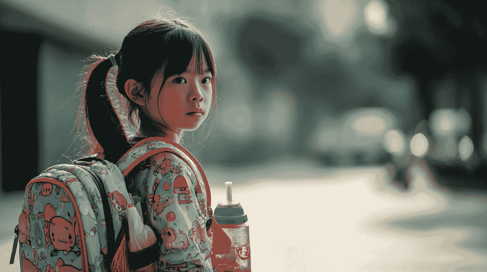

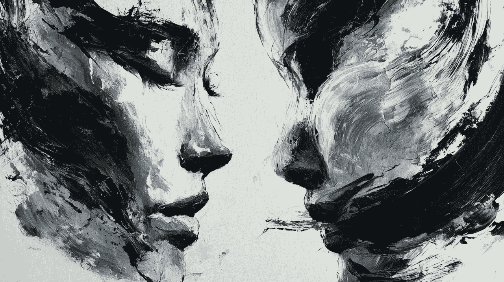

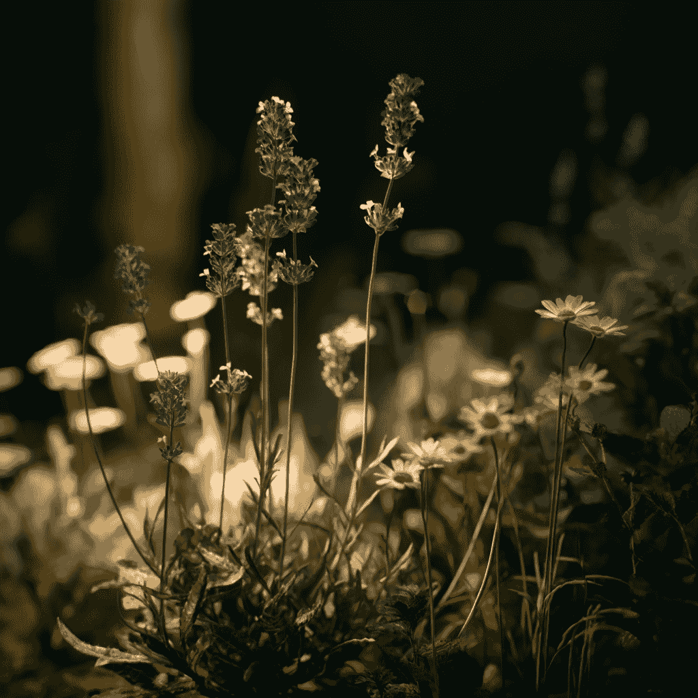

不好的👇

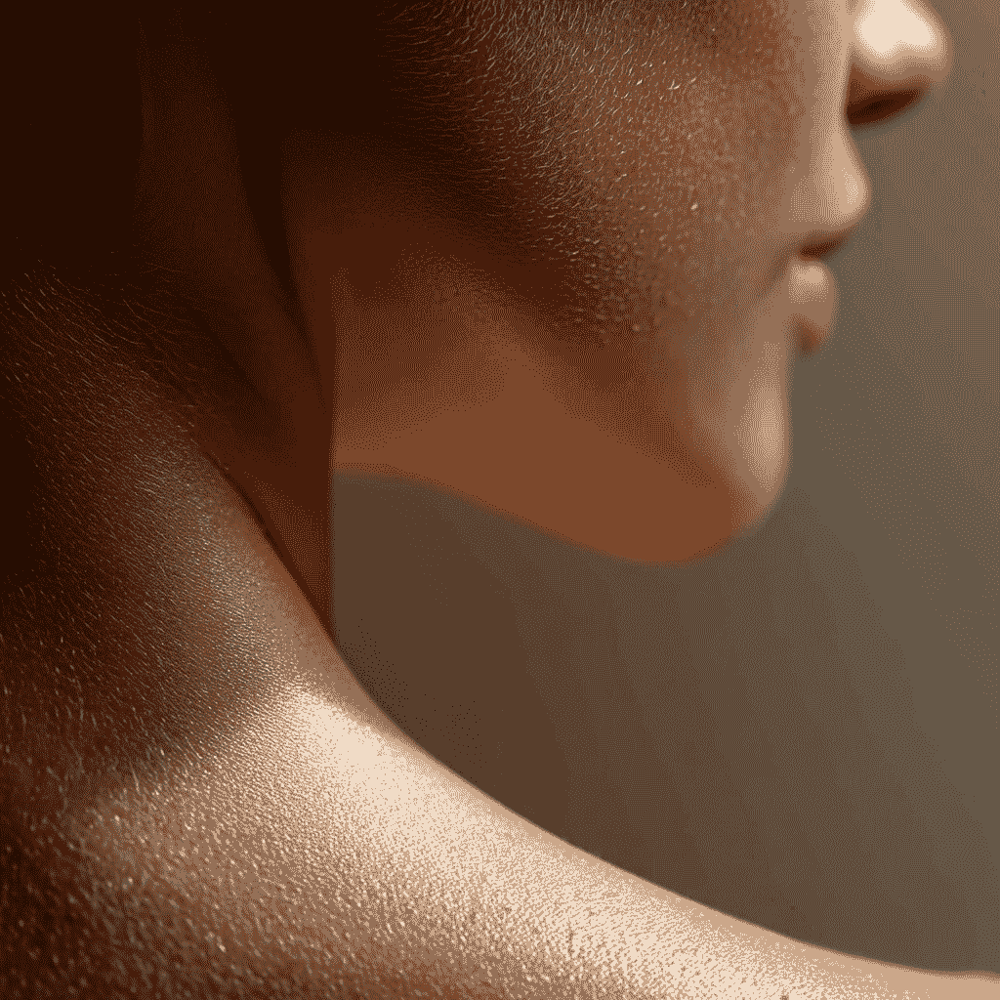

假

手部

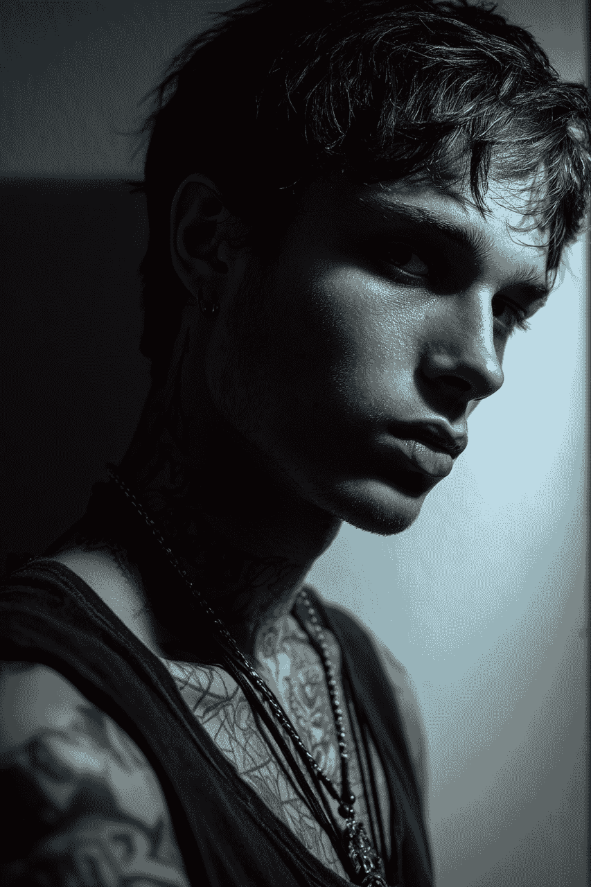

锁骨

# 编辑和重绘纹理

2024.10.24

> 更多新功能测评和使用教程可点击查看：https://www.xiaohongshu.com/user/profile/66c1dcbe000000001d0238df?xhsshare=WeixinSession&appuid=66c1dcbe000000001d0238df&apptime=1730165486&share_id=b65242fdf1f84f26a7651992f59e7178

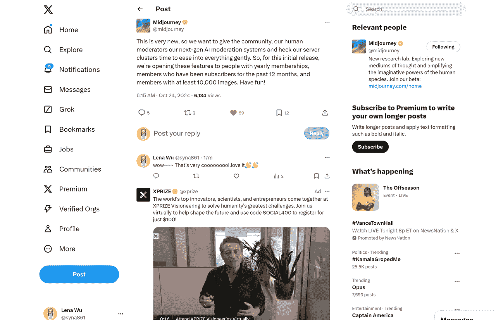

翻译：这个是个新功能，所以我们想给社区、管理员及AI过滤系统和我们的服务器集群一些时间来缓慢适应，在这个初始版本中，我们向年费会员、过去12个月订阅者以及至少有过10000张图片的会员开放。

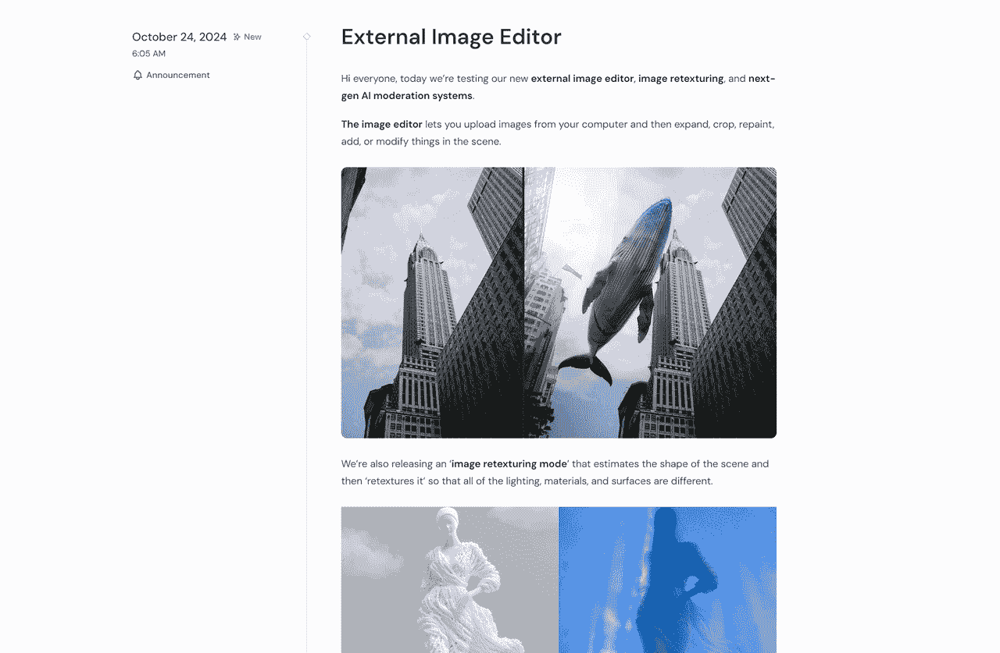

Midjourney通知里详细介绍了此次更新

重绘纹理效果👇👇👇

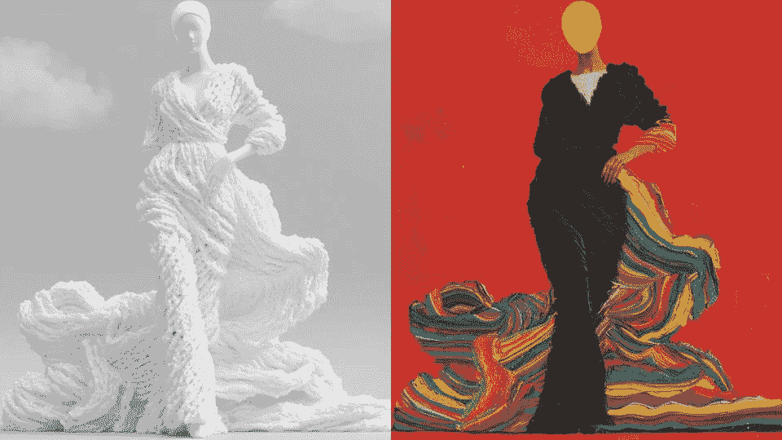

[retexture-example.mp4](https://internal-api-drive-stream.feishu.cn/space/api/box/stream/download/all/ILQdbCNhroDycPxk5ohcyz5knrf)

## 官方教程翻译

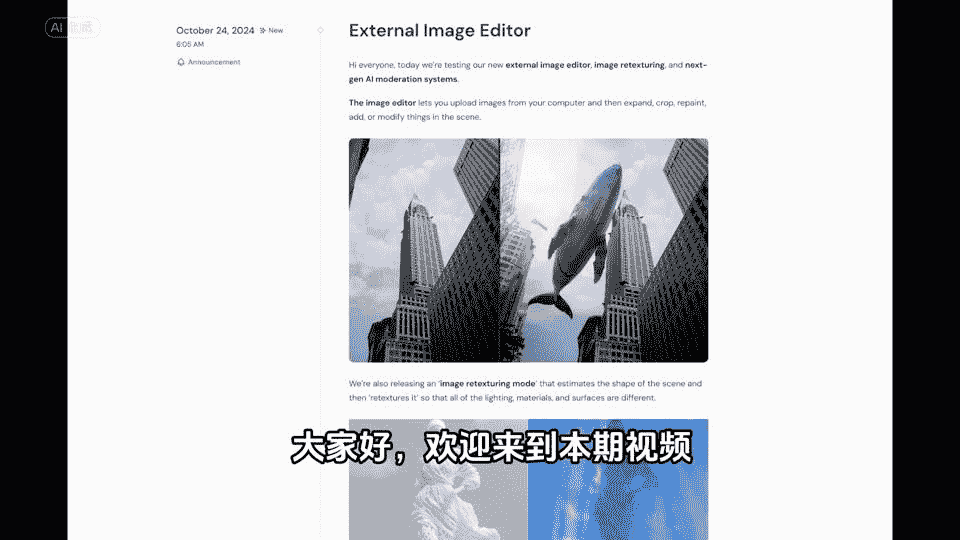

[10月24日lena.mp4](https://internal-api-drive-stream.feishu.cn/space/api/box/stream/download/all/MCA5bq1aWo33ccxh1hccL2ZmnJd)

## 编辑功能测评

这次编辑功能的更新，使用上跟以前区别不大，可以对本地上传的图片进行编辑了

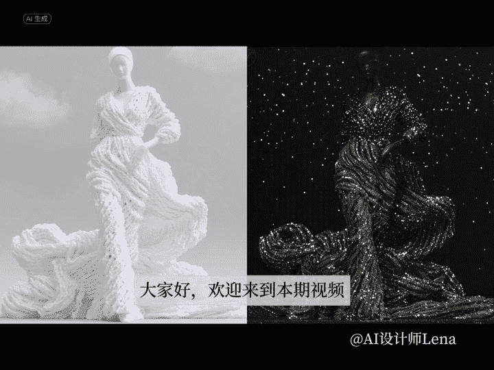

[10月28nnz.mp4](https://internal-api-drive-stream.feishu.cn/space/api/box/stream/download/all/Jqm5byrnRoCXR7xg7cXcChJ6n0e)

## 网友案例

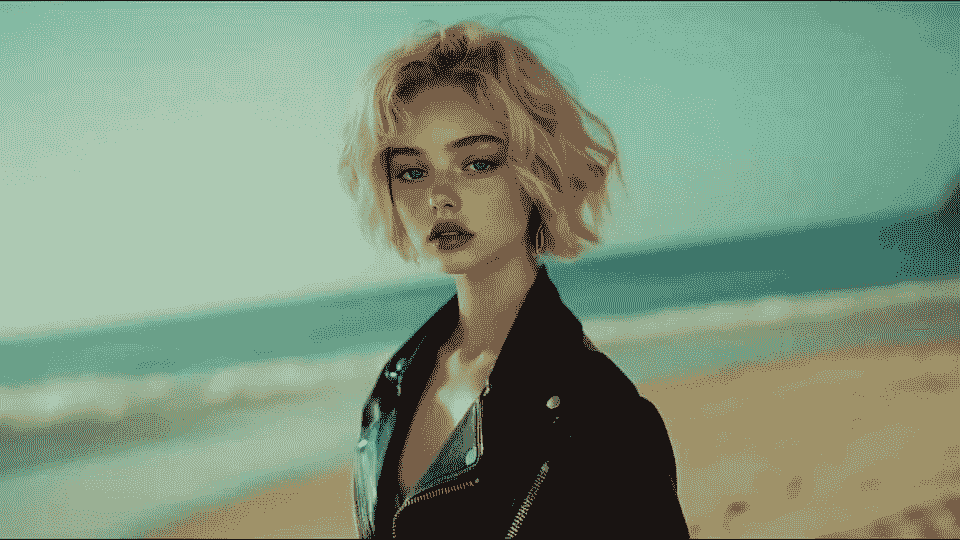

[X2Twitter.com_5zs4qnRwVbK-Lw7v_720p.mp4](https://internal-api-drive-stream.feishu.cn/space/api/box/stream/download/all/UfThbr3P6o68CDxwV3yc1sNrnTc)