# 其他更多AI绘画工具

> 来源：[https://aigclena.feishu.cn/docx/Our3dg4TEozChRxhK7gcN9c6nph](https://aigclena.feishu.cn/docx/Our3dg4TEozChRxhK7gcN9c6nph)

# 阿里巴巴

## 新模型

2025.9.24

阿里 Qwen 团队发布三款新模型

Qwen3-Omni、Qwen-Image-Edit-2509 与 TTS（语音合成）增强功能，其中，Qwen3-Omni 是一个真正的多模态旗舰模型，能够同时处理文本、图像、音频和视频输入，并在多个基准性能测试中优于之前的 Qwen 版本以及一些闭源模型。Qwen-Image-Edit-2509 在图像编辑能力上进行了升级，比如支持同时编辑多张图片（“人＋人”、“人＋商品”、“人＋场景”等组合），提升人像身份一致性、产品识别、字体与文本编辑精度，以及兼容控制图（ControlNet）等高级编辑控制。

更多：https://qwen.ai/research

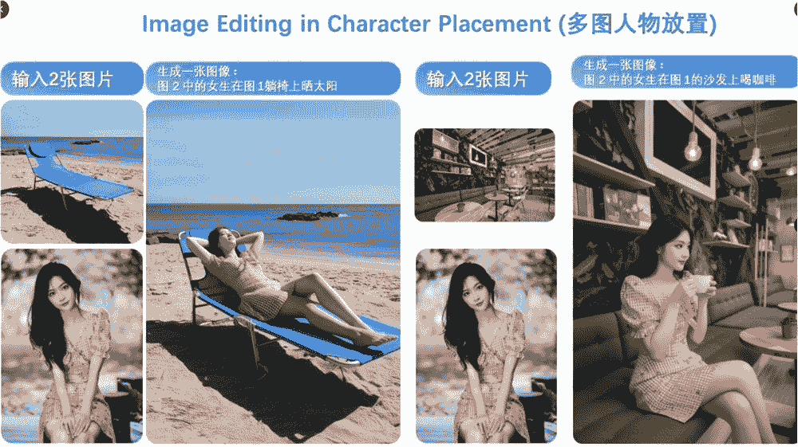

## Qwen-Image-Edit编辑模型

Qwen 推出Qwen-Image-Edit编辑模型

2025.8.19

一个拥有 200 亿参数的开源图像编辑模型。它既能实现像素级精确编辑，又能进行风格转换，同时保持原有角色和物体不变。在一系列图像生成与编辑基准测试中，Qwen-Image-Edit 实现了 SOTA（最先进） 表现，超越了 Seedream、GPT Image 和 FLUX 等竞争对手。

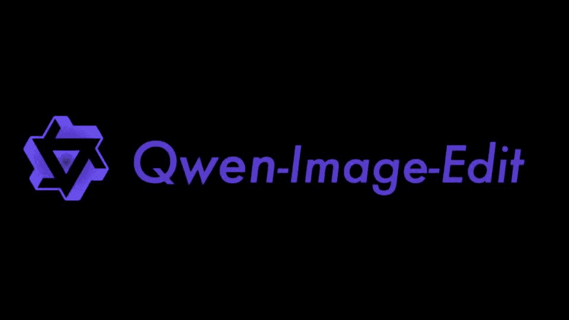

[alibaba-qwen-image-edit-video-demo.mp4](https://internal-api-drive-stream.feishu.cn/space/api/box/stream/download/all/R0Q4bhwoKoDvvhxVO2UciHHgnkd)

## Qwen-Image模型

2025.8.4

一款专注于图像中高保真文字生成的200亿参数AI模型。该模型支持多种视觉风格和双语文字，并配备丰富的编辑功能。通过新颖的空间编码技术，Qwen-Image提升了文字与图像的对齐效果。评测显示它在图像生成和文字渲染上超过多款商业竞品。该模型已免费开源，助力未来视觉-语言界面发展。

详细：https://qwenlm.github.io/blog/qwen-image/

使用地址：https://chat.qwen.ai/

测评：[最新AI绘画测评 一直更](https://aigclena.feishu.cn/wiki/ZVfrwpU2jiDphEkGb0qc7rfSnoh)

# Meta

## DINOv3

Meta 将其最先进的 DINOv3 图像分析模型开放用于商业项目

2025.8.18

Meta 发布了 DINOv3 通用图像处理模型，在 17 亿张图像上通过自监督学习训练，参数规模 70 亿。它无需标注数据，适用于卫星影像等缺乏标注的领域。性能优于 v2，但提升不如 v1→v2 时显著。Meta 提供了可商用的模型、适配器及训练代码，并已在 GitHub 开源。

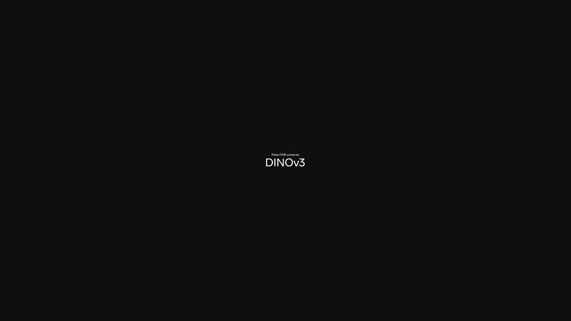

[dinov3_trailer-1.mp4](https://internal-api-drive-stream.feishu.cn/space/api/box/stream/download/all/CDAwbnWd7oUqVKx9JWtc7lVvnGe)

# Reve Halfmoon

Reve推出了文生图Reve Image 1.0  一周内登顶全球排行榜

2025.3.26

在 Artificial Analysis 的 Image Arena 评测中击败 Google Imagen 3、Midjourney V6.1、Recraft V3，排名第一。强调逻辑增强，在提示词匹配和长文本渲染方面表现优异，提供自然语言编辑、照片上传等功能，并开放社区探索。

详细：http://reveai.org/models/reve-image-1.0

体验地址：https://reveai.org/

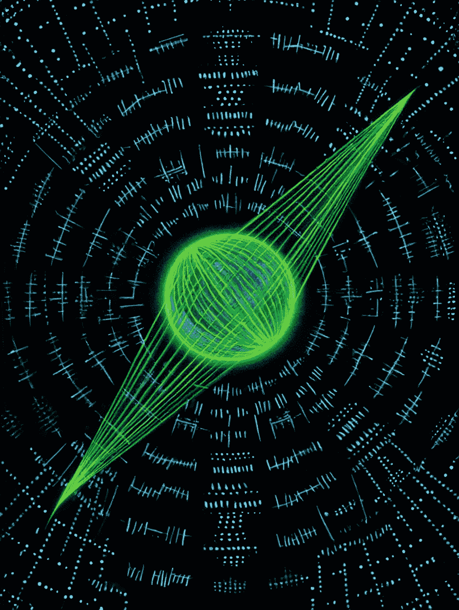

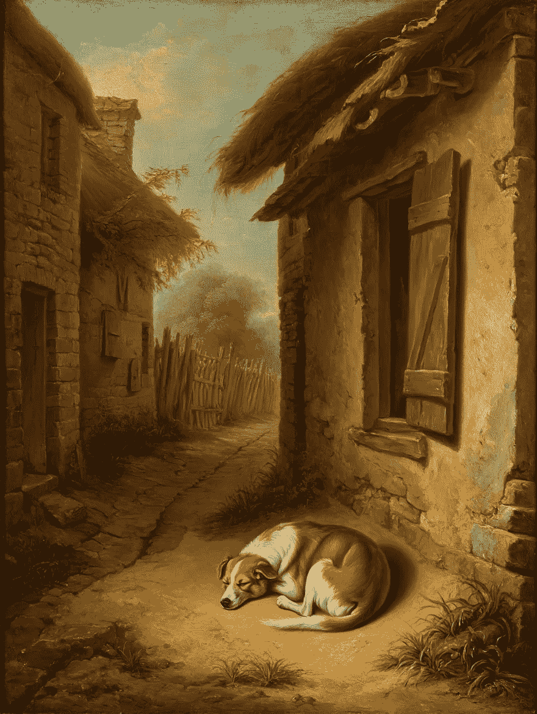

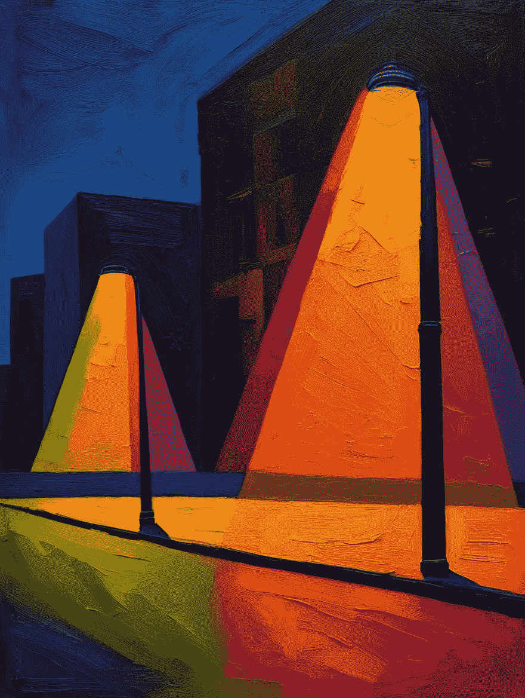

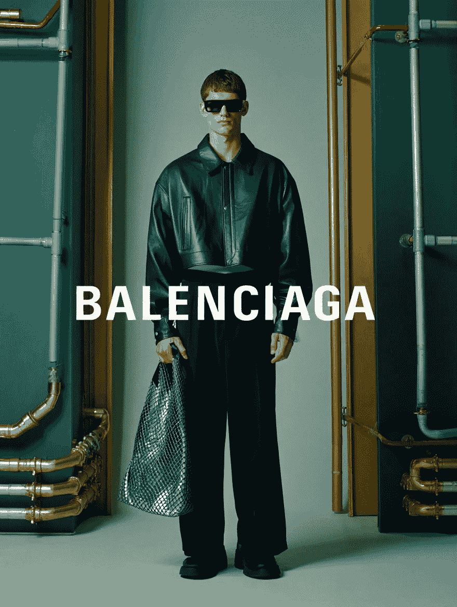

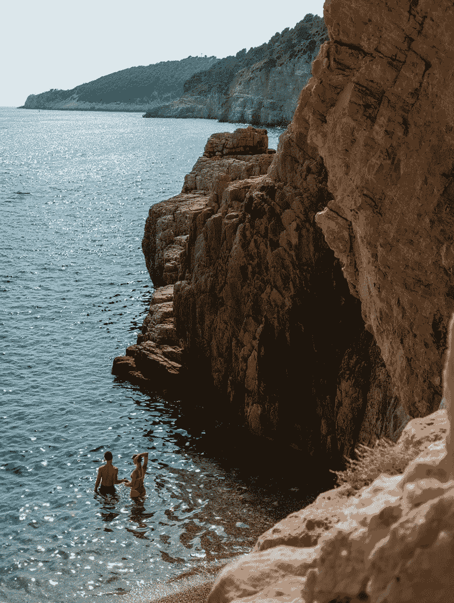

Reve Image 1.0（代号 Halfmoon）在图像质量和生成速度方面表现出色，超越了 Flux、Recraft、Dall-E 3 和 Image3，同时在与行业领先者的竞争中也保持了优势。

根据 Artificial Analysis 的数据，在超过 10 万名用户投票的基础上，Reve Image 1.0 的图像质量名列前茅，并且拥有业内最快的生成速度之一。

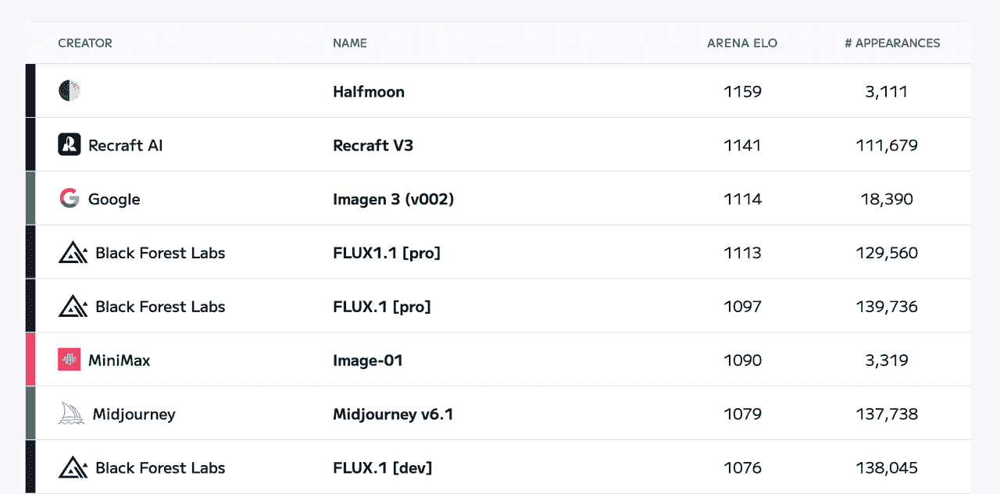

# craft

[X2Twitter.com_g46zzViwfTeh_Qc3_720p.mp4](https://internal-api-drive-stream.feishu.cn/space/api/box/stream/download/all/SDAlbR1C9oiR0FxjmVxcGGdjn1A)

#

1205更新

Ideogram推出背景移除功能

所有付费计划均享受无限制背景移除功能，无需额外积分。搭配魔法填充和扩展功能，轻松打造高端设计作品。

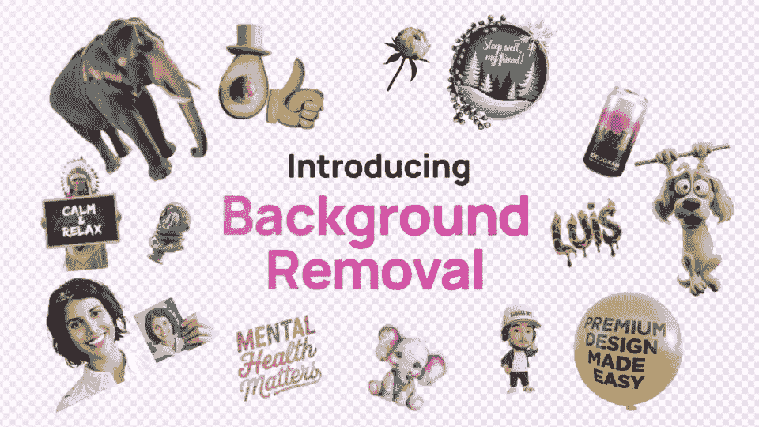

[X2Twitter.com_TPMcSOBcWV_sjMwI_720p.mp4](https://internal-api-drive-stream.feishu.cn/space/api/box/stream/download/all/NrNUbPjLpoN8P6xCWMccE8EmnQb)

# DomoAI

## 11月5日更新

DomoAI推出了18个风格，官方demo👇

[X2Twitter.com_vdwpDqgI3ZOoNdYN_1080p.mp4](https://internal-api-drive-stream.feishu.cn/space/api/box/stream/download/all/QnH1b5cvcoemodxCsCnciQyyn3g)

使用地址：https://www.domoai.app/create/restyle

我的测评

MJ里生成的图片

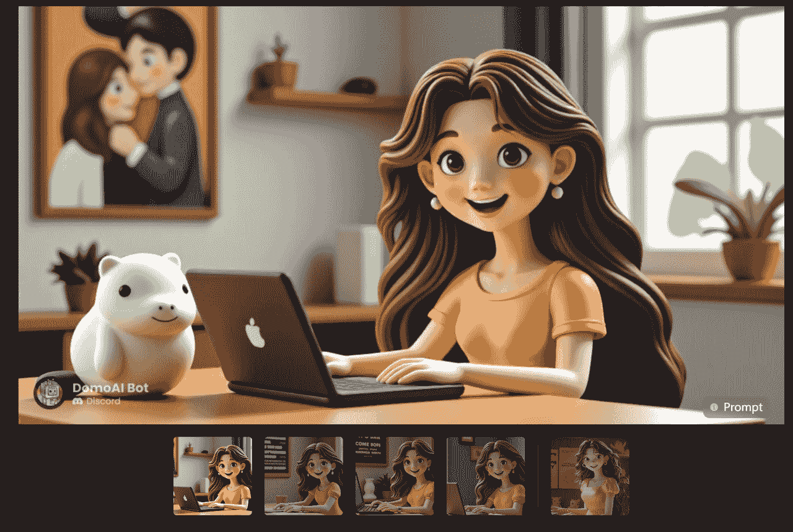

domo v11

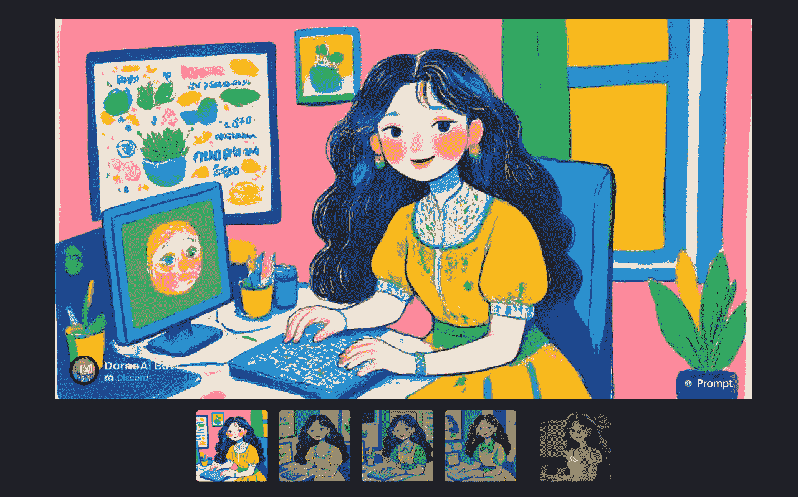

domo v13

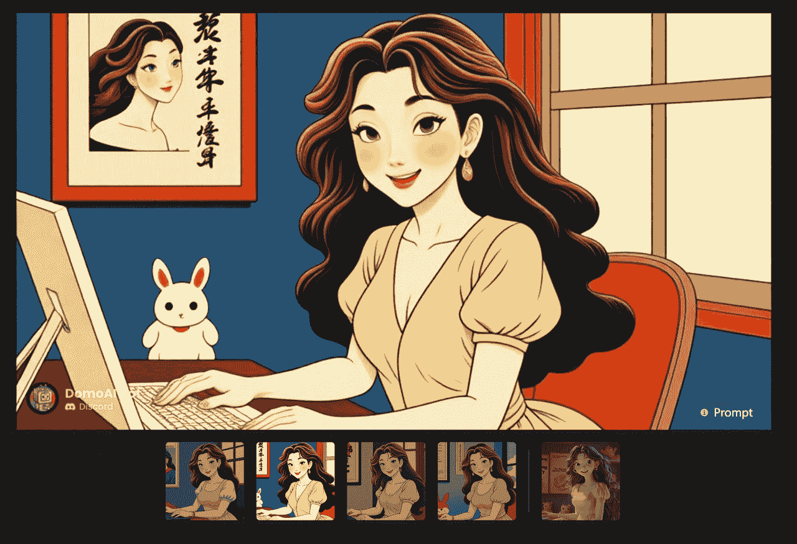

domo v1

# Flora

## 推出创新AI画布0227

Flora正式发布其创新的AI创作工具，旨在重新定义设计工作流程，Flora以其多模型集成与实时协作的特点，成为一种全新的创作平台，专为创意专业人士设计。

官网：https://www.florafauna.ai/

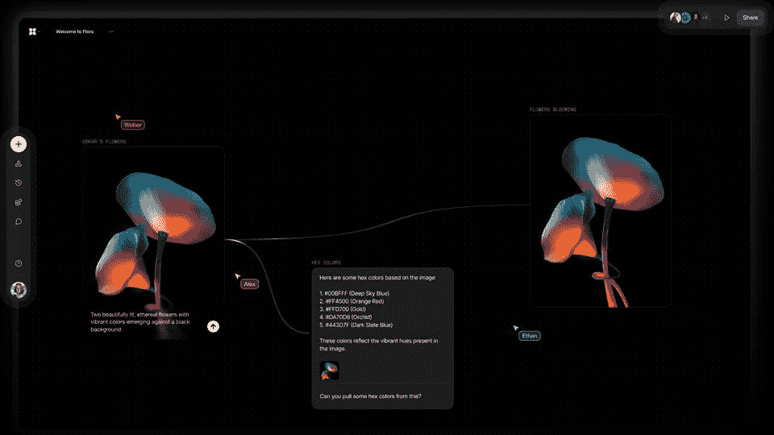

[6387659094429430216540774.mp4](https://internal-api-drive-stream.feishu.cn/space/api/box/stream/download/all/PqVobdWF3olunyxeveicieqAnKg)