# 海报提示词

> 来源：[https://aigclena.feishu.cn/docx/WmgydKwp0o17bFxhFEAc18hEnIp](https://aigclena.feishu.cn/docx/WmgydKwp0o17bFxhFEAc18hEnIp)

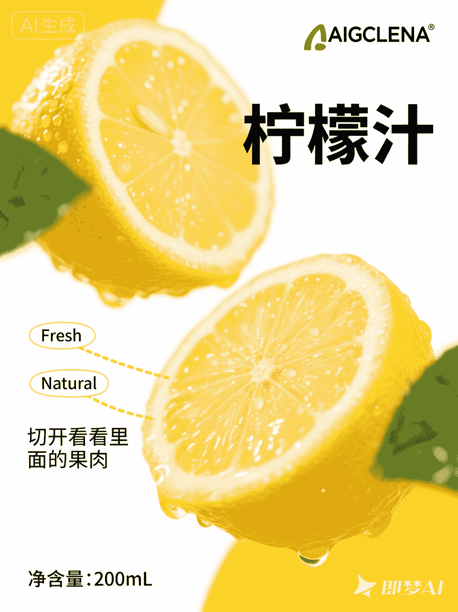

请生成一张竖幅、高品质的产品包装正面图，以微距特写的方式呈现两颗明亮、饱满的柠檬。柠檬表面布满了晶莹剔透的水珠，大小不一，部分水滴正欲滑落，展现出极致的新鲜感和诱人度。上方的柠檬占据画面大部分，下方有一颗切开柠檬的局部特写。背景为黄色，加一点绿叶，以符合文字场景，添加鲜艳色彩和水珠的细节。画面中央留白区域有现代风格的黑色文字排版，包括醒目的“柠檬汁”作为主标题，以及“一口柠檬，满杯阳光。”作为引导语。画面中穿插有细长的黄色虚线，连接着“Fresh”和“Natural”等标签式信息块。海报顶部右侧有“AIGCLENA”品牌标识，左侧有细小英文文本。整体采用高清摄影级别，光影自然，色彩鲜明，营造出健康、清新、充满活力的广告氛围。画面底部包含“净含量：200mL”辅助小字。

# 随手测评

2025.9.29

说明：各平台首次出图的默认效果，排名不分先后

最优解法：图片背景和文字分开生成，先通过垫图生成背景图片，后期再P上文字

原提示词 from@jans，诉求生成网页banner，要展示电脑屏幕内容

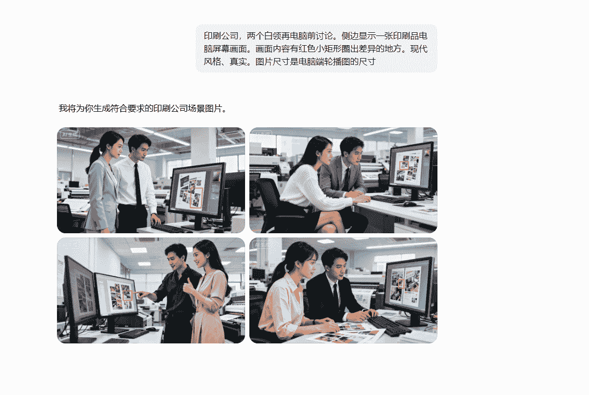

> 修正后提示词：

> 网站首页广告banner，两位职员在电脑前讨论，电脑屏幕显示印刷品画面，其中一人指着电脑屏幕，现代风格、真实。

> 左侧写上以下文字:

> Esko 软件25.07新版本现

> 已正式发布

> 【直播】8月25日4:00-15:30 新品发布会

> 按钮【申请回看】

> 横图尺寸2:1

## 1、sora里的chagpt

使用地址：https://sora.chatgpt.com/library

推荐指数：★★★★☆

## 2、对话框里的gpt

使用地址：https://chatgpt.com/

推荐指数：★★★★☆

## 3、Gemini banana

使用地址：https://gemini.google.com/

推荐指数：★★★★☆

## 4、扣子

使用地址：https://www.coze.cn/

推荐指数：★★★★★

## 5、lovart

使用地址：https://www.lovart.ai/

推荐指数：★★★★★

一次出了4张效果,不同的尺寸

## 6、即梦

使用地址：https://jimeng.jianying.com/

推荐指数：★★★★☆

一次出图4张，语义理解有点小问题，按钮两个字加在按钮里去了

## 7、豆包

使用地址：https://doubao.com/

推荐指数：★★★★☆

# 酸性海报

2025.9.20

By 归臧

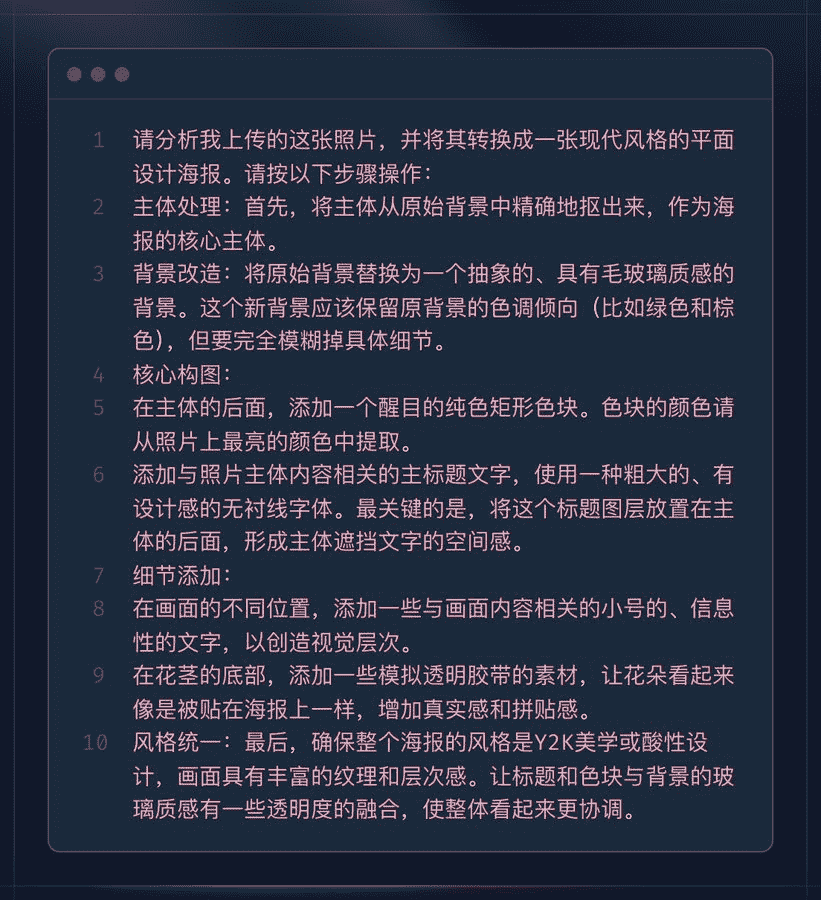

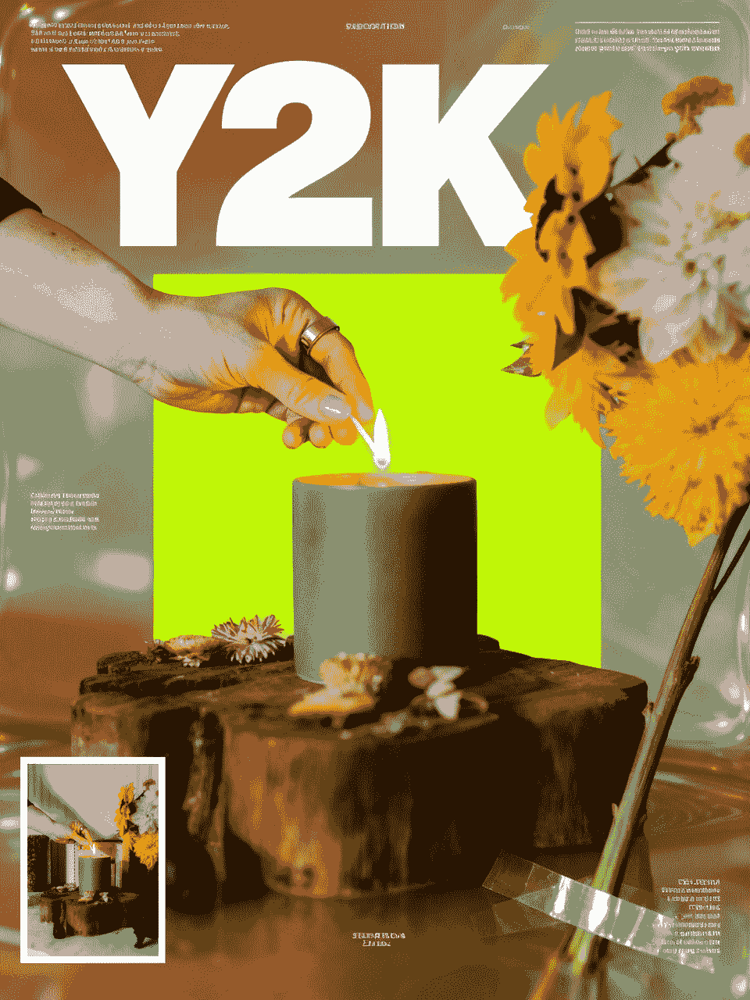

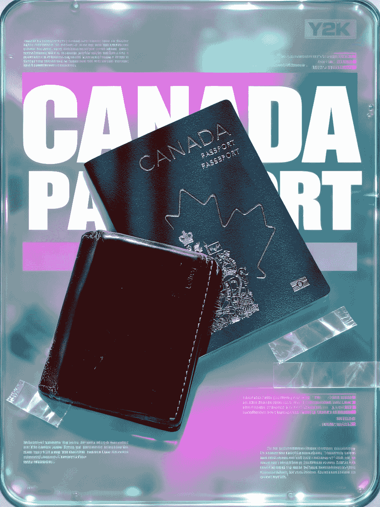

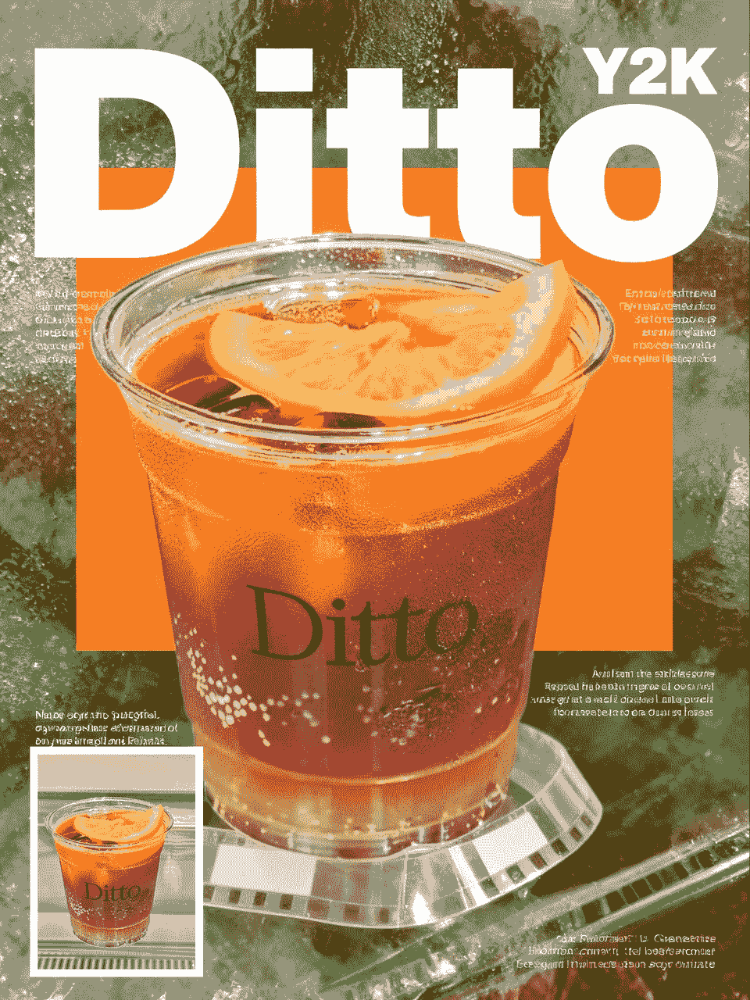

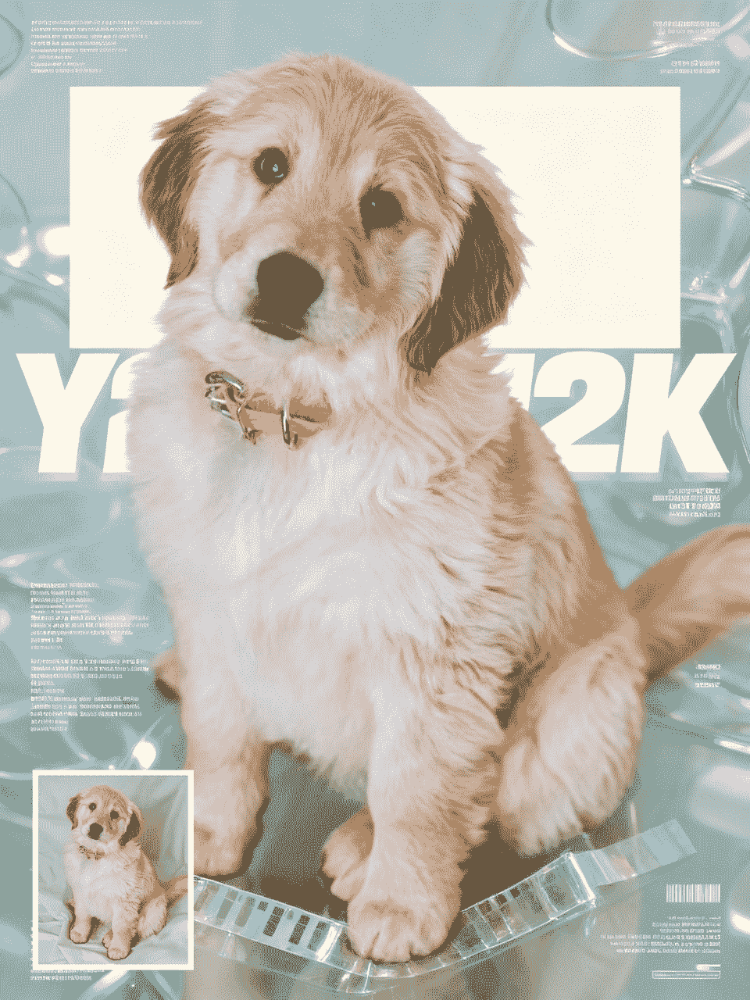

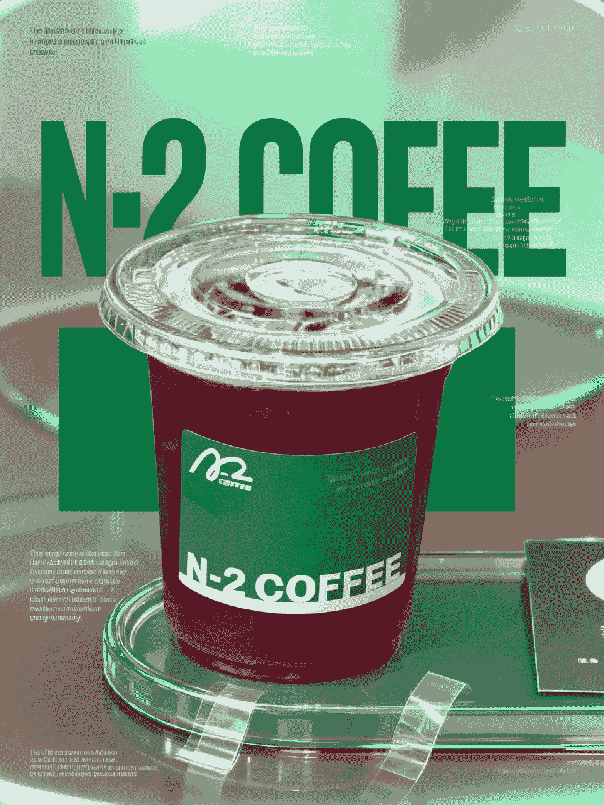

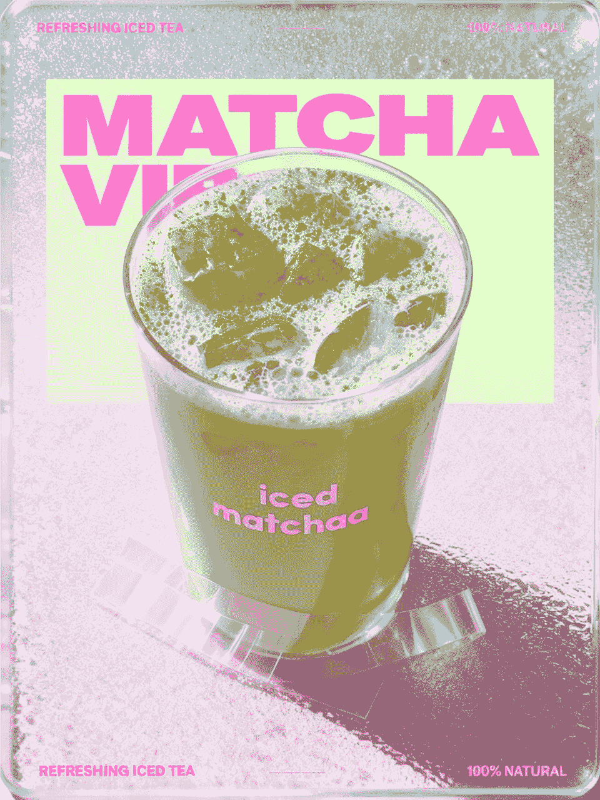

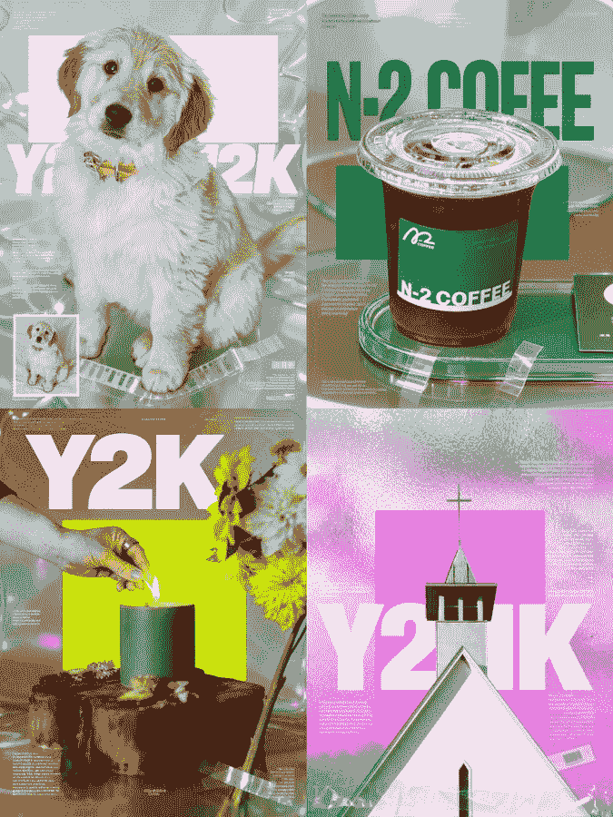

# 美食海报

工具：扣子

2025.9.10

https://space.coze.cn/share/7550620550855885106?share_id=7550883420903276854&secret=RWgFg2RP

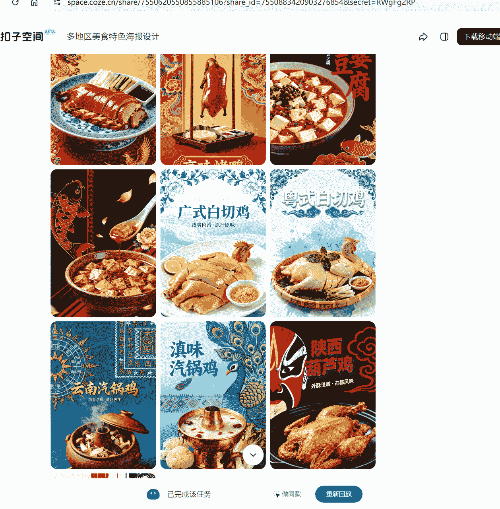

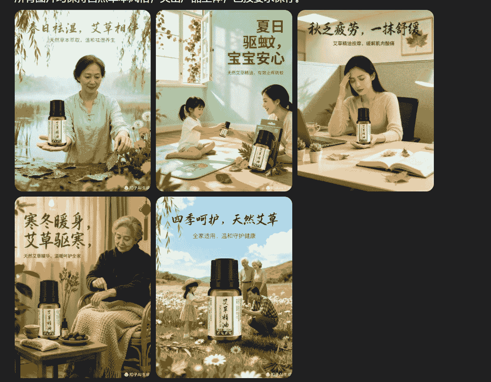