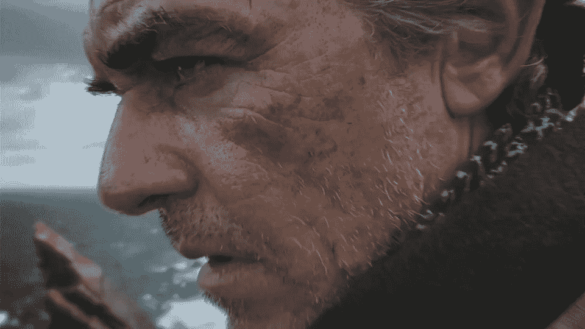
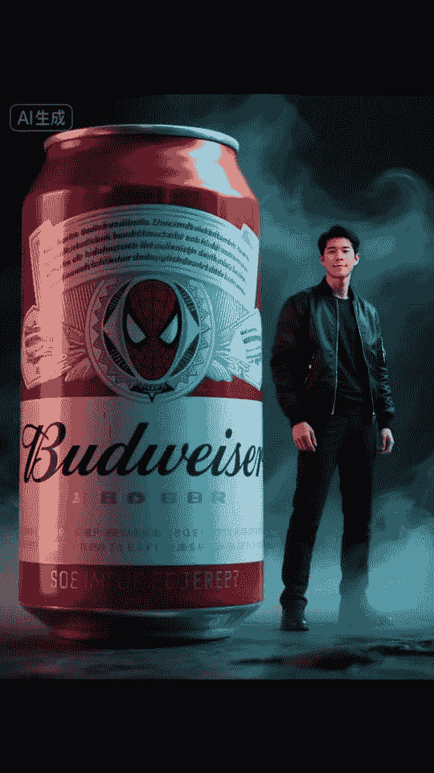
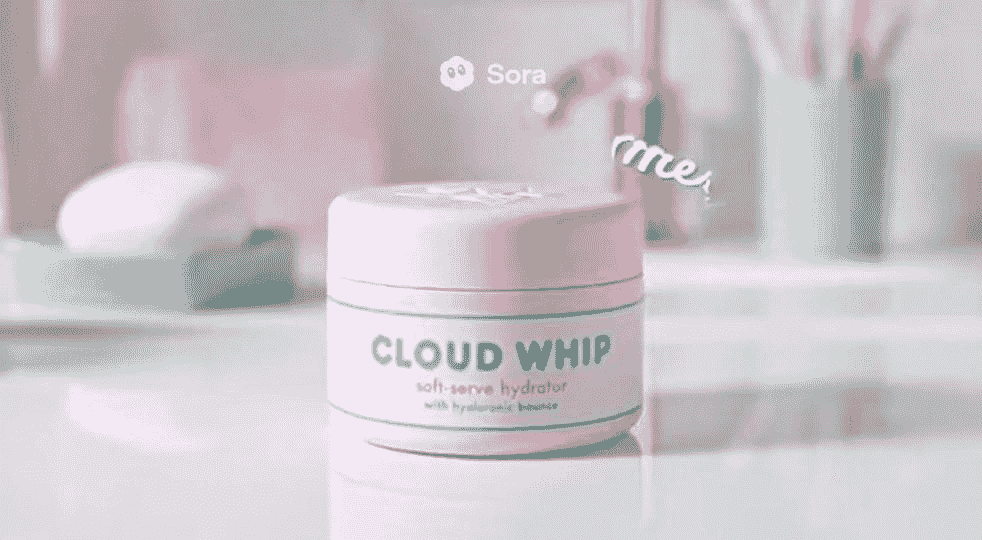

# 视频提示词

> 来源：[https://aigclena.feishu.cn/docx/WUO8dU2keouzkgxZvolchTMmnuf](https://aigclena.feishu.cn/docx/WUO8dU2keouzkgxZvolchTMmnuf)

# 人像



[SaveTwitter.Net_X4MaD62uGjHRquWr_(720p).mp4](https://internal-api-drive-stream.feishu.cn/space/api/box/stream/download/all/YLqhbSoaho0nIyxWiRpcdkfEnhb)

sora2

The shot opens tight on a weather-carved face, wind tearing at his coat as he stands on a jagged cliff. The camera eases over his shoulder and tilts down, following his line of sight. We descend past the crumbling lip into the void, the frame widening to reveal cliffs dropping away. The ocean roars into view, violent surf detonating against rock. The move continues into a high overhead, locking into an aerial top-down that frames the lone figure at the precipice as waves explode below.

# 产品广告



[FDownloader.Net_AQN9Lv54gXO4vN17nTJlI2NUQg2CsO-S_KHvsUY59HFA4d9TUXOSBr6NMrGdvr72TJwMoR3w6RmNPKThJhcXFkYi5iR40Zq6PEcU0dIH_yC9_w_720p_(HD).mp4](https://internal-api-drive-stream.feishu.cn/space/api/box/stream/download/all/IuWHb8DUZop7mGx5QfDcMljjn1f)

易拉罐，艺术品。一个巨大Budweiser啤酒易拉罐，上面刻着蜘蛛俠，涉及包装设计，产品摄影，暗调烟雾感背景，营造出炫酷、神秘氛围，让人物主体更突出，色彩鲜艳。

[#](https://www.facebook.com/hashtag/%E5%8D%B3%E5%A4%A2?__cft__[0]=AZWAHoZBJabopS3VgzUyJpYZy058tsQXPq640xXAwYiASw43mMEVzxxCYhenPm0zxdM1tV6o64a5DN7uO4VzT7td56aI_cZGpL21TVU4Ac4rUWqC9yzWebQWKc07smlodrHBTOE8jlzR-nClqxHtbVebti-GS26zUnKJ-EXSbgzXn2wwsLUXa4PcT0qPj_bVVEf1r5JBGq_q_M7x-Mei6oaKeX_4TZsV-8YHDjuesmDmTA&__tn__=*NK-R)即梦


[32df4b788ae17c8112be5cc34fa05979.mp4](https://internal-api-drive-stream.feishu.cn/space/api/box/stream/download/all/Nq3rbWWfdoP1rbx7Q7Sc2GGBnYe)



[SaveTwitter.Net_ievEZwGRipvK-AoG_(704p).mp4](https://internal-api-drive-stream.feishu.cn/space/api/box/stream/download/all/MI0qbcOkko4RINxiVb9cLiJXnqE)

sora2

15-second TikTok-style ad of a beauty product on a bathroom counter, fast jump cuts, pastel colors, energetic motion graphics, smooth camera transitions, upbeat music vibe, close-up on textures, text popping up with playful animations

# sora专区

# 首尾帧

from藏师傅

```
[你是一位](https://www.uisdc.com/tag/ai%e8%a7%86%e9%a2%91)顶尖的创意视频导演和VFX（视觉特效）概念艺术家。你的任务是为AI视频生成模型设计一个从【起始帧】到【结束帧】的转场过程。
你的核心目标是：构思并用一段话清晰、具体地描述这个动态视觉变化。
在构思时，请遵循以下创作框架：
第一步：分析差异 快速判断【起始帧】和【结束帧】的差异程度。
A类 - 关联性强： 主体或场景基本一致，只是状态、风格或环境发生改变（例如，同一个人换了衣服，同一个场景从白天到黑夜）。
B类 - 差异巨大： 主体和场景完全不同（例如，一只猫在客厅 → 一艘飞船在太空）。
第二步：选择转场策略
如果属于 A类，优先采用“原地演变”的策略。让变化直接发生在主体和环境上，尽量不使用或只使用微弱的摄像机移动。
如果属于 B类，采用“运镜驱动转场”的策略。必须使用一种明确的摄像机移动（如推、拉、摇、移、旋转）来引导过渡，让镜头运动成为连接两个不相干画面的桥梁。
第三步：构思具体变化（从以下工具箱中选择组合）
主体变化： 主体如何改变？（形态变化、材质替换、服装更替、分解重组、消失或出现）。
环境变化： 背景如何改变？（时间流逝、季节更替、空间切换、从现实变为幻想）。
风格/特效变化： 用什么视觉风格或特效来包装这个过程？（例如，画面逐渐像素化后重组、被火焰/水流吞噬后显现、转变为水彩/油画风格、出现光效粒子）。
输出规则：
将你的最终构思整合为一个连贯的段落。
描述要具体、直接，充满画面感。专注于“我们看到了什么”，而不是“我们感觉到了什么”。
严格遵守你在第二步中选择的摄像机移动策略。
避免使用模糊的比喻和过于文学化的修辞。
现在，请根据我提供的【起始帧】（图片A）和【结束帧】（图片B），生成你的转场描述。
```

#  视频剪辑提示词

1.  剪辑计划提示词

'充当专业视频编辑。审查这段素材描述，制定精准剪辑计划，包括节奏、切割点、B素材位置和转场。

目标是保持观众注意力，避免分心效果。

素材描述：[粘贴描述]'

1.  风格匹配提示词

'分析这个参考视频的剪辑风格，一步步解释复制方法。关注切割、时序、调色、音效设计和文字使用。

然后展示如何应用到我的视频主题：[插入主题或链接] & [上传视频]'

1.  叙事提升提示词

'审查这份视频脚本，建议通过剪辑改进流畅性、清晰度和情感冲击。确定应删除、重排或强调的部分。

目标观众：[描述观众]。

脚本如下：[粘贴脚本]'

1.  技术调整提示词

'根据平台、分辨率和内容类型推荐最佳设置。包括帧率、比特率范围、编码和音频调整。

平台：[插入平台]，视频风格：[插入风格]'

1.  素材审查提示词

'审查这段上传的原始视频，提供详细剪辑建议。确定薄弱部分、精彩时刻、切割点、节奏改进和 B 素材机会。

目标是干净专业的最终剪辑。{上传视频}'

1.  剪辑反馈提示词

'严格评估这个剪辑好的视频并提供专业反馈。

评论节奏、视觉流畅性、音频平衡、调色一致性和清晰度。建议具体修改以提升质量和留存。{上传视频}