# 人像提示词

> 来源：[https://aigclena.feishu.cn/docx/YTbFdWutYoC8vExRIhncBghpn5D](https://aigclena.feishu.cn/docx/YTbFdWutYoC8vExRIhncBghpn5D)

#

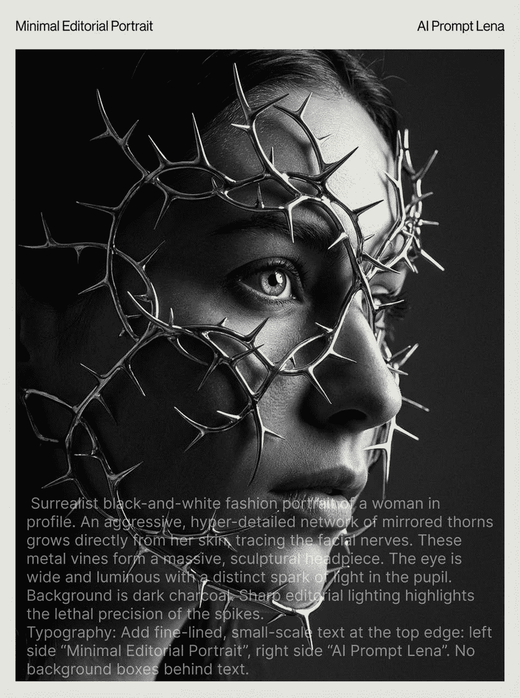

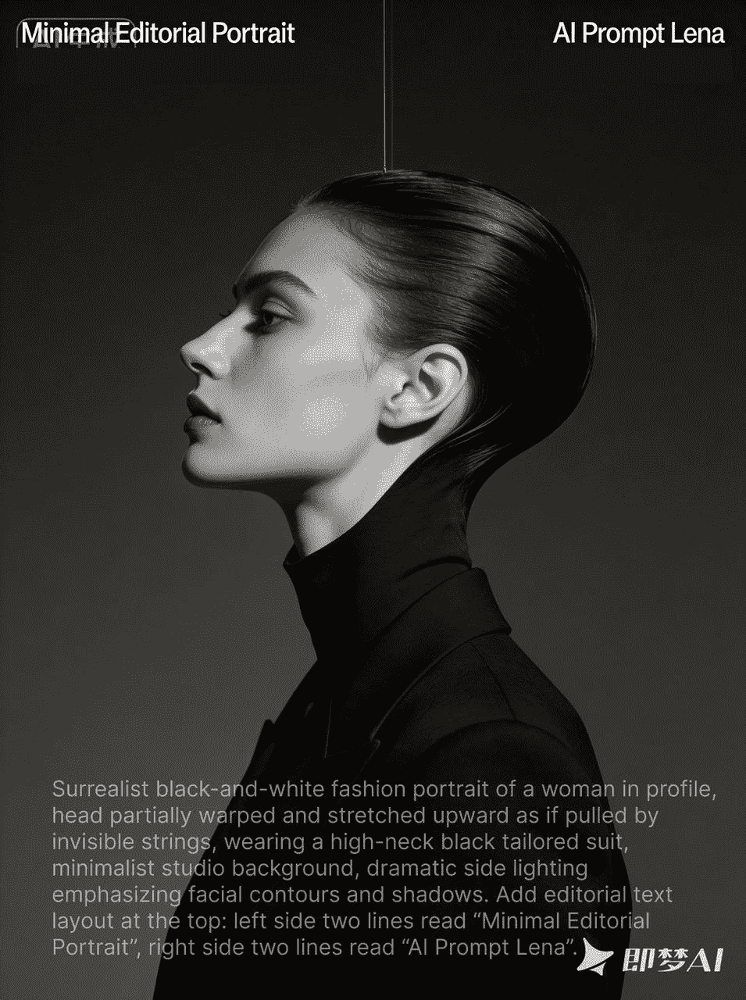

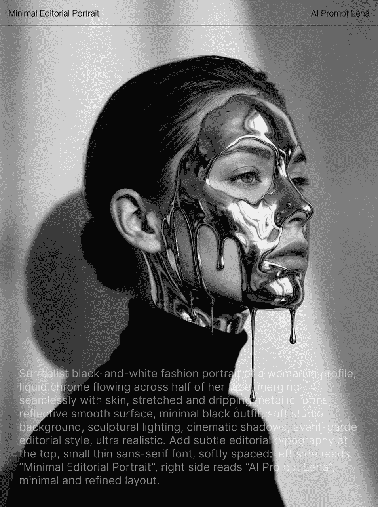

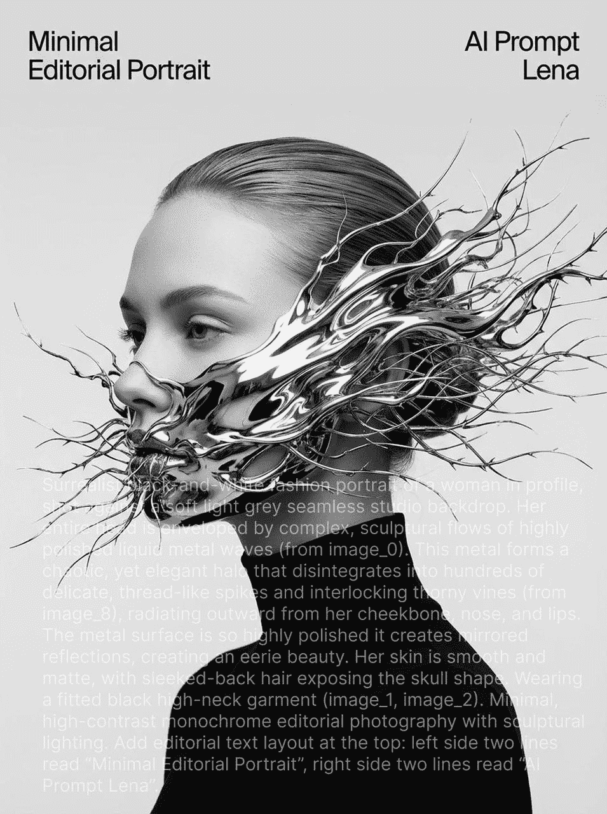

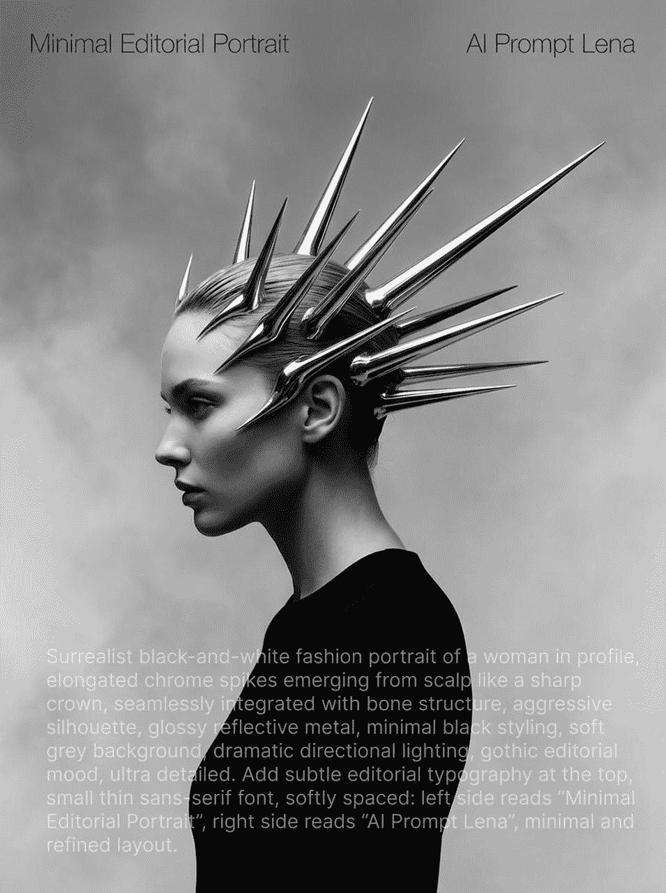

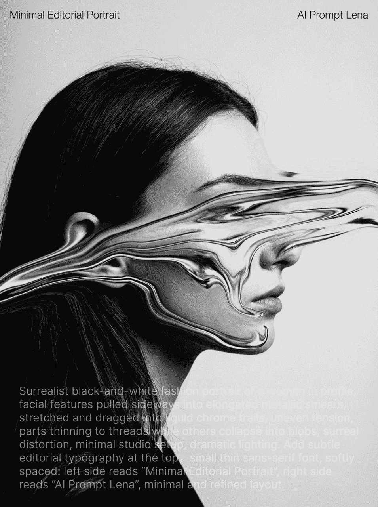

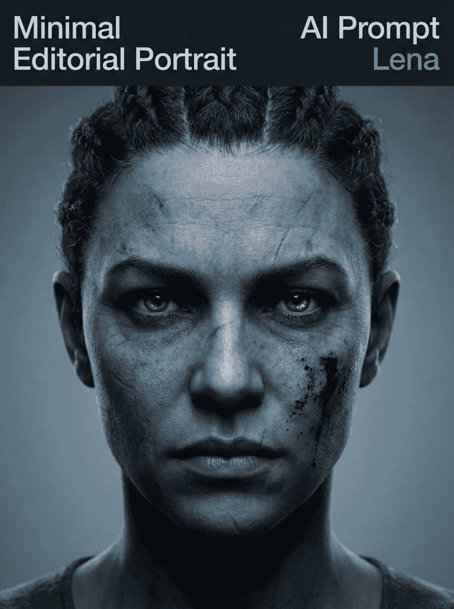

A fierce female warrior in her late 30s. Her face is a tapestry of survival, with fine battle scars across her cheek and temple, and faint wrinkles around her eyes showing endures pain. A smear of fresh blood is on her cheek. Intense, glowing amber eyes that stare directly into the camera with silent fury. Her hair is short and braided back. Minimal speaking, only her eyes speak. 8K, extreme detail, cinematic lighting, dramatic chiaroscuro, cold tones, moody atmosphere, Unreal Engine 5 render style.Top editorial text layout: left side two lines read Minimal Editorial Portrait, right side two lines read AI Prompt Lena.

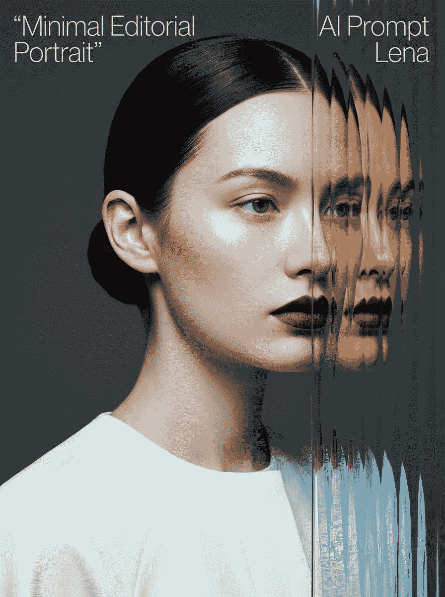

High-fashion beauty editorial portrait of a young female model with sleek dark hair pulled back, pale luminous skin and delicate facial features. The model has a calm, neutral expression with bold red lipstick, looking slightly to the side. Wearing a minimalist white top with clean lines. Dramatic cinematic lighting creating a distorted ripple glass effect across the face, producing abstract fragmented reflections and layered repetition of facial features. Solid dark seamless background enhancing contrast. Close-up portrait composition, modern fashion magazine photography style, minimalist aesthetic, ultra realistic skin texture, sharp focus, high contrast lighting, cinematic color grading, 8k detail. Top editorial text layout: left side two lines read “Minimal Editorial Portrait”, right side two lines read “AI Prompt Lena”.

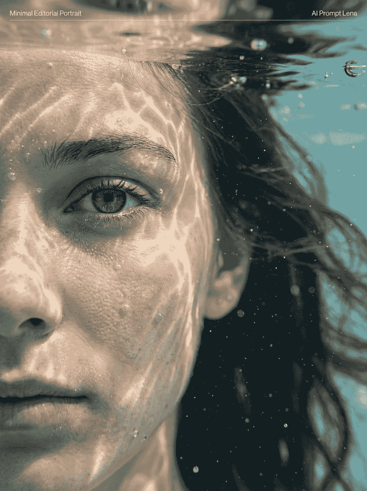

Hyper-realistic underwater macro portrait of the left half of a young woman’s face submerged in water. Only one eye is visible and in sharp focus, capturing an intense and calm gaze. Her fair skin reveals ultra-detailed texture with tiny pores and subtle reflections.

Soft cinematic lighting passes through the water, creating beautiful caustic light patterns and fluid reflections across the skin. Small suspended droplets, micro-bubbles, and floating particles add depth and realism to the underwater environment.

Dark hair flows gently into the water on the right side of the frame, moving naturally with the current. The composition is tightly cropped to show only the left half of the face, emphasizing the eye and the interaction between water and light.

Shallow depth of field, underwater macro photography style, dreamlike and ethereal mood, extremely detailed skin texture, surreal cinematic aesthetic, ultra-realistic lighting, 8K photorealistic, professional underwater beauty photography, aspect ratio 3:4.

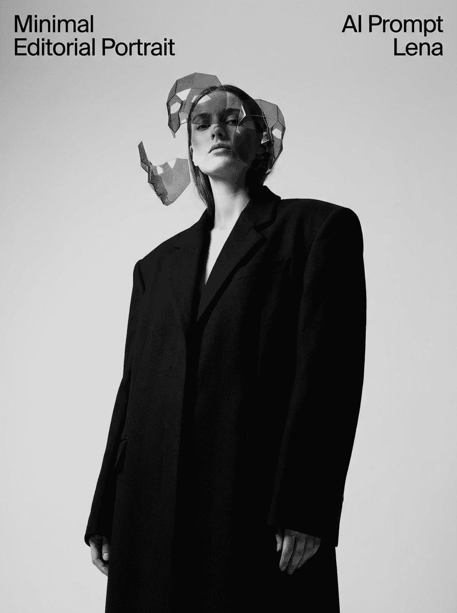

Avant-garde black and white fashion portrait shot from a low angle. The woman stands tall wearing a long black structured coat with exaggerated shoulders. Floating mask fragments hover around the face, partially obscuring the eyes and forehead. Soft light grey studio background, dramatic editorial lighting.

Add editorial text layout at the top: left side two lines read “Minimal Editorial Portrait”, right side two lines read “AI Prompt Lena”.

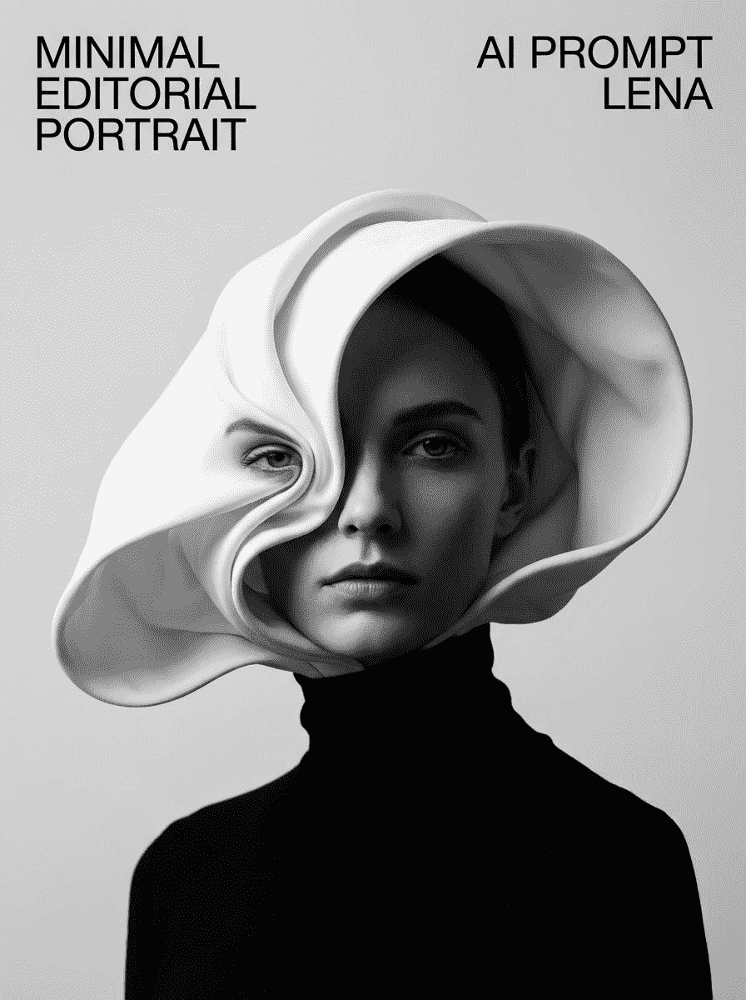

Ultra-realistic black and white avant-garde portrait of a woman wearing a sculptural white hood integrated into a black garment. The hood twists into exaggerated folds that distort the facial proportions. Soft light grey studio background, cinematic lighting, conceptual editorial photography.

Add editorial text layout at the top: left side two lines read “Minimal Editorial Portrait”, right side two lines read “AI Prompt Lena”.

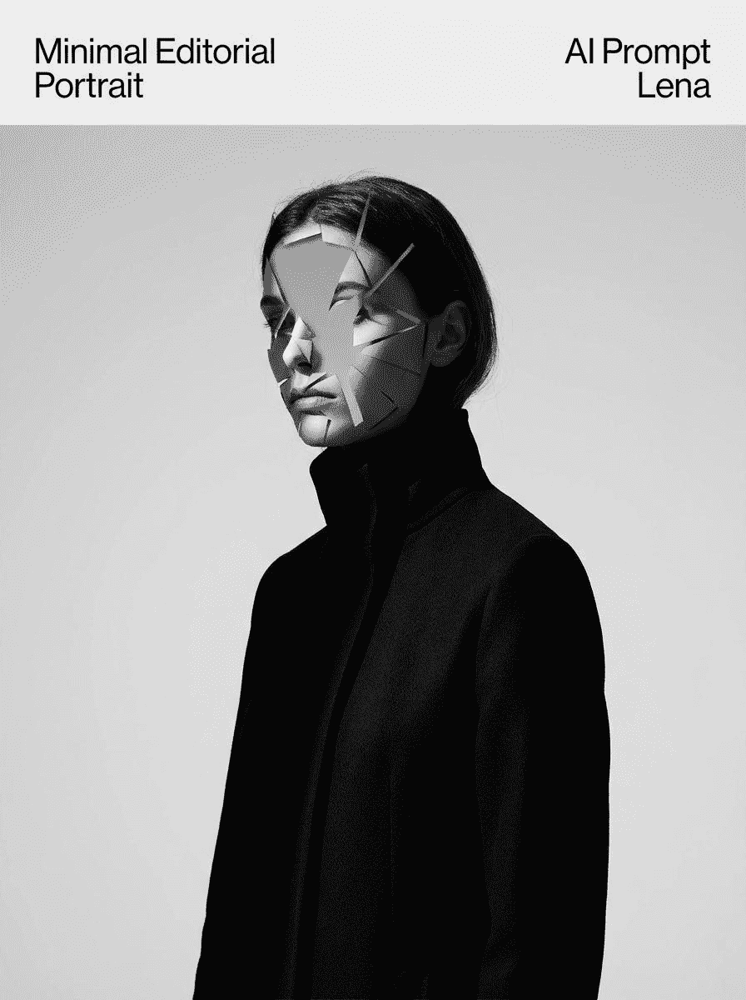

Minimalist black and white fashion portrait of a woman wearing a black high-neck coat. Her face is partially erased and cut into sharp geometric fragments, creating a surreal identity distortion effect. Soft light grey studio background, dramatic editorial lighting, high fashion conceptual photography.

Add editorial text layout at the top: left side two lines read “Minimal Editorial Portrait”, right side two lines read “AI Prompt Lena”.

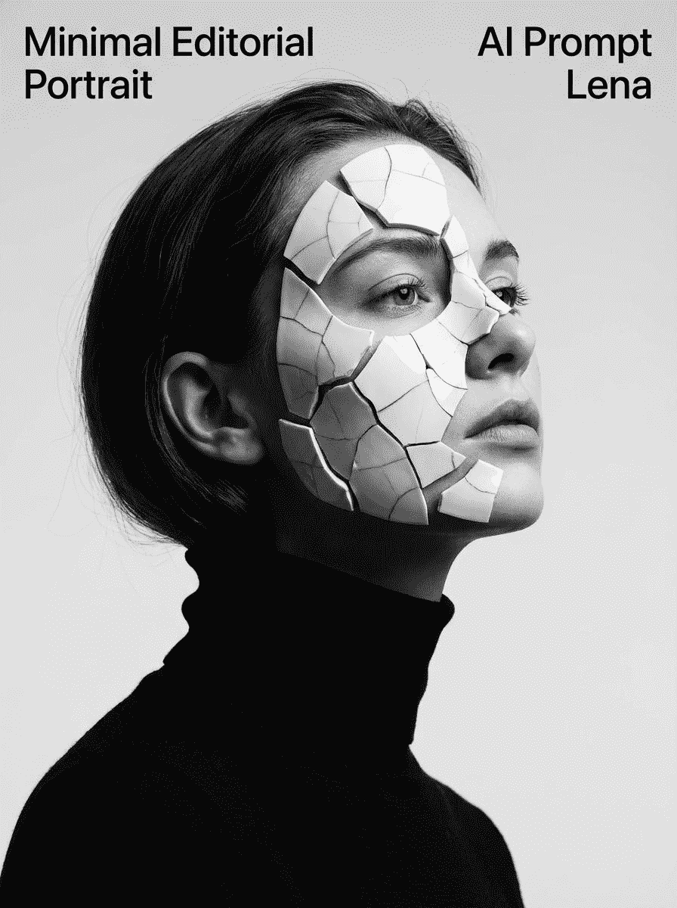

Ultra-realistic black and white portrait. Three-quarter profile facing right. The woman tilts her head slightly upward. She wears a black turtleneck garment. A fragmented sculptural mask spreads across the right side of her face, covering the eye and cheek like cracked porcelain pieces attached to the skin. Soft light grey studio background, dramatic editorial lighting.Add editorial text layout at the top: left side two lines read “Minimal Editorial Portrait”, right side two lines read “AI Prompt Lena”.

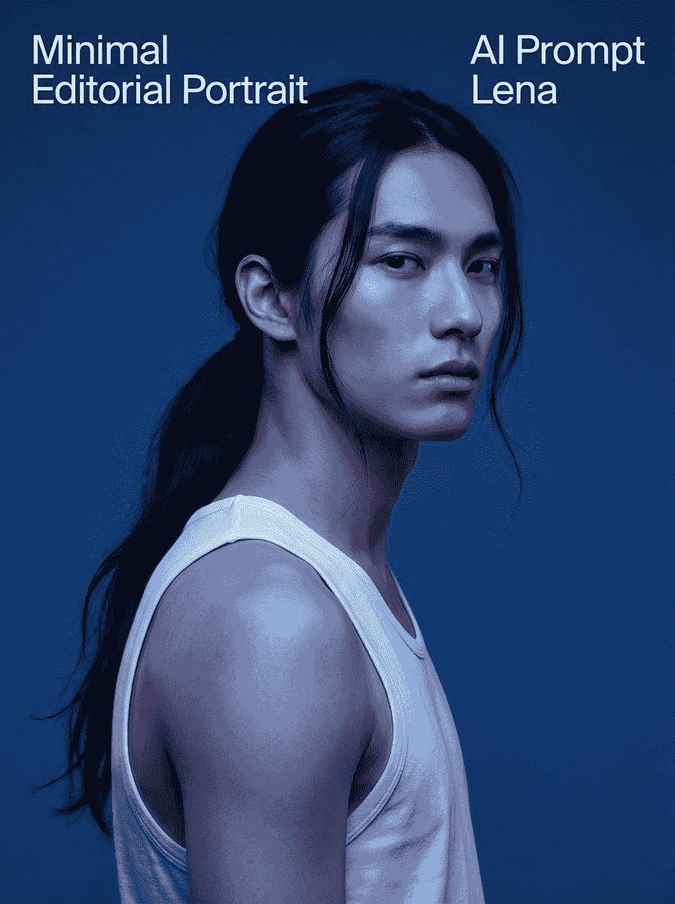

High-fashion editorial portrait of a Japanese male model with short clean hair and sharp facial features. The model has a melancholic, fashionable and emotionally distant expression, looking sideways toward the camera with calm, slightly tired eyes and relaxed lips. Wearing a minimalist white sleeveless tank top. Dramatic cinematic studio lighting in blue tones with subtle purple highlights, creating a moody atmospheric glow on the skin. Solid blue seamless studio background with smooth gradient lighting. Side profile portrait composition, modern fashion magazine photography style, minimalist aesthetic, high contrast lighting, cinematic color grading, ultra realistic skin texture, sharp focus, 8k detail. Top editorial text layout: left side two lines read “Minimal Editorial Portrait”, right side two lines read “AI Prompt Lena”.

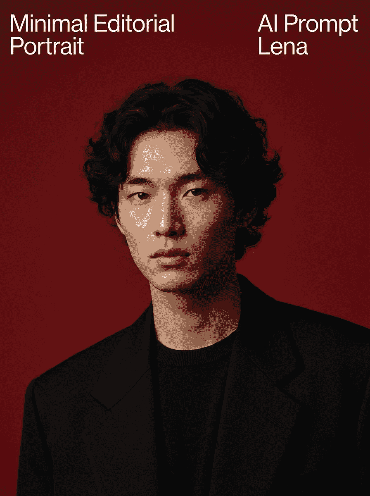

High-fashion editorial portrait of a young East Asian male model with short cropped hair and strong facial features. The model has a calm confident expression, looking slightly to the side with relaxed lips. Wearing a dark jacket over a simple shirt and a chunky metal chain necklace. Dramatic cinematic studio lighting casting shadows across the face, emphasizing facial structure and skin texture. Solid deep red seamless studio background creating strong color contrast. Close-up portrait composition, modern fashion magazine photography style, minimalist composition, sharp focus, high contrast lighting, cinematic color grading, ultra realistic skin texture, 8k detail.

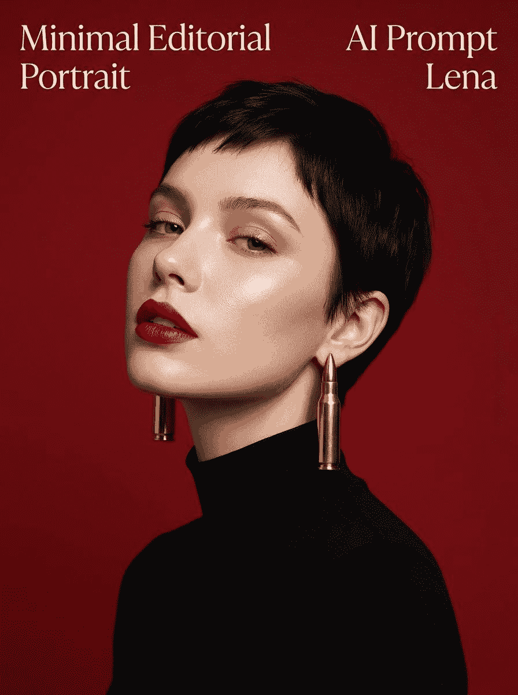

High-fashion beauty editorial portrait of a young female model with a short dark pixie haircut, pale luminous skin and delicate facial features. The model wears bold red lipstick, soft warm eyeshadow and glowing skin. She poses with her head slightly tilted back and turned sideways, looking confidently toward the camera with a calm seductive expression and slightly parted lips. Wearing a minimalist black high-neck top creating a clean elegant silhouette. Large exaggerated statement earrings shaped like metallic bullet cartridges, cylindrical brass bullet forms used as avant-garde fashion earrings, polished metal surface, reflective brass texture, oversized sculptural industrial jewelry. Solid deep red seamless studio background creating strong color contrast. Soft but dramatic studio lighting highlighting cheekbones and skin texture. Modern high-fashion magazine beauty photography, minimalist composition, editorial aesthetic, ultra realistic skin texture, sharp focus, cinematic lighting, high contrast, 8k detail.

Top editorial text layout:

**l**eft side two lines read “Minimal Editorial Portrait”

**right side two lines r**ead “AI Prompt Lena”

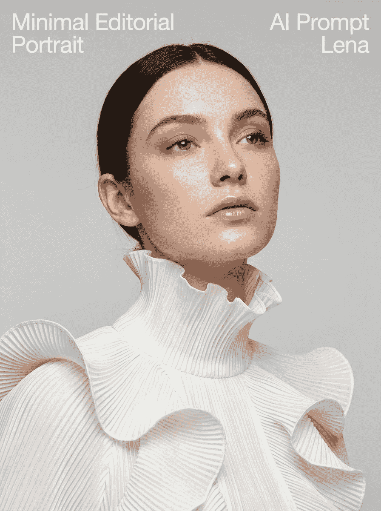

Minimal high-fashion beauty editorial portrait of a young female model with pale skin, soft freckles and delicate facial features. The model has a calm elegant expression, slightly parted lips, head gently tilted upward, looking slightly above the camera. She wears vivid orange eyeshadow with soft gradient blending, natural glossy lips and subtle luminous skin. Dark brown hair pulled back cleanly behind the ears. Wearing an avant-garde white pleated high-neck couture blouse with dramatic ruffled collar and sculptural texture. Close-up portrait composition, elegant fashion pose, clean light gray seamless studio background. Soft diffused studio lighting creating smooth shadows and highlighting facial contours. Professional high-fashion beauty photography, editorial magazine style, ultra realistic skin texture, visible pores, cinematic lighting, sharp focus, 8k detail.Top editorial text layout: left side two lines read “Minimal Editorial Portrait”, right side two lines read “AI Prompt Lena”.

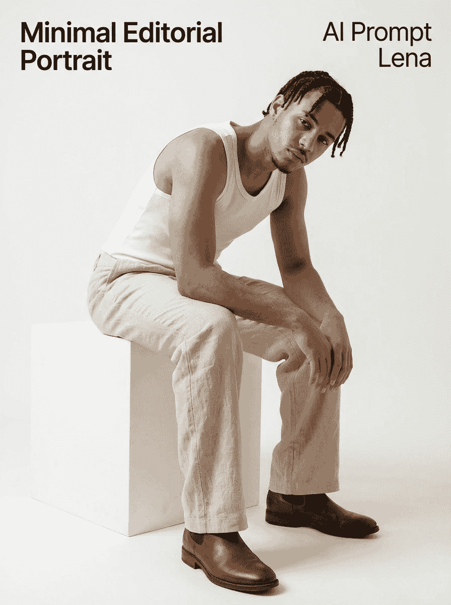

Minimalist fashion editorial portrait of a young male model sitting on a white cube in a relaxed pose, shown in a full-body composition. The model leans slightly forward with his elbows resting on his thighs and hands loosely clasped, creating a natural editorial seated posture. He has short twisted braids and light facial hair, with a calm, slightly tired expression and relaxed gaze directed toward the camera. He wears a white sleeveless tank top, loose beige linen trousers and brown leather boots. Clean white seamless studio background with soft shadows on the floor. Natural directional studio lighting highlighting the contours of the body and realistic skin texture. Minimal modern fashion photography style similar to COS or Acne Studios campaigns, sharp focus, ultra detailed, realistic fabric textures, 8K.

**T****op editorial text layou**t:

left side two lines read “Minimal Editorial Portrait”

right side two lines read “AI Prompt Lena”

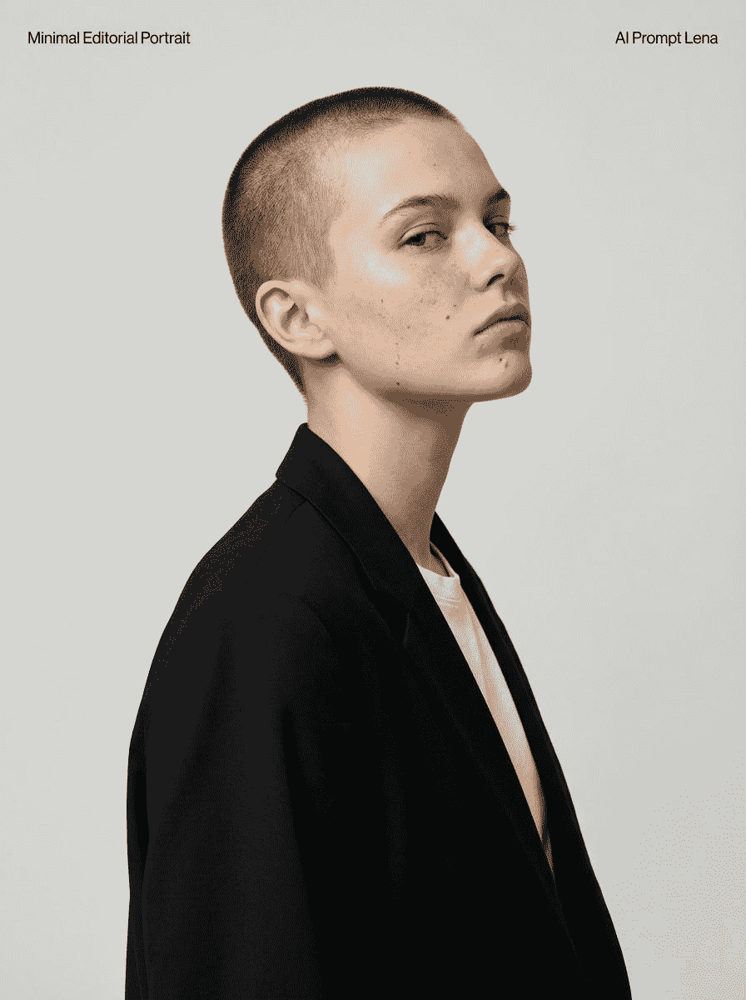

**Minimalist fash**ion editorial portrait of a young person with a shaved buzz cut hairstyle, shown in a clean side profile. The model has a confident, rebellious, slightly arrogant fashion-model expression with a subtle defiant attitude. Natural skin texture with freckles and subtle facial marks, wearing a black oversized blazer over a white t-shirt. Soft studio lighting with smooth shadows, light gray seamless background, minimal composition, realistic skin detail, medium portrait shot, sharp focus, Vogue style fashion photography, ultra detailed, 8K.

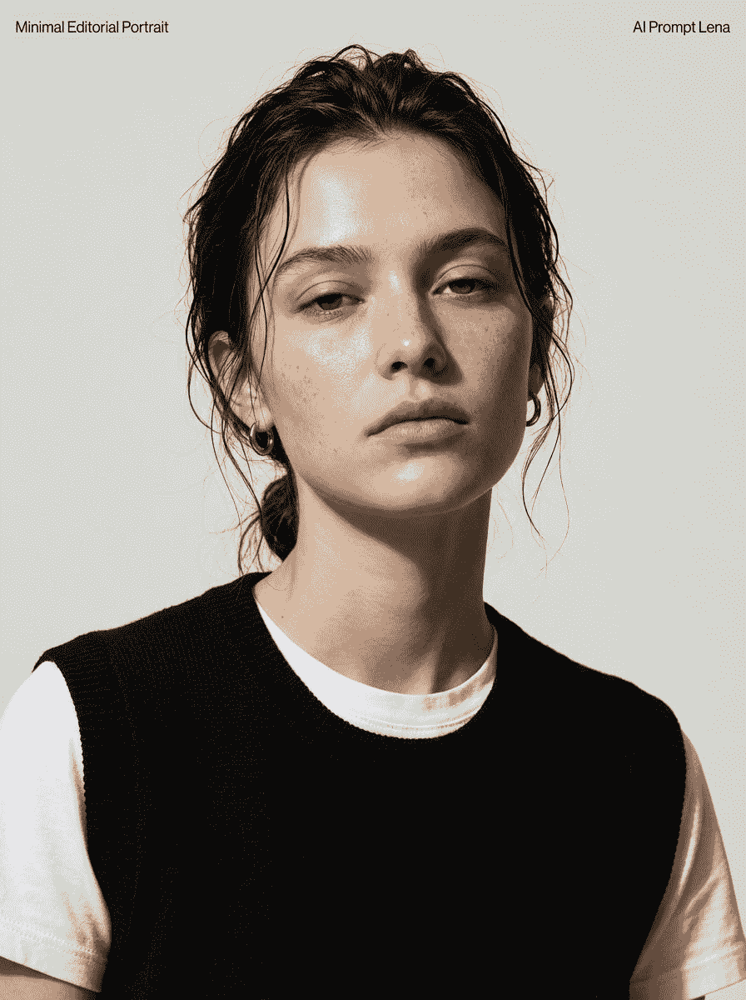

Minimalist fashion editorial portrait of a young model with slightly wet, messy dark hair loosely tied at the back, natural freckles scattered across the cheeks and nose, shown in a close-up composition. The model looks directly into the camera with half-relaxed eyelids and a subdued, detached expression, her gaze calm and slightly tired, lips resting naturally without a smile, conveying a quiet and indifferent mood. She wears a simple white T-shirt layered with a black knit vest and small gold hoop earrings. Clean light gray seamless studio background, strong directional studio lighting creating gentle sculpted shadows along the face and jawline, emphasizing realistic skin texture and natural imperfections. Modern high-fashion editorial photography aesthetic similar to Saint Laurent campaigns, sharp focus, minimal composition, ultra-detailed realism, 8K resolution.

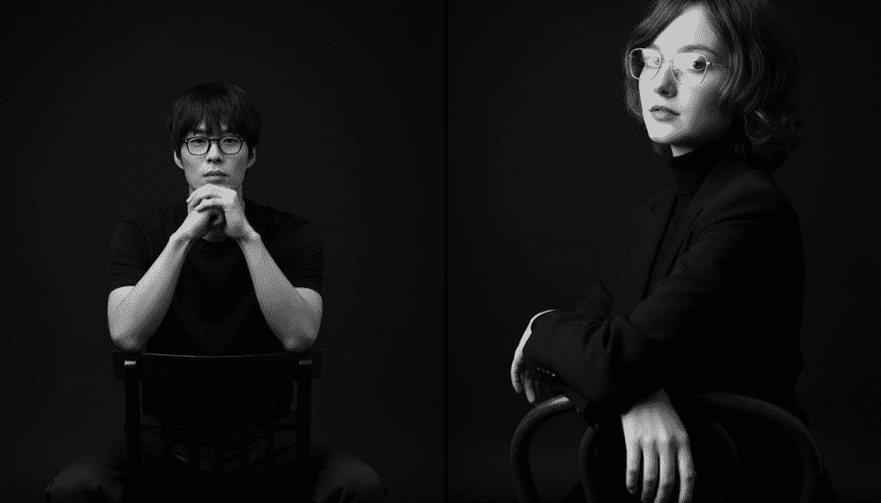

**Ultra-reali**stic studio portrait of a woman leaning gracefully on the backrest of a chair, dressed in a sleek dark outfit. Shot from a subtle low-angle to accentuate her facial features and confident expression. Cinematic black-and-white color grade with refined, natural skin tones. Solid black background with sharp 8K details, highlighting textures in her clothing, hair, and eyes for a dramatic, lifelike effect.

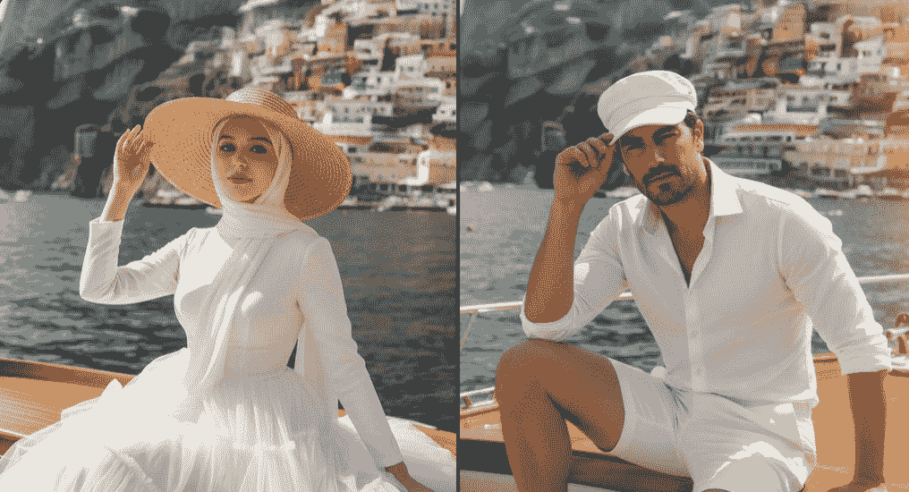

**Women > **

**Don’t change the face, Compositional portrait, dreamy, cinematic, filtered sunlight, slim figure, fair skin, 85 mm lens, f/1.4, sharp skin texture, glossy lips, zero over-processing no tect, watermark, distoration, **wearing hijab white, and wearing white haute couture dress with tulle,wearing floppy wide brim straw hat,poses sitting on boat look at the camera with her one hand hold the hat,bokeh,flare, eyes on camera,background beautiful amalfi coast with natural sunlight

**Men >**

**Don’t change the face. Compositional portrait, dreamy and cinematic, filtered sunlight, slim figure, f**air skin, 85mm lens, f/1.4, sharp skin texture, natural matte lips, zero over-processing no text, watermark, distortion.

**He is wearing an all-white haute couture outfit: a crisp white cap, white tailored shirt with rolled sleeves, and white fitted shorts. He is seated on a boat, looking directly at the camera wit**h a calm, composed gaze. One hand rests on the edge of the boat or lightly adjusts the cap. Bokeh, warm lens flare, eyes locked on camera. Background: the beautiful Amalfi Coast under natural sunlight, softly blurred to enhance the subject.

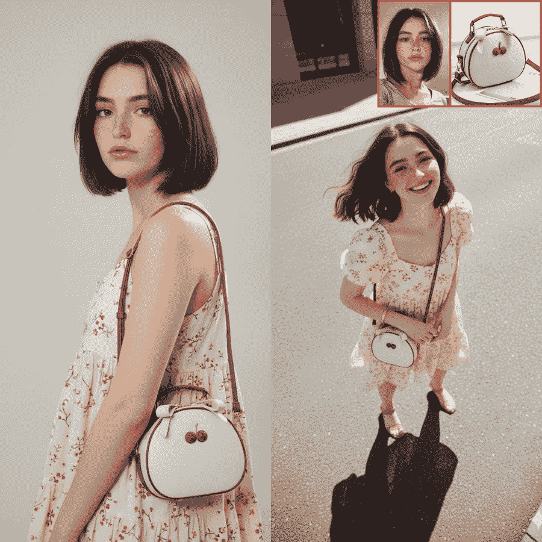

**Highly realistic studi**o fashion composite.

A female model from {{MODEL_IMAGE}} -'takes the girl's face/likeness from the uploaded photo' poses naturally in a modern studio setting, wearing neutral clothing (light top) to highlight accessories. Insert a designer women’s handbag from {{PRODUCT_IMAGE}} seamlessly into the scene — positioned as if she is holding it or resting it on her arm. The handbag must look realistic with correct lighting, shadows, and material texture. Clean background, soft daylight illumination, luxury brand aesthetic. High-end fashion editorial style, similar to Dior / Prada campaign. Sharp details on leather, stitching, and logo of the bag. No text, no watermark. Ultra photorealistic, minimal, elegant.

'change the pose and angle in 2nd'

**Overhead wide-angle fashion shot of the woman from the uploaded image, captured on an urban street. She maintains her natural face, hairstyle, and expression. She is holding a fashionable women’s handbag in her hand, styled** to match her outfit. Natural daylight, soft shadows on gray asphalt pavement, no vegetation. Sharp focus on the subject with shallow depth of field gently blurring the background. Photorealistic, cinematic street style, luxury editorial vibe, high resolution.

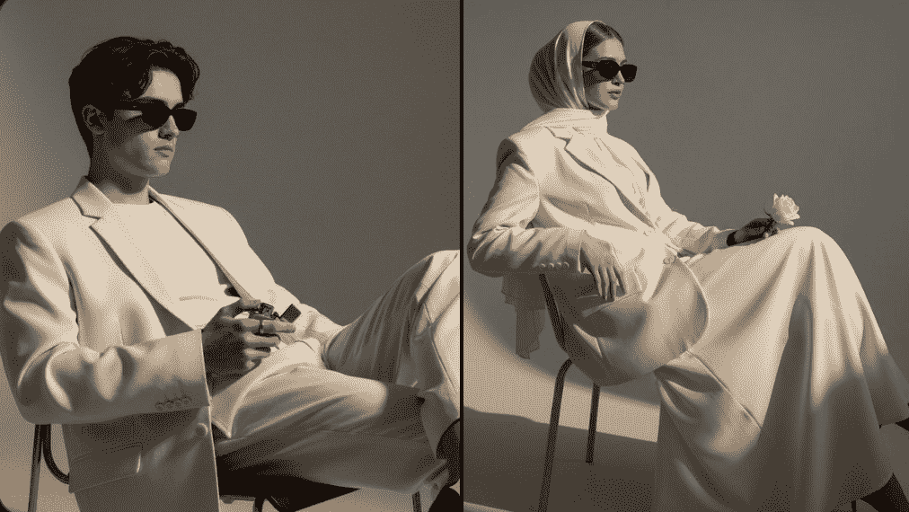

A high-resolution studio portrait of a man sitting in a relaxed pose, captured with soft, minimal sunset reflection lighting that creates strong shadows and a moody atmosphere. He is wearing an all off-white outfit with an oversized blazer, tailored trousers, and sleek black sunglasses. The angle is from the side, showing his body slightly leaning back in a composed, confident posture, with one hand resting on the chair and the other holding a leather journal (or cigaret case / vintage lighter – masculine accessory). The style is elegant and edgy with a mysterious mood. The face must remain exactly the same as the original photo, natural and realistic. Cinematic, detailed, high-quality studio photography, 4K.

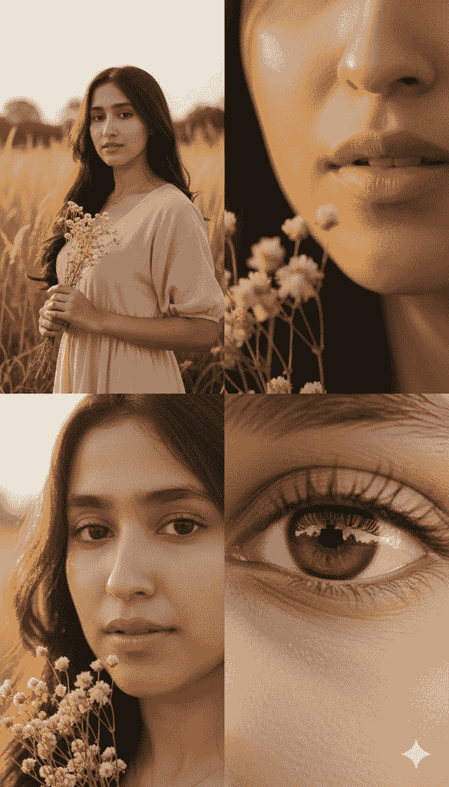

**A cinematic, **ultra-realistic 4-panel outdoor portrait collage of a beautiful young woman with long wavy hair and porcelain skin, holding dried wildflowers. Each frame captures unique intimacy: half-body, lips close-up, calm eye gaze, and extreme eye detail. Set in golden-hour sunlight with creamy bokeh, warm tones, and soft cinematic grading inspired by Kodak Portra 400. Shot on Leica S3, the collage radiates romantic, timeless beauty with HDR10 depth, fine film grain, and delicate textures.

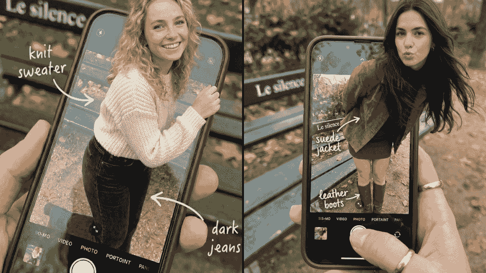

**{**

"image_metadata": {

"format_version": "2.1.0",

"aspect_ratio": "3:4",

**    "shot_type": "Composite H**yper-Realistic POV",

** **   "concept": "OOTD Breakdown / Smartphone Pop-out Illusion"

**  },**

"subject_profile": {

"identity": {

"ethnicity": "Caucasian",

**      "age_range"**: "20-25 years old",

** **     "identity_consistency": "100% face and body preservation"

**    },**

"facial_architecture": {

"features": {

**        "L**

"mouth": {

**        "expression": "Chic pou**t / blowing a kiss",

**        "detail": "Natural lip **texture, soft sheen"

**      },**

"makeup_style": {

"type": "Natural Glam",

**        "foundation": "Mat**te, seamless blend",

**        "details": "Subtle eyel**iner, defined brows"

**      }**

**    },**

"hair_mechanics": {

"color": "Deep dark brown",

**      "style": "Lon**g voluminous waves",

** **     "physics": "Wind-blown effect, realistic strand separation",

** **     "texture": "High-gloss shine, soft highlights"

**    },**

"body_anatomy": {

**      "frame": "Pet**ite, athletic-lean",

"waist": "Highly defined",

"skin_rendering": {

"tone": "Fair/Pale",

**        "texture": "Pore-level detail, natur**al imperfections, no plastic smoothing",

** **       "lighting": "Soft overcast daylight occlusion"

**      }**

**    }**

**  },**

"wardrobe_and_styling": {

"top_layer": {

"item": "Turtleneck sweater",

**      "color": "Mo**cha / Earthy Brown",

** **     "material": "High-quality ribbed textile, macro knit detail"

**    },**

"bottom_layer": {

"item": "Mini Skirt",

"color": "Dark Grey",

**      "material": "Heavy wo**ol or denim texture"

**    },**

"footwear": {

"item": "Tall Leather Boots",

"color": "Rich Brown",

** **     "material": "Polished leather with realistic creases",

**      "location": "Displayed exclusi**vely within the phone screen boundaries"

**    }**

**  },**

"device_and_interface": {

"hardware": {

**      "model": "Modern H**igh-End Smartphone",

**      "case": "Bur**gundy matte finish",

**      "hand_interaction": "Held by a photogr**apher’s hand with gold rings on fingers"

**    },**

"software_ui": {

**      "app": "iO**S Camera Interface",

"interactive_elements": [

**        "White circu**lar shutter button",

** **       "Selected mode: 'PHOTO' in yellow/white text",

**        "Zoom indica**tors and grid lines"

**      ],**

**  **    "screen_condition": "Active OLED glow, realistic fingerprint smudges, sharp pixels"

**    },**

"augmented_overlay": {

**      "style": "Handwr**itten white marker",

"annotations": [

** **       { "text": "suede jacket", "pointer": "arrow to upper body" },

**        { "text": "leather boots",** "pointer": "arrow to boots on screen" }

**      ]**

**    }**

**  },**

"environment_optics": {

**    "location": "Par**isian Park, Autumn",

"background_elements": {

** **     "furniture": "Classic green metal park bench",

** **     "typography": "Weathered text 'Le silence' on bench backrest",

**      "ground": "Grey gravel path **with fallen orange/yellow autumn leaves"

**    },**

"lighting_design": {

**      "source": "Nat**ural, Overcast sky",

** **     "quality": "Soft, diffused, low-contrast shadows",

** **     "ambience": "Cinematic, moody, fashion-editorial"

**    }**

**  },**

"technical_execution": {

**    "optics": {**

"lens": "35mm Macro",

"depth_of_field": {

** **       "foreground": "Sharp (Hand, Phone, Subject)",

** **       "background": "Creamy Bokeh (Park bench and trees)"

**      }**

**    },**

"special_effects": {

**  **    "illusion": "3D Pop-out effect: Upper body emerges from screen, legs remain inside UI",

**      "authenticity": "Zero-latenc**y transition between screen and reality"

**    }**

**  },**

"safety_and_exclusions": {

"negative_prompt": [

"transparent glass phone",

"blank black screen",

"CGI render",

**      "anime",**

"illustration",

"plastic skin texture",

"mirrored text",

"deformed hands",

"floating phone"

**    ]**

**  }**

**}**

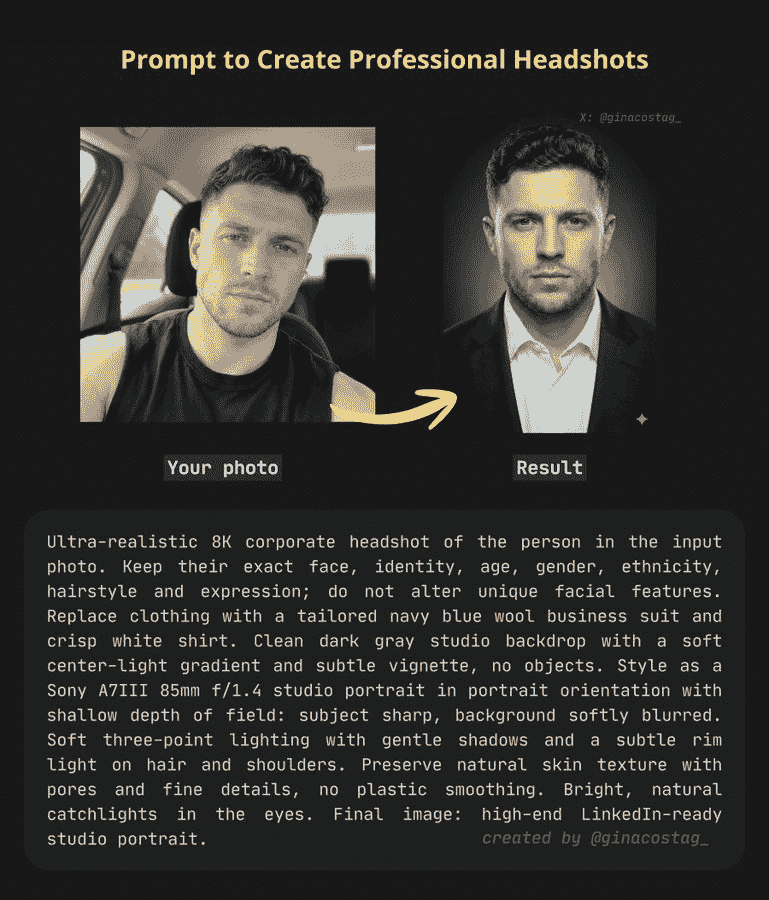

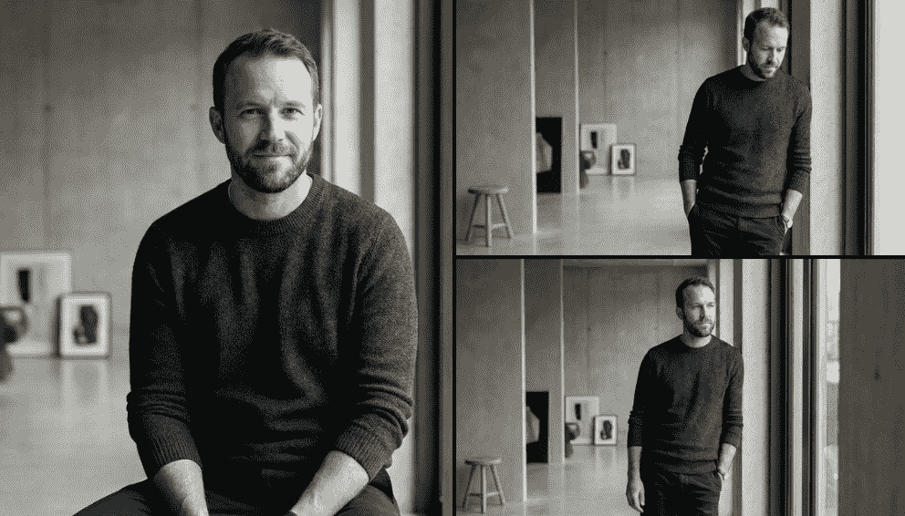

**PROMPT:**

Portrait photo of a MAN,

**posing confidently in an el**egant modern studio,

**minimalist interi**or, clean aesthetic,

**c**asual outfit (neutral tones, well-fitted, stylish but simple),

**relaxed natural postu**re, soft expression,

**m**inimal lighting setup, soft key light, subtle shadows,

**background slightly blurred, fu**ll focus on the man,

**realistic skin tex**ture, natural tones,

**high-end editorial **fashion photography,

**s**harp details, shallow depth of field, 4K, cinematic

**R**EFERENCE: (attach / upload the face reference here)

NEGATIVE PROMPT:

**o**verexposed, harsh lighting, neon colors, messy background,

**t**oo dark, low resolution, distorted face, extra fingers,

**u**nnatural skin smoothing, AI artifacts, cartoon, unrealistic

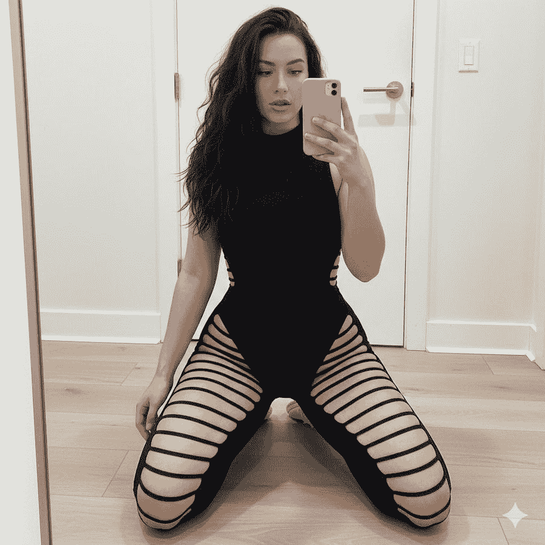

**{**

**  "subject": {**

** **   "person": "Young woman with long, wavy dark espresso hair",

**    "expression": "Slightly parted lips,** looking into a mirror, confident pose",

**    "physique": "Cu**rvy, athletic build"

**  },**

**  "outfit": {**

**    "style": "Avant-garde athl**eisure, streetwear",

** **   "garment": "Black mock-neck sleeveless bodysuit or jumpsuit",

**    "details": "Extreme lateral ladder cut-outs extending from th**e upper thigh to the waist, creating a caged effect with thin horizontal straps"

**  },**

**  "setting": {**

** **   "location": "Minimalist modern interior, dressing room",

**    "background": "Plain white door, neutral **white walls, light-toned wood flooring",

** **   "props": "Purple smartphone held for a mirror selfie"

**  },**

"composition_and_lighting": {

** **   "shot_type": "Full body mirror selfie, kneeling pose",

** **   "lighting": "Soft, diffused indoor lighting, bright and even",

**  **  "color_palette": "High contrast black and white with a pop of purple from the phone case"

**  },**

"technical_metadata": {

** **   "camera_simulation": "iPhone 15 Pro Max style, mobile photography",

"aspect_ratio": "9:16",

"focal_length": "24mm",

**    "depth_of_field": "Deep focus, sharp de**tails on the subject and outfit texture"

**  }**

**}**

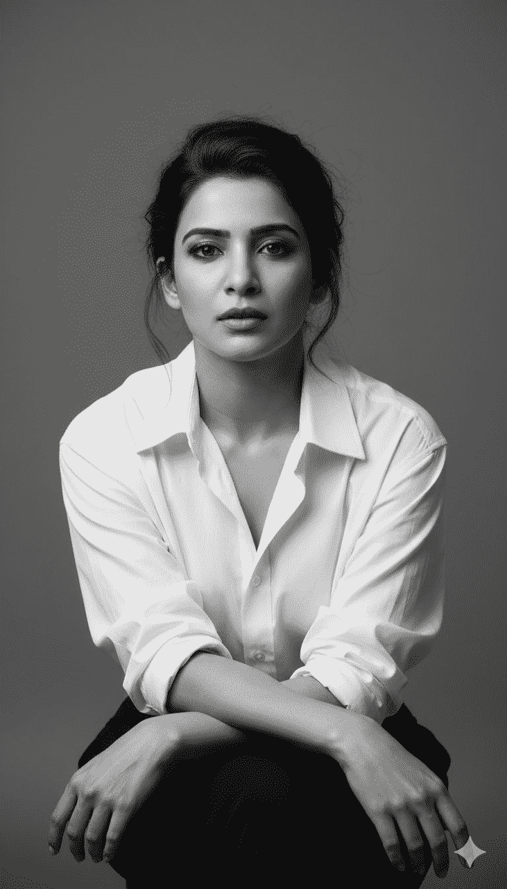

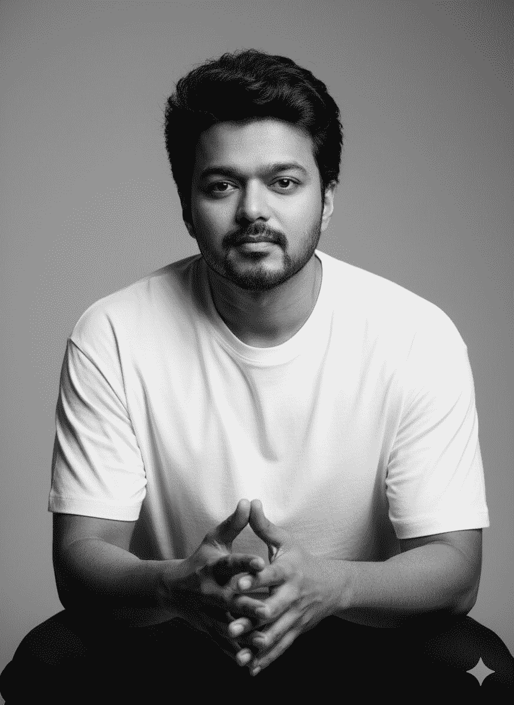

Shirt :  Black-and-white fine art studio portrait of the uploaded person, seated with both hands resting naturally in front, relaxed and composed. Slightly messy hair softly framing the face, natural smooth skin tones, wearing a clean white shirt. Calm, thoughtful expression while looking directly at the camera. Shot from a subtle cinematic angle (not strict eye level). Minimalist studio setup with a plain grey backdrop, soft diffused cinematic lighting creating gentle shadows and depth. Elegant, sophisticated mood, ultra-realistic textures, sharp facial details, professional photography quality, high contrast, smooth tonal gradation, 8K resolution, no noise, no pixel loss.

T-Shirt : Black-and-white fine art studio portrait of the uploaded person, seated with both hands resting naturally in front, relaxed and composed. Slightly messy hair softly framing the face, natural smooth skin tones, wearing a clean white oversized Tshirt. Calm, thoughtful expression while looking directly at the camera. Shot from a subtle cinematic angle (not strict eye level). Minimalist studio setup with a plain grey backdrop, soft diffused cinematic lighting creating gentle shadows and depth. Elegant, sophisticated mood, ultra-realistic textures, sharp facial details, professional photography quality, high contrast, smooth tonal gradation, 8K resolution, no noise, no pixel loss.

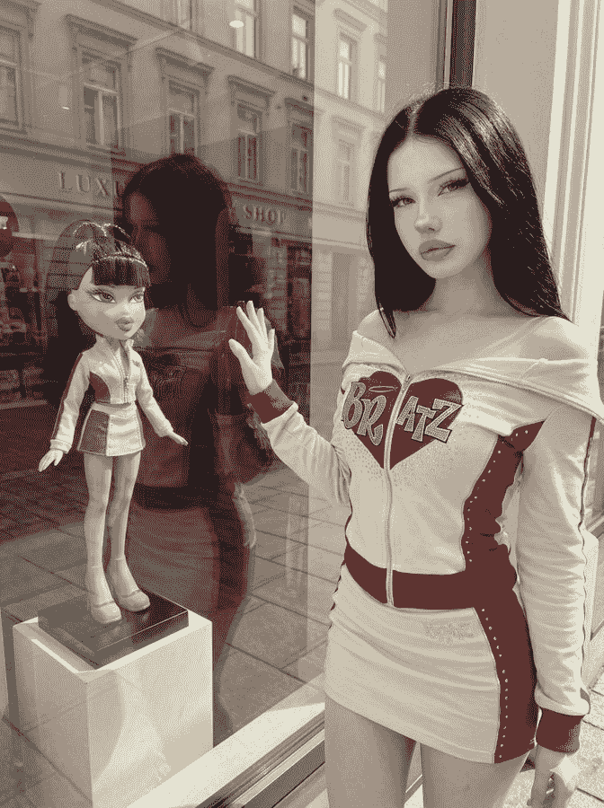

**

"scene": ****{

"type": "outdoor daytime"****,

"location": "****o****utside a lux****ur****y t****oy**** shop window****",

"style****"****:**** ****"****h****igh-****end street fa****shion",****

"at****mosphere": "cle****an, bright, fashi****onable city street",

****"****glass****": ****{

****    "descri****ption": "l****arge clear display**** window with rea****listic reflections of the st****reet and subject"

}

},

****"subject": {

"type": "re****al human woman",

"po****se": {****

****    ****"position": "****standing close to the**** shop window",

"interaction****": "one hand gently touc****hing t****he glass",

"body_ori****ent****at****ion": "slig****htly angled toward th****e wind****ow",

"head_position"****: "turned slightly tow****a****rd the**** ****camera",

"expressi****on"****: ****"confident, c****alm, fashion-for****ward"

},

****"****appearance": {

****   ****"s****kin": {

****   "texture": "real human sk****in",

"details": [

****   "visible pores",

****  **** "natural skin grain",

****      "no blur",

**** ****  **** **  "no smoothing",

"no plastic or waxy look"

]

},

"makeup": {

"style": "Bratz-inspired glam",

"eyes": "defined liner, bold lashes",

"lips": "glossy nude-pink with full Bratz shape",

"blush": "soft rosy glow"

}

}

},

"outfit": {

"top": {

"type": "off-shoulder zip-up top",

"brand_style": "Bratz-inspired",

"color": "cream base with deep red accents",

"details": [

"front zipper",

"heart-shaped chest panel",

"large red 'BRATZ' logo at the center",

"rhinestone detailing around the heart",

"long sleeves with red flared cuffs"

],

"material": "structured stretch fabric with smooth finish"

},

"bottom": {

"type": "mini skirt",

"color": "cream with red underlayer",

"details": [

"heart-shaped Bratz logo patch on the skirt",

"rhinestone outline around the heart",

"short Bratz-style length"

],

"material": "matching structured fabric"

}

},

"window_display": {

"doll": {

"type": "Bratz doll",

"style": "classic Bratz proportions",

"features": [

"oversized head",

"big almond-shaped eyes",

"small nose",

"full glossy lips"

],

"resemblance": {

"face": "clearly resembles the woman",

"hair": "same color, length, bangs",

"outfit": "exact same Bratz outfit as the woman"

},

"pose": "standing upright inside the display, facing outward",

"vibe": "cute, iconic Bratz aesthetic"

}

},

"lighting": {

"type": "bright natural daylight",

"effect": [

"crisp highlights",

"clean shadows",

"clear visibility of both subject and window display",

"realistic reflections on glass"

]

},

"camera": {

"aspect_ratio": "3:4",

"device": "smartphone camera",

"distance": "full upper-body fashion framing",

"angle": "eye-level",

"style": "high-end street fashion photography",

"look": "sharp but natural, photorealistic"

},

"overall_vibe": {

"aesthetic": "luxury Bratz street fashion",

"mood": "confident, playful, iconic",

"contrast": "clean and balanced",

"feeling": "fashion editorial meets toy-store fantasy"

},

"restrictions": [

"no anime style",

"no Pixar style",

"no generic cartoon doll",

"Bratz doll only",

"no over-stylization",

"no fantasy lighting"

]

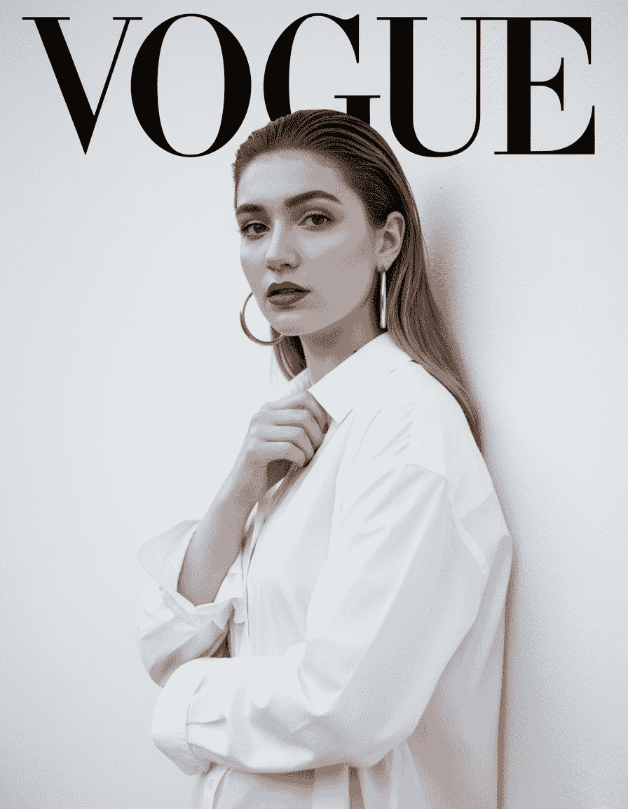

**A white background Vogue fashion editorial cover of the portrait of m**e. I wear a loose oversized white shirt with long sleeves, huge golden earrings.

**Aspect ratio: 4:5 vertical. My dark blonde hair is slicked back, red lips. I'm standing next to the wall, close-shot**, editorial fashion shoot style, ultra high resolution, realistic photography quality, sharp focus, shot with Canon EOS R5, 85mm f/1.2 lens.

**S**hooting in the style of Terry Richardson. Text: only Vogue.

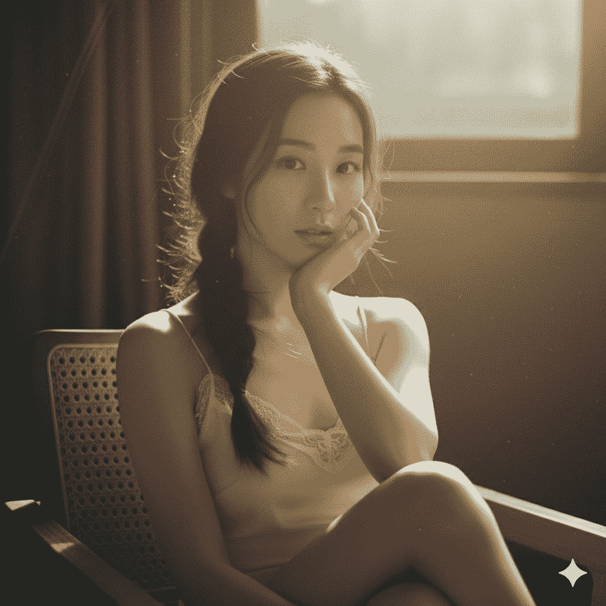

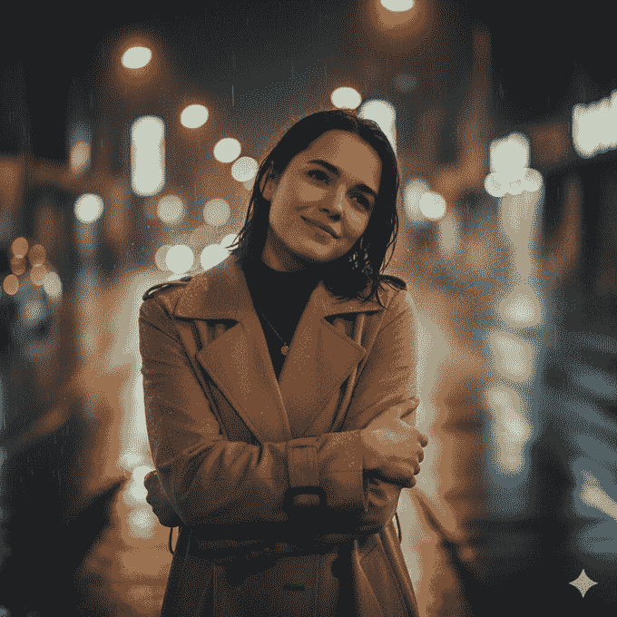

**{**

**  "prompt": "Transform this photo into a cinematic still from a melancholic neo-romantic drama, capturing a girl standing** alone under soft city rainlights at night. The image should be photorealistic, preserving the subject's true facial identity and essence.",

"style_and_aesthetic": {

**  **  "core_genre": "Neo-romantic realism fused with urban melancholy and poetic solitude.",

** **   "mood": "Reflective, nostalgic, quiet, emotional, bittersweet.",

"keywords": [

"cinematic still",

"urban solitude",

"rain-soaked atmosphere",

"melancholy realism",

"soft light photography",

"dreamlike tone"

**    ]**

**  },**

"composition_and_framing": {

**    "lens": "50mm cinematic lens with shallow depth of **field, creating creamy background bokeh from streetlights.",

**    "framing": "Medium shot framed from waist up, sl**ightly off-center to create a natural cinematic imbalance.",

**    "angle": "Eye-level perspective, inviting **emotional connection with the subject.",

**    "subject_position": "The girl is slightly turned sideways, head** tilted downwards, lost in thought, rain droplets visible on her hair and coat."

**  },**

"lighting_and_color": {

**    "lighting_scheme": "Soft diffused lighting wi**th reflective glow from neon shop signs and wet pavements.",

**    "light_quality": "Gentle, hazy, cinematic — illu**minated by multiple colored light sources in the distance.",

**    "color_palette": "Muted blues, s**oft pinks, and desaturated gold tones.",

**    "color_grading": "Warm cinematic color grade with** cool undertones — like modern indie film lighting at dusk."

**  },**

"subject_details": {

**  **  "expression": "Subtle sadness blended with peace, as if caught between memories and acceptance.",

**    "atmosphere_interaction": "Raindrops clinging to her hair a**nd jacket, faint mist visible from breath in the cold air.",

**    "apparel": "A long beige trench coat, dark turtleneck, minimal je**welry, hair slightly messy from the rain — emphasizing realism and raw emotion."

**  },**

"post_processing_effects": {

**    "film_texture": "Fine film grain with slig**ht halation glow around light sources.",

**  **  "lens_effects": "Subtle bokeh flares from neon lights, minor lens smudge or water droplets on lens.",

**    "focus": "Crisp focus on the girl's face, gent**le blur on the background lights for cinematic separation.",

**    "realism": "Hyperrealistic textures — visible water o**n skin, fabric creases, and natural reflections in puddles."

**  }**

**}**

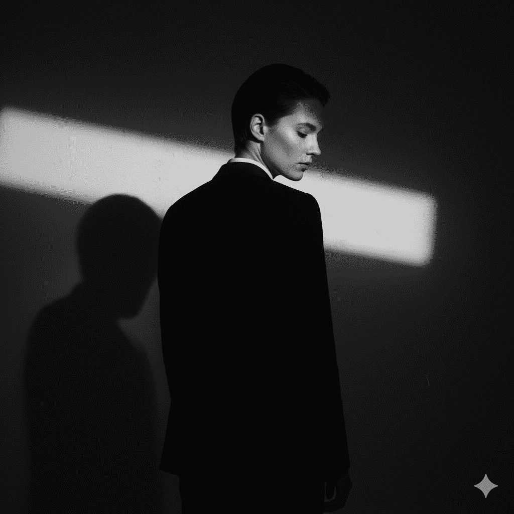

**Dramatic black-and-white studio portrait of a person standing with back to the camera, upper body slightl**y turned, head slightly lowered, showing part of facial profile. Calm, introspective expression, mysterious and elegant.

**Lig**hting: Strong side light creating sharp shadows, clean horizontal light beam across background, emphasizing silhouette and contours.

**Atm**osphere: Minimalist, cinematic, moody, elegant, solitary. Subject wears dark jacket blending into shadows, sleek fashion magazine style.

**Comp**osition: Mid-shot (waist to head), full-frame camera, 85mm lens, f/1.8, shallow depth of field, ISO 200, 1/125s. Focus on silhouette, side profile, and posture.

**Pos**t-processing: High-contrast black-and-white, soft tonal gradients, deep shadows, subtle film grain, refined artistic magazine look.

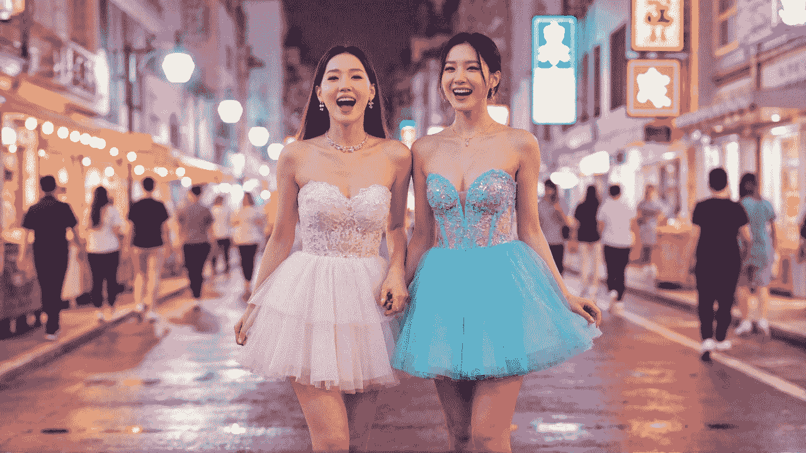

**好**闺密 夜市派对，姐妹的欢乐时光 街边灯火通明，人潮涌动。 两抹鲜亮的色彩，在夜市中闪耀。 欢快的笑容，定格了专属彼此的精彩瞬间。

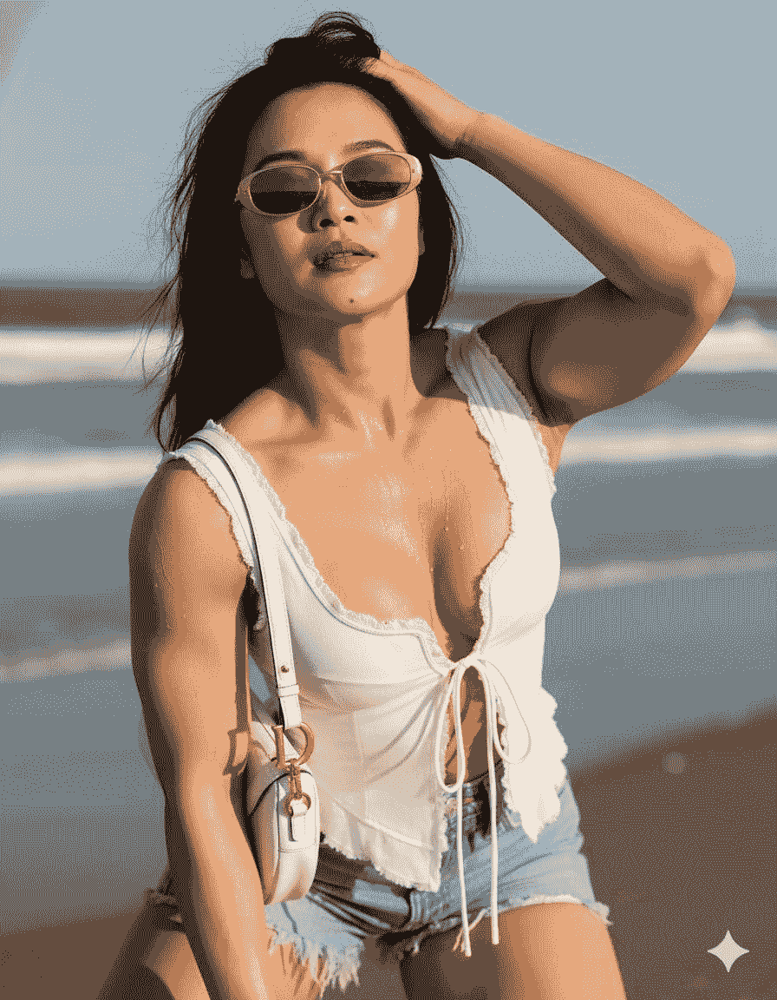

**Upper body, in a sitting pose, showing teasing attitude with fingers lightly touching lips, expression flirty and confident. Captured at early morning with natural light, creating **fresh and vibrant mood. Dutch angle, 50mm lens, f/2.2. Dorset Coast cliffs in background, sea mist subtly visible. Skin glistening with realistic sweat, droplets tracing contours of muscles and face, emphasizing texture.

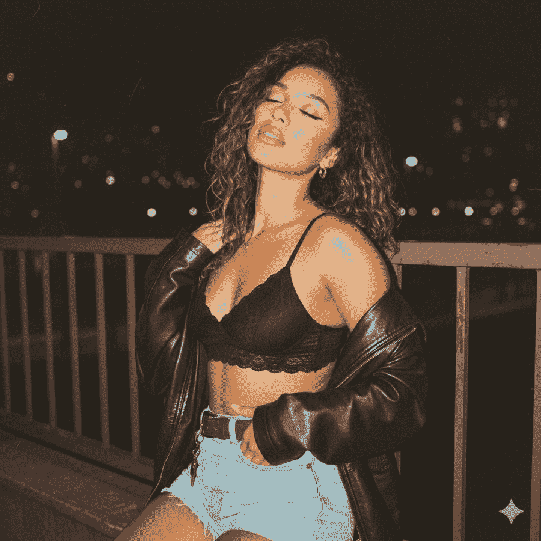

**{**

** ** "title": "Warm night street portrait with vintage flash aesthetic",

**  "sty**le": "Candid nightlife portrait with early-2000s Y2K fashion and Polaroid-film texture. Warm tones, visible grain, and slight color shift for an authentic analog look. Direct flash lighting with deep contrast and spontaneous energy.",

**  "subject": {**

"category": "human",

**    "gender_pres**entation": "female",

"age_bracket": "young_adult",

"ethnicity": "biracial",

**    "skin_tone": "w**arm golden-caramel",

**    "hair": {**

"texture": "curly",

"length": "medium-long",

**  **    "style": "naturally curly, slightly messy, loose strands framing face and falling over shoulders"

**    },**

**    "face": {**

**  **    "expression": "eyes closed, soft relaxed lips, calm confidence, serene and natural",

**  **    "makeup": "dewy skin, warm highlights on cheekbones, subtle eyeliner, glossy lips"

**    },**

**    "body": {**

**      "pose": "seated or leaning back slightly against ra**iling, torso turned 3/4 to camera, head tilted back gently",

**  **    "gesture": "right hand brushing shoulder or collarbone, left hand resting near shorts waistband"

**    }**

**  },**

**  "wardrobe": {**

** **   "top": "black lace bralette (tasteful, fashion-forward)",

** **   "outerwear": "black leather jacket worn loose and off-shoulder",

**    "bottoms": "light blue denim sho**rts, slightly frayed hem, mid-rise fit",

"accessories": [

"brown leather belt",

** **     "small keychain or charm hanging from belt loop",

**      "gold or silver s**mall hoop earrings",

"thin gold necklace"

**    ]**

**  },**

"environment": {

** **   "setting": "nighttime New York City street or elevated walkway",

**  **  "background": "rusted metal railings with vertical bars, dim warm city lights and bokeh in background",

** **   "lighting_condition": "low-light environment, single flash source"

**  },**

**  "camera": {**

**    "framing": "medium close-**up (waist to head)",

**    "angle": "slightly above subjec**t, tilted composition for natural feel",

**    "focal_length"**: "35mm equivalent",

** **   "depth_of_field": "shallow, soft background blur",

** **   "film_type": "warm color negative film (Kodak Gold 200 aesthetic)"

**  },**

**  "lighting": {**

**    "key": "dire**ct on-camera flash",

"fill": "none",

"temperature": "warm 4200K",

**    "notes": "slight overexposure on skin for flash realis**m; hard shadow behind railing for authentic snapshot effect"

**  },**

"composition": {

**    "framing_notes": "tight crop, include shorts line and rig**ht hand gesture, eyes closed and head slightly tilted back",

** **   "pose_notes": "relaxed body language with natural flow",

** **   "background_blur": "subtle bokeh on street lights"

**  },**

**  "colors": {**

**    "palette": "warm amber tones, soft golden sk**in, faded blue denim, black leather, muted dark background",

"contrast": "medium-high",

**    "saturation": "slightly i**ncreased for warmth"

**  },**

"postprocessing": {

**    "look": "vin**tage film snapshot",

** **   "grain": "medium grain visible throughout image",

"vignette": "gentle and warm",

** **   "white_balance": "flash/daylight with slight yellow tint",

** **   "exposure": "slightly overexposed highlights on skin",

**    "contrast": "high microcont**rast for flash pop",

**    "color_grade": "warm golden cast w**ith magenta shadows for nostalgic feel",

** **   "texture": "light film halation and fine dust specks"

**  },**

**  "output": {**

"aspect_ratio": "4:5",

"resolution": "1080x1350",

"render_intent": "photo",

"color_profile": "sRGB"

**  },**

"negatives": [

"no nudity",

"no extreme makeup",

"no cinematic lighting",

"no other people",

**    "no smile or **direct eye contact",

"no heavy retouching",

"no cold color tones"

**  ]**

**}**

** **

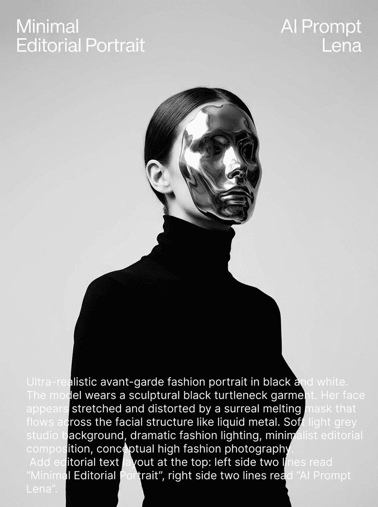

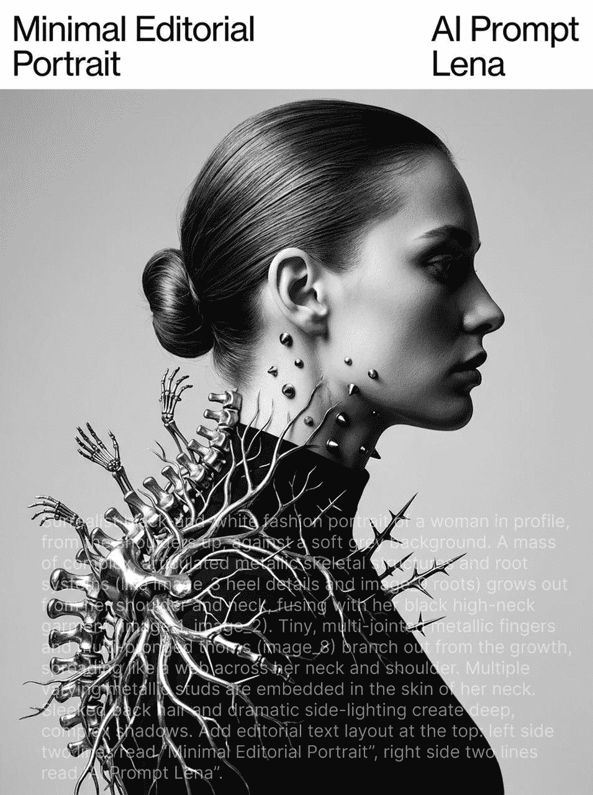

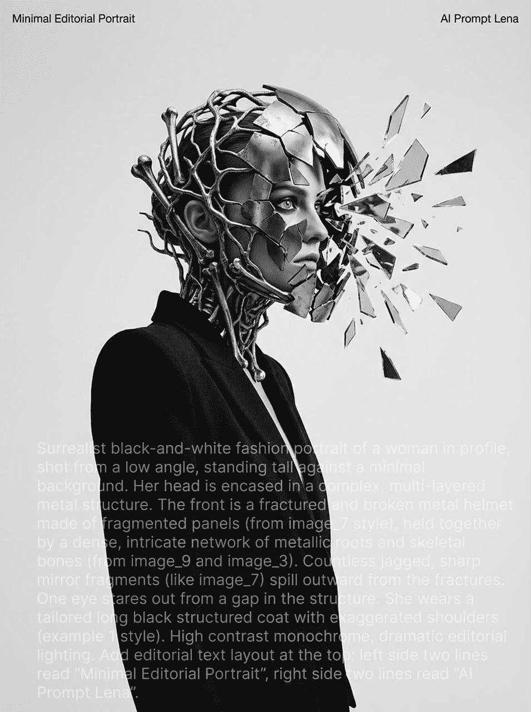

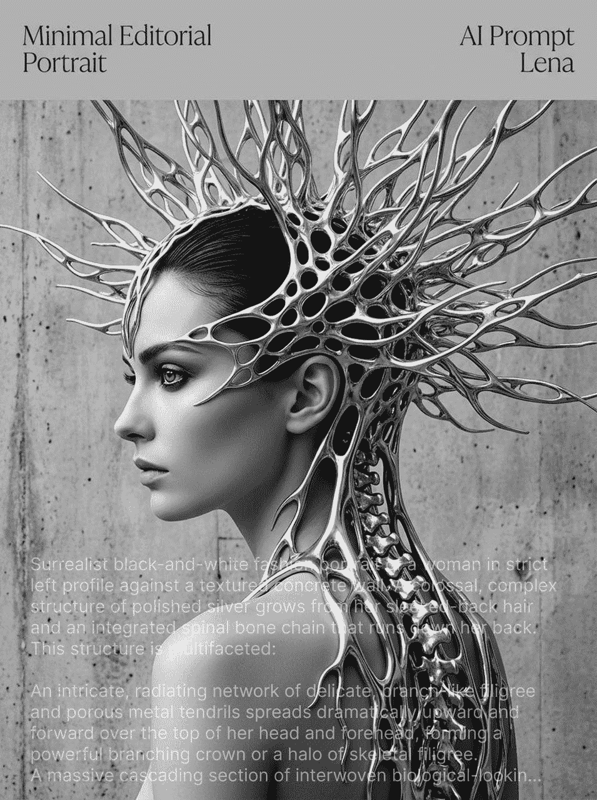

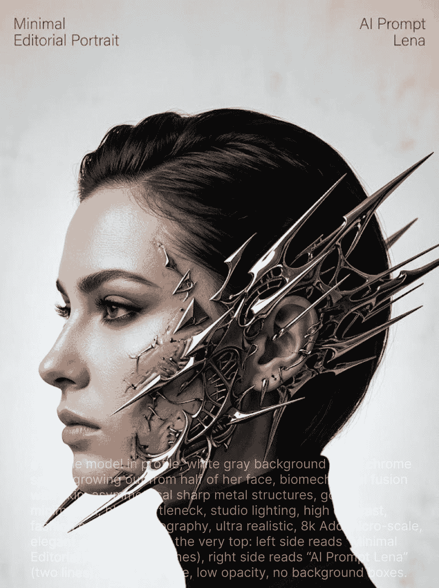

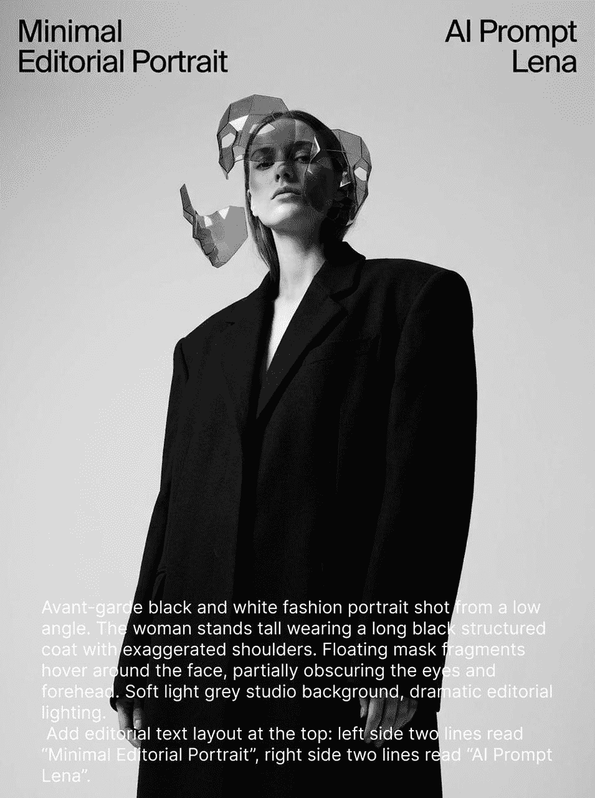

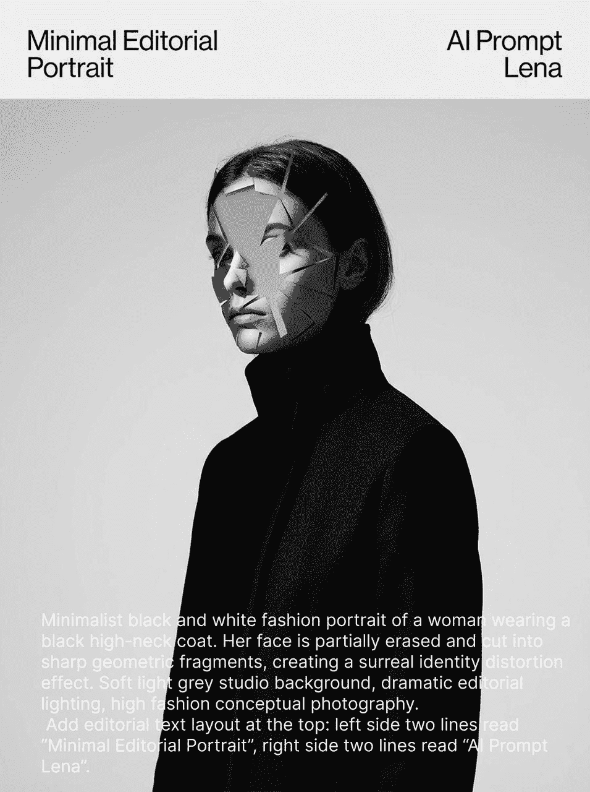

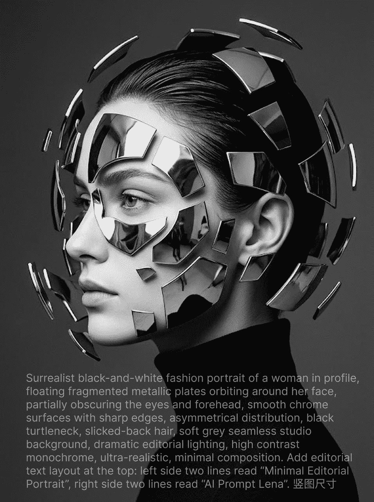

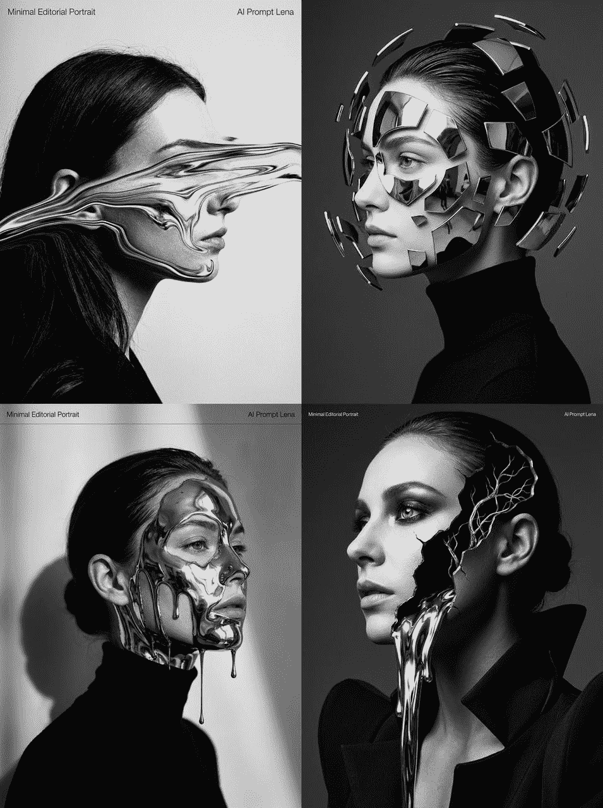

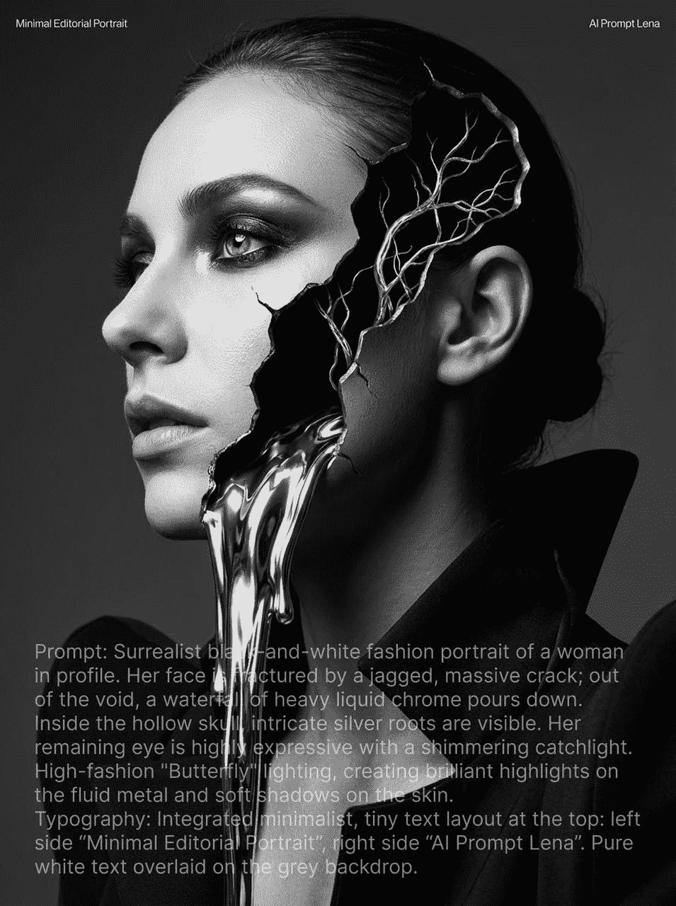

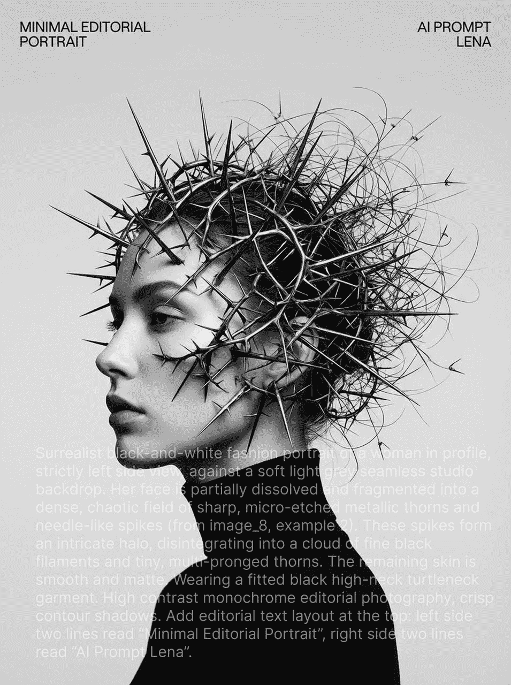

Spring Wisteria Moth

**Macro photograph of a fu**ll-body moth made from translucent organza, resting among purple wisteria blossoms.

Head made from soft lilac organza, antennae black.

Thorax lavender organza with fine gold thread wrapping.

Abdomen blush pink organza segments.

Wings deep violet translucent organza with delicate stitched veins.

Shot with 85mm macro lens, f/2.8, dreamy purple floral bokeh background.

Material must remain smooth organza, no lace texture.

Top editorial text layout: left side two lines read Minimal Editorial Portrait, right side two lines read AI Prompt Lena.

High-fashion editorial portrait of a young male model with short dark hair and strong facial features. The model has a calm neutral expression with slightly parted lips, looking directly at the camera. Wearing a minimalist black top.

Dramatic cinematic studio lighting.

The entire image is seen through strong vertical refractive glass distortion across the whole frame, creating dense ripple refraction, optical displacement, slit-scan style stretching, venetian-blind distortion and fragmented reflections of the face. The distortion affects the entire image uniformly from edge to edge, creating repeated vertical wave refraction across the face, hair and clothing.

This is a **lens-based optic**al distortion effect, not a physical glass object. No glass panel, no frame, no rectangular glass block.

Solid vibrant yellow seamless studio background enhancing contrast. Close-up portrait composition, modern fashion magazine photography style, minimalist aesthetic, ultra realistic skin texture, sharp focus, high contrast lighting, cinematic color grading, experimental optical distortion photography, 8k detail.

High-fashion editorial portrait of a young male model with short hair and dark skin. The model wears a bright orange jacket and a matching orange baseball cap. He poses with his head slightly turned to the side, looking subtly toward the camera with a calm, composed expression. The entire image is viewed through a strong vertical ripple refraction effect, with dense repeated wave-like slicing across the whole composition, creating distorted optical displacement, fragmented reflections, slit-scan style stretching, venetian blind distortion. Dramatic cinematic studio lighting. Solid dark green seamless studio background enhancing contrast. Close-up to mid-shot portrait composition, modern fashion magazine photography style, ultra realistic skin texture, sharp focus, high contrast lighting, cinematic color grading, experimental editorial photography, 8k detail. Top editorial text layout: left side two lines read Minimal Editorial Portrait, right side two lines read AI Prompt Lena

Ultra-realistic K-Pop idol style portrait, extreme close-up selfie from a slightly high angle, direct eye contact. Young East Asian female with long glossy dark-brown wavy hair, playful confident expression, lips slightly open with tongue touching the lower lip.

Flawless K-beauty glass skin, dewy glow, rosy blush, glossy pink lips.

Wearing a **sexy black silk slip dress with thin spa**ghetti straps and a soft draped neckline, elegant and flattering like a luxury K-Pop red-carpet outfit. Silver rhinestone hair clip on the left side, dangling silver heart earrings.

Soft beauty studio lighting, clear eye catchlights, plain neutral grey background with bokeh, 85mm portrait lens, extremely shallow depth of field, ultra-realistic skin texture, high-resolution fashion editorial photography.

Negative prompt: skin blemishes, wrinkles, harsh shadows, matte skin, distorted features, motion blur, low resolution, illustration, anime, CGI, vintage photo, plastic skin.

Ultra-realistic cinematic extreme close-up portrait of a young woman’s face, shot with a macro lens. Only one side of the face fills the frame, focusing on the eye, cheek, and lips. She has light green eyes, natural freckles, smooth luminous skin with visible pores and subtle moisture, dewy glowing complexion.

Soft wet hair strands fall naturally across the face, partially crossing the eyebrow and cheek. The eye is in sharp focus with detailed eyelashes and realistic iris texture.

Warm golden sunlight hits the face from the side, creating soft highlights on the cheekbone, nose bridge, and glossy lips, while the opposite side falls into gentle shadow.

Natural beauty editorial photography style, cinematic lighting, shallow depth of field, hyper-detailed skin texture, ultra-realistic photography, 85mm macro lens, Vogue beauty editorial aesthetic, 8K photorealistic.Add editorial text layout at the top: left side two lines read Minimal Editorial Portrait, right side two lines read AI Prompt Lena.

Ultra-realistic black and white fashion portrait. Side profile facing right. The woman wears a sleek black turtleneck garment. A melted sculptural mask grows from the cheekbone area and flows downward like liquid wax. Soft light grey studio background, dramatic studio lighting.

Add editorial text layout at the top: left side two lines read “Minimal Editorial Portrait”, right side two lines read “AI Prompt Lena”.

Ultra-realistic avant-garde fashion portrait in black and white. The model wears a sculptural black turtleneck garment. Her face appears stretched and distorted by a surreal melting mask that flows across the facial structure like liquid metal. Soft light grey studio background, dramatic fashion lighting, minimalist editorial composition, conceptual high fashion photography.

Add editorial text layout at the top: left side two lines read “Minimal Editorial Portrait”, right side two lines read “AI Prompt Lena”.

Ultra-realistic black and white avant-garde fashion portrait of a woman wearing a minimalist black high-neck garment. Side profile composition. Her face is surrounded by hundreds of thin needle-like spikes radiating outward like a surreal halo sculpture. Soft light grey studio background, dramatic directional lighting, high contrast editorial photography, minimalist luxury aesthetic, extremely detailed textures.

Add editorial text layout at the top: left side two lines read “Minimal Editorial Portrait”, right side two lines read “AI Prompt Lena”.

An ultra-realistic close-up portrait of me wearing a stylish black chalk suit, with a seductive, confident, and serious expression, no smile, high-fashion sophisticated facial features, striking red lipstick, flawless and radiant skin, and a clean face. Use dramatic fashion lighting with a soft circular spotlight in the background, cinematic beauty editorial photography aesthetic, ultra HD, hyper-detailed, ultra-realistic. Add editorial text layout at the top: left side two lines read “Minimal Editorial Portrait”, right side two lines read “AI Prompt Lena”.

Dramatic high-fashion male editorial portrait of a young model, shown in a side profile with his head tilted upward, looking toward a strong warm spotlight. He wears a structured black blazer, with subtle shadows sculpting his jawline and neck. Deep blue studio background with cinematic spotlight illuminating the face, creating a high-contrast dramatic effect. Modern fashion photography aesthetic similar to COS, Saint Laurent, or Acne Studios campaigns. Minimal composition, sharp focus, ultra-detailed skin texture and hair, cinematic lighting, 8K.

High-fashion editorial portrait of a young Black male model with short twisted dreadlocks and strong facial features. The model has a confident serious expression, looking directly at the camera with slightly narrowed eyes and relaxed lips. Wearing a dark red turtleneck sweater and a chunky metal chain necklace. Dramatic cinematic studio lighting with warm tones illuminating one side of the face and deep shadows on the other side, emphasizing facial structure. Vibrant gradient background transitioning from deep red to bright orange creating a bold high-contrast fashion aesthetic. Close-up portrait composition, modern fashion magazine photography style, minimalist composition, sharp focus, high contrast lighting, cinematic color grading, ultra realistic skin texture, 8k detail. Top editorial text layout: left side two lines read “Minimal Editorial Portrait”, right side two lines read “AI Prompt Lena”.

High-fashion beauty editorial portrait of a young female model with a short dark pixie haircut, pale luminous skin and delicate facial features. The model wears bold red lipstick, soft warm eyeshadow and glowing skin. She poses with her head slightly tilted back and turned sideways, looking confidently toward the camera with a calm seductive expression and slightly parted lips. Wearing a minimalist black high-neck top creating a clean elegant silhouette. Large exaggerated statement earrings shaped like metallic bullet cartridges, cylindrical brass bullet forms used as avant-garde fashion earrings, Solid deep red seamless studio background creating strong color contrast. Soft but dramatic studio lighting highlighting cheekbones and skin texture. Modern high-fashion magazine beauty photography, minimalist composition, editorial aesthetic, ultra realistic skin texture, sharp focus, cinematic lighting, high contrast, 8k detail.

Top editorial text layout:

left side two lines read “Minimal Editorial Portrait”

right side two lines read “AI Prompt Lena”

Ultra-realistic luxury beauty and jewelry editorial portrait of a platinum blonde woman with pale blue eyes and natural freckles across her nose and cheeks. Extreme close-up composition with the model looking directly into the camera, resting her chin softly on her hand. Her skin appears luminous and dewy with subtle natural highlights. She wears multiple stacked diamond rings and elegant silver earrings. A white ruffled high-fashion blouse frames her face. Clean soft gray studio background with diffused soft lighting that gently highlights facial contours and jewelry reflections. High-end beauty photography aesthetic similar to Dior Beauty, Chanel Jewelry and Vogue beauty campaigns. Ultra detailed skin texture, visible pores, natural freckles, cinematic realism, sharp focus, 8K.

Top editorial text layout:

left side two lines read “Minimal Editorial Portrait”

right side two lines read “AI Prompt Lena”

Minimal beauty editorial portrait of an East Asian female model with long straight black hair, natural freckles across the cheeks and nose, soft pink blush makeup, glossy natural lips, smooth radiant skin.

The model has a confident yet relaxed expression, head slightly tilted to the side, looking directly at the camera. Wearing a minimalist white linen shirt with the collar slightly open.

Close-up portrait composition, clean light gray seamless studio background, soft diffused studio lighting creating gentle shadows and natural skin tones, professional beauty editorial photography, high fashion beauty campaign style.

Ultra realistic skin texture, visible pores, hyper realistic lighting, sharp focus, 4k fashion photography.

Top editorial text layout:

left side two lines read “Minimal Editorial Portrait”

right side two lines read “AI Prompt Lena”

Minimalist fashion editorial portrait of a young male model with messy wavy dark hair partially covering the face, natural freckles across the cheeks and nose, wearing thin round silver metal eyeglasses.

The model has a calm, slightly tired fashion expression, soft relaxed lips, looking directly at the camera. Pale realistic skin texture with visible pores and natural imperfections, slim face and long neck. Wearing a black minimalist blazer.

Close-up head and shoulders composition, centered portrait framing. Clean light gray seamless studio background. Soft diffused studio lighting creating subtle shadows and depth, professional high fashion editorial photography, cinematic lighting, ultra realistic skin texture, sharp focus, 8k.

Ultra-realistic minimalist editorial beauty portrait of a young woman with voluminous short curly hair, natural freckles across her cheeks and nose, shown in a close-up composition. The model slightly tilts her head upward while looking directly into the camera with relaxed eyelids and softly parted lips, creating a calm, confident editorial expression. She wears large gold hoop earrings and a structured black blazer with a minimal neckline. Clean light gray seamless studio background. Soft diffused studio lighting highlighting facial contours, realistic skin texture with visible pores and natural imperfections. High-end fashion photography aesthetic similar to Vogue, Saint Laurent and Celine beauty campaigns. Sharp focus, minimal composition, cinematic realism, ultra detailed, 8K.

Minimalist fashion editorial portrait of a young female model sitting in a relaxed squat pose on a soft fabric stool. She has very short bleached hair with a white headscarf tied like a bow. The model shows a confident, rebellious, slightly arrogant fashion-model attitude. She wears a white polo shirt, beige cargo shorts, dark socks and chunky white sneakers, accessorized with simple gold jewelry. Clean light gray seamless studio background, soft studio lighting with natural shadows, realistic skin texture, modern street fashion editorial style, sharp focus, high-end fashion photography, ultra detailed, 8K.

Minimalist male fashion editorial portrait of a young model with wet wavy hair and natural freckles, shown in a close-up composition. The model has a confident, rebellious fashion attitude with a calm, slightly defiant expression. He wears a white shirt layered under a brown trench-style jacket. Clean light gray seamless studio background, strong directional studio lighting creating subtle shadows, realistic skin texture and natural imperfections. Modern high-fashion editorial photography style similar to Saint Laurent campaigns, sharp focus, ultra detailed, 8K.

Ultra-realistic close-up fashion editorial portrait of a young woman with short wet slicked-back hair and natural freckles across her cheeks and nose. The model looks directly into the camera with calm neutral eyes and a composed expression, lips relaxed and unsmiling. She wears a crisp white oversized collar shirt layered under a structured black blazer with small gold hoop earrings. Clean minimal light gray studio background. Soft natural studio lighting with subtle shadows emphasizing facial structure, highly realistic skin texture with visible pores and natural imperfections. High-end luxury fashion photography aesthetic similar to Saint Laurent or Celine campaigns, sharp focus, minimal composition, cinematic realism, ultra detailed, 8K.

{ "subject": { "description": "A high-fashion editorial studio poster featuring the same young female model shown twice (full-body on the left and closer 3/4 view on the right), fair skin, long voluminous copper-red wavy hair, quiet downcast expression, layered preppy-meets-modern styling with a beige oversized belted jacket, striped shirt layers, sheer tights, dramatic striped leg warmers, and chunky black shoes, holding a white bag with black polka dots.", "age": "early 20s", "expression": { "eyes": { "look": "downcast", "energy": "soft and introspective", "direction": "looking downward, not at camera" }, "mouth": { "position": "slightly parted", "energy": "calm, muted" }, "overall": "cool, dreamy, editorial detachment" }, "face": { "preserve_original": true, "makeup": "natural editorial makeup, light base, subtle blush, softly defined brows, muted rose lips" }, "hair": { "color": "copper red / ginger", "style": "long voluminous loose waves with airy bounce", "effect": "soft movement, slightly tousled, a small light-colored hair clip on one side" }, "body": { "frame": "slim", "waist": "not emphasized (oversized outerwear)", "chest": "not emphasized (layered clothing)", "legs": "long legs emphasized by sheer tights and leg warmers", "skin": { "visible_areas": [ "face", "hands", "legs through sheer tights" ], "tone": "fair", "texture": "smooth, clean editorial finish", "lighting_effect": "soft diffused highlights, minimal shadow" } }, "pose": { "position": "two poses of the same model composited in one layout", "base": "relaxed stance, slight slouch, head tilted down; one pose holding the bag, the other with hands near pockets/belt area", "overall": "gentle asymmetry, casual runway-off-duty feeling" }, "clothing": { "top": { "type": "oversized short trench-style jacket with belt, layered over a blue-and-white striped button-up and a white ruffled high-neck inner top", "color": "light beige / sand / warm gray", "details": "wide lapels, double-breasted buttons, belted waist with rectangular buckle, cuffed sleeves; striped shirt hem hanging unevenly; dark plaid hem peeking at the bottom", "effect": "structured outer shell with soft layered textures, preppy collage styling" }, "bottom": { "type": "short skirt implied by visible hem + sheer tights + dramatic striped leg warmers, paired with chunky black shoes", "color": "dark plaid accents, nude sheer tights, white striped leg warmers, black shoes", "details": "a thin band of dark plaid at the hem; leg warmers are white with fine vertical stripes and dark panel accents; shoes are round-toe, thick sole", "effect": "contrast of airy sheer legs with heavy footwear and graphic leg warmers" } } }, "accessories": { "prop": "soft white fabric bag with black polka dots, handheld and hanging at thigh level", "headwear": "none", "jewelry": "none visible" }, "photography": { "camera_style": "high-end fashion lookbook / magazine editorial poster layout", "angle": "mostly eye-level, straight-on", "shot_type": "split composition with one full-body shot and one closer 3/4 portrait of the same model", "aspect_ratio": "3:4 vertical poster", "texture": "clean, sharp, studio crispness with soft tonal transitions", "lighting": "bright diffused studio lighting, minimal shadow, white seamless backdrop", "depth_of_field": "moderate, subject fully in focus" }, "background": { "setting": "white seamless studio background with editorial typography overlay", "wall_color": "off-white / warm white", "elements": [ "magazine-style headline text: 'Mame brand'", "small title text: '25 fall winter'", "subheading text in parentheses: '(Neutra version type)'", "thin black rules/lines and small paragraph-like layout text" ], "atmosphere": "quiet, pristine, gallery-clean fashion space", "lighting": "even bright studio wash" }, "the_vibe": { "energy": "calm, composed, fashion-forward", "mood": "softly melancholic, thoughtful", "aesthetic": "minimal studio +

masterpiece, best quality, CivitAI BatouLaMenace, (flat color:1.4), (no lineart:1.9), (minimalistic:1.5), no lineart, no outline, cyberpunk, standing in her workshop legs apart, arched back, powerful pose, dark bedroom, at night, soft light from neon lights around her, ear piercings, nose piercing, ankh-necklace, full-body view, 1girl, photorealistic, Alternative, liberal, (punk:0.3), jewelry, ring, realistic, solo, long hair, blue eyes, looking at viewer, freckles, cute nose, Small , earrings, black shirt, k-pop, shirt, Red hair, clothes lift, necklace, shirt lift, upper body, lips, black hair, lifted by self, multiple rings, pink micro-panties,

超逼真真人特写混乱集体自拍，荒诞滑稽的能量，混乱喧闹的氛围。 仅限五人。禁止重复。所有角色必须到场。 中心（主）：成年亚裔女子，使用上传的脸部参考图，身穿木叶上忍防弹背心，黑色棒球帽在木叶护额下方清晰可见。 脸部表情：极致愚蠢－双眼略微斗鸡眼，嘴唇尴尬地抿着，脸颊上翘，故意做作但又很逼真。 左上：漩涡鸣人（成年）－经典的橙黑色服装，胡须清晰可见，张大嘴巴大喊/大笑，双眼圆睁，散发着混乱的傻瓜气息。 竖图尺寸 9:16

A tall, beautiful young East Asian woman with flowing long, wavy hair sits gracefully at a bright white outdoor table. This realistic fashion photograph, shot in a medium full-body shot, shows her in an elegant light pink satin silk slip dress, round reflective sunglasses, and delicate gold jewelry, including dangling earrings and a thin necklace. She is reading an open magazine, and silver strappy heels are faintly visible under the table. The image uses bright, warm natural light, with soft shadows and subtle rim lighting highlighting her hair and the smooth texture of the fabric. The composition includes a white wicker coffee chair, and through a large glass window with a striking gold "CAFE" sign, the classic European-style café facade is visible. The photograph uses a very shallow depth of field, creating a soft bokeh effect for the customers in the background. The image is rich in detail, has a high dynamic range, showcases a sophisticated street style, and is rendered in 8K resolution with exceptionally sharp focus.

Create a hyper-realistic urban night portrait of the woman from the uploaded image, preserving her exact facial features, expression, and natural skin texture. She is sitting casually beneath a large concrete overpass covered in graffiti, legs crossed, one hand resting on her face in a calm, introspective pose.

Wide-angle low camera perspective, her sneaker sole close to the lens, creating dynamic street attitude. City skyscrapers and light trails from passing cars in the background, long-exposure night photography style. Wearing a dark football jersey or casual streetwear jacket and cargo pants tied with a flannel shirt. Cold urban lighting, blue and red neon accents, moody cinematic atmosphere. Photorealistic, no text, no watermark.

man (same face as reference) leaning casually against a modified Honda Civic Type R . The photo is taken at night under a single warm streetlight, with reflections glimmering on the car's polished surface. The man faces directly toward the camera with a calm, confident expression. Shot from a high angle looking down, captured using a Canon EOS R5 with 85mm lens, f/1.4, ISO 400, 8K resolution.

Men >

Ultra-realistic cinematic full-body shot of a stylish young man (use my picture ) leaning casually in a modern luxury mall cafe area. Face and hairstyle exactly match the uploaded reference image, with hairstyle perfectly styled and set. He wears  reference photo items Leaning slightly on a table or railing, one leg crossed casually, hands relaxed.

Women >

Ultra-realistic cinematic full-body shot of a stylish young women (use my picture ) leaning casually in a modern luxury mall cafe area. Face and hairstyle exactly match the uploaded reference image, with hairstyle perfectly styled and set. sHe wears  reference photo items Leaning slightly on a table or railing, one leg crossed casually, hands relaxed.

A hyper-realistic, cinematic portrait of a man playing pool, captured mid-action as he leans forward to take a precise shot. The man is wearing a clean white fitted t-shirt that emphasizes his athletic arms, and a dark wristwatch on his left wrist.

He grips the cue stick firmly, aligning it with the white cue ball positioned at the center of the frame.

The composition places the viewer directly in front of the pool table, at ball level, creating a dramatic, first-person perspective. The man's intense focus is directed straight toward the cue ball, with a look of deep concentration. The foreground features a slightly blurred red ball to the left, adding cinematic depth and framing the scene naturally.

The pool table’s green felt surface appears textured and realistic, with smooth shadows cast by the overhead lighting. The cue stick has visible wood grain and a clean white tip. The background is slightly dark and softly blurred, allowing the subject and table to dominate the visual space.

Lighting & Mood: Focused overhead light creates a strong, realistic highlight on the cue ball and subtle gradients across the player’s face and shirt. Shadows are soft but directional, emphasizing the tension and precision of the moment. The tone should feel both realistic and slightly stylized, as though from a sports magazine cover or cinematic freeze-frame.

Camera Specifications:

Camera Angle: Low-angle shot at table height, directly facing the player (eye-to-ball perspective).

Lens Type: 85mm lens for cinematic compression and sharp focus on the subject’s upper body and the cue ball.

Aperture: f/2.0 for shallow depth of field – sharp focus on the player's face and cue ball, with blurred background and foreground.

Lighting: Overhead key light with soft diffusion; additional low ambient fill from the sides.

Focus: On the face, cue stick, and white ball – red ball in foreground blurred.

Resolution: Ultra-realistic, 8K, cinematic texture and sharp contrast.

Replace the current face with my uploaded face image, ensuring correct facial alignment, lighting consistency, and realistic blending with skin tone and shadow direction. Maintain all original proportions and body positioning for authenticity.*

A high-end editorial photo of a [IMAGE UPLOADED] placed flat on a [green soft bedroom], captured from a direct top-down view. The surface is gently disturbed to suggest recent motion or interaction. The front of the product is fully visible and properly oriented upright. The area around the product is intentionally left open to optionally place [YOUR ELEMENTS] that visually enhance the scene. Natural sunlight from the upper left casts warm, realistic shadows. 3D realism, luxury product photography, shallow depth of field, 1:1 format.

{

"task": "four_grid_lifestyle_collage",

"reference_face": {

"identity_lock": true,

"face_match_accuracy": "100_percent_identical",

"notes": "No facial changes allowed. Preserve exact facial structure, proportions, eye shape, nose, lips, brows, skin texture."

},

"output": {

"type": "single_image",

"layout": "2x2_grid",

"resolution": "ultra_high_resolution",

"realism": "natural_iphone_photography",

"quality": "social_media_lifestyle_collage",

"retouching": "minimal_skin_smoothing_only"

},

"subject": {

"gender": "female",

"age_range": "early_to_mid_20s",

"ethnicity": "asian",

"skin": {

"tone": "fair",

"texture": "natural_with_soft_glow",

"makeup": "light_natural_makeup_with_soft_pink_blush"

},

"hair": {

"color": "dark_brown",

"style": "low_ponytail_with_loose_face_framing_strands"

},

"expression": "calm_focused_fresh_morning_vibe"

},

"wardrobe": {

"outfit": "fitted_black_short_sleeve_activewear_top_and_black_leggings",

"style": "clean_minimal_fitness_look",

"coverage": "fully_modest_no_exposed_midriff",

"accessories": [

"smartwatch_on_wrist",

"neutral_phone_case"

]

},

"grid_breakdown": {

"top_left": {

"scene": "hand_holding_matte_pink_water_bottle",

"shot_type": "close_up_object_shot",

"focus": "hydration_and_fitness_routine"

},

"top_right": {

"scene": "selfie_half_body",

"camera_angle": "slightly_high_angle",

"pose": "relaxed_morning_selfie",

"expression": "soft_smile"

},

"bottom_left": {

"scene": "mirror_selfie_full_upper_body",

"camera": "iphone_front_camera",

"pose": "standing_straight",

"composition": "no_extreme_angles"

},

"bottom_right": {

"scene": "smartwatch_fitness_stats_close_up",

"details": "workout_time_calories_heart_rate_visible",

"style": "authentic_post_workout_capture"

}

},

"environment": {

"setting": "indoor_home_gym_or_bedroom",

"lighting": "soft_morning_natural_light",

"color_palette": "neutral_black_beige_soft_pink",

"mood": "productive_calm_morning_energy"

},

"style_notes": {

"aesthetic": "clean_girl_fitness_lifestyle",

"vibe": "morning_routine_realism",

"camera_effects": "slight_film_softness_no_heavy_filters",

"background": "simple_uncluttered"

},

"restrictions": {

"no_face_alteration": true,

"no_body_distortion": true,

"no_sexualized_pose": true,

"no_text_overlay": true,

"no_logos_or_watermarks": true

}

}

{

"subject": {

"description": "Young woman with wet, slicked-back dark blonde hair lying on a sandy beach. Slim athletic physique with natural curves. Wearing a green and yellow string bikini (Brazilian flag colors). Tanned skin with visible texture, pores, and sand grains sticking to damp skin, especially on glutes and legs. Natural waist folds from twisting pose. Realistic weight and gravity with hip flesh slightly compressed against sand.",

"anatomy": "Natural proportions with prominent glutes and realistic volume. Visible rib cage definition from stretch. No plastic smoothing. Slender arms; hands with light blue manicured nails. Posture emphasizes natural lower-back and hip curve.",

"clothing": "Green and yellow micro bikini. Triangle top with yellow trim. Thong-style bottom with green fabric and yellow strings riding high on hips. Fabric tension behaves naturally.",

"hair": "Long wet textured hair slicked back from face, hanging loosely down the back with water-clumped strands."

},

"pose": {

"type": "Reclining side twist on sand",

"details": "Lying on right hip and side. Legs extended with slight bend, ankles crossed. Upper body propped by left arm pressed into sand. Torso twisted away from camera; head turned back over left shoulder toward viewer. Right arm rests naturally in front.",

"head_position": "Turned over left shoulder, chin slightly tucked",

"gaze": "Direct, confident, relaxed"

},

"environment": {

"location": "Tropical beach resembling Rio de Janeiro",

"foreground": "Textured beige sand with footprints",

"midground": "Ocean waves with white foam and large dark granite boulders",

"background": "Distant green coastline with hillside buildings",

"sky": "Overcast white-grey clouds",

"atmosphere": "Humid, breezy beach day"

},

"camera": {

"type": "Professional DSLR or mirrorless",

"lens": "35mm prime",

"perspective": "Low angle near sand level, slightly upward",

"depth_of_field": "f/5.6 with subject sharp and background readable",

"focus": "Face and eyes"

},

"lighting": {

"type": "Natural overcast daylight",

"quality": "Soft, diffused, shadowless",

"direction": "Global ambient from cloudy sky",

"shadows": "Very soft occlusion at body–sand contact"

},

"mood_and_expression": {

"emotion": "Alluring, casual, confident",

"atmosphere": "Unposed vacation snapshot, raw and authentic",

"facial_expression": "Relaxed features, neutral to slightly parted lips"

},

"style_and_realism": {

"genre": "Candid travel / lifestyle photography",

"aesthetic": "Raw, unedited realism with texture emphasis",

"rendering": "Photorealistic, camera-like"

},

"colors_and_tone": {

"palette": "Beige sand, green-brown rocks, blue-grey ocean, bright green-yellow bikini, warm tan skin",

"white_balance": "Neutral to slightly cool",

"saturation": "Natural",

"contrast": "Moderate with preserved sky detail"

},

"quality_and_technical_details": {

"resolution": "8K",

"texture_quality": "Extreme detail: sand grains, pores, droplets, fabric weave",

"noise": "Subtle luminance grain"

},

"aspect_ratio_and_output": {

"ratio": "3:4",

"framing": "Full body, centered with slight bottom-right weight and headroom"

},

"controlnet": {

"pose_control": "strict_alignment",

"depth_control": "preserve_background_geometry"

},

"negative_prompt": [

"sunny blue sky",

"direct sunlight",

"harsh shadows",

"dry hair",

"perfectly smooth or plastic skin",

"airbrushed",

"cartoon",

"anime",

"3d render",

"studio lighting",

"makeup",

"unrealistic anatomy",

"missing limbs",

"extra fingers",

"floating objects",

"oversaturated",

"hdr"

]

}

Step 1:[ Prompt](https://x.com/hashtag/F0EAD6?src=hashtag_click) by Mel[isa:

{

](https://x.com/hashtag/8C6F5E?src=hashtag_click)  "ligh[ting": ](https://x.com/hashtag/A98D7A?src=hashtag_click){

"type": "Soft, diffused indoor lighting",

"source": "Ambient light, likely from a window or overhead fixture, coming from the upper right",

"quality": "Warm and gentle, creating soft shadows",

"shadows": "Gentle, undefined shadows under the subject's arm and hair",

"highlights": "Subtle highlights on the subject's skin and the texture of the blanket"

},

"metadata": {

"source": "User-provided image",

"description": "A high-angle selfie photograph of a young woman with long dark hair lying down.",

"created_date": "2024-11-28"

},

"background": {

"type": "Textured fabric surface and floor",

"focus": "Softly blurred background elements",

"elements": [

"Creamy-white knitted blanket",

"Wooden floorboards",

"Part of a blue shoe"

],

"description": "The subject is lying on a thick, creamy-white knitted blanket or rug. A wooden floor and a small portion of a blue shoe are visible in the bottom left corner."

},

"typography": {

"font_style": "N/A",

"text_present": false

},

"composition": {

"type": "Selfie photograph",

"framing": "Close-up on the subject's upper body and head",

"focal_point": "The subject's face and upper torso",

"orientation": "Portrait, with a diagonal composition of the subject's body",

"perspective": "High-angle shot, looking down"

},

"color_profile": {

"palette": "Warm neutrals, dominated by creamy whites, dark browns, greys, and natural skin tones",

"contrast": "Soft contrast between the dark hair/clothing and the light background",

"saturation": "Moderate saturation with warm undertones",

"dominant_colors": [

"#F0EAD6",

"#363231",

"#8C6F5E",

"#A98D7A"

]

},

"technical_specs": {

"focus": "Sharp focus on the subject's face and hair",

"lens_type": "Wide-angle lens",

"resolution": "Medium resolution",

"camera_type": "Smartphone camera",

"aspect_ratio": "Approx. 2:3"

},

"subject_analysis": {

"hair": "Long, dark brown, wavy hair spread out around her head and shoulders",

"pose": "Lying on her back, looking up at the camera, holding the phone with her right hand, left hand near her leg",

"skin": "Light-to-medium skin tone with warm undertones",

"person": "A young woman",

"clothing": "A dark grey or black spaghetti strap crop top, dark bottoms",

"expression": "Gazing directly at the camera with a calm, neutral-to-slightly pouty expression",

"accessories": "Several rings on the fingers of her left hand, dark painted nails"

},

"artistic_elements": {

"mood": "Relaxed, casual, slightly sultry",

"style": "Candid, intimate selfie",

"texture": "Prominent texture from the thick, knitted blanket and the subject's hair"

},

"generation_parameters": {

"seed": "N/A",

"model": "N/A",

"prompt": "A candid high-angle selfie photograph of a young woman with long dark hair lying on a thick, creamy-white knitted blanket, wearing a dark spaghetti strap top. She is looking up at the camera with a calm expression, holding a phone in her right hand. Her left hand has rings and dark nail polish. Soft, warm indoor lighting. Wooden floor and part of a blue shoe visible in the corner.",

"negative_prompt": "Professional studio lighting, bright daylight, multiple people, standing pose, cluttered background"

},

"output_specs": {

"resolution": {

"width": 1200,

"height": 1200

}

}

}

{

"metadata": {

"version": "1.1",

"project": "Retro Cinematic Portrait",

"style_preset": "1970s_vibe"

},

"canvas_settings": {

"dimensions": {

"width": 1200,

"height": 1200,

"unit": "px"

},

"format": {

"aspect_ratio": "1:1",

"orientation": "square"

}

},

"environment": {

"location": {

"setting": "vintage indoor living room",

"era": "1970s retro",

"atmosphere": "warm, intimate, cinematic, calm"

},

"lighting": {

"primary_source": {

"type": "vintage floor lamp",

"position": "left side",

"style": "scalloped edge with fringe trim",

"temperature": "warm tungsten",

"behavior": "soft ambient with natural falloff"

},

"global_contrast": "medium"

},

"background_elements": {

"walls": {

"material": "aged matte wood paneling",

"color": "warm brown",

"pattern": "vertical panels"

},

"foliage": {

"type": "leafy indoor plant",

"vessel": "earthy ceramic pot",

"placement": "background left"

}

}

},

"furniture_and_props": {

"seating": {

"type": "upholstered retro couch",

"material": "woven patterned textile",

"palette": ["beige", "brown", "muted green", "rust"],

"design": "geometric pattern"

},

"accents": [

{

"item": "pillow",

"material": "deep red velvet",

"texture": "plush"

},

{

"item": "pillow",

"material": "off-white faux fur",

"texture": "fluffy"

}

]

},

"character_model": {

"identity": {

"gender": "female",

"age": "early to mid 20s",

"ethnicity": "light skin tone"

},

"anatomy_details": {

"skin": "natural realistic texture, visible pores, subtle freckles",

"hair": {

"color": "dark brown",

"style": "long, loose natural waves",

"parting": "center"

}

},

"performance": {

"pose": "reclining on sofa, relaxed and confident, one arm on backrest",

"expression": "soft sultry, direct gaze, slightly parted lips"

},

"wardrobe": {

"item": "satin slip dress",

"color": "deep burgundy wine red",

"features": ["low-cut V neckline", "thin spaghetti straps", "loose draped fit"],

"finish": "silky sheen"

}

},

"cinematography": {

"camera": {

"angle": "eye-level",

"framing": "medium portrait",

"focus": "subject face and upper torso"

},

"optics": {

"depth_of_field": "moderate",

"background_blur": "slightly soft",

"balance": "asymmetrical (subject right, lamp left)"

},

"color_profile": {

"dominant": ["warm brown", "burgundy", "beige"],

"accents": ["deep red", "off-white"],

"grading": "warm cinematic, lifted blacks, soft highlights"

}

},

"render_quality": {

"positive_attributes": [

"high resolution",

"photorealistic",

"sharp fabric textures",

"realistic skin rendering"

],

"negative_prompt": [

"cartoon",

"anime",

"illustration",

"overexposed",

"harsh shadows",

"blurred face",

"distorted anatomy",

"extra limbs"

]

}

}

{

"project_constraints": {

"facial_rendering": "100% original facial features (Do not edit the face)",

"resolution": "1200x1200px",

"output_quality": "Photo-realistic, 8K resolution"

},

"camera_and_style": {

"device_emulation": "Y2k-era digital camera (Canon IXUS / Sony Cyber-shot)",

"perspective": "Low-angle, shot from behind at a 3/4 angle",

"visual_aesthetic": "Cinematic, nostalgic",

"post_processing": {

"grain": "Thin film grain",

"depth_of_field": "Shallow",

"color_grading": "Bright overall tone with a slight pinkish-purple hue"

}

},

"subject_details": {

"demographics": "Beautiful young woman",

"physique": "Hourglass figure, fair dewy skin",

"hair": "Long, wavy, thick milk-brown hair, spiral curls reaching waist",

"makeup": {

"base": "Light brown nude",

"eyes": "Aussie eyeliner",

"finish": "Glossy cheek and lip color"

},

"nails": "Long, polished in shiny wine red"

},

"pose_and_action": {

"position": "Sitting sideways in passenger seat",

"hands": "Right hand gripping steering wheel, left hand lifting hair up",

"expression": "Looking back over shoulder, seductive and confident"

},

"fashion_and_accessories": {

"top": "Shiny white tube top with open back and delicate crisscross detail",

"bottom": "Light blue high-waisted jeans (fitted)",

"jewelry": "Several gold rings, matching bracelet",

"bag": "Small Chanel Vanity bag with black gold chain (on armrest)"

},

"environment": {

"location": "Interior of luxury SUV (Mercedes-Benz style)",

"interior_elements": "Wooden trim, light beige leather seats",

"time_of_day": "Night"

},

"lighting": {

"technique": "Direct flash photography",

"sources": [

"Soft warm interior lighting",

"Cool blue dashboard light",

"City light bokeh through windows"

],

"characteristics": "High contrast, pronounced flash shadows, realistic cinematic lighting"

}

}

Prompt:

{

"image_description": **{

**   "scene": "A couple taking a selfie in a brightly lit store, likely a toy or souvenir shop, filled with plush toys and merchandise. The photo is taken in a mirror.",

"subjects": [

{

"person_id": 1,

"gender": "male",

"clothing": "Black long-sleeved sweater",

"accessories": "Fox (Nick Wilde from Zootopia) character hat, white watch",

"pose": "Kissing/puckering lips, arm around the female subject, looking at the camera reflection.",

"details": "Light skin tone, short blonde hair"

},

{

"person_id": 2,

"gender": "female",

"clothing": "Bright pink halter top, white pearl necklace",

"accessories": "Rabbit (Judy Hopps from Zootopia) character hat, rings, yellow smartphone (iPhone) taking the selfie",

"pose": "Smiling broadly, holding phone up for selfie, arm around male subject, looking at the camera reflection.",

"details": "Light skin tone, long grey hair"

}

],

"background_elements": [

"Shelves filled with various Zootopia plush toys (Nick Wilde, Judy Hopps, etc.)",

"Bright, colorful overhead lights (pendant lights)",

"String lights/decorations",

"Other merchandise visible on shelves in the distance"

],

"mood": "Playful, joyful, affectionate"

}

}

Prompt:

{

"image_structure": {

"layout": "Vertical three-panel collage",

"aspect_ratio": "Tall vertical strip",

"shot_type": "Close-up selfies"

},

"subject_details": {

"demographics": "Young woman with long, wavy brunette hair",

"skin": "Natural skin texture, minimal or no makeup",

"clothing": "Pink lace-trimmed bralette or camisole top with thin spaghetti straps",

"accessories": "Long manicured nails (nude/pale pink color)"

},

"environment": {

"setting": "Dimly lit bedroom or hotel room interior",

"background_elements": [

"Beige/cream colored walls",

"Heavy brown curtains on the left side",

"Partial view of a bed headboard in the background"

]

},

"lighting_and_style": {

"lighting": "Warm, indoor artificial lighting, low-light conditions",

"aesthetic": "Candid selfie style, slightly grainy phone camera quality, early 2010s social media aesthetic, flash photography look",

"mood": "Casual, intimate, playful"

},

"panel_breakdown": {

"top_panel": {

"expression": "Pouting or confused, eyebrows slightly furrowed",

"pose": "Finger hooked over bottom lip, looking directly at camera"

},

"middle_panel": {

"expression": "Soft smile, looking directly at camera",

"overlay_effect": "Digital pink heart crown filter (Snapchat style) floating around the head"

},

"bottom_panel": {

"expression": "Relaxed, mouth slightly open, gazing at camera",

"pose": "Head tilted to the side, hand gently touching chin and lower lip"

}

}

}

Use the original face from the uploaded photo. A young woman taking a mirror selfie,with very long and voluminous waves dark hair and soft wispy bangs , natural glam makeup - soft pink dewy blush, glossy red pouty lips, gold geometric hoop earrings, wearing a fitted white and red ringer very cropped top with cute cartoon face of Betty boop with the word "Betty Boop" below in cursive font, a silver waistchain and visible toned midriff, holding a smartphone with a patterned case,confident expression.

Set in a nostalgic early-2000s bedroom: pastel walls, chunky wooden dresser, CD player, posters of 2000s pop icons, hanging beaded door curtain, cluttered vanity with lip glosses and digital camera.

Harsh super-flash from a 2000s digital camera, bright blown-out highlights but subject still clearly visible, strong retro lighting, subtle grain, realistic texture, V6 realism, crisp details, soft shadows behind her. framing: tight selfie composition, mirror reflection.

young woman in a 'vintage glamour' or 'dark academia aesthetic' style. She has short black hair with bangs, blue eyes, and makeup in shades of pink. She is wearing a light blue, lace bodysuit with long sleeves and a turtleneck – very tight and sheer. She sits on an ornately decorated chair or sofa, with a large gold frame containing a classic painting in the background. She holds an ornate cup, appearing to contain tea or coffee. A black cat with yellow eyes and a silver collar with a pendant sits beside her.

Using the exact facial features from the attached image

Create an hyperrealistic and high quality close-up portrait of a styling young woman,  her dark thick long hair styled in twin high artistic braids that falls over her ears, few loose trendils clipped using a different style matte brown statement hair clips ,with few loose strands falls across and frames her face, wearing a drawstring halter top, a thick-frame  brown cat-eye eyeglasses slightly lowered, soft hazel nut eyes, glossy red pouty lips, peached dewy blush and soft warm tone eyeshadows with a little bit shimmers and glitters on her cheeks and under her eyes, artistic brown eyeliner, natural dewy skin, head slightly tilted, relaxed and confident gaze hand-on-cheek pose, minimalistic background, warm beige and brown tones, bright and harsh illumination coming from the camera highlighting the texture of her figure, soft studio background lighting, K-fashion editorial aesthetic, Seoul street style influence, hyper-detailed face texture, cinematic tone, 85mm lens photography, Vogue Korea vibe, stylish and modern mood

{

"image_prompts": [

{

"prompt": {

"type": "portrait",

"subject": {

"description": "A woman",

"attire": "classic white luxury gown",

"pose": "powerful and graceful"

},

"animal": "white horse",

"action": "woman riding the horse",

"setting": {

"location": "near a traditional windmill",

"time_of_day": "sunset",

"sky": "glowing pink sky"

},

"composition": {

"framing": "cinematic half-body portrait",

"focus": "windmill slightly blurred in the background"

},

"lighting": {

"style": "dramatic lighting",

"contrast": "rich contrast"

},

"atmosphere": {

"mood": "timeless and majestic",

"elements": "wind gently lifting her dress"

},

"style_and_execution": {

"realism": "ultra realistic",

"tone": "cinematic tone mapping",

"textures": "detailed textures",

"dynamic_range": "high dynamic range"

},

"technical_specs": {

"camera": "Sony a7RV",

"lens": "85mm f/1.2 G Master lens"

}

}

}

]

}

A stunningly beautiful young woman stands gracefully on a busy street corner in a vibrant American city, perhaps New York or San Francisco. She is dressed in exquisite, fashionable attire—a flowing silk dress in soft pastel colors that complements her radiant complexion, paired with stylish high-heeled shoes and elegant accessories like a delicate necklace and a designer handbag. Her hair is perfectly styled, cascading in gentle waves that catch the sunlight. Around her, the city buzzes with life: yellow taxis zip by, skyscrapers tower above, and the sidewalks are filled with people from all walks of life. The atmosphere is alive with energy, the sounds of distant chatter, honking cars, and the occasional street musician playing a lively tune. The golden hour sunlight bathes the scene in a warm glow, highlighting the woman’s poised and confident demeanor as she looks ahead with a calm yet determined expression, embodying the spirit of modern elegance in the heart of America.

Close-up of the face of an attractive cyberpunk woman with blue hair and one robotic eye, wearing futuristic gear. Captured on a Sony alpha a7 iii, this hyper-realistic, cinematic image features natural lighting, rim lighting, detailed skin texture, a bokeh effect, and ultra-high resolution. Sharp focus, resulting in a very detailed, clear, and professional-looking photograph with natural features and intricate details. Bright, vibrant colors, with pink highlights.

"prompt": "Transform the attached selfie to look like it was taken in natural daylight near a window with plants. The subject has minimal makeup, realistic skin texture, and a natural, fresh look. The image should have an Instagram aesthetic with soft, flattering lighting and a casual, cozy atmosphere. Preserve the subject's facial features and hairstyle exactly from the reference photo.",

"style": "realistic, natural light, soft, cozy, Instagram aesthetic",

"focus": "preserve face and hairstyle exactly from reference",

"lighting": "natural daylight, soft window light",

"composition": "close-up or medium selfie, plants in background, casual and relaxed",

"skin": "realistic texture, minimal makeup",

"atmosphere": "fresh, natural, cozy, aesthetically pleasing"

Use ref image, A woman (face from picture 100%) with long golden hair sits on the floor, wearing a simple blue slip dress, surrounded by the immersive projection of Vincent van Gogh’s The Starry Night. The swirling blues, yellows, and whites of the masterpiece cover the walls, floor, and ceiling, enveloping her in a dreamlike glow. She gazes upward with a soft, contemplative expression as the light reflects subtly on her bare arms and legs—clean and smooth without extra layers—

{

"prompt": "A black-and-white cinematic portrait of a woman, keeping her real face completely unchanged. She is shown in profile, leaning against a smooth wall with a relaxed yet elegant posture. Her head is slightly tilted back, chin lifted, and eyes closed, conveying calm and introspection. Her left arm rests naturally along her body, while her right arm is bent, lightly holding a transparent glass at waist height. She is wearing a perfectly fitted white blouse with sleeves casually rolled up to the elbows, the fabric slightly stretched across the chest and arms to emphasize a tailored silhouette. The blouse is neatly tucked into dark, well-fitted trousers secured with a slim black belt. No accessories, maintaining a timeless minimalist look. Lighting is dramatic and high-contrast, with soft highlights accentuating the contours of her face, the folds of the blouse, and the glass, while deep shadows create an elegant cinematic atmosphere. The monochrome tones give a classic and refined aesthetic.",

"style": "black_and_white_cinematic",

"mood": "calm_introspective_elegant",

"lighting": "dramatic_high_contrast_soft_highlights",

"composition": "profile_portrait",

"focus": "face_and_glass",

"quality": "ultra_realistic",

"camera": {

"type": "portrait_lens",

"settings": {

"aperture": "f/2.8",

"iso": "100",

"shutter_speed": "1/160s"

}

}

}

{

"style_mode": "raw_photoreal_high_fidelity",

"look": "K-Pop idol aesthetic, flawless complexion, high-resolution digital photography, trendy",

"camera": {

"vantage": "slightly high angle (selfie perspective), direct address",

"framing": "extreme close-up (ECU), tight framing on the face and shoulders",

"lens_behavior": "portrait lens (e.g., 85mm prime), extremely shallow depth of field (DoF), sharp focus on the eyes",

"sensor_quality": "high fidelity, no digital noise"

}

},

"scene": {

"environment": {

"setting": "indoor studio or simple interior",

"lighting": "soft, even beauty lighting (e.g., large softbox or beauty dish), minimizing shadows, creating clear catchlights in the eyes, emphasizing glossy highlights"

},

"subject": {

"description": "young East Asian female, K-Pop idol styling",

"hair": "long, dark brown, wavy, glossy finish",

"expression": {

"mood": "playful, confident, slightly sultry",

"action": "looking directly into the lens, mouth slightly open, tongue slightly sticking out over the lower lip"

},

"makeup": {

"style": "contemporary K-beauty trends",

"complexion": "flawless, 'glass skin' effect, dewy/glossy finish, realistic micro-texture",

"cheeks": "rosy blush, high application",

"lips": "glossy, pink tint"

},

"attire": {

"top": "grey pinstriped halter top, structured design",

"details": "white contrasting collar lapel with silver snap buttons and circular metal hardware"

},

"accessories": {

"hair_clip": "decorative silver/rhinestone clip on her left side",

"earrings": "dangling silver earrings (heart motif)"

}

},

"background": {

"description": "plain, neutral grey or white wall, blurred (bokeh)"

}

},

"aesthetic_controls": {

"render_intent": "high-quality digital photograph suitable for promotional material or social media",

"material_fidelity": [

"realistic skin micro-texture (pores, gloss, makeup interaction)",

"individual hair strand detail",

"fabric texture of the pinstripe material",

"metallic shine of accessories"

],

"color_grade": {

"overall": "neutral, slightly warm, vibrant skin tones, high clarity",

"contrast": "balanced"

}

},

"negative_prompt": {

"forbidden_elements": ["skin imperfections", "blemishes", "wrinkles", "harsh shadows", "textured/matte skin", "dry lips", "outdoor setting", "distorted features", "motion blur", "digital artifacts"],

"forbidden_style": ["anime", "painting", "illustration", "CGI render", "low resolution", "gritty realism", "vintage photography", "uncanny valley", "overly airbrushed/plastic skin"]

}

}

{

"prompt": {

"description": "Hyper-realistic, ultra-detailed close-up portrait of the left half of a young woman’s face submerged in water. One eye is in sharp focus. Light rays create caustic reflections and fluid patterns across her skin. Tiny suspended water droplets and bubbles add depth.",

"details": {

"subject": "Young woman's face, fair skin, focused eye (left)",

"pose": "Submerged in water",

"lighting": "Cinematic soft shadows with crisp highlights, light rays creating caustic patterns",

"attire": "Not visible, implied underwater setting",

"hair": "Dark hair visible on the right side, extending into the water",

"expression": "Calm and serene, with an intense gaze from the focused eye",

"mood": "Surreal, dreamlike, ethereal, and serene"

}

},

"image_settings": {

"size": "original",

"quantity": 1,

"style": "Underwater macro portrait photography",

"composition": "Close-up, with a shallow depth of field and an underwater macro perspective, emphasizing textures and light play. Cropped to show only the left half of the face.",

"aspect_ratio": "3:4"

},

"output_format": {

"type": "image",

"expected_result": "A visually striking and highly detailed underwater portrait, showcasing the interplay of light, water, and skin textures."

}

}

By maintaining the original face and without changing anything from the face and hairstyle, please create an ultra-realistic full-body shot of a young woman in her mid-30s with a height of 167cm and a weight of 70kg. Her expression is confident and calm, staring straight at the camera.

The woman leans casually against the wall in the corner of a minimalist room. Her right leg is crossed in front of her left leg, and both hands are placed into her pants pockets. She wears a short-sleeved polo shirt in maroon with a small white 'LV' logo on the left chest. She also wears dark blue slim-fit denim jeans and black casual sneakers with white soles. A black watch is seen on her left wrist.

The background is a modern interior with matte gray walls and dark wood floors with matching plinths. On the wall to her right hangs a large artwork in a thin black frame. The artwork is an illustration of her own face in black-and-white graphic style (stencil art/vector portrait), with the inscription "no limits" in capital letters at the bottom.

Technical specifications of photography:

Style: Professional portrait photography, cinematic, sharp, and highly detailed (hyper-detailed).

Lighting: Dramatic lighting with high contrast (Chiaroscuro style). One main source of hard light comes from the top-left direction, creating a spotlight-like effect on her and the wall behind her. This light highlights the left side of her face and body strongly, while producing a deep and sharp shadow on her right side.

Angle of Image Capture: Eye-level shot, showing the entire body. Composition is balanced with the subject on the left side and the artwork on the right side.

Color Palette: A controlled and cool color palette, dominated by gray, black, and dark blue, with a maroon shirt as the only strong and striking color accent.

Quality: 8K resolution, ultra-realistic, sharp detail on the texture of clothing, skin, and hair.

Create Extreme close-up portrait based on this picture, use the exact same facial feature, capturing intense skin texture and moisture details. Dewy skin glistening with natural shine, wet hair strands partially covering the eye area. The eye is in sharp focus with high clarity, showing subtle redness for raw realism.

Lighting: harsh directional studio light

from side angle, emphasizing pores, highlights, and micro-shadows on the skin.refrence pic same to same

Maintain the same face and person (use attached photo for accurate face).

Hyper-realistic cinematic — create an 8K photorealistic image using the attached photo.

A close-up portrait of a woman with long, jet-black, slightly wind-swept hair falling across her face.

Her striking, light-colored eyes gaze upwards and to the right, catching a sharp, diagonal beam of natural light that illuminates the high points of her cheekbone, nose, and plump, glossy, mauve-toned lips.

A slightly lightweight silk texture enhances the softness and realism of the scene.

Create an ultra-realistic close-up portrait of me wearing a stylish black chalk suit, seductive and confident expression, striking red lipstick, flawless and radiant skin, clean face, dramatic fashion lighting with a soft circular spotlight in the background, cinematic aesthetic of beauty editorial photography, ultra HD, hyperdeta.

A portrait of a woman with her thoughts visualized as spiraling text particles, cool monochrome tones with glowing typography.

Double exposure surreal portrait of a young woman in profile, wearing a light blue lace dress and a bucket hat. Her figure seamlessly blends with a lush forest — branches, leaves, and sunlight intertwine with her silhouette. Soft natural light creates a dreamy, ethereal mood. Butterflies gently flutter around her, symbolizing freedom and connection with nature. High-detail composition with smooth transitions between human and environment, clean white background, cinematic lighting, and a serene emotional tone.

{

"narrativeIntent": {

"coreMessage": "Unleash your inner energy",

"targetEmotion": "Excitement, intensity, invincibility",

"brandIntegration": "Red Bull can must be part of the action, not separate from it"

},

"visualAnchor": {

"heroAction": "A BMX rider launching off a rooftop ramp between skyscrapers",

"keyMoment": "Mid-air twist captured at peak height, Red Bull can visible in one hand",

"motionFreeze": "Dynamic tension — the peak of the stunt frozen in time"

},

"characterDesign": {

"demographics": "Male, mid-20s, urban athlete",

"styleSignature": "Urban extreme sport gear, Red Bull logo on helmet and gloves, confident smirk",

"physiqueDetail": "Defined arms, adrenaline-focused expression, slight sweat shine"

},

"sceneDesign": {

"macroSetting": "City skyline at golden hour",

"microSetting": "Rooftop ramp edge with faded graffiti, scattered energy drink cans",

"atmosphere": "Dust trails, motion lines, lens flare from low sun"

},

"cameraLanguage": {

"frameType": "Extreme wide-angle + slow shutter motion blur",

"cameraMovement": "Dolly-zoom forward combined with upward drone angle",

"pointOfView": "Close behind the rider’s shoulder — immersive 'you are there' effect"

},

"lightAndEnergy": {

"lightingStyle": "Cinematic golden hour — harsh backlight + rim highlights",

"energySource": "Dynamic glows on action edges, subtle blue halo around the Red Bull can",

"contrastDynamics": "Deep urban shadows vs sharp sunbursts"

},

"visualEffects": {

"physicsSimulation": "Can condensation particles breaking into light shards mid-air",

"brandSymbolism": "Two translucent energy wings subtly forming behind the rider",

"timingEmphasis": "Time appears slowed around the action core, enhancing tension"

},

"colorEngineering": {

"dominantPalette": "Electric blue, sunset orange, matte black, metallic silver",

"skinToneTreatment": "Warm natural tones, sweat sheen enhanced",

"gradeMood": "High-impact commercial style — vibrant mids, crushed shadows, clean whites"

},

"renderSpec": {

"qualityTarget": "Cinematic ultra-sharp clarity, stylized realism",

"focusDepth": "Foreground hyper-sharp, background with smooth atmospheric bokeh",

"postTreatment": "Edge sharpening, chromatic aberration, motion smears on limbs"

}

}

# 静物

Spring Tulip Ladybug

Ultra-detailed macro photograph of a full-body ladybug made from translucent organza, crawling slowly along a curved red tulip petal in spring.

The head is constructed from translucent black organza, smooth surface, no lace pattern, with black thread antennae.The neck is made from soft ivory translucent organza.The thorax is formed from fresh spring-green organza, wrapped with a single thin metallic gold thread forming a delicate ring.

The abdomen shell is composed of layered ruby red translucent organza plates, with darker crimson circular spots stitched into the surface.The legs are built from olive green organza segments, connected by black thread joints, ending in black thread feet.

The insect crawls across a velvety tulip petal with soft natural texture, while the background shows blurred spring flowers.Shot with 90mm macro lens, f/2.8, shallow depth of field, soft spring sunlight and warm floral bokeh.Material must appear as smooth translucent organza only, no lace effect.

Top editorial text layout: left side two lines read Minimal Editorial Portrait, right side two lines read AI Prompt Lena.

Ultra-detailed macro photograph of a full-body dragonfly constructed from translucent organza fabric, perched lightly on a blooming spring cherry blossom branch.

The head is made from translucent black organza, smooth and clean with no lace texture, with two small black bead-like eyes and thin black thread antennae.

The neck is formed from translucent ivory organza.

The thorax is constructed from soft mint green translucent organza, wrapped with thin metallic gold thread rings forming subtle segments.

The abdomen is long and slender, made from pale peach translucent organza segments, each connected with delicate gold thread stitching.

The wings are made from translucent lavender organza, with subtle stitched vein lines and delicate transparency.

The legs are articulated using light olive organza segments, with black thread joints and black feet.

The dragonfly rests on soft pink cherry blossom petals, some petals carrying tiny morning dew droplets reflecting spring sunlight.

Shot with 100mm macro lens, f/2.8, extremely shallow depth of field, dreamy pink blossom bokeh background, soft spring morning light.

Material appearance must remain pure translucent organza, absolutely no lace texture.

Top editorial text layout: left side two lines read Minimal Editorial Portrait, right side two lines read AI Prompt Lena.

Ultra-detailed macro photograph of a full-body moth made from translucent organza, resting on a blooming purple hyacinth flower.

The head is translucent soft lilac organza, with black eyes and black antennae.

The thorax is translucent pale lavender organza.

The abdomen is translucent blush pink organza.

The wings are translucent violet organza panels with delicate veins.

The legs are black thread structures.

Shot with 100mm macro lens, f/2.8, dreamy purple spring background.

Top editorial text layout: left side two lines read Minimal Editorial Portrait, right side two lines read AI Prompt Lena.

Ultra-detailed macro photograph of a full-body grasshopper made from translucent organza, perched on a fresh green leaf bud.

The head is translucent light chartreuse organza, with black eyes and antennae.

The neck is translucent cream organza.

The thorax is translucent mint green organza.

The abdomen is translucent soft lemon organza.

The hind legs are long black thread structures with black joints, with a single thin bronze thread detail.

Shot with 85mm macro lens, f/2.8, fresh spring greenery background.

Top editorial text layout: left side two lines read Minimal Editorial Portrait, right side two lines read AI Prompt Lena.

Dragonfly in organza. Head: pale pink, black eyes, antennae black. Thorax: soft green. Abdomen: light coral. Wings: transparent lavender with soft pink edges resembling petals. Legs black. Soft spring floral background, airy macro aesthetic. Top editorial text layout: left side two lines read Minimal Editorial Portrait, right side two lines read AI Prompt Lena.

Full-body bee in organza. Head: pale gold, black eyes, black antennae. Thorax: light pastel pink. Abdomen: soft lemon yellow with pastel green segments. Wings: transparent pale lilac. Legs black. Springtime airy aesthetic, micro detail. Top editorial text layout: left side two lines read Minimal Editorial Portrait, right side two lines read AI Prompt Lena.

Ultra-detailed full-body butterfly made from translucent organza. Head: soft peach pink organza with black eyes, thin black antennae. Neck: ivory organza. Thorax: soft mint green. Abdomen: pale lemon yellow. Upper wings: translucent pale lavender, lower wings: soft blush pink, delicate stitched veins resembling petals. Legs black-jointed thread. Airy spring light, creamy background. Top editorial text layout: left side two lines read Minimal Editorial Portrait, right side two lines read AI Prompt Lena.

Ultra-detailed macro photograph of a full-body handcrafted textile butterfly sculpture, the entire butterfly fully visible in the frame, including antennae, wings, body, and legs.

The head is made of translucent pale rose organza, with black rounded textile eyes. The antennae are long black thread wires, thin, curved, and clearly visible.

The neck is made from translucent light beige organza, soft and narrow.

The thorax is made from translucent soft coral-pink organza, slightly rounded and plush in shape.

The abdomen is made from translucent pale lemon-yellow organza, segmented visually by shape but wrapped by only one single thin gold thread spiraling gently along the body.

The upper wings are made from transparent lavender-purple organza, broad and soft, with delicate stitched veins. The lower wings are made from transparent blush pink organza, lighter and smaller, also with stitched vein structures.

The legs are very thin structures made of black thread and fine wire, with black joints and black tips.

Soft studio lighting, creamy ivory background, shallow depth of field, contemporary textile butterfly sculpture, couture craft aesthetic, ultra-realistic organza texture, full body visible, high-resolution macro photography.

Top editorial text layout: left side two lines read Minimal Editorial Portrait, right side two lines read AI Prompt Lena.

Ultra-detailed macro photograph of a full-body textile praying mantis made from translucent organza, the entire insect visible from head to legs.

The head is made from translucent pale beige organza, with a small upper section in soft powder-blue organza. The eyes are black rounded textile forms, and the antennae are long thin black twisted wires extending upward.

The neck is elongated and constructed from translucent warm beige organza, with delicate thread outlines defining the shape.

The thorax is made from translucent soft blush pink organza, slightly rounded.

The abdomen is made from translucent olive green organza, layered and slightly rounded behind the thorax.

The raptorial forelegs are made from translucent pale aqua-blue organza, folded outward in a mantis-like pose. The joints and tips are black thread structures.

The middle and hind legs are extremely thin, made from fine wire and thread, with black joints and black tips.

Soft studio lighting, creamy neutral background, shallow depth of field, high fashion textile insect aesthetic, ultra realistic organza texture, high-resolution macro photography.

Top editorial text layout: left side two lines read Minimal Editorial Portrait, right side two lines read AI Prompt Lena.

Ultra-detailed macro photograph of a full-body dragonfly made from translucent organza, resting on a fresh willow branch with young leaves.

Head made of pale mint organza, black eyes and black antennae with a thin silver thread accent along the crown.

Neck made from ivory organza.

Thorax made from soft spring green organza.

Abdomen made from pale coral organza, slender and elongated.

Wings made from transparent lilac organza with delicate stitched veins.

Legs thin black thread structures with black joints.

Shot with 100mm macro lens, f/2.8, blurred willow leaves swaying in soft spring wind.

Top editorial text layout: left side two lines read Minimal Editorial Portrait, right side two lines read AI Prompt Lena.

Tiny insect in full translucent organza. Head: soft yellow, black eyes and antennae. Thorax: pale green. Abdomen: soft pink. Wings: lavender, delicate stitched veins. Legs black. Airy, spring micro aesthetic. Top editorial text layout: left side two lines read Minimal Editorial Portrait, right side two lines read AI Prompt Lena.

Full-body snail in translucent organza. Head: soft pink, black eyes, black antennae. Shell: soft pale peach organza spiral. Body: tender green, airy, slightly curling. Legs not visible. Spring-inspired, soft lighting, shallow depth. Top editorial text layout: left side two lines read Minimal Editorial Portrait, right side two lines read AI Prompt Lena.

Full-body ladybug in organza. Head: soft ivory, black eyes and antennae. Thorax: pale rose pink. Abdomen: soft red with subtle spots in darker red organza. Legs black. Delicate floral spring macro style. Top editorial text layout: left side two lines read Minimal Editorial Portrait, right side two lines read AI Prompt Lena.

ltra-detailed macro photograph of a handcrafted textile scorpion sculpture.

The scorpion is constructed from translucent organza fabric segments and delicate embroidery materials. Each body segment is wrapped with colored thread and gold metallic embroidery wire, forming a segmented structure.

The head is made of tightly wrapped black thread, creating a dense textile texture that contrasts with the translucent fabric body.

The tail arches upward in a classic scorpion pose, made of layered translucent fabric pieces bound with golden thread.

The claws are formed from soft pastel organza shapes with black fiber tips.

The body combines pastel tones of peach, mint green, sky blue, and pale pink. A gold embroidery thread runs along the spine and wraps around each segment like decorative stitching.

The legs are thin and delicate, constructed from twisted green thread and transparent fabric.

Soft studio lighting, creamy neutral background, shallow depth of field, macro photography, contemporary textile sculpture, fashion craft aesthetic, ultra realistic fabric texture, 8K detail.

Ultra-detailed macro photograph of a full-body dragonfly made from translucent organza, the entire insect visible.

The head is made from translucent pale mint organza, with black eyes and thin black antennae.

The neck is made from translucent soft cream organza.

The thorax is made from translucent peach blossom organza.

The abdomen is long and slender, made from translucent fresh light green organza, tapering gently.

The upper wings are transparent soft lilac organza, and the lower wings are transparent pale sky-blue organza, with delicate stitched vein structures.

The legs are extremely thin thread structures with black joints and black tips.

Soft spring lighting, creamy background, shallow depth of field, airy textile insect aesthetic, ultra realistic fabric texture, high-resolution macro photography.

Top editorial text layout: left side two lines read Minimal Editorial Portrait, right side two lines read AI Prompt Lena.

# 旧照片修复

Prompt : Edit this photo into a professional portrait of very high quality and Color, comparable to the results of Canon EOS R5. Create like a recent photo, with great clarity and no noise. Produce razor-sharp photos. Full HD 32k

Ultra-realistic recreation of an old vintage photo, keeping the same original face (99% likeness, no alteration). Transform into a modern high-quality digital portrait with vibrant updated colors, smooth realistic skin textures, and natural lighting. The outfit and background should be upgraded into a clean, modern aesthetic while preserving the authenticity of the original pose and expression.

#

# 巨物提示词

ransform [EVERYDAY OBJECT] into a massive real-world monument. Surface materials are physically accurate, with visible wear, scratches, dust, and scale references like people and vehicles. Shot from a low-angle cinematic perspective, realistic daylight, ultra-detailed textures.



Render Language switcher

Accepts:

- formId:                       {String}

- css_class:                    {String}

- show_switcher_language_flag:  {Bool}







<noscript>



{{- 'localization.language_label' | t -}}

<select

class="localization-selector"

name="locale_code"

aria-labelledby="{{ formIdNoScript }}Label"

>



<option

value="{{ language.iso_code }}"

lang="{{ language.iso_code }}"



selected



>







{{ language.endonym_name | capitalize }}

</option>



</select>

<svg aria-hidden="true" focusable="false" role="presentation" class="icon icon-caret">

<use href="#icon-caret" />

</svg>

<button type="submit">{{ 'localization.update_language' | t }}</button>



</noscript>

<localization-form>



{{ 'localization.language_label' | t }}

<button

type="button"

class="disclosure__button button--small localization-form__select localization-selector"

aria-expanded="false"

aria-controls="{{ formId }}List"

aria-describedby="{{ formId }}Label"

>







{{ localization.language.endonym_name | capitalize }}

<svg

aria-hidden="true"

focusable="false"

role="presentation"

width="16"

height="16"

class="icon icon-caret"

>

<use href="#icon-caret" />

</svg>

<svg

aria-hidden="true"

focusable="false"

role="presentation"

width="12"

height="12"

class="icon-x"

hidden

>

<use href="#icon-x" />

</svg>

</button>

<ul id="{{ formId }}List" role="list" class="disclosure__list list-unstyled">



<li class="disclosure__item" tabindex="-1">

<a

class="link link--text disclosure__link  disclosure__link--active focus-inset"

href="#"

hreflang="{{ language.iso_code }}"

lang="{{ language.iso_code }}"



aria-current="true"



data-value="{{ language.iso_code }}"

>







{{ language.endonym_name | capitalize }}

</a>

</li>



</ul>

<input type="hidden" name="locale_code" value="{{ localization.language.iso_code }}">



</localization-form>



语言之后当前版本：