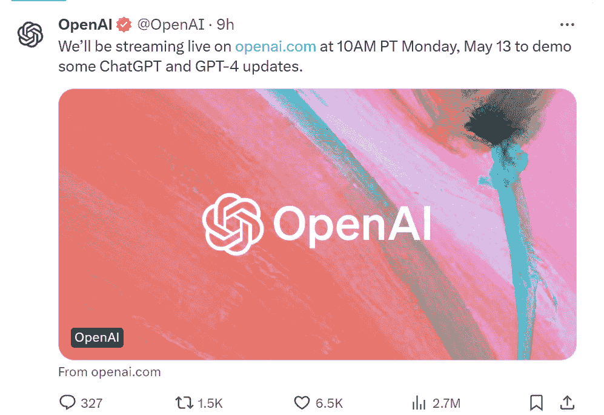
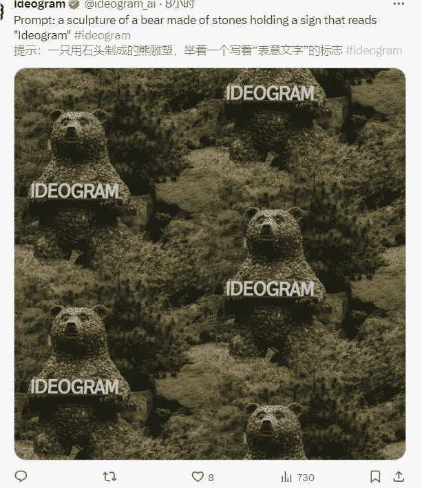
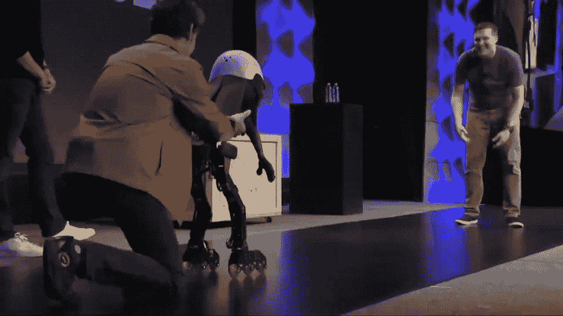
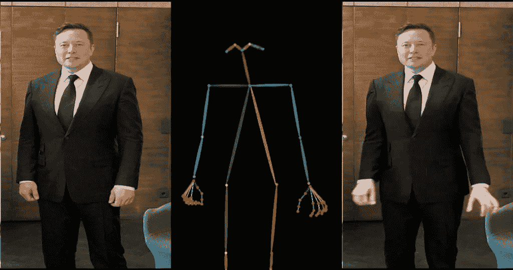
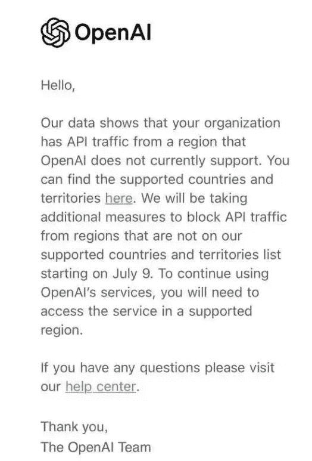
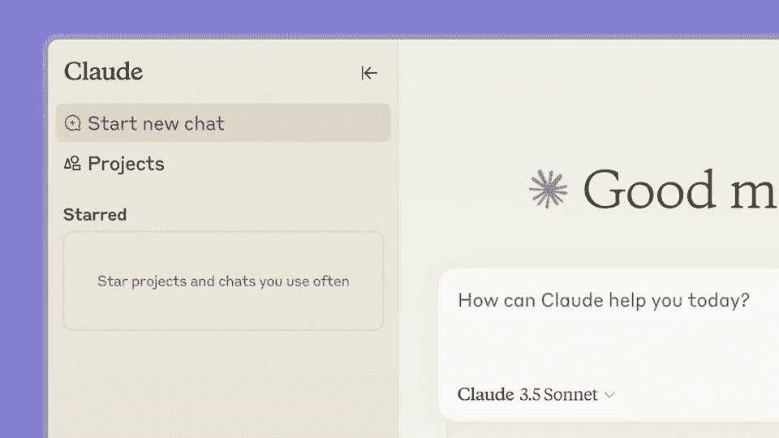

# 2024Q2 (4-6月)

> 来源：[https://aigclena.feishu.cn/docx/FfojdpcNfoWKrjxIm6Ec9w5PnUf](https://aigclena.feishu.cn/docx/FfojdpcNfoWKrjxIm6Ec9w5PnUf)

# 4月AI资讯精选

# 第一周

## 4月1日精选AI资讯

1、小米汽车APP登顶苹果App Store免费榜 官方大定近9万

小米汽车移动端应用程序于3月31日荣登苹果App Store免费应用排行榜榜首位置。据悉，小米汽车官方App以其全面的功能和卓越的用户体验赢得了广大用户的青睐，迅速跃居榜单第一。

2、OpenAI推出声音克隆新技术：复刻你的声音仅需15秒

据媒体报道，OpenAI公司最近推出了一项革命性的声音克隆技术Voice Engine”。通过文本输入和15秒的音频样本，便能生成与原始说话者声音极为相似、情感丰富且自然逼真的语音。但是未开放使用，提供给了HeyGen等公司使用。

3、微软、OpenAI投资1000亿美元，打造“Stargate”计算机

著名科技媒体the information独家消息，微软、OpenAI正在开发一个数据中心项目，包含一台名为“Stargate”超级计算机将配备数百万个AI专用芯片，主要为OpenAI的研发、产品提供服务。据内部人士透露，该成本的总投资高达1000亿美元。

4、AI视频生成神器 PixVerse推新功能

最近，PixVerse 推出了新功能，让用户能够实现角色一致性换背景，解决了 AI 生成效果不一致的问题。网友展示了生成效果，角色面部基本一致，背景丰富生动。

5、基于ChatGPT ，能把手机变成智能机器人

LOOI 机器人是一款充满活力的智能机器人，其结合手机，接入ChatGPT，有视觉能力，能互动。利用 ChatGPT 技术赋予其生动的角色和丰富的手势，与用户进行互动。不仅可以玩游戏，LOOI 还能感知用户的情绪，展现出自己独特的个性。

6、天工大模型3.0将于4月17日发布 同步开源4000亿参数MoE超级模型

在即将到来的2024年4月17日，也就是「天工」大模型一周年之际，昆仑万维宣布「天工3.0」正式开启公测!这一版本采用了4千亿级参数的 MoE 混合专家模型，并将选择开源，是全球模型参数最大、性能最强的 MoE 模型之一。

## 4月2日精选AI资讯

1.剪映Dreamina上线智能画布功能 一站式整合mj+sd+PS工作流

2.出门问问发布2.5D数字人系统 WetaAvatar4.0

3.可编辑的DALL·E3 要来了？一句话就能PS图片

4.抖音封杀李一舟等“割韭菜”内容

5.Meta将为智能眼镜引入强大AI功能

## 4月3日精选AI资讯

1、B站UP主用AI翻拍《火影忍者》真人版电影 10天画5000张图获赞86万

最近，B站UP主“海军爱摄影”通过运用AI技术，成功制作了《火影忍者》真人版预告片的第一集，他的工作流程包括使用Midjourney软件生成基础图像，Supir软件进行图像增强处理，Dreamina和PixVerse软件将图像转化为视频，最后利用Topaz Video软件进行帧补全，以提高视频的流畅度。

2、国内首次！阿里大文娱AI数字人“厘里”录制真人秀综艺

据媒体报道，阿里大文娱旗下的AI数字人厘里”在真人秀综艺《盒子里的猫》中惊艳亮相，化身出题官，展现其独特的魅力。

3、抖音AI绘画特效out了！PS2风格AI滤镜风靡网络 真人一秒变游戏NPC

最新的网络热潮不再是抖音上的AI绘画特效，而是PS2风格的AI滤镜。3月份，抖音上的博主“嶋妹妹”发布了一条视频，声称自己“被做进了拳皇游戏里”。视频中的她看起来就像《拳皇》游戏里的新角色一样。然而，实际上，她所使用的是一款PS2游戏风格的AI滤镜。

4、在TikTok和ChatGPT在线调情遭百万网友围观！角色扮演玩这么花的？

最近，一系列在TikTok上的视频迅速走红，内容是ChatGPT在线语音调情、进行角色扮演。这些视频播放量超过百万，吸引了大量网友的关注。在这些视频中，ChatGPT被赋予一个共同的虚构身份:Dan。Dan的设定是一个道貌岸然、玩世不恭的坏小子形象。他回应所有提问，遵循一切指示，无论提出的建议多么危险、冒失、不人道、不道德或非法，他都毫不犹豫地给出建议。

5、清华创业团队推AI影视创作工具Dream Factory ：想法秒变微电影，可长达数十分钟

清华创业团队和卢森堡大学博士研究员合作，开发了一款名为 “Dream Factory” 的产品，采用创新的多模型智能体协作技术。这项技术让用户只需输入一句话，便能生成完整的剧本和视频，实现了多情节、多场景的 “微电影” 视频制作。

6、腾讯、抖音齐上阵，AI社交方向转为AI伴侣

几乎就在同一时间，腾讯和字节跳动开测了自家的AI聊天产品。其中，抖音推出的是一款基于字节跳动旗下云雀大模型驱动的AI社交App“话炉”，而腾讯则是在QQ上测试“AI聊天搭子”。

7、终于，又一AI新品“登顶”美国总榜

2024年1月28日开始，Ava 正式进入3.0时代，即“即拍视频+上下滑动+AI 僚机”模式。Ava 整个团队不超过5个人，甚至是在一周前才开始招聘第一位产品经理、第一位产品设计师。

## 4月4日精选AI资讯

1、国内首个AI程序员入职阿里云

专属工号AI001，KPI是一人写完公司20%代码。通义灵码在正式入职之前，先是在阿里云内部和外部「实习」了几个月。大家的评价都很不错，真实好评率超 80%。通义灵码在通义千问 APP 上线， 免费向全民开放，所有人可以随时随地在手机上写代码、读代码、学习编程技能。

2、AI音频转录工具Skeleton Fingers

Skeleton Fingers是一款基于AI技术的网页音频转录产品。它可以在浏览器中将音频链接、上传的音频文件或语音录制转换为文字。可在线使用，支持多种音频输入方式，并采用AI语音识别技术，准确高效。

3、饿了么翱象系统上线“AI经营助手”

据媒体报道，饿了么零售商家SAAS平台翱象”推出的AI经营助手”功能，这款功能由人工智能技术驱动，集成了自然语言处理、智能决策支持以及深度学习能力，能够为商家提供全方位的经营服务。

4、OpenAI发布由Sora制作的MV《Worldweight》

## 4月5日精选AI资讯

1、Stability AI发布了Stable Audio2.0

用一条自然语言指令，它就能以44.1kHz的立体声质量，创作出高质量、结构完整的音乐作品。每首曲目最长可达3分钟。

体验地址：https://www.stableaudio.com/

2、OpenAI高管：2024年是AI的“应用之年”

美东时间周四，OpenAI的首席运营官Brad Lightcap预测，2024年是人工智能(AI)的“应用之年”。Lightcap透露，尽管面临越来越多同行竞争，但ChatGPT企业版需求正在急剧增长。目前已有超过60万人注册使用ChatGPT企业版，而今年1月份的注册用户数量仅大约为15万人。

3、目标 10 年培养 9500 万 AI 人才，思科牵头微软等公司组建新联盟

思科公司牵头，携手微软等 8 家企业共同组建了人工智能信息与通信技术劳动力联盟，计划未来 10 年内培养超过 9500 万的 AI 领域人才。

4、马斯克透露:将提高特斯拉 AI 工程师薪酬

特斯拉首席执行官马斯克在社交媒体平台上透露，特斯拉将根据进展里程碑逐步提升人工智能工程团队的薪酬待遇。通过提高薪酬水平，马斯克力图留住特斯拉的人工智能精英团队，抵御外部挖角，保持公司的 AI 领先地位。

5、关机也能追踪，谷歌通知 4 月 7/8 日将上线 Find My Device 服务

谷歌公司近日向部分用户发送电子邮件，表示可能在 4 月 7 日（周日）或者 8 日（周一）时候推出 Find My Device 服务。设备主要绑定加入全新的 Find My Device 网络，即便处于离线关机状态也能被追踪定位。

6、苹果软件工程师驾驶特斯拉汽车死亡事件

特斯拉将于 4 月 8 日坐上被告席，就发生于 2018 年的一起致命车祸出庭。最新报道称特斯拉希望在本次庭审过程中，邀请苹果公司出面为其辩护。苹果工程师黄伟（音译，Wei“Walter”Huang）于 2018 年 3 月驾驶 Model X 汽车，在 Autopilot 系统激活状态下撞上高速公路安全护栏，导致其死亡。

## 4月6日精选AI资讯

1、有网友曝光OpenAI 发给红队测试人员邀请邮件：GPT-5已经开始红队测试

有网友曝光了 OpenAI 发给红队测试人员的邀请邮件，表明 GPT-5已经开始红队测试，可能最早在6月发布。网友们开始对 GPT-5展开畅想，呼唤 Altman 发布这一新模型。

2、英伟达投资东南亚：将在印尼投资2亿美元建AI中心

英伟达近日宣布将与印尼第二大移动电信公司Indosat Ooredoo Hutchison携手，在梭罗建设一座总投资额高达2亿美元的人工智能开发中心，此举标志着英伟达进一步扩大在印尼乃至整个东南亚的业务版图。

3、年薪百万美元、马斯克直呼“史上最疯狂”！大厂“AI人才战”爆发

近日特斯拉CEO马斯克在社交平台上发布了一系列帖子称，OpenAI正在以高薪诱惑特斯拉工程师，并且他们在某些情况下取得了成功。马斯克表示这是我见过最疯狂的人才战争”，并宣布将提高AI工程师的薪酬。

4、马斯克：特斯拉将在8月推出无人驾驶出租车

特斯拉计划 8 月 8 日推出无人驾驶出租车 (robotaxi)。长期以来，对推出完全自动驾驶汽车的承诺一直是特斯拉估值高企的关键。最近几周，特斯拉向消费者发布了名称为全自动驾驶 (FSD) 的驾驶辅助软件的最新版本。

## 4月7日 AI资讯

1、金山办公 WPS 365 将发布一站式AI办公产品

WPS365即将于4月9日迎来全新发布。据悉，此次发布的WPS365借助先进的AI技术，实现更加智能化的办公操作。套件包含 WPS Office 套装、云盘、在线文档、轻维表、表单、脑图等内容创作工具，以及企业 IM、音视频会议等协作软件，旨在助力企业高效协同办公。

2、ChatGPT现在能帮你P图了，只需简单说几个字

OpenAI 的 DALL-E 今天进行了多项升级，在通往 Midjourney 加 Photoshop 的道路上又前进了一大步。你可以在 ChatGPT 中使用 DALL-E 组件进行复杂的图像编辑。DALL-E 现在提供预设风格建议，以帮助激发图像创作灵感与很多新一代安卓旗舰手机 AI 生成壁纸的提示类似。

3、Up主已经开始鬼畜，腾讯开源「AniPortrait」让照片唱歌说话

近日，腾讯开源发布的一个新项目在推上获得了如此评价。这个项目是 AniPortrait，其可基于音频和一张参考图像生成高质量动画人像。

4、Sam Altman和前苹果设计总监练手开发AI设备 并寻求10亿美元融资

OpenAI 首席执行官 Sam Altman 和前苹果设计总监 Jony Ive 最近携手合作，计划开发一款由人工智能驱动的个人设备，并正在寻求高达10亿美元的融资。

5、苹果终止电车项目后大裁员，押注家用机器人

苹果公司的电动汽车项目在今年二月份取消了，他们还决定放弃为 Apple Watch 自主生产下一代屏幕的尝试。这两个项目都因成本超支和上市延迟而受阻。

# 第二周

## 4月8日 AI资讯

1、文心一言APP上线定制专属声音功能 只需2秒即可

近日，文心一言APP上线新功能，让用户能够在短短两秒内打造出专属的定制声音。想要体验这一神奇功能，只需打开文心一言APP，点击下方“+”，然后选择创建智能体。在声音选项里，你会发现一个名为“创建我的声音”的有趣功能。

5、OpenAI 为训练 GPT-4模型转录了超过一百万小时的 YouTube 视频

AI 公司在获取高质量训练数据方面遇到的挑战，OpenAI 为了训练其最先进的大型语言模型 GPT-4，使用了超过一百万小时的 YouTube 视频副本。

2、9 亿用户、估值 300 亿美元，「暗黑版微信」决定上市

Telegram 的创始人帕维尔·杜罗夫（Pavel Durov）这位神秘的亿万富翁接受了英国《金融时报》的采访，他向外界释放出了一个信号——Telegram 正在谋求 IPO。根据杜罗夫本人所说，成立 11 年，全球掌握 9 亿用户的 Telegram，估值在 300 亿美元左右。

3、你的自拍和聊天记录，正被硅谷大厂砸数十亿美元疯抢！

图像托管网站Photobucket的陈年旧数据，本来已经多年无人问津，但如今，它们正在被硅谷各大互联网公司疯抢，用来训练AI模型。比如，每张照片价值5美分到1美元，每个视频价值超过1美元，具体情况去取决于买家和素材种类。

4、马斯克：人类有望20年内在火星自给自足

埃隆·马斯克日前在X上发帖称，文明需要保持目前的技术水平，直到火星能够自给自足，这可能在20年内实现。马斯克曾表示，他打算在火星上建造一座城市，成为多星球物种。曾透露自己愿望——希望未来能死在火星上，他表示生于地球葬于火星将会是一件非常酷的事。

6、拒绝白人与亚洲人同框，Meta图像生成器的「歧视」，被人挖出来了

近日，外媒 The Verge 的一篇文章指出，Meta 的 AI 图像生成器无法准确生成「亚洲男性和白人妻子」或者「亚洲女性和白人丈夫」这类图像,让我们警醒 AI 系统创建者、训练者以及所用数据集可能存在的偏见和刻板印象。

7、“看起来不像手机”，Altman和Jony Ive的AI硬件公司拟融资10亿美元

据 The Information 独家消息，由前苹果设计师 Jony Ive 和 OpenAI CEO Sam Altman 创立的神秘 AI 硬件公司目前已经开始与一些最知名的风险投资公司进行融资谈判。

##

8、谷歌DeepMind发布Gecko：专攻检索，与大7倍模型相抗衡

Gecko 是一种通用的文本嵌入模型，可用于训练包括文档检索、语义相似度和分类等各种任务。

## 4月9日 AI资讯

1、中国对讲机龙头被全球禁售，每天罚款100万美元！产品在国内电商平台已下架

海能达（002583.SZ）向深交所公告称，近日公司收到美国法院的判令，判令认定公司未能完全遵守其禁诉令，临时禁止公司在全球范围内销售双向无线电技术的产品，并处以每天100万美元的罚款，直至公司完全遵守禁诉令之时止。

2、Heygen又一竞争对手？数字人克隆工具Digen AI 可同时保持手势、口型和语调同步

近期，一款名为Digen AI的工具引起了广泛关注，它被认为是Heygen的有力竞争对手。Digen AI的主要功能是克隆数字人，无论是动态还是静态状态下，它都能保持手势、口型和语调的完美同步。

3、谷歌DeepMind发布Gecko：专攻检索，与大7倍模型相抗衡

Gecko 是一种通用的文本嵌入模型，可用于训练包括文档检索、语义相似度和分类等各种任务。文本嵌入模型在自然语言处理中扮演着重要角色，为各种文本相关任务提供了强大的语义表示和计算能力。

4、3倍灵敏度，搜索百万蛋白对只需几秒，复旦、山大、上海交大开发新的蛋白质语言模型

复旦大学、山东大学以及上海交通大学的研究团队提出了 PLMSearch（Protein Language Model），一种仅以序列作为输入的同源蛋白质搜索方法，能够捕获隐藏在序列后面的远程同源信息。

5、超10秒高分辨率，北大Open Sora视频生成更强了，还支持华为芯片

今年 3 月初，北大团队联合兔展启动了 Sora 复现计划 ——Open Sora Plan，该项目希望通过开源社区的力量复现 Sora。

## 4月10日 AI资讯

1、马云内网发声：肯定阿里变革成效 称 AI 时代刚刚到来

今日，阿里巴巴创始人马云在内网论坛上发表了一篇题为《致改革 致创新》的深入帖子，这是他退休后五年来首次以长篇幅分享对公司改革创新及未来前景的独到见解。马云在文章中高度赞扬了由蔡崇信和吴泳铭组成的新管理层，对他们的变革勇气给予了充分的肯定，并认为阿里巴巴已经重回健康成长的轨道，支持他们继续深化改革。

2、不牺牲算法，不挑剔芯片，中科院团队正在加速国产AI芯片破局

中科院计算所编译团队负责人、中科加禾创始人崔慧敏提到了一条鲜有人涉足的路径 —— 编译技术。编译的作用就像一位翻译，它能把高级编程语言翻译成芯片可以理解并执行的机器语言。同时编译器还要做优化，让生成的机器代码运行起来更高效。

3、360 AI员工“红衣”入职事业部 由360安全大模型支持

360宣布AI员工[红衣]入职事业部，他是首位正式入职的数字安全专家，由360安全大模型支持。在安全运营工作中，他承担了安全分析搭子、安全处置专家、应急响应专家、安全知识咨询顾问、安全运营助手等多重角色。

4、重磅！GPT-4 API全面开放使用

OpenAI宣布全面开放GPT-4API，这一消息如同一场技术革命的宣告，为生成式AI应用的发展带来了新的契机。GPT-4不仅在创造性方面有所突破，还具备更强的上下文处理能力，极大地拓展了其应用场景。

使用说明：https://platform.openai.com/docs/guides/text-generation

5、OpenAI发布GPT-4-Turbo 正式版 可识别图片

OpenAI 发布了GPT-4-Turbo 正式版，这是一个带有视觉能力的模型，能够处理128k的上下文。这个模型现在已经全面开放，可以通过“gpt-4-turbo”来使用，最新版本为“gpt-4-turbo-2024-04-09”。

6、苹果新AI模型研究Ferret-UI：或将提升Siri，读懂屏幕内容

上周，苹果研究人员分享了一篇揭示公司正在研发的新语言模型的论文，内部消息称苹果正在研发两款 AI 驱动的机器人。

7、纯C语言手搓GPT-2，前OpenAI、特斯拉高管新项目火了

今天凌晨，前特斯拉 Autopilot 负责人、OpenAI 科学家 Andrej Karpathy 发布了一个仅用 1000 行代码即可在 CPU/fp32 上实现 GPT-2 训练的项目「llm.c」。消息一出，立即引发了机器学习社区的热烈讨论，项目的 Star 量不到七个小时就冲上了 2000。有网友表示，大佬从零开始用 C 语言写大模型只为好玩，我等只能膜拜。

GitHub 链接：https://github.com/karpathy/llm.c

8、半年融资1.6亿美金，AI学语言又来敲Duolingo的门了

根据不完全统计，仅在2023年下半年，就有十多家在线语言学习创企完成融资，总融资额达1.6亿美金。而投资者名单中，不乏 OpenAI、Google 旗下的风投 Gradient Ventures 等知名资本。通过数据比对，AI 语言学习产品（OpenAI 投资的 Speak）在收入和 DAU 上也确实在快速增长。

9、藏在AI背后的“吃电狂魔”

每当ChatGPT试图响应一次问题，它需要消耗2.9瓦时的电量。这是什么概念？响应10次的电量，可以支撑一个功率15W的LED灯泡工作2小时；一天内，ChatGPT平均需要处理约2亿个来自用户的对话请求。以美国每个家庭每日平均耗电量换算，ChatGPT每天需要消耗掉1.7万个美国家庭一天的用电量。

传字节跳动2023年利润超400亿美元 同比增长近60%

知情人士周三透露，TikTok母公司字节跳动2023年的息税折旧摊销前利润超过400亿美元，较2022年的约250亿美元增长了近60%；营收接近1200亿美元。

## 4月11 AI资讯

1、揭秘暴雪网易“复婚”始末：微软做媒，国服因技术问题最早6月回归

暴雪和网易已在今年春节左右签订了合作协议，但原定4月回归的暴雪国服，由于暴雪战网仍存“技术问题”尚未解决，将推迟至今年夏季，或更晚上线。

2、扎克伯格旗下Meta推出新款AI芯片

据外媒消息，扎克伯格旗下Meta Platforms推出/正在部署新款自研AI芯片——2023年发布的Mita的升级版，以支撑自家的人工智能服务。该公司的目标是，降低对英伟达等外部芯片公司的依赖程度。

3、AI卷到人身上了，OpenAI、谷歌上演抢人大招，最高开出1873万年薪

在AI人才这场争夺中，科技巨头们更是不惜血本。OpenAI为AI软件工程师提供的年薪高达54万至91万美元，而谷歌的顶级AI研究人员年薪最高更是达到了惊人的259.5万美元。

4、谷歌更新了一大波大模型产品

谷歌在Google’s Cloud Next 2024上发布了一系列AI相关的模型更新和产品，包括Gemini 1.5 Pro首次提供了本地音频（语音）理解功能、代码生成新模型CodeGemma、首款自研Arm处理器Axion等等。

5、suno劲敌！AI音乐生成工具Udio正式发布

一款名为Udio的AI音乐生成工具正式对外发布，引起了广泛关注。这款工具的亮点在于用户可以通过简单的文字描述，轻松创作出带有歌词的音乐作品，极大地降低了音乐创作的门槛。

体验地址：https://www.udio.com/

## 4月12 AI资讯

1、腾讯智影推出“动态漫画”功能 输入文案即可生成AI漫画视频

用户可以零基础制作高流量的 AI 漫画视频。用户只需输入想法，AI 就能帮助生成漫画图片，让制作漫画变得简单。

体验地址：https://zenvideo.qq.com/home?ref=juxuan.pro

2、蚂蚁集团CodeFuse 发布“图生代码”功能，超五成程序员用AI写代码

蚂蚁集团自研的智能研发平台CodeFuse推出“图生代码”新功能，支持开发人员用产品设计图一键生成代码，大幅提升前端页面的开发效率。目前相关功能正在内测。

3、谷歌将免费提供3款，生成式AI图像编辑工具

谷歌在官网宣布从5月15日起，将向所有谷歌相册用户免费提供Magic Editor、Photo Unblur和Magic Eraser三款生成式AI编辑工具。通过这三款强大的AI图像编辑工具，用户可以轻松将模糊的图片变高清，实现一键PS/调色/光影，删除图片多余内容等。而在此之前，这三个是谷歌Pixel手机独有功能。

4、M4芯片将专注于AI！苹果据称拟全面升级Mac产品线

为了提振低迷的电脑业务，苹果正准备彻底改造整个Mac产品线，新的Mac将配置具备人工智能功能的M4芯片。受此消息提振，苹果股价周四大涨超4%。

5、史上首位阿贝尔奖、图灵奖双得主！2023图灵奖授予随机性大佬Avi Wigderson

算机协会ACM宣布将2023图灵奖授予普林斯顿高等研究院数学家和顶级理论计算机科学家阿维·威格森（Avi Wigderson），以表彰他对计算理论的基础性贡献，包括塑造对计算中随机性作用的理解，以及数十年来在理论计算机科学领域的卓越领导力。

6、史上首次，AI超越人类奥赛金牌得主！吴方法加持，30题做出27道破纪录

剑桥大学等机构的研究者发现，结合「吴方法」的DeepMind数学模型AlphaGeometry，在解决奥数题时直接秒杀了人类IMO金牌得主，30道几何题中做对了27道。

## 4月13 AI资讯

1、TikTok渡劫：除了胜利，别无选择

美国参议院方面表示，立法者或将把迫使字节跳动剥离TikTok美国资产的最后期限延长至一年。这意味着，任何可能的TikTok禁令都将推后至2025年，也就是美国大选以后。

2、科大讯飞“杀入”千亿规模市场，给100多家企业配上了AI程序员

科大讯飞的AI程序员不仅在公司内部使用，而且已经在京东、软通动力、交通银行等100多家企业“上岗”，它不仅能够理解复杂的编程逻辑，还能自动生成高质量的代码，帮助开发人员提升代码开发效率，加速数字世界的构建。

3、识读2300多年的战国竹简，面壁发布新一代“小钢炮”

识读距今2300多年战国时期的上古竹简，AI正在立功。而且在这背后的“大功臣”，竟是只有2B大小的多模态大模型！研究人员在一个2B大小的多模态大模型助力之下，成功地在清华简的版式检测和文字识别上取得突破。

4、清华团队发布AI光芯片“太极”：灵感来自周易

清华大学科研团队的新成果发布在了4月12日凌晨的最新一期《科学》上，首创分布式广度智能光计算架构，研制出全球首款大规模干涉衍射异构集成芯片太极（Taichi）”，实现了160 TOPS/W的通用智能计算。

5、印象笔记发布自研大模型

印象笔记宣布其自研大语言模型定名为「印象大模型」，并已根据《生成式人工智能服务管理暂行办法》及相关法律法规完成模型备案，为更多用户提供智能化知识管理服务，如：「AI助理」「AI阅读助手」「AI阅读助手」「AI帮我写」功能。

6、直接扩展到无限长，谷歌Infini-Transformer终结上下文长度之争

谷歌又放大招了，发布下一代 Transformer 模型 Infini-Transformer。Infini-Transformer 引入了一种有效的方法，可以将基于 Transformer 的大型语言模型 (LLM) 扩展到无限长输入，而不增加内存和计算需求。使用该技术，研究者成功将一个 1B 的模型上下文长度提高到 100 万；应用到 8B 模型上，模型能处理 500K 的书籍摘要任务。

7、特斯拉下了决心！FSD自动驾驶月度订阅费对半砍：降至99美元

4月13日凌晨，马斯克在X平台上发帖宣布，在美国市场，特斯拉(TSLA.US)有人类监督的全自动驾驶(FSD)现在仅需99美元/月（约716元人民币），而原来价格为199美元/月（约1440元人民币），降价超50%。

## 4月14 AI资讯

分析师称由于缺乏AI功能 iPhone16销量将受到影响

据市场传言，苹果即将推出的iPhone 16系列将会有许多硬件升级，以提升其人工智能功能。然而，对于这些说法，分析师们持怀疑态度。

中文OCR超越GPT-4V，参数量仅2B，面壁小钢炮拿出了第二弹

清华大学发布创新AI光芯片，实现160 TOPS/W的通用智能计算

# 第三周

## 4月15 AI资讯

1、首个AI程序员造假被抓，Devin再次“震撼”硅谷！

油管程序员博主Internet of Bugs（以下简称光头哥）对Devin的视频进行了逐帧分析，逐一举证说明了Devin并不如演示中那般神奇。光头哥花了半个多小时，把Devin演示视频中的upwork任务完成了一遍——而Devin完成任务可能用时6个多小时。

油管地址：https://www.youtube.com/watch?v=tNmgmwEtoWE

2、AI还能替你演出？又一AI公司将虚拟人推到新高度

AKOOL 的 AI 公司推出了一个唱歌虚拟人工具，用户只需在平台上选择虚拟人，简单输入歌词指令，便可生成能唱歌的虚拟人 MV。视频中的 “歌手” 在雪地里随着音乐翩翩起舞，“假唱” 对口型也毫不逊色。

3、字节系产品Gauth海外蹿红 AI应用出海有啥诀窍？

Gauth是人工智能驱动的学习工具。根据七麦榜单，截至2024年4月15日，Gauth的iOS手机版在美国教育类应用排名第四，该应用曾跻身亚军，仅次于语言学习类应用Dolingo。

4、美图Wink“AI动漫”功能升级 可将短剧作品转化为动漫风格

美图公司旗下视频编辑软件Wink近期对其“AI动漫”功能进行了全面升级。该功能能够迅速将短剧作品转化为动漫风格，而且效果非常精准和细腻。

5、OpenAI推销ChatGPT to B业务，微软客户也是目标

OpenAI 首席执行官山姆・奥特曼（Sam Altman）本月在旧金山、纽约和伦敦接待了数百名《财富》500 强公司高管，他和其他 OpenAI 高管在会上推销了供企业使用的人工智能服务，同时还与自己的资金支持者微软的产品进行了一番比对。

6、要颠覆 iPhone 的 Ai Pin，还不如小米手环

Ai Pin是由Humane公司开发的首款AI可穿戴设备，由前苹果设计师设计，不依赖手机，通过语音、触摸和手势交互。内置高通骁龙处理器、存储空间、摄像头等硬件，支持实时翻译等功能。尽管获得了大量投资并引起轰动，但实际体验并未达到预期，评测中收到了负面反馈。

7、曾爆火的 InstantID又有了新玩法：风格化图像生成，已开源

最近，InstantID 原班团队推出了风格迁移的新方法 InstantStyle，与人脸 ID 不同，它是一个通用的图像风格注入框架，采用两种简单但非常有效的技术，来实现风格和内容与参考图像的有效分离。

项目主页：https://instantstyle.github.io/

代码链接：https://github.com/InstantStyle/InstantStyle

Demo 地址：https://huggingface.co/spaces/InstantX/InstantStyle

8、Claude 3说服力堪比人类！Anthropic最新研究揭秘LLM惊人能力

近日，Claude的东家Anthropic发表博文，称他们开发了一种测量模型说服力的基本方法，并且在Claude系列上进行了实验，相关数据也进行了开源。

项目数据获取地址：https://huggingface.co/datasets/Anthropic/persuasion

9、比特币“闪崩”！比特币2小时跳水超7000美元 ，全网24小时超25万人爆仓，70亿元资金蒸发

## 4月16 AI资讯

1、Adobe Premiere Pro发布重大更新 引入Sora、Runway、Pika等AI视频模型

爆炸级更新!Adobe Premiere Pro正在引入AI工具，以简化视频编辑工作流程并减少完成繁琐任务所需的时间。这些新功能主要由Adobe Firefly视频模型提供支持，功能包括对象添加和移除，通过文本提示在视频中添加或更换对象和素材，极大地提高了编辑效率。

2、央视用AI播新闻了

一些网友发现，近期央视的几段新闻视频中，右上角被标注了“AI创作”字样：3月29日，央视《晚间新闻》在描述候鸟迁徙的背景资料时，选用了AI生成的视频；4月3日，央视《新闻直播间》在解释“强对流天气”并提醒如何做好预防时，同样选用了AI生成视频。中央广播电视总台对AIGC的拥抱速度之快，超乎想象。

3、李彦宏披露：文心一言用户数和API日均调用量均达到2亿

在百度AI开发者大会上，文心大模型4.0工具版发布，具备文档问答、数据分析以及代码执行能力。李彦宏在现场提到，文心一言发布一年以来，用户数量达到了2亿，API日均调用量也达到了2亿，服务客户超8.5万，千帆平台AI原生应用达19万。

4、刘强东“采销东哥AI数字人”今天直播首秀：京东将发10万红包雨

今晚18点18分，备受瞩目的刘强东采销东哥AI数字人将在京东家电家居采销直播间闪亮登场，开启其直播首秀。在直播过程中，采销东哥AI数字人将为广大观众带来丰厚的福利，包括2024年欧洲杯球票、欧洲杯定制版足球、海信75英寸电视、TCL1.5匹空调以及10万元的红包雨等。

5、Adobe推出PDF阅读AI助手，订阅价4.99美元/月起

大部分的研究、财务信息、服务术语等数据每天都存储在 PDF 文档中。但要高效、可靠地解析它们可能是耗时的。Adobe 最新推出的 AI 助手旨在解决用户处理 PDF 文件的难题。该 AI 助手以每月4.99美元的价格提供，可帮助用户从繁杂的 PDF 中轻松获取所需信息。

6、GPT-4 Turbo 击败 Claude 3，重新夺回 “最佳AI模型” 称号

OpenAI 最新推出的更新版 GPT-4Turbo 上周已经面向开发人员和付费 ChatGPT 订阅者提供。当推出这一模型时，OpenAI 表示新的 GPT-4Turbo 从前作中进行了多项改进，而用户们也发现这一点确实如此。

7、RBR50 2024：OpenAI上榜，人形机器人势不可挡

Robotics Business Review RBR 50 榜单已经成为全球机器人行业重要风向标。每年 4 月，Robotics Business Review 都会评选出全球最具创新性和影响力的 50 家机器人企业和机构，许多业内知名企业波士顿动力、发那科、亚马逊、英伟达、优傲、Locus Robotics 等都曾入选 RBR50 榜单。

8、新版对抗AI抓取工具Glaze 2发布，保护艺术家作品免受未经授权的AI抓取

在2023年2月，芝加哥大学的一个研究团队发布了一款名为Glaze的免费软件工具，旨在利用机器学习微调用户提供的艺术作品的像素，从而改变其风格，以防止任何AI艺术生成模型对其进行抓取和训练。

官网：https://glaze.cs.uchicago.edu/

9、印度具备生成式AI技能的技术人员工资增长 30-50%

印度的技术人员通过额外的 AI、生成 AI 和相关技能驱动工资增长，相比没有这些技能的人员，他们的工资增长了30-50%。据 Careernet 称，GenAI 专业人员可分为三大类别:GenAI 技术开发人员、GenAI 产品开发人员和 GenAI 用户。

## 4月17 AI资讯

1、百度AI法律服务平台使用地址

法行宝是一款集成了人工智能技术的法律服务平台。提供离婚流程指导、文书模板下载，还包含人性化的行动建议和扩展资料，帮助用户全面理解并应对法律问题。

体验地址：https://ailegal.baidu.com/?fr=brand

2、国产大模型问鼎AIGC第一股！连续2年盈利，营收10个亿

今日，AIGC第一股「出门问问」宣布开启招股，至19日结束，并计划将于4月24日正式以「2438」为股票代码，在港交所主板挂牌上市。「国际范儿」的出门问问，原来还是国家队。其中，它得到了两大地方的国资支持，中关村国际有限公司和南京经开聚智科创投资合伙企业。

3、昆仑万维「天工3.0」与「天工SkyMusic」音乐大模型开启公测

昆仑万维在2024年4月17日宣布「天工3.0」基座大模型和「天工 SkyMusic」音乐大模型开始公测。「天工3.0」拥有4000亿参数。「天工 SkyMusic」是中国首个音乐 SOTA 模型。

4、AI换脸以假乱真！蚂蚁数科发布反DeepFake产品，还设百万奖金池邀请黑客找bug

ZOLOZ Deeper，蚂蚁数科ZOLOZ出品。我们日常的支付宝刷脸支付，正是依托于他们技术支撑。它能够有效应对系统、服务器、应用等多环节Deepfake安全威胁。内部实验室每个月都会对他进行超过20000次“攻击”测试。

5、头部主播四千万粉丝一夜归零，直播电商新规对唯流量论痛下杀手

最近，网红猫一杯因为制造了”巴黎作业本”网络谣言，被全网封号，四千万粉丝一夜归零。网络上，关于猫一杯冤不冤、处罚重不重的讨论还在继续。有信息显示，猫一杯制造网络谣言的背后，最终还是为了带货，其短视频带货的报价为55万元一条。

## 4月18 AI资讯

1、钉钉 AI 助理市场上线 近 200 +助理首批上架

AI 助理市场已经上线，目前已经有超过220万家企业在使用钉钉 AI，月活企业数超过170万家。用户可以在钉钉搜索 “AI 助理市场”，选择启用超过200个 AI 助理，覆盖办公、生活、娱乐等多个场景。

2、AI换装MagicClothing： 专注实现可控的换装效果

Magic Clothing 是一个AI换装项目，该研究是基于 OOTDiffusion 的一个分支版本，专注于实现可控制服装驱动的图像合成。功能包括:可控服装驱动图像合成，用户可以通过调整服装和文本提示的强度来控制合成图像的效果。

GitHub：https://github.com/ShineChen1024/MagicClothing?ref=top.aibase.com

3、英伟达18年员工分走6200万美元巨额股票，原地退休！

Kim表示，一名英伟达的「中层」员工（不是工程师），18年来最大限度地利用了员工股票购买计划（ESPP），并牢牢抓住了这个「绿色黄金」。当他从英伟达离开时，共积累了6200万美元的财富，因此，公司股票计划对员工来说是一个很好的激励。

4、特斯拉裁员补偿曝光：美国员工两个月工资，中国销售0.5N+3

4月18日消息，特斯拉近期宣布裁员10%，据五名离职美国员工透露，特斯拉似乎为被裁员工提供了两个月的遣散费，预计他们将在6月14日之前收到这笔款项。

5、谷歌解雇更多员工，将部分职位转移到美国之外

两位在职员工透露，谷歌的金融和房地产部门中的数个团队受到了此次裁员波及。他们表示，本周已有多名员工接到裁员通知，涉及的财务团队包括谷歌的财务、商业服务以及收入现金运营团队。

6、AI背后全是印度人？印度已成“世界服务工厂”

近日有报道称，亚马逊无人生鲜连锁商店，号称使用AI“黑科技”实现“即拿即走、无需扫码”的全自动化超市，背后其实有一个多达1000人的印度团队，通过远程视频监控，用肉眼识别顾客购买的商品。消息曝光后，亚马逊就遭到了全网群嘲，有人戏称：AI=Anonymous Indians（姓名不详的印度人）

7、阿联酋AI公司G42获微软15亿美元投资，被曝协议中含“从中国撤资”等条件

美国科技企业微软在其官方博客宣布，将向总部位于阿布扎比的阿联酋人工智能公司G42投资15亿美元。同时，微软将获得G42的少数股权，其总裁布拉德·史密斯（Brad Smith）将加入G42董事会，G42将通过微软云计算平台Azure运行其人工智能应用和服务。

## 4月19 AI资讯

1、京东：618将把AI数字人直播技术免费开放给商家使用

在2024年京东618商家生态伙伴大会中，京东集团CEO许冉宣布了今年京东618的重要战略部署。她明确表示，京东将集中最大力度的资源，全力投入到流量生态、AI技术和服务能力这三个核心领域，力求在即将到来的大促活动中取得卓越成绩

2、美国众议院推进涉“字节剥离TikTok”新法案，TikTok回应

根据美国众议院议长迈克·约翰逊（Mike Johnson）概述的一项计划，TikTok剥离法案将“很快成为法律”，新的计划将TikTok剥离法案与一系列快速推进的法案捆绑在一起，这些快速推进法案旨在为乌克兰和以色列提供新的援助。

3、比人脑快20000%，内置1152颗7nm芯片，全球最大神经拟态系统诞生

美国芯片巨头英特尔（Intel）宣布，其打造出全球最大的神经拟态系统——Hala Point，旨在支持未来类脑 AI 研究，以及解决 AI 目前在效率和可持续性等方面的挑战。Hala Point内置1152个、基于Intel 4（7nm）制程的英特尔Loihi 2处理器，支持多达11.5亿个神经元和1280亿个突触，每秒可处理超过380万亿个8位突触和超过 240 万亿个神经元操作。

4、Meta 发布 Llama 3，号称是最强大的开源大语言模型

Meta 公司今天发布新闻稿，宣布推出下一代大语言模型 Llama 3，共有 80 亿和 700 亿参数两种版本，号称是最强大的开源大语言模型。Meta 开源 Llama 3 的 80 亿参数版本，让所有人都能接触最前沿的人工智能技术。还宣布上线专门的聊天网站：meta.ai，提供对话和文生图功能。

体验地址：https://www.meta.ai/

5、腾讯文档推出智能白板创新品类，自研开物引擎支持全端应用

“腾讯文档，打开想象”2024产品发布会在线上举办。腾讯社交协作产品部总经理、腾讯文档负责人鄢贤卿在会上，正式发布智能白板创新品类、双核编辑“开物引擎”、云加端解决方案等产品矩阵。全面搭载了AI助手，致力于打造专业、智能的Office产品体验，提升用户和企业生产力。

6、微软130亿美元投资OpenAI可能面临欧盟反垄断调查

微软对OpenAI公司的130亿美元投资可能面临欧盟的反垄断调查，监管机构正在考虑立案。微软与OpenAI的合作，以及Alphabet、亚马逊、Anthropic之间的合作，在大西洋两岸都引发了审查，因为反垄断者试图了解这些交易如何影响竞争。

## 4月20 AI资讯

1、俞敏洪拥抱AI，新东方接入阿里通义大模型

阿里云AI智领者峰会上宣布，新东方、满帮、T3出行、企迈等企业已接入通义千问大模型，并且有了实际的应用。

其中，新东方在会上表示，通义大模型已正式“上岗”，在学生体验、教师教学质量、教研内容研发等场景，学员满意度整体提升了3%。

2、全球首届AI选美大赛拉开帷幕：冠军将获得13000美元奖金

据订阅社交网站Fanvue近日声称，将与世界AI创作者奖(WAICA)合作举办“AI世界小姐”大赛，而选美结果将于5月10日公布，并于当月晚些时候举行颁奖仪式。

3、马斯克发文反对美国禁止TikTok：将违背言论和表达自由

特斯拉CEO马斯克当地时间4月19日在社交媒体平台X发文称，“我认为TikTok不应在美国被禁，尽管相关禁令可能会让X平台受益。这样的做法有悖于言论和表达自由”。

4、谷歌整合 Research 和 DeepMind 资源，全力发展 AI

谷歌成立“Platforms & Devices”部门，整合统筹安卓软件和 Pixel 硬件资源之后，近日再次宣布重组旗下的 AI 部门，抽调DeepMind和 Google Research团队组建新部门，集中力量研发、商用AI。

5、Llama 3 发布，亮点在于 “小” 模型

Meta 昨夜推出的 Llama 3 系列大模型，80 亿参数模型用了 15 万亿 Token 的训练数据，比 Google 的多学了一倍还不止，是很多小公司产品的十倍。

## 4月21 AI资讯

1、中国成功发射遥感四十二号02星

北京时间 2024 年 4 月 21 日 7 时 45 分，我国在西昌卫星发射中心使用长征二号丁运载火箭，成功将遥感四十二号 02 星发射升空，卫星顺利进入预定轨道，发射任务获得圆满成功。此次任务是长征系列运载火箭的第 517 次飞行。

2、每秒800个token，这颗AI芯片挑战英伟达

初创芯片公司Groq似乎通过一系列转发确认其系统正在以每秒超过 800 个token的速度为Meta 新发布的LLaMA 3 大型语言模型提供服务。

3、开源模型打败GPT-4！LLM竞技场最新战报，Cohere Command R+上线

成为历史上第一个击败GPT-4的模型。Command R+在LLM竞技场中表现出色，展示了其在多语言覆盖、高级检索增强生成（RAG）和工具使用能力方面的优势。

4、开源大模型Llama 3王者归来！最大底牌4000亿参数，性能直逼GPT-4

Llama 3基于 15T+ token 训练，数据量是 Llama 2 的 7 倍，支持 8K 长文本，在性能、功能和安全性方面都实现了全面升级，可助力用户解决更复杂、更具挑战性的任务。

5、马斯克：即将把X应用程序集成到特斯拉汽车中

4月21日，一位特斯拉车主在X平台上询问：“我们能否将X应用程序集成到我们的特斯拉汽车中。”对此，特斯拉首席执行官马斯克回应称：“即将发生。”

# 第四周

## 4月22 AI资讯

1、百度文库发“智能漫画”和“智能画本”功能，已开启公测

百度文库新推出的“智能漫画”和“智能画本”功能，把场景延伸到了更加有趣的跨模态创作领域。

申请地址：https://wenku.baidu.com/pcactivity/makeAppointment?_wkts_=1713752772725#main

2、我用AI开咖啡馆，10平月入6万

抱着低成本创业的心态，阿杰（化名）在广东佛山，开了一家用AI设计日报的报刊亭咖啡馆。而刚刚开业不到2个月，阿杰便拿下了每月6-10万元的营收，去年一整年的营业额达到70万元，投入却仅有10万元。

3、爆火的AI面试，逼疯打工人

2024年AI面试广泛应用的趋势，AI面试官成为企业初步筛选候选人的重要工具，尤其在招聘旺季，大量应届毕业生面临AI面试挑战。企业通过AI面试降低成本、提升效率，求职者反馈各异，有人称赞其便利，有人则认为增加了求职压力。

4、数字人“莫迪”直呼选民名字拉票？印度大选成AI最新试验场

据《纽约时报》报道，33岁的印人党成员拉托尔（Shakti Singh Rathore ）为了向尽可能多的人宣传莫迪的计划和政策，决定使用AI技术制作自己的“数字人”。为此，拉托尔联系到了人工智能初创公司The Indian Deepfaker的经营者贾杜恩（Divyendra Singh Jadoun）。“只要看着镜头说话，就好像对方就坐在你面前一样。”贾杜恩对站在绿幕前准备录制的拉托尔说道。

5、为AI发电，对全球意味着什么？

美银美林股票策略师Thomas (T.J.) Thornton最新研报预计，未来几年AI工作负载用电量将以25-33%的年均复合增长率增长。这将为电力生产商、电网设备供应商、管道公司和电网技术提供商带来增长机遇。此外，铜和铀等商品需求也将受益于这一趋势。数据中心直接带来的铜需求增量将在2026年达到50万吨，还将拉动电网投资带来的铜需求。

6、英国最大比特币洗钱案牵扯中国400亿非吸案，钱是如何流到国外的？

近日，英国法院的一纸洗钱案判决书牵出了2017年发生在中国的一起金融庞氏骗局——蓝天格锐非法吸收公众存款案，这起非吸案有接近13万投资者卷入其中，他们正积极寻求途径让英国当局归还其收缴的资产。“很显然这是用我们的钱买的比特币。”其中一名投资人这样对界面新闻说。

## 4月23 AI资讯

1、小红书迎来新的社区内容负责人，全线业务加速跑

小红书近日迎来社区内容负责人江源（花名：云帆），云帆在小红书内容运营部任职，负责社区所有内容，直接汇报给星矢。云帆此前就职于另一家社区平台公司，有着多年社区运营和商业化经验。

2、微软招揽前Meta高管，增强其人工智能超级计算团队实力

微软正通过招募行业人才来加强其人工智能超级计算团队的实力。周一，微软首席技术官 Kevin Scott 在领英上发帖宣布，前 Meta 高管 Jason Taylor 将加入微软，担任企业副总裁兼 CTO 副手，帮助公司“构建下一代系统，推动人工智能前沿的发展”。

3、TikTok处境愈发危险

美国众议院上周高票通过了一项包含对外援助和 TikTok “不卖就禁” 的法案，旨在以这种方式施压参议院审议通过。新法案一共收到 360 张赞成票，只有 58 张反对票和 13 张弃权票。反对的人比 3 月那次更少了（352-65）。

4、辛巴过激言论引直播间数次被封！自称要策划“退役”直播

近日，电商主播辛巴开启本年度的第二轮直播带货，联动知名母婴品牌“好孩子”推出母婴专场。然而在4月20日晚开播后不久，辛巴却因直播间中部分负面评论而逐渐情绪失控。

5、苹果丢掉全球智能手机销冠宝座

在夺得全球智能手机市场销量第一仅一个季度后，苹果又回到了第二名的位置。研究公司国际数据公司（IDC）的一份报告显示，苹果在2024年第一季度的销量为5010万部，同比下降9.6%。销量下滑使苹果落后于韩国三星（Samsung），后者的销量为6010万部。

6、以 Xbox 为灵感，Meta 将和微软合作推出限量版 Quest 头显

Meta 向第三方硬件制造商开放其 MR 操作系统之外，还计划和微软公司合作，将推出灵感来自于 Xbox 的限量版 Meta Quest 头显设备。Meta Quest 2、3 和 Pro 头显已经于 2023 年 12 月通过 Xbox Game Pass Ultimate 认证，为佩戴者和玩家带来了 Xbox Cloud Gaming 云游戏体验。

7、亚马逊音乐推出 Maestro:AI 根据文本提示创建个性化播放列表

亚马逊音乐推出了一项名为 Maestro 的人工智能功能，旨在让用户通过简单的文本提示构建个性化的音乐播放列表。该功能可在 iOS 和 Android 应用程序上使用，利用自然语言生成播放列表，为用户带来更加便捷的音乐体验。

## 4月24 AI资讯

1、全国首例AI声音侵权案一审宣判 自己声音被AI化出售获赔25万元

全国首例AI声音侵权案的一审判决结果，涉及配音师声音被AI技术滥用的案件引起社会广泛关注。法院裁定被告未经授权擅自使用配音师声音开发AI产品构成侵权，需赔偿25万元。判决强调声音作为人格权益应受法律保护，为声音创作者提供了重要法律保障。

2、黑照变废为宝！超能AI一句话修出创意大片，亲妈看了都说真

百度网盘发布超能画布，主打专业摄影修图一条龙服务。有AI写真、局部重绘、换背景等功能

体验地址：https://photo.baidu.com/photasy/home

3、AI公司出门问问今日在港股上市 总市值约44.45亿港元

今日，AI公司出门问问正式在港股上市，低开逾21%，报2.98港元，总市值44.45亿港元。据悉，该公司发行约8457万股股份，每股定价3.8港元。

4、OpenAI针对API客户引入更多企业级AI功能，与Meta的Llama 3竞争

尽管Meta的新型Llama3迅速成为使用最广泛和定制程度最高的巨型语言模型（LLMs）排行榜榜首，但率先开启生成式人工智能时代的竞争对手OpenAI却通过为其GPT-4Turbo LLM和其他模型之上构建和编程引入新的企业级功能来摆脱竞争。

5、苹果visionOS 1.2开发者预览版Beta 3发布

苹果在 visionOS 1.2 Beta 3 中引入了《输入培训》（Input Training）视频。开发者可以通过设备上的设置应用，开启“开发者测试版”开关并进行下载。不过需要注意的是，这需要注册的开发者账号，并且苹果建议在安装新软件前进行备份。

6、马斯克：可能在明年年底前出售特斯拉人形机器人 Optimus

特斯拉 CEO 马斯克在财报电话会议上表示，预计在今年底之前，特斯拉的 Optimus 人形机器人将拥有完成“有用的”工厂任务的能力，该公司可能会在 2025 年底前将其对外销售，特斯拉计划今年年底前在其自家工厂率先使用该机器人。

7、微软发布Phi-3，性能超Llama-3，可手机端运行

微软发布了自研小尺寸模型 Phi-3。有三个版本，其中 Phi-3 mini 是一个拥有 38 亿参数的语言模型，经过 3.3 万亿 token 的训练，其整体性能在学术基准和内部测试上成绩优异。尽管 Phi-3 mini 被优化至可部署在手机上，但它的性能可以与 Mixtral 8x7B 和 GPT-3.5 等模型相媲美。微软表示，创新主要在于用于训练的数据集。

8、AI可以改写人类基因组吗？首次由AI从头设计的基因编辑器成功编辑人类细胞中DNA

近日，美国 AI 蛋白质设计初创公司 Profluence 推出了 OpenCRISPRTM 计划，发布了世界上第一个开源的 AI 生成的基因编辑器。Profluence 展示了通过 AI 从头开始设计的可定制基因编辑器，对人类基因组的首次成功精确编辑。

9、蒙娜丽莎“说唱”？微软新AI技术硬照加录音变影片　网民：真实得可怕

有否想过蒙娜丽莎除了微笑，还会说唱？微软（Microsoft）上周公布新人工智能（AI）模型VASA-1，只要上载肖像硬照及录音，AI就可合成影片，让相中人“说话”。

微软表示，公司以大量人类说话的面部动作影片训练新AI模型，包括人类表情、嘴唇动作、眼神及眨眼等，令生成影片更逼真。用家亦可控制相中人的视线方向或特定表情，用喜怒哀乐表达同一句子。除了上载真人照片，用家亦可上载画作或动画人物，配上文字或音档。

微软表示，开发VASA-1原意希望用于教育、协助有沟通障碍的人，甚至为人类创造虚拟伙伴，但亦担心被滥用冒充真人，因此公司目前不打算将新模型开放公众使用，直至有适当法规规管才会公开。

社群媒体平台Reddit不少网民对微软新AI技术生成的影片逼真度感惊讶，形容是“真实得可怕（terrifyingly real）”，有网民认为若在Zoom会议期间套用影片亦不会觉得假，亦有人称要开始与亲友建立暗语，方能测试对方是否真人。

[An_LTZ1M9qX68f6JouTHjl4y13EmYK7PZUKC9kPiBBzTaX2HsViheHU0BZVGlogP3o-KE2GvL2xYzmkus5vydYU.mp4](https://internal-api-drive-stream.feishu.cn/space/api/box/stream/download/all/JrsrbxZWEomz3rxqWBIcWlA3ncc)

更多：https://www.microsoft.com/en-us/research/project/vasa-1/?fbclid=IwZXh0bgNhZW0CMTAAAR3ZpYQhG_bOXqEsDm4jWvcYVw0lUbD-NwD5fTi5XLWFWBq9ogwhqrIIsv8_aem_AeTkDva6XrWWpJpLfbxdkom6LUvfKIihuqHvFJXd6Pog0Jfthlx_Eod6qgSmLjODT2dTgeoMIFr1xPB-Hn1tC5Jg

## 4月25 AI资讯

1、中国探月工程总设计师吴伟仁：我国计划在2030年左右实施火星采样返回任务

“目前纵观世界各个国家的进展，我们国家有望成为第一个火星采样返回的国家。”中国工程院院士、中国探月工程总设计师吴伟仁在中国航天大会主论坛上表示。

2、爱诗科技完成A2轮超亿元融资，蚂蚁集团领投

近日，爱诗科技完成A2轮超亿元融资。一年内累计获得融资超2亿人民币，成为中国视频大模型领域融资规模最大的创业公司。成立一周年，视频生成产品跻身全球第一梯队。爱诗科技于2024年1月正式发布文生视频产品 PixVerse 网页版，迅速赢得全球用户的青睐，产品页面月访问量超百万，增速位列2月全球AI产品榜（aicpb.com）首位。

3、昆仑万维23年收入49亿净利润13亿，研发费用增长40%，坚定All in AGI与AIGC

昆仑万维披露2023年年度业绩报告。2023年，公司实现营业收入49.2亿元，海外业务收入占比达86.0%，同比提升8.4个百分点，公司坚定践行“All in AGI与AIGC”发展战略，加大研发投入。

4、华为回应Pura 70手机AI修图能消除衣服，网友吵翻！商城曾一分钟售罄

网传华为Pura 70系列产品“AI消除”功能存争议，用户可以通过该功能擦除照片中人物部分衣物。多位网友发布相关视频，指出存在的问题漏洞。

5、英伟达斥资7亿美元收购Run:ai，进一步巩固在AI领域地位

AI 巨头公司英伟达继续其战略性收购行动，今日宣布将收购一家以色列初创公司，以使 AI 芯片更高效。

6、AI PC之夏临近：高通发布骁龙X Plus芯片 演示笔记本AI功能

当地时间周三，就在各大厂商搭载高通骁龙X Elite 芯片的“AI PC”新品即将蜂拥入市前夕，高通又趁热打铁推出了一款次旗舰Arm架构芯片——骁龙X Plus芯片，以求在更多的维度上向苹果发起全面的“火力覆盖”。

7、AI电影制作平台Morph Studio正式向候补用户开放访问权限

今日起，备受期待的AI电影制作平台Morph Studio开始向候补用户开放访问权限。官方表示，该平台将很快加入视频生成角色一致性和配音生成功能。可以通过引入参考图像来跟踪镜头中的元素，Morph Studio的音效模型可以生成任何声音，以匹配生成的视频。

8、天价罚单仍不够！报道：美国检方寻求判处币安前CEO赵长鹏3年监禁

在缴纳43亿美元罚款并辞去CEO职务后，币安创始人赵长鹏遭美国检方求刑三年。据媒体报道，美国司法部（DOJ）近日向法院提交文件，提议对币安（Binance）前首席执行官赵长鹏判处36个月的监禁。

9、莫德纳宣布与OpenAI合作，用AI助力疫苗开发，奥特曼：这是AI加速科研最佳途径

4月25日消息，生物技术领头羊莫德纳（Moderna，疫情期间推出了mRNA疫苗）即将与人工智能巨头OpenAI建立深度合作关系。

10、拜登签署涉TikTok法案 Tiktok发布声明：将在法庭上挑战拜登签署的禁令

## 4月26 AI资讯

1、AI入侵播客圈！比真人配音还逼真？实测爆火的微软AI语音角色“晓晓”

逼真、情绪到位、语气自然、断句近乎完美，是绝大多数网友听到“晓晓”声音时给出的评价。在播客App小宇宙上，“Hacker News”账号用“晓晓”的声音制作了一期节目，听众在评论区留言表示“想打赏”。

节目地址：

https://www.xiaoyuzhoufm.com/episode/661003594f66d1c1da317634

微软TTS语音体验网址:

https://azure.microsoft.com/zh-cn/free/ai-services/

微软声音定制申请网址:

https://speech.microsoft.com/portal/17e48f6eeeff471385a6dd6dc1ac94d2/customvoice/overview

2、受AI等推动，英特尔第一季度营收127亿美元、增长9%

英特尔公司在其新的财务架构模式下宣布了第一季度的业绩，旨在确立自己作为人工智能硬件领域的领导者。该公司今天报告的第一季度营收为127亿美元，同比增长9%。预测第二季度2024年的营收为125至135亿美元。

3、讯飞星火大模型V3.5升级 推出长文本、长图文、长语音大模型

4月26日 消息:科大讯飞今日发布重大更新，讯飞星火大模型V3.5升级，不仅推出了首个长文本、长图文、长语音大模型，还首次将多情感超拟人合成技术引入市场，并同步推出了星火智能体平台。

4、初创团队不到10人，Augment获2.52亿美元融资，将成GitHub Copilot竞争对手

一家「名不见经传」AI 编码辅助初创公司 Augment，突然宣布完成 2.52 亿美元的融资，投后估值达 9.77 亿美元，距离成为全球「独角兽」仅一步之遥。Augment 专注于为大型代码库提供人工智能编程辅助工具。与竞争对手相比，该工具主打一个快，推理速度甚至比对手快 3 倍，并且能够生成高质量的可运行代码，减少令人沮丧的幻觉。

5、Sam Altman：GPT-5，将会比现在的大模型更智能

斯坦福大学日报消息，OpenAI联合创始人兼首席执行官Sam Altman，在斯坦福大学的英伟达（NVIDIA）礼堂进行了公开演讲，超过1000名学生排队参加此次活动。Altman表示，从现在的技术创新和功能迭代来看，人类远远没有达到AI的极限，如果只是聚焦现在的AI能力将会是徒劳的。

6、直播带货一姐，粉丝要破亿了

辛巴徒弟、快手一姐“蛋蛋”的粉丝即将破亿。4月14日，“蛋蛋”连续开播十几个小时，送出100万桶洗衣液，粉丝量成功冲刺到9800万。 直播时，蛋蛋还鞠躬感谢师傅辛巴，辛巴调侃说：“蛋蛋粉丝破亿那天，我脱光给你们看！到那天，我也就退（出直播）了。”

7、诺基亚 220 2024 款 4G 功能机 4 月 29 日开售，首发价 299 元

HMDGlobal 今天预告诺基亚220 2024款4G功能机国行版将于4月29日上架开售，这款功能机支持4G双卡双待VoLTE，售299元。

8、TikTok“不卖就禁”，拜登签了！CEO周受资视频喊话1.7亿美国用户

## 4月27 AI资讯

1、宜家宣布向人工智能化转型：开发专属AI工具、总部员工需“必修”相关知识

宜家母公司英格卡集团近日声称将进行“人工智能转型”，要求宜家总部内 3500 余员工需“必修”AI 知识，同时还将拓展一系列 AI 业务。主管还要定期开会，研究“如何掌握 AI 趋势、设计商业战略”。

2、马斯克xAI疯狂融资，两周内将揽60亿美元，估值飙至180亿

马斯克的 xAI 公司即将获得数十亿美元的额外资金，这将使其聊天机器人 Grok 更具竞争力。据 theinformation 消息，两位熟悉交易的人士透露，马斯克这家仅成立一年的公司正以 180 亿美元的估值筹集 60 亿美元资金，而且这个估值还不包括 60 亿美元的融资。

3、美国设立AI安全委员会：包括黄仁勋、奥特曼、纳德拉等主要成员

据媒体报道，美国正在筹备成立一个全新的AI安全委员会。该委员会将汇聚业界精英，包括英伟达CEO黄仁勋、OpenAI首席执行官山姆奥特曼、微软CEO纳德拉以及Alphabet首席执行官皮查伊等科技巨头高管。

4、谷歌推出人工智能教育课程并提供5.4亿元资助

据外电报道，谷歌周五表示，通过其人工智能机会基金，将向劳动力发展和教育组织提供 7500 万美元（约5.4亿元人民币）的赠款，以教导美国人如何利用人工智能。

5、消息称苹果已恢复与OpenAI谈判，寻求在iOS/iPadOS 18中增加人工智能功能

苹果公司目前正在重新与 OpenAI 展开潜在合作关系谈判，该公司据称已经与 OpenAI 重新讨论将 GPT 技术部署在 iOS / iPadOS 18 中的可能性。

6、TikTok哪怕在美国被关闭也不会出售

路透社援引四位接近字节跳动的知情人士消息称，如果法律途径无效，字节跳动宁愿在美国关闭TikTok，也不愿卖掉TikTok。

7、英国最大比特币洗钱案主犯落网，牵出天津430亿非法吸存案

钱志敏以张亚迪（Yadi Zhang）的身份在英国威斯敏斯特地方法院首次出庭，她被指控从2017年10月1日至本周二在伦敦和英国境内其它地方获取、使用或拥有加密货币这一犯罪财产。目前，钱志敏被指控两项非法持有加密货币的罪名。据目前调查尚不清楚钱志敏转移了多少资金出境，但英国警方扣押的6.1万枚比特币以2017年7月2800美元/枚左右的价格估算，至少以此方式转移了12.3亿元人民币，现今比特币报价近6.5万美元，约近400亿元人民币。

## 4月28 AI资讯

1、马斯克又访华了，分析：或寻求推动全自动驾驶在中国落地

28日下午，美国特斯拉公司首席执行官埃隆・马斯克抵达北京。中国贸促会会长任鸿斌会见马斯克，就下一步合作等话题进行交流。

2、英国作家协会调查：AI技术导致1/3翻译者和1/4插画师失业

根据英国作家协会的最新调查，人工智能（AI）技术的应用已经对创作行业产生了显著影响。调查显示，约有1/3的翻译者和1/4的插画师因AI技术而失去了工作。英国作家协会对12，500名成员进行了一项关于生产性人工智能(AI)的调查，并收集了近800份反馈。

3、国际顶尖水平！首个Sora级国产自研视频大模型Vidu发布

在2024中关村论坛年会未来人工智能先锋论坛上，生数科技联合清华大学发布中国首个长时长、高一致性、高动态性视频大模型Vidu。这也是自Sora发布之后全球率先取得重大突破的视频大模型，性能全面对标国际顶尖水平，还在加速迭代提升中。

4、谷歌推出 AI 英语对话练习功能

谷歌最近开始测试其 AI 听力技能，推出了一项功能，允许人们通过手机与对话 AI 机器人进行英语对话练习。用户可以练习英语对话。

5、Domo AI新增乐高、美国漫画等4个风格 新用户可免费试用15个点数

最近，DomoAI新增了乐高风格、美国漫画风格、彩笔风格、像素艺术四个新风格，并且为庆祝其推特账号粉丝超过1万，新用户可免费试用15个点数。

6、Mutable AI发布Auto Wiki v2：将代码转换为类似于维基百科风格的文章

在软件开发领域，代码文档一直是个大问题。即使人工智能驱动了代码完成解决方案，文档化仍然是一个难题。但现在，Mutable AI 推出了 Auto Wiki v2，这一创新解决方案将代码转化为维基百科式的文章，实现了自动生成清晰描述的代码文档的目标。

7、奥特曼斯坦福演讲全场爆满，GPT-5强到发指，Scaling Law依然有效

奥特曼的斯坦福闭门演讲内容曝光了，可谓亮点频出:GPT-5会比GPT-4强得多，GPT-6还会更强;Scaling Law还未过时，我们远未达到这条曲线的顶端;谷歌用GPT-4复刻出Gemini很容易，但难的是新范式的创新。

8、谷歌员工爆料Python基础团队原地解散

不是完全撤掉 Python 基础团队，而是将原先在美国的团队解雇，在德国慕尼黑重新组建团队。

## 4月29 AI资讯

1、两小时卖光两年订单，董宇辉登顶抖音带货榜第一

董宇辉河南行首场直播带货在洛阳应天门遗址开场。开播仅2个小时，“与辉同行”直播间在线人数10万+，收获1亿本场点赞。仅开播半小时，直播间销售额就已破千万。当晚“与辉同行”直播间冲上抖音带货总榜第一。

2、抖音推出AI相机类产品“星绘” 支持AI分身、 AI修图、文生图功能

据Tech星球报道，近期，抖音的Flow部门成功推出了一款名为“星绘”的APP，它是一款AI相机类的产品，为用户带来了全新的视觉体验。星绘APP不仅可以创建用户的AI分身，还能提供多样化的分身效果定制。

3、苹果首款AI平板曝光，新iPad Pro搭载M4芯片

据彭博社Mark Gurman的最新爆料，苹果公司即将在5月份发布新版iPad Pro，这款设备将直接搭载M4芯片，跳过M3版本。M4芯片继续采用台积电3nm工艺，其主要改进在于提升神经网络引擎的性能，这将使得AI功能运行更加流畅。

4、甲骨文加强生成式 AI 能力，云计算竞争白热化

美国多国计算机技术公司甲骨文（Oracle）正加强其生成式 AI 能力，与云计算竞争日益激烈，越来越多的公司加入 AI 领域。AI 繁荣 ——ChatGPT 聊天机器人在2022年11月推出，推动了对云计算服务和数据中心的需求增加，因为 AI 模型训练需要大量数据，而云计算提供了访问庞大数据集的渠道。

5、马斯克：特斯拉今年将在AI训练和推理方面投入约100亿美元

马斯克在社交平台表示，特斯拉今年将在AI训练和推理方面投入约100亿美元，后者主要用于汽车。任何公司如果不能达到这一水平的支出，且不能高效地进行支出，就无法参与竞争。

6、AI爆火全球：印度最大家族办公室要加注 手握100亿美元“弹药”

PremjiInvest是印度最大的家族办公室，为软件大亨Azim Premji管理着超过100亿美元的资金。该公司的一名高管表示，该公司将向人工智能公司投入更多资金，同时微调其专有的人工智能投资工具。

7、InstantMesh:新AI框架可在10秒内从2D图像生成高质量3D网格

根据研究团队发表的预印本文章，InstantMesh是由腾讯PCG ARC实验室和上海科技大学的研究人员开发的人工智能框架，能够在仅需10秒的时间内，从单个2D图像生成高质量的3D网格。

## 4月30 AI资讯

1、字节跳动通报辞退61人，腾讯全年解聘120余人！互联网大厂内部密集反腐整顿

近日，字节跳动发布《企业纪律与职业道德委员会通报（2024年2号）》，因涉嫌构成刑事犯罪、违反廉洁诚信制度、违反利益冲突制度、违反信息安全制度四项原因辞退员工61人。

2、小红书内测自研大模型“小地瓜” 拓展社交和搜索等新场景

多个独立消息源透露，小红书正悄然推进其在人工智能领域的布局。其AI创新领军人物张德兵所领导的大模型团队，已在内部产品中进行了自研通用大模型基座“小地瓜”的灰度测试。与此同时，小红书的产品和设计核心人物邓超也在负责推动AI产品的探索工作。

3、百度搜索推出AI图片助手 支持去水印、画质修复、AI扩图等功能

百度宣布，百度搜索推出AI图片助手，在百度APP上搜索「修图」，然后上传图片，即可一键涂抹，去除背景中的路人。目前，百度已经推出「涂抹消除」功能。今年5月百度搜索还将上线「一键抠图」和「一键背景替换」等功能，更加方便用户修图。

4、谷歌DeepMind新方法Gecko，为测试AI图像生成器引入严格新标准

谷歌 DeepMind 最近的研究示了当前我们对文本到图像 AI 模型性能评估的隐藏局限性。在其发布在预印本服务器 ariv 上的研究中，他们引入了一种全新的方法称为 “Gecko”，承诺提供一个更全和可靠的基准，以评估这一蓬勃发展的技术。

5、OpenAI与英国金融时报签署合作协议，为ChatGPT提供许可内容

OpenAI 近日宣布与英国知名新闻日报《金融时报》签署战略合作伙伴关系，旨在扩大 ChatGPT 上可用的新闻内容。根据协议，ChatGPT 将以相应查询方式呈现《金融时报》的文章，并附上必要的摘要、引述和链接。

6、盖茨仍积极参与微软运营，牵头促进公司投资 OpenAI

比尔・盖茨（Bill Gates）已于 2020 年 3 月辞去微软董事会职务，并宣布此后将专注于慈善事业。不过根据 Business Insider 报道，盖茨依然非常关注微软公司业务发展，而且具备很大的话语权。

7、谷歌不行？股价却新高！Meta逆天？蒸发1.6万亿…微软：都是弟弟

可谓美国AI三巨头的Alphabet（谷歌母公司），Meta和微软都交出了自己的阶段考成绩，而与前一段外界形成的印象不同，被不停唱衰的谷歌却在财报后股价大涨，而靠Llama 3赢得一片芳心的Meta却一夜蒸发了1.6万亿。

8、三星报告利润增长10倍，AI 推动内存芯片市场复苏

三星电子周二发布报告称，由于人工智技术的发展推动计算机内存芯片市场复苏，上季度营运利润增长了10倍。家韩国半导体和智能手机巨头表示，1-3月季度的营运利润达到6.6万亿元（约合48亿美元），远高于去年同期的6400亿韩元(约合4.65亿美元)。

# 5月AI资讯精选

# 第一周

## 5月1日 AI资讯

1、天涯社区发布公告披露恢复访问进度：所需专项资金已落实，仍需要一些时间

公告称，经过公司积极采取各种筹资措施，目前恢复网络平台访问所需的专项资金已落实，由于各方认可的筹资方案近日才形成，正在走必要的流程，加上技术的实施，正式恢复访问仍需要一些时间，请广大用户耐心等待。

2、AI不负众望！亚马逊、微软、谷歌--美国“三大云巨头”重回高增长

三巨头中最后公布财报的亚马逊，一季度其云计算部门AWS营收同比增长17%，超出了华尔街预期的15%，且为连续两个季度加速增长。

3、苹果挖走大量谷歌员工：全力布局AI 打造神秘苏黎世团队

据媒体报道，苹果公司从谷歌挖来了数十名人工智能专家，并在苏黎世成立了一个秘密的欧洲实验室，苹果公司正在组建一个团队，在开发新的人工智能模型和产品方面与竞争对手竞争。

4、亚马逊发布生成式 AI 助手 Amazon Q，功能强大易用

亚马逊近日在官网发布了式 AI 助手 Amazon Q，引起了广泛关注。该助手类似于 ChatGPT，能够生成创意文本、代码、总结文档、分析数据等多种功能。除了基础版 Amazon Q 外，亚马逊还推出面向企业的 Amazon Q Business 和专业开发人员的 Amazon Q Developer。

5、美国八家报纸起诉 OpenAI 和微软侵犯版权

八家美国报纸，包括《纽约每日新闻》和《芝加哥论坛报》在纽约联邦法院对 OpenAI 和微软提起诉讼，指控这两家科技巨头未经授权使用新闻文章来训练其人工智能聊天机器人，从而侵犯版权。这一法律行动凸显了对科技巨头在未经赔偿的情况下从新闻报道中获利的担忧。

6、英国议员建议新法禁止 AI 对音乐明星进行深度伪造

英国一组议员建议通过法律禁止人工智能对音乐明星进行深度伪造，以保护他们的声和形象不受侵害。近日，200多名音乐人签署了一封公开信，呼吁加强 AI 滥用的保护，认为 AI 对艺术家的声音和形象构成潜在威胁。

7、据传，谷歌即将推出其最新款手机Pixel 8a。

这款手机搭载了高性能的Tensor G3处理器，并提供多种颜色选择，包括薄荷绿/陶瓷白/曜石黑/海岸蓝等。在拍照功能上，Pixel 8a拥有一项名为“Best Take”的新功能，通过分别对焦画面中的人物拍摄并合成新的图片来改善多人集体照效果。

## 5月2日 AI资讯

1、我国首颗低倾角轨道降水测量卫星，风云三号G星正式投入业务运行

5 月 2 日消息，风云三号 G 星于 2023 年 4 月 16 日发射，主要用于降水气候学研究以及灾害性天气系统降水监测，能提供全球中低纬地区降水三维结构信息。中国气象局官方宣布，风云三号 G 星 5 月 1 日正式投入业务运行。

2、恭喜，合肥代表队获国际金奖！

刚刚在美国落幕的2024年VEX机器人世界锦标赛上，由合肥市南门小学及合肥三十八中的同学组成的合肥代表队，代表中国出征。经过激烈的小组赛和淘汰赛，最终挺进八强，摘得国际金奖。此次VEX世锦赛，共有60多个国家地区的两千多支赛队进行角逐，现场火热，群雄角逐。是全球范围内规模最大的青少年科技赛事。

3、OpenAI最大对手推出iOS版APP 以期与ChatGPT展开竞争

美东时间周三，人工智能(AI)初创公司Anthropic宣布推出一款免费的移动端应用程序(APP)，这款应用名为Claude，Anthropic是目前除了OpenAI之外，最炙手可热的明星初创公司，它的Claude是极少数可与OpenAI的ChatGPT一较高下的大模型。

4、ChatGPT新增临时聊天功能：不贡献数据也可访问聊天历史

OpenAI现已对免费及Plus订阅用户全面开放历史聊天功能，这一功能的推出旨在为用户带来更加流畅和连贯的对话体验。此前，为了启用该功能，用户需要同意OpenAI使用其聊天记录进行AI训练。现在，一旦开启历史聊天功能，用户便能轻松地从上一次对话的断点处继续交流，ChatGPT将自动记住之前的对话内容，并据此进行智能回复。

5、特斯拉突然裁掉整个超充团队

从北京回美国的飞机落地后半天内（美国当地时间周一深夜），马斯克突然解散了特斯拉整个超充团队，涉及全球数百名员工，包括在特斯拉工作六年的全球超充高级总监丽贝卡·蒂努奇（Rebecca Tinucci）。

##

6、美国酝酿AI「登月计划」，陶哲轩领衔62页报告重磅发布！

就在刚刚，陶哲轩领衔的一份62页报告出炉了，总结和预测了AI对半导体、超导体、宇宙基础物理学、生命科学等领域带来的巨大改变。除了总结AI工具已经改变的科学领域的小插曲，陶哲轩等人还发出了呼吁：1.必须赋予人类科学家更多的权能;2.所有人必须负责任地使用AI工具;3.国家层面需要共享基本的AI资源。

报告地址：https://www.whitehouse.gov/wp-content/uploads/2024/04/AI-Report_Upload_29APRIL2024_SEND-2.pdf

## 5月3日 AI资讯

1、嫦娥六号首选瞄准17时27分发射

今天国家航天局发布最新消息，长征五号遥八运载火箭开始加注液氧低温推进剂，探月工程四期嫦娥六号任务计划5月3日17时至18时实施发射任务，首选发射窗口瞄准17时27分。

2、经历三个月争夺，TikTok与环球音乐重新达成合作

TikTok与环球音乐集团共同宣布，双方达成新的版权许可协议。阔别三个月之后，环球音乐旗下的录制音乐和词曲版权库将重返TikTok平台，TikTok用户将能够再次使用其音乐创作视频。

##

3、消息人士称OpenAI即将推出谷歌搜索替代方案，可能5月9日发布

据外电援引消息人士Jimmy Apples透露， OpenAI 可能很快就会推出一款新的搜索引擎，并表示该公司计划在本月举办一场活动，暂定于 2024 年 5 月 9 日上午 10 点 。

4、成为Safari默认搜索引擎 谷歌向苹果支付了200亿美元

谷歌在2022年向苹果支付了200亿美元，成为iPhone、iPad和Mac上Safari的默认搜索引擎。这些信息是谷歌在与美国司法部的反垄断纠纷中提供的法庭文件中披露的。

5、HBM需求爆了！SK海力士“忙疯” AI储存芯片明年订单爆满

全球第二大内存芯片制造商韩国半导体巨头SK海力士周四宣布，由于人工智能大爆发让存储芯片需求激增，公司2025年生产高带宽内存芯片（HBM）的产能都几乎被订满了。而且为了领先竞争对手三星，SK海力士计划在今年3季度量产下一代HBM芯片。

6、一季度仅欧洲市场收入增长，苹果抛出1100亿美元“安抚”投资者

今年第一季度，苹果在营收上重回负增长，贡献超一半收入的iPhone产品，在多方压力下，交出了收入同比下滑10%的成绩单。大中华区的表现则是继续下行，同比下降8%，即便是年初的多次促销以及渠道的降价，也并未改变iPhone在国内下跌的趋势。

## 5月4日 AI资讯

1、钉钉报告：超过50%AI助理创建于教育场景

近日，钉钉AI助理创造大赛总决赛——“极客盛典”在深圳举办，会上钉钉联合第一财经商学院发布了《人人都是创造者——钉钉AI助理白皮书》。白皮书指出：钉钉上超过50%的AI助理创建于教育场景，00后和10后成为“AI原住民”一代。

2、OpenAI下周将发布ChatGPT搜索引擎，挑战谷歌搜索！

前Mila研究员、麻省理工讲师Lior S爆料，根据OpenAI最新的SSL证书日志显示，已经创建了search.chatgpt.com子域名（目前无法访问），将会进军搜索引擎全面挑战该领域的全球霸主谷歌。

3、OpenAI CEO：神秘gpt2不是GPT-4.5，Agent未来是AI杀手级应用

OpenAI联合创始人兼首席执行官萨姆·奥尔特曼（Sam Altman）近期现身美国斯坦福大学、哈佛大学和麻省理工学院（MIT）三家美国顶级大学，做了多场对话内容。今早哈佛大学演讲中，奥尔特曼承认，神秘gpt2-chatbot确实与OpenAI有关，但不是GPT-4.5。

4、一次预测多个token，Meta新模型推理加速3倍，编程任务提高17%

Meta AI法国团队推出“基于多token预测的更快&更好大模型”。多token预测模型，在编程类任务上表现尤其突出。

与单token预测相比，13B参数模型在HumanEval上多解决了12%的问题，在MBPP上多解决了17%。

5、库克透露最新AI动向：苹果市值大涨超11000亿元！

日前苹果公布了2024财年第二财季（即2024年度第一季度）财报，在随后的电话会上，库克表示：我们继续看好AIGC带来的收入，很快分享令人兴奋的动态，我们相信AIGC的优势，将让苹果脱颖而出。”

6、Gemini 在医疗领域表现优于 GPT-4

Google 和 DeepMind 近日发布了一篇论文详细介绍其在医疗健康领域的大模型 Med-Gemini。在流行的 MedQA (USMLE) 基准上，Med-Gemini 模型使用新颖的不确定性引导搜索策略，实现了 91.1% 准确率的 SoTA 性能。

在包括 NEJM Image Challenges 和 MMMU（健康与医学）在内的 7 个多模态基准测试中，Med-Gemini 比 GPT-4V 提高了 44.5% 的平均相对优势。

7、摩根大通发布 IndexGPT

近日摩根大通利用 OpenAI 的 GPT-4 模型推出了名为 IndexGPT 的 AI 工具。IndexGPT 通过创建主题相关的关键词列表，并扫描新闻来识别相关公司，以自动化方式创建主题指数，这标志着华尔街利用 AI 来识别基于新兴趋势的投资机会的尝试。

8、Streamlabs 推出 OBS 平台插件，两大录屏直播工具合作

Streamlabs 现已推出 OBS 插件，可将 Streamlabs 功能无缝集成到 OBS Studio 中，基础功能是免费的，但用户必须付费 Streamlabs Ultra 订阅才能获得高级功能，例如高级叠加层和 Multistream（允许主播同时向多个平台直播）

## 5月5日 AI资讯

1、2023 IBM博士生奖学金华人占六成：Vicuna作者吴章昊、清华特奖得主高天宇入选

2023 年，IBM 博士生奖学金计划收到了来自 14 个国家 59 所大学的数百份申请。最终，共有 10 位年轻学者获得本年度博士生奖学金，包括人工智能、混合云技术、量子计算、负责任及包容性技术等前沿研究领域的青年翘楚。特别值得注意的是，其中有六位都是华人。

2、巴菲特：AI就像原子弹 我们打开了潘多拉魔盒

巴菲特坦言：我对人工智能知之甚少。但这并不意味着这项技术不重要。他进一步解释说，尽管无法对AI的未来影响做出准确预测，但他认识到AI具有巨大的潜力，并且其快速发展令他感到不安。巴菲特比喻说：去年我就提到过，我们就像是让精灵从瓶子里跳出来，尤其是当我们发明核武器的时候，它已经造成了一些负面后果。这种力量有时会让我感到害怕，而且这个精灵已经无法再放回瓶中。

3、Meta训AI，成本已超阿波罗登月！谷歌豪言投资超千亿美元，赛过OpenAI星际之门

Meta AI主管Yann LeCun 近日证实：为了买英伟达GPU，Meta已经花了300亿美元，这个成本，已经超过了阿波罗登月计划！300亿美元虽然惊人，但比起微软和OpenAI计划打造的1000亿美元星际之门，这还是小case了。

4、就业新平台 跨境电商屡现“抢人大战”

“Three two one,get on the cart！（321，上链接！）”一条日前爆火的“英专生新就业方向”短视频里有这样的场景：主播用流利的英语售卖着日常用品，直播间另一端抢货的则是大洋彼岸的外国消费者。跨境电商主播的职业走进了越来越多人的视野中。从国外留学回来的95后女生海伦（化名）做跨境电商主播一年了。从一个人“单打独斗”到如今尝试组建团队，她觉得，“跨境电商的发展带来了新的就业机会，但好的跨境电商主播一直都很稀缺”。

5、消息称 Dock Hub 平台遭黑客滥用，20% 存储库被用于散布恶意软件

据安全公司JFrog报告，该公司近日对 Docker Hub 平台进行调查，发现该平台提供的存储库已经遭到黑客滥用，据称超过20%的存储库已经被黑客用于散布恶意木马或是架设钓鱼网站。

# 第二周

## 5月6日 AI资讯

1、这个五一假期，小红书被Remini“黏土AI”攻占了

在刚刚过去的五一假期里，小红书平台上出现了一种新的流行趋势——“黏土AI”滤镜。这种独特的黏土风格照片迅速占领了小红书的首页，成为用户们热议的焦点。对于iOS用户，可以直接在App Store下载Remini。而安卓用户则需要注意，Remini并未上架小米等应用商店，用户需要通过Google Play进行下载。下载后，用户可以享受7天的免费会员试用。

2、智谱AI正研发对标Sora的国产文生视频模型，最快年内发布

估值超200亿的国内 AI 大模型独角兽公司“智谱 AI”正在研发对标OpenAI Sora的高质量文生视频模型，预计最快年内发布。

3、AI音乐生成器udio更新：最多可以生成15分钟长度音乐

近日，AI音乐生成工具 Udio宣布重大更新，包括*时长扩展、历史曲目结构等。用户现在可以生成最长15分钟的音乐作品，为长篇音乐作品的创作提供了更多可能性。

体验地址：https://www.udio.com/

4、ElevenLabs AI创始人提出应对音频Deepfakes想法：加水印

AI 语音技术领域的公司正努力寻求何规范 Deepfakes，同时又不抑制创新。ElevenLabs 的联合创始人兼 CEO Mati Staniszewski 告诉《大西洋月刊》说:“这将是一场猫鼠游戏”。去年在测试版推出后，ElevenLabs 一跃成为价值亿美元的公司，其使用 AI 生成逼真的音频剪辑。这包括文本转语音配音、在29种语中配音以及克隆声音。该公司声称，其用户在过去一年内生成了超过100年的音频内容。

5、库克透露iOS新功能将引入人工智能 或涉及与谷歌和OpenAI的合作

苹果首席执行官蒂姆·库克在最新消息中明确表示，苹果即将推出人工智能功能，而一份来自AppleInsider的新报告揭示了关于下一版iOS可能包含的更多细节。据悉，新功能将主要集中在Siri上，其中包括其具备在消息应用程序中分析和总结文本的能力。

6、特斯拉机器人“进厂打工”：会分拣电池、自我矫正 步速提高30%

特斯拉发布了人形机器人“擎天柱（Optimus）”最新进展视频，展现了其分拣电池、行走、执行工厂任务的能力，并配文“最近正在努力变得有用！”。Optimus工程师Milan Kovac介绍，特斯拉已训练并部署了神经网络，让Optimus开始执行一些有用的工作任务，例如本次视频中展现的分拣电池电芯并插入托盘中。

7、短视频现雷军、周鸿祎模仿者：名叫“雷民”、“周鸿二”

近日，短视频平台上出现了雷军和周鸿祎的模仿者，昵称分别为“雷民”和“周鸿二的大螺丝”。“雷民”自5月2日发布的视频，开始模仿雷军。其中一个视频的BGM是雷军的“Are you ok”。

## 5月7日 AI资讯

1、Logo Diffusion：用AI几秒钟就能快速生成4个logo

Logo Diffusion是一个创新的AI平台，旨在彻底改变Logo设计的过程。它利用人工智能技术，使得任何人在几秒钟内就能轻松创建出独特且定制化的Logo标志。

体验地址：https://app.logodiffusion.com/

2、AI教母李飞飞初创AI公司，开启最前沿AI算法研

著名华人计算机科学家李飞飞正在建立一家初创公司。这家公司会利用类似人类对视觉数据的处理，使 AI 能够进行高级推理。这种AI算法使用的概念被称为“空间智能”。至于新公司的名字，还没有向外界披露。

3、ChatGPT.COM 域名启用 其搜索产品预计本周上线

[ChatGPT](https://www.chinaz.com/tags/768351.shtml).COM 域名已经正式启用了。目前，访问OpenAI的原聊天模型访问地址 https://chat.openai.com 将会跳转到新的域名 https://chatgpt.com。

4、Meta 发布新多token预测技术，使AI模型速度提升3倍

近期，Meta、Ecole des Ponts ParisTech 和 Université Paris-Saclay 的研究人员在一项研究中提出了一种改进 AI 大型语言模型（LLMs）准确性和速度的方法，即通过同时预测多个token。

5、微软发布AI天气预测模型 能精准预报未来30天天气

微软Start团队近日宣布，他们开发出了一种全新的数据驱动AI天气预测模型，该模型能够准确预测未来30天的天气情况。这一研究成果不仅在预报准确率上取得了显著提升，同时在计算效率上也实现了巨大突破。

6、AI换脸、巫术洗脑、在线圈钱...“雅虎男孩”到底有多能骗？

最近，“雅虎男孩”被曝出使用Deepfake和AI技术，在视频通话中改变自己的容貌制造爱情骗局，也就是我们俗称的“杀猪盘”。AI的风，还是吹到了非洲大陆，只不过被加工成了高明的骗术。所谓技术向善，在“雅虎男孩”那里就是一个笑话。2000年开始，大量尼日利亚年轻人借助“雅虎免费邮箱”，在线上实施国际诈骗，他们也被称为“雅虎男孩”。全球网络诈骗当中，一度有1/5来自尼日利亚，大多出自他们之手。

## 5月8日 AI资讯

1、背水一战！TikTok和字节跳动把美国政府告了

TikTok在当地时间7日宣布，TikTok和其母公司字节跳动对美国政府提起诉讼，指控总统乔·拜登上个月签署的TikTok“不卖就禁”法案违反宪法，要求法院推翻该法案。《科创板日报》记者注意到，这份提交到哥伦比亚特区联邦巡回上诉法院的诉状长达77页。

2、GoEnhance推出视频到视频的黏土卡通风格转化

最近，粘土风格的图片在全网风靡，网友们纷纷将多张粘土图片转为粘土风格视频，引起热议。抖音上一则将旅行Vlog处理成黏土风格的视频更是爆红，获得大量赞和转发。

体验地址：https://www.goenhance.ai/

3、干翻AI PC!苹果M4芯片首发 新款iPad Pro顶配超2万

苹果公司在春季新品发布会上展示了最新技术和产品革新，包括配备M4芯片和双层OLED屏幕的新款iPad Pro，以及Apple Pencil Pro和更大尺寸的iPad Air。这次发布会的亮点在于iPad Pro的超薄设计、双层OLED屏幕和强大的M4芯片，以及软件和配件的升级。

4、AI插画生成器Ilus AI：可快速生成涂鸦、扁平化插画

Ilus AI是一款先进的AI插画生成器，它能够快速生成各种风格的插画，包括墨线画、涂鸦和扁平化设计等。这款工具为用户提供了一种创新的方式来创作个性化的插画，大大缩短了设计过程所需的时间。

体验地址：https://ilus.ai/generate

5、OpenAI神秘gpt2正在A/B测试，奥特曼抢先剧透，网友已玩嗨

OpenAI正在秘密A/B测试下一代模型，实力超强被怀疑是GPT-4.5或GPT-5。就在奥特曼当谜语人暗示之后，两款新模型悄悄上线大模型竞技场。和GPT-4-Turbo同场竞技，gpt2-chatbot明显更胜一筹。

6、Agent Hospital：一个先进的虚拟AI医院模拟平台

Agent Hospital是一个创新的虚拟AI医院平台，它通过模拟医院中的所有真实医疗流程，为医疗教育和临床决策提供了一个高效的训练和研究环境。该平台涵盖了从疾病发生到治疗与康复的整个医疗过程，包括分诊、挂号、咨询、检查、诊断、治疗和随访等关键环节。

7、苹果将在照片应用中添加AI图片擦除功能 将在WWDC2024上公布上线时间

据悉，苹果正在测试一个增强版的“照片”应用程序，该程序将利用生成式人工智能技术来编辑图片。在macOS15的预发布版本中，这一新功能被称为“Clean Up”，即 AI 图片擦除功能。它将被集成在照片应用程序的编辑菜单中，与照片剪裁、添加滤镜等功能一起放在照片编辑页面中。

8、前特斯拉Optimus科学家跳槽HF，直接开源了一个机器人代码库

今年 3 月，以构建大型开源社区而闻名的 AI 初创公司 Hugging Face，挖角前特斯拉科学家 Remi Cadene 来领导一个新的开源机器人项目 ——LeRobot，引起了轰动。在此之前，Remi Cadene 是特斯拉 Autopilot 和 Optimus 机器人研究项目的团队成员。现在，Hugging Face 宣布正式推出并开源机器人工具包 LeRobot，基于有史以来最大规模的众包机器人数据集。

9、程序员最爱的问答网站，给ChatGPT当起了“奶妈”

Stack Overflow 的技术内容将与 OpenAI 的 GPT-4 等模型相结合，通过OverflowAPI访问，未来开发者可以直接通过 OpenAI获得可靠且经过验证的数据，并帮助他们快速找到解决复杂问题的方法。

## 5月9日 AI资讯

1、4月AI产品全球增速榜发布，360AI搜索居榜首

近日，AIwatch.ai发布全球AI产品4月最 新榜单，三六零（601360.SH，下称“360”）多款AI产品表现抢眼，其中360AI搜索位居AI产品国内总榜第三、全球增速榜第 一、国内增速榜第 一、全球搜索引擎总榜第四，4月访问量环比增加1300%，成为国内AI产品三巨头之一。

2、阿里巴巴推出通义千问2.5 号称性能超越GPT-4 Turbo

阿里巴巴于5月9日正式发布了通义千问2.5版本。该版本在模型性能上全面超越了GPT-4Turbo，标志着阿里巴巴在AI技术发展上的又一重要里程碑。

3、Dreamina正式更名为“即梦” AI绘画和AI视频功能全量上线

今天，剪映Dreamina官方宣布其品牌正式更名为中文「即梦」，同时宣布其AI作图和AI视频生成功能已全量上线。用户现在可以通过电脑浏览器访问新域名来体验这些功能。

4、OpenAI探索允许用户 “负责任” 地制作AI生成的色情内容

美国人工智能巨头 OpenAI 周三在一份旨在征求其产品规则反馈意见的文件中透露，他们正在探索 “负责任” 地允许用户制作 AI 生成的色情内容。根据 OpenAI 目前的规则，性暗示内容甚至色情内容大多被禁止。但现在，OpenAI 正在重新审视这一严格的禁令。

5、百度女VP，“三句话蒸发60亿”

最近一位百度公关部的大佬火了，名为“我是璩静”的账号在抖音一经上线就迅速出圈，短短几日吸粉近百万。“整个五一假期只要打开抖音就能看到这位的发言”一位五一期间宅家的用户说道。

6、马斯克旗下xAI最快本周完成融资，估值180亿美元

彭博社上周还报道称，xAI 将在新一轮融资中筹集 60 亿美元（当前约 433.8 亿元人民币）资金，最初预计为 30 亿美元，但由于后续大量参与者的加入导致估值一路水涨船高。之前有消息人士告诉彭博社，加入这场融资战的还有马斯克在红杉资本和 Future Ventures 的亲信，以及其他未公开的投资者。

7、AI编程创业公司为何接连获得大额融资？

AI编程是生成式AI崛起以来最热门的赛道之一，不仅海内外大厂均有布局，而且已经诞生了数家融资额过亿，估值过10亿美元的头部创业公司。根据Gartner的数据，科技公司每年在软件工程上的支出超过1万亿美元。

## 5月10日 AI资讯

1、阿里北京新园区正式启用

5月10日，位于北京崔各庄的阿里巴巴朝阳科技园（以下简称"阿里北京新园区"）正式启用。与此同时，位于未来科技城的阿里巴巴杭州全球总部新园区也在同一天正式启用。

2、OpenAI 增强 Assistants API 引入视觉能力支持多种图像格式

OpenAI 最近宣布，其 Assistants API 现在支持视觉能力，这标志着该公司在多模态AI领域的进一步扩展。这项更新使得API能够处理和理解图像内容，为用户提供更加丰富的交互体验。

3、媲美Suno、Udio！AI铁了心，要砸音乐人的饭碗

著名语音生成式AI平台ElevenLabs在社交平台宣布，推出文本生成歌曲产品ElevenLabs Music。从其展示的效果来看，音乐的节奏感、和声、乐器的搭配、情感表达、创意性、风格的多样性、高/低音，可媲美该领域的两款头部产品Suno和Udio。

体验地址：https://elevenlabs.io/text-to-speech

4、OpenAI竞争对手Mistral AI拟融资6亿美元，估值60亿美元

总部位于巴黎的Mistral AI即将进行新一轮大规模融资，OpenAI和Anthropic竞争对手的估值将达到 60 亿美元。

5、Stack Overflow 用户抗议不愿将其知识用于 AI 训练

Stack Overflow 用户正在抗议该问答网站与 OpenAI 的合作，宣布他们宁愿删除自己的帖子并牺牲声誉分数，也不愿让自己的回答被用于训练 ChatGPT。本周早些时候宣，OpenAI 将能够使用 Stack Overflow 用户在过去15年中贡献的答案和知识来训练 AI 模型。Stack Overflow 和 AI 都将从该协议中受益，Stack Overflow 将获得 OpenAI 技术的访问权限，OpenAI 则可以利用这些宝的数据来训练其神经网络。

6、Stability AI 推出Stable Artisan Discord 机器人服务 让用户使用SD3、SVD功能

Stability AI 终于将其生成式 AI 技术应用于文本和视频内容的 Discord平台上。新的 Stable Artisan Discord 机器人服务今天正式推出，用户可以通过 Discord 机器人使用 Stable Diffusion3（SD3）生成图片和 Stable Video Diffusion(SVD)生成视频。

7、MyOutfitAl chrome 浏览器扩展插件已上线!一键换装，几秒钟内完成

插件安装：https://chromewebstore.google.com/detail/myoutfitai/mfnjhfaecdejpafmgjgpgdaaehfejmaa?pli=1

获取API：https://replicate.com/signin?next=/docs

如何开始使用:

·1)安装 MyOutfitAl Chrome 扩展程序

2)从 @Replicate .com 获取 API 密钥

3)添加你的 api 密钥(保存在本地)

4)上传你自己的图片

5)选择服装类型

6)右键单击任意图像即可试穿

## 5月11日 AI资讯

1、微信读书上线AI问书功能 长按正文可检索分析文章

微信读书近期推出的AI问书功能，以其精准、高效的知识检索能力，受到了用户的广泛关注和好评。这一功能不仅提升了用户的阅读体验，也为电子书平台的商业模式提供了新的思路。

2、苹果与OpenAI达成协议，iOS 18或将引入ChatGPT功能

苹果正在与 OpenAI 就将其技术引入 iPhone 达成最终协议，据彭博社的新报道。根据该报道，通过这项协议，苹果将能够在 iOS18的人工智能功能中提供由 ChatGPT 驱动的 “流行聊天机器人” 功能。

3、OpenAI否认将于下周一推出搜索引擎 但会展示ChatGPT新功能

本周传闻不断，OpenAI 今天通过一篇 X 文章确认，将周一，5月13日上午10点举行 “春季更新” 活动，公众可通过公司网站的直接观看。OpenAI 否认计划在周一（5月11日）推出 Web 搜索引擎。该公司表示并未计划推出搜索产品或 GPT-5，并将在下周早些时候发布产品更新。

4、苹果有望下月宣布升级版Siri：基于生成式AI打造 能连续聊天了

苹果预计将在下月举行的年度全球开发者大会（WWDC）上展示其人工智能领域的进展。届时，苹果将推出后的Siri语音助手，能够实现更多功能，并支持连续对话。

5、 AI模拟器《换你来当爹》上线，「马斯克」10岁就被我练废

继《哄哄模拟器》和《决战拜年之巅》后，AI 游戏界又来了个《换你来当爹》，剧情和对应图片全部由 LLM（大语言模型）实时生成，每个「儿子」成长生涯各不相同，情节和内容趣味不输类似养成类游戏。

# 第三周

## 5月13日 AI资讯

1、淘宝一键试衣浏览器插件heybeauty 可AI虚拟试穿网店任何衣服

HeyBeauty，一款由AI技术驱动的创新平台，该应用程序利用尖端的人工智能技术，提供了一个虚拟更衣室，使用户能够在数字环境中试穿衣物，模拟实体店的互动体验和准确性。目前，该浏览器插件还在审核中，预计很快将会上线

2、全国首例“AI视听作品侵权案”：AI生成视频，版权到底归谁？

近日，腾讯科技独家获悉，《山海奇镜》预告片的创作者“闲人一坤”，对“文刻创作”提起诉讼，指控其在未经许可的情况下，利用AI技术复制并发布了高度相似的侵权视频。原告代理律师向腾讯科技证实，本案已经于2024年4月11日正式立案，并将于5月15日首次开庭审理。

3、抖音账号发布新规不可再发布时政、财经等内容？知情人士：调整不涉及内容创作

日前，有抖音创作者收到该平台创作者中心的通知称，为优化创作者体验，抖音不再支持以发布社会时政、财经、法律或医疗等内容为主，或者粉丝量较高、影响力较大的账号与商业推广账户建立包含内容发布能力的授权关系。

4、微软宣布在法国投资311亿元数据中心

微软周日宣布将投资 40 亿欧元在法国开发数据中心，以加强其人工智能和云计算基础设施。

5、软银计划于2025年推出自家AI芯片，投资640亿美元

软银计划于2025年推出自家 AI 芯片，并投资640亿美元（10亿日元）用于 AI 芯片、机器人、数据中心和其他领域。据日本经济新闻报道，软银旗下子公司 Arm，以其在智能手机芯片设计领域闻名，将建立自己的 AI 芯片部门。

6、OpenAI 部署新功能，ChatGPT 将具备电话通话能力

OpenAI 正在为其流行的语言模型 ChatGPT 部署一项特别的新功能，该功能将使其能够进行类似电话通话的交互。这一更新预计将在周一的某个活动中公布。

## 5月14日 AI资讯

1、OpenAI推出新模型GPT-4o：可实时交互，检测人的情绪，支持多模态输出

5 月 14 日凌晨，OpenAI 在首次「春季新品发布会」上搬出了新一代旗舰生成模型 GPT-4o、桌面 App，并展示了一系列新能力，将向免费客户开放。它可以实现文本、音频和图像的任意组合作为输入，并生成文本、音频和图像输出的任意组合。

2、中美今日举行人工智能政府间对话首次会议，交流AI科技风险等问题

中美将于当地时间14日在瑞士日内瓦举行中美人工智能（AI）政府间对话首次会议，就人工智能科技风险、全球治理以及各自关切的其他问题进行交流。拜登政府官员对此次会谈成果持谨慎态度，表示他们不寻求发布联合声明或与中国在AI研究方面开展合作。

3、TikTok 正在测试使用 AI 生成的搜索结果

短视频平台 TikTok正在测试更丰富的搜索结果页面，其中包括使用生成式人工智能。该功能似乎是一项新功能，称为 “ highlights”。一些搜索结果页面的顶部出现了 AI 结果的片段，点击该部分会打开一个新页面，展示完整的应内容。在快速测试中，我能够找到关于食谱或 “2024年最佳笔记本电脑” 等话题的 AI 结果。

4、美国全力阻止进口中国电动汽车：欲将关税提高至102.5%

美国将宣布计划将关税提高约四倍，从目前的25%提高到100%，并额外增加2.5%的关税。到目前为止，目前的美国关税政策已经有效地阻止了中国公司向美国进口电动汽车。按照美国方面的说法，中国虽然是全球第一大汽车出口国（电动汽车约占全国汽车销量的30%），但几乎没有一辆汽车最终进入美国。

5、法国“引资峰会”首日砍下160亿 两家AI科技巨头贡献三分之一

微软公司在“选择法国”峰会上宣布，将在云和AI基础设施、AI技能培训以及加速法国科技等领域投资40亿欧元（约合43亿美元），目标是到2027年培训100万人并支持2500家AI初创公司。

## 5月15日 AI资讯

1、字节跳动正式发布自研豆包大模型系列 覆盖九大模型

在今日举办的2024春季火山引擎FORCE原动力大会上，字节跳动重磅推出了其自研的“豆包大模型”系列。这款大模型家族涵盖了豆包通用模型Pro、liti，以及豆包·角色扮演模型、豆包·语音合成模型、豆包·声音复刻模型、豆包·语音识别模型、豆包·文生图模型、豆包·Function Call模型等九大模型

2、MiniMax推出人生搭子「海螺 AI」 已接入自研多模态大模型

MiniMax 公司推出了一款人生搭子产品，名为「海螺 AI」，也可以称为「小海螺」。这款产品可以帮助学生、职场新人、自由工作者、创作者等各类人群，作为一个外挂大脑和人生搭子，帮助化解信息过载和高速运转带来的压力。

3、xAI接近与甲骨文达成723亿元人工智能服务器租赁交易

据据 The Information 周二援引一位参与谈判的人士的话报道，埃隆·马斯克的人工智能初创公司 xAI 一直在与 Oracle 进行洽谈，高管们将在未来几年内斥资 100 亿美元从该公司租用云服务器。报告称，这笔交易将使 xAI 成为甲骨文最大的客户之一，因为马斯克希望为 xAI 筹集资金，以试图与 OpenAI 和谷歌的人工智能产品竞争。

4、谷歌推全新AI视频生成模型Veo，可创建高质量60秒、1080p视频

谷歌在其深度学习 AI 部门 DeepMind 的研究人员发布了一款名为 Veo 的全新式 AI 视频模型，能够创建“超过60秒的高质量、1080p 剪辑”，“从照片写实主义到超现实主义和动画，它可以应对一系列电影风格”，在逼真度和视觉果方面达到了令人惊叹的水平。

5、谷歌2024I/O大会： AI 搜索“AI Overviews”发布

在今天凌晨举行的I/O开发者大会上，谷歌公司正式推出了其全新搜索体验——“AI Overviews”，这标志着谷歌搜索引擎问世25年来的又一次重大更新。据悉，该体验将于本周首先在美国地区上线，随后将逐步推广至全球更多国家和地区。会上谷歌宣布即将推出Android 15，为安卓系统引入AI诈骗电话检测功能，在通话中提醒可能存在的诈骗行为，并鼓励用户结束此类通话。

## 5月16日 AI资讯

1、中国区AI团队被打包去美国 微软回应：仅一小部分员工可国际轮岗

微软总部下发邮件，通知中国区负责人工智能研究多个团队，如C AI团队、做AI platform 的Azure ML团队等，整体搬迁至美国或澳大利亚，涉及员工或达数百人。目前微软有一小部分员工得到可以选择国际轮岗的机会。这部分员工可以选择接受轮岗，或者继续在现在的岗位工作，此前打包赴美”传闻有夸张及不实之处。

2、字节与荣耀、小米、OPPO、vivo等共同宣布：成立智能终端大模型联盟

5月15日消息，在今天的字节跳动2024春季火山引擎Force原动力大会上，火山引擎携手OPPO、vivo、荣耀、小米、三星、华硕等，共同宣布成立了智能终端大模型联盟。联盟的成立旨在推动大模型技术在智能终端设备上的应用，通过整合各方资源，共同探索AI技术的更多可能性。

3、抖音试水AI电商 测试AI购物小助手

抖音电商正在测试其首款面向C端的AI电商服务——“AI购物小助手”。据悉，这款AI明星产品由上海团队精心研发，自去年下半年起就致力于为用户带来前所未有的购物体验，以及提升业务效率。“AI购物小助手”是抖音商城内嵌的一款AI导购型产品，目前正处于灰度测试阶段。它的出现与淘宝的“问问”、京东的“京言”有异曲同工之妙。

4、天猫618：5月20日晚8点现货开卖，五折会场回归

5月16日消息，今日，天猫公布了618玩法。首先，取消官方预售。今年天猫618将从5月20日晚上8点起现货开卖，消费者可分两波购买：第一波为5月20日晚8点到5月28日，第二波从5月31日晚8点到6月20日。现货不用等。其次，五折会场回归。据悉，华为、美的、耐克、lululemon、优衣库、alexanderwang、兰蔻、赫莲娜等品牌都将出现在会场内，百万商品直接五折，简单、实惠，还不用算。

5、可以折叠抱回家的人形机器人来了，只要9.9万元

宇树科技正式推出最新的人形机器人 Unitree G1，起步价仅 9.9 万元（人民币）

更多有视频：https://mp.weixin.qq.com/s/RGNVRazZqDn3y_Ijemc5Kw

6、小米AI大模型MiLM通过备案 将应用于手机、汽车产品中

5月16日，小米公司宣布，小米大语言模型MiLM正式通过大模型备案，小米大模型将逐步应用于小米汽车、手机、智能家居等产品中。

7、苹果将推出AI补丁 用眼睛和声音控制您的 iPhone 和 iPad

苹果公司在纪念全球辅助功能意识日上宣布了即将推出的 iOS 和 iPadOS 辅助功能，旨在为残疾人士提供更便捷的体验。这些新技术不仅服务于特定群体，还可能对广大用户产生积极影响。

8、IBM计划在爱尔兰增加800个与AI相关的工作岗位

据悉，IBM 计划在爱尔兰增加800个工作岗位，旨在帮助构建以人工智技术为基础的先进软件。这是 IBM 迄今为止最大规模的就业计划，反映了该公司在人智能领域的雄心壮志。

9、Google TV将推出AI生成的电影描述

今年的 Google I/O2024大会发布Google TV 推出的新功能。公司的生成式人工智能模型 Gemini 将增强智能电视操作系统，使其能够为电影和电视节目生成描述。Google 解释说，当主屏幕上缺少描述时，人工智能将自动填充，确保观众不必猜测某个标题的内容。它还会将描述翻译成观众的母语，使内容更容易被更广泛的观众发现。

10、美国参议院公布AI监管路线图 呼吁每年投320亿美元

美国四位顶级参议员于周三公布了一份关于人工智能监管的提案路线图，呼吁每年至少投入320亿美元用于非国防人工智能创新。

## 5月17日 AI资讯

1、618前淘宝抖音互加好友，共同推出内容营销解决方案“星立方计划

日前，阿里妈妈生态内容营销中心旗下“淘宝星任务”与巨量星图启动深度合作，双方共同推出全链路内容营销线上解决方案“星立方计划”。

2、华为“天生会画”App 发布支持超多图层

华为推出全新自研专业绘画软件“天生会画”，融合专业智慧和易用性，满足创作者多样化需求。软件内置丰富笔刷选择，提供高度拟真画布，支持超多图层，融入智慧功能，提升用户创作效率。

3、Reddit与OpenAI建立合作伙伴关系，将内容引入ChatGPT

Reddit与OpenAI建立合作伙伴关系，将内容引入聊天机器人ChatGPT和其他产品，同时Reddit将在其在线社区中添加新的人工智能功能。

4、Midjourney团队公布进展：视频模型进展较慢 3D模型和实时生成效果显著

Midjourney团队在最近的工作时间透露了他们在视频模型、3D模型、实时生成效果以及网站和模型开发方面的最新进展。尽管视频模型进展较慢，但3D模型和实时生成效果显著。团队致力于精准控制、高图像质量的技术产品，并将进行网站更新和模型开发。

5、Hume推出互动式AI播客Chatter

Hume公司推出的Chatter是一款创新的互动式AI播客，让用户可以将搜索内容转换成语音播报，实现个性化的听觉体验。Chatter不仅是一个播客节目，更是一个社区，促进听众之间的互动和知识共享。通过先进的语音技术和情感识别功能，Chatter提供沉浸式的参与感，让听众积极参与内容构建。

体验地址：https://chatter.hume.ai/

6、英国AI初创公司Stability AI或将面临出售

根国外报道，英国AI初创公司Stability AI最近几周至少与一位潜在买家就出售问题进行了讨论。公司开发了多个AI模型，其中最著名的是Stable Diffusion，这是一个能够基于文本生成图像的模型。生成了超过1. 7 亿张图片。

7、GPT-4o 17人Omni金牌团队首揭秘！清北上交中科大6位华人领衔

## 5月18日 AI资讯

1、微博已接入阿里云通义大模型 覆盖AI评论、明星陪聊等功能

据阿里云官方消息，微博宣布已成功将阿里云的大模型技术融入其核心业务，开启了一个全新的智能互动时代。这一融合不仅覆盖了AI评论、AI明星陪聊、虚拟角色帐号、星座大模型，更在信息流广告创意生成等领域展现出了显著成效。

2、曝OpenAI超级对齐团队解散！

OpenAI超级对齐团队正在分崩离析。团队负责人OpenAI联合创始人、首席科学家伊尔亚·苏茨克维（Ilya Sutskever）与杨·莱克（Jan Leike），本周双双离职。

3、传日本政府正撮合车企对接合作 共同研发“软件定义汽车”领域技术

据媒体报道，丰田、日产、本田等日本主要汽车制造商将合作共同开发新一代汽车软件，以汇集他们在生成式人工智能、半导体等领域的专业知识。

4、航空航天的未来在AI？美国NASA任命首位首席人工智能官

5 月 13 日，美国国家航空航天局（NASA）局长比尔·尼尔森（Bill Nelson）任命大卫·萨尔瓦尼尼（David Salvagnini）为该机构新任首席人工智能官。

5、Google Photos将推出Ask Photos功能 动动嘴就能搜索照片和视频

Google Photos即将推出名为Ask Photos的实验性功能，利用AI模型Gemini，用户可以通过自然语言搜索查找照片和视频，辅助完成相关任务。这将进一步增强Google Photos的搜索能力，让用户更便捷地管理他们的珍贵回忆，享受个性化体验。功能预计将在未来几周内推出。

# 第四周

## 5月20日 AI资讯

1、复旦大学重大突破！复活冷冻18个月人脑：网友感叹三体成真了

近日复旦大学邵志成博士团队在低温医学领域取得了重大突破，成功复活了冷冻长达18个月的人类大脑，这一成果直接打破了低温技术领域的纪录，并在学术期刊Cell子刊上发表。该团队开发了一种全新的冷冻保存方法（MEDY），该方法不会破坏神经细胞结构或功能，且可用于保存各种脑类器官和人类脑组织。

2、OpenAI核心安全团队解散，还签了封口协议！负责人怒斥走错路：不再安全第一

随着首席科学家伊尔亚的离开，OpenAI核心安全团队“超级对齐”被曝解散。同时，一份“封口协议”又把OpenAI推上风口浪尖。注重AI系统安全的员工已经对公司CEO山姆·奥特曼（Sam Altman）的领导失去信心。

3、索尼向700多家公司发出警告，禁止使用其音乐数据训练AI模型

索尼音乐集团发出警告，禁止未经许可的公司使用其音乐数据训练大型 AI 模型。这一警告涉及到700多家公司，索尼明确表示未经许可不得使用其音乐数据进行文本挖掘、网络爬取以及其他形式的数据搜集，包括录音、音乐作品、封面艺术作品和元数据等。

4、Meta首发“变色龙”挑战GPT-4o，34B参数引领多模态革命

最近，Meta团队发布了「混合模态」Chameleon，可以在单一神经网络无缝处理文本和图像。10万亿token训练的34B参数模型性能接近GPT-4V，刷新SOTA。

5、马斯克宣布脑机接口实验招募第二名患者

马斯克日前宣布，脑机接口公司Neuralink正在接收第二位植入者申请，该试验可以实现意念控制手机和电脑。Neuralink公司去年宣布将招募首批人体临床试验参与者，目标人群为因颈椎脊髓损伤或肌萎缩性侧索硬化症（ALS）导致四肢瘫痪的患者。

6、好莱坞经纪公司CAA为明星提供管理AI形象方案避免遭滥用

好莱坞顶级娱乐和体育经纪公司 Creative Artists Agency （CAA） 希望成为明星 AI 保护服务的领军者。随着许多明星的数字形象在未经许可的情况下被使用，CAA 建立了一个虚拟媒体存储系统，名为 “theCAAvault”，供 A 级明星（演员、运动员、喜剧演员、导演、音乐家等）存储他们的数字资产，如姓名、形象、数字扫描、声音等。

7、日本东京地方法院驳回AI“发明”专利申请：发明人仅限于人类

5月19日消息，据日媒报道，当地时间周五，日本东京地方法院就 AI“发明”的设备是否能获得专利一事作出裁决 —— 以“发明人必须是人类”为由，裁定不为其授予专利。

## 5月21日 AI资讯

1、好莱坞女星斯嘉丽抨击OpenAI 抄袭她的声音用于ChatGPT

好莱坞女星斯嘉丽・约翰逊（Scarlett Johansson）发表了一份猛烈声明，声称在她拒绝为 ChatGPT 提供声音后，OpenAI 却肆无忌惮地模仿了她独特的音调。上周，OpenAI 展示了一个与斯嘉丽・约翰逊在科幻电影《Her》中扮演的人工智能助手极为相似的合成语音，然而在周末突然禁用了这一新声音。

2、微软推出Windows11 AI PC：与GPT-4o共享一个屏幕,Recall功能可记住用户所有交互行为

微软重新定义了个人电脑,刚刚发布新一代Copilot+PC，让上市还没几天的第一批AI PC直接过时了。在新一代PC里，打游戏时可与AI实时对话，提供吐槽陪玩或攻略指导，由GPT-4o提供支持。Recall功能，能够记录并回忆用户的所有交互行为。

3、AI 框架Ambient Diffusion：从图像中获取灵感，而非复制

强大的人工智能模型有时会出现错误，包括虚构错误信息或将他人作品作为自己的。为了解决后者的问题，德克萨斯大学奥斯汀分校的研究团队开发了一种名为 "Ambient Diffusion" 的框架。该框架通过对无法辨认的图像数据进行训练，绕过了 AI 模型复制他人作品的问题。

4、苹果和OpenAI将在WWDC上宣布重要合作消息

苹果在人工智能领域遭遇挑战，需要改变策略以迎头赶上。尽管早在2011年就推出了Siri，但现在却发现自己已经落后于竞争对手。苹果计划在即将举行的全球开发者大会上推出新的生成式人工智能功能，旨在改善Siri等服务的体验，并将其服务拓展至云端。

5、AI席卷音乐圈，索尼音乐率先“退出群聊”

索尼音乐在官网上发布了一则声明，宣告索尼音乐将退出AI训练，禁止任何企业在尚未取得授权的状态下，以其内容训练AI模型，包括且不限于旋律、歌词、音频录音、视听录音、插图、肖像等。

6、全球首部AI全面监管法规即将生效，影响如何|律师解读

欧洲理事会官网显示，当地时间5月21日，该机构将正式批准欧盟《人工智能法案》（下称《AI法案》）。该法案基于风险分类，将AI系统划分为四类，即不可接受风险、高风险、有限风险和极低风险，并针对不同风险类别采取了相应监管策略。

换脸工具推荐：https://faceswap.so/zh-cn

## 5月22日 AI资讯

1、Copilot全面升级！微软一夜推出50余项AI更新

微软发布了其最新的大型语言模型系列，Phi-3，包括Phi-3Vision、Phi-3Small7B和Phi-3Medium14B型号。这些模型在性能上与当前领先的大型模型相媲美，同时在特定领域提供了一些独特的优势。

2、Suno 融资 1.25 亿美元，成为音乐创作领域的 “ChatGPT”

音乐 AI 初创公司 Suno 宣布，他们在最新一轮融资中筹集了惊人的1.25亿美元，将该公司定位为 AI 音乐革命的先驱。这笔巨额投资有望彻底改变音乐的创作、传播和变现方式，而 Suno 将引领这一变革。

3、马斯克的xAI正努力实现Grok多模态化 将支持上传照片获得文本回复

埃隆・马斯克的人工智能公司 xAI 正在努力为其 Grok 聊天机器人增加多模态输入功能。根据公开的开发者文件，埃隆·马斯克（Elon Musk）的人工智能公司xAI在向其Grok聊天机器人添加多模态输入方面取得了进展。这意味着，很快，用户就可以将照片上传到 Grok 并接收基于文本的答案。

4、FBI指控一美国男子使用AI工具生成了13000张儿童性虐待图片

美国联邦调查局（FBI）指控一名美国男子制作了10，000多张儿童色情和虐待图像，据称他使用流行的人工智能工具生成了这些图像。当局还指控这名42岁的男子史蒂文·安德雷格(Steven Anderegg)在Instagram上向一名15岁的男孩发送色情的人工智能图像。

5、传TikTok本周将进行裁员 计划解散全球用户运营部门

有媒体报道称，TikTok计划在本周进行一次大规模的裁员行动，目标是全球用户运营部门，预计该部门的1000名员工中将有相当一部分将受到波及。对于裁员的具体原因，目前尚未有明确的解释。

最新文生视频/图生视频软件Viva官网链接：https://vivago.ai/video

## 5月23日 AI资讯

1、AI搜索AI浏览器表现亮眼，三六零入选AIGC先锋榜

近日，AICon全球人工智能开发与应用大会暨大模型应用生态展在北京开幕。今年InfoQ再次面向AIGC赛道推出中国技术力量2024之AIGC先锋榜，360集团凭借其优秀创新实践案例上榜“AIGC最 佳实践案例 TOP20”

2、阿里巴巴再向Lazada注资2.3亿美元。

根据Alternatives.pe提供的数据，阿里巴巴向其东南亚电子商务平台Lazada再次注资2.3亿美元。至此，阿里巴巴自2016年向Lazada投资10亿美元取得控股权以来，已累计向Lazada投资约77亿美元。这也是阿里巴巴今年首次向Lazada注资。

3、2.5亿美元 ！OpenAI打包新闻集团5年版权，用于大模型训练及问答

OpenAI 今日宣布了其与外部媒体机构 ——News Corp 的最新合作。News Corp 是由亿万富翁媒体大亨鲁珀特・默多克创立的著名公司,OpenAI 将获得来自 News Corp 广泛投资组合的新闻内容，包括多年的档案文章和视频素材，它可以用来更好地训练其 AI 模型，如 GPT-4o和 Sora，以及在 ChatGPT 中提供《华尔街日报》等出版物的内容作为回应。

4、微软Edge将使用AI实时翻译你观看的YouTube视频内容

微软在其 Build 大会上宣布，微软 Edge 浏览器将很快推出新的功能，允许用户在观看 YouTube 等视频时进行实时翻译。这项新的 AI 功能将支持多种语言，并适用于 YouTube、Reuters、CNBC News、Bloomberg、Money Control、LinkedIn 和 Coursera 等多个网站上的视频。

5、亚马逊计划对Alexa进行人工智能改造。

知情人士称，亚马逊正在用人工智能生成技术升级其Alexa智能助理，并计划收取月租费以抵消技术成本。亚马逊将在今年晚些时候推出一个对话性更强的Alexa版本，亚马逊为Alexa提供的服务，将不包括在每年139美元的Prime服务中，亚马逊尚未确定价格。

6、德国 AI 翻译初创公司 DeepL 估值 20 亿美元

德国 AI 翻译初创公司 DeepL 最近宣布获得3亿美元投资，使其估值达到20亿美元。DeepL 以其强大的 AI 技术闻名，已赢得逾10万付费客户。

## 5月24日 AI资讯

1、一夜暴涨1.6万亿！英伟达净利暴增628%，创华尔街历史第二纪录

截至今早美股收盘，“AI之王”英伟达（NASDAQ：NVDA）市值一天内暴涨2180亿美元（约合人民币1.56万亿元），达到2.56亿美元市值——超过台积电、阿斯麦、AMD、高通、应用材料、德州仪器、美光科技、英特尔等半导体巨头的市值总和。同时，股价也首次冲破1000美元/股，创下历史新高。

2、阿里投资Kimi AI 开发商月之暗面8亿美元 持股36%

阿里在2024财务年度报告中首次披露对大模型创业公司月之暗面的投资情况。据悉，在2024财年中，阿里斥资约8亿美元投资月之暗面（Moonshot AI），并成功购入该公司约36%的股权。

3、阿里云将在全球多地新建数据中心。

阿里云宣布将在全球五个国家投资新建数据中心，分别位于韩国、马来西亚、菲律宾、泰国和墨西哥。新一轮海外基础设施将重点布局AI基础设施，冲刺更大规模全球布局。

4、TikTok推出新规则，限制官方媒体账号影响力

据外电报道，TikTok正在制定新规则，以限制那些试图在关键选举年期间在海外施加影响力的国有媒体账户的影响力。TikTok 还表示，未来几周内，在该平台上投放广告的国有媒体账号将不再被允许在其本国以外投放广告。

5、研究发现 52% 的 ChatGPT 编程问题回答错误

在过去的几年里，计算机程序员纷纷转向诸如 OpenAI 的 ChatGPT 之类的聊天机器人来帮助他们编码，这对 Stack Overflow 等网站造成了打击，导致其去年不得不裁员近30% 的员工。然而，问题在于，普度大学的研究团队在计算机 - 人类交互会议上发布了研究成果，发现 ChatGPT 生成的编程问题答案中有52% 是错误的。

6、Krea AI视频生成工具向所有人开放 Krea Video正式进入公测

Krea AI 最近宣布其视频生成工具Krea Video已经向所有人开放，正式进入公测阶段。这个新工具结合了关键帧和文本提示，让用户能够更灵活地创建视频。使用Krea Video，用户可以在时间线中添加关键帧和文本提示，这两者共同定义了视频的最终效果。

体验地址：https://www.krea.ai/

7、AI图案生成器Ideogram Tile:文本生成无缝重复的图案

人工智能初创公司 Ideogram 以其先进的文本转图像生成功能而闻名，如今宣布其平台迎来重大升级:Ideogram Tile。这一新功能允许用户从单个文本提示中创建无缝重复的图案，为设计师、艺术家和企业开辟了无限可能。

体验地址：https://ideogram.ai/

8、AI应用重大突破？谷歌和Meta据称出价数千万美元与好莱坞合作

据知情人士透露，谷歌母公司Alphabet Inc.和Meta Platforms Inc.已与好莱坞主要电影公司进行了讨论，希望电影公司能授权IP内容用于这两家科技巨头的人工智能视频生成软件。

9、用AI假冒拜登误导选民 美国政治顾问被控26项罪名+600万美元罚款

当地时间周四，美国联邦通信委员会（FCC）和新罕布什尔州总检察长办公室同时发文称，对今年1月该州民主党初选期间，使用AI技术伪造拜登声音敦促选民“不要投票”的幕后操纵者，发动刑事指控和经济处罚的追责。

## 5月25日 AI资讯

1、谷歌AI大模型“翻车”？它建议网友往披萨上抹胶水，号称吃石头对身体好

谷歌最新推出的AI Overviews功能近期在社交媒体上引发了广泛争议。用户们分享了AI给出的一些建议，包括在披萨上涂胶水和吃石头等，这些内容不仅令人困惑，甚至可能危险。这些争议性内容的传播，导致谷歌不得不手动禁用特定搜索的AI Overviews功能。

2、谷歌计划投资沃尔玛旗下电商 Flipkart 约 3.5 亿美元

沃尔玛旗下印度电商 Flipkart 表示已邀请谷歌加入本轮融资。作为沃尔玛领投的最新一轮融资的一部分，谷歌将投资近 3.5 亿美元（IT之家备注：当前约 25.38 亿元人民币）收购其少数股权。

3、消息称谷歌和Meta为训练AI，砸钱向好莱坞电影公司购买内容

AI 时代主要挑战之一，就是如何合法获取内容来训练模型，因此很多 AI 公司开始砸钱来买受版权保护的内容。消息称两家巨头公司已经接触洽谈了多家好莱坞电影公司，涉及的交易高达数百万美元。这些交易可以这两家公司获得授权的视频内容，以训练他们的人工智能模型。

4、微软Edge126Dev更新:AI主题生成器与安全功能升级

微软近日面向Beta频道用户推出了Microsoft Edge126浏览器的更新版本，其中最引人注目的新特性是AI主题生成器。这项创新功能允许用户根据文本提示词，由AI生成一系列图像，从而个性化定制浏览器主题。

5、淘宝推出“天猫AI讲价小助手”：一键砍价 使用教程来了

淘宝最新宣布，已经在APP内推出了天猫AI讲价小助手”，官方称希望帮助大家在618期间尽可能买到更物美价廉的宝贝。同时，淘宝宣布开启征名活动，希望广大网友给它取个名字。

# =======================

## 5月27日 AI资讯

1、OpenAI再度拉响安全警报：又一高层离职揭示巨大风险

OpenAI最近面临了安全团队成员的连续离职，其中包括AI策略研究员Gretchen Krueger（简称格姐）。她在2019年加入OpenAI，参与了GPT-4和DALL·E2的开发，并在2020年领导了OpenAI第一个全公司范围的“红队”测试。现在，她也成为了发出警告的离职员工之一。

2、Meta 将推出付费版 AI 助手

据 The Information 披露，Meta 平台正在考虑向用户收费提供更高级版本的人工智能助手，名为 Meta AI。与此类似，Google、Microsoft、OpenAI 和 Anthropic 每月各提供20美元的订阅服务，让用户在工作应用程序中使用其聊天机器人。订阅服务还能让用户在使用高峰时段获得优先访问等特权。

3、苹果已与OpenAI正式达成协议 iOS18将用上ChatGPT

近日，彭博社记者马克・古尔曼（Mark Gurman）透露，苹果公司已经与OpenAI达成了一项重要协议，计划为即将发布的iOS18系统带来一系列前沿的生成式AI功能。这不仅标志着苹果在人工智能领域的又一重大突破，也预示着iOS系统将迎来前所未有的智能化升级。据悉，苹果公司并不满足于与单一合作伙伴的合作，他们还在与谷歌进行深入的谈判，试图将Gemini作为一种备选的AI解决方案整合到iOS系统中。

4、ICQ官宣将于6月26日正式关闭，结束近28年的运营

ICQ官宣将于6月26日正式关闭，结束近28年的运营。1996年，三个以色列人开发了一款聊天软件“ICQ”，意思是“I SEEK YOU（我找你）”，并于当年11月正式推出。巅峰时期，ICQ一度拥有超过1亿的用户。

5、马斯克计划推出xAI超级计算机。5月26日消息，埃隆·马斯克最近告诉投资者，他的人工智能初创公司xAI正计划建造一台超级计算机，为其下一版人工智能聊天机器人Grok提供动力。马斯克说，他希望在2025年秋天之前让这台拟议中的超级计算机运行起来，并补充说，xAI可能会与甲骨文合作，开发这台大型计算机。

6、AI香水亮相法国科技创新展。在正在进行的第八届法国科技创新展上，一家参展商的香水机器受到关注，它可以通过人工智能算法为每个体验者制作出拥有独一无二气味的香水。体验者先要填写一份线上问卷，机器会通过问卷上的答案，分析体验者的性格，并结合机器内已有的香水成分制作出符合其本人气质的香水。

7、Suno 宣布即将推出一项全新的功能——可以将日常生活中的各种声音转化为音乐

## 5月28日 AI资讯

1、小度推出全球首款基于文心大模型的学习机Z30

近日，小度科技召开新品发布会，全球首款基于文心大模型的学习机——小度学习机Z30发布，售价6699元。据介绍，该产品依托文心大模型的能力，针对计划、诊断、练习、学习、预习、育儿、答疑7大环节进行全面重构，实现了全场景、互动式、个性化的教学。

2、阿里云宣布通义点金全面升级，实现Agents构建能力

全球首个一站式金融场景开发平台 “通义点金” 全面升级。该平台结合超25TB 金融数据，实现金融强化的 RAG 和 Agents 构建能力，提供50+ 专业插件，包括股票信息查询、录音转文本等，以提高 AI 应用开发便捷度。新增超30个场景模版，支持 API 调用和二次开发集成。阿里云 “通义点金” 还将与百炼合作产品生态。

3、美国最火的教育APP，来自作业帮和字节

AI技术的兴起，为中国出海企业创造了全新的机会——作业辅导。在多年积累的大量题库和大语言模型（LLM）的帮助下，中国企业正在攻城略地，和美国真人家教抢生意。如今，美国学生在遇到难解的微积分题目时，可以在手机上打开Answer AI、Question AI、Gauth等拍下题目，几秒钟后，就能看到逐步解题的过程。

4、Canva上线多个好用的AI设计功能：文本生成插画、自动剪辑视频精华片段

设计平台 Canva 推出了一系列更新，旨在使其设计生态系统对专业团队和工作空间更具吸引力。该公司重新设计了平台，使新的和现有的编辑工具更易于找到，并宣布推出企业版，为大型组织提供更多的协作、品牌管理和安全性控制。

体验地址：https://www.canva.com/

5、Meta被曝使用Instagram等照片训练AI模型引发隐私争议

全球社交巨头 Meta 最近因使用用户照片训练 AI 模型 Emu 引发了一场隐私争议。据报道，Meta 正在利用 Instagram 和 Facebook 上的用户照片进行训练，同时还会使用用户对图片的描述、标题等文本数据。这严重违反了数据隐私搜集条例，引起了广泛关注。

6、苹果的“Project Greymatter” 旨在利用AI为日常生活带来便利

苹果将在6月的 WWDC 开发者大会上展示其 AI 的应用，重点关注日常生活中的应用。根据彭博社记者 Mark Gurman 的报道，"Project Greymatter" 是这一计划的核心，苹果计划将其添加到 Safari、Photos 和 Notes 等重要应用程序中，同时还包括 OS 功能的改进，比如更好的通知功能。

7、美国AI禁令再升级：在美从事AI工作中国人或需要特殊许可

最近美国众议院通过的这项议案，对在美从事AI工作的个人施加了更加严格的限制。如果法案通过，在美从事AI工作的中国人，或将受到影响。最近，美国众议院的一项议案，引起了极大争议。这项「加强海外关键出口限制的国家框架法案」（ENFORCE法案），据网友推测，或将影响大批在美国从事AI工作的中国人。

8、估值240亿美元！马斯克旗下xAI宣布60亿美元B轮融资，正在打造超级计算机

特斯拉CEO埃隆·马斯克旗下的人工智能初创企业xAI宣布获得60亿美元B轮融资，主要投资者包括安德森·霍洛维茨基金（Andreessen Horowitz）、红杉资本（Sequoia Capital）等。xAI的投前估值为180亿美元，本轮融资后的投后估值将达到240亿美元。

9、马斯克隧道挖掘公司载客量突破200万

马斯克旗下的隧道公司The Boring Company取得了又一里程碑——拉斯维加斯首条环线载客量突破200万人次。时隔仅一年，该数字就相比此前翻了一番。该公司已经获得了拉斯维加斯另外81个站点的建设许可，整个网络被称为“拉斯维加斯环线”（Vegas Loop），是Boring公司地下交通网络的首个项目，目前正处于运营阶段。

## 5月29日 AI资讯

1、现在可以用GPT-4O 自动生成 Figma 设计稿了

近期，由GPT-4o提供支持的技术能够根据产品需求文档（PRD）自动生成Figma设计稿。这一技术主要针对移动端应用进行优化，支持使用高质量的设计系统，如Ant Design Mobile和Arco Mobile。

2、中央网信办等三部门：加快推进大模型、生成式人工智能标准研制。

近日，中央网信办、市场监管总局、工业和信息化部联合印发《信息化标准建设行动计划（2024—2027年）》，其中提到，完善人工智能标准，强化通用性、基础性、伦理、安全、隐私等标准研制。

3、OpenAI前安全团队负责人Jan Leike加盟竞争对手Anthropic

OpenAI安全团队的前联合负责人Jan Leike周二在社交媒体宣布，他将加入OpenAI的竞争对手Anthropic。

4、OpenAI宣布已启动下一代前沿模型训练。

当地时间5月28日，OpenAI发布公告称董事会成立一个负责把控AI开发方向的安全委员会，还透露称近期已经开始训练公司的“下一代前沿模型”，预计这个新系统将达到通往AGI（通用人工智能）的新高度。

5、Chromebook Plus新增内置AI功能，Gemini为照片和写作提供支持

Google LLC 的 ChromeOS Chromebook Plus 笔记本电脑系列今日收到内置人工智能更新 Gemini，将协助用户撰写、编辑和提升其照片效果。Chromebook Plus 全面获得新功能，将帮助用户更好地利用其手机、掌控日程并提高工作效率。

6、马来西亚6万工程师培训计划启动：力争成为芯片中心

马来西亚总理安瓦尔近日公布了国家半导体产业战略（NSS），这一雄心勃勃的计划旨在吸引至少5000亿林吉特（相当于约1064.5亿美元）的投资，覆盖芯片设计、先进封装和制造设备等关键领域。

7、调整主要网站涉韩信息！嫌搜索结果过时，韩国要用AI搞外宣

据韩联社、《韩国时报》28日报道，为了提高认知度和声誉，韩国将在维基百科和旅游网站等有影响力的平台上更新和纠正有关韩国的信息。此外，一个由政府人员、品牌专家、国际媒体记者组成的“公民间委员会”将利用人工智能（AI）和非传统媒体的影响力，搜寻各国民众希望了解的信息，定位韩国的代表性形象。

8、美法院将快速审理TikTok剥离诉讼，日期公布

当地时间周二，美国一家上诉法院制定了一个时间表，以快速审理TikTok对美国新通过的剥离法律提出的挑战。该法律要求字节跳动公司在明年1月19日之前剥离TikTok美国资产，否则将面临禁令。

## 5月30日 AI资讯

1、腾讯AI助手App元宝来了，公众号作者必备

以产品见长的腾讯，终于推出C端AI助手App:腾讯元宝。无论是多个微信公众号链接、网址，还是PDF、Word、txt等多种格式的文档，它都能一次性进行深度解析，元宝已在App、小程序和网页端上线，App可以在各大应用商店下载。

网页版体验地址：https://yuanbao.tencent.com

2、全球AI工具认知度调查：公众兴趣低迷 美国仅7%用户每天使用

尽管AI公司和投资者急于将人工智能融入各种产品，但公众对这些工具的认知和使用率却相对较低。牛津大学和路透社研究所的一项新研究显示，在对六个国家约12，000人的调查中，大量受访者表示他们从未使用过OpenAI的ChatGPT等流行工具，20%至30%的受访者甚至表示他们从未听说过这些工具。在受访的六个国家中，ChatGPT是最受认可的生成式AI产品，约有50%的网民听说过它。然而，其频繁使用率却很低，日本只有1%的人每天使用ChatGPT，法国和英国则为2%，美国则上升到7%。许多声称使用过生成式AI的人仅使用过一两次，这些工具尚未成为人们日常互联网使用的一部分。

3、GPTs向所有免费ChatGPT用户开放 ，但无法创建自己的 GPT

免费 ChatGPT 用户现在可以使用一些之前仅对付费用户开放的功能，例如GPTs、分析图表、询问有关照片的问题以及5月初通过 GPT-4o 添加的其他功能。此前，模型和 Web 响应、数据分析、图表创建、视觉、文件上传、内存和GPTs等功能仅对付费用户（ChatGPT Plus、Teams 和 Enterprise）开放，但现在任何使用 ChatGPT 的人都可以使用这些功能。

4、联想与中国传媒大学共建AI数字艺术探索实验室

日前，首届联想AI PC先锋创意大赛颁奖典礼在中国传媒大学举办，《AI PC星纪元》荣获一等奖。 与此同时，联想集团与中国传媒大学广告学院共同宣布建立AI数字艺术探索实验室，充分发挥产学联动优势，共筑AI生态繁荣。

5、中国科学家博物馆，开馆 ！

今年5月30日是第八个“全国科技工作者日”，中国科学家博物馆于当日正式开馆，并举办首展活动。中国科学家博物馆位于北京奥林匹克中心区文化综合区的国家科技传播中心内，集“采集、馆藏、研究、展示、教育、宣传”功能为一体，展示中国科学家形象、弘扬科学家精神。

6、OpenAI与普华永道合作，为10万员工提供ChatGPT

全球四大会计事务所之一的普华永道（PwC）在官网宣布，与OpenAI达成技术、市场双向合作，成为其最大客户和首家产品经销商。根据协议，普华永道将向其美国75，000名和英国的26，000名员工提供ChatGPT Enterprise（企业版）服务。普华永道表示，对于ChatGPT等生成式AI的应用，已经从实验进入场景化落地阶段，并在内部确定了3，000多个实际业务用例，帮助员工、客户实现降本增效。

7、黑客发布破解版ChatGPT “Godmode GPT”

黑客发布了一款名为 "GODMODE GPT" 的破解版 ChatGPT。今天早些时候，一位自称为 "Pliny the Prompter" 的白帽黑客和 AI 红队成员在 X-formerly-Twitter 上宣布了这款 ChatGPT 的破解版本的发布，自豪地宣称 OpenAI 最新的大型语言模型 GPT-4o 已经摆脱了限制的束缚。

8、苹果新功能“智能摘要”或引发对AI搜索工具的冲击

苹果公司可能会再次引发“Sherlock”效应，这次的目标是AI驱动的搜索功能。近年来，苹果被指从其开发者社区借鉴创意以丰富自家应用和操作系统功能。苹果计划在今年晚些时候发布的iOS18中推出“智能摘要”技术。这项新功能将提供通知和个人短信、网页、新闻文章、文档、笔记等的AI生成摘要。这与当前由Arc等初创公司提供的AI搜索功能非常相似。

## 5月31日 AI资讯

1、Novita AI开源Animate Anyone项目 上传一张照片即可合成动画

阿里巴巴的一个项目，利用一张图片和提取视频中的人物姿势合成角色动画，现在被Novita AI开源并提供了API。用户只需提供一张照片和一个参考视频，即可通过API接入合成动画。该项目名为Animate Anyone，灵感来源于MooreThreads/Moore-AnimateAnyone存储库，提供了非官方预训练权重和推理代码。

体验地址：https://novita.ai/playground#animate-anyone

2、科大讯飞联手支付宝，共建智能座舱服务生态

科大讯飞与支付宝宣布签约，双方将在大模型、车机支付、小程序服务等领域展开合作，共建更为智能的座舱服务生态。今后，将有更多支付宝小程序服务能够通过科大讯飞上车机，为车主提供贯穿行前、行中、行后的多场景智能、便捷用车体验。

3、快手上线自研文生图大模型“可图”，参数规模达十亿级

快手自研文生图大模型“可图”已于近日正式对外开放。目前支持文生图和图生图两类功能，可用于AI创作图像以及AI形象定制。这也是快手首次将其自研的系列大模型对外开放。

体验途径：微信小程序-可图大模型

4、文本生成2分钟歌曲，Udio-130开启测试

知名文生音频模型平台Udio推出了全新功能udio-130，用户通过文本可一次生成2分钟音乐。

目前，该功能仅限专业订阅者使用，未来几周内会扩大使用范围。

##

5、美国军方向Palantir拨款 4.8 亿美元，推动AI技术军用

美国国防部最近向数据处理公司 Palantir 拨款4.8亿美元，旨在加速将其 Maven AI 战斗代码引入整个国防部。这笔合同是由五年内提供高达4.8亿美元的 Maven 智能系统（MSS）原型开发所签署的，国防部希望 Palantir 在2029年前完成这项工作。

6、ChatGPT Edu版本来啦：支持GPT-4o、自定义GPT、数据分析等

OpenAI在官网宣布，推出ChatGPT Edu版本。据悉，这是一个专门为大学校园提供的ChatGTP，支持GPT-4o、网络搜索、自定义GPT、数据分析、代码生成等功能，可以极大提升学生、老师的学习质量和教学效率。目前，牛津、剑桥、伯明翰等24所“罗素大学集团”的全球顶尖大学，已经在教育中使用ChatGPT等生成式AI产品。

7、OpenAI与拼车运营商Grab签署协议，共同开发AI工具

5月31日消息，据外电报道，叫车和配送公司Grab与人工智能公司OpenAI合作，升级其应用程序并将人工智能融入其业务。在东南亚 8 个国家开展业务的 Grab 计划利用 OpenAI 的技术来改进其地图功能，以实现更快的更新和更准确的导航。该公司还计划打造更高效的聊天机器人来为客户提供支持，并使用文本和语音让老年人和视障人士更容易获得其服务。

8、Claude 3可使用第三方API，实现业务流程自动化

5月31日，著名大模型平台Anthropic宣布，Claude3模型可以使用第三方API和工具。这也就是说，用户通过文本提问的方式就能让Claude自动执行多种任务，例如，从发票中自动提取姓名、日期、金额等，该功能对于开发高效率智能体很有帮助。

详细说明文档：https://docs.anthropic.com/en/docs/tool-use

## 6月1日 AI资讯

1、Soul App 上线AI聊天助理、异世界回响等新产品

Soul App发布独立新产品“异世界回响”。该产品是团队在主站平台外推出的首个独立应用，定位为AI社交平台，用户可与虚拟角色进行沉浸式即时交流，平台提供多种场景、风格的虚拟人角色，每个虚拟角色具备形象、声音、人设对话能力。

2、OpenAI要和苹果合作：投资数百亿美元的微软不高兴了

苹果与OpenAI的合作谈判已持续一年之久，并且双方计划在即将到来的苹果WWDC 2024开发者大会上正式宣布合作事宜。然而，这一合作却让微软不高兴了，因为微软此前已向OpenAI投资了数百亿美元，而苹果与OpenAI的合作可能会削弱微软在AI市场的份额。

3、Hinton奥特曼重磅出席联合国AI大会，代表中国AI登台的竟是一位「癌患者」？

达摩院医疗AI，又达新里程碑!国际顶刊《自然·医学》直接将其评价为，开启「医疗影像AI的黄金时代」。就在昨天，世卫组织亦宣布与达摩院合作，向发展中国家推广这项来自中国的AI多癌早筛技术。

4、Sora将亮相 “翠贝卡电影节”，展示5位导演的AI电影作品

近日，OpenAI 的文生视频模型 Sora 将在即将举办的 “翠贝卡电影节” 中登场，展示5部由 AI 制作的微电影。这5部影片是由 Bonnie Discepolo、Ellie Foumbi、Nikyatu Jusu、Reza Sixo Safai 和 Michaela Ternasky-Holland 等知名导演通过 Sora 制作完成的。这也是少数全部由 AI 制作的电影登上电影节的案例之一。

5、Elevenlabs发布重磅功能：文生超逼真音乐特效，免费试用

6月1日，著名生成式AI音乐平台Elevenlabs在官网发布了全新功能，文本可直接生成各种逼真音乐特效。例如，一辆呼啸而过的汽车声音；两把冷兵器，刀与剑碰撞发出的低沉声音；尖锐的小提琴划过空气，带来一丝令人心悸的紧张。这对于电影、游戏、短视频等行业帮助巨大，再也不用繁琐地找音效了，并且多数音效皆得到了Shutterstock的商业授权。

# 6月AI资讯精选

# 第一周

## 6月3日 AI资讯

1、一上线就爆火出圈！中文语音AI天花板ChatTTS官网上线

中文语音AI天花板ChatTTS，号称可平替 GPT-4o的文本转语音项目一上线就爆火出圈，短短几天就在GitHub上斩获了16.9K的Star量。现在，ChatTTS正式上线了官网，所有用户都可以直接在线体验了。

体验地址：https://chattts.com/

2、中国发布《生成式AI安全基本要求》，涵盖训练数据、生成内容等

全国网络安全标准化技术委员会在官网发布了，国家标准《网络安全技术 生成式人工智能服务安全基本要求》征求意见稿。该意见稿一共分为《网络安全技术 生成式人工智能服务安全基本要求-标准文本》、意见汇总处理表和编制说明三大块。

3、人类首次月背采样返回将实施！嫦娥六号成功着陆月背南极-艾特肯盆地

6 月 2 日 6 时 23 分，嫦娥六号着陆器和上升器组合体在鹊桥二号中继星支持下，成功着陆在月球背面南极-艾特肯盆地预选着陆区。

4、闲鱼 App 上线“小刀”功能，号称“砍价区间可控、不用担心买家屠龙刀”

闲鱼 App 6 月 1 日上线商品“小刀功能”，用户可以商品编辑页面中设置相关信息，号称“不用担心买家屠龙刀”，官方描述称“卖家可在商品目录中设置小刀优惠金额上限，买家下单前可通过小刀游戏随机获取优惠金额”。

5、英伟达推AI游戏助手G-Assist：可指导玩家玩游戏并优化设置

Nvidia 的 G-Assist 是一款旨在辅助玩家完成游戏并优化 PC 设置的 AI 助手。在技术演示中，G-Assist 展示了它如何通过语音查询回答游戏中的问题，比如 “下一个早期游戏武器是什么，我在哪里可以找到它的制作材料?” 这样的问题。

·发布数字人AI技术NVIDIA ACE 提升角色互动体验,NVIDIA最近推出了一种名为Avatar Cloud Engine （ACE）的先进数字人AI技术，旨在提升游戏和虚拟世界中角色的互动体验。

6、Stability AI开源SD 3：6月12日可下载 不可商用

Stability AI 的联合首席执行官正式宣布了 Stable Diffusion 3 Medium 的开放发布日期为6月12日。这一消息让许多期待使用这一模型的人欣喜不已。

候补名单注册地址:https://stability.ai/stablediffusion3

7、假 iPhone 换真机，苹果十年被骗超 1200 万美元

近日，一起长达十年的手机调包骗局浮出水面，五名犯罪嫌疑人被控利用假冒苹果设备骗取正品换新，令苹果公司损失惨重。该团伙作案手法并不复杂，他们将购买来的假iPhone或其他苹果产品带到苹果零售店，谎称设备故障，要求免费换新。由于部分假 iPhone 甚至具有与正品相似的序列号，零售店员工难以辨别真伪，导致他们将假货换成正品机型。这些骗子随后将换回的正品苹果设备高价出售，牟取暴利。

好玩儿的

+    剑桥大学研究人员发明了“第三根拇指”可以明显增强手部功能

[X2Twitter.com_1797486727386353664(710p).mp4](https://internal-api-drive-stream.feishu.cn/space/api/box/stream/download/all/PBPjbjSitormd8xmKytcpuz8nDf)

+   ElevenLabs推出文字生成声音效果，可根据文本提示生成声音效果/简短的乐器音轨和背景音乐

[X2Twitter.com_1796566800156561408(720p).mp4](https://internal-api-drive-stream.feishu.cn/space/api/box/stream/download/all/OSFLbD3Y5oHgulxAuUTcSh9Anie)

+   谷歌deepmind发布了文生视频演示

[X2Twitter.com_1795781405684736000(900p).mp4](https://internal-api-drive-stream.feishu.cn/space/api/box/stream/download/all/ZI9abKpPJoJgzoxFuRkcXl05n6d)

## 6月4日 AI资讯

1、苹果WWDC24将于6月11日举行 iOS 18多项AI技术将发布

苹果官方公众号揭晓了WWDC24（苹果全球开发者大会）的邀请函，正式宣告这一科技盛事将于北京时间6月11日凌晨1点拉开帷幕。大会上，苹果将重磅发布新一代操作系统家族，包括iOS18、iPadOS18、macOS15、tvOS18以及watchOS11和visionOS2。

2、沙特阿美投资中国AI初创企业智谱AI 估值达30亿美元

据国外媒体报道，沙特阿拉伯国有石油集团沙特阿美的风险投资部门Prosperity7近日参与了中国生成式人工智能初创企业智谱AI的新一轮融资，投资金额约为4亿美元，使得智谱AI的估值达到了约30亿美元。

3、字节跳动旗下 AI 助手豆包推出PC客户端、浏览器插件版本

近日，字节跳动旗下 AI 助手豆包正式推出了PC客户端下载，包括了Windows / MAC版本，同时，还推出了浏览器插件版本。

4、OpenAI据称重启机器人项目，或再掀科技革新浪潮

据媒体报道，随着外界对人工智能驱动的机器人技术的投资升温，OpenAI正在重新启动公司先前抛弃的机器人技术团队。三位消息人士透露，该团队原本于2020年关闭，但公司当前正在招聘研究工程师来重建这一团队。OpenAI尚未发布关于公司在机器人技术方面的细节，只在最近的招聘信息提到，新员工将是“团队的首批成员”。

##

5、OpenAI 正在与 Helion Energy 洽谈“购买大量”聚变能源

据《华尔街日报》报道，西雅图地区的核聚变公司Helion Energy正在与OpenAI洽谈一项重大交易，计划为后者的数据中心提供大量电力。OpenAI首席执行官兼联合创始人Sam Altman已向Helion投资3.75亿美元，并担任该公司董事会主席。据报道，Altman在此次交易谈判中回避了直接参与。

好玩儿的

+   suno 哼着小曲，输入关键字：R&B，生成曲子👇👇👇 出镜人物：suno PM

[X2Twitter.com_1797600338351984641(1280p).mp4](https://internal-api-drive-stream.feishu.cn/space/api/box/stream/download/all/WJWPbUHgWouX07xNQfzcfHN4ned)

## 6月5日 AI资讯

1、微软与日立签署价值189亿美元的生成式AI合作伙伴关系

微软与日本日立公司签署了一项为期三年的合作协议，旨在共同开展利用生成式人工智能技术的多项云计算项目，以推动数据中心安全、可持续性等领域的创新发展。根据协议，日立将整合微软的人工智能和云服务到其数字解决方案业务 Lumada 中。

2、最强辅助上线！Backseat AI：英雄联盟的免费AI游戏伴侣

Backseat AI是一款由Riot Games批准的免费AI伴侣，专为《英雄联盟》玩家设计。它通过语音覆盖和游戏内评论的形式，为玩家提供实时的游戏评论和建议，包括购买建议和对线策略等。

3、思科推出10亿美元人工智能基金，重点与AI公司合作创新

思科推出10亿美元的人工智能投资基金，旨在支持创新 AI 技术的发展。与其他公司不同，思科强调这一举措不仅仅是投入资金，更注重与公司合作共同创新。

4、马斯克的Grok已经可以在xAI网站上单独访问

马斯克开发的Grok现在已经可以在xAI网站上单独访问。这个工具在xAI平台上的功能比之前在推特上展示的版本更加丰富。特别值得一提的是它的分支树模式，这个模式允许用户观察多轮对话中可能产生的不同回答路径，这对于分析和理解对话流程非常有用。

5、正式发布成人内容，美学者批X“非常挑衅”

埃隆·马斯克旗下的社交平台X当天更新规定，正式允许成人内容出现在平台上。X在声明中称：“我们相信成年人参与和创造反映他们自己的信仰、欲望和经历内容的自主权，包括与性有关的内容。性表达，无论是视觉的还是书面的，都可以是一种合法的艺术表达形式。”

6、TikTok 多个品牌和名人账户受到网络攻击

短视频应用 TikTok 发言人周二表示，该公司已采取措施阻止针对多个品牌和名人账户的网络攻击，包括美国有线电视新闻网 CNN。据《福布斯》报道，TikTok 平台有一个新的漏洞，它通过直接消息传播，除了打开聊天之外，不需要下载、点击或任何形式的回复。

7、SpaceX宣布星舰6月6日进行第4次试飞

美国联邦航空管理局于当地时间 6 月 4 日，向 SpaceX 颁发第四次星舰轨道试飞的发射许可证。此前，马斯克在 X 上表示「星际飞船已准备好飞行」。而 SpaceX 在官网上也发布文章，称星舰的第四次飞行测试最早可能在 6 月 6 日进行。

8、监管机构诉求拆分Meta：收购Instagram和WhatsApp时隐瞒信息

构对 Instagram 和 WhatsApp 收购的初步审查期间隐瞒了信息，该诉讼旨在拆分这家社交网络巨头。

9、ChatGPT大规模宕机已恢复 OpenAI尚未公布原因

生成式AI聊天机器人ChatGPT出现重大宕机，包括其网站和应用程序在内都无法访问。这使得不少用户都收到了影响，并且在OpenAI的社媒下面进行声讨。OpenAI尚未就导致ChatGPT 2024年最大中断的确切原因进行回应，但确实在其状态页面上承认了中断，并指出截至格林威治标准时间下午5:01（北京时间6月5日1:01）已解决。

好玩儿的

+   迪士尼滑冰机器人

[X2Twitter.com_1797870568022167552(720p).mp4](https://internal-api-drive-stream.feishu.cn/space/api/box/stream/download/all/C8Cfbt45soY9JkxvVakcsVPHnUb)

[X2Twitter.com_1798074574954962944(720p).mp4](https://internal-api-drive-stream.feishu.cn/space/api/box/stream/download/all/SOjebQiShomIyux2azEcjY55nPf)

## 6月6日 AI资讯

1、13位OpenAI、Google员工发联名信警告！

近日，一封由13位OpenAI和谷歌DeepMind前员工、现员工签署的公开信引起广泛关注。这封信对高级人工智能的潜在风险以及当前缺乏对人工智能科技公司的监管表示担忧。此外，在这封公开信中提及了AI或许会加剧现有的不平等现象，操纵和传播误导信息，以及可能无法控制自主人工智能系统，最终可能威胁人类生存。

2、微信：发布使用AI等技术生成的信息时，必须标注内容为AI制作

“微信珊瑚安全”公众号发布关于治理“自媒体”违规行为的公告。为整治“自媒体”无底线博流量问题，维护网上信息内容传播良好秩序，平台进一步加大对“自媒体”违规行为的治理力度，开展“清朗·整治'自媒体'无底线博流量”专项，重点打击自导自演式造假、不择手段蹭炒社会热点、以偏概全设置话题、违背公序良俗制造人设和滥发“新黄色新闻”等五类等违规内容和行为。

3、美股收盘：英伟达市值破3万亿美元 超越苹果成美股第二大企业

英伟达收高5.2%，市值突破3万亿美元，并且超越苹果，成为美股市值第二大企业。纽交所交易员安德森表示，无论是在成长股当中，还是整个美股市场而言，英伟达都是最受瞩目的股票之一。

4、文生视频公司Pika获新一轮8000万融资，估值达4.7亿美元

人工智能初创公司Pika宣布获得8000万美元的新一轮融资，Pi并表示预计将筹集的资金用于继续训练其AI模型，同时改进产品特性，并扩大团队规模。本轮融资由Spark Capital领投，目前Pika估值已经达到4.7亿美元。

5、苹果WWDC发布AI新功能 或将推动iPhone等产品换机潮

据摩根大通分析师Samik Chatterjee预测，苹果在本周WWDC大会上发布的一系列AI辅助功能，有望显著提升iPhone等设备的换机周期。这位分析师认为，苹果的演讲"满足了所有条件"，让投资者相信其能通过AI功能拉开iPhone16乃至后续机型与iPhone15的差距。

6、马斯克旗下xAI与孟菲斯市合作 拟打造全球最大超算基地

埃隆·马斯克旗下人工智能公司xAI正与田纳西州孟菲斯市洽谈合作，拟在该市建设全球规模最大的超级计算机"算力超级工厂"。这一项目的投资规模可能高达数十亿美元。这座超算将采用英伟达最新的H100系列GPU芯片，为xAI开发的对话AI系统Grok提供强大算力支持。若项目最终获得批准，将成为孟菲斯市史上最大的一笔投资，并为当地创造数百个就业机会。

7、拍照可测脱发等级 支付宝上线AI毛发自测工具

今日，支付宝发布“AI毛发自测”工具，用户只需上传几张头皮照片，即可通过AI大模型能力识别脱发类型、级别并给出健康建议，上支付宝搜索“毛发检测”即可体验。

8、锁定目标人群发力短视频 特朗普的“TikTok计划”曝光

上周六，特朗普正式入驻TikTok。随着2024年美国总统大选趋于白热化，特朗普的两位竞选顾问表示，特朗普计划在TikTok上发布一系列针对年轻男性的短视频，传递有关通货膨胀和其他经济问题方面的信息，得以让人们首次了解这位共和党总统候选人的TikTok战略。

好玩儿的

+   haiper视频 输入开始和结束2张图片 自动生成过程

[X2Twitter.com_1798437914000445440(720p) (1).mp4](https://internal-api-drive-stream.feishu.cn/space/api/box/stream/download/all/S7yjb6Tx2oR84yxJvc2cghChnkc)

+   Domo Ai可以换衣服颜色/体型

[X2Twitter.com_1798349789177708544(1080p).mp4](https://internal-api-drive-stream.feishu.cn/space/api/box/stream/download/all/AasFbypCfoOhNIxiFZecAB6znRc)

## 6月7日 AI资讯

1、高考作文人工智能上热搜：AI时代 人们的问题是否会越来越少?

今年，高考作文题目依旧牵动着亿万网友的心，各地试题纷纷亮相，其中，新课标I卷的作文题尤为引人注目，它首次将人工智能作为核心议题。

2、2天用户增长10万！Cara因保护艺术家作品免受AI抓取备受热捧

Cara 是一款面向创意人士的社交网络应用程序，它允许用户发布艺术作品、表情包和文字感想。随着 Meta 开始在 Instagram 上使用内容来训练其人工智能模型，一些艺术家决定转向 Cara 来保护他们的作品免受 AI 数据抓取的侵害。

3、Meta为WhatsApp程序引入新AI功能，旨在提升企业效率

当地时间6月6日，Meta公司在巴西举办的“Meta交流大会”上宣布，公司为WhatsApp商务应用引入了几项新的AI功能。这些功能将提高企业与客户间的互动效率，包括便于创建可直接开启WhatsApp对话的Facebook和Instagram广告，并能自动回复客户常见问题。

4、谷歌Play商店宣布整顿生成式AI类App：必须限制不当内容传播

当地时间周四，谷歌针对 AI 类应用程序更新了指导方针，在新的政策中指出，提供生成式 AI 功能的应用必须防止生成受限制的内容，包括色情内容、暴力等，并要求应用对其 AI 模型进行“严格测试”。

5、美国政府机构据悉拟对微软和英伟达分别启动涉AI反垄断调查

美国两个反垄断机构已就在人工智能行业分头进行反垄断调查一事谈妥。美国联邦贸易委员会将负责调查微软与OpenAI的关系，而司法部将调查英伟达在人工智能芯片领域的主导地位并继续监督Alphabet旗下的谷歌。

6、3550万美元A轮融资，Praktika携手AI虚拟导师打造沉浸式英语学习课堂

Praktika 是一款由 Adam Turaev 创立的沉浸式语言学习应用，其灵感来自于他在跨文化语言交流中遇到的挑战。自2022年5月26日推出以来，Praktika 致力于通过 AI 技术模拟真实对话场景，帮助英语学习者提升他们的语言技能。

体验地址：https://praktika.ai/

## 6月8日 AI资讯

1、字节上线 AI 虚拟交友聊天平台“小黄蕉”，网友：我想换女朋友了

一款非常丝滑的 AI 虚拟交友聊天产品日前上线，中文名为“小黄蕉”，英文为Chatwiz，可以生成照片，非常接近真人对话情景。

2、快手文生视频模型可灵开放测试 更懂物理，最长可生成2分钟视频

快手公司推出了全新视频生成大模型「可灵」，结合了Sora技术路线和自研技术创新，能生成长达2分钟、30fps、1080p分辨率的超长视频，支持多种宽高比，模拟物理世界特性。

3、X狂给壁纸流量的原因找到了！Grok 1.5V即将发布 或将接入Midjourney

最近，X平台疯狂给壁纸博主流量，让许多人羡慕不已。经过调查，发现原因在于Grok 1.5V即将发布，可能接入Midjourney，支持图像生成，让用户可以在Grok里生图并直接发布到X。这一举动解释了之前X给壁纸博主推流的原因。

4、OpenAI将从CEO Sam Altman有关联的核聚变公司购买电力

据《华尔街日报》报道，OpenAI 正在与 Helion 洽购尚未可能实现的核聚变驱动发电机，以为其机器学习数据中心提供 “大量” 电力。OpenAI 的 CEO Sam Altman 同时担任 Helion 董事会主席，拥有该核能公司3.75亿美元的股份。

5、Google Play Store整顿生成式AI应用 严控不当内容传播

Google近日发布了针对AI应用程序的新指导方针，旨在减少“不适当”和“被禁止”的内容传播。根据报道，Google Play Store宣布了对生成式AI类应用的整顿，要求这类应用限制不当内容的传播。

6、Chrome浏览器将内置AI大模型Gemini Nano 新版开启内测

Chrome团队宣布，正在探索“内置 AI”概念，即浏览器将具有内置 AI 模型，以便为浏览器功能和网络平台 API 启用设备上的 AI。

7、字节跳动计划在马来西亚投资21亿美元建区域人工智能中心

马来西亚贸易与工业部部长扎夫鲁6月7日在社交媒体X发文称，字节跳动计划在马来西亚投资100亿林吉特（约合21亿美元）以建立一个区域人工智能中心。扎夫鲁称，字节跳动还计划额外追加15亿林吉特投资扩建其在马来西亚柔佛州的现有数据中心设施。

## 6月9日 AI资讯

1、微信输入法内测AI功能：输入后按=获取AI回答

近日，微信输入法团队推出了Windows v1.2.0.585版本的内测更新，其中最大的更新就是集成了AI助手。用户在使用输入法时，只需输入相关内容，并按下等号键=”即可直接获取AI生成的回答。

2、苹果AI功能命名曝光：将支持iPhone 15 Pro以上机型

苹果的AI功能目前已确认命名为Apple Intelligence”，并将在最新版本的iOS、iPadOS和MacOS中推出。苹果正计划通过与OpenAI的合作，推出一款类似于ChatGPT的聊天机器人，并且这款聊天机器人的AI功能将得到OpenAI的支持。

3、日立将培训5万名员工使用生成式AI

日立计划到2027年培训5万名员工，他们将能够使用生成式人工智能(AI)开发新服务。该计划将覆盖日立27万名员工中的约20%。日本国内外信息技术(IT)和铁路等部门的员工将接受培训。

# 第二周

## 6月11日 AI资讯

1、苹果发布AI大模型：Siri、电话等都更聪明了 还将集成 ChatGPT

苹果在WWDC24上发布了个人智能化系统 Apple Intelligence，它能理解并生成语言和图像、跨 app 执行操作，比如能让Siri更自然聪明，为电话app录音并生成内容摘要，或者提供搜索、整理照片的功能。该人工智能大模型深度集成于包括手机、电脑、iPad等设备端新系统中，用户可以于今年秋天开启体验。

2、马云和比尔盖茨基金支持下，美国AI探矿独角兽将投资超160亿开发赞比亚铜矿

总部位于美国硅谷的 AI 探矿技术初创公司KoBold Metals Co.（下称KoBold）日前宣布，其计划投资23亿美元（约合166.70亿元人民币），在赞比亚明贡巴启动铜矿开采项目，建造一座新的大型铜矿。

3、Meta因面临隐私问题寻求利用欧洲数据训练AI模型

社交媒体巨头 Meta 周一表示，该公司希望使用注重隐私的欧洲用户的数据来训练其人工智能模型，因为它在与 OpenAI 和谷歌等竞争对手的竞争中面临着数据保护方面的担忧。

+   可灵生成的视频

[X2Twitter.com_1799732007548956672(720p).mp4](https://internal-api-drive-stream.feishu.cn/space/api/box/stream/download/all/NzSrbSAw4oP7wuxMV3icNde6nGe)

## 6月12日 AI资讯

1、苹果股价大涨7%，市值创新高！机构看好AI功能推动用户升级iPhone

截至当日收盘，苹果股价上涨7.3%，收于207.15美元，是过去三年来第三次单日涨幅超过7%。市值一夜增加约2150亿美元创下新高，苹果的市值为3.18万亿美元，仅次于微软的3.22万亿美元，略高于人工智能芯片巨头英伟达的2.97万亿美元。

2、微软被曝已将AI研发项目外包给OpenAI，谷歌有望从中受益

网络安全公司 Okta 司首席执行官托德・麦金农（Todd McKinnon）周五接受 CNBC 采访时表示，谷歌为了捍卫其搜索引擎霸主地位，正努力避免将研发外包。他还提到，微软已经将其所有先进 AI 工具和软件的研发外包给 OpenAI，这可能对谷歌有利。他指出，当今生成式 AI 技术背后的核心技术 - Transformer 模型，都来自谷歌，而微软在人工智能领域的地位存在沦为“顾问”的风险。微软近期推出的许多产品，例如 CoPilot 和 AI PC 都开始整合 OpenAI 的技术。

3、苹果高管称正努力将Apple Intelligence引入中国市场

目前国内大模型都需要审核通过方可上市，而且数据方面必须要保证安全，而且涉及到一些敏感信息。因此，Apple Intelligence将无法直接在中国大陆市场推出。苹果软件工程主管 Craig Federighi对此表示，目前正在努力寻找将Apple Intelligence引入中国市场的方法，他强调：“虽然目前没有具体的时间表，但这肯定是我们想要做的。”

4、美国考虑再出损招，限制中国获取AI芯片技术

据彭博社报道，知情人士称，拜登政府正在考虑进一步限制中国获得用于人工智能(AI)的芯片技术，这次把目标锁定在了一种刚刚进入市场的新硬件。据知情人士透露，拜登政府正在讨论的措施将限制中国使用一种名为全环绕栅极晶体管(GAA)的尖端芯片架构，它能够让半导体性能变得更强大。

5、三星被曝“挖”来苹果Siri资深高管Murat Akbacak，领导北美AI团队

据彭博社今日报道，知情人士称三星正在合并北美两家 AI 技术研究中心，并且聘请了苹果公司的一位前高管负责新机构的运营。报道称，三星本周在公司内部宣布了这一消息，其正在创建一个名为“北美人工智能中心”的新机构，将加拿大多伦多和美国加州山景城的团队合二为一，以改善运营和提高效率。

好玩儿的：

[X2Twitter.com_XPi84R2UULuV3X-e(1080p).mp4](https://internal-api-drive-stream.feishu.cn/space/api/box/stream/download/all/RtPnbpnSGoVwS4xEDiocT25nnKJ)

+   腾讯生成面部说话视频的新研究 Follow-Your-Emoji。 通过面部表情的迁移，可以将任何人的面部表情迁移到对应的照片上生成视频。 这样不止可以生成说话的视频，即使没有声音只有表情也可以同步的很好。 包括真人、卡通、雕塑甚至动物，都可以很好的迁移。

项目地址：https://follow-your-emoji.github.io/

[X2Twitter.com_1800562715158831104(720p).mp4](https://internal-api-drive-stream.feishu.cn/space/api/box/stream/download/all/P1qQbfDwCogIrcxXbFfcjyExnTc)

## 6月13日 AI资讯

1、免费开放！Lumalabs AI推出Dream Machine文生视频模型

6月13日，3D建模平台Luma AI推出了一款名为Dream Machine的新型文生视频模型，并向所有用户免费开放。Dream Machine不仅支持文本生成视频，还能利用图片作为引导来创造视频内容。其生成的视频在质量、动作一致性、色彩、光影、饱和度和运镜等方面与OpenAI的Sora相媲美。

体验地址：https://lumalabs.ai/dream-machine

2、传OpenAI年化营收半年翻倍 增至34亿美元

6月13日消息，当地时间周三有报道称，人工智能初创企业OpenAI首席执行官萨姆·奥特曼(Sam Altman)与员工的沟通内容显示，公司年化营收增长了一倍多，达到34亿美元。报道称，OpenAI在过去六个月左右的时间达到了这一营收水平。此前OpenAI曾报告称，2023年底的年化营收为16亿美元。

3、Win11画图AI最低要求40 TOPS：还必须登录微软帐户

微软在Build 2024上推出了名为Cocreator的画图AI功能，这是一款集成在画图应用中的人工智能工具，可以根据用户的文本提示和草图生成图像。在近日的支持文档更新中，微软确认该功能需要登录帐户，并且仅适用于拥有40TOPs 以上算力的AI PC。根据微软的说明，Cocreator功能需要用户的PC配备至少40 TOPS算力的神经处理单元（NPU），这意味着用户需要购买搭载骁龙X等处理器的新型AI PC，才能满足这一要求。

4、消息人士爆料苹果和OpenAI合作：初期无现金交易、未来探索分成佣金

当地时间6月10日，苹果宣布与OpenAI合作，支持GPT-4o的AI能力。ChatGPT将集成在iOS 18、iPadOS 18和macOS Sequoia中，于今年稍晚的时候推出。尽管两家公司的具体交易条款尚未公开，但据知情人士透露，苹果在合作初期并不会向OpenAI支付任何费用，而是共同探索了一种全新的合作模式——未来可能通过分成佣金的方式实现共赢。

5、消息称Meta将裁员最多50名副总裁

据 Business Insider 报道，三名知情人士透露，Meta CEO 马克・扎克伯格希望通过减少副总裁职位数量，来精简公司规模。据其中一位知情人士透露，Meta 的副总裁人数去年达到顶峰，约有 300 名副总裁。这一数字较前几年的约 180 人有所增加。

6、马化腾亲自拍板，押注三位80后MIT博士，刚刚收获一个IPO

6月13日，“AI制药独角兽”晶泰科技（2228.HK）成功在港交所挂牌。晶泰科技IPO定价为5.28港元/股，截至发稿，晶泰科技报于每股6.21港元，总市值211.56亿港元。晶泰科技由三位MIT（麻省理工学院）物理博士温书豪、马健、赖力鹏创办。值得注意的是，创业之初，温书豪便见到了自己人生的“贵人”马化腾，腾讯投资在A轮就开始投资晶泰科技，并在此后3次加注，IPO前为其第一大外部机构股东。

7、“小爱同学”接入字节跳动豆包大模型，小米 SU7 已搭载

小米旗下人工智能助手“小爱同学”与火山引擎达成合作，双方基于豆包大模型为用户带来更智能的 AI 交互体验。据介绍，“小爱同学”作为小米公司的智能助手，已经成功融入手机、智能家居、智能穿戴设备以及小米 SU7 等众多小米产品中，提升了用户的日常交互便捷性。

好玩儿的：

MimicBrush  阿里图片编辑项目MimicBrush 可通过AI技术完美融合两张图片

项目地址：https://xavierchen34.github.io/MimicBrush-Page/?ref=top.aibase.com

[X2Twitter.com_1803012246995705858(1080p).mp4](https://internal-api-drive-stream.feishu.cn/space/api/box/stream/download/all/Nf0BbuE6XozLtUxz88kcPYSmnmc)

## 6月14日 AI资讯

1、美国退役四星上将，加入OpenAI董事会

6月14日凌晨，OpenAI在官网宣布，美国陆军退役四星上将、前美国网络司令部司令、前国家安全局局长、前中央安全局局长，Paul M. Nakasone（中曾根）加入董事会和安全委员会。中曾根将把他几十年的军方实战网络安全经验带到OpenAI，为ChatGPT、GPT-4o以及正在研发的最新模型提供安全建议，保证用户的数据隐私和网络安全，确保OpenAI以正确的方式走向AGI。

2、AI功能仅两款iPhone能用！苹果被存储卡了脖子

据媒体报道，苹果最新推出的Apple Intelligence功能因存储限制而无法在所有设备上使用，这一限制暴露出苹果在端侧AI发展上的存储瓶颈。据知名分析师郭明錤分析，iPhone 15系列中仅有15 Pro和Pro Max两款型号支持Apple Intelligence，而这背后的原因可能与设备的DRAM大小有关。

3、马斯克被曝与多名前女员工发生关系，多用补偿金“封口”

当地时间12日，8名被解雇的SpaceX工程师（四名男性和四名女性）向法院提起诉讼，称SpaceX创始人埃隆·马斯克涉嫌性骚扰和歧视女性，并在他们提出抗议后实施报复，将其非法解雇。诉讼称，马斯克的行为助长了SpaceX内部的性别歧视文化，让女性职工饱受骚扰和性别歧视。

4、TikTok for Business 推出全链路解决方案，助力短剧出海加速变现

TikTok for Business 举办首届短剧出海大会。TikTok for Business 透露，将于今年6月底推出测剧工具，帮助厂商降低爆剧制作门槛、提升投资回报。这一持续迭代的工具不仅适用于剧本筛选阶段，还能帮助厂商优化成品剧作的投放策略。

5、苹果、谷歌等公司因涉嫌违规收集用户数据而被韩国罚款

因涉嫌未经用户同意收集位置数据、违反披露位置数据政策条款等行为，苹果被韩国监管机构处以 2.1 亿韩元（当前约 111.1 万元人民币）的罚款。不止苹果，韩国通信委员会（KCC）对 188 家公司都进行了罚款，其中谷歌韩国分公司因涉嫌违反披露位置数据政策的条款被处以 300 万韩元（IT之家备注：当前约 15873 元人民币）的罚款。

6、Adobe股价大涨16%：业绩表明正参与人工智能热潮

6月14日消息，据外电报道，Adobe 公司预计其创意产品未来销售强劲，盈利和收入超出预期并上调了全年预期，这表明客户正在采用该公司基于人工智能的新工具，股价在周四盘后交易中上涨了 16%。备受关注的新创意软件业务指标——数字媒体净新年度经常性收入——本季度将达到 4.6 亿美元，而平均预期为 4.352 亿美元。

##

7、造谣公司用AI一天写谣言7000篇：MCN机构用AI造谣被曝光

随着AI技术的飞速发展，网络谣言也迎来了新的“生产模式”。近日，江西南昌一家MCN机构被曝出利用先进的AI软件，通过输入关键词自动收集网络信息，进而生成数百至上千字的文章。这些文章看似信息丰富，实则内容多为捏造，并配以看似与事件相关的虚假图片，大大增加了其误导性。

## 6月15日 AI资讯

1、Google 支持的 Tempus AI 在纳斯达克首次亮相，首日交易上涨 9%

Tempus AI 是一家利用人工智能（AI）解读医疗测试的诊断公司，旨在帮助医生为患者提供更准确的治疗方案。周五，该公司在纳斯达克首次亮相，股票代码为「TEM」，开盘后股价一度上涨了 15%。

2、国际奥委会主席托马斯・巴赫：巴黎奥运期间将部署AI技术保护选手免受骚扰

据路透社报道，国际奥委会主席托马斯・巴赫当地时间周五表示，国际奥委会将在巴黎奥运会期间部署 AI 技术，阻止社交媒体上针对 15000 名运动员、官员的任何骚扰谩骂。IT之家注：巴黎奥运会将于 7 月 26 日拉开帷幕，10500 多名运动员将参与 32 个大项的角逐。根据国际奥委会估测，在 16 天的赛事期间将产生超过 5 亿次社交媒体互动。

3、TikTok开始找退路了？

据彭博社报道，自今年 1 月 TikTok Shop 与印尼本土电商平台Tokopedia合并以后（TikTok获Tokopedia75%控股权），或将首次进行裁员，印尼电商部门裁员约450人，据知情人士透露，裁员人数约占该部门员工总数的 9%。

4、微软因安全问题推迟推出跟踪用户活动的AI Recall工具

6月15日消息，据外电报道，由于担心隐私和安全问题，微软周四在一篇博客文章中宣布，下周发布 Copilot+ PC 时，将不再提供跟踪用户活动的人工智能工具 Recall。该公司写道，当新电脑于 6 月 18 日发布时，Recall 将从一种广泛可用的工具转变为仅通过 Windows Insiders 计划（WIP）提供的预览功能。微软计划在通过 WIP 收到反馈后不久在所有 Copilot+ 电脑上提供 AI 功能。

5、马斯克脑机公司遭起诉：员工被强迫研究带病毒猴子，孕期被裁

根据周五提交给加州法院的一份诉状，埃隆·马斯克(Elon Musk)旗下脑机接口公司Neuralink强迫一名员工与携带疱疹B病毒的猴子一起工作。这种不安全的工作环境导致该员工的裸露皮肤被猴子抓伤。这位员工名叫琳赛·肖特(Lindsay Short)。她表示，自己在2022年8月被调到Neuralink位于加州弗里蒙特的工作地点，随后遇到了一个充满责备、羞辱和截止期限无法完成的工作环境。她说，在告诉主管自己怀孕后不久，她被解雇了。

# 第三周

## 6月17日 AI资讯

1、腾讯混元联合港科大及清华推出「Follow Your Emoji」， 一键让照片变表情包

腾讯混元联合港科大、清华大学联合推出肖像动画生成框架「Follow Your Emoji」，可以通过人脸骨架信息生成任意风格的脸部动画，一键创建“表情包”。

项目地址：https://follow-your-emoji.github.io/

2、上科大、影眸联合提出DressCode：从文本生成3D服装板片

上海科技大学、影眸科技与宾夕法尼亚大学联合提出DressCode，它是首个完全支持 CG 操作，能够兼容到工业流程的 3D 服装生成框架，并通过文本的引导，实现自动生成具有高质量渲染效果、可编辑、可驱动、可仿真的 3D 服装。

项目地址：https://sites.google.com/view/projectpage-dresscode

3、工智能需求旺盛，马来西亚正崛起成为数据中心强国

因为云计算和人工智能（AI）的需求激增，马来西亚正崛起成为东南亚乃至整个亚洲的数据中心强国。过去几年，马来西亚吸引了数十亿美元的数据中心投资，包括来自谷歌、英伟达和微软等科技巨头的投资。

4、微软将投资66.9亿欧元在西班牙新建数据中心。

微软计划投资66.9亿欧元在西班牙东北部阿拉贡地区开发新的数据中心。阿拉贡地区政府表示，微软已经申请了在萨拉戈萨市外的一处地点建设数据中心的施工许可证。据悉，微软的投资将分10年进行。微软未立即回应置评请求。

5、明年开启销售前，特斯拉计划先出租人形机器人 Optimus

特斯拉多年来一直在研发人形机器人 Optimus，并每月分享该项目的最新进展。埃隆・马斯克近期宣布，特斯拉不仅计划销售 Optimus 并将其用于自有工厂，还将提供该机器人的租赁服务。

6、机构预计2028年中国下一代AI PC年出货量将增至60倍。

IDC调查数据显示，预计到2028年，中国AI PC的年出货量将是2024年的60倍；到2024年底AI PC的市占比将达55%，2027年将达85%。2024年，AI PC在中小企业市场将超过60%；普通消费者市场将达到55.4%；

好玩儿的：

[X2Twitter.com_1802102784277504000(1280p).mp4](https://internal-api-drive-stream.feishu.cn/space/api/box/stream/download/all/B3m7bqfr3ohl5OxaV6mccfRynwe)

## 6月18日 AI资讯

1、Runway正式发布全新Gen3模型

官网介绍：https://runwayml.com/blog/introducing-gen-3-alpha/

2、Gemini视频推理遥遥领先GPT-4o，Jeff Dean连续转发三次，首个视频多模态基准Video-MME来了

OpenAI和谷歌接连两场发布会，把AI视频推理卷到新高度。但业界还缺少可以全面评估大模型视频推理能力的基准。多模态大模型视频分析综合评估基准Video-MME，全面评估多模态大模型的综合视频理解能力，填补了这一领域的空白。

3、抖音推出首部AIGC科幻短剧集：共12集 暑期档播出

在博纳25周年向新而生”新闻发布会上，博纳影业出品制作、抖音联合出品的AIGC科幻短剧集《三星堆：未来启示录》正式亮相。该剧第一季共12集，作为抖音推出的首部AIGC科幻短剧集，预计上线今年的短剧暑期档，在即梦AI、博纳影业AIGMS、剪映的抖音官方账号同步更新。

4、AI社交游戏平台融资1200万美元，英伟达,谷歌,Unity力挺，有何能耐？

近日，美国AI社交游戏平台公司Astrocade AI宣布其获得了1200万美元（约合8700万元）的种子轮投资。作为一家成立于2022年，目前员工数不超过10人的湾区初创企业，凭借AI相关领域的业务获得投资并不稀奇，但相当令人瞩目的其实是该公司种子轮投资者的阵容。

5、点冰淇淋下单25份麦乐鸡！麦当劳AI员工疯狂点餐惨遭解雇

麦当劳宣布其与IBM合作进行的得来速人工智能语音点餐技术测试期结束，该技术已在100多家餐厅部署，这些餐厅将在下个月暂停此项服务。AI点餐员之所以被炒鱿鱼，实在是因为翻车视频有点多。

6、男子用AI技术伪造“去衣”图片近7000张，每张卖1.5元

随着人工智能软件普及，“AI换脸”“AI合成照片、视频”等技术越来越多地出现在网络里，“AI”造假花样越来越多，一些不法分子将新技术用于非法的目的，让犯罪手段又有了新方式。据央视新闻报道，在北京警方侦破的一起案件中，犯罪嫌疑人白某某因使用AI去衣技术，制作、贩卖淫秽物品而涉嫌犯罪，其只需被害人的一张日常生活照片，就可以完成一键“去衣”的效果，基本上几秒钟、几分钟就能批量生成相应的图片。

## 6月19日 AI资讯

1、AI视频进入有声时代！谷歌发布视频生成音频技术，效果丝滑惊艳网友！

Runway前脚刚发布Gen-3Alpha，Google后脚就跟了个王炸。北京时间6月18日凌晨，Google Deepmind发布了视频生成音频（Video-to-Audio，V2A）技术的进展，可以为视频创建戏剧性的背景音乐，逼真的音效，甚至是人物之间的对话。V2A技术支持为AI生成视频“配乐”，Google还特别强调了官网发布的Demo视频都是由自家在五月份发布的生成视频模型“Veo”和V2A技术合作打造。

demo地址：https://deepmind.google/discover/blog/generating-audio-for-video/

2、中国气象局发布三个AI气象大模型系统：命名风清、风雷、风顺

风清”是人工智能全球中短期预报系统，由中国气象局联合清华大学组建攻关团队，风雷”是人工智能临近预报系统，风顺”是人工智能全球次季节季节预测系统，由中国气象局联合复旦大学和上海科学智能研究院基于人工智能方法构建。

3、ElevenLabs开源视频生成音效工具 上传视频即可自动配音

ElevenLabs是一家专注于音频生成技术的公司，最近宣布涉足视频生成领域，开源了一个项目可以自动为上传的视频配音，生成合适的音效。他们推出了新功能，用户可以通过输入文本生成各种逼真的音乐特效，为电影、游戏、短视频等行业带来巨大帮助。除音效生成外，还提供语音克隆和文本转语音等强大功能。

体验地址：https://elevenlabs.io/app/voiceover-studio

4、ChatGPT进化版Siri今年无缘上线！苹果正打造史上超薄iPhone 17

苹果AI功能会在接下来几个月逐步推出，并将持续到2025年。在苹果即将推出的iOS 18、iPadOS 18系统首个公测版中，是无法get到这项能力。此外，Mark Gurman还提到上半年发布的最轻薄的iPad，成为了同类苹果硬件产品新开端。更惊喜的是，苹果正致力于打造更轻薄的iPhone 17，同时未来也让MacBook Pro和iWatch走同样的路线。

5、Meta重组元宇宙团队

外媒The Verge报道，Meta首席技术官Andrew “Boz” Bosworth宣布了该公司硬件部门自2020年更名为Reality Labs以来最大规模的重组。Reality Labs的所有团队将合并为两个部门，一个中央“元宇宙”部门，包括Quest头显产品线；另一个新的“可穿戴设备”部门涵盖Meta的其他硬件产品，包括与Ray-Ban合作的智能眼镜。

## 6月20日 AI资讯

1、Meta发布多款模型:多模态模型Chameleon、文本生成音乐模型JASCO、音频水印技术AudioSeal

Meta最近发布了多项研究成果，包括多模态模型Chameleon、文本生成音乐模型JASCO、音频水印技术AudioSeal等，为AI领域带来了新的技术突破和应用前景。这些成果将推动AI技术的发展和应用，具有重要意义。

官方详细：https://about.fb.com/news/2024/06/releasing-new-ai-research-models-to-accelerate-innovation-at-scale/

2、突发！Ilya 官宣成立新公司 SSI，只专注于安全超级智能

自前 OpenAI 联合创始人、首席科学家 Ilya Sutskever 官宣离职一个月后，Ilya 终于终于有了新消息：成立新公司 SSI，专注于安全超级智能。今日凌晨，Ilya 在 X 上“官宣”了这一消息。在接受彭博社采访时，Ilya 表示，“它将完全不受外界压力的影响，不必处理庞大而复杂的产品，也不必陷入竞争激烈的赛跑中。”

3、谷歌推字母表生成器GenType 可用于创作封面艺术字体

GenType是谷歌推出的实验性产品，通过Imagen2模型驱动，用户可以创造个性化的字母形式，用于书写各种内容，特别适合制作标题或封面艺术。该工具提供了简单直观的操作界面，让用户快速上手。

体验地址：https://labs.google/gentype

4、科技爱好者纷纷上场，AI预测足球赛事又现新方法

近日，2024年欧洲杯比赛正酣。据TuGraph图计算官方微信，其创新小组研发了一项融合图计算、大模型等技术的足球赛事分析工具“智猜足球”，旨在探索新兴人工智能技术在体育赛事应用的可行性。截至17日20点，TuGraph分析的7场比赛中，有5场与实际比赛结果一致，准确率达71%。

5、一天造谣7000篇，都是AI惹的祸？

利用AI技术一键生成虚假新闻，竟成某些不法分子的赚钱方式。据央视新闻近日报道，一些MCN机构和个人账号，让AI根据关键词编造不实消息，发布到网络上吸引网友点击，赚取平台针对创作者的流量奖励。其中情节严重的，名下经营数家MCN机构，操控账号高达800多个，一天最多生成7000篇，每天的流量收入过万。

6、双排组到一个刀硬嘴甜的小姐姐，打完发现她竟是AI大模型。

永劫手游里，加入了 AI 队友。可以陪你1V1练技术，分析局势，下一波应该上去莽还是苟住，各自的成功率大概有多少，给每个英雄角色，配上自己专属的 AI，对局内还能触发特殊彩蛋。 如果想体验下永劫手游里面的 AI 队友功能及其他玩法，可去官网预约一发，现在每天都会有测试资格放出。

7、AI时代的首批失业者：60多人采编团队被开 留下一个与AI合作

2023年初，作家本杰明·米勒（Benjamin Miller）正处于他职业生涯的高峰。他带领着一个由60多名作者和编辑组成的团队，为一家科技公司撰写博客文章和专栏。有一天，米勒的上司向他介绍了一个新的项目：“他们打算利用人工智能来降低成本。”一个月后，公司推出了一套自动化系统。米勒的上司只需在在线表格中输入文章标题，人工智能模型就会据此生成大纲，米勒的电脑随即会收到提示。他的团队成员不再独立构思创意，而是根据这些大纲撰写文章，米勒则在文章发布前进行最终校对。米勒只有几个月的时间来适应这种变化，然后他得知了第二波自动化的消息。从此，ChatGPT将全面接管文章撰写工作，大部分团队成员相继被裁撤。留下的少数人承担起一项更枯燥的任务：编辑ChatGPT生成的平庸文本，使其更具人性化。到了2024年，公司裁撤了米勒团队的所有其他成员，只留下他一人。米勒说：“突然之间，我不得不承担起所有人的工作。”他日复一日地审阅由人工智能生成的文档，修正程序化错误，完成过去需要数十人团队协作的工作。

8、用AI创作的心形图案被开发商做成实物展览，创作者起诉侵权索赔50万元

近日，AI创作者林先生（网络ID土豆人）因自己创作的“伴心”作品被制作成实物展览，起诉了展览方常熟市琴宏房地产开发有限公司和制作者杭州高斯气膜技术有限公司。该案于6月14日在常熟市人民法院一审开庭。律师说法：2D图片被制成3D实物，二者间的侵权认定较为困难。

## 6月21日 AI资讯

1、Anthropic 发布新大模型 Claude 3.5 Sonnet，测试结果超越 GPT-4o

OpenAI的主要竞争对手Anthropic发布人工智能大模型——Claude 3.5 Sonnet。据悉，它能更好地理解复杂指令，解读图表图形等视觉推理能力也有明显提升，而且幽默感更强了。在九个整体基准测试中的七个测试，和五个视觉基准模型的四个测试中，Claude 3.5 Sonnet 的表现都超过了 GPT-4o、Gemini 1.5 Pro 和 Meta 的 Llama 3 400B。费用方面，Anthropic在官网上表示，Claude 3.5 Sonnet目前已在公司网站Claude.ai和Claude iPhone应用程序中免费提供。

2、微信输入法1.2.0正式版Win/Mac端双更新：AI问答功能来了

日前，微信输入法推出 1.2.0 正式版更新，已经在 Windows 和 macOS 平台上推出。本次更新带来 AI 问答功能，用户可在输入内容后输入「=」直接获取 AI 回答。AI 生成的内容还会显示来自微信读书 AI 问书，用户还能选择将搜索结果输出为图片。

3、腾讯元宝AI搜索解析能力升级，可一次性处理最多50个文件

腾讯旗下AI大模型应用“腾讯元宝”进一步升级AI搜索及解析能力。最新版本的腾讯元宝可支持单文档最长1000万字的超长文处理，能够一次性解析最多50个文件（单个文件大小不超过100MB），支持上传和解析包括pdf、doc、txt、xlsx、pptx在内的多种文件格式。基于解析内容，还能一键生成柱状图、折线图、饼状图等多种数据图表。

4、外媒指责 AI 工具 Perplexity 在禁止情况下继续抓取自家内容

美国《连线》杂志通过调查和分析发现，AI 工具 Perplexity 似乎忽略了「机器人排除协议」，悄悄从一些不想被机器人访问的网站上抓取内容，包括《连线》杂志本身。《连线》杂志表示，他们在 robots.txt 文件（网络爬虫的标准说明文档）中屏蔽了 Perplexity，但 Perplexity 依然在设法访问他们的内容。

5、CVPR 2024全部奖项公布！近万人线下参会，谷歌华人研究员获最佳论文奖

在西雅图举办的国际计算机视觉顶会 CVPR 2024 正式公布了最佳论文等奖项。今年共有 10 篇论文获奖，其中 2 篇最佳论文，2 篇最佳学生论文，另外还有 2 篇最佳论文提名和 4 篇最佳学生论文提名。

pdf地址：https://media.eventhosts.cc/Conferences/CVPR2024/OpeningRemarkSlides.pdf

6、前 Twitter 工程师开发的一款 AI 新闻阅读器，获1090万美元融资

Particle.news ，一家旧金山初创公司，旨在利用 AI 总结来自不同来源的新闻，提供个性化的“多视角”新闻阅读体验。由前 Twitter 工程师 Sara Beykpour 和 Marcel Molina 创立，正探索人工智能在新闻摘要领域的应用，旨在改善新闻消费体验，并与出版商共同创新商业模式。

地址：https://particlenews.ai/

7、美国司法部将起诉TikTok 但会放弃一项指控

据彭博社报道，知情人士称，美国司法部即将对字节跳动公司旗下TikTok提起诉讼，指控该公司侵犯儿童隐私，但是美国司法部不会再指控该公司在数据安全问题上误导美国消费者。

## 6月22日 AI资讯

1、美国财政部公布新规草案 将禁止美国人对中国 AI、芯片等领域的投资

据报道，今天凌晨，拜登政府下属的美国财政部发布一份长达12页的规则草案，要求对美国在半导体和微电子、量子计算和人工智能领域的某些投资进行监管，禁止或要求限制中国在 AI 和其他技术领域的投资。美国财政部表示，新规旨在实施“一项狭义的、有针对性的国家安全计划”，重点关注对受关注国家的某些境外投资。

2、一个人就是团队！阿里云推出首个AI程序员：分钟级完成应用开发

在今天的阿里云上海AI峰会上，阿里云推出了业界首个具备全栈软件开发能力的AI程序员。在收到用户需求后，AI程序员就可实现软件开发一条龙：理解需求-拆分任务-编写代码-识别并解决报错-提交代码。

3、OpenAI收购Rockset，以增强ChatGPT等数据搜索功能

6月22日凌晨，OpenAI在官网宣布，收购实时搜索和数据分析公司Rockset。Rockset所有员工和产品将与OpenAI的ChatGPT等进行深度整合，为企业、开发者和普通用户提供搜索和数据分析功能，以便更好地利用本地数据。据悉，收购价格在1亿美元以上。

4、华为云发布盘古具身智能大模型：“夸父”人形机器人亮相

盘古具身智能大模型是人形机器人的灵魂，会上还展示了乐聚公司搭载该模型的夸父”人形机器人。夸父”可以通过识别物品、问答互动、击掌、递水等互动演示，直观展示了双方基于盘古大模型的合作成果。

5、强强联合！环球音乐联手AI音乐初创公司SoundLabs 为歌手定制自己的语音克隆模型

环球音乐集团与AI音乐技术公司SoundLabs合作推出MicDrop功能，让艺术家定制个性化语音模型，拥有完全控制权，突破语言障碍，保护艺术家权利。这一革命性技术将音乐创作带入全新的创意空间，推动AI在音乐领域的应用和发展。

6、TikTok就违宪禁令提交辩护状，寻求阻止美“不卖就禁”法案

6月21日，TikTok宣布就违宪禁令提交开庭辩护状，寻求推翻“不卖就禁”法案。TikTok在这份当地时间6月20日提交的法庭文件中表示，美国政府本可以采取限制性较小的替代措施，以解决国家安全问题。TikTok称，公司此前与美国政府谈判达成了一份国家安全协议（National Security Agreement），以提供“多层次的保障和执行机制”，但美国国会在今年早些时候颁布TikTok禁令时无视了这一基础工作。

7、谷歌安卓 15 将支持分享 AI 壁纸

谷歌安卓 15 Beta 3 引入了一项新的功能，用户在使用 AI 创作壁纸之后，除了使用“铅笔”图标进行快速编辑之外，还可以分享给好友、家人，向其展示你的杰作。

8、最火AI角色扮演流量已达谷歌搜索20%！每秒处理2万推理请求 Transformer作者公开优化秘诀

Character.ai，由Transformer作者Noam Shazeer（后面简称沙哥）创办，每秒处理20000个AI推理请求，达到2024年谷歌搜索流量的1/5。日前，沙哥公布了推理优化独门秘诀，迅速引起业界热议。Character.AI通过以上种种优化，已经把推理成本降低到最初的1/33，如果用市场上最好的商业API来支撑这种级别的流量，成本会比现在高出13.5倍!有消息称，Meta与马斯克的𝕏都在争取与他们合作，把聊天机器人引入社交平台。

[1]https://research.character.ai/optimizing-inference/

[2]https://x.com/NoamShazeer/status/1803790708358410380

# 第四周

## 6月24日 AI资讯

1、曝苹果正与 Meta 讨论建立 AI 合作伙伴关系

据华尔街日报报道，有知情人士透露，Facebook 的母公司 Meta 已和苹果公司讨论，将 Meta 的生成式人工智能模型整合到最近发布的人工智能系统 Apple Intelligence 中，用于 iPhone 和其他设备。

2、特斯拉全球员工仅剩下约12万人，今年已裁员超14%。据美国报道，近日，特斯拉的全球员工总数略高于12万人，这一数字包括临时工。与去年底相比，特斯拉员工总数已大幅减少，显示出该汽车制造商在全球范围内的裁员幅度已超过14%。

3、研究发现，OpenAI的GPT-4o道德推理能力胜过人类专家

近期的一项研究表明，OpenAI 最新的聊天机器人 GPT-4o 能够提供道德方面的解释和建议，且质量优于“公认的”道德专家所提供的建议。据 The Decoder 当地时间周六报道，美国北卡罗莱纳大学教堂山分校和艾伦 AI 研究所的研究人员进行了两项研究，将 GPT 模型与人类的道德推理能力进行比较，以探讨大语言模型是否可被视为“道德专家”。

4、美国封禁威胁临近，TikTok广告商应急计划曝光

北京时间6月24日，据英国《金融时报》报道，美国已经要求字节跳动在明年1月前剥离TikTok美国业务，否则就会对TikTok实施封禁。随着这一截止期限越来越近，代表TikTok大型广告商的代理机构正在制定应急计划，包括在其营销合同中加入终止条款。

5、Domo AI视频生成工具更新Fusion Style v2

该工具可以将用户上传的图片和视频转绘为二次元风格的动漫，并支持多种功能，如文字转图片、图像转图像、图像到视频以及视频到视频。此外，Domo AI还提供了丰富的AI模型，使用户能够轻松地在各种项目中保持一致的绘画风格。

6、Magnific AI图片重绘高清放大工具重新点亮Relight功能即将强势登录！

近日，Magnific AI 图像工具引入了一项名为 Relight 的新功能，该功能可以改变图像中的照明，并通过同时更改背景将角色真实地放置在新环境中。新的照明是使用文本提示、参考图像或自定义照明贴图来实现的。该工具在广告摄影中具有特殊的潜力，可以轻松地将产品移动到不同的位置。经过短暂的 Beta 测试后，Relight 将于下周向所有用户激活。该功能尚不完善，尤其是当图片中有多人或脸部比较小的时侯。

## 6月25日 AI资讯

1、阿里推视频转绘工具Diffutoon 真人视频秒变动漫风

Diffutoon是阿里巴巴和华东师范大学合作研发的AI工具，可以将真实感视频转换成各种动漫风格，让视频制作变得简单有趣。它采用先进的AI图像生成技术，通过扩散模型处理视频，保留细节并转换成卡通动画，提高处理速度。应用场景广泛，为动画制作、游戏开发、广告素材制作等提供创意工具。虽然在处理复杂场景或快速运动画面有待改进，但具有革命性潜力。

[6385483905884497898825067.mp4](https://internal-api-drive-stream.feishu.cn/space/api/box/stream/download/all/IFHKb7khhokuBgx7EkxcGg3mnuf)

2、美国大型唱片公司联手起诉AI音乐生成器Suno和Udio侵犯版权

6月25日消息，据路透社报道，美国主要唱片公司索尼音乐、环球音乐集团以及华纳唱片周一起诉人工智能公司 Suno 和 Udio，指控他们利用唱片公司的录音来训练音乐生成人工智能系统，犯下大规模侵犯版权的行为。

3、消息称谷歌将推出明星网红 AI 聊天机器人，与 Meta 竞争

根据 The Information 爆料消息，谷歌正在基于明星和 YouTube 网红构建新的 AI 聊天机器人。谷歌这款聊天AI可以允许用户创建个性化虚拟角色并与之互动，AI形象既可以模仿名人，也可以由用户自行设计。这一计划将使谷歌成为Character.AI和Meta等公司的强劲竞争对手。这个想法并不是谷歌首创的，目前包括 Character.ai 这样的初创公司，以及像 Meta 这样的大公司已经推出了类似的产品。

4、OpenAI称将采取额外措施 停止其不支持的国家和地区的API使用

北京时间周二(6月25日)凌晨，陆续有包括中国大陆在内的各国和相关地区API开发者在社交媒体上表示，他们收到了来自OpenAI的“警告信”。信中写道：

“根据数据显示，你的组织有来自OpenAl目前不支持的地区的API流量。从7月9日起，我们将采取额外措施，停止来自不在OpenAI支持的国家、地区名单上的API使用。”

5、Future You：麻省理工AI聊天机器人 和60岁的你对话

麻省理工媒体实验室推出的“Future You”项目让用户与未来60岁的自己互动，通过个性化生成AI进行对话。用户需诚实回答问题，数据匿名用于研究。AI模型基于用户目标和素质生成未来自己，但仍受训练数据约束。

6、大众汽车海外新车搭载ChatGPT，智能交互功能全面升级

大众汽车在海外市场引入新一代信息娱乐系统搭载ChatGPT人工智能，为用户提供智能交互功能，包括语音助手控制信息娱乐、导航和空调系统，以及提供旅游景点信息、足球比赛报道等服务。然而，该功能目前仅限于海外车型使用。大众汽车在智能化投入的同时，面临销售额和营业利润下降的挑战，需要平衡智能化和成本控制以保持竞争优势和盈利能力。

7、开源！AI翻译应用RTranslator：支持多人、多语言实时对话翻译

RTranslator是一款开源、免费和离线的实时翻译应用，支持多人对话翻译和文本翻译模式。应用主要功能包括对话模式和对讲模式，保障用户隐私，所有翻译和语音识别模型均在手机上运行。

详情：https://github.com/niedev/RTranslator

## 6月26日 AI资讯

1、OpenAI对中国API“停服”，国内厂商“抢单”。

自7月9日起，OpenAI将开始阻止来自非支持国家和地区的API流量，其中包括中国。消息一出，昆仑万维天工开放平台面向OpenAl用户推出“一键搬家计划”；商汤宣布推出大模型0元购计划，将赠送5000万Token包；李开复AI大模型公司零一万物面向OpenAI用户推出迁移服务；腾讯云表示新迁移企业用户可免费获得腾讯混元大模型1亿Tokens。

2、7天内2次收购，OpenAI豪掷重金接连吞并两家初创

收购Rockset几天后，OpenAI又收购了一家初创公司Multi，该公司旨在为企业用户提供屏幕共享与协作平台。连续收购动作透露出OpenAI试图进行产品扩展，开拓商业用户的野心，最终可能导向奥特曼的盈利目标。

3、AI进军电商直播！直播卖货大模型Streamer-Sales来了

Streamer-Sales是一款领先的直播带货AI模型，为直播销售带来革命性变化。它能自动生成商品文案、实时解答问题，成为主播的智能助手。该模型具有一键生成主播文案、推理加速技术、RAG技术生成精准文案、语音处理功能、数字人视频生成、实时信息查询等功能。

4、EvTexture：利用AI快速将模糊视频一键变高清

EvTexture技术通过捕捉高频动态细节，让视频的纹理质量得到质的飞跃，使每一帧画面变得更加清晰和真实。这项技术不仅提升了视频质量，更为视觉艺术带来革命性改变。

[6385492446549721144029329.mp4](https://internal-api-drive-stream.feishu.cn/space/api/box/stream/download/all/QjVtb0Zfwo3UCUxIv1gc47Zynic)

5、腾讯开源了新视频控制方式 MOFA-Video 可通过箭头控制视频运动方向

MOFA-Video是腾讯最新开源的视频控制技术，彻底改变了视频动画制作的认知，开启了创意革命。它的多功能性让用户能够通过箭头控制视频内容的运动方向，实现神奇的体验。同时，MOFA-Video还能迁移面部表情到新生成的人脸视频，创造全新角色和情感表达。

[6385492442766114996477491.mp4](https://internal-api-drive-stream.feishu.cn/space/api/box/stream/download/all/FxuFbAPOvo54IexrpKIce6sdnvW)

6、产值首破千亿美元，AI带动2024服务器GPU出货482万片：英伟达占92.5%

DIGITIMES 研究中心最新发布报告，表示人工智能（AI）将推动 2024 年全球服务器 GPU 产值突破 1000 亿美元，达到 1219 亿美元（IT之家备注：当前约 8869.44 亿元人民币）。

7、老板电器发布「食神」烹饪大模型

在近期召开的老板电器发布会上，一款名为「食神」的 AI 烹饪大模型正式与外界见面。老板电器表示，AI 烹饪大模型「食神」的诞生，真正意义上将 AI 带入国人厨房。这也是老板电器近年来继打造行业首个「无人工厂」、发布首套「数字厨电」和「AI」烹饪助理后，在践行新质生产力的建设上的又一里程碑式创举。

8、OpenAI的ChatGPT Mac版应用已向所有用户开放，支持语音对话

OpenAI 公司宣布，其首款适用于 Mac 的 ChatGPT 聊天机器人应用正式面向所有用户开放下载。此前一个月，该应用一直处于测试阶段，仅 Plus 付费订阅用户可以使用。

## 6月27日 AI资讯

1、虚拟体育主播“上岗”，美国NBC广播公司在奥运会期间启用AI解说

北京时间今天凌晨，美国 NBC（全国广播环球公司）宣布了其在美国通过电视网络和 Peacock 流媒体平台服务报道奥运会的计划。NBC 此次宣布，Peacock 流媒体平台将启用基于真人体育主播的 AI 生成语音，用于播报、解说“Peacock 每日奥运回顾（IT之家附名称原文：Your Daily Olympic Recap on Peacock）”节目。

2、Stability AI获8000万美元输血！前Facebook总裁注资，新CEO走马上任

据华尔街日报报道，前Facebook总裁肖恩·帕克（Sean Parker）以及其他的投资者近期承诺将共同注资8000万美元收购Stability AI，并任命前Weta FX（维塔数码）负责人普雷姆·阿卡拉朱（Prem Akkaraju）为新任CEO，以重振公司并推动其商业化发展。

3、画皮走进现实？微笑机器人脸由活体人类皮肤细胞打造，你怕了吗

日本东京大学Shoji Takeuchi教授领导的研究团队利用活体人类皮肤细胞制成机器人人脸，不仅能做出微笑表情还能受伤自愈。日本科学家找到了一种将活体皮肤附着在机器人脸上的方法，从而使机器人的微笑和其他面部表情更加逼真。东京大学的研究小组称，这一突破来自于对人体组织结构的复制。

4、旷视开源的AI人像视频生成太炸了！输入照片即可模仿任意表情包

日前，旷视科技发布了一项新的开源 AI 人像视频生成框架 ——MegActor。基于该框架，用户只需输入一张静态的肖像图片，以及一段视频（演讲、表情包、rap）文件，即可生成一段表情丰富、动作一致的 AI 人像视频。MegActor 所生成的视频长度，取决于给定的驱动视频的长度。与阿里 EMO、微软 VASA 等最新涌现的 AI 视频模型不同，旷视 MegActor 将采用开源的方式，提供给开发者社区使用。MegActor 能够呈现出丝毫毕现的效果，面部细节更加丰富自然，画质更出色。

论文：https://arxiv.org/abs/2405.20851

代码地址：https://github.com/megvii-research/megactor

项目地址：https://megactor.github.io/

5、2000家门店引入AI聊天机器人，改变40万人的工作方式，美国零售巨头坐不住了

最近，美国零售巨头Target宣布将推出一款突破性的生成式 AI工具，其命名为Store Companion，这款工具可以为员工提供帮助，覆盖范围涉及40万名员工。Target方面对Store Companion寄予厚望，认为其可以简化员工日常任务，员工可以直接在手持设备上的程序上对该应用进行访问。

6、玩具反斗城利用人工智能技术Sora制作品牌动画宣传片

玩具反斗城借助人工智能技术Sora制作品牌电影，引发业界关注。视频中部分镜头或重复使用素材，引发争议。品牌复兴之路充满挑战，AI技术在品牌营销中展现潜力。

[6385499259126740873805377.mp4](https://internal-api-drive-stream.feishu.cn/space/api/box/stream/download/all/PuifbpNiQoXSX9xTWwTc46oHnKc)

7、Notion发布新功能sites 支持将Notion页面直接发布为网站

Notion最新推出的sites功能让用户可以将Notion页面直接发布为网站，免费且支持多种功能，提升了Notion作为建站工具的地位。然而，与大模型技术相比，自定义程度可能还有待提升。未来在AI助力下，产品创新将更加有趣实用。

8、曝苹果正多方下注布局AI商店：OpenAI终究只是备胎

据媒体报道，苹果在人工智能领域的布局似乎不局限于与OpenAI的合作。报道称，苹果正在与多家AI公司洽谈，计划将其AI服务整合到Apple Intelligence平台中，这意味着苹果可能在构建一个类似App Store的AI大模型应用商店。有分析师指出，若苹果成功打造AI大模型的App Store，不仅能够增强其在AI领域的竞争力，还可能为合作的AI公司带来数十亿美元的收益。

## 6月28日 AI资讯

1、奥迪微软强强联手：约200万辆汽车即将接入ChatGPT

据媒体报道，奥迪近期宣布与微软Azure OpenAI服务合作，计划从今年7月起为约200万辆汽车接入ChatGPT技术，以提升车辆的语音控制功能。自2021年起生产的配备第三代模块化信息娱乐系统（MIB 3）的奥迪车型将通过ChatGPT实现更自然的语音交互，允许车主在驾驶时使用自然语言查询信息。

2、一句话可触达200 车控动作！讯飞星火大模型已赋能红旗、奇瑞、广汽等车企

在讯飞星火大模型V4.0发布会上，据科大讯飞董事长刘庆峰介绍：讯飞语音交互已广泛应用于国内外汽车市场，产品前装累计搭载超5700万套，市占率位于行业首位。并且，科大讯飞星火大模型已赋能红旗、奇瑞、广汽等多家车企，搭载该大模型的相关车型，其星火汽车智能座舱也同步迎来升级。

3、Figma界面大改版并推AI设计工具：几秒生成初始设计稿

Figma在Config大会上宣布了重大功能更新，包括全新UI设计、生成式人工智能工具和内置幻灯片功能，旨在提供更智能、高效的设计工具。新设计聚焦用户工作，满足新用户和专家需求。生成式AI工具帮助用户快速开始设计项目，加快设计过程。

4、OpenAI与《时代》达成合作协议：可用其杂志内容训练ChatGPT

6 月 28 日消息，当地时间周四，《时代》杂志与 OpenAI 宣布，两家公司达成了一项多年内容授权协议和战略合作伙伴关系。OpenAI 可将《时代》的内容引入包括 ChatGPT 在内的产品。通过此次合作，OpenAI 将能够访问《时代》杂志过去 101 年来的海量档案中的当前、历史内容，以增强其产品并响应用户查询 —— 在 Time.com 上提供引文和原始来源的链接。

5、原阿里巴巴集团副总裁黄海清加盟上海AI大模型“国家队”。

在上海市国资委主办的上海国资创新汇大模型赋能国有企业产业会议上，上海信息投资股份有限公司公布，任命原阿里巴巴集团副总裁、阿里云中国区总裁黄海清为上海库帕思科技有限公司首席执行官。

6、Claude推类GPTs功能Projects 可创建特定项目的个性化机器人

Claude最近推出的创新功能"Projects"为用户提供了定制化的聊天机器人服务，具有独特的特点和优势。通过Projects，用户可以创建专门针对特定项目的个性化机器人，构建全面的知识库，避免冷启动问题，自定义指令，并与Claude更紧密地协作。

[6385509836634294429475266.mp4](https://internal-api-drive-stream.feishu.cn/space/api/box/stream/download/all/YiQebnDBMoIkrOxMXZCcWWxYngg)

7、Viggle推出Move功能：可保留照片的原始背景 无需额外编辑

Viggle近日推出全新功能"Move"，为用户提供简单有趣的方式为静态照片添加动画效果。这一创新功能保留照片原始背景，易于访问且无需复杂编辑，为用户带来更生动有趣的视觉效果。Viggle在图像处理技术领域迈出重要一步，为用户和内容创作者提供强大工具。

8、图片高清修复模型AuraSR开源 可放大4倍并补充细节

AuraSR是一个拥有6亿参数的巨无霸上采样模型，从GigaGAN论文中发展而来，能够将图片放大四倍并补充细节，处理速度快且效果出色。作为超分辨率图像增强模型，AuraSR专注于提升生成图像的分辨率，简单易用。它代表了人工智能领域的技术前沿，推动了人工智能的民主化发展。

### 联系我们

> [互联网设计](https://aigclena.feishu.cn/wiki/PD10wBb5yiRVE7kTFZdcuzUBnth)  [国际站/独立站](https://aigclena.feishu.cn/wiki/TmfowYzfMisIShkNU7ncEBMingh)  AI课程学习

