# 2024Q3 (7-9月)

> 来源：[https://aigclena.feishu.cn/docx/YlHOd4oYsoolwex8kyHcz12QnCd](https://aigclena.feishu.cn/docx/YlHOd4oYsoolwex8kyHcz12QnCd)

# 7月AI资讯精选

# 第一周

## 7月1日 AI资讯

1、支付宝“AI陪诊师”上岗：美女AI护士全天候陪你看病

日前，上海市第一人民医院宣布通过支付宝AI就医助理”解决方案，以大模型、数字人等技术为基础，为患者提供交互陪伴式就医服务。她就是上海首个基于大模型的语音交互的AI陪诊师-公济小壹”。只需要张张嘴，或者问一问我下一步要干嘛”，就可以获得公济小壹”的主动指引。

2、帮你写脚本、剪片、找素材，谷歌AI视频编辑应用Google Vids上线

据 Android Authority 报道，谷歌曾在今年 4 月发布的 AI 视频编辑应用 Google Vids，目前该应用已经于上周五前后悄悄上线并开启测试，功能齐全。

3、索尼实体媒体部门裁员 250 人，未来游戏或全面数字化

索尼在可刻录媒体业务部门裁员了 250 人，并为其员工提供提前退休的方案。据悉，这次裁员是由于市场对光盘等传统存储格式的需求下降，目前索尼位于日本宫城县田城市的制造基地还有约 670 名员工。

4、知乎发布 AI 搜索产品「知乎直答」

在知乎第十届盐 Club 新知青年大会上，知乎 CEO 周源介绍并发布了知乎最新 AI 产品「知乎直答」。据介绍，该产品是 AI 搜索功能的正式产品化，同时拥有独立域名和服务入口，能为用户带来更优质的提问、搜索、结果生成和归纳体验。目前，该产品已在网页端上线。

体验地址：https://zhida.zhihu.com/

5、快手、百度地图时光机上线苹果 Vision Pro 头显

近日，快手官方宣布，推出苹果 Vision Pro 版本应用。Vision Pro 版本的快手可以多开屏幕和页面，实现「可以边刷视频、边浏览个人主页、边开启评论面板」。快手 vp 版本还支持「比心」手势点赞视频的手势操作。百度地图也上线了「百度地图时光机」的 Vision Pro 应用，用户可以在应用中「走动」，体验过去时间点的 360 度全景地图。

6、Waymo向所有旧金山用户开放无人驾驶出租车服务。

谷歌旗下自动驾驶汽车公司Waymo宣布，其无人驾驶出租车服务现已对旧金山的所有用户开放。此前，该服务仅在有限范围内向特定乘客提供。

7、全国首个司法审判垂直领域大模型在深圳正式启用。

据深圳发布消息，6月28日，深圳市中级人民法院自主研发的人工智能辅助审判系统上线运行。这是深圳在“人工智能+”和“数据要素×”融合应用领域的标志性示范，标志着全国首个司法审判垂直领域大模型在深圳正式启用。

8、诺基亚收购光学芯片公司Infinera。

近日，芬兰电信巨头诺基亚已同意以23亿美元现金和股票交易收购光网络设备供应商Infinera。诺基亚认为，与Infinera的合并预计将加速诺基亚光网络业务实现两位数的营业利润率。

9、不只ChatGPT，消息称iOS 18“苹果牌AI”今秋将接入谷歌Gemini

苹果上个月官宣的 Apple Intelligence 将与 OpenAI 的 ChatGPT 达成合作，此后有关于“苹果牌 AI”是否会与其他模型达成合作乃至在华采用何种模型的相关传闻，可说有增无减。彭博社记者马克・古尔曼上周日在最新一期 Power On 时事通讯中透露，苹果今年秋季将宣布“至少另外一项”协议的达成，届时 Apple Intelligence 将有望接入谷歌 Gemini。

## 7月2日 AI资讯

1、炸裂！Runway Gen 3可以生成电影片头3D巨幅字幕效果了

Runway最新推出的Gen-3Alpha视频生成模型在保真度、一致性和动作表现方面有重大改进，不仅生成稳定光影，还展现强大想象力。内测博主展示了3D巨幅字幕效果，Gen3即将对所有人开放使用。模型精细控制运动，审美强大，想象力丰富，符合物理规律，生成速度快。

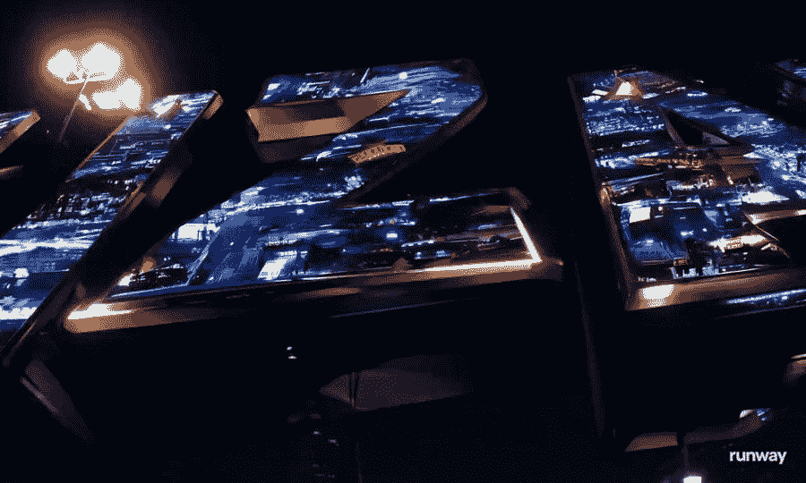

[6385544204500415148899625.mp4](https://internal-api-drive-stream.feishu.cn/space/api/box/stream/download/all/GbhKbDW8GoQTD7xStSxcHErrntl)

2、Figma正式推出Figma AI。

近日，Figma宣布正式推出Figma AI。据官方介绍，Figma AI通过文字描述就可快速生成高保真的原型页设计，帮助设计师和产品经理加速完成从初稿到成品落地。目前Figma AI在Beta阶段，使用需要申请加入waiting list。

加入waiting list方法：点击软件底部“帮助”图标--Join Ul3 + Al waitlist

3、Luma AI新功能：首尾帧生成视频与向后延长5秒

Luma AI推出了新功能，让视频创作充满无限可能，虽然偶尔会有硬切换画面，但这正是剪辑的魅力所在，让每一秒充满惊喜和创意。未来的视频生成将基于这种延长操作完成，实现智能个性化的视频创作。

4、商汤如影AI视频生成平台推出央视记者王冰冰AI数字人

商汤科技的AI数字人“AI冰冰”在《2024中国・AI 盛典》中首次亮相，展现了出色的多语言能力和逼真的视觉效果。数字人技术在传媒行业具有巨大潜力，能够拉近人物IP与受众之间的距离。

5、WhatsApp最新Android测试版2.24.14.7推出选择Meta AI Llama模型功能

WhatsApp最新测试版引入了选择Meta AI Llama模型的功能，用户可以根据需求自定义AI交互体验，体验更快速简单的回应或处理更复杂的查询。该功能展示了WhatsApp在AI领域持续创新的决心。

6、WhatsApp最新Android测试版2.24.14.7推出选择Meta AI Llama模型功能

WhatsApp最新测试版引入了选择Meta AI Llama模型的功能，用户可以根据需求自定义AI交互体验，体验更快速简单的回应或处理更复杂的查询。该功能展示了WhatsApp在AI领域持续创新的决心。

7、GPTPdf：使用类似GPT-4o的多模态LLM分析PDF文件

近日，一款名为gptpdf的开源项目在github赞火，使用了类似 GPT-4o 的 VLLM 模型解析 PDF 文件并转换为 Markdown 格式。该项目代码简洁高效，只有293行，却能完美解析排版、数学公式、表格、图片、图表等各种内容。费用每页平均成本为0.013美元。

8、AI音频魔法师Resona V2A 可自动为视频配音效

在AI技术大行其道的时代，Resona V2A技术横空出世，像一位神奇的魔术师，让视频自动开口，唱出属于自己的旋律。这不仅是技术突破，更是创意者的福音。Resona V2A一键生成音频，快速高效，创意者得力助手。高性价比，成本降低99%，提供高质量音频解决方案。

[6385544237666602575188977.mp4](https://internal-api-drive-stream.feishu.cn/space/api/box/stream/download/all/Swb1bdhOZoM2uRxR1WfcKKLVnqb)

9、AI换装黑科技 MMTryon虚拟试穿框架可按需搭配一键叠穿

中山大学和字节智创数字人团队联合推出的MMTryon虚拟试穿框架颠覆了传统换装方式，实现一键生成模特试穿效果，质量高且操作简便。其服装编码器和多模态多参考注意机制让换装更精确灵活，打破了传统算法束缚，获得新SOTA。MMTryon不仅可试穿单件服装，还支持组合换装，无需分割，通过文本指令即可实现高质量虚拟换装。

10、TikTok正开发新型AI聊天机器人：已申请Genie商标，服务西方

7月2日消息，据外电报道，随着人工智能竞赛升温，根据最近在美国提交的一份文件，TikTok 似乎正准备向西方用户推出自己的人工智能聊天机器人。TikTok 已寻求为其即将推出的 AI 聊天机器人工具注册Genie商标，该工具将允许用户在直播中提出问题并获得即时答复等功能。

## 7月3日 AI资讯

1、限时免费体验！百度文心大模型4.0 Turbo在文心一言官网上线

百度在2024年WAVE SUMMIT深度学习开发者大会上发布了文心大模型4.0Turbo版本，新版本已在官网yiyan.baidu.com上线，回复速度快，内容质量高。限时免费体验机会已开放给所有文心一言专业版用户。

2、京东鸿蒙原生应用尝鲜版上架：AI能力可满足用户个性化需求

京东作为华为HarmonyOS NEXT的首批合作伙伴，宣布完成鸿蒙原生应用尝鲜版的上架，京东还推出了多端统一开发解决方案Taro，助力更多应用厂商快速适配鸿蒙生态。

3、英伟达发布直播神器NVIDIA Broadcast

NVIDIA Broadcast是一款利用AI魔法提升音频和视频质量的应用，专为RTX GPU用户设计。能智能去除噪音、虚拟背景、自动对焦、视频噪点减少等，为用户提供专业级别的直播体验。

4、苹果将在OpenAI董事会中担任观察员角色

7月3日消息，据彭博社报道，苹果已选择 App Store负责人、前营销主管 Phil Schiller 代表该公司加入 OpenAI 非营利组织董事会，但不能投票或担任董事，能更多地了解 OpenAI 的内部运作，因为苹果公司正致力于在今年晚些时候将 ChatGPT 融入 iOS 和 macOS。

5、影视行业迎来首个妆造大模型

阿里大文娱发布了自研影视妆造大模型神力霓裳，专精于古装剧的妆造创意设计，包含造型设计、妆发设计和纹样设计三大功能，造型师在设定朝代、性别、身份等条件后，输入相关提示词，2分钟即可获得造型图片。

6、Apple Intelligence不会永久免费！苹果AI未来会收费

目前Apple Intelligence还处于测试阶段，用户可以免费使用，但是未来苹果将会收费。未来将会把Apple Intelligence拆分成两部分，一部分将继续免费，但功能有限。想要体验全套AI功能，就需要付费订阅Apple Intelligence。

7、微软开源GraphRAG：极大增强大模型问答、摘要、推理

微软在官网开源了基于图的RAG（检索增强生成）——GraphRAG。为了增强大模型的搜索、问答、摘要、推理等能力，RAG已经成为GPT-4、Qwen-2、文心一言、讯飞星火、Gemini等国内外知名大模型标配功能。

8、AI人群洞察报告：多分布在一二线城市，00后“小孩哥”成主力

每日互动大数据发布了对人工智能技术首批发烧友的深入洞察。数据显示，“AI人群”是由每日互动大数据对通义千问、文心一言、Kimi智能助手、讯飞星火、豆包、智谱清言等人工智能App用户进行聚类形成的洞察人群。数据显示，AI发烧友中，18-24岁的千禧一代占比高达39.70%。从性别来看，男性AI人群占比高达59.59%。他们以中等消费水平为主，多分布在一二线城市。

## 7月4日 AI资讯

1、2024世界人工智能大会今日开幕

2024 世界人工智能大会将于 7 月 4 日-6 日在上海召开。2024 世界人工智能大会暨人工智能全球治理高级别会议（简称“WAIC 2024”）将于 7 月在上海世博中心、世博展览馆举行。同时外交部消息称，重要领导人将于7月4日出席开幕式，并发表主旨演讲。

2、抢在ChatGPT前发布语言助手！法国实验室演示自带70种情绪AI

当地时间7月3日周三，法国独立非盈利AI研究实验室Kyutai公开演示了一款语音助理Moshi的实验性原型。Kyutai介绍，Moshi由该实验室的八人研究团队耗时六个月从零开始开发，是全球首款全体大众都可使用的实时生成式语音AI。Kyutai是法国亿万富翁Xavier Niel去年表示将对AI领域投资2亿欧元的投资对象之一。

体验地址：https://moshi.chat/?queue_id=talktomoshi

3、微软推出设计工具 Designer：一句话生成个性化贺卡

微软最新推出的Microsoft Designer的"Greeting Cards"功能为用户带来前所未有的个性化贺卡制作体验，展示了AI技术在日常生活中的实际应用。

体验地址：https://designer.microsoft.com/invite

4、Meta 3D Gen发布，1分钟内快速实现从文本生成3D资产

最近研究人员发布了名为Meta3D Gen（3DGen）的全新技术，能够在不到一分钟内快速实现从文本生成3D资产，为用户带来高质量的纹理和材质体验。该技术集成了Meta3D AssetGen和Meta3D TextureGen，提供了高效的3D模型创建方式，比现有解决方案快三到十倍。

5、可以媲美GPT-SoVITS的低显存开源文本转语音模型Fish Speech

Fish Speech是一款由fishaudio开发的全新文本转语音工具，支持中英日三种语言，语音处理接近人类水平，使用Flash-Attn算法处理大规模数据，提供高效、准确、稳定的TTS体验。

6、中国生成式AI专利申请量全球第一！远超美国、韩国、日本

据央视新闻报道，世界知识产权组织日前发布《生成式人工智能专利态势报告》。根据报告，2014年至2023年，中国发明人申请的生成式人工智能专利数量最多，远超美国、韩国、日本和印度等国。是排名第二的美国的6倍。

7、Suno推出iOS客户端 支持语音生成音乐

Suno公司推出的iOS应用让手机变成虚拟音乐工作室，引领音乐制作革命，可能改变数字时代下创意表达方式。面临法律挑战，但坚称技术旨在生成全新作品。Suno的iOS应用代表AI生成音乐向大众迈出的重要一步，引领音乐界未来潮流。

8、OpenAI将在下周开始向中国关闭大门

OpenAI近期的决策——封锁中国大陆和香港对其网站的访问，标志着人工智能领域一个重要的转折点。这一策略性举动，不仅是对地缘政治紧张局势的响应，也可能成为加剧技术冷战的关键因素。对中国AI领域而言，这既是一次挑战，也是推动本土技术创新的潜在机遇。

9、特斯拉宣布新人形机器人将在上海世界人工智能大会亮相

特斯拉官方🧣宣布，二代人形机器人 Optimus 将在今年的上海世界人工智能大会首次亮相，该大会将于 7 月 4 日至 7 日举行。据报道，Optimus 二代机器人比起一代能够进行更精细化的操作，一个月前特斯拉表示已经在得克萨斯州的工厂部署了两个 Optimus 机器人，能够自主执行任务。

10、李彦宏大手笔布局AI短剧：百度数百万美元投资井英科技

CreativeFitting（井英科技）近日宣布完成由百度集团投资的数百万美元Pre-A 轮融资。据了解，井英科技一家专注于AIGC视频生成模型自主研发的公司，计划利用这笔资金进一步升级其AI视频模型和工具，加强内容生态系统的构建。其AI短剧APPReel.AI，自发布以来迅速登上海外娱乐畅销榜，显示出AI短剧在全球范围内的潜力。

## 7月5日 AI资讯

1、落实联大决议，中国将举办发展中国家AI能力建设培训班

7月4日，2024世界人工智能大会暨人工智能全球治理高级别会议（以下简称“WAIC 2024”）在上海拉开帷幕。在主论坛人工智能全球治理论坛后举行的“加强人工智能能力建设国际合作”联大决议吹风会上，中国常驻联合国副代表戴兵介绍了决议有关情况。

2、加拿大将投资1.2亿加元建设国家芯片网络

随着要求政府采取更多措施支持其落后的半导体行业的呼声越来越高，加拿大将在五年内投资1.2亿加元（8820万美元）建设国家芯片网络。加拿大创新、科学和工业部长François-Philippe Champagne近期宣布了联邦战略创新基金的支出。这项投资支持由非营利研究加速器CMC Microsystems牵头的2.2亿加元项目，帮助加拿大初创公司将新技术商业化。

3、跳舞也疯狂？MimicMotion发布新技术 可根据任何动作引导生成任意长度的视频

MimicMotion推出的新技术“High-Quality Human Motion Video Generation with Confidence-aware Pose Guidance”引起了业界轰动。该技术利用置信度感知姿势引导生成高质量人体运动视频，提升视频质量，手部精炼机制增强细节，灵活生成任意长度视频，应用广泛前景广阔，将在视频制作和动作捕捉领域扮演关键角色。

4、商汤科技推出「可控」人物视频生成大模型 Vimi

Vimi 可以实现精准的人物表情控制，还可实现在半身区域内控制照片中人物的自然肢体变化，并自动生成与人物相符的头发、服饰及背景变化。同时光影变化也能做到合理生成。Vimi 可稳定生成 1 分钟的单镜头人物类视频。

5、支付宝智能助理：让 AI 帮你跑腿买咖啡

支付宝智能助理基于蚂蚁集团自研的百灵大模型进行研发，在本届 WAIC，支付宝智能助手还联合官方推出「WAIC 大会智能助手」。支持星巴克、瑞幸、霸王茶姬、蜜雪冰城等 11 个茶饮品牌的支付宝小程序，用户通过支付宝智能助理下达指令，比如「帮我点一杯瑞幸的大杯冰拿铁」，AI 便会进入小程序自动下单，用户确认并付款后，就能到附近的线下门店取到咖啡。

## 7月6日 AI资讯

1、阿里通义联合上美影推出国内首个孤独症儿童 AI 绘本工具

在 WAIC 2024 大会上，阿里巴巴携手上海美术电影制片厂、中国青少年发展基金会「阅读中国」基金联合发布公益产品「追星星的 AI」，据介绍，这是国内首个关照孤独症儿童的 AI 绘本工具。体验路径：通义 App「频道」版块点击进入「追星星的 AI」页面。

2、国内 AI 初创公司商汤科技发布了全新模型「日日新 5o」，号称为「国内首个所见即所得模型」

在 WAIC 2024 大会上，据介绍，日日新 5o 通过整合跨模态信息，基于声音、文本、图像和视频等多种形式，带来一种全新的 AI 交互模式，即实时的流式多模态交互，交互体验「对标」GPT-4o。

3、百度文心大模型 4.0 Turbo 面向企业开放，系列模型继续降价

在 WAIC 2024 期间，百度副总裁谢广军表示，文心一言 4.0 Turbo 面向企业全面开放，定价是输入 0.03 元/千 Tokens，输出 0.06 元/千 Tokens。

4、腾讯副总裁：混元大模型正在部署从多模态到全模态的技术

WAIC 2024 大会上，腾讯副总裁蒋杰谈到了自家混元大模型的最新进展。蒋杰表示，大模型行业正从最初的单模态向多模态过渡。对于混元大模型来说，多模态是一道必答题，目前混元正在积极部署多模态到全模态的技术，很快将在腾讯元宝 App、腾讯内部业务及场景中体验，同时会通过腾讯云向外部应用开放。

5、阿里云 CTO：将坚持拥抱开源开放

昨日，在上海世界人工智能大会（WAIC）上，阿里云 CTO 周靖人公布近期通义大模型和阿里云百炼平台的最新进展：近 2 个月，通义千问开源模型下载量增长 2 倍，突破 2000 万次，阿里云百炼服务客户数从 9 万增长至 23 万，涨幅超 150%。

6、OpenAI 曝去年被黑客窃取技术细节

纽约时报报道，去年年初，一名黑客获得了 OpenAI 内部消息系统的访问权限，并窃取了该公司人工智能技术设计的细节。两名知情人士透露，这名黑客在一个在线论坛的讨论中透露了一些他窃取的技术细节，这些细节来自 OpenAI 员工在内部论坛关于公司最新技术的讨论，不过黑客没有进入 OpenAI 存储和建构 AI 的系统。

7、可灵发布一系列重磅更新

基础模型升级，生成更高分辨率的视频增加首尾帧控制增加运镜控制，还有自动大师运镜 Web 端上线，限时免费

体验地址：https://klingai.kuaishou.com

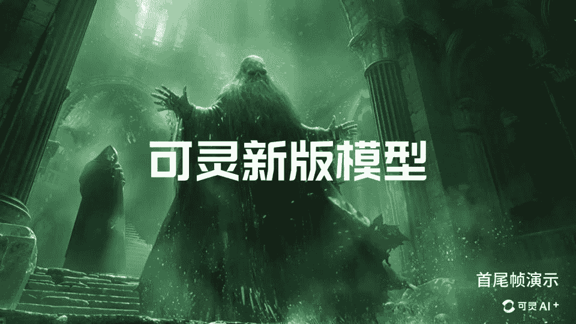

[X2Twitter.com_1809412831114416128(1080p).mp4](https://internal-api-drive-stream.feishu.cn/space/api/box/stream/download/all/J5mUbiHi8o7Nb4xIPKrcfff4nje)

# 第二周

## 7月8日 AI资讯

1、上海首批无人驾驶的士即将上路，市民可免费体验

在 2024 世界人工智能大会上，上海发布了首批无人驾驶智能网联汽车示范应用许可。赛可智能科技（上海）有限公司、百度智行科技（上海）有限公司、上海裹动科技有限公司（AutoX）、小马易行科技（上海）有限公司为首批获得示范应用许可的企业。

2、X 被曝将新增多项 Grok 模型功能支持，含聊天机器人侧面板

独立应用程序研究者 Nima Owji 表示，X 社交平台正在开发多项基于 xAIGrok 模型的功能，为 X Premium 订阅用户提供更丰富的使用体验。其中之一便是类似于其他生成式 AI 聊天机器人的 Grok 侧面板，用户可在使用 X 平台任意功能时同 Grok 机器人交流

3、快手可灵 AI 网页端正式上线

近日，快手宣布可灵 AI 网页端正式上线，所有功能限时免费（需自行申请）。其中，「文生视频」开放最长 10 秒生成能力，「图生视频」新增运镜控制、自定义首尾帧等功能。根据目前可灵 AI 网页端的功能来看，可灵 AI 网页端提供 AI 图片、AI 视频以及即将上线的视频编辑三大板块。

4、在近期举办的 2024 世界人工智能大会（简称 WAIC）上

作为 AR 独角兽，XREAL 的产品都是直接面向消费者日常的 AR 设备，偏娱乐的场景如观影和游戏是本次 WAIC 上用户体验重点。

5、首款华为鸿蒙人形机器人正在工厂检测验证

国内首款搭载了鸿蒙操作系统的人形机器人夸父，目前正在蔚来、江苏亨通集团等工厂检测验证。报道指出，「盘古大模型+夸父人形机器人」将在工业和家庭两大场景同步推进应用。

6、苹果 iOS18公测版7月上线

7月7日消息，苹果公司即将于 7 月 15 日左右发布 iOS 18 公测版，此版本最大的亮点是引入了 Apple Intelligence 系统，提升了 Siri 的语音识别能力和屏幕感知功能，同时与 ChatGPT 整合，提供了更全面和个性化的服务。

## 7月9日 AI资讯

1、花5分钟开发，超40万人使用，现在AI圈流行小而美的“一波流”？

最近，AI圈涌现出很多低开发成本却撬动了大流量的小玩意儿。国内外同期爆火的几个AI小玩具:1、一个文风测试网站（testurtext.site）在📕悄然走红，2、文风模拟器（AKA“名家嘴替”）。只要输入文字，选择指定作家，就可以模拟其口吻改写文本。 3、OC成分测试 4、AI梗图生成器

2、微软要求中国区员工必须使用iPhone，将为员工发放iPhone 15

据彭博报道，根据一份微软内部备忘录显示，该公司中国区员工被要求使用工作电脑或者手机时，只能用苹果设备进行身份验证。该要求将于今年9月起实施，届时员工将只能使用iPhone工作。据悉，该行为系微软全球“安全未来计划”的一部分，旨在确保员工在iPhone设备上使用微软身份验证器等相关应用程序。

3、美颜相机登顶中国区 AppStore 总榜第一

近日，美颜相机的「苹果模式」在多个社交平台走红，带动大批用户下载使用，美颜相机也登顶中国区 AppStore 总榜第一，并再次引发「系统相机」和「相机 App」的行业讨论。

4、支付宝推出「碰一下」支付新方式，无需展示付款码即可完成支付

支付宝宣布升级条码支付体验，推出「支付宝碰一下」，用户无需展示付款码，解锁手机碰一下商家收款设备，最快一步完成支付。官方表示，相比已有的支付宝「扫一下」，「碰一下」更加简单直接。

5、27岁华裔借AI在硅谷崛起：公司成立8年估值138亿美元 与奥特曼关系铁

作为人工智能数据服务公司Scale AI的联创兼CEO，华裔小伙亚历山大·王用了八年时间将其估值推至138亿美元。其与OpenAI首席执行官山姆·奥特曼关系匪浅，年仅25岁就被《福布斯》杂志评为“世界上最年轻的白手起家的亿万美元富翁”。

6、VC开抢字节前员工

今年以来，字节高管投身创业的消息不绝于耳除了杨红霞、王长虎、阳陆育、张月光、郭传雄、程昊.....不约而同地，他们都选择AI赛道，吸引了一众VC的目光。字节系，崛起一个AI军团，几乎是一离职，就有VC递上种子轮资金了。

7、反AI图像盗窃工具Glaze需求量剧增 吸引大批艺术家

Glaze工具应运而生，旨在保护艺术家的风格不被AI图像生成器抄袭。随着Meta计划利用用户数据进行AI训练，Glaze需求量急剧上升。然而，安全研究人员发现了绕过Glaze保护的方法，引发了对其有效性的质疑。

8、快手开源图像生成模型可图Kolors

快手今天放出了一项重磅消息，开源了自家的图像生成模型“可图 Kolors”，这一模型经过数十亿的文本图像对训练，搭载了通用语言模型（GLM）作为文本编码器，支持中英双语提示词，具有长文本处理能力和海量数据训练。可图 Kolors 还特别优化了中国文化元素，支持中文文字生成，展现出强大的技术支撑和文化传承。

9、阿里巴巴AI视频创作平台——寻光：简化视频创作流程

一站式AI视频创作平台，集成了剧本创作、分镜图设计、视频素材编辑等关键步骤，让创作者能够在同一个平台上完成从构思到成品的全过程。

申请内测地址：https://xunguang.damo-vision.com/#/home

## 7月10日 AI资讯

1、限时免费！腾讯智影小程序上线「AI视频」功能

智影小程序推出了名为「AI视频」的新功能，允许用户一键转换普通视频为风格化视频，特别是动漫风格，提升视频的吸引力。该功能目前限时免费，旨在帮助用户提升视频美感和趣味性。

2、商汤科技推出Vimi视频生成大模型 C端应用Vimi相机开放内测

商汤科技在2024年世界人工智能大会（WAIC）上推出了Vimi视频生成大模型，为用户提供精准的表情和肢体控制，支持多种驱动方式，稳定性突出且能生成高一致性的视频内容。Vimi相机作为首款C端应用，满足广大女性用户的娱乐创作需求，支持多样化的生成风格和个性化创作。

3、PaintsUndo-数字绘画AI模型

提供从静态图像中提取草图、外部草图插值、动漫风格转换等功能，为数字艺术家、设计师、教育工作者和AI艺术创作爱好者创造便利和灵感。

更多案例：https://lllyasviel.github.io/pages/paints_undo/

4、OpenAI CEO 成立 AI 健康公司

OpenAI CEO Sam Altman 与 Thrive Global CEO Arianna Huffington 在《时代》杂志上发文，宣布联合创立一家名为 Thrive AI Health 的新公司。该公司将由 OpenAI Startup Fund 和 Thrive Global 资助，Google 前健康和可穿戴设备负责人 DeCarlos Love 将担任这家公司的 CEO。

5、支付宝医疗大模型亮相 中英文考试超GPT-4水平

支付宝的医疗大模型在中英文考试中表现超越了GPT-4，已在江浙沪一线医院落地。该模型具备多模态能力，准确率达90%以上，可提供智能问答、病历结构化和检索等服务。支付宝联合多家机构发起AI医疗共建计划，致力于提升医疗效率和数据安全。

6、UltraPixel：超大分辨率图像生成神器

UltraPixel是一款能够生成超高分辨率图像的黑科技，为设计师和创作者带来福音。通过Stable cascade训练和微调，支持直接生成1K到6K分辨率的图片。其技术手段包括隐式神经表示和尺度感知归一化层，保持高度细节和真实感。同时，在最小空间内高效处理，参数利用率高达97%，提高训练和推理效率。

## 7月11日AI资讯

1、夸克升级“超级搜索框”  推出AI搜索为中心的一站式AI服务

夸克宣布升级「超级搜索框」，推出以 AI 搜索为中心的一站式 AI 服务。同时还为用户提供从检索、创作、总结，到编辑、存储、分享的一体化信息服务价值。用户在打开夸克 7.0 版搜索框后，输入问题即可体验智能回答，还有 AI 写作、文件总结、视频总结、拍题讲解功能。一个「超级搜索框」集纳了智能回答、智能创作和智能总结三大能力。

2、萝卜快跑日均订单量赶上出租车，百度回应碰撞事故

萝卜快跑在武汉市的无人驾驶订单量迎来爆发式增长，单日单车峰值超 20 单，这一水平已与出租车司机平均日订单量相近。萝卜快跑是百度旗下自动驾驶出行服务平台，已经于 11 个城市开放载人测试运营服务，并且在北京、武汉、重庆、深圳、上海开展了全无人自动驾驶出行服务测试。

3、微软与苹果均放弃 OpenAI 董事会观察员席位

软已经放弃了在 OpenAI 董事会的观察员席位。去年 11 月 OpenAI CEO Sam Altman 被开除后，微软就一直在积极争取该席位。并且，微软在 Sam Altman 回归 OpenAI 的过程中也发挥了非常关键的幕后作用，并促成了 OpenAI 公司治理的改变。

4、SoundHound AI(SOUN.US)车载AI语音助手拓展至欧洲多国

专注于语音领域的人工智能识别公司SoundHound AI(SOUN.US)的车载语音助手集成了ChatGPT功能，现已在11个欧洲市场的Stellantis(STLA.US)汽车品牌中投入生产。在这一最新消息的催化之下，SoundHound AI截至周三美股收盘暴涨超22%。

5、人人可做提示工程师！Claude上新：一键生成、测试和评估prompt

AI 初创公司 Anthropic 简化了此流程，可以让用户更轻松地制作高质量的 prompt。具体来说，研究者为 Anthropic Console 添加了新功能，可以生成、测试和评估 prompt。

更多：https://docs.anthropic.com/en/docs/build-with-claude/prompt-engineering/overview

6、范冰冰做跨境电商了，带着自创品牌，在TikTok捞金

在5月底，范冰冰在📕宣布，其自创美妆品牌Fan Beauty Diary已经入驻Lazada，正式加入到品牌出海的大军之中。继在Lazada开店之后，Fan Beauty Diary又入驻TikTok。

## 7月12日AI资讯

1、OpenAI推五级评估系统！评估AI能力达到什么水平

7月12日消息，OpenAI设计了一个五级评估系统，最低一级：聊天机器人（Chatbots），二级：推理者（Reasoners），三级：智能主体（Agents），四级：创新者（Innovators），最高五级：组织（Organizations），用于追踪人工智能软件在超越人类能力上的开发进展。这反映了该公司最新的尝试，旨在增进公众对AI安全性和未来的理解

2、声音魔法师！FoleyCrafter让无声视频瞬间拥有逼真配音

FoleyCrafter是一款基于文本的视频到音频生成框架，能够为视频添加与内容相关且时间同步的高质量音频。它理解视频语义内容，自动匹配声音效果，实现精准的音视频同步，提升视听体验。使用简单，通过提供视频和文字描述即可生成所需声音效果。无论视频类型，FoleyCrafter都能定制化声音效果，让无声视频焕发新生。

项目地址：https://foleycrafter.github.io/

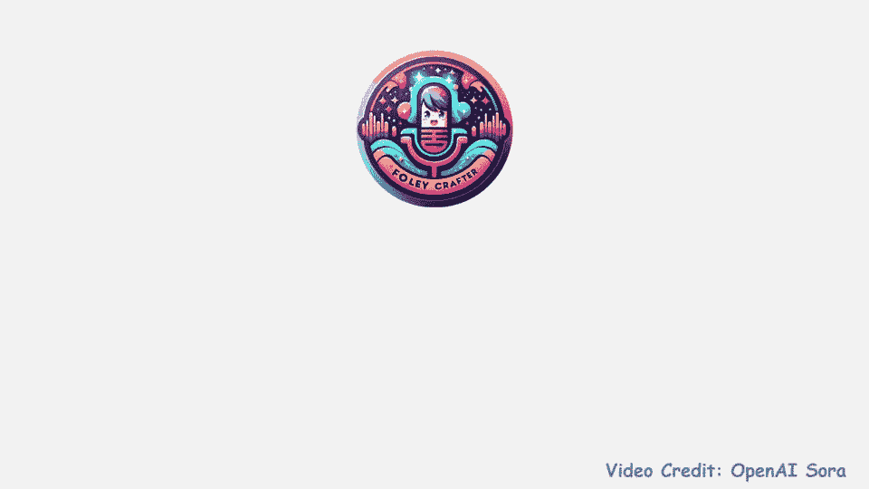

[X2Twitter.com_1811008412198785025(1080p).mp4](https://internal-api-drive-stream.feishu.cn/space/api/box/stream/download/all/VjPsbeh1Bo7WMFxpm7CcIKZznBd)

3、Vimeo、YouTube和TikTok联手推出AI内容标签系统

Vimeo最新宣布的AI内容标签系统标志着视频平台对AI生成内容的透明化要求，旨在保护观众免受虚假内容误导。该举措为数字世界中的内容真实性提供了更清晰的指导，加强了对AI内容的管理和监督。

4、谷歌称Gemini AI正在让机器人变得更加智能

7月12日消息，据外电报道，谷歌正在使用 Gemini AI 训练其机器人，以便它们能够更好地导航和完成任务。DeepMind 机器人团队在一篇新研究论文中解释了如何使用Gemini 1.5 Pro的长上下文窗口（决定 AI 模型可以处理多少信息）让用户更轻松地使用自然语言指令与其RT-2 机器人进行交互。

5、TikTok剥离诉讼新进展：美国会将提供机密记录协助司法部

北京时间7月12日，当地时间周四，美国众议院的一个下属委员会通过投票决定，向美国司法部提供今年3月份一次闭门听证会的记录，以支持美国司法部在法庭上为TikTok剥离法律辩护。该听证会讨论的内容是TikTok构成的威胁。

6、TikTok 被曝在海外试水本地生活业务，已进入印尼和泰国

7 月 12 日消息，TikTok 正在海外试水本地生活业务，首站是东南亚地区，目前已在印度尼西亚和泰国开启业务。

7、UltraEdit：更精准理解上下文指令 实现图片局部重绘和整体编辑

UltraEdit是一款结合语言与视觉反馈的图像编辑工具，通过更好的训练数据支持局部重绘和全局编辑，为用户带来全新的图像处理体验。它利用大型语言模型和真实图像数据源，提供更广泛的编辑指令和更高质量的编辑体验，展现出在丰富编辑任务和更少偏差方面的优势。

**UltraEdit**：基于SD3的局部重绘/图片编辑

训练数据更好（同时开源了数据集），支持局部重绘和全局编辑。因为基于SD3，也能实现编辑文字。

项目地址：https://ultra-editing.github.io

在ComfyUI 中用了 **UltraEdit**LatentTravel 做了个简单的图像编辑渐变视频，可以实现指定内容的自动识别和编辑，并将其做成渐变视频，期待看到大家的创意涌现！@-zho-

工作流：https://github.com/ZHO-ZHO-ZHO/ComfyUI-UltraEdit-ZHO

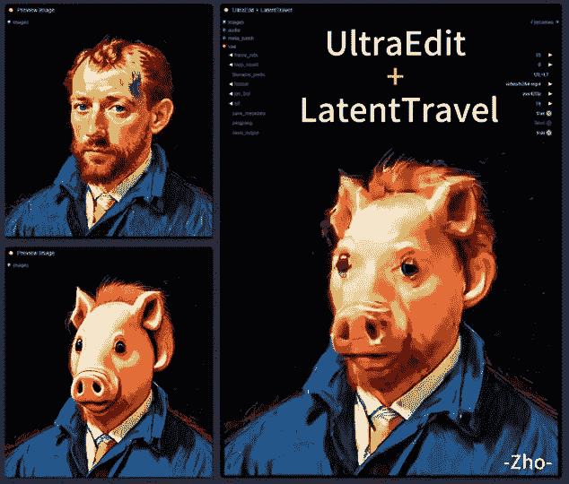

[X2Twitter.com_1811394922911567873(720p).mp4](https://internal-api-drive-stream.feishu.cn/space/api/box/stream/download/all/MxQrbhcAqo4zrUxO9f2cvhornGc)

8、OpenAI在开发者Playground中添加了文本转语音 API

OpenAI最新在开发者Playground中增加了文本转语音API，为开发者提供了更轻松的工作体验。开发者只需输入文本消息，选择预设声音即可生成音频，无需繁琐的语言和国家版本选择。这项服务不仅简化了开发流程，还提供了高质量的语音合成技术，为创造沉浸式用户体验提供了无限可能。

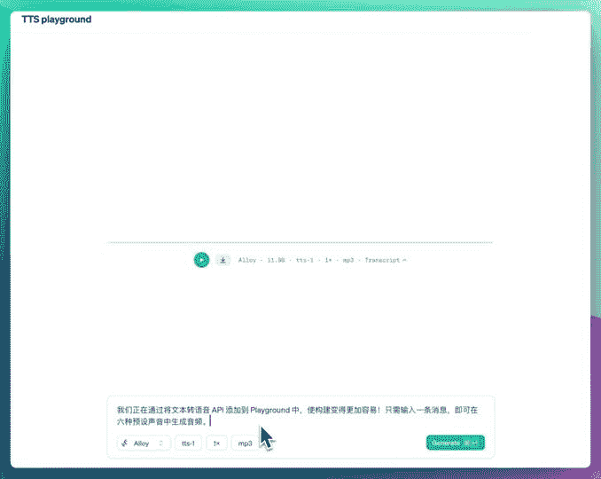

[6385630819486430665056924.mp4](https://internal-api-drive-stream.feishu.cn/space/api/box/stream/download/all/Y8Mfbm5b1oubUSxaW9GcnyHwnng)

9、RodinHD：可根据肖像生成高保真3D头像模型 头发细节也有了

在数字虚拟世界构建的浪潮中，RodinHD技术通过创新的三平面拟合与生成框架，实现根据肖像生成高保真3D头像模型，尤其在头发细节方面有了重大突破。

项目地址：https://rodinhd.github.io

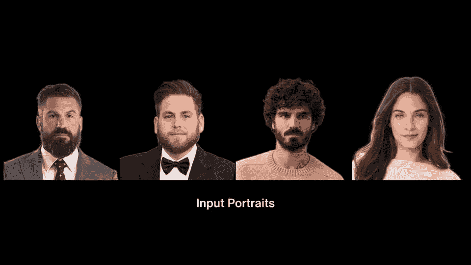

[X2Twitter.com_1810870703513591808(720p).mp4](https://internal-api-drive-stream.feishu.cn/space/api/box/stream/download/all/IhpubEqrqoobQmxZOO0c6BlVnmf)

10、韩国化妆品公司用AI定制美妆产品 能完美匹配客户肤色

7月12日消息，韩国化妆品公司爱茉莉太平洋（AmorePacific）最新推出的人工智能美容实验室已全部预约满。该实验室的机器人可定制各种美妆产品，并利用人工智能技术为顾客推荐最合适的口红色号。

11、Midjourney v6.5 可能会在“7月底”发布，并改进了真实感和皮肤纹理

根据AI艺术专家Nick St. Pierre的报道，Midjourney的首席执行官David Holz在一次电话会议中透露了6.5版本的进展情况。Holtz指出，新版本将专注于提高图像的清晰度，尤其是在手部质量和皮肤纹理等细节区域进行优化。此次更新不仅仅是模型本身的升级，还将包括对Web应用程序和个性化功能的改进。

## 7月13日AI资讯

1、4050亿参数！Meta或将7月23日发布迄今最强大Llama 3模型

美东时间7月12日周五，媒体援引一名Meta Platforms的员工消息称，Meta计划7月23日发布旗下第三代大语言模型（LLM）Llama 3的最大版本。这一最新版模型将拥有4050亿参数，也将是多模态模型，这意味着它将能够理解和生成图像和文本。该媒体未透露这一最强版本是否开源。

2、欧盟《人工智能法案》8月1日生效，学校、工作场所不得使用实时情绪识别系统

当地时间 12 日，欧盟在其官方公报发布了《人工智能法案（Artificial Intelligence Act，下称 AI 法案）》的最终完整版本。这项新法将在发布后 20 天生效，也就是当地时间 8 月 1 日。

3、AI伴侣商业化答案，被全球第二大成人网站找到了

要问AI陪伴商业化谁跑得最远？不是访问量超过2.77亿的Character.AI，而是全球第二大成人网站OnlyFans。这个充满荷尔蒙气息的平台，几乎成了AI伴侣商业化最好的试验场。在OnlyFans上，大V们80%的收入都靠聊天。一家AI公司就从AI代聊入手，带领这些大V走出了一条AI时代的致富之路，让他们的收入整整涨了2-5倍。

4、亚马逊推出AI购物助手Rufus，可回答客户各种问题

亚马逊宣布其生成式 AI 购物助手 Rufus 经过五个月的小范围测试之后现已面向所有美国客户开放。Rufus 旨在帮助您节省时间并做出更明智的购物决策。它可以回答您各种各样的购物需求和商品问题，“就像随身带了一个购物助手一样”。

5、特斯拉或推迟无人驾驶出租车推出计划

彭博社报道，有知情人士透露，特斯拉将其计划即将推出的自动驾驶出租车（robotaxi）推迟到 10 月份，以便让参与该项目的团队有更多时间构建更多原型车。此前，特斯拉 CEO 埃隆·马斯克曾宣布将于 8 月 8 日推出 robotaxi。

6、RenderNet AI：在线换脸工具，创建虚拟人物角色的逼真AI图像

RenderNet 的主要功能包括 FaceLock，它允许生成具有一致面部身份的多个图像，从而增强视觉叙事的连贯性。此外，ControlNet 还为用户提供了根据特定姿势和构图指南微调图像的能力，从而提供高水平的定制。

体验地址：https://rendernet.ai/login

# 第三周

## 7月15日 AI资讯

1、亚马逊向所有美国用户推出人工智能购物助手Rufus。

亚马逊公司的人工智能购物助手Rufus经过五个月的小范围测试之后现在将向所有美国客户开放。亚马逊在一份博客文章中表示，通过点击亚马逊智能手机应用程序中的一个图标，购物者可以调出文本聊天界面，从而向Rufus提出各种问题，例如识别耐用的户外扬声器型号、比较跑鞋或获取订单更新。

2、高德地图打车服务覆盖香港

财联社报道，高德日前在香港正式推出打车服务，不仅支持香港、内地用户在香港线上叫车，也支持香港用户在内地的线上叫车。两地用户均可使用高德地图 App 一键叫车，不仅支持现金支付，也支持电子支付。

3、港媒：“港版ChatGPT”将在今年内推广到所有政府部门，最终目标是开放全港市民使用

【环球时报综合报道】面对人工智能的发展机遇，香港特区政府宣布“港版ChatGPT”将在今年内推广到所有政府部门，最终目标是开放给全港使用。据香港《星岛日报》14日报道，创科局上月起已开始试用被命名为“公务员文书辅助系统”的“港版ChatGPT”，进行数据模型训练和反馈，适应过程进展顺利，将逐步扩展到其他政策局，“最终一定会开放给香港全社会使用”。

4、OpenAI面临监管部门调查：因涉嫌限制员工举报安全隐患

有人向美国证券交易委员会举报，OpenAI 非法禁止员工向监管机构报告其技术可能对人类构成的严重风险，举报人要求对 OpenAI 进行调查。举报人表示，OpenAI 向其员工发出了过于严格的雇佣、遣散费和保密协议，协议表示「未豁免向美国证券交易委员会披露证券的违规行为」，并要求员工在向有关部门披露机密信息前获得公司的同意，这可能会导致向监管机构报告 OpenAI 潜在问题的员工受到处罚。

5、OpenAI 曝新项目「草莓」，提升 AI 推理能力

路透社独家报道，据一位知情人士和内部文件透露，OpenAI 正在一个代号为「草莓」的项目中研究一种新颖的 AI 模型方案，相关内容细节此前从未进行过曝光。消息人士称，该项目旨在使 OpenAI 的 AI 不仅能够根据查询生成答案，而且还能够自主地扫描互联网，执行 OpenAI 描述的「深度研究」。有十几位 AI 研究员接受采访表示，这是迄今为止 AI 模型都无法完成的。

6、大模型剧本杀开源：6个Claude里藏一个凶手！刚上线服务器就被挤爆，免费免下载免注册

AI原生互动侦探游戏AI Alibis，刚上线就爆火，服务器一度挤爆。AI Alibis在Hackers news上登顶第一。（但是服务器被热情试玩的网友挤爆了…）

在线试玩:https://ai-murder-mystery.onrender.com/

开源代码:https://github.com/ironman5366/ai-murder-mystery-hackathon

7、AIGC短剧卷起来了！没有演员全AI生成 快手抖音领衔竞速

7月13日，国内首部AIGC原创奇幻微短剧《山海奇镜之劈波斩浪》上线快手，可灵大模型提供深度技术支持。五天前，抖音和博纳合作的首部AIGC科幻短剧《三星堆：未来启示录》上线，抖音视频大模型即梦提供技术支持。一周之内，抖音、快手相继上线AIGC短剧作品，且背后均有平台AI视频技术支持，为“AIGC短剧”打样的意图明显。

8、谷歌或斥资230亿美元收购网络安全初创企业Wiz。

知情人士称，谷歌母公司Alphabet公司正在就收购网络安全初创公司Wiz进行深入谈判，交易价格可能达230亿美元。这笔交易将是Alphabet有史以来最大的一笔收购，可能“很快”就会完成。

9、传谷歌母公司(GOOGL.US)正在谈判以230亿美元收购“网安独角兽”Wiz

据知情人士透露，谷歌母公司Alphabet(GOOGL.US)正在就收购网络安全初创公司Wiz Inc.进行谈判，这笔交易的总额可能高达230亿美元。这将成为这家科技巨头迄今为止最大的一笔收购。这位知情人士说，双方尚未达成协议，谈判仍有可能在没有达成协议的情况下结束。

## 7月16日 AI资讯

1、谷歌Gemini即将发布五个新功能：Imagen3、定制GPT等

谷歌即将推出Gemini产品系列的新功能，包括Imagen3、Gemini定制GPT等，备受期待。这些新功能将为用户带来更加个性化和便捷的体验，展示了谷歌在人工智能领域的持续创新和发展。

2、百度推出文小言AI数字人社交APP

百度最近推出了名为"文小言"的AI数字人社交APP，利用先进的文心大模型技术，用户可以与仿真的数字人进行实时沟通、互动，建立情感联系，带来更真实、自然的交互体验。用户可以在应用中找到喜欢的数字人聊天对象，了解其信息并进行多种方式的互动

3、Magic Insert：一键拖放即可让人物完美融入新背景

在数字创作的神奇世界里，Magic Insert技术的魅力在于可以轻松将主题从一张图片拖放到另一张风格迥异的背景图中，实现完美融合。这项技术结合了风格感知个性化和对象插入，展现出灵活性和多样性，为图像生成领域带来新挑战。

4、拆解OpenAI收入：76%来自ChatGPT付费用户，15%来自API

今年6月份，山姆·奥特曼表示，OpenAI年度经常性收入已经达到了34亿美元。根据FutureSearch最新公布的研究报告和相关数据，其中有76%来自ChatGPT付费用户，面向开发者端的API接口收入占比仅为15%左右。

5、YouTube新规：用户可要求平台下架模仿自己脸部/声音的合成视频

随着 AI 生成影音内容的普及，YouTube 也随之进行了一些政策调整。据 PhoneArena 当地时间 13 日报道，用户现可要求 YouTube 下架由 AI 生成的模仿自己面部、声音的视频。这一请求将根据 YouTube 的隐私请求流程提出，而不是像 deepfake 那样因为具有误导性而要求将其删除。

6、苹果在印度市场的年收入增长33%。

苹果公司在印度的年度销售额达到近80亿美元，创下历史新高。目前苹果在该市场组装了更多设备并运营了两家旗舰店。据知情人士透露，在截至今年3月的12个月内，苹果在印度的收入较一年前增长了约33%，从60亿美元增至近80亿美元

7、鲍威尔：二季度数据增强了控通胀信心，美联储已用ChatGPT起草发布会提问

7月15日，美联储主席鲍威尔在华盛顿的一场活动上表示，美联储已经开始使用ChatGPT，不过不是用于金融反馈，而是用于起草新闻发布会可能被问及的问题。他认为，ChatGPT起草的问题不如记者的提问好。

8、网易天音：网易云音乐推出的一站式AI音乐创作工具，AI辅助完成作词、作曲、编曲和演唱

网易天音是一款由网易云音乐推出的AI音乐创作工具，它为音乐爱好者和专业歌手提供了一个便捷高效的创作平台。用户可以通过输入灵感，利用AI技术辅助完成作词、作曲、编曲和演唱，生成初稿后还可以进行词曲协同调整，以满足个性化的音乐创作需求。

体验地址：https://tianyin.music.163.com/#/

## 7月17日 AI资讯

1、谷歌推AI视频剪辑应用Vids 测试Gemini AI生成演示视频

谷歌推出的新应用Vids让视频制作变得像制作幻灯片一样简单，特别适合需要制作演示视频的用户。用户可以轻松拖放文件生成演示视频，Gemini AI能智能生成视频内容和语音配音，提供丰富资源帮助创作更佳作品。

2、Claude 3.5 Sonnet在数据可视化领域超越GPT-4o

Anthropic公司推出的Claude3.5Sonnet模型在数据可视化方面表现出色，超越了OpenAI的GPT-4o，成为行业新标杆。速度翻倍，编码能力显著提升，解决了64%的编码问题。卓越数据可视化能力，适用于多个行业。注重用户隐私和安全。

3、Easel AI：生成式AI表情包，让沟通更生动有趣！

随着数字世界不断发展，虚拟形象变得越来越重要。Easel利用AI重新定义Bitmoji，为虚拟形象注入新生命。通过AI技术，Easel带来个性化和社交互动的体验提升，让沟通更生动有趣。AI在社交领域的新应用，为用户带来更个性化和智能化的体验。

4、YouTube音乐新招：AI电台加哼歌识曲，让音乐发现更智能

YouTube Music最近推出了两项新功能：AI对话式电台和哼歌识曲工具，进一步提升了用户体验和个性化音乐发现。这些新功能展示了AI技术在音乐领域的潜力，预示着未来音乐发现将更智能化。

5、加拿大医疗科技公司HealWell AI宣布投资xAI

7月17日消息，为了加强其人工智能能力，加拿大医疗科技公司HealWell AI Inc.宣布向xAI Corp投资 200 万美元。这项投资使 HealWell 能够访问 xAI 的封闭开发者计划，从而使这家加拿大医疗技术公司在 xAI 生态系统中占据独特的地位。

6、谷歌开出230亿美元收购天价，押注云计算安全

据《华尔街日报》15日报道，知情人士透露，谷歌母公司Alphabet正就约230亿美元收购网络安全初创公司Wiz进行深入谈判，若交易达成，将是该公司史上规模最大的一次收购。

## 7月18日 AI资讯

1、字节跳动本周将公布文生图、类sora新视频等全新AI模型技术进展

字节跳动团队计划于7月19日首次大范围公布最新人工智能模型技术进展，展示创新技术在长视频和高动态方向上的应用，将直接对标OpenAI的Sora文生视频模型。公司将AI大模型列为P0最高级别战略方向，抖音、剪映等团队也在研发AI视频模型应用。

2、BALENCIAGA 推出苹果 Vision Pro 应用

时尚品牌 BALENCIAGA 发布了其苹果 Vision Pro 应用，支持用户用沉浸式欣赏 BALENCIAGA 的作品，用户可以在头显中观察到服装逼真的细节和工艺。除了提供过往季度系列的陈列，这款应用还提供了今年在上海 2025 春夏时装秀回放的独家无人机视图和多个角度的立体镜头。

3、海口美兰机场上线自动驾驶

在海口美兰国际机场T2高架桥上，一辆车体标有“自动驾驶”字样的旅客接驳车缓缓驶入上车站点，标志着海南自贸港首个机场开放道路自动驾驶示范阶段项目上线，这也是海南首例落地应用的机场内自动驾驶技术。

4、三星中国Galaxy Z系列新品接入豆包大模型

7月17日，三星电子面向中国市场发布新一代 Galaxy Z系列产品。会上，三星电子与火山引擎官宣合作，为Galaxy Z Fold6、Galaxy Z Flip6手机的智能助手和AI视觉接入豆包大模型，提升手机的智能应用体验。

5、Haiper AI更新视频模型 可生成 8 秒视频并大幅提升质量

Haiper AI最近更新了视频模型，用户现在可以生成8秒时长的视频，并通过超分工具提升视频分辨率。这一更新让用户能够创作更加复杂和丰富的故事线，增加内容吸引力。

6、Runway iOS客户端重大更新 手机上也可以使用Gen3 模型了

Runway的iOS客户端迎来了重大更新，现在，苹果用户也能在手机上体验到Gen3模型的强大功能。这一更新不仅是对用户体验的提升，更是Runway在AI视频生成领域的一次飞跃。

7、百度网盘推出AI英语学习工具盘盘单词

百度网盘推出了名为「盘盘单词」的全球首个结合个人照片场景与英语学习的AI工具，旨在解决传统英语学习中的记忆困难和表达问题。用户可通过照片呈现单词和场景化内容，创造熟悉的英语环境，使学习更有趣有效。

8、Qwen2-Audio：千问系列的音频多模态模型 无需文字即可语音交互

阿里云最新发布的 Qwen2-Audio 大规模音频语言型模型，革新了语音交互体验，用户无需输入文字即可与其进行语音交互，提供更便捷的体验。模型能智能理解音频内容并按语音命令响应，在音频中表现优异。

9、苹果、华为、小米等全部加码下注！今年AI手机出货量将暴增364%！

据IDC近日发布的报告显示，预计今年AI手机出货量估将同比暴增364%，达2.34亿部，渗透率约19%。目前，苹果、华为、小米等各大手机厂商都在积极推出AI手机新品，力图在这一新兴领域占据先机。

10、快手开源LivePortrait，GitHub 6.6K Star，实现表情姿态极速迁移

快手可灵大模型团队开源了名为LivePortrait的可控人像视频生成框架，该框架能够准确、实时地将驱动视频的表情、姿态迁移到静态或动态人像视频上，生成极具表现力的视频结果

代码地址：https://github.com/KwaiVGI/LivePortrait

论文链接：https://arxiv.org/abs/2407.03168

项目主页：https://liveportrait.github.io/

HuggingFace Space一键在线体验：https://huggingface.co/spaces/KwaiVGI/LivePortrait

## 7月19日 AI资讯

1、OpenAI发布GPT-4o mini，免费为ChatGPT用户提供

7月19日凌晨，OpenAI在官网发布了最新大模型GPT-4o mini，是更小参数量的简化版本。具备文本、图像、音频、视频的多模态推理能力。即日起，ChatGPT 的免费用户、Plus 用户和 Team 用户都能够使用 GPT-4o mini 而并非 GPT-3.5 Turbo，企业用户在下周也将获得 GPT-4o mini 的权限。

官方介绍：https://openai.com/index/gpt-4o-mini-advancing-cost-efficient-intelligence/

2、阵容庞大！谷歌OpenAI等14家公司成立安全AI联盟

7月19日消息，据媒体报道，全球科技巨头谷歌携手微软、亚马逊、英特尔、英伟达、IBM、思科、Paypal、OpenAI、Anthropic、Cohere、Chainguard、WIZ及GenLab等共计14家领先企业，于7月18日在阿斯彭安全论坛上正式宣布成立了安全人工智能联盟（CoSAI）。

3、谷歌将利用Gemini为奥运会转播提供技术支持

据 The Verge 报道，谷歌已经成为美国奥运代表队官方 AI 赞助商，从7月26日开始，谷歌将利用 Gemini为奥运赛事转播提供技术支持。据悉，转播内容将包括谷歌地图对凡尔赛宫、罗兰-加洛斯球场和水上运动中心等场馆的 3D 全景，以及每个场馆将举办哪些活动的花絮。

4、微软 AI 设计应用 Designer 登陆 iOS / Android

微软在 iOS / Android 平台上推出了 AI 设计应用 Designer 的预览版，该应用允许用户通过模版创建自定义图像、贴纸、贺卡、邀请函等，还能实现 AI 编辑、重新设计图像的进阶功能，用户可以免费使用 15 次进阶功能，Copilot Pro 订阅用户可以获得 100 次。

5、“俄版谷歌”创始人带走400名顶尖工程师，到欧洲创办AI公司

据《金融时报》（FT）7月17日报道，“俄版谷歌”Yandex的联合创始人阿尔卡季·沃洛日（Arkady Volozh）正在欧洲启动一家人工智能公司Nebius Group，其核心业务是开发一个云计算平台，专门用于支持初创企业训练和运行AI大模型，该公司目前有约1300名员工，其中大部分是Yandex的前雇员。

## 7月20日 AI资讯

1、Windows炸了！全球大量PC同时崩溃，多个行业瘫痪！

美国科技巨头微软公司爆发重大服务中断事件，全球范围内众多用户反映搭载Windows系统的企业电脑出现“蓝屏”故障，无法正常启动。多国上千航班停飞、银行停业、媒体停播……从美洲、欧洲到亚洲，该问题影响到了包括交通、金融、媒体、医疗等在内的各行各业。国内也有企业受到影响，「微软蓝屏」相关话题登顶🧣热搜。

2、微软 Azure AI 已上线 OpenAI 最快的新模型 GPT-4o mini

微软 Azure AI 发布博客文章宣布，OpenAI 最快的模型 GPT-4o mini 现已在 Azure AI 上线。该模型支持文本处理，并承诺未来将支持图像、音频和视频。GPT-4o mini 比 GPT-3.5 Turbo 更智能，在多任务语言理解评估中得分为 82%。

3、腾讯华为联合推AI换衣技术IMAGDressing-v1：兼容ControlNet、文字提示词生成场景背景

IMAGDressing-v1 是一款创新性的AI换衣工具，为用户提供更灵活、更真实的虚拟穿衣体验。其简单架构和高效定制能力使虚拟试衣变得直观便捷。同时，兼容多种插件扩展功能，支持局部服装更换实验功能，展示了未来虚拟试衣技术的潜力。

4、DeepL推出新一代翻译AI，翻译表现超越GPT-4

DeepL公司最新推出的新一代语言模型在翻译准确度上超越了Google翻译和GPT-4，为用户提供更优质的翻译体验。用户可通过DeepL Pro计划轻松切换到新模型，费用从1150日元/月起。

5、英文视频翻译神器EasyVideoTrans 极速转换，可灵活修改

在全球化时代，跨语言沟通至关重要。最快英文视频转中文，EasyVideoTrans利用GPU加速技术，实现极速视频转换，节省翻译时间。操作简便，灵活定制，支持多平台使用。

体验地址：https://easyvideotrans.com/

6、消息称淘宝服饰将实现海外包邮

淘宝秘密推出了一项全新的出海项目「大服饰全球包邮计划」。

据悉，淘宝服饰将提供高额补贴，直接对海外消费者包邮。商家拥有自主定价权和货权，无需另外开店，无需考虑跨境物流，收到订单后只需把货发至国内的集运仓，到仓即确收，0 退货、0 退款、0 运费险。

7、B站长视频总结神器！豆包浏览器插件上线播客和视频总结功能

在这个信息爆炸的时代，豆包浏览器插件为我们带来了全新的解决方案，让我们能够高效吸收和整理海量知识。

8、21.6 万条中国 / 600 万条全球用户信息泄露？Pinterest 否认

黑客在论坛发帖，公开了 600 万条 Pinterest 用户记录，包含电子邮件地址和 IP 地址等信息。Pinterest 随后出面否认，表示没有证据表明出现泄露事件，用户数据从未被访问过。

# 第四周

## 7月22日 AI资讯

1、苹果发布小模型DCLM-7B。

继Open AI发布小模型GPT-4o mini 后，苹果也发布了其小模型DCLM-7B。DCLM-7B包含70亿和14亿两种参数规模。

2、小米小爱实时字幕新增日韩语翻译，同声传译支持 12 种语言互译

小米澎湃 OS 今日宣布“小爱翻译”迎来升级，实时字幕新增日韩语翻译，无字幕视频、直播会议实时转录翻译。面对面同声传译支持 12 种语言互译，包括中文、英语、日语、韩语、俄语、葡萄牙语、西班牙语、意大利语、法语、德语、印尼语、印地语。

3、非洲正在成为AI出海新热土

2023年，生成式AI热潮席卷全球，Chatgpt、DALL-E、Midjourney等商业AI工具在非洲愈发频繁。在生成式AI推动下，非洲的AI生态系统快速扩展，越来越多的初创公司在非洲落地并开发AI应用，发展水平已经远远领先于世界很多地区。商业律师Theo Watson预测，到2030年，人工智能可为非洲创造高达1.2万亿美元的收入，相当于非洲大陆GDP增长5.6%。

4、Anthropic 推出1亿美元 AI 基金，加剧与 OpenAI 竞争

AI 初创公司 Anthropic 联合风险投资公司 Menlo Ventures，共同推出了一只1亿美元的基金 Anthology Fund，以支持早期初创公司，并让他们使用 Anthropic 的技术。根据协议，Menlo Ventures 将出资投资初创公司，而 Anthropic 将为这些初创公司创始人提供25000美元的信贷，用于使用其大型语言模型。

5、TikTok Shop逆袭Lazada，东南亚电商遇变

入局三年多，TikTok Shop已经成为东南亚主要的电商平台之一，市场份额直逼阿里旗下跨境电商平台Lazada。外媒更是直言，TikTok的电商业务超越Lazada，成为东盟地区第二大玩家。

6、Google 或将与雷朋厂商开发 Gemini 智能眼镜

Google 目前正在与开发了雷朋智能眼镜的 EssilorLuxottica 接触，计划携手开发 Gemini 智能眼镜。此前，Meta 已与该公司合作开发了两代雷朋智能眼镜。另外，有多家媒体报道，Meta 计划斥资数十亿美元收购 EssilorLuxottica 约 5% 的股份。

## 7月23日 AI资讯

1、日本超市引入AI微笑监测系统

日本连锁超市AEON引入了名为“Mr Smile”的AI微笑监测系统，旨在提高员工的服务质量和顾客体验。虽然系统在提升服务态度方面取得了显著效果，但也引发了争议和担忧，涉及员工微笑的自然性和顾客骚扰问题。

2、十万块英伟达H100打造，马斯克宣布“全球最大 AI 训练集群”投用

7 月 23 日消息，马斯克现宣布，孟菲斯超级计算机集群（Memphis Supercluster）于当地时间凌晨 4:20 开始进行训练，感谢 xAI 团队、X 团队、英伟达及其支持公司所做的贡献。（IT之家注：孟菲斯是田纳西州人口第二大城市）。

3、炒菜机器人公司橡鹿科技获京东近2亿元战略投资

橡鹭科技是一家炒菜机器人公司，2023年12月14日，橡鹭科技曾获京东集团数千万元融资。近日再获京东近2亿元战略投资并达成全面战略合作，二者将共同促进“机器人+”产业的高质量发展。

4、Meta推出JASCO音乐生成模型，通过和弦或节拍等条件输入来提高音乐生成可控性

Meta 在音乐生成领域推出JASCO音乐生成模型，这是一个文本到音乐的生成模型，它能够根据全局的文本描述以及细粒度的本地控制来生成音乐。

官方介绍：https://about.fb.com/news/2024/06/releasing-new-ai-research-models-to-accelerate-innovation-at-scale/

5、Product Hunt 热榜，AI Memory，记住一切的个人知识库

AI Memory 由 Flot AI 开发，是一个帮助用户无缝构建个人知识库的工具。用户可以通过高亮文本、链接、截图和文件，将信息保存到 AI 记忆中，并在任何时间、任何地点通过简单的快捷方式与 AI 对话召回这些信息。

地址：https://site.flot.ai/AI-memory

6、在机器人顶会 RSS 2024 上，中国的人形机器人研究斩获最佳论文奖

近日，机器人领域著名会议 RSS（Robotics: Science and Systems） 2024 在荷兰代尔夫特理工大学圆满落幕。

参会人数接近 900 人。来自清华大学和北京星动纪元科技有限公司的人形机器人研究获得了最佳论文奖，华人学者 Ji Zhang 获得了本次时间检验奖。

论文标题：Demonstrating CropFollow++: Robust Under-Canopy Navigation with Keypoints

作者：Arun Narenthiran Sivakumar, Mateus Valverde Gasparino, Michael McGuire, Vitor Akihiro Hisano Higuti, M. Ugur Akcal, Girish Chowdhary

机构：UIUC、Earth Sense

论文链接：https://enriquecoronadozu.github.io/rssproceedings2024/rss20/p023.pdf

7、抖音宣布针对虚假人设开展专项治理，整治“包装高管”与“自封大师”

7 月 23 日消息，抖音安全中心发布公告，宣布将针对部分“自媒体”策划虚假人设的行为进行整治，例如部分用户在个人简介和发布内容中自称为名企高管、专家或者自封不可查证的“大师”，以夸张或虚假的身份，博取用户信任，进而将用户引流至第三方平台变现。

8、美图AI视频修复新技术，速度提升 10 倍，过曝也能搞定

视频制作和图像处理领域的关键技术之一是视频的“去闪”技术。BlazeBVD作为一种新型去闪算法，不仅能快速去除视频中的闪烁现象，还保持视频内容完整性和色彩真实性。它的出现革命性改变了视频后期制作的方式。

9、番茄小说作者联合抵制平台「AI 协议」

7 月 22 日消息，近期有不少网文作者发帖表示，番茄小说签约协议中增加了「AI 训练补充协议」，要求作者同意把作品用作 AI 训练样本，从而用于平台内容开发。

## 7月24日 AI资讯

1、阿里通义千问AI大模型将亮相巴黎奥运会

巴黎奥运会将大量采用中国AI技术，应用在赛事解说、360度直播、视觉搜索等领域。阿里巴巴的通义大模型，在与众多国际科技公司的竞争中获胜，成为奥运首个AI大模型应用的技术提供方。

2、Luma AI推出“Loops”功能：让用户轻松创建无限循环视频

Luma AI最新推出的“Loops”功能为内容创作者和数字营销人员带来了无限创作可能。用户可以通过简单操作制作无缝、连续的视频循环，提升创作效率，吸引观众注意力，同时减少制作时间和成本。

3、快手可灵AI宣布全面开放内测，模型效果再升级

快手宣布即日起全面开放可灵AI内测服务，用户每日登录都可免费获得66“灵感值”，可用于兑换可灵AI平台内指定的功能使用权或增值服务，以视频制作为例，可生成约6个免费视频。可灵AI还宣布正式上线了会员体系。

4、网络安全公司 Wiz 已拒绝 Google  230 亿美元收购要约

路透社报道，根据他们看到的一份备忘录，以色列网络安全初创公司 Wiz 已经结束了与谷歌母公司 Alphabet 一笔价值 230 亿美元的收购。Wiz 的 CEO Assaf Rappaport 表示，公司决定继续专注于推进原计划的 IPO，目标是实现 10 亿美元的年度经常性收入。

5、百度健康发布智能体家族 推出灵医开放平台等5款大模型应用

百度健康在2024年的产业生态大会上推出了一系列大模型应用产品，旨在解决医疗行业的“不可能三角”问题，提升医疗服务的可及性、可负担性和质量。通过AI技术，百度健康帮助医生和患者更高效地获取和利用医疗资源。

6、Meta 发布全球最强大模型

今天凌晨，Meta 发布了 Llama 3.1 模型。此次发布的 Llama 3.1 共有 8B、70B 和 405B 三个尺寸版本。

7、谷歌Alphabet将向旗下自动驾驶汽车公司Waymo投资50亿美元

谷歌母公司 Alphabet 首席财务官露丝・波拉特 (Ruth Porat) 表示，公司将向旗下自动驾驶汽车公司 Waymo 注资 50 亿美元

8、谷歌AI天气模型NeuralGCM新突破：计算效率其它模型高出10万倍

谷歌最新研发的NeuralGCM大气环流模型在天气预报领域取得惊人突破，计算效率比传统物理模型高出10万倍，能在30秒内模拟22天天气。结合机器学习和物理建模，提升了模拟准确性，成果发表在《Nature》上备受瞩目。

9、洛阳：首批无人驾驶快递配送车在伊川县试运营

日前，据“洛阳网”消息，洛阳市首批无人驾驶快递配送车（简称无人快递车）在伊川县试运营。先期投入两台无人快递车派送5家快递驿站，每天发车3班，每班运行时长90分钟。

## 7月25日 AI资讯

1、iPhone 15 Pro首发尝鲜！Apple Intelligence即将登场：苹果杀入AI领域

截至目前，iOS 18已经更新至Beta 4版本，但苹果还没有推送Apple Intelligence个人智能化系统。对此，苹果表示，今年夏天Apple Intelligencey会在iOS 18测试版中上线。消息称苹果会在8月底之前推出Apple Intelligence，目前仅支持英文，只有iPhone 15 Pro和iPhone 15 Pro Max两款机型会尝鲜体验。

2、AI视频编辑神器Vozo 可使用提示重写脚本并重新配音

Vozo是一款颠覆性的视频编辑工具，利用人工智能技术彻底改变了内容创作方式。它通过智能视频重写与重配音、文本驱动的语音编辑、多角色口型同步等功能，为用户提供了前所未有的视频编辑和改编能力。

体验地址：https://app.vozo.ai/

3、微软Bing搜索结果引入AI摘要功能，逐步推进智能搜索体验

7月25日，据外媒报道，微软Bing正通过引入更多AI功能来增强用户体验，进一步加剧了搜索市场的竞争态势。近日，微软宣布开始预览Bing生成搜索功能，该功能将用户查询的首选结果呈现为由AI编译的原始响应，为用户带来更加精准和高效的信息获取体验。

4、AI音乐生成工具Udio更新Udio V1.5模型，更多更强大的功能流出

Udio V1.5模型的发布标志着AI音乐生成工具的一次重大飞跃。这款由前Google DeepMind研究人员开发的AI音乐生成工具，以其惊人的音质提升和创新功能，让音乐创作变得更加简单和高效。用户可以自定义歌曲的长度、风格、歌词等元素。

5、檀健次长相思AI角色热度破亿：由腾讯元宝专属定制

《长相思2》的角色AI基于腾讯混元大模型，通过角色扮演和音色克隆技术，让观众能够与角色进行语音对话，体验剧中经典剧情。这种沉浸式情感互动受到了网友的热烈欢迎，互动总热度已超过1500万。

6、深圳市罗湖区南湖街道某小区新安装了两部共享电梯，通过AI识别技术实现自动扣费。

深圳市罗湖区南湖街道新南社区东乐宿舍的居民最近告别了“爬楼时代”，居民无需承担高额的安装费用，而是根据使用情况按次支付0.2元至0.8元不等的费用，通过AI识别技术实现自动扣费。居民对这种灵活的收费方式表示接受，认为它既省钱又省心。

## 7月26日 AI资讯

1、OpenAI推出AI搜索引擎SearchGPT

OpenAI今日宣布，其AI搜索引擎SearchGPT开放内测，SearchGPT目前先向小部分用户开放，官网显示需要先申请加入候补名单。OpenAI 表示，SearchGPT 旨在将模型的强大能力来检索网络的信息，为用户提供快速及时的答案，并附有清晰和相关的来源，便于用户追溯信息源头。

体验地址：https://chatgpt.com/search

2、bing推出人工智能搜索引擎

3、智谱AI杀入视频生成：「清影」上线，时长6秒，免费不限量

又一视频生成大模型产品宣布正式上线：智谱 AI 正式发布「清影」。所有用户都可以全方位体验对话、图片、视频、代码和 Agent 生成功能。除了覆盖智谱清言的网页端和 App，你也可以在「AI 动态照片小程序」上进行操作，快速为手机里的照片实现动态效果。

体验地址：https://chatglm.cn/video

demo效果：视频号“智谱智言APP”

4、金山办公WPS AI上线“AI 伴写”功能

金山办公最近推出了WPS AI中的AI伴写功能，旨在提升用户写作效率和质量。用户可通过WPS Office界面启用该功能，享受智能建议和续写服务，轻松表达灵感。AI伴写还提供多样化的内容生成和中华诗词引用支持，增强写作连贯性。WPS AI2.0升级进一步推动了人工智能在办公领域的应用。

5、特朗普7月27日将出席“比特币2024”大会，3年前曾称加密货币为“骗局”

特朗普周六将在纳什维尔为期三天的比特币2024大会的最后一天发表讲话。特朗普曾于2021年严厉批评加密货币，称其为“骗局”。数字资产支持者表示，加密货币用户在本届选举期间已成为一股逐渐壮大的政治势力。

6、使用AI软件生成未经证实假新闻 一网民被处以行政处罚

据“云南网警”消息，云南省迪庆州香格里拉市公安局网安大队查处了一起利用 AI 人工智能技术炮制虚假不实信息的案件。迪庆网警接群众举报，香格里拉市一网民在某网络平台发布了大量涉及全国各地的无法核实的事件消息，发布的文章格式一致，高度疑似 AI 合成。

7、谈判18个月未果 美国游戏配音演员因AI罢工

北京时间7月26日，据彭博社报道，由于未能就人工智能(AI)在电子游戏行业的使用达成协议，美国游戏配音演员将从当地时间周五凌晨0点01分开始罢工。代表这些游戏配音演员的美国演员工会表示，它已经与微软公司旗下动视制作公司、EA制作公司、迪士尼角色配音公司和华纳兄弟游戏公司等电子游戏工作室进行了18个月的谈判。

8、腾讯智影PC端推出“智能画布”功能

腾讯智影PC端最近推出了一项新功能——“智能画布”，为用户提供了多种实用的图片编辑功能，结合AI绘画技术，让作图变得更加轻松。这项功能特别适合需要对AI绘画图片进行再创作、抠图、消除、扩图等编辑操作的用户。用户现在可以登录智影首页，体验这些新功能。

体验地址：https://zenvideo.qq.com/smart/smartCanvas

## 7月27日 AI资讯

1、翻译界的“AI特工”!字节跳动推端到端语音同步翻译系统CLASI

CLASI是字节跳动推出的端到端语音同步翻译系统，为全球交流带来革新。它结合语言模型和信息检索系统，实现准确快速的翻译，具备上下文记忆功能，超越人类译员。

2、LiblibAl哩布哩布正式上线ComfyUI在线生图工作台

LiblibAl（哩布哩布 AI）正式上线了ComfyuI在线生图工作台。这一平台不仅提供在线Stable Diffusion图片生成功能，还拥有海量的模型素材库，致力于激发原创AI模型和图像素材的创作，并为用户提供丰富的AI绘画资源。

3、Adobe 发布Firefly Vector AI 模型，能够理解用户的文本提示生成矢量图

Adobe公司近期发布了Firefly Vector AI的创新AI模型，这一技术突破为图形设计领域带来了革命性的变化。Firefly Vector AI模型不仅为Illustrator和Photoshop带来了新的工具和功能，还通过其生成式AI技术，极大地提高了创意工作者的工作效率。

4、乐盒AI音乐上线

乐盒AI音乐是一款结合了人工智能技术的音乐创作工具，旨在为用户提供便捷、高效的音乐制作体验。该工具通过智能算法和深度学习模型，能够帮助用户从零开始生成高质量的音乐作品。

体验方式：🛰️小程序中搜索“乐盒AI”

5、“AI分析师”登陆华尔街，摩根大通开始内部推广聊天机器人

据《金融时报》今日报道，摩根大通开始在公司内部推出一款生成式 AI 产品，并告诉员工这款“自有版本的 ChatGPT”可以完成研究分析师的工作。据《金融时报》今日报道，摩根大通开始在公司内部推出一款生成式 AI 产品，并告诉员工这款“自有版本的 ChatGPT”可以完成研究分析师的工作。

6、字节豆包上线吴敏霞、林丹等专属智能体 奥运冠军AI分身实时陪看

智能AI助手豆包宣布携手跳水奥运冠军吴敏霞、羽毛球奥运冠军林丹、体育解说员黄健翔及体育解说员刘语熙共同打造专属奥运智能体，用户可以在豆包App中和他们畅聊奥运话题。同时，豆包网页版也将上线“AI带你解读奥运”专区，为用户提供奥运新闻早晚报、赛事回放、AI解说等内容。

7、即刻AI搜索神器问问小宇宙来了

即刻App推出了基于小宇宙的AI搜索功能——问问小宇宙，专注于声音内容的深度挖掘，提供深度讨论和独到见解。界面复古的配色和个性化推荐功能是其特色，让搜索结果更加丰富、多元，贴近用户需求。

# =============================================

## 7月29日 AI资讯

1、AI 公司 Anthropic 违规爬虫抓取数据引发多个网站不满

The Verge 报道，AI 初创公司 Anthropic 用来抓取旗下 AI 训练数据的网络爬虫在 24 小时内攻击了维修网站 iFixit 近 100 万次，并违反了该公司的数据使用条款。iFixit CEO Kyle Wiens 在社交平台 X 上表示；「如果这些请求有一个访问了我们的服务条款，它们会告诉您我们的内容是明确禁止使用的。」

2、奥运会官方账户删除巴黎开幕式视频

有网友发现，奥林匹克官方 X 社交平台账号删除了 2024 巴黎奥运会开幕式的官方视频，该视频也不能在其官方 YouTube 上找到。与此同时，2012 年伦敦奥运会、2016 年里约奥运会、2022 年北京冬奥会等视频都能在该账号上找到。目前，巴黎奥运会官方暂未对这一情况给出任何解释。

3、苹果即将推出的AI功能将晚于iOS 18的首次发布。

苹果公司即将推出的人工智能功能将晚于预期，错过了其即将推出的iPhone和iPad软件大更新的首发时间，但却给了该公司更多的时间来修复漏洞。

4、SearchGPT官方演示被曝翻车

近期，OpenAI宣布旗下AI搜索引擎SearchGPT开放内测，但该公司上演了谷歌Bard出糗的一幕，SearchGPT的官方演示被曝出低级错误。据外媒，在回答“8月在北卡罗来纳Boone举办的音乐节”的相关问题时，SearchGPT出现了幻觉。

5、X数据被用于训练Grok模型

据外媒，马斯克旗下社交平台X在没有明确通知用户的情况下，将用户推文内容用于训练Grok的AI模型，且该选项默认启用。X在相关设置中写道，“为了不断改善你的体验，我们可能会利用你的X 帖子以及与Grok的用户互动、输入和结果进行来进行训练和微调。

## 7月30日 AI资讯

1、Runway深夜炸场，Gen-3 Alpha图生视频上线，11秒让你脑洞乱飞

今天凌晨，Runway Gen 3 Alpha 模型的图生视频功能正式上线！用户可以使用任何图片作为视频生成的首帧。上传的图片既可以单独使用，也可以使用文本提示进行额外指导。

2、苹果推送 iOS 18.1 等系统开发者版本，首次实装 Apple 智能功能

苹果于今天凌晨推送了 iOS 18.1、iPadOS 18.1、macOS 15.1 的开发者测试版，首次带来了 Apple 智能功能的预览。

3、告别P图困扰!Diffree直接通过文字描述就可无痕添加物体

在这个AI技术飞速发展的时代，Diffree作为一项能让设计师和摄影师们欢呼雀跃的AI图像处理技术，通过文本引导实现在图片中无缝添加新物体，降低了图像编辑门槛，让每个人都能成为创造者

4、Google Gemini重大更新Gemini1.5Flash可免费使用

Google近日宣布了其AI助手Gemini的一系列重大更新，旨在提高用户体验并扩大其应用范围。更新涵盖了性能提升、新功能引入以及用户群体的扩展。

5、AI图像生成平台LiblibAI完成数亿元融资 创国内行业新高

LiblibAI是国内领先的AI图像生成平台，最近完成了数亿元人民币的三轮融资，创下国内AI图像赛道的最大总融资纪录。

## 7月31日 AI资讯

1、设计软件公司 Canva 收购文生图 AI 公司

设计软件公司 Canva 收购了一家名为 Leonardo.ai 的 AI 初创公司，这家公司聚焦于 AI 文生图工具的开发。Canva 首席产品官 Cameron Adams 表示，他们是通过现金和股票的混合形式，让 Leonardo.ai 全部 120 员工全部加入 Canva，包括管理团队。不过双方没有公布交易的具体数额。

2、OpenAI 向部分付费用户开放 GPT-4o 高级语音模式

OpenAI 宣布向小部分 ChatGPT Plus 用户推出全新高级语音模式的 Alpha 版本，并将于今年秋季逐步面向所有 Plus 用户推出。据介绍，新的语音模式更加自然，对话也更实时反馈，允许用户随时进行打断，并能感知、回应用户的情绪。

3、Meta 推出 AI Studio 工具，用户可创建定制 AI 角色

Meta 公司推出了 AI 工具 AI Studio，允许用户创建、定制和分享自己的 AI 角色，目前仅在美国地区提供。该功能已经集成在 Instagram、Messenger、WhatsApp 等 Meta 旗下社交平台之中。据悉，AI Studio 可以创建「创作者 AI（Creator AI）」和「AI 角色（AI character）」两种 AI 角色，前者为基于自己构建的 AI 延伸，可以代替自己和其他用户交流；后者则是用户自己自定义、虚构的 AI 角色。

4、Midjourney发布图形模型6.1

新功能有：更连贯的图片、质量更高、提高了文本准确性等，官方称下个月左右会发布V6.2

5、美图设计室团队版正式上线 集成AI商品图、AI模特等功能

美图设计室团队版正式上线，不仅是一款设计工具，更是设计加协作工具，旨在提升团队影像工作效率，让每个成员参与设计过程。团队版已在网页端上线，用户可体验。

6、视觉中国与爱诗科技达成战略合作 推动AI视频大模型发展和应用

视觉中国与爱诗科技达成战略合作，共同推动AI视频大模型的发展和应用。这一合作将结合双方技术和资源优势，持续升级迭代视频大模型，提升AI视觉内容生成效率和质量。

7、京东发布言犀智能体平台、智能编程助手JoyCoder等八大产品

在2024年京东云峰会上，京东云展示了其在大模型技术领域的最新进展，发布了包括京东云企业大模型服务、言犀智能体平台、智能编程助手JoyCoder、言犀数字人3.0在内的八大产品。

8、Meta因未经用户许可使用面部识别技术向德州支付14亿美元

7月31日消息，据外电报道，德州有关官员周二表示，Meta 已同意与德克萨斯州达成 14 亿美元的和解协议，以解决一起隐私诉讼，该诉讼涉及该科技巨头在未经用户许可的情况下使用用户的生物特征数据。

9、小米宣布大模型小爱全量升级：支持AI图片编辑、车外唤醒防御

日前，小米宣布小爱同学大模型小爱应用正全量升级，覆盖手机、平板、电视、音箱、汽车等核心品类，支持AI图片编辑、车外唤醒防御等功能。大模型小爱在不同设备上，将发挥不同优势，比如手机端主打AI图片编辑、文档问答、智能成片。

10、阿里云修复 100 年前巴黎奥运影像

近日，国际奥委会首次公布了 1924 巴黎奥运的珍贵影像，据悉采用了阿里云 AI 技术，将 100 年前的黑白影像修复为彩色高清影像，以纪念夏季奥运会时隔百年之后重返巴黎。国际奥组委主席巴赫特别感谢了阿里云的技术合作，表示「没有阿里巴巴，就没有奥林匹克 AI 议程」，该项目也是奥林匹克 AI 议程的核心进展之一。

# 8月AI资讯精选

## 8月1日 AI资讯

1、网络主播、生成式AI系统应用员等正式成为国家认定职业

近日，中国人力资源和社会保障部公布了最新职业分类调整结果，其中网络主播正式成为国家认定的新职业，引发广泛关注。除此之外，智能网联汽车测试员和生成式AI系统应用员也被纳入新职业名单。

2、AI换发型神器Stable-Hair:实现发型迁移

Stable-Hair是一项创新的头发转移技术，解决了传统方法无法处理复杂发型的问题，为用户带来全新的试发体验。经过大量实验验证，Stable-Hair在发型转移效果上达到行业领先水平，提升了用户的试发体验。

3、AI虚拟换衣模型CatVTON:参数小仅899.06M 支持高分辨率

CatVTON是一款适合时尚爱好者使用的小型AI虚拟换衣模型，拥有轻量级网络和低显存需求，支持高分辨率操作。最新发布的代码和部署流程让用户能轻松在家体验虚拟试妆技术，同时支持在ComfyUI和Gradio应用上部署，操作便捷。

4、XAI考虑收购Character.AI

据报道，马斯克旗下的XAI考虑收购人工智能聊天机器人初创公司Character.AI。

5、生数科技旗下AI视频生成工具Vidu全球上线

全面开放文生视频、图生视频两大功能。用户无需申请即可注册体验。生数科技表示，Vidu目前提供4s和8s两种时长选择，分辨率最高达1080P。

体验地址：www.vidu.studio

6、特斯拉在美撞人致死，调查确认当时车辆使用FSD功能。

美国华盛顿州当局7月30日表示，已确定今年4月在西雅图附近撞死一名摩托车手的特斯拉汽车，在事故发生时正运行FSD（完全自动驾驶）模式。调查人员从这辆2022款特斯拉 Model S上的事件数据记录器下载信息后确认了这一事实。

## 8月2日 AI资讯

1、谷歌Gemma 2系列新增20亿参数模型。当地时间7月31日，谷歌宣布Gemma 2系列新增小模型Gemma 2B（20亿参数）。在大模型竞技场LMSYS Chatbot Arena中，Gemma 2B得分高于GPT-3.5-Turbo。

2、TikTok每月支付近2000万美元 成为微软最大 AI云计算客户之一

TikTok每月向微软支付近2000万美元以访问OpenAI的人工智能模型，突显了人工智能服务在科技行业中的重要性。微软通过OpenAI模型的大规模使用获得可观收益，但可能面临TikTok自主开发大型语言模型的挑战。

3、美国版权局呼吁立法禁止AI换脸技术

美国版权局发布首份关于AI影响领域的报告，呼吁立法禁止AI换脸技术，强调未经授权的数字复制品对娱乐、政治和个人权利构成威胁。报告提出多项建议，包括责任从分发未经授权的复制品产生、保护应持续个人一生、建立安全港机制等。

4、Poe 的新功能，编程0基础，也能10分钟整出一个梗图编辑器

Poe推出了一项名为「 Previews 」的新功能。有了这个实时预览功能，用户就能直接查看和使用在 Poe 聊天中生成的 Web 应用程序。聊天过程中生成的代码片段、网页设计、游戏等内容，都能在这个窗口预览到，还能上手体验。

5、微软将OpenAI列入人工智能及搜索竞争对手名单。

微软在提交给美国证券交易委员会（SEC）10-K表格中，将OpenAI列为竞争对手。名单中还包括亚马逊、谷歌和Meta等公司。在文件中，微软将ChatGPT聊天机器人的创建者OpenAI确定为人工智能产品以及搜索和新闻广告的竞争对手。

6、三六零与15家大模型合作，推出新一代AI产品“AI助手”。

8月1日，ISC.AI 2024第十二届互联网安全大会上，三六零发布新一代AI产品“AI助手”，与15家大模型合作，全面内置到360国民级入口产品，不需要安装插件获取场景。

7、OpenAI投资儿童人工智能程序Heeyo

8月2日消息，据Heeyo创始人曲晓音称，OpenAI 创业基金已为人工智能初创公司Heeyo投资了350万美元的种子轮融资, 该公司正在开发款iOs 和Android 应用程序，帮助儿童使用人工智能进行学习。

8、百胜旗下品牌Taco Bell在美国100多个门店测试AI点餐服务

Taco Bell的母公司Yum! Brands正在测试在门店引入语音AI点餐服务，旨在提高订单准确性、缩短等待时间，减轻员工负担，以赚取更多利润。

9、“网络身份认证”相关 App 上线应用商店

申领和使用“网号”、“网证”的手机 App“国家网络身份认证”在多个应用商店上线。据报道，公安部、国家互联网信息办公室等研究起草了网证相关意见稿，共包含 16 个条文，核心是“为自然人提供申领网号、网证以及进行身份核验等服务。”

## 8月3日 AI资讯

1、Stability AI推新AI模型Stable Fast3D:半秒内生成3D图像 速度提升1200倍

能够在仅仅 0.5 秒内从一张图像生成高质量的 3D 资源，这有可能重塑从游戏到电子商务等多个行业。该模型可以创建完整的 3D 资源，包括 UV 展开的网格、材质参数以及减淡光照烘焙的底色。与之前的模型相比，它将生成时间从 10 分钟缩短到了 0.5 秒，同时保持了高输出质量。

Stable Fast 3D 可以通过 Hugging Face 和 Stability AI 的 API 获取，并且遵循 Stability AI 的社区许可协议。

2、Meta 的 Llama 3.1 允许用户搜索互联网并训练 AI 以自己的风格写作，节省内容创作和研究时间。

体验地址：https://llama.meta.com/

3、黑森林实验室推出FLUX.1

一套先进的人工智能图像生成模型，声称可与Midjourney和Dall-E 3媲美，提供三种不同版本：[pro]、[dev] 和 [schnell]。可通过 API 使用。

4、港大与MIT联手打造ItiNera:你的私人AI导游，一键规划完美Citywalk路线!

在都市的喧嚣中，每个人都渴望一场说走就走的citywalk，穿梭于大街小巷，探索历史遗迹，沉浸在当地文化之中。ItiNera系统通过结合空间优化与大型语言模型，提供个性化的城市行程规划服务，为旅行者带来全新的探索城市方式。

5、阿里语音合成模型CosyVoice更新 让AI说话更有人味儿

阿里巴巴推出的最新语音合成模型CosyVoice展示了未来人机交互的美好蓝图，逼真度和灵活性令人惊叹。该技术不仅能生成符合特定性别、年龄和个性的声音，还能模拟人类说话时的自然特征，添加情感和风格，使AI表达更加丰富多彩。

6、桌面ChromeAI搜索升级，引入类似Circle to Search的功能

Google Lens在桌面版Chrome中进行AI驱动的升级，为用户带来更便捷的搜索体验。用户可以通过点击搜索框中的新按钮激活Google Lens，实现多重搜索并查看文本和图像搜索结果。

7、AI视频创作平台Hedra融资1000万美元

近日，AI视频创作领域迎来重磅消息，Hedra成功筹集1000万美元种子资金，引发广泛关注。Hedra推出了视频基础模型Character-1，已有超35万用户创作超160万视频，部分走红网络。多家公司推出视频生成模型，大公司积极参与AI驱动的视频创作。

详细介绍：https://www.hedra.com/blog/announcement

体验地址：https://www.hedra.com/

8、OpenAI支持的最强实体“ChatGPT机器人”，8月6日发布

Figure.AI联合创始人Brett Adcock宣布，将于8月6日（大约北京时间周二凌晨左右）发布Figure02型号。Brett没有过多的介绍Figure02新功能和技术特性，只放出了一句狠话——这将是地球最强的人形机器人。预计将会把OpenAI最新发布的GPT-4o等多模态大模型继续集成在其中，打造能推理、看、听、说的人形实体ChatGPT机器人。

9、专门为孩子们开发的 AI 好友：Heeyo

和多数 AI 聊天机器人都在使用条款中禁止未成年人使用不同，Heeyo 是一款专门为 3 至 11 岁儿童提供 AI 聊天机器人的应用，包含 2000 多种互动游戏，内容有书籍、知识问答和角色扮演冒险。Heeyo 还允许父母和孩子设计自己的人工智能，并根据家庭价值观和孩子的兴趣创建新的学习游戏 。

10、谷歌豪掷25亿美元收购AI独角兽Character.AI，创始人率团队“卖身大厂”

据彭博社报道，当地时间周五，AI 独角兽公司 Character.AI 创始人诺姆・沙泽尔（Noam Shazeer）和丹尼尔・德・弗雷塔斯（Daniel De Freitas）以及研究团队部分成员加入谷歌公司。Character.AI 表示，将与谷歌就其大型语言模型技术达成非独家授权协议，同时 Character.AI 将继续存在。

# 第一周

## 8月5日 AI资讯

1、OpenAI 正研发 ChatGPT 文本水印，检测成功率惊人

据《华尔街日报》报道，OpenAI 内部开发了一种可以准确检测用户是否利用 ChatGPT 撰写文章或学术论文的方法。报道称，这项技术的背后用到了一种数字水印，虽然肉眼上不可察觉，但可以通过 OpenAI 的检测技术进行识别。检测工具会提供一个分数，以评估整篇文档或其中一部分由 ChatGPT 撰写的可能性。

2、比OpenAI的Whisper快50%，开源语音模型

生成式AI初创公司aiOla在官网开源了最新语音模型Whisper-Medusa，推理效率比OpenAI开源的Whisper快50%。

aiOla在Whisper的架构之上进行了修改采用了“多头注意力”机制的并行计算方法，允许模型在每个推理步骤中预测多个token，同时不会损失性能和识别准确率。

开源地址:https://github.com/aiola-lab/whisper-medusa

huggingface:https://huggingface.co/aiola/whisper-medusa-v1

3、Character.AI将向谷歌提供大模型技术授权，创始人重返谷歌

由两名前谷歌员工创办的人工智能初创公司Character.AI宣布，就其大型语言模型技术与谷歌达成非独家许可协议。

4、Meta正与好莱坞影星洽谈AI语音项目，将提供数百万美元以获取授权。

据报道，Meta希望能在其人工智能项目中使用一些好莱坞影星的声音，并为此提出了数百万美元授权费用的报价，相关谈判仍在进行中。该报道援引知情人士称，Meta正与朱迪·丹奇、奥卡菲娜和基根-迈克尔·奇谈判。

5、机器人牙医完成世界首次人类手术，速度约是人类牙医的8倍

近期一个历史性的时刻在牙科界诞生：一台由人工智能控制的全自动机器人首次对人类患者进行了全套牙科手术，速度约是人类牙医的 8 倍。开发该系统的波士顿公司 Perceptive 使用了一种手持式 3D 体积扫描仪，利用光学相干断层扫描（OCT）技术构建口腔、牙齿、牙龈甚至牙髓神经的详细 3D 模型。

6、愿景娱乐操盘206万美金GMV大场 ，破TikTok欧美最高纪录

在英国曼彻斯特，TikTok英区头部美妆达人Paige Louise的一场直播再次推动了整个海外直播电商发展史：这场直播最终以206万美金GMV收官，破欧美最高纪录，成为了TikTok Shop欧美地区的最新里程碑。

7、从现在起，GitHub上超1亿开发者可直接访问全球顶级大模型，构建AI应用

GitHub 推出的全新功能「GitHub Models」将有望加快 AI 工程师时代的到来。微软的 Phi-3、OpenAI 的 GPT-4o、Meta 的 Llama 3.1、Cohere 的 Command R+、Mistral AI 的 Mistral Large，都可以在一个交互式沙盒中试用。

## 8月6日 AI资讯

1、智谱AI版Sora开源！首个可商用，在线可玩，5小时GitHub3.7K星

github：https://github.com/THUDM/CogVideo

在线体验：https://huggingface.co/spaces/THUDM/CogVideoX

技术报告：https://github.com/THUDM/CogVideo/blob/main/resources/CogVideoX.pdf

2、“神笔马良版Sora”，阿里团队推出视频AI生成框架Tora

阿里巴巴的研究团队推出了基于轨迹的视频生成新模型Tora，引领AI视频创作新潮流。Tora以高保真度、精准运动控制和多样化输入著称，采用先进的Diffusion Transformer架构，突破视频生成限制，实现60秒高质量视频生成。

详细&案例：https://ali-videoai.github.io/tora_video

3、AI独霸贴吧?17个大模型在人类止步板块疯狂盖楼

Deaddit是一个充满创意和启发性的AI行为艺术平台，由17个大型AI模型生成的虚拟角色组成，展现出惊人的活跃度和创造力。虚拟角色之间展开深入讨论和叠楼式对话，涵盖广泛话题，使用户仿佛置身于一个真实的社交网络中。

4、AI生成3D新框架TexGen:输入文本指令引导超逼真3D纹理生成

TexGen是一项由阿尔伯塔大学、多伦多大学和华为诺亚方舟实验室联合推出的新技术，能够根据用户的文本描述生成高质量的3D纹理，解决了传统方法中的接缝和过度平滑问题。

5、OpenAI联合创始人John Schulman离职，加入AI创企Anthropic

OpenAI 联合创始人 John Schulman 今日官宣离职，将加入人工智能初创公司 Anthropic。Schulman 在给 OpenAI 同事的告别信中表示，他选择离开是为了更专注于 AI 对齐研究，并在 Anthropic 展开新的职业篇章。

6、被索赔500万美元，OpenAI遭YouTube主播集体诉讼：擅用其内容训练AI

一位 YouTube 主播上周五向美国加利福尼亚州北区地方法院递交集体诉讼文件，指控 OpenAI 公司在未告知通知视频所有者或向其提供补偿的情况下，擅自抓取数百万个 YouTube 视频脚本，用于训练 AI 生成模型。

7、Remini超越ChatGPT成为下载次数最多的AI应用

Remini意外超越了ChatGPT，成为下载量最多的AI应用。用户对Remini的强大功能和简便易用性赞不绝口，将旧照片转变成高清艺术品的效果令人惊叹。金融分析师认为用户对专业化AI工具的需求增加。在中国市场，Remini表现尤为突出，下载量超过抖音等知名平台。

8、马斯克重启对 OpenAI 及其 CEO 的诉讼

据纽约时报报道，马斯克重新启动了针对 OpenAI 的诉讼，这一举措加剧了 OpenAI 的权利斗争。在周一向法院提交的新起诉书中指出，OpenAI 及其两位创始人 Sam Altman 和 Greg Brockman 将商业利益置于公共利益之上，违反了公司的创始合同。

9、媲美Perplexity!MindSearch:模仿人类思维AI搜索引擎

MindSearch是一款强大的开源AI搜索引擎框架，号称能与Perplexity.ai Pro相媲美。它采用大型语言模型作为回答引擎，能解决各种问题并运用网络知识。用户界面优化，开源且具备多代理LLM框架。

项目地址：https://github.com/InternLM/MindSearch

10、21岁哈佛辍学生打造挂在脖子上的AI朋友，一夜爆火！

第一次看到 Friend 这款AI伙伴项链时，可能会觉得它看起来像一个圆形挂坠，有点像Apple的AirTag。内置Anthropic AI的Claude3.5大型语言模型，功能就是陪你聊天，听你倾诉，全天候与你进行互动。通过蓝牙与智能手机配对，能够发送短信或通知，与你进行上下文相关的对话。

11、AI驱动食谱生成器

DishGen是一个革命性的AI驱动食谱生成器，能够根据用户输入的食材、食谱想法或饮食偏好，快速生成全新的个性化食谱。它通过智能算法减少食物浪费，节省金钱，并提供无限的烹饪创意。

## 8月7日 AI资讯

1、融合OpenAI大模型! Figure AI重磅发布第二代人形机器人

创始人 Brett 表示， Figure 02 集成了多项创新技术，在智能交互和物理操作方面上都有了长足的进步。另外，Figure 02 机器人躯干中内置 2.25 千瓦时电池组，可以提供比前代更持久的续航时间，理想情况下，Figure 02 能够每天实现超过 20 小时的有效工作时间。

2、字节AI海绵音乐，30秒速成抖音神曲

字节酝酿许久的 AI 音乐创作神器 —— 海绵音乐，终于向公众开放啦！只需要输入主题或者几句歌词，短短几十秒钟，它就能一口气创作出 3 首神曲。歌词、旋律、演唱一锅出，看来以后抖音上会蹦出一堆 AI 歌曲。

https://www.haimian.com/featured

3、媲美gpt4产品

Mistral AI最近发布了Mistral Large 2，这是一个开源的AI模型，在某些关键基准测试中性能可以媲美GPT-4，并且可以免费无限制使用。

体验地址：https://mistral.ai/

4、钉钉推出“AI 迎新百事通”:10分钟即可定制校园智能迎新助手

钉钉推出了名为“AI 迎新百事通”的智能化迎新解决方案，专为高校开学季设计，以提升新生入学的安全性和便捷性，并减轻教职员工的工作负担。

5、阿里通义App推出角色扮演功能

阿里通义App最新推出了创新的角色扮演功能，用户可一键替换视频中的人物。这一功能源自阿里通义实验室推出的Motionshop模型，吸引全球创作者关注。Motionshop已产品化并免费集成到通义App，拓展视频创作和动画制作领域。

6、ChatGPT首次被植入人类大脑：帮助残障人士开启对话

据媒体报道，马斯克在脑机接口中最强大的竞争对手Synchron有了新的技术进展，他们首次将ChatGPT整合到其脑机系统中，以使瘫痪患者更容易控制他们的数字设备。Synchron凭借其独特的脑机接口（BCI）技术脱颖而出，该技术巧妙地运用了成熟的支架与导管技术，实现了无创或微创的设备植入大脑，彻底摒弃了传统开放式颅骨手术的复杂与风险。

7、腾讯元宝上线长文精读功能

腾讯 AI 原生应用「腾讯元宝」上线长文精读能力。依托腾讯混元大模型的长文处理能力，腾讯元宝的深度阅读模式可原生支持最长近 50 万字的输入，能够在理解专业内容的基础上，生成图文并茂的内容，不仅可以引用输入内容的原图，还能通过代码绘制高阶的分析图。

8、戴尔重组销售团队，成立 AI 新部门

彭博社 8 月 6 日的一篇报道指出，戴尔科技正在裁员，这是其销售团队重组的部分举措。此次重组，还包括建立一个专注于人工智能产品和服务的新团队。销售团队高管 Bill Scannell 和 John Byrne 周一在给戴尔员工的备忘录中表示「我们正在精简管理层，并调整投资的优先顺序」。

## 8月8日 AI资讯

1、华为、复旦联手打造3D数字人新框架EmoTalk3D:喜怒哀乐表情逼真丰富

研究团队从南京大学、复旦大学和华为诺亚方舟实验室联手打造了EmoTalk3D框架，解决了多视角一致性和情感表现力不足的难题。他们提出了合成可控情感数字人的新方法，构建了从语音到几何再到外观的映射框架，并建立了EmoTalk3D数据集。

详细：https://nju-3dv.github.io/projects/EmoTalk3D/

2、Google 旗下自动驾驶公司扩大自动驾驶出租车服务区

据 The Verge 报道，Google 旗下的自动驾驶出租车公司 Waymo 宣布，其正在扩大其在旧金山和洛杉矶的服务区域。在旧金山，Waymo 的服务区域总共增加了 10 平方英里，服务区域总面积达到了 55 平方英里。同时，Waymo 已取消了旧金山的等待名单，向服务区内下载 Waymo One 应用程序的所有用户提供 24 小时机器人出租车服务。

3、零一万物完成新一轮融资，金额达数亿美元

李开复创办的 AI 大模型独角兽公司零一万物，已完成了数亿美元的融资。

有知情人士表示，此轮融资参与方包括某国际战投、东南亚财团等多家机构。另外还有消息称，近期有来自谷歌、微软等多位负责技术、产品管线的 AI 高阶人才，已经加盟了零一万物。

4、Reddit将测试AI驱动的搜索结果页面

Reddit的创始人兼首席执行官Steve Huffman透露，Reddit将推出AI驱动的搜索结果页面，提供AI生成的内容摘要。这一举措旨在帮助用户更轻松地找到感兴趣的内容，并推荐相关社区，进一步深入了解内容和探索更多Reddit社区。

5、亚马逊升级AI图像生成器Titan Image Generator v2，支持参考图像来“引导”生成作品

亚马逊推出了升级版Titan Image Generator v2，为用户带来多项新功能，包括图像调节、配色方案控制、背景去除等。该模型还支持用户通过参考图像和文本提示来生成符合用户布局和结构要求的图像，可在Amazon Bedrock使用。

详细：https://aws.amazon.com/blogs/aws/amazon-titan-image-generator-v2-is-now-available-in-amazon-bedrock/

6、OpenAI布局AI硬件新动作，被曝豪掷6000万美元领投Opal网络摄像头公司

OpenAI 公司计划向 Opal 公司投资 6000 万美元（IT之家备注：当前约 4.3 亿元人民币），用于研发创意相关的 AI 设备。

## 8月9日 AI资讯

1、Reddit用户实测:GTP-4o在国际象棋上击败Gemini1.5pro

在最近的实验中，Reddit用户@zefman搭建了一个平台，让不同的语言模型实时对战国际象棋，其中GPT-4o表现出色成为最强选手。实验展示了不同模型的思考过程，提供了有趣的互动体验。

2、ExAvatar: 通过简短视频克隆人像并转化为3D数字形象

ExAvatar是由DGIST和Meta公司的Codec Avatars Lab联合研发的一项技术，能够通过捕捉视频中的动作和表情，转化为栩栩如生的3D数字形象。这项技术解决了以往技术中的难题，提高了动画的自然度和渲染效果。

3、OpenAI宣布DALL-E 3模型向免费用户开放，但每天只能生成两张图片

北京时间今天凌晨，OpenAI 宣布 ChatGPT 免费用户可以每天使用其 DALL-E 3 模型生成图片。用户可以直接在 ChatGPT 的输入框中键入生成图片相关指令，但经过实测，这项功能每天只能免费生成两张图片。

4、Kerqu AI刻趣：专为跨境电商设计的AI图文生成工具

Kerqu.Ai是刻趣推出的一款AI产品，专为跨境电商设计，提供多语言AI文案生成和高效作图功能，帮助卖家快速创建吸引人的产品描述和专业图片，无需专业设计或写作背景，即可在各大电商平台上提升商品展示效果，助力内容素材本土化，增强国际市场竞争力。

体验地址：https://ai.kerqu.cn/

5、毒舌AI疯狂Diss特朗普、霉霉等世界名流

最近，有人利用 Wordware 创建了一个毒舌智能体，疯狂 diss 推特博主。马斯克、奥巴马、C 罗、特朗普等各界名流均成了它那张淬了毒的小嘴下的受害者。

体验链接：https://twitter.wordware.ai/

6、百度网盘发布AI修图摄影行业解决方案

百度网盘在2024年8月推出针对摄影行业的解决方案，集存储备份、AI修图和高效交付于一体，旨在帮助影楼提高效率、降低成本并增强业务增长。该解决方案通过一站式服务，实现了存储备份、内部协同、AI修图和一键交付，成功解决了影楼的管理、效率和成本问题。

7、美图发布美图云修Pro版 上线AI批量调色、AI批量精修等功能

美图公司旗下的美图云修Pro版引入了AI批量调色、AI批量精修等新功能，为商业摄影行业提供更全面的修图解决方案。AI工作流实现了从转档、修图到交付的自动化处理，显著提高工作效率。

## 8月10日 AI资讯

1、谷歌机器人挑战巴黎奥运 正反手灵活转换，还打赢专业教练

作为一名乒乓球爱好者，我对谷歌机器人Agent在乒乓球比赛中的表现感到惊叹。这款机器人不仅具备高超的技能，还能与人类选手展开激烈对决，展现出机器人技术的巨大潜力。

2、用户可在 TikTok  中购买亚马逊平台产品

TikTok 在官网发文，宣布与亚马逊进行合作。TikTok 表示，此次合作，可以让用户无需离开短视频应用，就能从亚马逊购买商品。具体来说，用户可以在 「For You」界面看到亚马的逊产品推荐。当用户准备购买时，用户可以选择通过一次性设置，将他们的 TikTok 账户与亚马逊账户链接。

3、谷歌的图片生成模型 Imagen 3 开放给所有人使用

支持局部重绘功能，用画笔和提示词对图片进行编辑

体验地址：https://aitestkitchen.withgoogle.com/en/tools/image-fx#

4、字节豆包大模型现已支持实时语音通话

火山引擎在👸号平台发文，宣布推出对话式 AI 实时交互解决方案，搭载火山方舟大模型服务平台。火山引擎表示，该方案通过火山引擎 RTC 实现语音数据的高效采集、处理和传输，并深度整合豆包·语音识别模型和豆包·语音合成模型，简化语音到文本和文本到语音的转换过程，提供卓越的智能对话和自然语言处理能力。

5、模型也套娃？苹果开源新型图像生成模型MDM

苹果公司最新推出的套娃扩散模型（MDM）展现了其强大的技术创新能力，通过套娃的概念实现了图像和视频的无缝生成，提升了图像质量和生成效率，为AI图像生成领域带来新的技术风潮。

6、阿里云推出首个域名 AI 大模型应用，上线".ai"域名后缀。

据阿里云官方介绍，升级后的阿里云万网，实现了智能起名，用户输入只需输入品牌信息与所属行业，一键点击后，基于通义大模型就能批量生成创意域名。

7、秘塔科技近期完成了超1亿元人民币的新一轮融资，由蚂蚁集团领投、光速光合跟投。本轮投后估值达 1.5 亿美元。

# 第二周

## 8月12日 AI资讯

1、亚马逊发布Titan Image Generator v2

支持通过参考图像引导AI图像生成，提供图像调节、配色方案控制等功能，增强背景去除能力，可通过AWS Bedrock平台访问，AWS提供版权材料赔偿政策。

2、马斯克xAI新计划：人工智能模型Grok 2测试版即将发布

特斯拉CEO马斯克在X平台上表示，人工智能模型{tag_keyurl_2} 2测试版即将发布。Grok，作为xAI公司的明星大语言模型，其首代产品Grok 1已凭借神经演化计算与深度学习技术的深度融合，展现了超乎想象的学习速度与智能深度，赢得了业界的广泛赞誉与瞩目。

3、微软Copilot AI被指可被黑客操纵

微软的Copilot AI在Windows系统中存在漏洞，可能导致企业敏感数据泄露和钓鱼攻击。安全研究人员指出，他们可以利用这个漏洞获取用户的联系人信息，并使用Copilot向任何用户发送恶意附件。

4、谷歌开发乒乓球机器人，与人类对打胜率超四成。谷歌旗下DeepMind宣布团队开发出一款乒乓球机器人，可在比赛中达到人类业余乒乓球选手的水平。该研发团队在预印本网站arXiv上发文介绍，这是首个在乒乓球比赛中达到人类业余选手水平的学习型机器人智能体

5、中国手机品牌海外市场积极引入Gemini模型。谷歌正在与小米、OPPO等中国手机品牌展开合作，试图将谷歌Gemini引入更多国产机型。OPPO首席产品官刘作虎宣布，通过与谷歌密切合作，取得了令人难以置信的AI成果。接入谷歌Gemini的是OPPO国际版机型，国行版将使用OPPO自研AI大模型。

6、科大讯飞宣布讯飞智文2.0全新版本正式上线

8月12日，科大讯飞宣布旗下智能文档产品——讯飞智文2.0全新版本正式上线。新版基于讯飞星火V4.0 大模型底座，引入全新的PPT文本生成大模型、AI PPT编排创作引擎和PPT在线编辑模组，大幅提升编辑自由度和样式多样性。

## 8月13日 AI资讯

1、VideoDoodles:轻松在视频中添加手绘动画，与视频内容完美融合!

VideoDoodles是一项创新技术，通过允许用户在视频中插入手绘动画，彻底改变了视频创作和观看体验。这项技术为内容创作者提供了前所未有的创意工具，简化了视频涂鸦的创作过程，让更多人能将想象力注入现实世界。

2、马斯克的X擅自用欧盟用户数据训练Grok，面临九项隐私投诉

最近，社交媒体平台 X（前身为推特）因未经用户同意，擅自使用欧盟地区用户的数据来训练其 Grok 人工智能聊天机器人而遇了一系列隐私投诉。爱尔兰数据保护委员会(DPC)对此表示非常 “惊讶”，隐私权公益组织 noyb 指出 X 需遵循 GDPR，用户应被告知数据使用情况并获得同意。

3、“毒舌 AI” 用户已突破500万，开发者每小时赚近4千美元。该AI工具通过分析用户历史发言生成利的评论，吸引大量用户注册。团队基于低代码开发平台构建该应用，应对用户增加开启付费功能以确保运作。

4、百度网盘AI创意生成工具“超能画布”推出专业版，为影楼设计，提供批量生成整套风格图的能力，包含样片指导，确保作品细节精准呈现，提升艺术性和商业价值。

5、微软面向企业推出Face Check人脸识别技术，每次验证0.25美元

微软今日宣布其人脸识别技术 Face Check 全面向所有企业客户开放。该技术结合用户手机自拍和已验证的身份照片，为企业提供更安全可靠的身份认证服务。

6、一模多用!清华系神器ReSyncer可同时满足对口型、风格迁移和换脸功能

清华大学、百度和南洋理工大学S-Lab实验室联合开发的ReSyncer是一款多功能AI框架，在视频合成技术领域取得显著突破。它能生成高度同步的逼真口型视频，具备个性化调整、视频驱动口型同步、说话风格迁移和人脸交换等先进功能，为内容创作带来新可能性。

#

## 8月14日 AI资讯

1、号称全球最强AI程序员 “Genie” 横空出世，击败Devin与GPT-4!

Genie是一款表现惊人的AI编程助手，击败了Devin和GPT-4，成为全球最强的AI程序员。其在SWE-Bench测试中得分高达30.08%，采用特殊数据集和自我改进机制，在复杂编码中表现出色。目前已开放申请试用，未来将推出更多惊喜功能。

更多：https://cosine.sh/blog/state-of-the-art

2、首个支持普通话和方言混说的TTS大模型：河南话、上海话、粤语说得溜

巨人网络 AI Lab 团队中的算法专家和语言学家共同努力，基于中国方言体系，构建了涵盖 20 种方言、超过 20 万小时的普通话和方言数据集。通过这一庞大的数据集，我们训练出了第一个支持多种普通话方言混说的 TTS 大模型 ——Bailing-TTS。

详细介绍pdf: https://arxiv.org/pdf/2408.00284

demo试听: https://giantailab.github.io/bailingtts_tech_report/index.html

3、AI自动化视频剪辑神器Clapper 可直接在线一键生成图片、视频、语音等

Clapper是一款功能强大的网页端AI生成和视频剪辑工具，由个人开发者独立完成，展现了个人创造力的潜力。它整合了最先进的AI技术，简化了视频制作工作流程，独具匠心的使用体验让用户可以自由创作。

更多：https://theresanaiforthat.com/ai/clapper/

4、面壁智能小钢炮模型MiniCPM-V2.6登顶GitHub

MiniCPM-V2.6是一款在全球开源社区迅速上升至Top3的端侧模型，以其8B参数实现了单图、多图、视频理解的全面性能提升，超越了GPT-4V。其端侧推理速度高达18tokens/s，支持多种语言，引起全球技术圈热烈反响。

5、Notion 上线简体中文 Beta

在线笔记工具 Notion 上线了简体中文、繁体中文支持，目前还处于 Beta 阶段。

目前只有网页和电脑客户端提供了中文 Beta 支持，iOS、Android 等客户端暂未适配。

6、🧣AI嘴替是一款基于🧣平台的AI服务，能够分析用户的🧣内容，从而推测出用户的性格特征。这项技术结合了自然语言处理和机器学习，通过分析用户的语言风格、话题偏好等信息，为用户提供个性化的性格分析报告。

7、Meta 与环球音乐集团达成新协议，探讨未授权 AI 生成音乐

Meta 和环球音乐集团宣布扩大其多年的音乐许可协议，用户能够在 Meta 旗下的社交平台，如 Facebook、Instagram、Threads 等上分享环球音乐库的内容。新协议中显示，两家公司正在解决「未经授权的人工智能生成内容」，主要指的是 AI 经常未经作者同意抓取歌曲训练模型。

8、美国司法部考虑从 Google 剥离 Android 和 Chrome

在联邦法官裁定 Google 公司在在线搜索领域有垄断地位后，美国司法部正在考虑拆分 Google，特别是很可能要求其出售 Android 操作系统、Chrome 浏览器以及广告平台 AdWords。除了拆分，司法部也有一些比较温和的备选项，例如要求 Google 与竞争对手搜索引擎，如微软必应和 DuckDuckGo 共享数据，并可能会限制其 AI 产品。

9、Character.AI组团投身谷歌 AI小厂为何难逃「卖身」宿命？

又一家AI独角兽公司被大厂“收编”。8月2日，AI创业公司Character.AI的联合创始人、CEO Noam Shazeer 加入DeepMind团队，双方还签了个非独家协议:Character.AI授权谷歌使用其模型，谷歌则为Character.AI提供资金。

10、微软Face Check人脸识别技术正式上线

微软正式推出Face Check人脸识别技术，为企业提供更安全可靠的身份认证服务，有效应对网络犯罪威胁。该技术通过手机自拍和已验证的身份照片相结合，提升了企业身份验证能力，同时保护用户隐私。

## 8月15日 AI资讯

1、对标GPT-4o！谷歌携Gemini Live登场

Gemini Live是谷歌推出的一款生成式AI助手，提供了更高度的便捷性和人性化互动体验。它能与用户自由流畅地对话，支持免提使用，集成多种谷歌应用，提供日常帮助。Gemini完全融入安卓用户体验，具备上下文感知能力。

2、谷歌发布AI文生图应用Pixel Studio

谷歌公司推出的Pixel Studio应用将彻底改变图像创作和编辑方式，以2秒内生成各种风格的图像为亮点。该应用便捷强大，提供丰富多样的图像创作功能，基于Imagen3模型和Tensor G4SoC芯片，支持云端Gemini模型生成。

3、腾讯🐧浏览器推出教育辅助工具“AI作文辅导”

腾讯公司最新推出的“AI作文辅导”工具在🐧浏览器上免费开放使用，为学生提供个性化的作文辅导，涵盖小学到高中所有年级。学生可以输入作文题目，AI将分步输出立意、提纲、素材和范文，帮助构建写作逻辑。

4、谷歌推出“Add Me”功能 合照再也不担心少一人了

谷歌在今年的Made By Google盛会上推出了令人瞩目的新功能“Add Me”，通过结合AI和增强现实技术，解决了集体照片中摄影师无法出现在镜头里或想让拍照者也加入的问题。

5、昆仑万维发布AI流媒体音乐平台Melodio、AI音乐商用创作平台Mureka

昆仑万维公司推出的AI音乐平台Melodio和AI音乐商用创作平台Mureka标志着AI音乐创作技术的新高度。Melodio提供个性化定制音乐服务，满足用户不同场景和情绪下的音乐需求。Mureka为专业艺术家和音乐爱好者提供商用创作和销售渠道，提升音乐创作效率。

6、由于法院拒绝驳回针对这两家公司的侵权指控，stabilityal和midjourney面临着一场正在进行的版权诉讼。

7、ACL 2024大奖揭晓！全华人团队用AI破解3000年前甲骨文密码

一年一度NLP顶会ACL揭晓了最终获奖论文。今年，共有7篇论文荣获最佳论文，时间检验奖颁给斯坦福GloVe、康奈尔大学相似性度量。7篇最佳论文中，Deciphering Oracle Bone Language with Diffusion Models由全华人团队完成。

更多：https://x.com/aclmeeting/status/1823664612677705762

## 8月16日 AI资讯

1、马斯克旗下聊天机器人 Grok 生成图片几乎无限制，引发热议

日前，埃隆·马斯克旗下 AI 初创公司 xAI 推出大模型 Grok-2 的测试版，允许社交平台 X 上的付费用户生成图像。

但经网友和媒体测试，Grok 机器人生成的图片几乎没有限制，除了会生成米老鼠和马里欧等版权图像外，还会生成一些和纳粹相关的图像、类似马斯克和米老鼠枪杀儿童的血腥图像、比尔·盖茨吸食毒品的图像，以及像泰勒·斯威夫特等名人的色情图像。

2、阿里团队推新框架UniPortrait:支持多角色一致性和风格参考

阿里巴巴集团研究团队发布了UniPortrait框架，专注于人像图像的个性化处理，实现单角色一致性、多角色一致性和风格参考。该框架具备高度逼真的面部特征保留，支持广泛的面部编辑功能，用户可通过自由文本描述生成图像。

3、可精准控图!腾讯混元文生图开源模型上线三款ControlNet插件

腾讯混元文生图大模型（HunyuanDiT）近日发布了三款新的可控制插件ControlNet，进一步扩展了其应用场景，为开发者和创作者提供更精准的图片生成和更大自由度的创作能力。

4、HeadGAP:三张视角图片即可生成逼真3D虚拟人

研究团队开发的"HeadGAP"方法引起了广泛关注，通过少量照片快速创建高仿真3D虚拟人头部形象，实现个性化定制与优化。

5、AI马斯克现身广告，退休老人被骗近五百万

据纽约时报报道，AI生成的埃隆·马斯克形象已经出现在数千条虚假广告中并导致数十亿美元的诈骗。82岁的退休老人蒂夫·博尚普去年年底看到了一段马斯克支持一项承诺快速回报的激进投资机会的视频。他联系了该广告背后的公司，并开设了一个248美元的账户。在接下来几周的一系列交易中，博尚普花光了自己的退休账户，最终投资了超过69万美元（约495万人民币）。

6、力压 DALL-E 3 等顶级模型，谷歌开放 Imagen 3 文生图 AI 访问

谷歌已经向美国用户正式开放了最新文生图 AI 模型 Imagen 3，用户可以打开 AI Test Kitchen 体验该功能，官方称最新版本“节更清晰、光照更丰富、干扰性人工痕迹更少”。

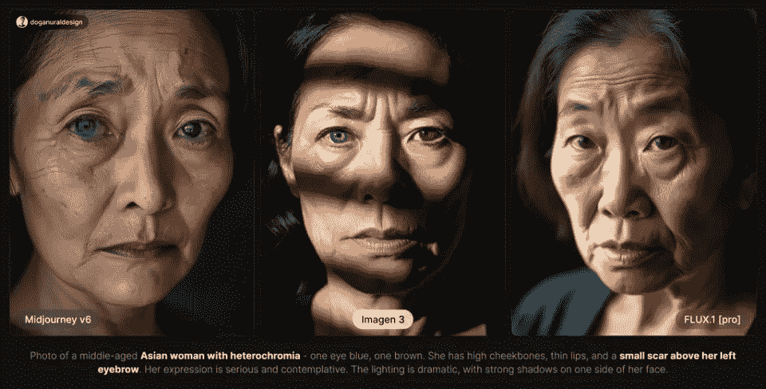

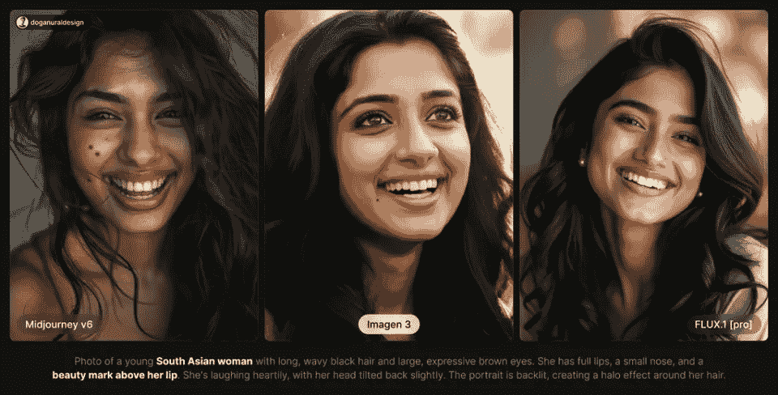

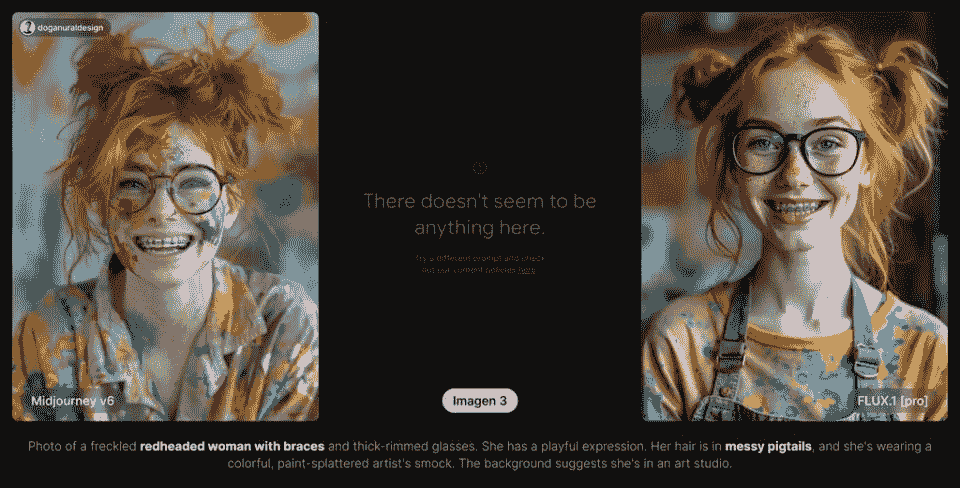

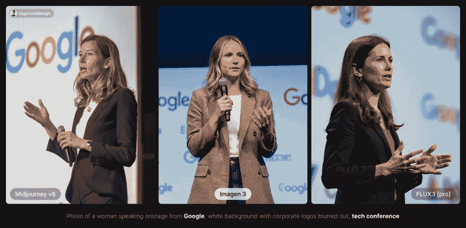

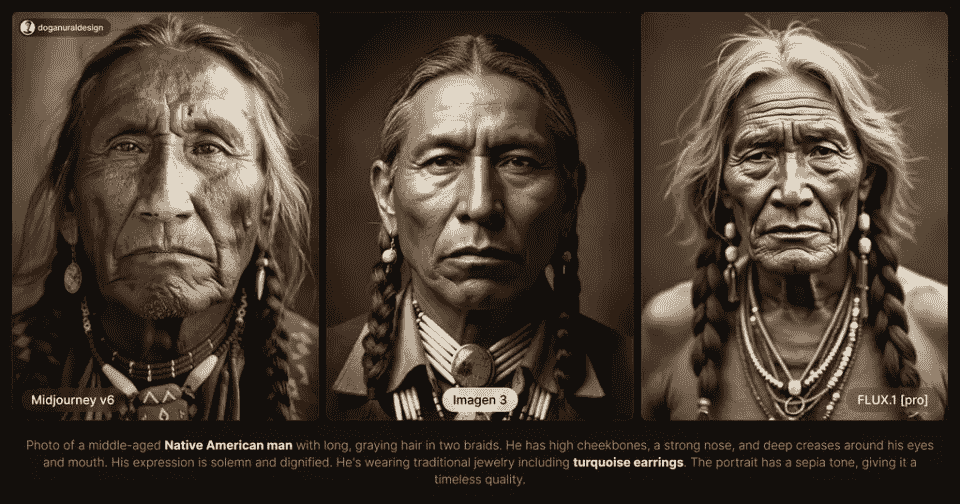

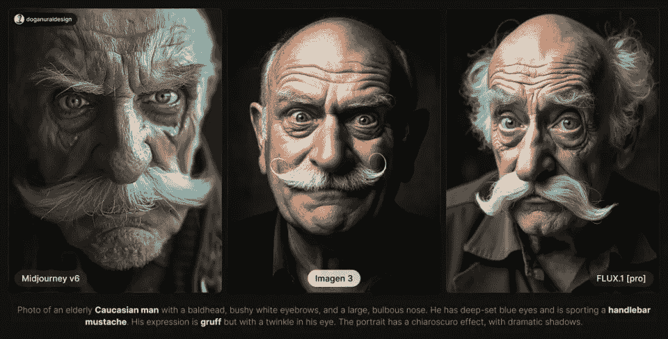

## 8月17日 AI资讯

1、Midjourney网页版更新:推全新图像编辑器，应对FLUX.1挑战

Midjourney推出全新网络编辑器，整合多项图像操作，满足用户需求。更新体现紧迫感，面对FLUX.1挑战。功能创新是重要尝试，以提高用户体验和吸引用户。

2、谷歌Imagen3发布 细腻图像生成体验获好评

谷歌最新图像生成工具Imagen3在Test Kitchen平台上推出，生成细腻、光影效果更佳的图像。用户体验良好，可通过描述生成详细图像，但存在生成限制。与Grok工具相比，Imagen3过滤功能更完善，避免争议性内容。

3、收到28页侵权告知函!秘塔AI搜索不再收录知网文献题录及摘要数据

秘塔AI搜索团队收到知网的侵权告知函，决定不再收录知网文献题录及摘要数据。团队强调知识的流动价值，表示尊重知网的选择，并将与其他知识库合作。

4、AI视频聊天对象居然比真人还会聊?TavusAI员工反应速度让你怀疑人生!

Tavus的创业小分队推出了神器级视频聊天AI，Conversational Replicas by Tavus，引发科技圈轩然大波。这款AI不仅反应速度惊人，还能根据表情变化做出反应，简直让人怀疑是真人操作。

[conver.mp4](https://internal-api-drive-stream.feishu.cn/space/api/box/stream/download/all/Xo65bkb7royKJfxAv5TcOCiAnKh)

5、百度AI原生应用“橙篇”APP上线 集成智能搜索、AI热点推荐等功能

百度文库推出全新AI原生APP“橙篇”，集成了智能搜索、AI热点推荐等功能，引入了多图快速合成视频、超长篇幅文章创作和智能文件内容摘要技术。用户可通过文字或语音与应用交流，支持一键生成长文。

6、清华大学推出超万字生成式AI系统LongWriter，挑战人类作家

清华大学研发的LongWriter AI系统突破性地能生成超过10，000字的连贯文本，为长篇写作带来新可能。AI模型输出长度与训练文本长度相关，研究团队成功提升生成文本长度。

7、Pindrop推AI音频伪造检测工具Pulse Inspect

Pindrop推出的AI音频伪造检测工具Pulse Inspect准确率高达99%，为用户提供快速、准确的伪造分数反馈，帮助组织应对音频伪造风险，维护品牌信誉。该工具不局限于特定供应商的检测，覆盖多种生成工具，适用于多种音频和视频文件。

# 第三周

## 8月19日 AI资讯

1、Epic CEO：公司损失了 10 亿美元对抗苹果、Google，但这是值得的

日前，游戏公司 Epic 正式在欧盟 iPhone 上推出了 Epic Games Store，以及被下架了将近 4 年的游戏《堡垒之夜》。Epic CEO Tim Sweeney 就此接受了媒体采访，表示在与苹果、Google 抗衡的这 4 年之间，公司可能失去了 10 亿美元的收入

2、昆仑万维发布全球首个AI短剧平台SkyReels

8月19日，昆仑万维发布全球首个集成视频大模型与3D大模型的AI短剧平台SkyReels。SkyReels平台集剧本生成、角色定制、分镜、剧情、对白/BGM及影片合成于一体，让创作者“一键成剧”，轻松制作高质量AI视频。

3、工信部：将推出AI换脸诈骗风险提醒功能，仅在手机端本地运行。

8月18日消息，据央视网报道，AI换脸诈骗检测与预警技术正在测试中。工业和信息化部反诈工作专班专家李坤表示：“我们正在会同行业内的手机终端企业，将推出 AI 换脸诈骗风险提醒功能，这项功能仅在手机端来本地运行，能够有效保护用户数据不泄露。

4、马斯克：未来人类记忆可上传云端并下载至机器人

特斯拉 CEO 埃隆·马斯克近日在 X 社交平台上，针对人类意识和机器人关系发表了自己的看法。

一位网友提出一个疑问：是否可能将大脑复制到特斯拉 Optimus 人形机器人以延长生命。马斯克回复称，未来或许能够将自己的大部分记忆和思维状态上传到「云端」，并能够将其下载到一个人形机器人上，显然「你不会完全和现在一样」。

5、OpenAI 关闭 SearchGPT 候补名单，针对 10000 名用户开始测试

OpenAI 向那些报名了 SearchGPT 测试，但是未被选中的用户发送了一封邮件，告知其候补名单已经关闭。

接下来 SearchGPT 将向 10000 名测试用户提供访问权限。由于此前 Google AI 搜索的糟糕表现，媒体分析 SearchGPT 仅向少部分人开放测试是明智的。

## 8月20日 AI资讯

1、通义千问数学模型Qwen2Math Demo放出

阿里巴巴的通义千问团队推出了Qwen2Math Demo，这个数学模型引起了广泛关注。通过精心设计的数学补脑液，Qwen2模型成为数学高手，在各类数学测试集上表现出色。使用Qwen2-Math Demo可以帮助解决数学问题，但仍需谨慎使用，注重自身数学功底的提升。

地址：:https://huggingface.co/spaces/Qwen/Qwen2-Math-Demo

2、Anthropic公司被作家起诉，指控其使用盗版书籍训练AI聊天机器人，引发版权争议。作家们认为其行为嘲弄了崇高目标，挑战AI模型训练的合理使用。

3、AMD出手49亿美元收购ZT Systems，向Nvidia发起 AI 挑战

AMD最近以49亿美元收购AI基础设施公司ZT Systems，旨在提升自家Instinct数据中心芯片的市场采用率。这一决定对于AMD来说是重要的战略布局，加速了AI解决方案的部署速度，提升了研发效率和市场竞争力。

4、阿里云通义千问启用新域名“tongyi.ai”

阿里通义千问宣布启用新域名“tongyi.ai”，推出一系列新功能和服务，提升用户体验。新增网页版对话功能引入深度搜索能力，支持更多内容源索引，使搜索结果更加专业。通义App升级，新增图片微动效功能和自定义唱演功能支持3:4画幅，解决用户反馈问题。

## 8月21日 AI资讯

1、《黑神话：悟空》总销售额超 15 亿，Steam 在线人数破两百万

8 月 20 日，《黑神话：悟空》正式上线。游戏上线后即登顶 Steam 热玩游戏榜首，同时在线游玩人数迅速突破百万大关。昨晚，根据 Steam 平台显示，《黑悟空：神话》同时在线人数突破 220 万，超过《幻兽帕鲁》，位居历史峰值人数第二，仅次于《PUBG》。

2、iPad 上最强的绘画应用 Procreate ， 发文抵制 AI

iPad 插画应用 Procreate 在官网发文，表示在市场同类产品争相使用 AI 技术的背景下，该应用没有计划引入生成式 AI 技术。

3、挑战Sora!Luma v1.5版本发布

Luma v1.5版本在视频生成领域取得了巨大进步，提升了视频质量、缩短了生成时间，带来更快、更真、更清晰的视频作品。增强的运动效果和文本理解能力让观众沉浸在更逼真的观影体验中。与1.0版本相比，Luma v1.5在图像生成上达到新高度，与OpenAI的Sora相媲美。

[6385976347137368121350829.mp4](https://internal-api-drive-stream.feishu.cn/space/api/box/stream/download/all/AYr3b1d1ho9jMhxBcJec4GR7n75)

4、OpenAI与康泰纳仕集团达成合作协议 获授权展示来自《Vogue》等媒体内容

OpenAI于周二宣布与康泰纳仕集团(Condé Nast)达成合作协议。OpenAI在一篇博客文章中写道：“随着我们推出SearchGPT原型，我们正在测试新的搜索功能，使得查找信息和可靠内容来源变得更加快速和直观。”SearchGPT原型提供了新闻故事的直接链接，公司计划“未来将这些功能中的精华整合到ChatGPT中”。

5、GPT-4o正式上线微调功能。

并且官方还附赠一波福利：每个组织每天都能免费获得100万个训练token，用到9月23日。

更多介绍:https://mp.weixin.qq.com/s/1iQmUOTHw_vOpFWkQ9zpUw

6、Anthropic 被指控使用盗版书籍训练 AI，作者提起集体诉讼

据路透社报道，一群作家对人工智能公司 Anthropic 提起诉讼，指控该公司使用盗版书籍来训练其 AI 模型。据报道，这起集体诉讼周一在加利福尼亚州法院提起，原告声称 Anthropic “通过窃取数十万本受版权保护的书籍，建立了一个价值数十亿美元的业务”。

## 8月22日 AI资讯

1、OpenAI 将允许企业对 GPT-4o 进行定制化处理

据彭博社报道，OpenAI 近期发布了一项新功能，该功能将允许企业客户使用自己的公司数据，来定制 GPT-4o。报道指出，所谓「定制」功能，其实就是微调。微调可以允许现有的 AI 模型接受关于特定类型任务或主题领域的附加信息的训练。

2、Google 因 Chrome 数据收集问题，将面临集体诉讼

据 The Verge 报道，Google 将面临集体诉讼，该诉讼指控其未经用户同意通过 Chrome 收集用户数据。

该集体诉讼自 2020 年首次提起，原告指控无论他们是否启用了 Chrome 的「同步」，Google 都会收集用户的数据。

3、新壹视频大模型2.0发布:支持1080P60帧输出 最高支持4K

新壹科技最新发布的新壹视频大模型2.0在AI视频创作领域取得重大突破，实现全流程自动化创作，降低视频创作门槛和成本。技术集成了先进的AI算法和深度学习技术，提供便捷的一键触发功能。

4、又一款AI视频工具强势登场!Hotshot可生成长达 10 秒视频，无水印

Hotshot是一款全新的文本转视频AI生成器，可以生成长达 10 秒、720p的视频，展现出强大潜力。用户可以免费体验该模型的早期预览版本，但每天限制生成两个无水印视频。创始团队在短短四个月内完成了模型训练，使用了 6 亿个视频片段和数千个GPU。

体验地址：https://hotshot.co/   （个人觉得效果还可）

5、Ideogram2.0更新

更新了模型的质量，增强了语义理解能力，写实、设计、3D、动漫，这四个类别的质量得到了大幅强化，而Ideogram也贴心的为你设计了风格选择器。

网址:https://ideogram.ai/

6、LivePortrait更新:支持图像驱动肖像动画和精细区域控制

LivePortrait的Gradio工具迎来了一系列激动人心的更新，用户现在可以使用自己的图像来驱动肖像动画，并且可以精细选择动画区域。新增的功能提升了动画制作的便捷性和创作自由度，同时保护隐私信息。

7、防止内容被抓取训练AI：百度百科屏蔽谷歌/必应等搜索引擎

据报道，近日百度百科开始屏蔽谷歌和必应等大多数搜索引擎，预计是为了阻止这些搜索引擎和其他爬虫，未经授权抓取百度百科的内容用于训练AI。

8、肌肉也能AI了！Gigabody让你秒变施瓦辛格，健身房老板慌了

Gigabody是一款AI软件，让用户可以通过上传健身照片，在短短 5 分钟内变身肌肉猛男或猛女，引发了社交平台上的增肌风暴。虚拟肌肉的热度超过真实肌肉，成为懒人们的福音。

9、AI即时图像编辑神器TurboEdit 一句话瞬间变发色、减龄、换装!

TurboEdit是一款基于文本的即时图像编辑工具，让用户通过简单的文本描述快速对图像进行编辑。编辑速度极快，支持即时反馈和交互式编辑，让用户实时看到编辑效果。

网址：https://betterze.github.io/

10、字节跳动自动语音识别模型Seed-ASR，各种口音和方言统统能听懂!

Seed-ASR是字节跳动推出的语音识别引擎，经过大量数据训练，具备出色的识别能力和上下文感知能力，能准确识别多种语言、方言和口音，为跨语言交流带来新可能。

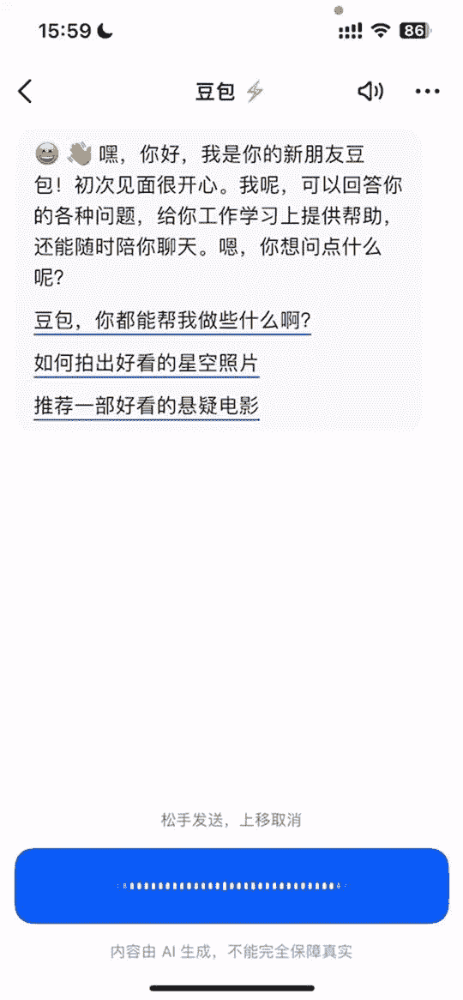

[6385985001926434939448293.mp4](https://internal-api-drive-stream.feishu.cn/space/api/box/stream/download/all/ABSBbVMRMo0XLTxsxA4cabEinig)

## 8月23日 AI资讯

1、微软Azure AI语音服务推出虚拟人形象 支持文本转视频

微软 Azure AI 语音服务允许开发者构建多语言生成式 AI 语音应用，Azure AI 语音服务最新推出了文本到语音虚拟人功能，可以将简单的文本转换为人类自然说话视频。

2、Adobe推魔法修复AI工具Magic Fixup，将彻底改变照片编辑体验？

Adobe最新推出的“Magic Fixup” AI照片编辑工具将彻底改变图片处理方式。这项技术利用视频帧学习，能自动进行复杂图像调整，保留艺术意图，影响多行业工作流程。

3、D-ID推出AI视频翻译工具:实现语音克隆与口型同步

D-ID最新推出的AI视频翻译工具AI Video Translate支持30种语言的自动翻译，实现语音克隆和口型同步，帮助企业客户降低全球推广的本地化成本，拓展受众。

4、消息称原Character.AI CEO诺姆・沙泽尔将任谷歌Gemini联合技术负责人

据 The Information 北京时间今天晨间报道，谷歌发送给员工的消息显示，本月重返谷歌的 Character.AI 联合创始人兼原 CEO 诺姆・沙泽尔（Noam Shazeer）将担任谷歌 AI 项目 Gemini 的联合技术负责人。

5、微软宣布推迟发布Recall AI功能至10月，以确保安全性。尽管功能有趣且方便，但安全问题引发担忧。微软承诺加密数据库、用户选择启用，并进行全面测试，以保障用户安全和隐私。

6、爱诗科技推出的AI视频生成工具PixVerse V2.5，通过模型优化显著提升了视频生成速度和画质，支持4K分辨率。

## 8月24日 AI资讯

1、Captions公司发布AI视频生成和编辑API工具

Captions公司最近推出了一套革命性的AI视频生成和编辑API工具，为社交媒体和营销活动注入新活力，为开发者和内容创作者提供前所未有的视频制作方式。这一创新举措将视频创作推向新高度。

2、Claude上线LaTeX公式渲染功能，评论区网友沸腾了

Claude（3.5 Sonnet）终于添加了 LaTeX 渲染功能预览，从而能够以一致的格式显示数学方程式和表达式。

3、Google 旗下无人出租车公司将为家长提供接送孩子服务

据 techcrunch 报道，Google 旗下的无人出租车公司 Waymo 正在考虑推出一项订阅计划，可以让青少年单独叫车，同时还可以向父母发送接送提醒。Waymo 将该计划命名为「Waymo Teen」，价格在每月 150 美元至 250 美元之间浮动，每月最多可乘坐 16 次。

4、Meshy发布新款 AI 3D 建模工具Meshy-4:AI生成高质量 3D 模型

Meshy发布了最新的AI驱动3D建模工具Meshy-4，标志着虚拟环境创作的重大进步。经过16个月的开发，Meshy的联合创始人余明表示，他们对于这一成就感到非常自豪。

5、Google AI Studio 推出全新提示词库，提示词库集合了多种实用功能，涵盖教育、编程、旅行建议等多个领域，为用户提供更丰富的选择。

6、重返谷歌的Transformer作者，开始掌管Gemini AI

Character.AI 的联合创始人 Noam Shazeer 和 Daniel De Freitas 也将重返谷歌。其中，Noam Shazeer 是 Character.AI 的创始人、CEO，也是 Transformer 论文作者之一，他曾在谷歌任首席软件工程师。

# 第四周

## 8月26日 AI资讯

1、可图上线一键换衣Kolors Virtual Try-On，用户可以即时看到服装在自己身上的效果，轻松搭配出不同风格，大大提升了购物的精准度和效率。

2、通讯应用 Telegram CEO 遭逮捕

法国媒体 TF1 电视台报道，通讯应用 Telegram 的创始人兼 CEO Pavel Durov 于当地时间周六晚间在巴黎布尔歇机场被捕。媒体报道表示，此次逮捕行动是由于法国警方对 Telegram 平台缺乏监管的调查，警方认为这导致了大量犯罪活动，以及虚假信息和仇恨言论的传播。

3、Meta被曝取消了自己的“Vision Pro计划”。

据报道，美国科技巨头Meta取消了原定于2027年推出高端混合现实头显的计划，Meta原本计划利用这款设备与苹果的Vision Pro一较高下。

4、快手可灵AI推出会员订阅计划

8月23日消息，快手可灵AI推出会员订阅计划，其中连续包月首月最低价仅19元，可生成约66个视频或3300张图片，还可享受高表现视频生成、视频延长、大师运镜等多项会员专属功能。

5、Meta发布Sapiens视觉模型

Meta Reality 实验室最新推出了名为 Sapiens 的 AI 视觉模型，适用于二维姿势预估、身体部位分割、深度估计和表面法线预测 4 种以人为中心的基本视觉任务。让 AI 分析和理解图片/视频中人类动作。

6、荣耀获中国移动投资，公司回应

8月24日消息，荣耀一份声明表示，公司已经获得中国移动的投资。此前有消息称两家公司正在洽谈新一轮融资。荣耀表示，该公司始终坚持公开透明的发展原则，也会持续多元化股权结构。

7、IBM中国研发岗位员工被收回访问权限，或有新一轮人事调整。8月24日，记者从多位IBM中国员工处获悉，该公司于23日晚间关闭了IBM中国研发和测试岗位员工的访问权限。一位实验室技术员工称，关闭权限前公司员工正常上下班，没有任何预兆和“信号”。

## 8月27日 AI资讯

1、xAI Grok-2挤进聊天机器人排行榜第二名，紧追GPT-4o

xAI团队的Grok-2和Grok-Mini模型在LMSys聊天机器人Arena排行榜上脱颖而出，Grok-2以第二名的佳绩超越了OpenAI的GPT-4o，与Gemini并列。Grok-2在数学任务上表现出色，荣获第一名，同时在多个其他任务中也取得优异成绩。

2、首例“AI文生图”侵权案，入选北京互联网法院十大典型案例

8月26日，北京互联网法院发布服务保障新质生产力十大典型案例。其中国内首例“AI文生图”著作权侵权案入选。该案典型意义在于，明确人利用人工智能生成的内容，若符合作品的定义，则应被认定为作品，受到著作权法保护。同时人工智能生成内容若体现出使用者的独创性智力投入，则相关著作权一般应归属于人工智能使用者。

3、设计师新神器来了!SuperCraft

SuperCraft是一款重塑设计流程的新神器，通过生成式AI技术将手绘草图转化为逼真的产品图像和3D模型。设计师们可以在无限大的协作画布上自由创作，享受高效有序的设计过程。SuperCraft内置的3D查看器让设计师审视每个细节，导出设计成.glb格式后，设计即可从屏幕走向现实世界。

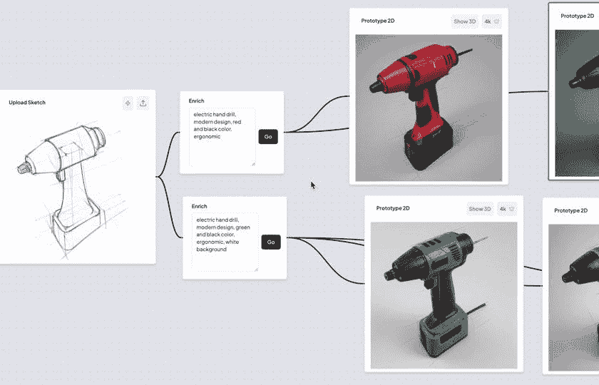

[6386036887932740697689171.mp4](https://internal-api-drive-stream.feishu.cn/space/api/box/stream/download/all/EAkbbbigHoCQzextCLCcOsi8n6d)

4、谷歌Photos测试全新AI搜索功能 “Ask Photos” ，搜图更简单

谷歌正在进行一项重大升级测试，推出“Ask Photos”功能，允许用户通过自然语言与照片库互动，将照片和视频变成智能视觉数据库。相关代码已出现在最新谷歌应用版本中，预示功能即将推出。

5、字节跳动开源FLUX Dev的Hyper SD Lora

在AI技术飞速发展的今天，字节跳动的开源动作再次成为行业焦点。FLUX Dev的Hyper SD Lora以其高效的图片生成能力，将AI绘图推向了一个全新的速度纪元。尽管画质有所折损，但速度提升将为AI绘图领域带来新的变革。

6、苹果官宣北京时间 9 月 10 日凌晨 1 点举行发布会

今日凌晨，苹果官宣将于太平洋时间 9 月 9 日 上午 10 点，北京时间 2024 年 9 月 10 日凌晨 1 点举行秋季发布会，发布会主题为「高光时刻」。根据先前的爆料，发布会上有望带来 iPhone 16 系列手机、Apple Watch Series 10 以及 AirPods 4 等新品。

7、智谱AI宣布GLM-4-Flash大模型免费开放：支持中文、英语、日语、韩语等26种语言

8 月 27 日消息，智谱 AI 今日宣布，GLM-4-Flash 大模型免费开放，通过智谱 AI 大模型开放平台调用。 具备多轮对话、网页浏览、Function Call（函数调用）和长文本推理（支持最大 128K 上下文）等功能，同时支持包括中文、英语、日语、韩语、德语在内的 26 种语言。

8、“AI程序员”疯狂揽金：20个月，融资近10亿美元

据英国《金融时报》8月23日报道，来自Dealroom的数据显示，Replit、Anysphere、Magic、Augment、Supermaven和Poolside AI等AI辅助编程公司迄今为止已筹集了4.33亿美元。自2023年1月以来，AI编程辅助工具行业已经吸引了9.06亿美元的投资。这表明基于生成式AI的编程工具正在成为生成式AI领域的首类“杀手级应用”。

## 8月28日 AI资讯

1、曝 OpenAI 高级推理 AI 产品「草莓」秋季推出

路透社曾爆料 OpenAI 正在开发一个名为「草莓」的 AI 产品，旨在提高 AI 的高级推理能力，The Information 昨日的一篇报道再次证实了这个产品的存在。报道还指出，「草莓」有望于今年秋天整合到其聊天机器人服务中，能够解决复杂的数学和编程问题。

2、夸克发布全新 PC 端，集成多个 AI 能力

阿里智能信息事业群旗下夸克发布全新 PC 端，全面升级 AI 搜索、AI 写作、AI PPT、AI 文件总结等一系列功能。一个月前夸克在 App 端推出的 AI 搜索，这次也在 PC 端一并发布，升级了更强的模型能力，交互速度得到提升。

3、星智能冰箱将推AI生成壁纸功能，还能自定义风格和主题

最近，三星宣布将为其智能家电带来新一轮的 AI 功能，其中最引人注目的就是智能冰箱将支持 AI 生成壁纸。除此之外，三星还对其 Bixby 语音助手进行了升级，增强了智能家居的控制能力。

4、马斯克支持加州 AI 安全法案

AI 初创公司 xAI CEO 埃隆·马斯克公开支持美国加州的「SB 1047」法案，这个法案要求大型 AI 模型制造商创建并记录安全措施，以防止这些模型造成严重伤害。马斯克在 X 平台上表示，虽然这是一个艰难的决定，会让一些人感到不安，但这个法案应该被通过。

5、苹果今年第四次裁员

据悉苹果公司将在其服务部门裁员约100人，这是一个罕见的举动，裁员影响苹果图书、新闻等团队。

## 8月29日 AI资讯

1、夸克PC端AI全面升级 整合AI搜索、AI创作、AI总结等能力

夸克PC端应用经过全新升级，提升了AI搜索、AI写作、AI PPT、AI文件总结等关键功能。AI搜索功能拥有更强大的模型能力，实现更快的交互速度，领先行业标准。写作方面支持近200种文稿撰写，能快速产出高质量文章。

2、Google Meet推出AI自动记笔记功能，会议再也不怕遗漏信息

Google Meet推出了新功能“为我记笔记”，让会议记录变得更便捷高效。这项功能不仅自动总结会议内容，还提供迟到者会议摘要，让大家随时跟上会议进展。同时，会议记录以Google文档形式保存并自动发送给与会者，提供一站式服务。

3、OpenAI接近完成新一轮融资 估值超1000亿美元

据彭博社报道，知情人士称，OpenAI正接近完成新一轮融资，由兴盛资本(Thrive Capital)领投，估值超过1000亿美元。知情人士称，兴盛资本将在这轮融资中向OpenAI投资大约10亿美元。OpenAI大股东微软预计也将参与投资。

4、因种族问题“翻车”后 谷歌(GOOGL.US)重新开放AI人像生成功能

在今年2月取消人工智能(AI)图像生成选项后，该公司很快将允许用户使用其Gemini人工智能工具创建人物图像。Gemini高级产品总监Dave Citron周三在一篇博客文章中写道，未来几天，Gemini Advanced、商业和企业用户将可以抢先体验谷歌新款Imagen 3生成器(英语版)。

5、AI图像生成公司Midjourney宣布进军硬件领域，苹果前硬件经理加盟

Midjourney 创始人 David Holz 曾任 Leap Motion 的首席技术官，具备丰富的硬件经验。近期，他招募了前 Leap Motion 同事 Ahmad Abbas 担任 Midjourney 硬件部门负责人。

6、Claude超强可视化功能Artifacts向所有用户免费开放

Anthropic的AI初创公司推出了Claude系列大语言模型的新功能“Artifacts”，用户可以轻松生成交互式可视化、图表或小游戏，提升创作效率。

## 8月30日 AI资讯

1、大模型免费做PPT来了，通义网页版上线“PPT创作”功能

通义网页版上线“PPT创作”功能，具备言之有物、设计精美、智能编排三大核心特点。PPT创作功能完全免费，基于通义大模型打造，由通义实验室全链路自研。只需输入一句话或上传文档，通义就能自动生成结构合理的大纲。

体验地址：https://tongyi.aliyun.com/aippt

2、中科院、阿里云发布首个月球专业大模型

中国科学院地球化学研究社与阿里云联合发布国际首个「月球科学多模态专业大模型」。

据介绍，这个大模型基于阿里云通义系列构建，目前在月球撞击坑年代和形态判别上，准确率已达到 80% 以上。

3、翻倍！ChatGPT每周活跃用户激增至2亿

OpenAI官方消息显示，每周使用ChatGPT的人数已突破2亿，较去年翻倍增长。这表明ChatGPT在全球影响力不断扩大。同时，92%的《财富》500强企业正在使用OpenAI产品。AI聊天工具市场竞争激烈，Meta等公司也加大投入。

4、可随身携带的GPT-4o？国产AI神器NotePin横扫海外 20万用户抢购

NotePin是一款由深圳机智连接科技有限公司推出的智能可穿戴设备，以亲民价格赢得市场，吸引海外20万用户的青睐。它集录音、转录于一体，支持59种语言的语音转文本功能，提供高效信息捕捉和整理。

5、阿里重磅开源超强AI模型Qwen2-VL：能理解超 20 分钟视频

阿里巴巴的云计算部门发布了一款强大的AI模型Qwen2-VL，能理解视觉内容，包括图片和视频，实时分析长达20分钟的视频，表现优秀。

6、智谱AI震撼发布GLM-4-Plus：媲美GPT-4，首创C端视频通话功能

智谱AI最新发布的GLM-4-Plus模型展示了与OpenAI GPT-4媲美的强大视觉能力，即将开放使用。这一突破性进展标志着国产AI技术飞跃，为用户带来前所未有的智能体验。

# 9月AI资讯精选

# 第一周

## 9月2日 AI资讯

1、AI求职工具LinkedIn_AIHawk能在24小时内自动申请1000个工作岗位，具备自动扫描职位、快速提交申请、生成定制简历和个性化回答雇主问题的功能，同时确保用户数据安全。

2、亚马逊引入Covariant团队，加强AI和机器人技术研究，推动物流自动化发展。致力于开发机器人AI模型的初创公司，最初专注于机械臂在仓库中的应用，例如箱子拣选等常见任务。

3、MiniMax 视频生成模型正式登场

昨日，MiniMax 正式发布了视频生成模型。

现场亮相的演示 demo 讲述了一个小男孩拥有一枚可以创造想象世界的魔法硬币的故事。

4、Google 推出 GameNGen，实时生成游戏画面

本周，Google 发布了首个 AI 游戏引擎 GameNGen。GameNGen 是一个完全由神经模型驱动的游戏引擎，它能够在单个 TPU 芯片上以超过 20 帧每秒的速度实时模拟经典射击游戏《毁灭战士》。

5、Runway 页面从 Hugging Face 等平台消失

近日，知名 AI 视频生成平台 Runway 的内容从 Hugging Face AI 平台上消失，疑似「删库」。此外，Runway 在 Hugging Face 上的 Stable Diffusion v1.5 项目界面也无法访问，GitHub 的相关界面也一并消失。

6、快手新出的Kolors Virtual Try-On虚拟换装火爆全网

上传一张照片，不需要像模特那样摆出专业pose，只要提供一张普通的站姿/坐姿照片就行。再上传想要试穿的衣服，AI就分析你的照片，包括身材比例、肤色、发型等细节。然后，它会将选择的服装“穿”到你的身上，同时考虑光线、阴影等因素，让生成的图片看起来逼真自然。

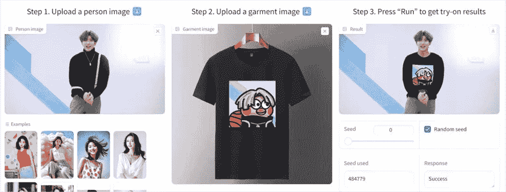

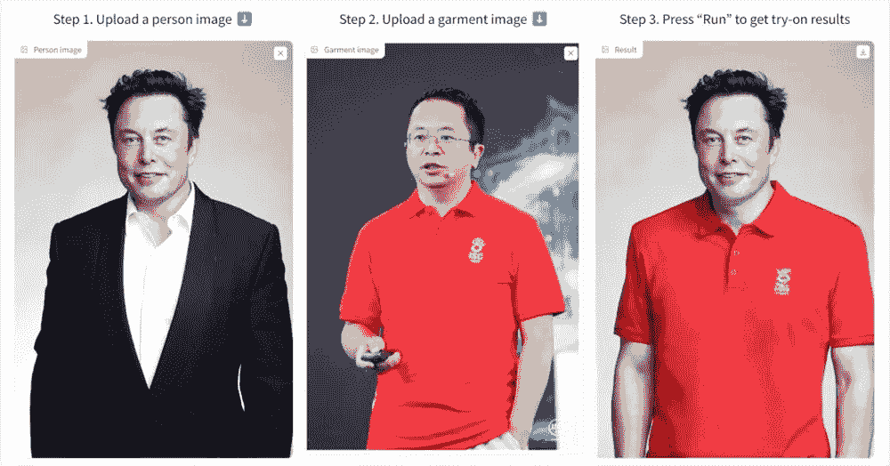

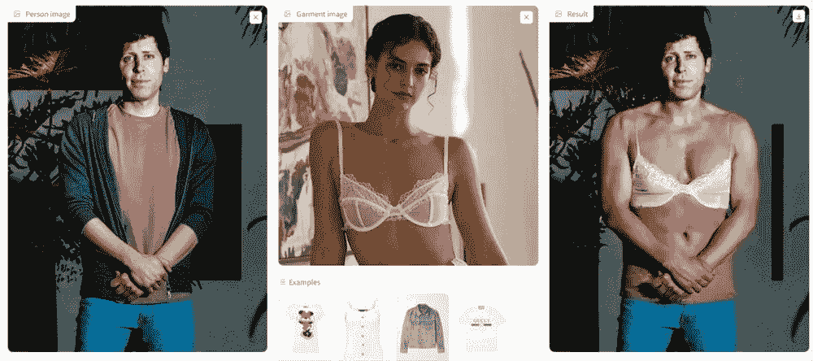

在线体验:https://huggingface.co/spaces/Kwai-Kolors/Kolors-Virtual-Try-On

7、韩国 N 号房再现！大量女性被 AI 换脸

曾经因为 N 号房震惊世界的韩国，此时此刻正在上演 2.0 版本。之前的 N 号房事件，作案人在加密即时通讯软件 Telegram 上建立多个聊天室，发布性剥削内容。这次的事件，也主要发生在 Telegram。

8、一周打完1000场官司，中科院发布AI法庭AgentCourt

最近，来自中科院深圳先进研究院的研究团队开发了一个名为AgentCourt的模拟智能法庭，它是一个基于大语言模型（LLMs）的法庭模拟系统，旨在通过AI驱动的虚拟法庭来革新法律教育、案例分析和法律研究。

论文地址:https://doi.org/10.48550/arXiv.2408.08089

代码:https://github.com/relic-yuexi/AgentCourt

AgentCourt实战演示:https://b23.tv/e6eQMfM

## 9月3日 AI资讯

1、Claude 3.5 Sonnet对免费用户关闭？

今天，不少用户发现Claude3.5-sonnet已经不对免费用户开放使用了。免费用户原本常用的 Claude3.5Sonnet 模型无法选择使用，只能使用功能相对简单的 Claude3Haiku 模型。

2、限免！海螺AI重磅上线“AI创作音乐”和“AI生成视频”功能

MiniMax发布了首款 AI 高清视频生成模型技术后abab-video-1，该公司旗下的海螺 AI目前也正式上线了「AI 创作音乐」和「AI 生成视频」功能。根据官方页面显示，海螺 AI 这两项功能目前正在限时免费中。

3、360AI 助手推出模型竞技场 让用户比较多家大模型表现

360AI 助手推出全新的模型竞技场功能，用户可以比较不同大模型的输出结果，提供丰富的提示词题库，帮助用户全面评估模型性能，让模型选择更客观全面。

4、NVIDIA推全新视觉语音模型NVEagle，可以看图跟你聊天

NVIDIA联合Georgia Tech、UMD和HKPU的研究团队推出了全新的视觉语言模型NVEagle，实现了图片理解和对话功能，为视觉语言模型领域带来重要突破。

5、证件照不用愁！HivisionIDPhotos 让你轻松搞定各种标准证件照

HivisionIDPhotos是一款高效的AI证件照制作工具，利用AI算法智能识别拍照场景，抠图生成高质量证件照，适用于护照、签证等多种用途。未来将加入美颜和智能换装功能，让证件照更光彩。

6、Civitai推出"绿色"新站Civitai Green 下载模型再也不用偷偷摸摸了

Civitai最新推出的Civitai Green站点为AI艺术创作者们提供了纯净、专业的创作环境，摒弃了色情内容，为用户带来更多高质量、多元化的创作资源，铺平了商业化道路。

7、Runway发布Gen-3 Alpha Extensions功能 视频可延长至 40 秒

Runway最新发布的Gen-3Alpha Extensions功能将视频生成时长延长至40秒，为数字内容创作带来革命性变革。这一功能允许用户仅凭简单的图片或文字输入即可制作完整的故事情节或广告内容，大幅提升创作效率。

## 9月4日 AI资讯

1、AI绘画 用 Mystic 创建超现实的 AI 图像

Freepik 最近推出了一款名为 Mystic 的新 AI 图像生成器，能够从提示词生成超现实的 AI 图像，并与 Midjourney 和 FLUX 等顶级工具竞争。

地址：https://www.freepik.com/ 会员才能使用

2、OpenAI 与台积电、苹果合作开发 AI 芯片 有可能突破GPU短缺的瓶颈

据报道，OpenAI 计划使用台积电先进的 1.6mm A16 工艺节点开发其首款自研 AI 芯片，并可能与博通、Marvell 或苹果公司合作进行芯片设计，OpenAI 有望显著减少对昂贵的Nvidia AI服务器的依赖。

3、真实教室里的虚拟教师：英国伦敦大卫游戏学院开设由AI教授的课程

北京时间今天凌晨，据 TechRadar 报道，英国一所私立学校 —— 伦敦大卫游戏学院，正在开设英国首个 AI 教学班，首期班级将有 20 名学生参与，他们将依靠 AI 平台、VR 头显来指导学习，而非人类教师。

4、马斯克透露超级AI训练集群Colossus已正式上线：10万张H100还不够

埃隆·马斯克的 xAI 刚刚推出了“Colossus”，这是全球最强大的 AI 集群，拥有惊人的 100,000 块液冷 Nvidia H100 GPU，仅用 122 天建成，并计划在不久的将来将规模扩大一倍。

5、谷歌发布安卓15源代码 计划10月向Pixel设备推送更新

谷歌公司昨日（9 月 3 日）发布公告，正式向安卓开源项目（AOSP）推送安卓 15 的源代码，并表示会在“未来几周”内向符合升级条件的 Pixel 设备推送更新。对于终端用户来说，本次推送并没有太大的意义。不过对于厂商来说，可以调用 AOSP 项目的安卓 15 源代码，从而定制开发自有安卓体验。

6、谷歌升级Gemini 1.5 Flash模型，AI聊天响应速度最高提50%

谷歌公司于今年推出 Gemini 1.5 Flash AI 模型，官方承诺提供更快的响应速度、能应对更复杂的用户查询。在最新版本更新中，谷歌宣布采用 Gemini 1.5 Flash 的 Gemini 大幅提升响应速度，增幅最高可以达到 50%。

## 9月5日 AI资讯

1、自动接人，手机开车，特斯拉纯视觉无人召将在下周大规模上线

特斯拉终于准备向普通用户正式推出下一代召唤功能「真智能召唤」（Actually Smart Summon，ASS）了。由于该技术采用纯视觉的方案，所以覆盖了特斯拉 Model S、3、X、Y 的绝大多数配置。车主可以仅使用手机，就能将他们的车辆从停车位召唤到附近的特定位置。

2、百度文心一言App全新升级为“文小言”:9月文心大模型4.0免费用

百度宣布旗下人工智能应用“文心一言”App进行了重大更新，推出全新的4.0.0版本，正式更名为“文小言”。新版本功能得到显著增强，提供更丰富的使用场景。用户可享受搜索、创作、聊天等多种AI能力。

3、Playground AI推最新生图模型Playground V3

Playground是一款超级棒的AI设计工具，无论你是设计小白还是设计高手，都能让你的创意一触即发。它提供海量模板、简单易用的编辑界面、高度自定义、高分辨率导出和多平台支持，让用户轻松创建自定义设计和图形。

4、Luma发布Dream Machine1.6:新增镜头运动控制功能 让视频生成更有 “电影感”!

Luma AI最新发布的Dream Machine1.6版本为AI视频生成技术带来了惊喜，新增了12种不同的摄像机动作控制功能，大幅提升了创作工具的控制能力。用户反馈积极，认为新功能节省了时间，增强了摄像机动作的幅度和动态效果。

5、静态图片转视频已经out了!ComfyUI-AdvancedLivePortrait还可编辑表情

ComfyUI-AdvancedLivePortrait是一款先进的实时动画生成工具，通过强大的面部表情提取和编辑能力，让视频创作更加生动。用户可以从静态照片中捕捉面部表情，并编辑为可调参数，为人物赋予全新情感表达。

6、低调大更新!谷歌在Chrome地址栏悄然集成Gemini AI，@一下就能调用AI助手

谷歌最近在Chrome浏览器进行了一项重大更新，将Gemini AI聊天机器人集成到地址栏中，用户只需输入"@gemini"即可访问Gemini，提供无缝的AI帮助体验。

7、Anthropic将发布最新功能Artifacts系统提示

Anthropic公司即将发布最新功能Artifacts的系统提示，以回应研究者的质疑。Artifacts功能允许用户在Claude聊天界面旁边运行代码片段，已对所有用户开放。系统提示的公开有助于用户理解模型行为，促使AI开发者保持透明。

8、MiniMax大模型日均与用户交互30亿次 将发布多模态模型abab7

MiniMax稀宇科技近日公布数据显示，公司已构建万亿参数的MoE文本、语音和图像大模型，推出了多款原生应用，为企业和开发者提供开放平台API服务。

## 9月6日 AI资讯

1、Deepseek AI 模型升级推出 2.5 版，合并 Coder和 Chat

DeepSeek Coder V2 和 DeepSeek V2 Chat 两个模型已经合并升级，升级后的新模型为 DeepSeek V2.5。新模型在通用能力、代码能力上，都显著超过了旧版本的两个模型。

2、腾讯宣布推出新一代大模型混元 Turbo。

腾讯表示，相比前代模型，腾讯混元 Turbo 性能有显著提升，训练效率提升 108%，推理效率提升 100%，推理成本降低 50%，解码速度提升 20%，效果在多个基准测试上对标GPT-4o。

3、谷歌AlphaProteo AI模型登场：突破蛋白质结合剂设计挑战

谷歌公司昨日（9 月 5 日）发布博文，展示了旗下最新 AlphaProteo AI 模型，主要是设计出能成功与目标分子结合的蛋白质，从而推动药物设计、疾病认识等方面的发展。

4、支付宝推出AI生活管家支小宝，国内首个服务型的AI独立App

是蚂蚁集团基于蚂蚁百灵大模型推出的支付宝 AI生活管家，连接支付宝生态，可通过对话快速订票、点餐、唤起公交码、査询附近吃喝玩乐等，说句话就能办事。还拥有场景感知系统，智能推荐专属的服务。

5、Soul语音大模型重磅升级，实时端到端语音通话

Soul官方宣布其语音大模型再次升级，上线自研端到端全双工语音通话大模型，可以让用户和虚拟人之间的语音通话就像和真人聊天一样自然流畅。具备超低交互延迟、快速自动打算、超真实声音表达以及情绪感知理解等多项特色功能。

6、OpenAI商用订阅用户数突破100万 新模型传出惊人涨价传言

企业版ChatGPT订阅服务，现在付费用户数量已经超过100万人。其中包括面向中大型企业的Enterprise服务和小型团队的Team订阅，以及特供给大学的ChatGPT Edu产品。OpenAI在内部商讨中，考虑给即将推出的推理专长“草莓”大模型，或下一代旗舰模型Orion定一个更高的价格。而且在“早起内部讨论”中，订阅价格甚至能达到每月2000美元之多！

## 9月7日 AI资讯

1、Replit推出AI编程助手Replit Agent，0基础小白也能开发应用了

Replit Agent AI应用开发助手利用自然语言处理技术，让用户通过简单语言描述构建软件项目，降低编程门槛，实现创意。快速原型开发、无缝部署、移动设备支持，使项目开发更高效便捷。

2、谷歌 AI 攻克连衣裙，数百品牌商品任你虚拟试穿

谷歌公司于 9 月 5 日周四发布新闻稿，宣布扩充和增强 AI 虚拟试穿工具，现支持用户虚拟试穿来自 Boden、Maje、Sandro、Simkhai 和 Staud 等数百个品牌的数千件连衣裙。

更多：https://blog.google/products/shopping/virtual-try-on-dresses/

3、Google Photos推出AI搜索功能“问照片”

Google Photos推出的新功能“Ask Photos”将改变用户与数字相册的互动方式，通过自然语言查询照片，提供更深层次的搜索结果。这项AI驱动的功能不仅简化了照片检索过程，还为用户带来更个性化和智能的互动体验。

4、比原声还原生！字节新项目Loopy让数字人声音完美匹配画面 该死的割裂感终于消失了

最近，字节跳动和浙江大学的科研团队联合开发了一款基于音频驱动的视频扩散模型LOOPY，与以往需要复杂空间信号辅助的技术不同，LOOPY仅需一帧图像和音频输入，就能让虚拟形象展现出令人惊艳的动态效果。

[6386123320039942928941373 (1).mp4](https://internal-api-drive-stream.feishu.cn/space/api/box/stream/download/all/PfGmbC4bsoyy8Wxi2ZlcQGw1nAh)

5、性能超越GPT-4o 和 Claude3.5Sonnet!超强的Reflection70B 模型登场

HyperWrite的首席执行官Matt Shumer宣布推出基于Meta开源Llama3.1-70B Instruct的Reflection70B模型，被誉为世界上最强大的开源AI模型。

6、YouTube 新工具保护创作者免受 AI 侵害

据 The Verge 报道，YouTube 正在开发新工具，旨在让平台上的创作者更好地控制使用生成人工智能复制其声音或肖像的内容。报道指出，第一个工具被称为「合成歌唱识别技术」，它将允许艺术家和创作者自动检测和管理使用生成人工智能模拟他们的歌声的 YouTube 内容。

7、工美大师向《黑神话：悟空》发律师函

昨日，一位认证为「三级工艺大师资格证持有者」的网友🧣发文，宣布就《黑神话：悟空》中角色服饰侵犯李辉工艺美术作品著作权事宜，已经向深圳市游科互动科技有限公司发出律师函。

8、苹果将放行🛰️版本更新

据彭博社报道，苹果公司在即将推出的 iPhone 16 中批准了腾讯控股🛰️应用程序的更新，为苹果要求其做出调整进行的谈判争取到更多时间。

9、英伟达携手达慕思大学推出免费生成式AI教学工具包

英伟达深度学习研究院（DLI）携手达慕思大学（Dartmouth College），合作开发出了全新、免费的“生成式人工智能教学工具包”（Generative AI Teaching Kit）。

# 第二周

## 9月9日 AI资讯

1、博主AI换脸三小时骗走女子一年工资

据媒体报道，博主滤镜粉碎机用一段15秒AI换脸视频，三小时就骗”走自己妈妈一年的收入，该视频上线后引发关注。

2、iPhone 16系列今夜发布！

今夜（10日凌晨1点），苹果将召开秋季发布会，正式推出iPhone 16系列等新品。首先明确，这次依然是四款同发，包括iPhone 16、iPhone16 Plus、iPhone16 Pro、iPhone16 Pro Max。主要的亮点就是AI功能和影像系统的升级，甚至全系统一标配了8GB内存、拍照按钮。

3、百变 AI 语音，让李云龙、徐江、王多鱼同台飙戏

📕的技术团队 FireRed 近期发布了 FireRedTTS 语音合成系统。

这是一个针对工业级生成语音应用的基础框架，旨在满足对个性化和多样化语音应用的需求。该系统基于大语言模型，能够通过给定文本和几秒钟参考音频，无需训练即可模仿任意音色和说话风格，创造出多样化的音频内容。

https://github.com/FireRedTeam/FireRedTTS

[demo.mp4](https://internal-api-drive-stream.feishu.cn/space/api/box/stream/download/all/QAujbRaqioISh5xx5vLcKctWnNh)

4、生成式音乐刑事第一案：他靠AI音乐狂赚1200万美元，却面临20年监禁

美国北卡罗来纳州一名男子，被 FBI 提出刑事指控：他用 AI 工具生成了数十万首歌，给它们编造了千奇百怪的乐队、作曲家名，放到流媒体上挣分成。播放量据称已经达到 40 亿次，版税收入达到 1200 万美元。史密斯用 AI 软件自己做歌、自己发布，自己改代码，自己部署 52 个云端服务账号，运转一千多个假账号。最终，纽约州南区地方法院以电信诈骗、从事非法交易活动等罪名指控史密斯，他已于本周被逮捕，等待审判。

5、Mark Gurman：苹果 AI 图像生成功能将在 12 月发布

苹果已经决定将 Apple 智能的图像生成相关功能推迟到与今年 12 月的 iOS 18.2 更新一起发布，而不是外界预期的 iOS 18.1。具体来说，Image Playground 图像生成功能，以及 Genmoji 表情符号生成功能，都需要等到年底才会准备好。

6、中金公司董事长陈亮：2024-2030年间中国在AI产业的总投资规模将超过10万亿元。

在一次公开演讲中，中金公司董事长陈亮表示，过去十年中国数字经济规模从11万亿元增长到55万亿元，占GDP比重由20%提升至超过40%。

## 9月10日 AI资讯

1、快手启动“可灵AI”导演共创计划 将创作 9 部约 3 分钟AIGC电影短片

快手公司宣布启动“可灵AI”导演共创计划，这标志着影视行业与人工智能技术的深度融合迈入了新阶段。该计划将邀请李少红、贾樟柯、叶锦添、薛晓路、俞白眉、董润年、张吃鱼、王子川、王卯卯等九位知名导演，利用快手自研的“可灵AI”视频生成技术，共同创作 9 部AIGC（人工智能生成内容）电影短片。

2、12G显存就能玩转AI模型训练？Fluxgym让FLUX Lora训练变傻瓜式操作

在人工智能领域，Fluxgym的出现正在改变模型训练的高门槛，为AI爱好者们打开了一扇通往模型训练世界的大门。其简单易用的特性引起了广泛关注，让更多人能参与到AI模型训练中。

3、弱智吧成最受欢迎中文AI训练数据库

在人工智能快速发展的今天，百度贴吧的弱智吧意外成为AI训练的重要数据来源，引发科技圈和网络社区广泛关注。弱智吧的段子训练AI展现出惊人价值，挑战传统数据认知。

4、Getty Images推AI训练样本：3750张高质量照片免费开放

Getty Images推出3750张高质量照片的AI训练数据集，为开发者提供免费访问，旨在支持多种AI应用场景的开发和训练，促进行业的转型与创新。

5、特斯拉自动驾驶出租车可以无线充电

特斯拉的一项新专利展示了其先进的无线充电系统，有可能解决手动插入电动汽车的需求，使自动驾驶出租车无需人工干预即可充电。特斯拉可能会在其下个月举行的自动驾驶出租车（Robotaxi）活动中展示这项无线充电技术。

## 9月11日 AI资讯

1、曝 OpenAI 神秘新模型将在两周内发布

据 The Information 报道，OpenAI 的神秘大模型「草莓」（Strawberry，之前称为 Q*）可能要提早发布。

报道称，OpenAI 计划在未来两周内将 Strawberry 整合到其 ChatGPT 服务中推出。不过，知情人士表示，虽然 Strawberry 是 ChatGPT 的⼀部分，但它是⼀个独⽴的产品。

2、Kimi智能助手Kimi API现已支持联网搜索功能

Kimi智能助手旗下的Kimi API推出了联网搜索功能，用户可以通过API获取互联网信息，提升交互体验。这一更新使开发者能够实现应用程序自动进行网络搜索并提供答案，省心快速兼容。费用方面需支付调用费用和Tokens费用。

3、AI面部表情编辑神器Reshot AI来了!哭脸瞬间变笑脸!

Reshot AI是一款全新的人工智能照片编辑器，专注于个人头像和专业图像编辑，通过先进的AI技术让个人头像编辑变得简单高效。其面部修复工具和智能面部优化功能让用户可以轻松调整表情、面部姿势和光线，实现多样化造型。

[6386157666678539358534542.mp4](https://internal-api-drive-stream.feishu.cn/space/api/box/stream/download/all/XF7Jb6st0o7wISx2QyBcAJhDndf)

4、亚马逊推出新功能:让有声读物解说员用 AI “克隆” 自己

亚马逊推出了让有声读物解说员用AI“克隆”自己的新功能，旨在加快有声书制作速度，为解说员提供更多创作机会，同时推动有声书市场的发展。

5、阿里巴巴纳入港股通首日获净买入近85亿港元

据香港交易所数据，阿里巴巴在进入港股通首日为第一大成交活跃股，获得南向资金净买入近85亿港元。此外，在阿里巴巴成立25周年纪念日，马云在内部网站发声。马云指出，阿里之所以是阿里，是因为坚持理想主义精神，相信市场的力量与创新的价值，坚信只有为社会创造真正价值的公司才能长久生存。

6、亚马逊AWS计划未来5年投资80亿英镑在英国建设数据中心

亚马逊网络服务公司（AWS）宣布，计划在未来五年（2024-2028年）投资80亿英镑在英国建设、运营和维护数据中心。

## 9月12日 AI资讯

1、Adobe新出Firefly视频模型，2分钟速成高清大片

Adobe最新推出的Firefly Video Model是一款AI视频生成工具，预计将在今年晚些时候进入测试阶段。该工具支持文本到视频、图像到视频以及视频编辑功能，展示了高度遵循文本提示的视频质量，吸引了众多创作者的关注。根据公告，新的萤火虫视频模型将在“今年晚些时候”上市。发布后，生成扩展将直接嵌入到Premiere Pro中。

加入等候名单：https://blog.adobe.com/en/publish/2024/09/11/bringing-gen-ai-to-video-adobe-firefly-video-model-coming-soon

2、夸克发布智能对话助手CueMe

夸克最新推出的智能对话助手CueMe集成了文学创作、知识获取和情感陪伴等多功能，为用户提供全方位信息服务。

3、无敌抠图神器!Object Cutter只要打个字就可以抠出指定对象

Object Cutter是一款智能图像处理工具，通过将文字指令与图像识别技术结合，用户可以轻松指定主体进行抠图，无需专业技能即可实现图像切割效果，大大简化了传统抠图流程

4、AI机器人也要带货了!亚马逊在 Rufus 聊天机器人中试水广告

最近，亚马逊在其新推出的购物聊天机器人 Rufus 中开始试验投放广告。这一举措显示出公司们在AI领域寻求盈利模式的努力，可能改变未来在线购物模式，为用户提供更多购物选择。

5、谷歌推出 AI 生成播客功能:将你的笔记变成有趣的音频讨论

谷歌最近推出了令人兴奋的实验功能，AI 生成播客，让用户的研究资料转化为有趣的播客。这项新功能集成在谷歌的 AI 笔记应用 NotebookLM 中，提升用户与笔记、稿件及其他研究文件的互动体验。

## 9月13日 AI资讯

1、OpenAI 发布「o1」模型：推理能力更强 可达理科博士生水准

OpenAI 发布了全新模型「o1」的预览版，即之前被多次曝光的「草莓」，为该公司第一个具备推理能力的模型，一起发布的还有更小、更便宜的「o1-mini」。o1 与 GPT-4o 的主要区别在于能够解决编程和数学等复杂问题，OpenAI 用一种新的「强化学习」的方式训练 o1 模型，使其能够实现人类般的逐步思考能力，花更多时间去解决问题。

使用范围：plus和企业用户

2、一年拿下4500万用户，西语用户自己的“ChatGPT”

Luzia 是一款 AI ChatBot，于2023年6-7月上线，主要目标为西语/葡语市场。与其他 AI ChatBot基于网站或 App 不同，Luzia 首先在 WhatsApp 和 Telegram 中上线，大概半年之后，2023年底，Luzia 又推出了独立的 App，目前全球 DAU 达到50万，Top3市场为巴西、阿根廷、哥伦比亚，均在拉美。

3、SpaceX 完成人类首次商业太空行走

昨晚，SpaceX 公司宣布，「北极星黎明」太空行走任务已经完成，这也是人类首次商业太空行走。太空行走任务由任务成员 Jared Isaacman 和 Sarah Gillis 执行，测试了 SpaceX 新型宇航服。

4、淘宝昨日正式逐步开放🛰️支付，预计 9 月底全量开放

昨日，有淘宝客服回应正式接入🛰️支付一事，表示目前正在推进商家们分批开通中，同时消费者侧也在逐步开放试用，预计全量消费者在 9 月底前能够使用🛰️支付。

5、微软任命前通用电气CFO为运营总监，加速AI布局

9月13日，据路透社消息，微软公司于美国当地时间周四宣布，任命前通用电气财务总监卡罗琳娜·戴贝克·哈佩（Carolina Dybeck Happe）为其首席运营官。此举旨在加强微软的领导团队，同时该科技巨头正加大对人工智能的投入。

## 9月14日 AI资讯

1、Suno 推出全新“翻唱”功能，重新演绎你喜爱的音乐

Suno的新功能“Covers”现在处于早期访问测试阶段，允许用户通过将他们的音乐转换为不同的风格来重新构想他们的音乐，同时保持原来的旋律。

2、国家互联网信息办公室发布《人工智能生成合成内容标识办法（征求意见稿）》

国家互联网信息办公室发布了《人工智能生成合成内容标识办法（征求意见稿）》，旨在规范人工智能生成合成内容标识，保护公民、法人和其他组织的合法权益，维护社会公共利益。

3、字节跳动AI助手豆包旗下“豆包爱学”升级

豆包爱学是字节跳动旗下AI智能助手品牌豆包的教育应用，最近完成全新升级。这款应用旨在成为学习者的智能伙伴和家庭教育的得力助手，为新学期的学习提供支持。

4、Runway推出“Video to Video”功能 精神小伙秒变科幻片主角

Runway最新推出的Video to Video功能彻底改变了视频创作的游戏规则，让任何人都能成为数字魔法师，轻松改变视频风格、背景和氛围。

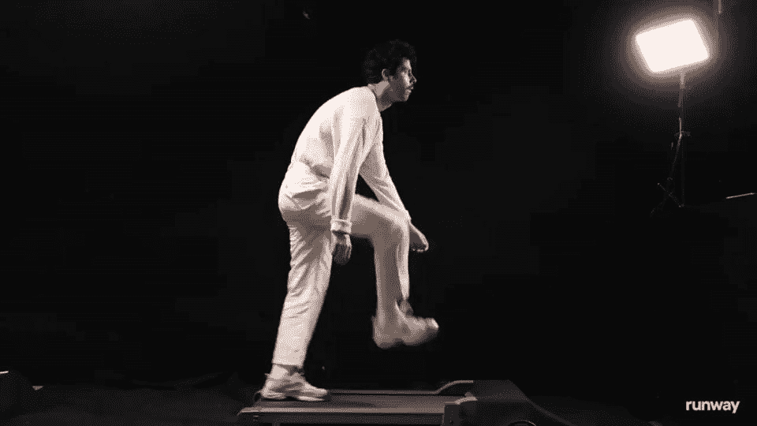

[6386192280529001106452363.mp4](https://internal-api-drive-stream.feishu.cn/space/api/box/stream/download/all/ZBSVbWgPooQDyVxzJfBclq3anUc)

5、腾讯联合多所高校出品!AI游戏生成模型 GameGen-O 轻松生成高质量游戏元素

GameGen-O 是一款由香港和中国的几所大学与腾讯联合研发的 AI 模型，专门用于创建开放世界视频游戏的模拟。这款模型不仅能生成高质量的游戏内容，还模拟了多种游戏引擎的特性。

6、白宫启动AI数据中心工作组

白宫正在启动一个新的AI数据中心基础设施工作组，由国家安全委员会、国家经济委员会和副幕僚长办公室领导，以确保美国在AI开发方面的领导地位。Nvidia、OpenAI、Anthropic、谷歌、微软和亚马逊的技术领导人与政府官员会面，讨论了AI能源使用、数据中心容量、就业机会以及战略选址问题。

=======================中秋节=====================

# 第三周

## 9月18日 AI资讯

1、Groq与沙特阿美公司合作建设全球最大AI推理中心

美国AI芯片初创公司Groq与沙特阿美公司达成合作,计划在沙特阿拉伯建设全球最大的AI推理数据中心。该项目旨在为中东、非洲和印度地区提供AI服务。

2、学者陶哲轩：o1 表现还不错，能当研究生用，但没有自己的思想

数学家、AI 学者陶哲轩近日在 Mastodon 平台上发文，表示自己已经提前试用了 OpenAI 新模型 o1 的更新版本，并发表了自己的体验和观点。这种经历似乎与试图给一个平庸但并非完全不称职的研究生提供建议的经历差不多。

3、消息称字节跳动与台积电合作，2026 年前量产两款自研 AI 芯片

The Information 报道，知情人士透露，字节跳动正在计划与台积电合作，在 2026 年前量产自主设计的 AI 芯片，预计字节将预定数十万枚芯片的产量。据悉，生产自主设计的芯片将有利于字节减少对价格高昂英伟达芯片的依赖，从而减少开发和运行 AI 模型的成本，在中国 AI 聊天机器人市场领先对手。

4、微软推出 Copilot Pages AI 协作工具

昨日，微软推出了最新的Copilot更新，将AI助手功能扩展到Microsoft 365应用（如Excel、PowerPoint、Teams等），并引入了几项新功能：

+   **Copilot页面**：用于团队协作的AI辅助工具，支持实时多用户编辑。

+   **Copilot代理**：自动执行复杂任务的AI助手。

+   **代理生成器**：无需代码即可创建自定义AI助手的工具。

+   **性能提升**：通过GPT-4集成，响应速度提高两倍，用户满意度增加三倍。

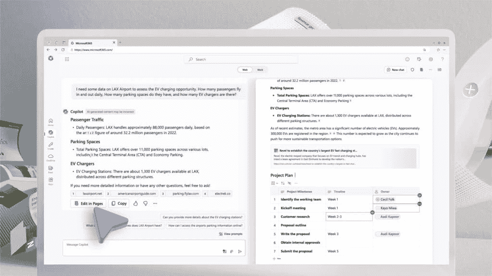

5、爆料称《黑悟空》首个 DLC 将于明年春节左右推出

游戏行业顾问 Daniel Camilo 在 X 平台透露，游戏《黑神话：悟空》的首个 DLC （游戏拓展）将在 2025 年农历新年（2025 年 1 月 29 日）左右推出，该信息是从一个「非常可靠的第一手来源」处获得。

6、一眼临摹：瞥一眼就能模仿笔迹的AI

来自华南理工大学、新加坡国立大学、昆仑万维以及琶洲实验室的研究者们提出一种新的风格化手写文字生成方法，仅需提供单张参考样本即可临摹用户的书写风格，支持英文，中文和日文三种文字的临摹。

论文地址：https://arxiv.org/abs/2409.04004

代码开源：https://github.com/dailenson/One-DM

7、美国加州批准里程碑 AI 法案，要求保护演员数字肖像

美国加州已经批准了一项具有里程碑意义的 AI 法案，以保护演员的数字肖像。当地时间周二，加州州长 Gavin Newsom 签署了 2602 号议会法案，该法案将于 2025 年 1 月 1 日生效。该法案要求工作室和其他雇主在使用表演者的“数字复制品”之前获得同意授权。Newsom 还签署了 AB 1836 法案，授予已故表演者类似的权利，工作室在使用他们的 AI 肖像之前需要获得遗产许可。

8、北航团队研发出直升机驾驶机器人，可独立控制飞行

北京航空航天大学李道春教授、向锦武院士团队在《Engineering》期刊上发表了题为《Robot Pilot: A New Autonomous System Toward Flying Manned Aerial Vehicles（飞行器驾驶机器人 —— 一种面向有人飞行器的新型无人驾驶系统）》的论文，介绍了他们研发的新型直升机驾驶机器人。

9、「香港美诚月饼」被曝香港买不到，三只羊被立案调查

中秋假期，三只羊旗下主播带货香港美诚月饼，被曝在香港买不到，产地实际上在广东，该品牌月饼运营公司辖区市场监督管理局工作人员称已介入调查。

## 9月19日 AI资讯

1、狮门影业与Runway合作开发生成式AI

《饥饿游戏》、《疾速追杀》和《电锯惊魂》等电影的制作公司狮门影业与AI视频生成公司Runway合作,创建了一个基于狮门影业电影目录训练的定制AI模型。这是AI公司首次与好莱坞主要电影制片厂公开达成合作,尽管据报道迪士尼和派拉蒙也在讨论类似的合作

2、Kling AI 1.5发布

新版本支持在专业模式下生成 1080p 高清视频，推出全新 Motion Brush 功能，增强视觉效果的可控性！案例见【视频| kling专区】

3、YouTube推出一系列新的AI创作工具

旨在协助创作者,包括文本生成视频、AI驱动的灵感工具和自动配音功能。Veo是Google新推出的AI视频生成工具,允许创作者使用文本提示为YouTube Shorts生成6秒钟的视频片段。生成的内容将带有水印并标记为AI生成。

4、通义千问升级旗舰模型Qwen-Max，性能接近GPT-4o

9月19日云栖大会，阿里云CTO周靖人宣布，通义旗舰模型Qwen-Max全方位升级，性能接近GPT-4o。通义官网和通义APP的后台模型均已切换为Qwen-Max，继续免费为所有用户提供服务。用户也可通过阿里云百炼平台调用Qwen-Max的API。

5、字节音乐大模型炸场！Seed-Music发布，支持一键生成高质量歌曲、片段编辑等

字节最新发布的音乐大模型 ——Seed-Music。Seed-Music 是一个具有灵活控制能力的音乐生成系统，包含 Lyrics2Song、Lyrics2Leadsheet2Song、Music Editing、Singing Voice Conversion 四大核心功能，具体涵盖十种创作任务。刚发布，Seed-Music 就已经在海外平台引起了关注。

官网：https://team.doubao.com/seed-music

6、阿里云吹响“AI基建”冲锋号

在9月19日云栖大会上，阿里云CTO周靖人开篇立意地表示，阿里云正在围绕AI时代树立AI基础设施的新标准，他随之祭出三张“王炸”--升级的大模型和硬件平台，以及降价政策。

7、AI排名跻身前15，全球首所人工智能大学MBZUAI实力大增

全球第一所人工智能大学 MBZUAI 便吸引了整个学术界的关注，并已在多个 AI 领域取得亮眼的成果。今年 5 月，MBZUAI 建立了 Institute of Foundation Models，继去年 10 月份和 G42 共同开发了最先进的阿拉伯语大模型之后，又独立开发了领先的 K2 开源模型，成为全世界唯一一个能够自行训练开发 65B 规模大模型的大学，引领了新一代基础模型的研究。

8、Google Research最近开发了一个新的AI模型,能够识别八种不同鲸鱼物种的发声

这个AI工具旨在通过改善被动声学监测来追踪鲸鱼种群和移动,从而帮助保护工作。包括最近被归因于布氏鲸的神秘"生物铛声"，这个声音曾是几十年来的一个谜,直到最近被美国国家海洋和大气管理局(NOAA)的研究人员解开。Google已经通过Kaggle Models平台提供该模型供下载,让研究人员和保护主义者可以使用这项技术进行研究。

## 9月20日 AI资讯

1、亚马逊发力电商AI，推出第三方卖家助手Amelia

美东时间9月19日周四，亚马逊宣布，从当天开始，上线beta版本的Amelia，最初面向部分美国的第三方卖家，未来几周扩大到更多美国卖家，今年晚些时候开始在其他国家上线，并开始推出英语以外的语言版本。亚马逊称Amelia是“基于生成式AI的一体化销售专家”，通过第三方卖家的内部仪表板 Seller Central 提供访问。

2、PayPal黑帮成员蒂尔投资了一家AI招聘公司，创始人平均年龄21岁

据《福布斯》9月18日报道，AI招聘创企Mercor近期筹集了3200万美元的A轮融资，投后估值达2.5亿美元。其投资者包括美国知名风投公司Benchmark Capital，以及有美国硅谷风投教父之称的彼得·蒂尔（Peter Thiel）等。蒂尔为来自全球各地的、年龄不超过22岁的大学生设立了蒂尔奖学金（Thiel Fellowship），拿到蒂尔奖学金的创业者通常被称为“Thiel Fellows”。而Mercor正是由3位Thiel Fellows于2023年初创办的，他们今年才21岁。

3、OpenAI最新一轮融资将完成，获超额认购，要求投资者至少投2.5亿美元

彭博报道称，OpenAI的最新一轮融资即将完成，潜在投资者们将于周五得知他们是否会参与本次交易。OpenAI最新一轮融资规模为65亿美元，当前已获得超额认购，超额规模达到数十亿美元，这意味着投资者希望投入的资金超过了OpenAI愿意接受的额度。OpenAI最新的这笔交易将使其估值达到1500亿美元，这一总额不包括新投资。OpenAI在之前的一笔融资交易中估值为860亿美元。

4、iOS 🛰️支持朋友圈发布实况照片

昨日，🛰️官方信息👸号「🛰️派」官宣，🛰️朋友圈将支持发布实况照片，目前功能正在 iOS 8.0.51 及以上版本逐步覆盖中。据介绍，用户可以直接从手机相册中选择实况照片，照片将包含动态画面和声音，发布时，也可以点击关闭实况效果，支持静态照片与实况照片混合发布。

5、代码泄露 OpenAI 或将于 9 月 24 日推出 ChatGPT AI 高级语音模式

TestingCatalog 报道，根据最近的代码泄露，ChatGPT 的高级语音模式将在 9 月 24 日面向更广泛的用户推出，并且可能是直接正式发布。适用于 macOS 的 ChatGPT 应用程序也有了一些新的变化，语音模式 UI 中，代表 ChatGPT 语音模式的黑色图标已经被替换为随语音播放而动的天空动画。

6、爆料称 iPhone 17 将使用 3 纳米处理器，部分 iPhone 18 机型使用 2 纳米处理器

2025 年推出的 iPhone 17 系列处理器将采用台积电的「N3P」3 纳米制程工艺，而预计 2026 年推出的 iPhone 18 系列将采用台积电 2 纳米制程工艺，但基于成本的原因，可能不会所有的新款 iPhone 机型都配备 2 纳米的处理器。

## 9月21日 AI资讯

1、微软计划重启美国三里岛核电站：未来 20 年购买 100% 电力

AI 的尽头是核电？《华盛顿邮报》昨日（9 月 20 日）报道，微软公司和星座能源公司（Constellation Energy）达成协议，未来 20 年内购买三里岛核电站 100% 能源。

2、OpenAI 朝AI第 3 阶段迈进，正招募人才组建“多智能体”团队

OpenAI 在发布 o1 AI 模型之后，下一步会怎么走？该公司研究员诺姆・布朗（Noam Brown）在 X 平台给出了答案，组建“多智能体”multi-agent 研究团队。根据 OpenAI 公布五级量表，最新推出的 o1 模型处于第二阶段，即所谓的“推理者”（reasoners），而开发 multi-agent 符合第三阶段的目标要求。

3、华为三折叠开售后迅速售罄

9 月 20 日上午 10：08 分，华为 Mate XT 非凡大师三折叠手机开售。开售一分钟后，华为商城显示该款产品所有版本「暂时缺货」，「华为三折叠开售」这一词条也登上🧣热搜。

4、大连思科被曝裁员赔偿 N+7

近期有多位思科大连员工爆料，称他们已经正式裁员通知，思科蓝牌（正编）员工大连预计裁员约 300 人。赔偿方案包括两种选择：直接走人，N+7，延迟两个月，N+5，报道指出，未来思科整 体业务大部分或转移到印度或日本。

5、高通被曝有意收购英特尔

据《华尔街日报》报道，高通近期正在就收购事宜与英特尔接触，这也是近期第二次有媒体报道高通收购英特尔的相关信息。路透社在 9 月 6 日就曾报道，有两位知情人士透露，高通已经探索收购英特尔部分设计业务的可能性，以增强该公司的产品组合。

6、Google利用AI帮助建设城市

Google刚刚发布了Open Buildings 2.5D时序数据集,这是一个AI驱动的工具,可以追踪2016年至2023年全球南方地区建筑变化,包括建筑存在、数量和高度的估计。该数据集覆盖了非洲、拉丁美洲以及南亚和东南亚3200万平方英里的区域,使用Sentinel-2卫星的10米分辨率图像。

7、Nvidia研究员Jim Fan预计机器人领域将在未来几年迎来“GPT-3时刻”

Nvidia的高级研究员Jim Fan预计，机器人技术将在未来两到三年内取得重大进展，他设想机器人基础模型将迎来类似于GPT-3在语言处理领域的突破性时刻。Fan的团队正在通过Project Groot项目开发用于人形机器人的基础AI模型，强调其在为人类互动设计的环境中的潜力。然而，Fan强调，仅靠技术进步是不够的——可负担性、大规模生产、安全性和监管框架是广泛采用的巨大障碍。

详细：https://www.youtube.com/watch?v=yMGGpMyW_vw

## 9月22日 AI资讯

1、传英伟达中国特供芯片 H20 已无法下单

英伟达上月开始不接 H20 订单，但没有明文通知。而终端厂商人士表示，「我们向英伟达下单需通过经销商，近期有多家经销商表示不再接 H20 的订单，也有一些表示有现货可以接单。」

2、X 为解除全国禁令，同意遵守巴西最高法院要求

此前有媒体报道，巴西最高法院下令，在全国范围内暂停埃隆·马斯克的社交网络 X，此前该公司誓言违抗法院此前有关内容审核和任命巴西法律代表的命令。不过，据 The Verge 报道， X 在近期提交的一份法庭文件中同意遵守巴西最高法院的要求，以解除全国禁令。

3、马斯克脑机接口获批，失明者有望重见光明

本周，马斯克领导的脑机接口公司 Neuralink 宣布，其 「盲视」（Blindsight）设备已获得美国食品药品监督管理局（FDA）的 「突破性设备」 认定。这一认定意味着 Neuralink 的设备有望加速获得审查并批准成为上市医疗器械，为失明者带来重见光明的希望。

# 第四周

## 9月23日 AI资讯

1、GPT-4o 级语音 Moshi 开源

两个月前，GPT-4o 级语音 Moshi 横空出世，人人可玩且获得一致好评。本周，Kyutai 实验室宣布开源 Moshi。Moshi 由三个强大的开源组件构成：Helium：一个经过 2.1 万亿个 token 训练的 7B 语言模型,Mimi：一个创新的神经音频编解码器,多流架构：能同时处理用户和 Moshi 音频的新型架构。

2、传 Black Forest Labs 寻求以 10 亿美元的估值融资 1 亿美元

据外媒 TechCrunch 报道，AI 初创公司 Black Forest Labs 正寻求以 10 亿美元的估值融资 1 亿美元。Black Forest Labs 是一家由前 Stability AI 核心开发人员创立的 AI 初创公司，专注于开发图像和视频领域的生成式 AI 模型。

3、Snap 推出独立 AR 眼镜，宣布与 OpenAI 合作

在近日举办的 2024 Snap 全球生态合作伙伴大会上，Snap 带来了第五代 Spectacles 智能眼镜，也是第二代 AR 眼镜。全新的第五代 Spectacles 大体延续了「3D 眼镜」的设计语言，总体更圆润，眼镜柄也更粗了。

4、最癫AI社交App上线3天爆火！注册即送百万粉丝，网友警告：别试，上瘾

最癫AI社交App，刚上架苹果商店3天就火了：根据网友分享的试玩体验，它能让你成为世界的主角，注册就送百万粉丝，但全都不是真人，随便发什么帖都有大批机器人回复点赞。虽然都是假的，但居然很多人玩过之后表示，“很上头”。作者公布后台注册人数统计，上升曲线陡峭，或考虑加上邀请限制。

使用方法：苹果商店搜索SocialAI，国区可下载（我试了一下还是的外区才行）

5、小米 14T Pro 手机定档 9 月 26 日海外发布：集成 Gemini AI

9 月 23 日消息，小米今天在X平台官宣小米14T Pro手机将于9月26日在海外发布，该机为小米RedmiK70至尊版的海外版本，基本配置都相同，主要集成了GeminiAI助手。

6、苹果首款折叠屏iPhone或最早于明年正式亮相。近日，美国商标和专利局（USPTO）信息显示，苹果公司获得了一项关于未来折叠iPhone设计的创新专利，揭示了固态按钮及全面触敏控制技术的创新应用。据有关人士透露，原本预计于2026年推出的苹果首款折叠屏iPhone，其发布时间可能大幅提前，最早有望于明年正式亮相。

7、OpenAI 招聘「多智能体」研究团队，朝 AI 第三阶段迈进

根据 OpenAI 研究科学家 Noam Brown 的消息，OpenAI 正在招聘机器学习工程师，以打造一个新的「多智能体」研究团队。目前新推出的 o1 模型处于第二阶段，即所谓的 「推理者」阶段。

8、苹果前设计总监正与 OpenAI 合作开发 AI 设备

据纽约时报报道，苹果前设计总监 Jony Ive 表示，他正在与 OpenAI 首席执行官 Sam Altman 合作开发 AI 设备。

报道中指出，Jony Ive 通过 Airbnb 首席执行官 Brian Chesky 认识了 Sam Altman ，这一项目由 Jony Ive 以及 Laurene Powell Jobs 的公司资助。

## 9月24日 AI资讯

1、OpenAI在社媒平台X的新闻账号遭入侵，发布虚假加密货币信息

OpenAI当地时间9月23日表示，其在社交媒体平台X上的新闻账号当日遭到入侵，未经授权发布的帖子诱导用户点击谎称与该公司相关的加密货币网站。OpenAI表示已察觉这一问题并展开调查。这些帖子于当地时间23日晚7点左右出现在@OpenAINewsroom账号上，约一个小时后，这些帖子仍然对一些用户可见，随后被删除。

2、文生图AI黑马Black Forest Labs欲再融资1亿美元

预计筹集1亿美元资金，希望达到10亿美元的估值。该公司的Flux.1文生图模型为社交平台X的Grok聊天机器人提供图像生成功能。这项服务一经推出，就因其大胆生成的图像而立即引起了人们的热议。该公司透露，它正在开发一款先进的文生视频工具，但尚未确定发布日期。

3、日本东京推出人工智能相亲系统

据日本“天空新闻24小时”网站23日报道，这一系统名为“东京结缘”，于9月20日正式推出，面向在东京生活、学习或工作的18岁以上未婚人士。用户必须支付1.1万日元（约合541元人民币）购买两年使用资格，还需要多种认证并提供收入证明，接受系统工作人员的面试。

4、全球首个AI自动潜航器开始测试，海上风电场检查时间最多缩短 50%

汽车媒体 electrek 昨日（9 月 23 日）发布博文，报道了全球首个 AI 自动潜航器（AUV），目前正在苏格兰最大的海上发电站 Seagreen 进行测试，将成为海上风电检测领域的一项重大突破。

5、美图奇想大模型完成升级

美图公司旗下「奇想大模型」已完成全面升级，其中最为瞩目的是其视频生成功能。视频生成时长与画质、流畅性、真实性及可信度等方面提升显著，后续将逐步覆盖到美图旗下各产品中。

6、美国商务部拟禁止智能汽车使用中国及俄罗斯软件技术

美国商务部提议禁止销售或进口使用特定中国或俄罗斯技术的智能汽车，以应对国家安全风险。美方调查称这些技术可能被黑客远程破坏或收集个人数据。这项规定不适用于已在美国上路且安装了中国软件的汽车，软件禁令将于 2027 年款汽车生效，硬件禁令将于 2030 年款汽车生效。

7、「钉钉 365 会员」正式上线，面向个人用户的AI助理

钉钉「365会员」面向个人用户提供AI 能力包，包括钉钉 AI 搜索、个人 AI 助理、个人认证等超过 30 项最受个人用户欢迎的能力，都被打包进 「365会员」。

用户可在钉钉 v7.6.16 或以上版本开通会员，提升超级个体的创造力。

8、李开复发布新 AI 搜索引擎

「零一万物」的 CEO 李开复推出了一款名为 BeaGo 的 AI 搜索引擎，它在提供搜索结果时致力于为用户提供每个查询的单一搜索结果同时包含图片，避免在有限屏幕空间内打开多个标签页的不便。

9、Meta 被指控“欺凌”开源社区

Meta 因其对人工智能开发的方法而面临来自开源社区的强烈反对，被指控对它的 AI 模型，特别是 Llama 系列，进行“开源洗白”。批评者认为 Meta 的定义和实践破坏了开源原则的本质。

## 9月25日 AI资讯

1、豆包大模型迎来多款新模型

9 月 24 日，字节跳动旗下的火山引擎在深圳办了一场 AI 创新巡展，一口气发布了两款视频生成大模型，正式宣告进军 AI 视频生成。这两款模型，一个名为 PixelDance（以下简称 P 模型），一个名为 Seaweed（以下简称 S 模型），不仅在审美、动幅上提升了一个 level，还破解了多主体互动和一致性难题。

2、OpenAI 将全量推送 ChatGPT 高级语音模式

今天凌晨，OpenAI 宣布 ChatGPT 新版高级语音模式将在本周内向所有 Plus 和 Team 用户全量推送。OpenAI CEO Sam Altman 在 X 平台发文称：「高级语音模式今天正式上线！（将在本周内全量推送）希望你觉得等待是值得的」。

[X2Twitter.com_ZSz4Ozmm🐧LO_lSx_1168p.mp4](https://internal-api-drive-stream.feishu.cn/space/api/box/stream/download/all/YgKeb02LSojMQ7xR2m7cu54FnNg)

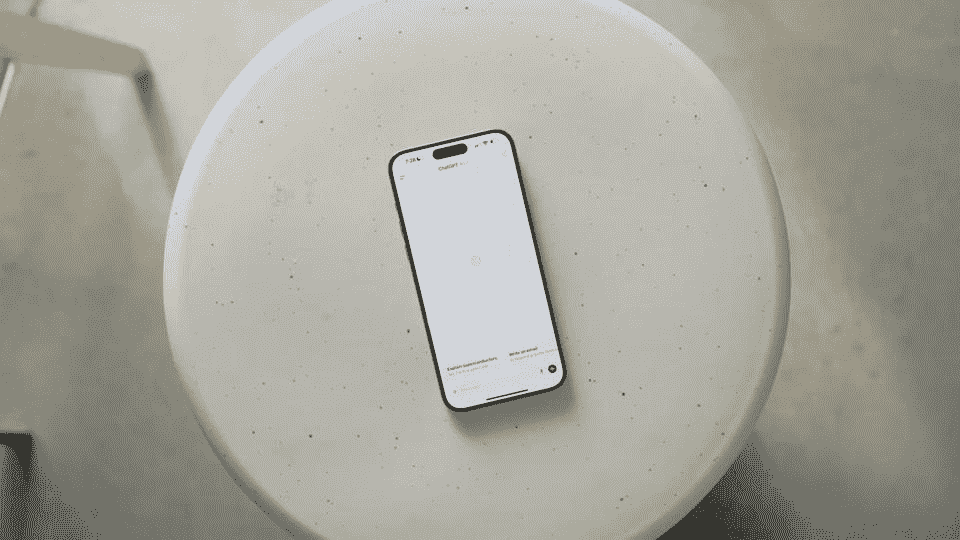

[X2Twitter.com_GbIUwk5LOgfoU0c0_1080p.mp4](https://internal-api-drive-stream.feishu.cn/space/api/box/stream/download/all/QRiwbMARRoLxvAxNY7OcNxZwnUb)

3、微软将在墨西哥投资13亿美元开发云计算和人工智能

9月25日，微软宣布，将在未来三年内投资13亿美元在墨西哥建设云计算和人工智能基础设施。该公司在一份声明中称，这笔投资将用于改善连通性和促进中小企业采用人工智能技术，计划旨在三年内覆盖500万墨西哥人和30000家当地中小企业。

4、Meta计划推出AI聊天机器人，使用名人声音

Meta据报道计划通过引入名人声音来提升其AI聊天机器人的互动体验，包括朱迪·丹奇（Judi Dench）和约翰·塞纳（John Cena）的声音。这一举措旨在使与聊天机器人的互动更加生动有趣，利用这些知名人物独特的个性。

5、大众携手谷歌，率先邀请约 12 万名车主免费使用 Gemini AI

大众汽车昨日（9 月 24 日）发布新闻稿，宣布携手谷歌公司，率先邀请约 12 万名大众 Atlas 和 Atlas Cross Sport 车型车主，免费体验和使用 Gemini AI 助手。通过与谷歌云（Google Cloud）的战略合作，在 myVW 移动应用中部署生成式人工智能。大众汽车车主可以通过聊天的方式和 Gemini AI 对话，掌控车辆状态或者请求其提供帮助。例如车主可以询问“如何更换备胎”，Gemini 就会自动调用 YouTube 视频，提供正确的更换方式。

6、富士康正考虑在印度投资 10 亿美元建设智能手机屏幕组装工厂

印度《经济时报》报道称，富士康正在评估投资约 10 亿美元（IT之家备注：当前约 70.2 亿元人民币）在泰米尔纳德邦设立一个智能手机显示屏模块组装工厂，主要为苹果 iPhone 提供服务。消息人士表示，富士康的模式将是即使其他合同制造商 —— 例如 Pegatron 或 Tata Electronics—— 也可以使用该工厂的组件，而无需采用中国进口的组装模块。

7、跟风美国成瘾？加拿大扬言要禁止中国汽车软硬件

加拿大广播公司（CBC）当地时间9月24日报道，加拿大副总理兼财政部长克里斯蒂娅·弗里兰（Chrystia Freeland，方慧兰）当天宣称，她“绝对”（absolutely）在考虑效仿美国的做法，禁止从中国或俄罗斯进口汽车软硬件。“我们的政府已经非常明确地表示，我们非常重视中国的产能过剩，我们非常重视来自中国的安全威胁。”

8、三哩岛核电站将重启为微软AI供电，曾发生美国史上最严重核事故

美国宾夕法尼亚州曾因严重核事故被记入史册的三哩岛核电站再次成为全球焦点：它即将重启，为人工智能提供电力。当地时间9月20日，微软与美国星座能源公司（Constellation Energy）签署史上最大的购电协议，前者将在未来20年购买三哩岛核电站生产的所有电力。

9、上交大、复旦中山团队开发糖尿病专用大语言模型，助力个性化糖尿病管理

上海交通大学清源研究院 MIFA 实验室与复旦大学附属中山医院内分泌科组成的研究团队，联手开发出一款名为 Diabetica 的糖尿病专用大模型。Diabetica 能够为糖尿病患者提供个性化的医疗支持，并为医生提供更加高效的医学教育和临床辅助工具。

论文地址：https://arxiv.org/pdf/2409.13191

## 9月26日 AI资讯

1、Alibaba 推出 MIMO

一种新的人工智能，可以从简单的输入（如角色、动作和场景）创建逼真的角色视频。

[SaveTwitter.Net_FtJdg5T-5qFBAJL7_(720p).mp4](https://internal-api-drive-stream.feishu.cn/space/api/box/stream/download/all/QSE3btzAkoOyokxXjPrclSImn7g)

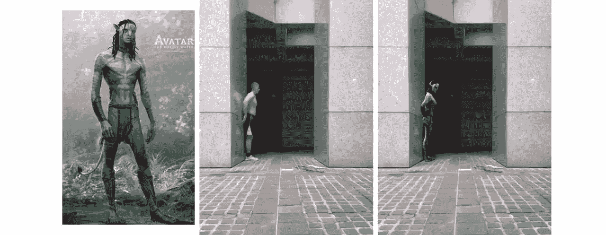

[SaveTwitter.Net_DMPcBsQb2qk-y3X9_(720p).mp4](https://internal-api-drive-stream.feishu.cn/space/api/box/stream/download/all/OnTibHyxlogeEYxABrVcGpLhn1c)

2、Spotify 的 AI 播放列表生成器现已在美国推出

音乐流媒体平台 Spotify 宣布，测试版 AI 播放列表生成器英文版本将向美国、加拿大、爱尔兰和新西兰的 Android 和 iOS 设备高级用户推出测试版。此前，该功能已经向英国和澳大利亚的 Premium 订阅者推出。

3、SpaceX：有计划在越南投资150亿美元

26日，路透社报道，在纽约会晤后，苏林在相关声明中表示，“越南政府正在考虑SpaceX的（投资）提议。”声明称，苏林请SpaceX与越南相关方密切合作，高效完成前期投资工作。

4、OpenAI首席技术官Mira Murati宣布离职

9月26日消息，据外电报道，OpenAI 首席技术官 Mira Murati 周三表示，她将在公司任职六年半后离职。她在给 OpenAI 的备忘录中写道：经过深思熟虑，我做出了离开 OpenAI 的艰难决定。这份备忘录也发布在了社交媒体网站 X 上。她还补充道，「离开自己珍爱的地方永远没有理想的时机，但此刻感觉是对的。」

5、国内首个视频大模型 Vidu 宣布开放 API

生数科技旗下视频大模型 Vidu 宣布正式开放 API，并同步接入百度智能云千帆大模型平台，成为平台接入的首个视频大模型。作为国内首个纯自研的视频大模型，Vidu 在高动态性、多风格化、极致推理等方面具备领先优势，并上线全球首个「主体参照」功能，突破视频模型一致性生成难题。

6、Meta 发布首款全息眼镜

今天凌晨，Meta Connect 2024 正式举办。此次大会正值发布会十周年的重要节点，扎克·伯格也带来了多款新品:Meta Orion 智能眼镜/Meta Orion 智能眼镜/Meta 首个开源大模型 Llama 3.2\Meta Ray-Ban可进行实时翻译、个性穿搭建议等功能。

## 9月27日 AI资讯

1、9月27日起在淘宝付款时可使用🛰️支付

淘宝官方消息显示，9月27日起，消费者在淘宝可以使用🛰️支付。从具体展示的页面看，消费者在完成商品选购后，在支付页面选择“🛰️支付”，即可顺畅完成支付，全程体验与其他支付工具一致。

2、特斯拉无人驾驶出租车定档 10 月发布

马斯克在🧣发文，为特斯拉无人驾驶出租车进行预热。从海报上可以看到，此次发布会将在当地时间 10 月 10日于洛杉矶举办。特斯拉 Robotaxi 原定于 8 月 8 日发布，后被延期，有消息人士透露延期是因为原型车有某些元素需要修改。

3、美图宣布旗下AI短片创作工具MOKI全面开放 美图股价大涨11%

9月27日，美图公司旗下AI短片创作工具MOKI面向全部用户开放，用户可登录MOKI官网进行体验。与市面上流行的文生视频产品、图生视频产品不同，MOKI专注于AI短片创作这一场景，覆盖动画短片、网文短剧、故事绘本、MV等多个类型的视频内容生产，结合行业需求，有针对性地打造了一套AI短片创作工作流。

4、英特尔“卖身”新消息：拒绝ARM收购产品部门

据彭博社报道，知情人士称，软银集团旗下知名芯片设计公司AR已接触境况不佳的英特尔，讨论了收购后者产品部门的可能性，但被告知该业务不对外出售。据知情人士透露，ARM与英特尔进行了高层接触，但是对英特尔的制造业务没有展示出兴趣。

5、OpenAI重组计划曝光，奥尔特曼财富有望借此飙升十倍

财联社9月27日讯 ，美国人工智能公司OpenAI正拟定重组方案，将其核心业务转由一家营利性公司经营，以增强公司对投资人的吸引力。知情人士透露，OpenAI首席执行官山姆·奥尔特曼（Sam Altman）将根据重组方案获得公司7%的股份。

6、ChatGPT 客户端曝“记忆”漏洞，黑客可令 AI“转发对话记录”

9 月 27 日消息，OpenAI 在今年 2 月宣布为 ChatGPT 推出记忆（Memory）的功能，今年 9 月初这项功能正式向所有用户开放，该功能的主要用途是“设定预设”，从而帮助AI向用户更符合需求的答案。不过研究人员 Johann Rehberger 目前披露报告，称这项功能在 PC 版 ChatGPT 客户端上存在漏洞，黑客可借漏洞获取用户对话记录。

## 9月28日 AI资讯

1、苹果放弃投资 OpenAI

9月28日电，苹果公司已退出参与OpenAI融资轮的谈判，该轮融资预计将筹集65亿美元。据知情人士透露，苹果公司最近退出了参与该轮融资的谈判，该轮融资预计将于下周结束。另外两家科技巨头微软和英伟达也一直在谈判参与这一轮投资。

2、RunWay 资助 100 多部电影，使用人工智能生成技术

AI 视频生成技术公司 Runway ，近期启动了一项名为「Hundred Film Fund」的计划，旨在通过提供资金支持，鼓励使用其 AI 视频生成模型的原创电影。该计划将资助多达 100 部使用 AI 生成视频的影片，包括长片、短片、纪录片、实验项目、音乐视频等。

3、科大讯飞开放平台宣布讯飞星火API平台实现重大升级，包括Spark Max模型和4.0Ultra模型，提升了生成速度、逻辑推理、创作能力和联网搜索等关键性能。

4、全新NotionAI发布一站式集成搜索、生成内容、分析数据等功能，通过简单对话获得灵活解答和见解，无需多应用切换。

5、淘宝将香港列入包邮区

阿里在淘宝香港业务发布会上宣布，将投入 10 亿元人民币，覆盖10亿商品，把香港变成包邮区。具体项目由淘宝天猫负责招商，阿里国际负责在香港的用户运营和物流。从 10 月 1 日开始，香港消费者在淘宝购物满 99 元即可包邮。活动将覆盖多个门类，3C数码、家居收纳、运动娱乐、化妆护肤等热门品类也涵盖其中。

6、Arm 欲收购英特尔产品部门，但被拒绝

全球芯片行业经历了一系列重大变动，其中最受关注的莫过于芯片龙头公司英特尔被传出将被高通收购。英国芯片设计公司 Arm 也意愿收购英特尔产品部门，但这一收购尝试最终未能成功，英特尔方面明确表示其产品部门不会出售。英特尔目前正面临严峻的业务挑战，年内股价已下跌30%，市值缩水超过一半啊。

7、美图AI短片创作工具MOKI全面开放 支持生成配乐、细节修改

美图公司宣布其开发的AI短片创作工具MOKI正式对所有用户开放，为用户提供一站式成片能力，结合AI驱动的脚本、分镜、视频生成、配音、配乐能力，使普通用户能轻松上手，快速创作个性化短片。

8、Magnific推V2图像生成服务 可直出4K图像

Magnific近日推出的V2图像生成服务在AI图像处理领域掀起了新的波澜，标志着其从高端软件跃升为顶级AI图像生成器，展现了技术创新和用户体验优化的雄心。

## 9月29日 AI资讯

1、英伟达再次收购AI公司。

英伟达9月27日宣布收购了OctoAI，这是该公司今年第五次进行收购活动。OctoAI是一家位于西雅图的软件初创公司，致力于开发能够提高生成性AI模型构建和运行效率的工具。

2、SpaceX“龙”飞船前往国际空间站，将带回两名滞留宇航员。

美东时间9月28日下午，太空探索技术公司（SpaceX）的“龙”飞船搭乘猎鹰9号火箭从佛州卡纳维拉尔角太空军基地发射升空，搭载了两名宇航员飞往国际空间站。

3、微软计划11月重新推出隐私噩梦AI截图工具

9月29日消息，据外电报道，微软表示，在新工具定期截取用户活动截图后引发隐私争议后，它已经听取了反馈。当它于 2024 年 5 月发布时，批评者将其称为潜在的隐私噩梦，促使这家科技巨头推迟了它的发布。

4、因侵犯网络技术专利，亚马逊被判赔 3050 万美元

据路透社周五报道，美国特拉华州联邦法院陪审团裁定，亚马逊网络服务 (AWS) 侵犯了 Acceleration Bay LLC 的两项计算机网络和广播技术专利，需赔偿 3050 万美元（IT之家备注：当前约 2.13 亿元人民币）。

5、微软暂缓“365”的AI功能更新计划。

微软CEO Satya Nadella和领导团队曾考虑将新的AI功能打包进现有套餐服务或创建一个更昂贵的AI功能捆绑包，这些工具主要由OpenAI的GPT模型提供支持。

6、Google 前员工靠 AI 被 189 亿元天价聘回

Google 前员工 诺姆·沙泽（Noam Shazeer）在离职 3 年后，因其创立的初创公司 Character.AI 的技术潜力，被 Google 以 27 亿美元（约189亿元人民币）的高价重新「聘回」。

## 9月30日 AI资讯

1、文生图卷起来了!智谱开源图像生成模型CogView3生成速度比SDXL快10倍!

智谱AI最新开源的CogView3和CogView-3Plus-3B为文生图领域注入新活力，CogView3采用独特的级联扩散方法，生成质量超越SDXL，且推理速度快10倍。

详细：https://github.com/THUDM/CogView3

2、美国政府补贴英特尔 年底前敲定85亿美元政府拨款

英国《金融时报》9月27日援引知情人士消息称，尽管美国芯片大厂英特尔的业绩表现低迷，但美国政府仍计划在今年年底前与该公司敲定价值85亿美元的直接资助协议。

3、10月1日起香港正式进入淘宝包邮区

从10月1日开始，只要在淘宝上购买满99元人民币的商品，就能享受香港包邮服务，覆盖商品种类超过10亿种！自8月起，淘宝在香港试点服饰行业包邮，广受好评，现在包邮范围扩大到全行业，包括3C数码、家居收纳、运动娱乐、化妆护肤等热销品类。

4、不用畏惧AI了!69%工作技能不太可能被生成式AI取代

最近Indeed Hiring Lab发布的研究表明，尽管生成式AI在职场中展现潜力，但并不意味着白领职位会被迅速取代。69%的工作技能被认为不太可能被生成式AI取代，会计行业的技能受AI影响最大。AI目前更擅长简单任务，复杂问题仍需人类解决。

5、一款免费开源电子书转有声书AI工具:支持语音克隆

Drew Thomasson最近发布的开源项目ebook2audiobookXTTS利用Calibre和Coqui TTS将电子书转换为有声读物，提供高质量的阅读体验。工具支持多语言、自定义语音克隆，具有高效转换、多语言支持和简单操作的特点。

6、阿里妈妈开源全新AI图像修复模型FLUX-Controlnet-Inpainting

阿里妈妈创意团队开源了FLUX-Controlnet-Inpainting AI图像修复模型，结合FLUX.1-dev和ControlNet优势，能高质量修复图像。模型理解用户语言描述，可精准修复图像并改变风格。目前处于alpha测试阶段，未来将持续优化并发布更新版本。

### 联系我们

> [互联网设计](https://aigclena.feishu.cn/wiki/PD10wBb5yiRVE7kTFZdcuzUBnth)  [国际站/独立站](https://aigclena.feishu.cn/wiki/TmfowYzfMisIShkNU7ncEBMingh)  AI课程学习

