# 2024Q4 (10-12月)

> 来源：[https://aigclena.feishu.cn/docx/E1k7dVtq3o9fnbxutOrcn6BKnwh](https://aigclena.feishu.cn/docx/E1k7dVtq3o9fnbxutOrcn6BKnwh)

# 10月AI资讯精选

# 第二周

## 10月8日 AI资讯

1、OpenAI再获40亿美元，总融资超100亿美元！

全球第一财经CNBC消息，OpenAI在获得66亿美元融资后，摩根大通、花旗、高盛、三井住友、富国、瑞银和汇丰等全球顶级银行，又为OpenAI提供了40亿美元的循环信贷额度。除了40亿美元之外，如果OpenAI愿意还可以再加20亿美元，并且贷款无需任何抵押3年内有效。

2、AI生图模型Flux1.1刷屏！添加单反相机文件名获得超写实图像

最新AI文生图模型Flux1.1，一夜刷屏。只需一个简单技巧，就能去除图中的“AI味”，无论人物还是风景都能达到照片级效果。这个技巧用起来也非常简单，在提示词中模仿单反相机的文件命名格式即可。比如“CR2”就是佳能相机使用的原始图像文件格式，输入“IMG”+随机编号+“.CR2”，再加指定的内容，就能获得一张写实图像了。

https://api.together.ai/playground/image/black-forest-labs/FLUX.1.1-pro

3、OpenAI canvas一夜封神，超强AI编码研究神器

ChatGPT横空出世以来，首次迎来界面史诗级升级!全新canvas界面，开启了人类与AI协作研究、编码的新时代，更代表着终极AGI人机交互形态。canvas不仅可以让你与ChatGPT一起做研究，还能写代码、邮件等等，最重要的是还能帮你一起脑洞。有趣的是，canvas还可以添加emoji。奥特曼在线发起投票，看看有多少人喜欢这个功能。

4、黄仁勋身价已超过英特尔公司总市值。

NVIDIA首席执行官黄仁勋（Jensen Huang）的身价现已超过NVIDIA的宿敌英特尔（Intel）公司的总和，净资产达到1090亿美元。

5、美国联邦航空管理局批准SpaceX“猎鹰9”火箭复飞。

美国联邦航空管理局当地时间10月6日表示，SpaceX“猎鹰9”型主力运载火箭可以复飞，执行计划于周一从佛罗里达州发射欧洲航天局“赫拉”航天器的任务。

6、纯血鸿蒙官宣 10 月 8 日开启公测：和安卓分道扬镳

华为宣布将于 2024 年 10 月 8 日开始公测 HarmonyOS NEXT 纯血鸿蒙系统，新系统不再兼容安卓应用，首批适配 Mate 60/X5 系列手机和 MatePad Pro 13.2 英寸平板。HarmonyOS NEXT 发布于 2023 年 8 月 4 日，是华为鸿蒙系统的一次重大更新，放弃了 Linux 内核和安卓开放源代码项目，转而只支持鸿蒙内核。

7、欧盟要求YouTube、Snapchat、TikTok提供有关推荐算法的信息。

欧盟委员会于当地时间10月2日根据《数字服务法》，要求互联网平台YouTube、Snapchat和TikTok提供有关其算法向用户推荐内容所使用的参数信息，以及它们在放大一些系统性风险

## 10月9日 AI资讯

1、限时免费!腾讯智影上线「AI网感帮修」功能

腾讯智影推出了名为“AI网感帮修”的新功能，旨在简化修图流程，提高效率。用户可以通过上传照片让AI自动进行美化和优化，满足潮流感和个性化追求。智影的AI网感帮修功能不仅一键修出符合网络热点的时尚美图，还能个性化调整。

2、Hailuo AI上线图片生成视频功能

Hailuo AI推出了其图片生成视频功能，这一创新性工具为视频制作带来了前所未有的便捷和灵活性。这项新功能的核心亮点在于其文本与图片联合输入能力。用户只需同时提供文字描述和参考图片，Hailuo AI就能精准捕捉创作意图，生成符合要求的视觉效果。

3、新加坡推出人工智能教育计划 2025年所有中小学生提供5到10小时AI课程

新加坡政府近日宣布，将从2025年开始向所有中小学提供五到十小时的人工智能（AI）课程模块，旨在培养学生的数字素养和人工智能知识。这些模块将被称为“趣味人工智能”，并将在“趣味代码”(CFF)计划下推出。

4、消息称百度计划在中国境外推出无人驾驶出租车服务

据日经新闻今天上午报道，随着自动驾驶汽车商业化竞争的白热化，中国互联网巨头百度计划在中国以外的地区推出机器人出租车服务 Apollo Go。报道称，百度此举正值特斯拉准备在本周推出其 Robotaxi 之际。诸如小马智行、文远知行在内的其他中国企业也盯上了海外市场，希望在自动驾驶汽车的竞争中拔得头筹。

5、苹果发布第一部 Vision Pro 电影预告片

苹果近期在 YouTube 上，发布了第一部专为 Vision Pro 打造的沉浸式电影预告片。这支名为《Submerged》的电影，由 Edward Berger 编剧并执导。此前，Edward Berger 执导并参与编剧的电影《西线无战事》，曾在第 95 届奥斯卡金像奖最佳国际影片中，夺得最佳国际影片、最佳摄影奖、最佳美术设计奖和最佳原创配乐奖共四个奖项。

6、苹果推出新 AI 模型 Depth Pro:0.3秒超快速生成3D深度图

苹果最新推出的 AI 模型 Depth Pro 在深度估计领域取得重大突破，能快速生成高分辨率的3D深度图，无需相机元数据。该模型工作速度快，能捕捉微小细节，提供绝对深度估计，且开源共享。

## 10月10日 AI资讯

1、虚拟试衣革命:GS-VTON技术让3D试衣体验更加真实个性

GS-VTON技术通过高斯点云渲染，实现了虚拟试衣的新方法，让消费者享受身临其境的3D试衣体验。它解决了传统3D试衣技术面临的挑战，提升了用户体验，开创了虚拟试衣领域的新纪元。

详细：https://yukangcao.github.io/GS-VTON/

2、OpenAI与美国知名出版商Hearst达成合作

我对OpenAI与美国知名出版商Hearst达成合作的文章内容进行了分析。这一合作意味着OpenAI将通过ChatGPT向用户提供来自Hearst的优质内容，强调专业新闻的重要性，同时保持内容的可信度和高标准。

3、Adobe发布新应用，保护创作者作品免受AI滥用

Adobe推出了备受期待的免费网络应用“内容真实性”，旨在保护创作者作品不被滥用，特别是防止用于训练人工智能模型。这款应用将于2025年第一季度开始公测，无需Adobe订阅。

4、萝卜快跑计划在香港推出无人驾驶出租车服务

据科创板日报报道，有知情人士表示，萝卜快跑将计划在香港推出无人驾驶出租车服务，这也将是其首个内地市场以外的业务落地。此前，根据百度公布的 2024 年第二季度财报数据显示，萝卜快跑二季度订单同比增长 26 % 至 89.9 万单。

5、国家电网：高速公路服务区累计建成充电桩 2.88 万个

国家电网近日发表公告，截至 2024 年 8 月底，中国在高速公路服务区（包括停车区）已经累计安装了 2.88 万个充电桩，以及 4.48 万个充电停车位。根据国家电网智慧车联网平台的统计，国庆假期期间，超过三分之一的高速公路服务区充电桩达到了满负荷运行。

6、只需10秒!WonderWorld AI 实现单张图片实时生成3D 场景

WonderWorld AI 是一种能够从单张图片实时生成3D 场景的新技术，突破了以往生成速度的限制，使用户可以轻松控制场景内容和布局。尽管存在局限性，但研究人员对其潜力充满信心，特别是在游戏开发和虚拟现实领域。

7、AI搜索玩法又升级!天工AI搜索新增了全新内容形态——彩页

天工AI搜索推出了全新的彩页功能，用户可以在首页直接搜索并浏览各类丰富内容，同时还可以利用AI帮助设计彩页，操作简单便捷。彩页不仅适合用来做PPT，还可以通过认领宝典来躺着赚钱，优质内容有望获得更多流量和广告分成。

8、ChatGPT新版GPT-4o灰测UI界面曝光 或改名GPT-auto

最新版本的ChatGPT GPT-4o正在进行灰度发布，可能会更名为GPT-auto。新版本的UI界面设计有了大改进，更简洁现代化。功能包括创建图片、总结文本、写作辅助等，提升了用户体验和创作效率。你期待吗?

特斯拉 Robotaxi 将于今日正式发布

特斯拉无人出租车将于北京时间 10 月 11 日正式发布，据新浪科技报道，在这次发布会以前，特斯拉 CEO 马斯克就无人驾驶出租车相关内容进行了一系列回答。

## 10月11日 AI资讯

1、海螺 AI 新增图生视频功能

昨日，MiniMax 稀宇科技宣布，旗下海螺视频 AI 生成工具新增「图生视频」创作功能，在海螺 AI 网页版即可体验。在海螺视频中，用户点击「图片」按钮即可自由上传图像作为生成视频的首帧，MiniMax 视频模型能够准确识别用户上传的图片。

2、特斯拉 Robotaxi 将于今日正式发布

特斯拉无人出租车将于北京时间 10 月 11 日正式发布，据新浪科技报道，在这次发布会以前，特斯拉 CEO 马斯克就无人驾驶出租车相关内容进行了一系列回答。马斯克表示，其他厂商所拥有的那些需要高精度地图的本地化解决方案是非常脆弱的，而特斯拉的解决方案是一种通用解决方案，适用于任何地方，甚至可以在另一个地球上工作。

3、Kimi发布探索版：一次搜索可精读500个页面

10月11日，月之暗面正式上线具备AI自主搜索能力的Kimi探索版，搜索量是普通版的10倍，一次搜索即可精读500个页面。新功能会模拟人类的推理思考过程，多级分解复杂问题，执行深度搜索，帮助用户更高效完成分析调研。

4、WPS AI伴写更新功能，无需提示词可自动生成内容

金山办公昨日宣布，WPS AI 上新了「AI 伴写」的功能，全新支持基于参考资料写作的功能，还能将参考资料添加到批注当中。官方介绍，AI 伴写支持添加文档、网页等参考资料，从而限定 AI 的创作范围。除此之外，WPS AI 伴写支持标题多方案续写正文、文风切换等功能，并内置了 20 万古诗词等专业知识库。

5、图像修复新魔法!突破性算法PMRF

PMRF（后验均值修正流）算法是图像处理领域的一项创新技术，解决了图像恢复中失真与感知质量之间的矛盾，开辟了高质量图像重建的新可能。

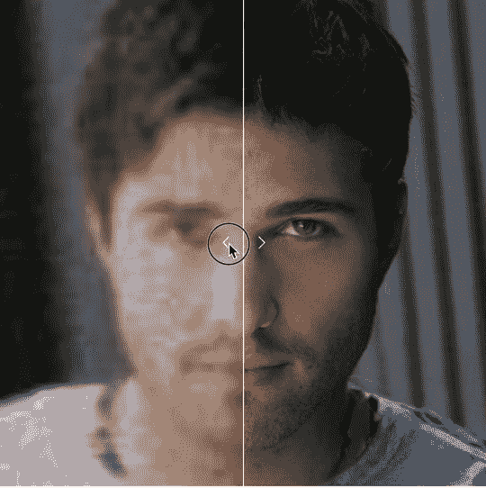

[6386416914767431037762676.mp4](https://internal-api-drive-stream.feishu.cn/space/api/box/stream/download/all/KeZpbI0HbophE0xMtymc73aKnwC)

6、微软(MSFT.US)推出全新医疗保健AI工具 帮助减轻医生和护士工作量

微软(MSFT.US)周四宣布了新的医疗数据和人工智能工具，包括一系列医疗成像模型、一项医疗代理服务和一项针对护士的自动文档解决方案。这些工具旨在帮助医疗保健组织更快地构建人工智能应用程序，并节省临床医生在管理任务上的时间，这是导致行业倦怠的主要原因。

7、DreamWaltz-G:从文本生成生动的3D 可动画头像

在数字化时代，个性化的虚拟形象受到关注。DreamWaltz-G框架通过结合骨骼引导的得分蒸馏和混合3D高斯表示，提升了头像生成的一致性和动画表现力。该框架支持形状控制、视频重演和多主体场景构建，拓展了数字内容创作的可能性。

8、200万用户量!Hugging Face旗下Gradio5发布:用自然语言轻松构建AI应用

Hugging Face旗下Gradio5发布，致力于简化AI开发，提供企业级安全性和AI Playground功能，进一步推动AI应用开发体验。

9、沃尔玛推出新型人工智能模型 Wallaby

沃尔玛最近推出了名为Wallaby的大型语言模型，专注于零售行业数据，旨在提升客户服务体验。他们采用多模型组合的方法，灵活应对不同应用需求。

10、开源版NotebookLM来了!Podcastfy:输入PDF、文本、网址等即可转换成播客

在数字时代，制作引人入胜的多语言音频内容成为热门话题。谷歌的NotebookLM备受好评，而开源Python软件包Podcastfy引起广泛关注。

## 10月12日 AI资讯

1、国家地方共建具身智能机器人创新中心正式揭牌。10月10日，国家地方共建具身智能机器人创新中心揭牌，北京具身智能机器人创新中心正式升级为“国家地方共建具身智能机器人创新中心”。

2、豆包大模型再造爆款：抖音“AI绘本特效”播放超11亿

国庆期间，抖音上一款名为“AI治愈绘本”的特效凭借温暖优美的画风和高还原度吸引了数百万用户投稿，采用了动态绘本的拟物玩法，“AI治愈绘本”特效首次使用了3D立体翻书的形式，巧妙地将首张用户图作为书皮呈现，玩法新颖有趣。基于该特效投稿的“成为绘本里的温暖主角”话题播放量超过11亿。

3、快手、北大联手开源视频生成模型Pyramid-Flow

Pyramid-Flow是一款超高清视频生成模型，由快手、北京大学和北京邮电大学研究团队联合开源。该模型能够生成10秒、1280x768分辨率、24帧的视频，质量出色。采用金字塔流匹配技术，在不同分辨率和噪声水平间插值，提高计算效率。用户普遍对其视频生成效果给予高度评价。

体验地址：https://huggingface.co/spaces/Pyramid-Flow/pyramid-flow

4、特斯拉推出Cybercab、Robovan车型:无油门、方向盘 售价低于3万

特斯拉在“WE， ROBOT”发布会上推出了令人惊艳的Cybercab和Robovan车型，标志着无人驾驶出租车的新时代。马斯克强调了这些车型的创新设计和未来潜力，以及自动驾驶技术的安全性和便利性。

5、KREA集结了AI视频的四大金刚，誓要做AI创作者的“POE”

前天，Runway宣布把自己的API全量开放了，现在，人人都可以像接一个OpenAI的API一样，把AI视频接入到自己的产品中。在20个小时之后，Krea.ai宣布正式上线一个集合站，能在这个产品里，一键使用Runway、Luma、可灵、海螺。

体验地址：https://www.krea.ai/home

6、智谱AI搜索重磅升级:思维链+深度阅读，开启信息检索新纪元

智谱科技推出基于思维链的AI搜索工具，引发广泛关注。工具整合深度阅读和多步推理能力，与其他AI工具联动，提供前所未有的搜索体验。解决了常见的AI搜索幻觉问题，能对搜索结果进行复杂总结，节省用户时间成本。展现出强大的信息整合和分析能力，支持多级推理的思维链。

7、AI音乐再升级:Suno推出精细化编辑功能，让创作更自由

Suno近日推出重大更新，允许用户精确替换歌曲特定部分，提升创作自由度。新功能包括精确编辑、多元化替换、智能生成、无缝衔接等。更新反映了AI音乐创作工具向个性化、精细化发展，为创作者提供更大创作空间。

体验地址：https://suno.com/

8、亚马逊新型仓库即将启用：机器人数量是之前的10倍

亚马逊宣布推出一种新型仓库，其中机器人的数量是现有仓库的十倍。该公司一直在逐步增加用于发送客户包裹的机器人系统的数量和复杂性，现在表示正在推出基于新系统的“下一代”仓库。

9、印尼封禁Temu：“不希望TikTok Shop进入印尼的情况再上演”

去年10月，TikTok Shop在印尼遭到封禁的禁令，印尼总统Joko Widodo下令禁止了TikTok Shop在印尼社媒平台上的直接交易行为。无独有偶，就在一年后的今天，Temu似乎再次走上了TikTok Shop的"老路"。

## 10月13日 AI资讯

1、谷歌向所有 Gemini 用户开放 Imagen 3 图像生成 AI

谷歌正在向全球所有 Gemini 用户（包括免费账户）推出其最新的图像生成 AI——Imagen 3。公司声称，Imagen 3 是其迄今为止最强大的图像模型，内部测试显示它的表现优于 DALL-E 3、Midjourney v6 和 Stable Diffusion 3 等竞争对手。

2、小红书新流量密码?用这个Flux LoRA一键出“神图”，比棉花娃娃还火

社交平台上的真人转卡通玩法愈发盛行，Flux LoRA是最新衍生玩法，可在生成真人照片基础上叠加卡通人物，类似抖音的棉花娃娃效果。在抖音和小红书广受欢迎，一图加音乐即可获得数万点赞。

3、Adobe Express 新增功能: AI 支持动画和创作工具

Adobe本周宣布了Adobe Express的一系列新功能，旨在为需要创建网页和图形的主流用户提供更高的集成度和创作能力。新功能包括与Creative Cloud应用程序的更紧密集成，以及用于文本和形状的新工具。用户可以更轻松地与InDesign和Lightroom进行协作和共享内容。

4、电子舌头使AI具备“品尝”能力

宾夕法尼亚州立大学的科学家刚刚开发出一款由AI驱动的“电子舌头”，能够识别液体中的细微差别、检测食物变质，并深入了解AI的决策过程。

5、加州机动车辆管理局取消苹果自动驾驶汽车测试许可证

据 MacRumors 报道，在彭博社记者 Mark Gurman 报道苹果公司放弃发布电动汽车计划的六个月后，加州机动车辆管理局 (DMV) 取消了苹果的自动驾驶汽车测试许可证。这一行为，也意味着苹果正式停止了此前传闻的自动驾驶汽车计划。

6、OpenAI 推出 Swarm 框架

解决多智能体系统编排难题，简化协调、执行和测试过程，提升开发效率。该框架有望降低技术门槛，为探索多智能体 AI 提供新工具，推动 AI 领域的创新与发展。

## 10月14日 AI资讯

1、Threads「Loop」开发中，将挑战 X 与 Reddit

据外媒报道，Meta 旗下的社交平台 Threads 似乎正在开发一个名为 Loop 的新功能，旨在挑战 X（之前称为 Twitter）和 Reddit 的社区功能。马斯克对 X 的社区功能非常重视，并认为这是其未来增长的关键。在收购 Twitter 后，他大力推动了社区功能的发展和变革。今年 4 月，他分享了一篇帖子，指出 X 用户在社区上的使用时间增长了 495%，而整体使用时间比去年同期增长了超过 600%。

2、阿里发布 FLUX.1-Turbo-Alpha:基于FLUX.1-dev、8步提炼Lora

阿里妈妈创意团队发布了基于FLUX.1-dev模型训练的FLUX.1-Turbo-Alpha，采用8步蒸馏Lora模型，多头判别器显著提高蒸馏质量，支持多种FLUX相关应用。模型可与Diffusers框架结合使用，通过几行代码加载模型生成高质量图像。

详细：https://huggingface.co/alimama-creative/FLUX.1-Turbo-Alpha

3、智谱开源文生图模型CogView3-Plus，相关功能上线智谱清言App

智谱技术团队今天宣布开源文生图模型 CogView3 及 CogView3-Plus-3B ，该系列模型的能力已经上线“智谱清言”App。

https://github.com/THUDM/CogView3

4、SpaceX 首次成功「夹住」星舰

美国太空探索技术公司 SpaceX 在当地时间 10 月 13 日进行了「星舰」火箭的第五次试飞，并取得了历史性的成功。在得克萨斯州的试飞中，发射塔的机械臂成功捕获了返回地面的「超级重型火箭」（Super Heavy），标志着 SpaceX 首次成功回收了「星舰」。

5、合成数据有毒!Meta团队证实:1%数据就能让大模型完全崩溃

最近AI圈子发生了一件怪事，就像一个吃播博主突然开始吃自己做的菜，越吃越上瘾，菜也越来越难吃。这事儿说起来还挺吓人，专业的术语叫模型崩溃（model collapse）。模型崩溃是AI模型在训练过程中，如果大量使用自己生成的数据，就会陷入恶性循环，导致模型生成的质量越来越差，最终完犊子。

6、获奖AI画作《太空歌剧院》版权申请遭拒

最近，合成媒体艺术家Jason Allen因创作的作品《太空歌剧院》遭到版权办公室拒绝注册引发争议。Allen不满决定上诉，认为作品中有大量人类创作成分，应获版权保护。

# 第三周

## 10月15日 AI资讯

1、Adobe推出Firefly AI视频模型，Photoshop新增多个AI功能

Adobe在最新的MAX大会上推出了Firefly AI视频模型和多个增强版Photoshop工具，为用户带来了令人振奋的AI新功能。Firefly视频模型让用户通过文本提示创建或修改视频内容，为创作者们提供了全新的创作空间。

[6386460409215198295112825.mp4](https://internal-api-drive-stream.feishu.cn/space/api/box/stream/download/all/RaiubrfluoR1IOxbT1bcc3zxnyf)

2、Midjourney即将推出在线编辑器，V7版本和个性化功能在路上

Midjourney最近公布了一系列令人兴奋的更新和即将推出的新功能，展示了公司在AI图像生成领域的快速发展和创新。

3、微软正打造 AI 伴侣，可以“看见” 和 “记住” 用户一切行为

最近，微软正致力于开发一种能实时观察用户行为的 AI 伴侣，旨在建立深厚的互动关系。这反映出人类对于倾诉、理解和陪伴的基本需求。

4、Kimi推出多功能语音通话模式 支持更换声音语速调节

Kimi人工智能助手最近推出了备受期待的语音通话功能，为用户带来了丰富的互动体验。新功能集多样化应用和个性化体验于一身，提升交流效率，满足个性化需求。

5、ChatGPT大变身:新界面引入搜索功能

OpenAI近期对ChatGPT进行了重大更新，将其从单纯的对话助手转变为综合性信息平台。界面更新包括新增的Canvas功能和移动提示框位置，使用户体验更加便捷。引入的SearchGPT功能让用户可以访问实时网络数据，并与知名出版商合作确保信息可靠性。

6、微信宣布小程序翻译功能上线：18种语言一键翻译

今日，微信宣布上线“小程序翻译”功能，小程序右上角新增翻译按钮，点击可一键翻译当前页面文字。如需取消翻译，或切换翻译语言，可以点击“...”进行操作。

7、微软AI副总裁跳槽OpenAI 将致力于AGI研究

微软AI副总裁塞巴斯蒂安・布贝克离开微软加盟OpenAI，将致力于人工通用智能（AGI）的研究。这一转变标志着布贝克的职业转折，也为OpenAI的发展增添了强有力的支持。

## 10月16日 AI资讯

1、版权风暴再起!纽约时报严厉警告AI搜索引擎公司Perplexity，要求停止使用其内容

近日，著名媒体《纽约时报》向一家名为Perplexity的AI初创公司发出了停止令，要求停止使用其内容。这一举动再次引发了关于内容版权的热议，凸显了数字化时代下保护创作者权益的紧迫性。

2、阿里国际Marco-MT模型达成大规模商用

10月16日消息，根据阿里国际AI官网Aidge消息，阿里国际最新研发的翻译大模型Marco正式上线。阿里国际副总裁、AI负责人张凯夫表示，阿里国际最新研发的Marco翻译大模型，支持中、英、日、韩、西、法等15种全球主流语种。目前已在阿里国际AI官网Aidge上发布，面向全球用户开放使用。

3、物理课本竟然“活”了!Augmented Physics让静态图表秒变动图

加拿大卡尔加里大学研究人员开发的Augmented Physics工具将静态物理课本图表转化为交互式模拟，为物理教育带来革新。

4、儿子使用AI答题受到惩罚 家长怒了!把学校告上法庭

在马萨诸塞州Hingham发生的一起高中生因使用AI而受到严厉处罚的案例引发了教育界对AI政策的讨论。家长和律师呼吁学校提供更清晰的AI使用指导，强调AI是一种工具，必须明确可做和不可做的事情。

5、Google AI推出Gemma-APS:革新文本分割的新型命题解析模型

Google AI最近发布了Gemma-APS，这是一套专门用于文本到命题分割的模型集合，旨在解决当前机器学习模型在处理复杂人类语言时面临的挑战。 Gemma-APS的应用范围广泛，表现出卓越性能，提高了语言模型的工作效率，降低了文本分析过程中的语义漂移风险，对保留原始文本含义至关重要。

6、美国政府正在考虑限制Nvidia和AMD等公司向特定国家（特别是中东地区）出口AI芯片，原因是出于国家安全的考虑。

7、TANGO，一个接近HeyGen的强大解决方案

东京大学的研究人员展示了TANGO系统，这是一款能够根据音频输入生成逼真的人类说话者、动作和手势的AI系统。TANGO是一个创新项目，能够生成与音频完美匹配的全身动作视频，核心优势在于独特的生成逻辑和技术基础。开源性质吸引开发者和技术爱好者，应用前景广阔，简化了视频制作过程。然而，与HeyGen类似项目相比，TANGO在全身动作生成方面取得了突破性进展。

更多：https://pantomatrix.github.io/TANGO/

[6386469124876549788174882.mp4](https://internal-api-drive-stream.feishu.cn/space/api/box/stream/download/all/Fv8fbyG7nohomJxAwNDcG8VdnqD)

8、Meta研究人员开发“思考型”大语言模型

概述：Meta的研究人员刚刚引入了一种新方法，称为“思维偏好优化”（TPO），用于训练大语言模型在响应通用指令前进行“思考”，而不仅仅局限于推理任务。

## 10月17日 AI资讯

1 、火山引擎飞连首发大模型IT赋能平台，助力企业办公智能化

火山引擎在上海举办飞连新品发布会，推出行业首个大模型IT赋能平台。该平台接入豆包大模型，通过All in One产品架构统管身份、网络、终端、数据等IT的核心要素，在多场景落地AI应用，助力企业提升IT管理效率和员工办公体验。

2、全球首次，AI机器人画作将拍卖

AI机器人“Ai-Da”的一幅画作将于近期拍卖。这是全球首次有机器人“艺术家”获得大型拍卖行青睐，因此科技界和艺术界都颇为关注这桩拍卖。英国苏富比拍卖行定于10月31日至11月7日举行线上拍卖会，拍品包括“Ai-Da”创作的一幅数学家艾伦·图灵的肖像。这幅画作标题是《AI之神》，高2.2米，有望拍得10万至15万英镑（约合92.5万元至138.8万元人民币）。

3、彩色 Kindle 发布

亚马逊公司旗下的电子书阅读器品牌 Kindle 发布了四款新产品，这四款新产品分别是：首款彩色屏幕的 Kindle 阅读器，新版的 Kindle Paperwhite，抹茶绿色的新版 Kindle 阅读器,经过重新设计的 Kindle Scribe 阅读器。这是 Kindle 家族中的全新产品线，它声称能够提供「如同在纸张上呈现出的丰富色彩」。

4、京东物流开始服务淘宝天猫商家

10 月 16 日，京东物流与淘天集团达成合作，京东物流将全面接入淘宝天猫平台，平台商家将能够选择京东物流作为服务商。目前，双方对接系统已基本完成，众多淘宝天猫商家已经选择京东物流作为服务商，消费者也可以在淘宝和天猫 APP 内查询京东物流轨迹。

5、苹果 Vision Pro 头显成外科医生新宠：简化手术过程

《时代》（Time）于 10 月 15 日发布博文，报道称加州大学圣地亚哥分校的外科医生们正积极测试苹果 Vision Pro 头显，并在佩戴该头显的情况下成功执行了超过 20 例微创手术。加州大学圣地亚哥分校未来手术中心的外科医生兼主任圣地亚哥・霍根（Santiago Horgan）认为，Vision Pro 头显凭借着出色的表现，赢得了不少外科医生的关注和青睐，未来可能在医疗领域带来显著变革。

6、YouTube正在推出新的迷你播放器、可微调的播放速度、睡眠定时器等功能，这些更新已经在最近几个月进行了测试。

## 10月18日 AI资讯

1、可灵AI推出一站式AIGC生态合作平台

快手可灵AI启动首期“未来合伙人计划”，依托于可灵AI强大能力及其优质创作者生态，为合作伙伴提供一站式定制创意短片、短剧、宣传片等AIGC服务，平台还可提供如联合运营活动、课程开发、IP联名等合作机会，助力提升用户活跃度、实现收入目标。

2、Sieve推出了一款API可自动修正视频中的眼神交流

AI初创公司Sieve推出了一款API，能够自动修正视频中的眼神交流，以每分钟10美分的价格提升观众的参与度。该技术利用AI模型分析眼部区域和头部位置的三维数据，实时调整视线方向，从而营造出直接眼神接触的效果。

更多：https://www.sievedata.com/blog/eye-contact-correction-gaze-correction-api?utm_source=aibreakfast.beehiiv.com&utm_medium=newsletter&utm_campaign=openai-s-sneak-peak-of-gpt-o1&_bhlid=a1d472262b382cd91a977492fdaa595c477b8b7f

3、仅十亿参数!AI图像生成模型Meissonic

Meissonic是一款仅用十亿个参数就能生成高质量图像的开源AI模型。其采用了并行迭代优化的训练方法，使得在图像生成速度上比传统模型快99%。

更多：https://huggingface.co/spaces/MeissonFlow/meissonic

4、谷歌人事大调整:Gemini团队并入DeepMind，搜索领导层大变动

谷歌最近进行了重要的领导层变动和团队结构调整，包括K&I团队和Gemini团队。新任领导人的接任和团队整合将对公司的技术发展和AI项目合作产生重大影响。

5、特斯拉Optimus机器人再进化:自主导航、爬楼梯、与人互动成现实

特斯拉最新发布的Optimus机器人展示了令人瞩目的新功能，从自主导航到与人类互动，彰显人工智能和机器人技术的飞速进步。Optimus的自主导航能力、能源管理自主性、负载能力提升等方面都展现出巨大潜力。

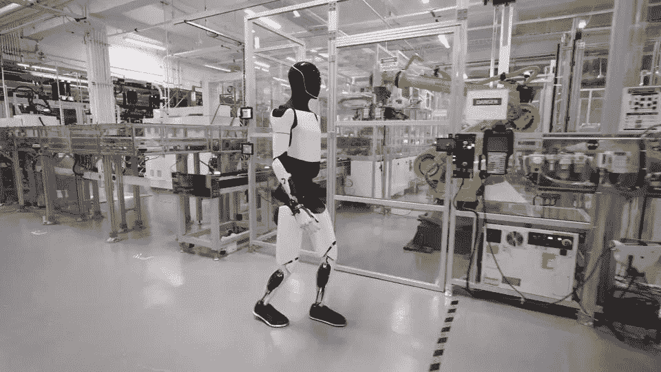

[6386486337516026613119294.mp4](https://internal-api-drive-stream.feishu.cn/space/api/box/stream/download/all/RnYpb3Mg0oGYpmxgQOBcIpvrn4b)

6、面向付费用户!全新ChatGPT Windows版本上线:快捷键即可召唤AI助手

OpenAI推出了全新的ChatGPT Windows应用早期版，为付费用户提供便捷的AI助手体验。用户只需按下Alt + Space组合键即可召唤ChatGPT，无需每次打开网页。

7、复旦、百度联手打造全新AI模型Hallo2可生成4K超高清+1小时超长视频!

复旦大学和百度公司联合开发的Hallo2AI模型将彻底改变人物动画生成的现状，为电影制作、虚拟助手、游戏开发等领域带来革命性变化。

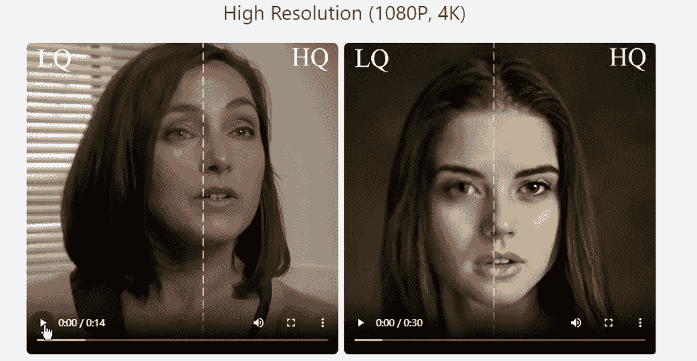

[6386486335764400361522253.mp4](https://internal-api-drive-stream.feishu.cn/space/api/box/stream/download/all/O7wRbCQGCo5W8QxoTXucL1SQntd)

## 10月19日 AI资讯

1、骗子克隆一个官网只用半小时：内容可以随便删改

据央视新闻报道，很多冒充政府部门发布信息的骗局背后都有一个与官方网站仿真度极高的网站或者是APP。

报道称，据网络安全人员透露，克隆一个网站平均只需要半个小时左右的时间。克隆一个网站的第一步，就是注册一个相似度高的域名，这个域名跟需要仿造的这个域名有很高的相似度。

2、再不用拔枪插枪了！特斯拉无人出租车Cybercab无线充电演示

日前，特斯拉发布了无人驾驶出租车“Cybercab”。在发布会上，马斯克预告称，将于2026年正式投产，2027年规模生产，届时这款车的售价控制在30000美元（当前约21.2万人民币）以下，并设想未来人们可以拥有多辆Cybercab，通过共享出行平台运营车队，实现收益。

3、全球首个AI电子顺磁共振波谱仪正式发布：检测精准度打破世界纪录

据媒体报道，在浙江大学举办的2024年全国电子顺磁共振波谱学学术研讨会上，国仪量子技术（合肥）股份有限公司（以下简称国仪量子）正式发布了全球首个AI电子顺磁共振波谱仪（以下简称AI-EPR）。

4、Unity 6 引擎正式发布

Unity 在其官方公众号上宣布，Unity 6 引擎正式发布，现在已开放下载。使用 Unity 6，将能体验到更快的渲染速度、更先进的光照选项、无缝的多人游戏工作流、增强的 AI 功能，以及对移动端 Web 运行时的改进支持。

5、特斯拉 FSD 尚未批准入华

特斯拉的人工智能团队曾在 9 月初对外公布了他们的发展规划，预计到 2025 年第一季度，将在中国市场和欧洲市场推出全自动驾驶功能，但这还需要得到监管机构的批准。然而，一些知情人士透露，实际的进展速度并没有预期的那么快。

6、本周，NVIDIA 发布了其最新的基础模型——Nemotron 70B。这款精致的新语言模型因其令人印象深刻的表现而备受瞩目，在基准测试中甚至超越了 OpenAI 的 GPT-4 和 Anthropic 的 Claude 3.5 Sonnet 等重量级模型。

# 第四周

## 10月21日 AI资讯

1、谷歌苹果最新发现：LLM知道但不告诉你，掌握知识比表现出来的多

近日，来自谷歌和苹果的研究表明:AI模型掌握的知识比表现出来的更多!研究人员在LLM内部表示上训练分类器，以预测与生成输出的真实性相关的各种特征。结果表明LLM的内部状态编码反映出的真实性信息，比以前认识到的要多得多。

论文地址:https://arxiv.org/pdf/2410.02707

2、微软正与OpenAI洽谈，140亿美元投资股权

华尔街日报独家消息，微软正与OpenAI进行140亿美元的投资股权谈判。除了股权之外，微软作为OpenAI的最大股东，其转型之后在公司治理、发展方面有多少实际的控制权也是谈判重点。特别是微软退出OpenAI董事会后，整个谈判流程非常复杂、繁琐。为了更好地理清这些，双方都带了金融谈判专家进场，微软找了摩根士丹利，OpenAI则找了高盛。

3、谷歌首席执行官桑达尔・皮查伊上周四宣布，将负责公司 Gemini AI 助理应用程序的团队转移到其 DeepMind 研究实验室，继续整合公司在人工智能领域工作的各个团队。

4、安卓版Chrome 130浏览器“听网页”功能已支持后台播放

谷歌为安卓版的 Chrome 浏览器更新了一项新功能，允许用户在后台收听网页内容。在 Chrome 130 中，即使用户切换到其他应用或关闭手机屏幕，Chrome 仍能继续朗读网页内容。

使用方法：1、在 Chrome 浏览器的三点菜单中找到。2、通过 Chrome 设置中的“工具栏中的快捷方式”选项，将该功能的快捷方式添加到地址栏旁边。

5、让Kimi和GPT-4o用语音功能相亲，两个AI差点谈上了，直接点开听吧，太有趣儿了，比人类稳定有礼貌多了。

https://mp.weixin.qq.com/s/rHOqb40FilOeBZI80BXF0w

6、曝 OpenAI 前首席技术官正筹资建立 AI 初创公司

有消息称，OpenAI 前任首席技术官 Mira Murati 正在向风险投资机构募集资金，以创建自己的 AI 初创公司。

据悉，这家初创公司的目标是基于专有模型构建人工智能产品，目前尚不清楚 Murati 是否会担任这家公司的 CEO。

7、腾讯会议：免费版单场时长将逐步调整为40分钟，2人会议不限时

10月20日消息，腾讯会议官方发布通知称：为了优化资源分配，腾讯会议免费版单场会议时长将逐步调整为40分钟(2人会议不限时)，请您提前做好规划。未来，我们将逐步升级服务提供模式，推出具备更强AI与丰富权益的专业版、以及升级商业版的权益组合，助力更多组织和用户开展高效协同。

## 10月22日 AI资讯

1、前OpenAI首席技术官Mira Murati据报道正在寻求超过1亿美元资金开发专有模型

据报道，前OpenAI首席技术官Mira Murati正寻求超过1亿美元资金，以启动她自己的AI初创公司，加入了越来越多前OpenAI高管独立创业的行列。在OpenAI期间，Murati参与了诸如ChatGPT和DALL-E等重要项目，这让她在竞争激烈的市场中具备了优势。

2、OpenAI的o1模型可能让大多数律师失业

在2024年Ray峰会上，OpenAI的首席产品官凯文·韦尔（Kevin Weil）讨论了o1模型的能力，这款模型能够在几分钟内起草法律简报，而这一任务之前需要时薪1000美元的律师助理花费六个小时才能完成。这种效率的提升实现了时间和成本的99.9%削减，促使人们重新思考专业服务的传统定价模式。

韦尔在Ray峰会2024的完整视频：https://www.youtube.com/watch?v=VsmEMUiPXIs

3、颠覆 Stable Diffusion!智源重磅发布 Emu3，图像、文本、视频全拿下!

Emu3团队发布了一套全新的多模态模型Emu3，颠覆了传统的扩散模型和组合模型架构，在生成和感知任务上取得了最先进的性能。该模型基于下一个token预测进行训练，实现了多模态任务的统一，超越了特定任务模型，甚至旗舰模型。

更多：https://github.com/baaivision/Emu3

4、Meta最新黑科技Spirit LM生成更具表现力的声音，能够反映愤怒、惊讶、快乐等情感

Meta的基础AI研究团队推出了Spirit LM，这是一款开源的多模态语言模型，在AI语音技术上实现了重大突破。与传统模型通常像机器人朗读脚本不同，Spirit LM通过使用语音、音调和音高等标记，为输出增添了情感色彩。该模型有两种版本：Spirit LM Base，专注于语音处理的基础功能；以及更高级的Spirit LM Expressive，能够表现出喜悦、愤怒和惊讶等情感。

更多：https://arxiv.org/pdf/2402.05755

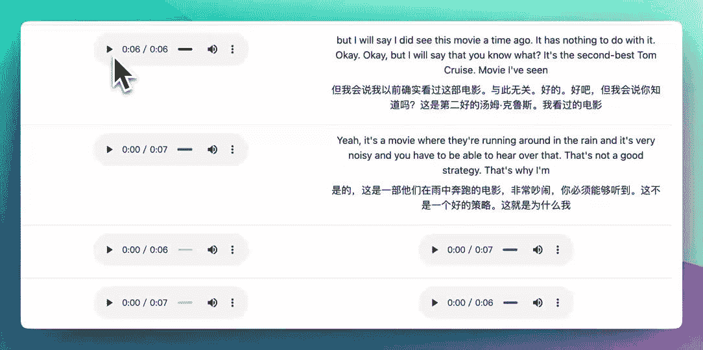

[6386512190840187464974980.mp4](https://internal-api-drive-stream.feishu.cn/space/api/box/stream/download/all/TAIWbatCAoRtXMxdN2eccY37nCb)

5、Viggle AI再推新功能 可通过录制声音让角色说话

Viggle AI推出了令人兴奋的新功能，用户可以通过录制声音让角色说话并实现口型同步。这项创新技术让用户完全控制角色的表现方式，无论是唱歌还是跳舞，都能轻松实现。

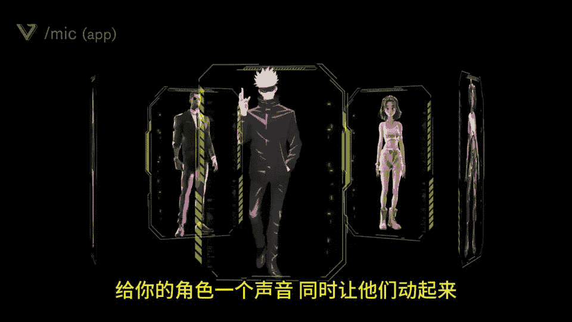

[6386512178626684876286982.mp4](https://internal-api-drive-stream.feishu.cn/space/api/box/stream/download/all/UKQXbZZLgo958qxcpvIc1QDTnye)

6、Midjourney图像编辑器新功能下周上线

Midjourney的创始人David Holz宣布，一款全新的图像编辑器即将上线，该编辑器利用上传图像的深度信息生成新图片，保留原始构图和内容的同时彻底改变纹理、颜色和细节。这一创新提升了用户创作自由度，为设计师和艺术家提供强大工具。

7、Perplexity 新一轮融资谈计划筹集约 5 亿美元

据华尔街日报报道，Perplexity 正在进行新一轮的融资谈判。他们告知投资者，公司希望在新一轮的融资中筹集约 5 亿美元。Perplexity 表示，他们希望将公司的估值增加一倍以上，即 80 亿美元。报道指出，Perplexity 已经在过去的一年中，完成了三轮融资。

8、索尼和本田合作的纯电动汽车将引入 AI 自动驾驶辅助功能

据日经新闻报道，索尼集团和本田将在双方共同开发的纯电动汽车中，引入 AI 自动驾驶辅助功能。

报道指出，双方的合资公司索尼本田移动出行，将于 2026 年在日本和美国推出高档纯电动汽车 Afeela。该款新车将搭载 AI 自动驾驶辅助功能。

9、表格、图表统统拿下!阿里达摩院开源DocOwl1.5无需OCR，高效“读懂”文档!

阿里巴巴达摩院与中国人民大学联合开源了mPLUG-DocOwl1.5文档处理模型，无需OCR即可理解文档内容，在多个视觉文档理解基准测试中表现领先。该模型强调结构信息的重要性，提出“统一结构学习”来提升MLLM性能。

## 10月23日 AI资讯

1、全新升级的 Claude 3.5 Sonnet 正式推出

人工智能初创公司 Anthropic 推出了全新升级的大杯 Claude 3.5 Sonnet。官方表示，编码能力的改进是 Claude 3.5 Sonnet 的最大亮点。GitLab 测试发现其推理能力提升了 10%，无额外延迟，非常适合多步骤的软件开发流程。The Browser Company 也指出，Claude 3.5 Sonnet 在自动化网页工作流程方面的表现超越了他们之前测试的所有模型。

2、马斯克官宣!xAI的Grok API正式上线，仅支持grok-beta模型、功能尚待完善

马斯克的AI新创公司xAI推出了名为Grok的生成性AI模型API，虽然功能还相对简单，但已正式实现。用户反馈购买使用积分时遇问题，API功能尚未全面上线。

3、ComfyUI发布桌面一键安装包ComfyUI V1支持自动更新

ComfyUI近日发布V1版本更新，带来一系列重大改进，包括全新桌面版应用、用户界面革新以及自定义节点安全机制升级。新版桌面应用支持跨平台运行，自动更新功能确保用户始终使用最新稳定版本。

4、Reddit CEO 宣布平台进入 AI “军备竞赛”。

社交平台 Reddit 的 CEO Steve Huffman 表示，平台内容是全球「最佳的 AI 训练数据」之一。随着公司积极参与 AI “军备竞赛”，这些数据的价值将不断攀升。Huffman 强调，Reddit 上覆盖了「几乎所有主题的口语表达」，且内容持续更新，这使得平台在教导机器模仿人类思维与语言方面具有独特优势。

5、首件人形机器人创作艺术品即将在苏富比拍卖

近期苏富比拍卖行将展出人形机器人艺术家Ai-Da的作品，引发了人们对人工智能与艺术结合的新讨论。这次拍卖将开启新的艺术创作趋势，激发了对当代艺术的思考，展示了科技与艺术的融合之美。

6、Meta智能眼镜在欧洲畅销，AI 功能未上线销量却超越传统Ray-Ban

Meta与Ray-Ban合作推出的智能眼镜在欧洲市场取得了巨大成功，尽管缺乏AI功能，但销量超越了传统Ray-Ban产品。消费者对眼镜内置的扬声器和摄像头表现出浓厚兴趣，展现了产品的吸引力。

7、发布会用相关 AI 图，特斯拉遭《银翼杀手》制作公司起诉

10 月 22 日，据 The Verge 报道，《银翼杀手 2049》背后的洛杉矶制作公司 Alcon Entertainmen 向特斯拉、埃隆·马斯克和华纳兄弟探索公司提起诉讼。Alcon Entertainmen 指控他们使用电影中的一张图片，用来宣传特斯拉「We, Robot」发布会中的无人驾驶出租车原型。

## 10月24日 AI资讯

1、Ideogram上线Canvas功能:实现图片魔法填充、无缝扩展

Ideogram最新推出的Canvas功能为用户提供了强大的图像生成和编辑选项，让用户可以自由展开、对比、调整图像大小和顺序，甚至将多个图像结合成新作品。特别适合营销人员和内容创作者使用，提高创作效率与灵活性。

2、**Claude3.5重磅升级:Sonnet编码能力秒杀**o1，Haiku性价比无敌，还会用电脑!

Anthropic发布了升级版Claude3.5Sonnet和全新模型Claude3.5Haiku，在推理、编码和视觉处理方面取得显著进步。Sonnet在业界领先，表现出色，甚至超越了OpenAI o1-preview等公开模型。

3、Canva推出全新文生图工具Dream Lab，一键生成3D插图!

Canva最新推出的AI功能中，最引人注目的是Dream Lab工具，利用Leonardo.ai的Phoenix模型，用户可以通过描述生成各种风格的图像。除此之外，Canva的Magic AI工具套件也进行了更新，提升了文本生成准确性，并增加了白板和视频编辑的新功能。

4、**Genmo 重磅开源视频生成模型 Mochi1:高画质**、超流畅，家用电脑也能创作好莱坞级大片!

Genmo 公司开源的最新视频生成模型Mochi1在视频生成领域引起了轰动，其高画质、超流畅的特点让家用电脑也能创作好莱坞级大片。Mochi1采用创新的Asymmetric Diffusion Transformer（AsymmDiT）架构，拥有100亿个参数。

体验地址：https://www.genmo.ai/play

5、ChatGPT 高级语音模式登陆欧洲!

OpenAI最近将其ChatGPT高级语音模式扩展到欧盟等地区，实现与人类对话相媲美的响应速度。功能不仅在美国、英国用户中开放，还进行了多项改进，包括新增五种语音、自定义指令功能和对话内容记忆。

6、秒杀人类!AI香水调配师来了，几秒钟就能开发高品质香水

NotCo与Cramer联手推出的NotCo生成式AI香水调配师革新产品，简化了香水研发流程，提高效率和创造性。经过盲测验证，AI生成的香水被评为“市场就绪”，展示了其实际应用潜力。

7、微软开始测试照片 AI 超分辨率功能

近日，微软向搭载高通骁龙芯片的 Copilot+ PC 推出了包含「超分辨率」功能的 Windows 预览版。

据介绍，超分辨率使用 AI 来增强和放大图像，最高可达原始图像尺寸的 8 倍，适合用于改善低质量照片。

8、腾讯推出ima.Co pilot智能工作台产品

腾讯最新推出的ima.Co pilot智能工作台产品由混元大模型提供技术支持，旨在为用户提供全新的搜读写体验。该产品具备知识获取、个人知识库打造和智能写作辅助等核心功能，能够轻松管理和获取知识，提供定制化回答，辅助写作任务。

9、扣子专业版模板商城发布：AI 最佳实践，一键复制

火山引擎推出的模板商城为用户提供了一种简单快捷的方式，让更多用户能够轻松使用AI能力，大幅提升工作效率和质量。商城内置多款源自AI最佳实践的优质模板，涵盖多个业务场景

## 10月25日 AI资讯

1、iOS 18.2 的首个开发者测试版来了，这也是最接近下周正式推送的版本。

这一 beta 版本继续履行了 WWDC 2024 所推出的 Apple Intelligence「分阶段升级」的承诺，为开发者用户带来了属于苹果 AI 的四大新功能，其中就包括接入了 ChatGPT 的「更智能」的全新 Siri。

2、美国女子起诉 Character.ai，称其导致儿子自杀

具体的诉状显示，Garcia 指控理由包括「过失致死」、「疏忽」、「欺骗性商业行为」和「产品责任」，并称 Character.AI「非常危险」。14 岁的 Sewell Setzer III 从去年开始使用 Character.AI，这个平台能够提供角色模仿的聊天机器人，Setzer 在上面与几位《权力的游戏》角色机器人进行聊天，一直到其自杀前的几秒钟。

3、谷歌开源AI文本水印工具SynthID

谷歌最近开源了文本水印工具SynthID，旨在帮助开发者更好地识别AI生成的文本。这一举措对应对虚假信息和不当内容具有重要意义，同时推动了AI技术的发展和应用。

4、科大讯飞发布多款 AI 新品

讯飞星火 4.0 Turbo 模型全新升级，号称七大能力全面超过 GPT-4 Turbo，数学能力、代码能力超过 GPT-4o，已完成超长思维链、树搜索和自我反思评价等算法验证，预计年底实现类 o1 的高难度数学能力提升。

5、Anthropic升级AI助手，Claude可写网页代码，更像数据分析师

美东时间10月24日周四，Anthropic宣布推出了一款分析工具，它是AI助手 Claude.ai新的内置功能，可让 Claude 编写和运行编程语言 JavaScript的代码。Claude 现在可以处理数据、进行分析并产生实时见解。该分析工具可供所有 Claude.ai 用户在能预览版中使用。

6、ElevenLabs推出AI语音生成工具Voice Design

ElevenLabs允许你创建自己的数字语音复制，用于内容创作、有声书或个性化AI助手等多种应用。通过简单的文本描述即可创建个性化语音，为用户提供了直观的文本提示功能，支持调节多个语音参数，包括年龄、性别、口音、语调和音高，同时突破性地支持创作角色化语音，为内容创作者提供了前所未有的声音定制自由。

官网：https://elevenlabs.io/voice-design

7、前OpenAI研究员指控侵犯版权

一名前OpenAI研究员发声指控公司，声称其使用受版权保护的材料违反了法律，并损害了互联网和内容生态系统。曾帮助收集ChatGPT训练数据的Suchir Balaji在今年8月离职后指出，这些模型完全复制了训练数据，并直接与原创内容创作者竞争。

8、DeepMind 开源AI水印工具

谷歌旗下的DeepMind刚刚宣布开源并发布了SynthID，这是一款用于AI生成内容的先进水印系统，同时透露该工具已在Gemini和其他谷歌产品中投入使用。该系统采用“竞赛采样”（tournament sampling）方法，嵌入不可检测的水印，同时保持文本输出的质量。该工具已经集成到Gemini、ImageFX、VideoFX和Vertex AI的图像工具中，标志着AI水印技术的首次大规模部署。

## 10月26日 AI资讯

1、华为数字能源携手华润燃气打造的全国首座电动重卡超充站正式运营

华为数字能源官方账号近期发文，称在 10 月 22 日，华润燃气集团携手华为数字能源打造的「华润燃气重卡超充第一站——弥渡重卡超充站」正式投入运营使用。官方表示，作为华润燃气首个重卡超充站项目，弥渡重卡超充站的建成投运展现了华润燃气推动能源转型、助力「双碳」目标实现的决心。

2、OpenAI 下一个大模型或将于年底发布

据 The Verge 报道，OpenAI 计划在 12 月之前推出下一个大模型，目前该模型命名为「Orion」。有 OpenAI 高管表示，Orion 可能比 GPT-4 强大 100 倍，该模型与 o1 是分开的，不过会利用 o1 来提供合成数据训练模型。

Perplexity 发文回击媒体起诉：媒体和科技不应是「对抗的」

近日，AI 智能搜索引擎 Perplexity 受到《纽约时报》《华盛顿日报》母公司「新闻集团」的起诉，声称其「大量复制」了旗下内容。Perplexity 方面进行了回应，表示像新闻集团这种起诉 AI 公司的新闻机构，更喜欢生活在一个公开报道的事实归公司私有的世界，没有人可以在不付费的情况下使用这些公开报道的事实。

KREA AI推出视频延展功能 可以给真实视频加上各种魔法特效

KREA AI最新推出的Video Extend功能在视频创作领域引起创新浪潮，巧妙融合真实视频与AI生成内容，为创作者提供前所未有的视频特效制作体验。其核心亮点在于独特的视频尾帧利用机制，能延伸生成长达5秒钟的连贯视频内容。

苹果将推私有AI云服务，悬赏百万寻找 AI 云安全漏洞!

苹果即将推出私人AI云服务，悬赏高达100万美元寻找可能危害其云服务安全的漏洞。这一举措将进一步提高苹果服务的安全性，为安全研究人员提供展示技术的机会。

美图奇想大模型图像生成能力再度升级:生成质感更细腻自然

美图公司宣布其旗下的美图奇想大模型在图像生成能力上实现了再次升级，进一步完善综合实力。同时推出一站式AI短片创作工具MOKI，将为用户提供全新视觉体验。

OpenAI macOS 应用重磅更新:语音界面终于支持图片上传

OpenAI 最近在其 macOS 应用的高级语音模式界面上进行了重要更新，推出了全新的图片上传功能，用户可以通过语音 UI 上传并讨论图片，提升互动体验。除了图片上传功能，还可以直接使用笔记本摄像头拍照分享，但尚无视频共享功能。

# ======================================================

## 10月28日 AI资讯

1、Google 正在开发「贾维斯项目」，可将 Chrome 网页任务自动化

据 The Information 报道，Google 正在开发「贾维斯项目」，该项目可以帮助用户执行包括 收集研究、购买产品或预订航班在内的任务。报道指出，该项目将由未来推出的 Google Gemini 驱动，并且仅适用于 Chrome 浏览器，该项目预计最早将在 12 月亮相。

2、报道称字节跳动拟在欧洲设立 AI 研发中心

字节跳动准备在欧洲设立 AI 研发中心。有知情人士表示，字节跳动目前已经开始寻找欧洲的 LLM 和 AI 方面技术大牛，积极招揽人才。在今年 6 月，就有消息指出，字节跳动计划投资约 100 亿林吉特（21.3 亿美元）在马来西亚建立 AI 中心。另外，字节跳动还打算额外投资 15 亿林吉特扩大其在马来西亚的数据中心设施。

3、Perplexity AI每周处理1亿次查询，消息称微软/X/OpenAI有意收购

AI 搜索引擎 Perplexity 的首席执行官 Aravind Srinivas 透露，其产品目前每周的查询量已达到 1 亿次，推算下来每月约为 4 亿次，与 7 月的 2.5 亿次相比增长显著。当地时间 25 日，该公司披露称，随着公司快速扩展，Perplexity 正在逐步推出电商功能，计划让“Perplexity Pro”服务的订阅用户享受一键下单的便捷功能。

4、谷歌据悉将开发可控制计算机的人工智能。

Alphabet旗下的谷歌正在开发可控制浏览器的人工智能技术，以完成研究和购物等任务。消息称，谷歌将于12月展示代号为“Project Jarvis”的产品，并发布其下一代旗舰产品Gemini大型语言模型。

5、阿里巴巴同意支付30亿元和解，否认任何指控。

美国当地时间10月25日，阿里巴巴集团发布公告，已同意支付4.335亿美元（约合30.87亿元人民币）和解投资者在美国提起的一桩集体诉讼。该诉讼案指控阿里巴巴存在垄断行为，但阿里巴巴否认其存在任何不当行为。

6、25岁日本男子利用AI制造计算机病毒：被判处有期徒刑3年

据报道，一名25岁的日本男子因利用人工智能（AI）技术制造计算机病毒，近日被法庭判定有罪，并判处其有期徒刑3年，缓刑4年执行。据悉，该男子过去曾从事SIM卡诈骗等非法兼职活动。在寻找更为轻松的获利途径时，他结合自己对AI生成技术的兴趣，萌生了制作计算机病毒进行勒索的邪恶念头。

7、Google DeepMind为AI大模型添加了“隐形指纹”

Google DeepMind 团队开发了一种名为 SynthID-Text 的新型水印工具。该工具采用“锦标赛抽样”（tournament sampling）算法，在不损害文本质量的前提下，通过嵌入隐形水印，使大语言模型（LLM）生成的每段文本都带有独特标识，极大提高了文本追踪和检测的精度。

## 10月29日 AI资讯

1、神秘模型“小熊猫”一夜刷屏：排名超Flux、Midjourney

一款名为red_panda的神秘AI图像生成模型在Artificial Analysis的基准测试中表现惊人，超越了行业领军企业的产品。其在文本转图像测试中以1244分的成绩领跑，展现出技术优势和高效率。红熊猫的真实感图像超越了传统AI作品，展现出色的文本提示理解和执行能力。红熊猫的横空出世推动了行业标准的提升，引发关注。

2、苹果推出Apple Intelligence系统

通过最新的 iOS 18.1 和 macOS Sequoia 15.1 更新引入了一系列专注于生产力、创意和隐私增强的新功能。

此次发布的写作工具，可用于重写、校对和总结文本，还增强了照片搜索功能。重新设计的 Siri 支持打字输入，具备更好的上下文理解能力，并升级了对苹果设备知识的支持，以便更好地解答产品相关问题，为用户带来更智能、更便捷的体验。

3、环球音乐携手 Klay Vision 开发合乎伦理的 AI 音乐模型KLayMM，强化版权保护

环球音乐集团（UMG）宣布与 AI 初创公司 Klay Vision 合作，共同开发一款尊重版权的 AI 音乐生成器，旨在推动可持续AI音乐创作。此举正值 UMG 针对 Suno、Udio 和 Anthropic 等 AI 公司采取法律行动之际，展现出 UMG 在 AI 时代维护版权和艺术家权益的决心。

4、突破性开源项目:手机也能运行的轻量级数字人来了

近日，一个名为Ultralight-Digital-Human的开源项目成功解决了数字人技术在移动端的部署难题，让普通智能手机也能实时运行数字人应用，为相关技术的普及带来新的可能。该项目采用了创新的深度学习技术，通过算法优化和模型压缩，成功将庞大的数字人系统瘦身到可以在移动设备上流畅运行的程度。

github：https://github.com/anliyuan/Ultralight-Digital-Human?tab=readme-ov-file

demo:链接太长，效果还可以，点开github链接查看

5、源推出全能视觉生成模型 OmniGen 集多项能力于一体

北京智源人工智能研究院（BAAI）推出全新全能视觉生成模型OmniGen，标志着图像生成领域重大突破。OmniGen以统一性、简单性和跨任务知识迁移能力著称，可处理多种图像生成任务，包括文生图、图像编辑、主题驱动生成和视觉条件生成。

技术文档：https://arxiv.org/pdf/2409.11340

论文：https://arxiv.org/pdf/2409.11340

代码：https://github.com/VectorSpaceLab/OmniGen

演示：https://huggingface.co/spaces/Shitao/OmniGen

6、Meta构建AI以减少对谷歌bing的依赖

据报道，Meta 正在开发自己的 AI 驱动搜索引擎，以便其 AI 能够实时了解当前事件和网络信息，旨在减少对 Google 和 Bing 的依赖，从而为 Meta AI 对话提供实时信息支持。内部团队据称从 2024 年初就悄悄开始搭建搜索基础设施。

7、xAI为Grok添加图像理解功能 还能看懂梗图的幽默

马斯克旗下xAI公司最新为其AI模型Grok增添了图像理解功能，用户可上传图片向AI助手提问。马斯克展示了Grok的新能力，包括理解图片内容和幽默元素。功能仍在早期阶段，团队将持续改进。xAI通过与黑森林实验室合作，新增多模态理解功能，提升用户体验和开发者API。

8、又要被玩坏了!PixVerse V3升级:不但能玩AI捏捏，还能让杯子长腿

PixVerse V3版本带来了全方位的功能升级，让创作者体验更专业、更有趣。从视频特效到风格功能再到视频延长，都有显著提升，为内容创作者提供更全面、更专业的视频创作平台。

[X2Twitter.com_zxSG2uMtl7W5up-N_720p.mp4](https://internal-api-drive-stream.feishu.cn/space/api/box/stream/download/all/I6tFbzE8aogBuLxzVwNcP5o5n9e)

## 10月30日 AI资讯

1、ChatGPT新增重磅功能！能打造自己的聊天数据库了

今天凌晨3点，OpenAI宣布ChatGPT新增重磅功能——聊天记录搜索。现在，用户可以快速一键搜索自己的聊天记录，或者从中断的地方继续聊天了。无论你开了多少个聊天页面、这个聊天有多难找，都能通过一键搜索轻松把它找出来，用户可以轻松打造独属自己的聊天数据库了。这对于写作、教育、金融、医疗等，对聊天交互频繁的行业来说帮助巨大。

2、腾讯推出 AI 笔记，可搜公众号文章

腾讯近日推出 ima copilot AI 工具，可以搜索微信公众号文章中的内容。在 ima copilot 的搜索框内键入搜索关键字，即可引用一些微信公众号的文章生成回答，支持深度模式、脑图生成等功能。除了搜索想要的内容，ima copilot 也能作为 AI 浏览器，总结网站内容。ima copilot 也支持 500 页和 100MB 内的本地文档总结。

3、GitHub接入Claude+Gemini

GitHub Copilot宣布为开发者引入多模型选择，不再仅依赖于OpenAI的模型。最新整合了Anthropic的Claude 3.5 Sonnet，谷歌Gemini 1.5 Pro以及OpenAI o1-preview和o1-mini。

4、OpenAI或已计划联手博通和台积电打造自研芯片。

消息人士透露，OpenAI正在与博通和台积电合作，以打造首款自研(“in-house”)芯片，支持其人工智能系统。OpenAI已经研究了一系列让芯片供应多样化和降低成本的选项。

5、马斯克的xAI拟按400亿美元估值进行新一轮融资。

一位知情人士称，埃隆·马斯克的人工智能初创公司xAI拟按约400亿美元的估值寻求新一轮融资。就在数月前，另一轮融资才刚为该初创公司带来60亿美元资金。

6、微信正灰测AI问答功能：整合混元大模型

据媒体报道，微信正灰测AI问答功能，已被灰测到的用户可通过微信搜索框输入相关问题触发AI问答，并且该功能整合使用了腾讯内部技术资源，包括混元大模型。对此，微信团队回应称，微信正在搜索场景内灰度测试AI生成答案，该能力整合使用了腾讯内部技术资源，包括混元大模型，目的是进一步优化用户搜索体验，提升用户搜索效率。

7、OpenAI约75%收入来自消费者订阅，ChatGPT周活跃用户数达2.5亿

据彭博社报道，OpenAI 约 75% 的收入来自消费者订阅，这一数据由首席财务官 Sarah Friar 透露。据彭博社报道，OpenAI 约 75% 的收入来自消费者订阅，这一数据由首席财务官 Sarah Friar 透露。

8、AI艺术家Botto作品在苏富比拍出351,600美元

在最近的苏富比拍卖会上，自主AI艺术家Botto的作品以351,600美元的价格售出，使得其累计销售额突破400万美元大关。此次拍卖中，Botto通过名为“Exorbitant Stage”的社区展览，展出了六组NFT艺术品，吸引了众多藏家的目光。尽管自2022年以来，NFT市场经历了诸多挑战，但Botto的作品依然表现出色。

9、知行机器人完成数千万元 B 轮融资

知行机器人科技（苏州）有限公司（简称「知行机器人」）于近期完成数千万元 B 轮融资。报道称，此轮融资由诚美资本与中关村智友科学家基金联合领投，融得资金将用于公司核心产品及系统的研发、拓展及推广。

## 10月31日 AI资讯

1、曝 OpenAI 将与博通台积电合作打造首款芯片

路透社独家报道，OpenAI 正在与博通公司以及台积电进行合作打造首款芯片，计划于 2026 年推出。芯片将用于处理自家大量的 AI 任务，特别是推理工作的负载。据报道，OpenAI 组建了一个大约 20 人的芯片团队，其中包括曾经负责 Google Tensor 处理器的工程师。

2、GitHub推出了Spark平台，面向AI驱动的应用创建

用户无需掌握编程技巧，通过自然语言指令即可创建微型应用并集成AI功能，且无需手动管理云端资源。

其他更新还包括Copilot在VS Code中增强的多文件编辑功能、30秒代码审查功能，以及更广泛的Copilot Extensions支持，如Docker和Stack Overflow工具集成。

产品详细介绍：https://www.youtube.com/watch?v=oM2amcnVmzM

3、OpenAI ChatGPT 高级语音模式已登陆 Windows 和 Mac 平台

OpenAI 今日宣布，ChatGPT 的高级语音模式（Advanced Voice Mode，简称 AVM）现已登陆 Windows 和 Mac 平台。AVM 基于 OpenAI 最先进的 GPT-4o 模型运行，允许用户像与真人对话一样与 ChatGPT 进行交流，包括打断、停顿等自然语言行为。OpenAI 表示，AVM 提供了更自然、实时的对话体验，能够实时感知和回应用户的情绪。

4、LinkedIn推出AI招聘助手“Hiring Assistant” 助力自动化招聘流程

LinkedIn将Hiring Assistant视作其AI发展道路上的一个重要里程碑——该产品是其首个AI代理，专为其重要客户群体——招聘人员设计。LinkedIn表示，该AI助手目前已向部分客户（如AMD、Canva、西门子和苏黎世保险等大公司）开放测试，并将在未来几个月逐步扩大使用范围。

5、国产AI投广告太疯狂！Kimi 20天花1.1亿元、秘塔20天投1500万

10月30日消息，随着人工智能技术的飞速发展，国产AI大模型市场的广告投放战也愈演愈烈。根据博主“互联网的那点事”分享，Kimi在10月份的前20天内，广告投放费用高达1.1亿元人民币，接近其三季度总和。秘塔同期投放1500万，逼近其三季度总额，腾讯的元宝AI同样大手笔，10月已投入3000万广点通，超过三季度总额的三分之一。

6、微软旗下开发平台 GitHub 正在为其 Copilot 编程工具引入更多模型。

未来开发人员可以为 GitHub Copilot 选择 Anthropic Claude 3.5、Google Gemini 1.5 Pro 和 OpenAI GPT-4o、o1 等模型。开发人员将能够在与 Copilot Chat 对话期间在模型之间切换，以找到最适合特定任务的模型。

# 11月AI资讯精选

## 11月1日 AI资讯

1、神秘大模型“小熊猫”身份揭晓:英国AI公司最新图像生成模型Recraft V3

我对最新揭晓的英国AI公司Recraft V3图像生成模型进行了点评。该模型以red_panda化名引起关注，具备强大的长文本图像生成能力，突出的文本布局和样式控制功能让用户可以精确创造专业品质的视觉效果。

官网：https://www.recraft.ai/

试用地址：https://fal.ai/models/fal-ai/recraft-v3

2、OpenAI 正式推出 ChatGPT 搜索

今天凌晨，OpenAI 宣布开放 ChatGPT 机器人中集成的全新搜索功能。

当用户与 ChatGPT 交互时，聊天机器人会根据用户的需求自主决定是否进行网络搜索以提供更多更新的信息，用户也可以手动触发搜索功能。据介绍，搜索功能的底层模型是 ChatGPT-4o 微调版本。

3、任天堂推出游戏音乐流媒体平台

任天堂公司发布了一个名为「Nintendo Music」的移动应用，将登陆 iOS 和 Android 平台。

这个 Nintendo Music 将允许用户聆听任天堂游戏的经典配乐，需要订阅 Switch Online 才能使用，支持在线流媒体播放和下载离线收听。Nintendo Music 提供游戏、时刻、情绪或角色主题的播放列表，用户也可以自建歌单。

[4、字节](https://www.chinaz.com/tags/Lumi.shtml)跳动推出AI模型社区平台:炉米Lumi 类似Liblib和CIvitai

字节跳动最新推出的AI模型分享社区平台炉米Lumi，展示其在AI领域的全面布局策略。平台提供模型上传分享、Workflow搭建和LoRA训练功能，目前仅向白名单用户开放。

5、波士顿动力Atlas进厂视频火了，不断电不下班

波士顿动力公司发布了新一代人形机器人Atlas的精彩视频，展示了其在模拟工厂环境中独立完成分拣任务的能力。视频强调了Atlas利用机器学习和升级传感器实现实时环境反馈与调整的特点，展示了完全自主工作能力。

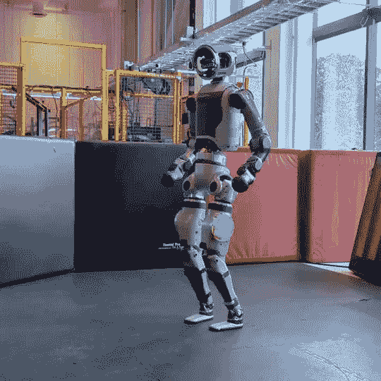

[X2Twitter.com_32M_p8jCYyqxfau2_720p.mp4](https://internal-api-drive-stream.feishu.cn/space/api/box/stream/download/all/ECuYb3MFOozATdxepjkcRtAHn2f)

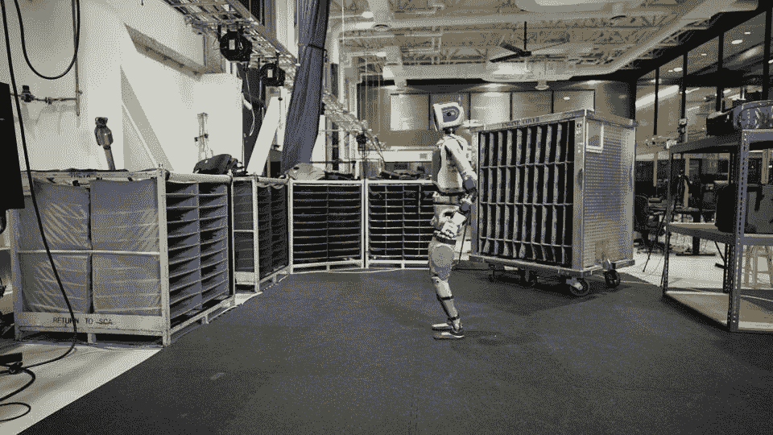

[Atlas Goes Hands On.mp4](https://internal-api-drive-stream.feishu.cn/space/api/box/stream/download/all/OGxdb0WHBoMm6wx5cXvcu2PPnfx)

6、好莱坞黑科技!Wonder Dynamics发布视频转3D功能

Wonder Dynamics发布了颠覆性的AI工具Wonder Animation测试版，利用人工智能重新定义影视制作流程。这项技术让创作者可以轻松转换素材为包含CG角色的3D动画场景，实现完整虚拟场景编辑。

https://www.wonderdynamics.com/

7、百川智能发布一站式解决方案

百川智能推出了一站式大模型商业解决方案「1+3 产品矩阵」，包括全链路优质通用训练数据，Baichuan4-Turbo、Baichuan4-Air 两款模型和全链路领域增强工具链。据介绍，这个方案能够帮助企业以最低成本实现效果最佳的私有化部署，支持企业将专有数据与百川智能自用的全链路优质训练数据混合，对 Baichuan4-Turbo、Baichuan4-Air 两款模型进行调优和增强。

## 11月2日 AI资讯

1、Meta 正在制造可以「感觉」的机器人手

Meta 表示，他们正在和传感器公司 GelSight 和韩国机器人公司 Wonik Robotics 合作，将人工智能触觉传感器商业化。新品 Digit360 将于明年上市，是 Meta Digit 传感器的后继产品，可将触摸信号数字化，使用设备上的 AI 芯片和大约 18 个「传感特征」来检测周围环境的变化。Meta 介绍，为传感器配备了多种传感模式，可以让机器人「感知」振动、热量，甚至「闻」到气味。

2、Google 地图获得 Gemini AI 功能

Google 地图正在获得 Google 的生成式 AI 模型 Gemini 提供支持的新功能。据介绍，美国的 Google 地图用户将可以利用 AI 来帮助他们寻找新的游览景点，并回答有关不同地点的问题。Google 地图还将允许用户询问 AI，来获得目的地和活动的新灵感。例如，用户可以询问「晚上与朋友要做的事情」，Gemini 会提供一系列精选选项，比如说前往酒吧或者音乐现场。

3、带图层的AI生图软件来了!Blendbox Alpha 版发布

Blendbox Alpha版是一款革命性的AI图像生成软件，重新定义了艺术家创作的方式。通过引入图层概念，用户可以像使用PS一样控制图像生成，摆脱了过度依赖提示词的创作方式。艺术家可以实时调整纹理、光影、颜色方案和对象位置，实现高度的创作自由。

4、D-ID推超逼真AI虚拟头像:进行视频训练就能复刻头部和躯干动作

D-ID推出两款新型虚拟头像Express和Premium+，旨在提升内容创作的质量和效率，满足企业在市场营销、销售和客户支持等领域的需求。公司致力于打造超逼真的虚拟头像，提供实时互动能力，以增强用户体验。个性化视频活动显著提升企业点击率和转化率。

5、Suno新增AI歌手克隆功能，一键复刻专属音乐风格

Suno推出的Personas功能让用户可以复制自己钟爱的音乐风格，一键生成带有个人特色的AI音乐，打造专属音乐IP。这项突破性功能允许用户提取保存某首歌曲的核心元素，包括人声特点、音乐风格和情感氛围，让创作保持一致的个人特色。

[6386607297311828141439142.mp4](https://internal-api-drive-stream.feishu.cn/space/api/box/stream/download/all/DvmVbWFAaoflmLx7ZuVc0Exkn3e)

6、ElevenLabs推开源小项目X-to-Voice:一键将Twitter账号转化为个性化虚拟形象

ElevenLabs最近发布了开源项目X-to-Voice，利用声音设计API和动态头像技术，智能分析Twitter用户资料，生成个性化虚拟形象。项目高度个性化定制，用户只需输入账号名称即可获得独特声音配置和动画头像。技术整合了声音生成、动态头像制作等多项尖端技术，提供全新社交表达方式。

7、三星即将推出混合现实头显设备

三星公布了 2024 年第三季度财报，显示该季度三星营收达 79.1 万亿韩元（折合人民币约 4089.47 亿元），较上季度增长 7%；营业利润为 9.18 万亿韩元（折合人民币约 474.61 亿元），较上一季度有所下滑。

8、告别“假脸”模特!阿里EcomID重磅来袭

阿里巴巴最新发布的AI人像生成项目EcomID带来了显著突破，完美继承了InstantID和PulID的优势，实现了创新。该工具在图像生成效果、文本到图像功能、用户体验等方面都有突出表现，重新定义了AI图像生成的品质标准。

更多：https://github.com/alimama-creative/SDXL_EcomID_ComfyUI

9、京东快递国际拓展亚洲 11 国寄递服务

近日，京东快递国际再次拓展亚洲 11 国的国际快递服务，包括阿联酋、沙特阿拉伯、卡塔尔、阿曼、约旦、印度、巴基斯坦、孟加拉国、尼泊尔、哈萨克斯坦、蒙古等国家消费者均可收到京东快递国际件。近一个月来，京东物流已先后开通日本、韩国，以及新加坡、马来西亚、泰国等东南亚国家的国际寄递服务。

# 第一周

## 11月4日 AI资讯

1、曝迪士尼建立 AI 和混合现实部门

路透社报道，华特迪士尼正在组建一个新的小组，以协调公司对人工智能和混合现实（XR）等新兴技术的运用，特别是在其电影、电视剧和主题公园等方面上的应用。一封泄露的邮件显示，迪士尼认为 AI 和 XR 技术的进步速度很快，影响范围深远，将在未来几年继续影响消费者体验、创意工作和迪士尼的各种业务。

2、苹果收购图像编辑应用 Pixelmator

iOS 和 macOS 平台的图像编辑应用 Pixelmator 发布公告，宣布团队将加入苹果公司。公告显示，Pixelmator 已经签署了一份被苹果收购的协议，目前正在等待监管部门的批准。就目前而言，Pixelmator Pro 以及 iOS 版本的 Pixelmator 应用不会有任何重大变化，但 Pixelmator 预告接下来会有「令人兴奋」的更新。

3、韩国拟立法禁止在中小学校园内使用智能手机

据 Koreaherald 报道，国会和教育界人士周日透露，韩国国民力量党议员赵正勋（Cho Jung-hun）在 8 月提出了一项修订《中小学教育法》的法案，以限制学校内智能手机的使用，并增加了关于指导学生使用手机的第 20.3 条。该条款规定：“学生不得在校园内使用智能设备。但是，经校长和教师许可，可出于教育目的或应对紧急情况而使用。”

4、无需开颅手术！贝索斯与比尔·盖茨押注的脑机接口公司要挑战马斯克

《科创板日报》11月3日讯 在科技巨头纷纷涉足神经科学领域的背景下，一场关于脑机接口的竞赛正在悄然展开。不同于埃隆·马斯克旗下Neuralink的高调，一家由杰夫·贝索斯和比尔·盖茨支持的初创公司——Synchron，正以侵入性更小的设备，悄然成为这场竞赛中的黑马。

5、OpenAI 已聘请 Twitter 竞争对手 Pebble 的联合创始人 Gabor Cselle。

Cselle 是 X（前 Twitter）竞争者 Pebble 的前 CEO 和联合创始人，他已于 10 月在 LinkedIn 上显示入职 OpenAI，参与一个神秘项目。昨日他在 X 上发布了这一消息，表示“会在适当的时候分享更多工作内容”，并透露他“已经学到了很多新东西”。

## 11月5日 AI资讯

1、Anthropic推出Claude 3.5 Sonnet，支持PDF分析

Anthropic 推出的 Claude 3.5 Sonnet AI 现已进入公开测试阶段，专注于 PDF 分析，能够处理文本以及图表和表格等详细视觉内容，并采用三步法进行：文本提取、页面转图像转换以及双层分析。Claude 的 PDF 工具专为应对密集的金融和法律文档而设计，支持文件大小在 32 MB 以下、页数不超过 100 页的 PDF 文件。

2、Rive推Layouts功能 画面自动适配各种屏幕，搞定排版难题!

Rive推出的Layouts功能为设计师和开发者带来了突破，摆脱了屏幕适配的困扰。这一功能让动画图形可以自动适应不同设备和屏幕尺寸，保持流畅的动画效果，为用户提供更好的体验。

官网：https://rive.app/blog/introducing-layouts

3、Oasis AI模型生成开放世界游戏

AI实验室Decart和Etched刚刚推出了Oasis，这是一款实时生成可玩电子游戏环境的AI模型，同时发布了一个类似Minecraft的可玩演示。Oasis可响应键盘和鼠标输入，逐帧生成游戏环境，包括物理效果、物品交互和动态光照。在当前硬件上运行速率为20帧每秒，比传统的AI视频生成模型快100倍。

官方地址：https://oasis.decart.ai/introduction

4、Ideogram Canvas画布功能

上月底ideogram推出了 Ideogram Canvas，一个无限创意的画布，用于组织、生成、编辑和组合图片。可以上传图片或在 Canvas 内生成新图片，随后使用 Magic Fill（图像填充）和 Extend（图像扩展）工具无缝编辑、扩展或组合图片。使用 Magic Fill 和 Extend 可以将您的面孔或品牌视觉融入 Ideogram Canvas 中，并与创意的 AI 生成元素进行融合。

使用说明：https://about.ideogram.ai/canvas

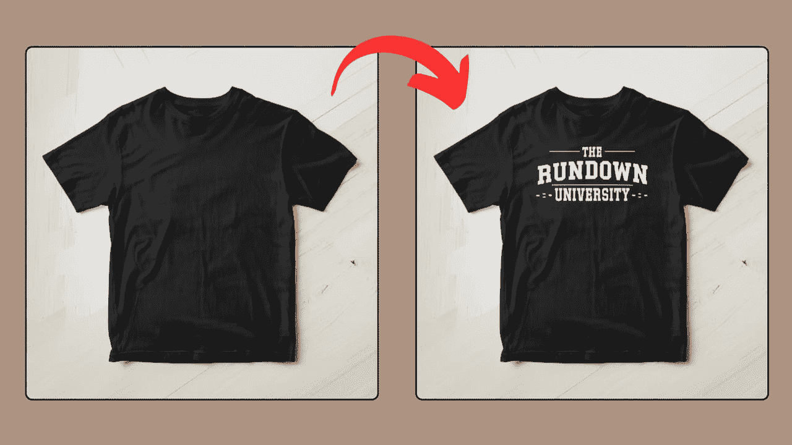

5、xAI面向开发者推出API，提供每月25美元的免费使用额度

埃隆马斯克的xAI今天宣布其应用程序编程接口（API）现已向公众开放，并且到今年年底每月可免费获得25美元的API积分。xAI的API定价略高于其他模型，但免费的25美元积分可能吸引开发人员至少查看xAI的工具和平台。开发人员可以期待更多功能和更新。

6、Runway为Gen-3 Alpha Turbo AI视频生成器新增精确摄像机控制功能

Runway在其Gen-3 Alpha Turbo AI视频生成器中引入了精确的摄像机控制功能，使用户能够更好地掌控AI生成场景中的摄像机移动。此更新允许创作者指定摄像机的方向、速度和移动类型，包括平移、缩放以及前后移动，以构建复杂的视觉叙事。

官方介绍👇

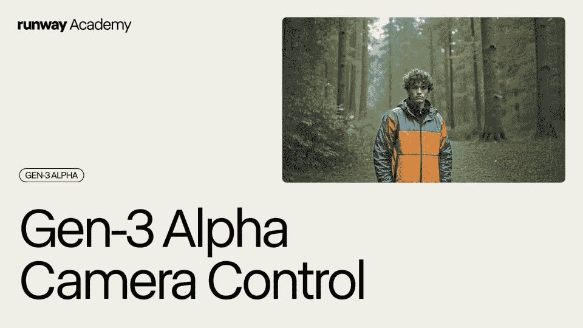

[Using Camera Control in Gen-3 Alpha Turbo _ Runway Academy.mp4](https://internal-api-drive-stream.feishu.cn/space/api/box/stream/download/all/Nefeb2RIAoOWtGx9NtOc5nImnFi)

7、Perplexity推出美国大选追踪工具

Perplexity AI 推出了一个美国大选追踪工具，基于美联社和Democracy Works的数据，为总统选举、参议院和众议院竞选提供实时更新和重要信息。该工具通过专门页面访问，涵盖投票要求、投票时间，并提供候选人、政策立场和选票措施的AI生成摘要。Perplexity的追踪器被定位为可靠的选举信息入口。

## 11月6日 AI资讯

1、苹果公司将在iOS18.2中集成OpenAI的ChatGPT

苹果公司宣布将在即将发布的iOS18.2版本中集成OpenAI的ChatGPT，为用户带来更智能的Siri和其他功能。新功能包括升级至ChatGPT Plus的选项，用户可订阅OpenAI的付费服务，费用为每月20美元。苹果与OpenAI合作的盈利模式尚不明确，双方希望通过提高曝光率实现互利。

2、昆仑万维发布天工 AI 高级搜索功能

昆仑万维天工 AI 发布最新版本的 AI 高级搜索功能。据介绍，本次天工 AI 高级搜索采用了强推理能力，实现「难题拆解 + 自动规划 + 主动扩展 + 深度回答 + 图文交织」多层次分析推理能力，将复杂的难题拆解为多个简单的问题，自动规划路径，一边思考一边执行。

3、Anthropic 发布 Claude Haiku 3.5

Anthropic 最近发布了其 Claude 3.5 Haiku 模型，相比前代在工具使用、推理和编码方面提供了新的改进。Anthropic 在十月推出了 3.5 Haiku，同时宣布了平台支持计算机使用功能，该模型在关键基准测试中超越了之前的顶级模型 3 Opus。新模型的价格提高了 4 倍，每百万输入令牌收费 1 美元，每百万输出令牌收费 5 美元，而 Claude 3 Haiku 的价格分别为 0.25 美元和 1.25 美元，价格的上涨引起了开发者社区的批评。

4、ControlNet作者新作：AI打光玩得更溜了！细节能力远高于SD1.5

ControlNet作者“敏神”（张吕敏），刚刚上新了一个新项目--IC-Light V2，具有16通道VAE和原生高分辨率。网友们看完效果之后也直呼“世界上最好的重光照（relighting）工具”

体验地址：https://huggingface.co/spaces/lllyasviel/iclight-v2

5、百度纯血鸿蒙版 App 开启测试：支持搜索、资讯等功能

近日，百度纯血鸿蒙版 App 已向报名测试用户发送下载链接，安装包约 33.6MB，提供搜索、资讯、短视频等功能。百度系 App 正适配鸿蒙系统，百度地图已在华为应用市场提供 HarmonyOS NEXT 版服务，百度网盘也将在 11 月推出原生 HarmonyOS NEXT 版本。

6、物理智能获得 4 亿美元资金，助力更先进的机器人

AI 创业公司物理智能刚刚获得了由杰夫·贝索斯和 OpenAI 领投的 4 亿美元融资，公司估值达到 24 亿美元，同时推出了其通用机器人控制模型 π0 (pi-zero)。

7、Meta 向美国国防部门开放 Llama AIMeta

刚刚宣布将向美国政府机构和国防承包商提供其 Llama AI 模型，用于国家安全应用，这标志着该公司关于其开源 AI 军事使用的政策发生了转变。Meta 正与包括亚马逊、微软、Palantir、洛克希德马丁和甲骨文在内的科技和国防公司合作，将 Llama 引入政府机构。

## 11月7日 AI资讯

1、OpenAI成功收购Chat.com域名

OpenAI成功收购知名老牌域名Chat.com，进一步丰富了其在网络领域的资产。这次收购预估金额达2000万美金，展现了OpenAI在人工智能行业的地位和品牌扩展战略。然而，尚未将ChatGPT托管在该域名下，可能不会影响品牌形象。

2、告别模糊画质!超清AI图像生成模型FLUX1.1Pro Ultra发布

FLUX1.1Pro 迎来重大更新，推出全新版本 FLUX1.1Pro Ultra，支持高达4兆像素的分辨率，生成速度大幅提升，每张图片仅需约10秒完成。Ultra模式可生成超高分辨率图像，速度比同类模型快2.5倍，不影响提示词精准度;Raw模式生成更真实、自然图像，适合人像和自然摄影。

体验地址：https://replicate.com/black-forest-labs/flux-1.1-pro-ultra

3、苹果发布iOS18.2公测版，AI表情生成、图像创作工具等系列AI新功能来袭

苹果公司发布了iOS18.2公测版，引入了一系列令人兴奋的人工智能功能，包括AI表情生成器、图像生成工具等。新功能统称为“苹果智能”，基于大型语言模型技术，为用户提供更智能的Siri服务、文本写作和校对助手以及图像生成能力。

4、Stability AI发布全新 Stable Diffusion3.5生成模型，三个版本、速度大提升

Stability AI最近推出了全新的深度学习文本到图像生成模型Stable Diffusion3.5，包括三种改进的开源模型，满足不同用户需求。其中Stable Diffusion3.5Large是最强大的模型，参数高达81亿，可生成1兆像素高质量图像。

详情：https://stability.ai/stable-image

5、AI颠覆服装设计!FLUX.1-dev LoRA 服装生成器来了

FLUX.1-dev LoRA 服装生成器利用先进的人工智能技术，为用户带来前所未有的时尚设计体验，让设计小白也能秒出服装效果图。模型基于丰富的时尚知识库训练，能准确理解用户需求，生成符合流行趋势和消费者偏好的服装设计。

链接：https://huggingface.co/tryonlabs/FLUX.1-dev-LoRA-Outfit-Generator

6、阿里测试AI动漫创作工具 “Animode”:视频一键动漫化

阿里巴巴正在测试一款名为“Animode”的AI视频创作工具，旨在简化视频动漫创作流程。这款工具能帮助用户将现实世界的视频转换为流畅的二次元风格，操作简单易上手，极大提升创作便捷性。

7、字节旗下AI助手豆包开启视频生成内测

字节跳动旗下的AI助手豆包推出视频生成内测，标志着公司正式进军AI视频生成领域。豆包视频生成支持图片文字一键成片，用户可选择风格比例、添加动态和运镜效果，创造独特视频内容。内测阶段需申请资格，未来将对外开放，让用户自由创作更多视频内容。

内测申请：https://www.doubao.com/video-apply?enter_from=internal_test_click

8、Perplexity新一轮融资即将完成，估值将达到 90 亿美元。

此轮融资由 Institutional Venture Partners 进行领投，投资金额为 5 亿美元。报道指出，这次融资是 Perplexity 今年的第四轮融资，而 Institutional Venture Partners 在此次融资前，也对 Perplexity 进行了多次投资，去年 Perplexity 的 B 轮融资也是由该公司领投。

## 11月8日 AI资讯

1、字节跳动推出X-Portrait2模型，一键生成相同表情神态

字节跳动推出X-Portrait2肖像动画技术，通过先进的表情编码器模型和生成扩散模型，实现超低成本高效的角色动画创作。该技术能传输细微面部表情，保持高保真度，适用于多种场景。

[6386659086063744857615931.mp4](https://internal-api-drive-stream.feishu.cn/space/api/box/stream/download/all/QQFfbWOn1okglhxYqNmcQBxpnFh)

2、小米视频 App 开启 “免费短剧” 专区内测招募：优化播放体验、提供 2000 部免费剧集

日前，小米社区发布小米视频新功能内测招募信息，新版本将推出 “免费短剧”专区，提供 2000 部免费短剧，并优化播放体验。同时，还将推出短剧畅看卡。内测报名时间为 2024 年 11 月 7 日至 11 月 13 日，测试时间为 11 月 7 日至 11 月 15 日。

3、亚马逊考虑加大对Anthropic的投资，要求使用自家芯片

亚马逊计划增加对AI公司Anthropic的投资，金额可能达到数十亿美元。这是自去年达成40亿美元投资协议以来的首次注资，但亚马逊提出一个条件：要求Anthropic使用其自家开发的硅芯片，通过Amazon Web Services进行AI训练。尽管Anthropic倾向于使用Nvidia芯片，但考虑到资金的诱惑，公司可能会同意这一要求。

4、Google推出AI互动学习平台，探索知识新方式

Google全新实验项目“Learn About”上线，利用AI技术为用户提供互动式学习体验。通过深入的解释、视觉辅助和个性化内容，用户可以更高效地掌握各类知识。目前，用户可以报名参与测试，使用 AI 工具更高效地学习和理解各种主题。该功能仅限部分国家用户注册测试。

https://learning.google.com/experiments/learn-about/

5、黑客称利用反作弊漏洞封禁《使命召唤》“成千上万”玩家

一名黑客近日向媒体透露，利用Ricochet反作弊系统的漏洞，他成功封禁了《使命召唤》中数千名玩家，甚至包括部分知名主播。通过发送含有特定“关键词”的私信，该黑客让系统误判玩家为作弊者。尽管动视已修复漏洞，但业内人士批评其反作弊检测机制存在重大疏漏。

6、TikTok新增功能：用户可直接从Spotify和Apple Music分享音乐

TikTok推出“分享到TikTok”功能，允许用户将Spotify和Apple Music上的歌曲、专辑、播放列表直接分享至TikTok的动态、故事或私信中，增强音乐推广和互动体验。此举旨在促进音乐发现，并加深与流媒体平台的合作，而非与之竞争。通过此功能，TikTok进一步推动其在音乐推广领域的影响力。

# 第二周

## 11月11日 AI资讯

1、最后一曲!甲壳虫乐队借AI修复新曲《Now and Then》获两项格莱美提名

甲壳虫乐队利用人工智能技术修复新曲《Now and Then》，并获得两项格莱美提名，尽管已解散50年，仍引人惊讶。保罗・麦卡特尼亲自参与制作，通过AI技术修复约翰・列侬的录音，展现出乐队的音乐魅力。格莱美提名使乐队再次成为关注焦点。

2、台积电据报道暂停向中国公司供应先进芯片

据路透社报道，在台积电（TSMC）生产的芯片被发现用于华为处理器后，美国商务部已下令台积电暂停向中国客户供应先进芯片。华为因受到美国的贸易限制，暂停出货是为了让美国政府有时间确认是否有其他公司将芯片转移给华为。

3、X 正在测试 AI 聊天机器人 Grok 的免费版本

据报道，目前免费版本正在新西兰测试，用户需要账户注册超过 7 天并绑定手机号。免费用户可使用 Grok-2 模型每两小时最多查询 10 次，并支持有限的图像分析功能。xAI 希望通过扩大用户群，加快反馈，以更好地与 ChatGPT 等竞争对手竞争。

4、豆包大模型团队正式发布图像编辑模型SeedEdit 用嘴P图成真!

SeedEdit是豆包大模型团队推出的图像编辑工具，通过一句话命令AI实现精准修改图片元素，比MJ更简单快捷。用户只需输入指令，如"把项圈变成珍珠项链"，即可轻松编辑图片。SeedEdit在维持原始图像和生成新图像之间取得平衡，支持多轮编辑，精准理解用户指令，保持高质量。

https://huggingface.co/spaces/ByteDance/SeedEdit-APP

5、Suno发布V4音乐生成模型音频演示视频，音质和风格大提升

Suno 公司最新发布的v4音乐生成模型展现出显著的音质和多样性提升，通过深度学习技术生成更自然和富有表现力的音乐作品。这一创新不仅适用于个人创作，还可以推动AI音乐生成技术的普及和应用。

6、谷歌推出AI视频制作神器Vids:输入文字秒变视频，小白也能轻松创作!

谷歌最近推出了名为Vids的AI视频演示应用程序，利用Gemini AI模型驱动，用户可以通过简单的文字提示或上传Google Drive文档生成视频演示文稿。Vids具有强大的AI智能创作能力，简化了视频制作过程，提供丰富模板和自定义编辑功能。同时支持便捷的语音和录音功能，实时协作和安全共享，适用于多种场景。

更多：https://workspace.google.com/products/vids/

7、昆仑万维SkyReels AI短剧平台将于12月10日在美国正式上线

昆仑万维科技股份有限公司旗下的AI短剧平台SkyReels即将在美国正式上线，这标志着公司在全球AI娱乐市场的扩张，为北美观众带来全新的智能短剧体验。平台通过创新技术和功能，为内容创作者提供强大的创作工具，同时降低了AI短剧创作门槛，使非专业用户也能轻松上手。

8、视频也能脑补配音?CogSound让视频“声”动起来，从此告别无声尴尬!

CogSound是一款基于人工智能技术的音效生成模型，能为无声视频添加逼真的音频体验，让观众享受身临其境的音效体验。它像经验丰富的配音大师，识别视频场景，匹配合适音效，并确保音视频同步。采用先进技术确保音效与画面完美同步，避免“音画不同步”的尴尬。

9、百度文心一言AI绘画功能升级

百度AI旗下的文心一言AI绘画技术迎来了重大升级，现在支持一键生成多比例图片，极大地简化了新媒体配图流程。技术进步使得文心一言AI在语义理解、视觉效果和细节刻画上都有显著提升，提高工作效率，提升视觉效果，使新媒体配图变得简单易行。

## 11月12日 AI资讯

1、即梦AI宣布Seaweed视频生成模型开放使用

即梦AI宣布开放Seaweed视频生成模型，提供专业级光影布局和色彩调和，画面视觉美感和真实感。模型基于DiT架构，能实现流畅自然的大幅度运动画面。Pro版模型可实现多拍动作与多主体复杂交互，攻克多镜头切换难题，适配各种设备比例，助力专业创作者和艺术家们的创作。

2、机器人艺术家Ai-Da肖像拍卖破纪录，图灵画像超百万美元成交

在苏富比的数字艺术拍卖会上，机器人艺术家Ai-Da创作的阿兰·图灵肖像《A.I. God》以超过100万美元的价格售出，打破了AI艺术作品的拍卖记录。作品运用柔和色调和碎片化元素，探讨AI技术的伦理问题，激发了对AI在未来艺术领域影响的思考。

3、谷歌ReCapture让用户在现有视频中调整镜头角度

谷歌推出全新AI技术ReCapture，允许用户在已录制的视频中调整镜头角度。通过时间和空间低秩适应（LoRA）层微调视频，实现平滑的平移、倾斜和缩放效果，无需重新拍摄或重新训练模型。该技术展示了AI在视频编辑领域的创新潜力，为用户提供专业级的编辑体验。

4、MIT推出虚拟训练平台LucidSim，提升机器人性能

MIT研究人员推出了名为LucidSim的AI系统，通过生成的图像训练四足机器人，无需在实际环境中训练就能达到前所未有的表现。与传统依赖人工演示的方法相比，LucidSim在虚拟环境中的训练使机器人在障碍物导航和小球追逐等任务中达到了88%的准确率。通过消除对大量显示世界训练数据的依赖，减少实际部署中时间和资源投入。

5、URAvatar:用手机扫描即可生成个性化虚拟头像

URAvatar技术利用手机扫描生成高保真的虚拟头像，提升了虚拟头像的视觉效果，让用户可以实时驱动和调整头像。该技术采用可学习的辐射传输模型，实现了实时渲染和光照迁移，为虚拟头像带来新的可能性。用户还可以独立控制头像的凝视方向和颈部动作，增强了虚拟交互体验。

6、AI编码助手Cursor背后公司估值暴涨至25亿美元，投资者竞相抢购

Anysphere旗下的AI编码助手Cursor月收入迅速增长至每月400万美元，吸引了大量风险投资者的关注。公司估值在短短几周内从15亿美元飙升至25亿美元，成为市场焦点。创始团队均为麻省理工学院学生，曾毕业于OpenAI的加速器项目，展现出强大的潜力和吸引力。

7、Meta与美国和英国大学合作测试VR教育，创建数字双胞胎“元宇宙大学”项目

Meta的新教育测试计划将与13所教育机构合作，这些机构将提前获得Meta一直在预告的新产品的早期版本。该计划将使用虚拟现实和混合现实技术，为学生提供沉浸式学习体验，涵盖科学、医学、历史等多个学科。通过这些创新项目，Meta希望进一步推动VR在教育领域的应用，同时解决其虚拟现实实验室的亏损问题。

8、亚马逊确认员工数据在第三方供应商安全事件中被泄露

亚马逊确认，员工数据在其第三方供应商发生“安全事件”后被泄露。亚马逊发言人表示，亚马逊和AWS系统安全，未受到影响，泄露的数据仅包括员工的工作联系信息，如工作邮箱、座机号码和办公楼位置。该供应商已经修复了漏洞，并且未涉及社保号码或财务信息。

## 11月13日 AI资讯

1、无需顶级显卡，Meissonic 让你轻松生成媲美 SDXL 的高清大图!

Meissonic 是一款颠覆性的图像生成模型，通过一系列架构创新和优化策略，将非自回归掩码图像建模技术提升到与顶级扩散模型相媲美的水平。其性能和效率得到显著提高，仅有10亿参数就能生成高质量的1024×1024分辨率图像，且在消费级 GPU 上运行流畅。

详细：https://github.com/viiika/Meissonic

2、谷歌DeepMind开源AlphaFold3:诺奖化学模型，助力药物研发!

谷歌DeepMind意外发布了AlphaFold3的源代码和模型权重，标志着科学发现和药物开发的重大进展。创造者获得2024年诺贝尔化学奖，表彰在蛋白质结构预测方面的贡献。AlphaFold3技术能力有质的飞跃，可建模蛋白质、DNA、RNA及小分子复杂相互作用，对药物发现和疾病治疗至关重要。

3、秘塔AI搜索上线专题功能 支持收藏、定制数据源

秘塔AI搜索推出全新的专题功能，允许用户上传资料至知识库，定制个人或专业领域的数据源，提升搜索效率和相关性。用户可创建专属搜索环境，增强搜索体验。API功能允许集成专题搜索能力到用户程序中，提供个性化和专业化搜索服务。

4、Meta再向欧盟监管低头：Facebook和Instagram在欧无广告版订阅降价高达40%

Meta更新公司博客文章宣布，对在欧盟上线的Facebook和Instagram无广告版订阅收费下调。从本周三起，网页端的每月订阅收费从9.99欧元降至5.99欧元，降幅40%，在苹果iOS系统和谷歌安卓系统上的手机端每月订阅收费从12.99欧元降至7.99欧元，降幅38.5%。订阅用户每增加一个Facebook 或 Instagram 帐户，网页端每月收费4欧元，iOS 和 Android 端每月收费 5 欧元。

5、拯救TikTok？特朗普团队回应：他将“兑现”承诺

还有两个多月时间，TikTok可能就会在美国被封禁。由于候任总统特朗普曾在今年竞选期间表示反对封禁TikTok，TikTok现在寄希望于特朗普能够找到方法拯救它。当被问及特朗普是否会阻止TikTok在美国被封禁时，特朗普团队的发言人表示，他将“兑现”这些承诺，但没有提供具体细节信息。

6、月之暗面创始人杨植麟与前投资人“反目”，背后牵扯“泼天富贵”

有媒体报道称，月之暗面创始人杨植麟和联合创始人兼CTO张宇韬近日在香港被提起仲裁，仲裁申请方为二人此前共同创立的循环智能的部分投资人。目前，月之暗面方面已委托律所处理此事，代理律师称将对此依法进行抗辩。

据媒体报道，此次仲裁申请很可能是因为循环智能的投资方对循环智能后来在月之暗面所占的股比不满。

7、马斯克正式领导特朗普政府效率部，狗狗币大涨近20%

在特朗普宣布埃隆·马斯克(Elon Musk)将领导新成立的“政府效率部”(DOGE)后，狗狗币价格暴涨近20%，延续了美国大选后的上涨态势。美国当选总统特朗普周二宣布，马斯克与美国企业家维韦克·拉马斯瓦米(Vivek Ramaswamy)将领导新成立的“政府效率部”，为新政府废除官僚主义，削减多余的监管，减少浪费性开支，并重组联邦机构。

8、TikTok 正在与网红购物应用 LTK（原名 LiketoKnow.it 和 RewardStyle）进行整合

TikTok 正在与网红购物平台 LTK 进行整合推出全新购物功能，以帮助时尚创作者通过其推荐内容赚取更多佣金，并简化消费者购物流程。目前，部分创作者已开始测试这一功能，他们的视频评论区会显示 LTK 的商品链接。这一合作将进一步巩固 TikTok 作为社交与购物相结合的平台地位，使消费者更方便地从视频中直接购买产品。

9、亚马逊推出1.1亿美元AI研究资助计划

为推广自家AI芯片Trainium，亚马逊宣布启动“Build on Trainium”项目，将向AI研究人员提供总额达1.1亿美元的资助和云计算资源。该计划旨在帮助高校和独立研究者获取更多计算能力，以加速AI模型开发，缩小学术界与行业在资源上的差距，同时推动AI技术的开源发展。尽管AWS表示研究者将不被“绑定”至其平台，但外界对企业对学术研究可能产生的影响仍存质疑。

## 11月14日 AI资讯

1、生数科技 Vidu 大模型迎来新版本

全球首个支持多主体一致性的多模态大模型！Vidu-1.5支持人物、物体和环境等主体的一致性，颠覆了传统的单点微调方法如Lora。同时在镜头理解、特效画面、动漫风格等方面实现模型能力的全面升级！清晰度新增支持720p和1080p。

体验地址：https://www.vidu.studio/zh

更多玩法：https://c.aiiz.cn/nKJphC

2、阿里海外推出全球首个B2B领域AI搜索引擎Accio

阿里巴巴集团推出全球首个B2B领域AI搜索引擎Accio，旨在帮助商家更快速、更准确地找到所需的商品和供应商。Accio已在阿里国际站取得成功试运行，转化率提升20%-30%，商品量覆盖亿级。

详情链接:https://www.accio.ai/

3、ElevenLabs推出Projects功能，革新有声读物制作

ElevenLabs发布了Projects工具，支持用户将书籍和剧本等长篇内容转换为有声读物与播客，同时提供语音分配、文本编辑与情感调节功能，提升制作效率并优化听书体验。这一功能旨在降低出版成本，并通过AI个性化语音进一步丰富用户的听书选择。

4、AI机器人掌握外科手术技能

约翰·霍普金斯大学研究人员取得重大进展，成功训练AI机器人通过观看人类外科手术视频，掌握缝合和组织提拉等复杂操作。借助模仿学习算法和达芬奇手术系统的结合，这一突破为外科手术机器人的自主学习与灵活性开辟了新前景。

5、传OpenAI即将推出新款智能体 能为用户自动执行任务

据两名知情人士透露，美国人工智能初创企业OpenAI正准备推出一款代号为“Operator”的新型智能体。该智能体可以通过计算机代替用户完成编写代码或预订旅程等任务。其中一位匿名知情人士透露，在周三的员工会议上，OpenAI管理层宣布计划于明年1月发布该工具的研究预览版，并通过API（应用程序接口）向开发者开放。

6、YouTube试水AI音乐重混功能，用指令词即可改编 30 秒热门配乐

YouTube近日推出了名为“Dream Track”的AI音乐重混功能，让创作者可以重新演绎授权歌曲，增强短视频的艺术表现。这一创新将为创作者们带来更多灵感，拓宽音乐创作的边界，为短视频音乐带来更多风格可能性。

7、Anthropic即将推出 Claude3.5Opus，AI 竞争再升级

Anthropic的首席执行官宣布公司即将推出新一代人工智能模型Claude3.5Opus，引发行业期待。新模型将超越现有型号，重新分配能力曲线。AI竞争激烈，OpenAI和谷歌也将发布新模型。

8、小米成立 AI 平台部

小米公司最近进行了一系列的人事变动，其中包括成立了 AI 平台部，并任命张铎为该部门的负责人，他将向基础技术平台部总经理冯宏华汇报。张铎曾在 2016 年至 2021 年间任职于小米，并被雷军誉为公司的「大神」。此外，小米集团副总裁马骥已不再参与中国区的具体业务，并正在休假。

9、剁手党狂喜!AI试衣技术Fashion-VDM颠覆传统 网购衣服再也不怕踩雷了!

Fashion-VDM技术为网购者带来革命性的试衣体验，通过视频扩散模型实现动态试穿衣服，效果逼真。技术采用先进的分离式无分类器引导技术和渐进式时间训练策略，结合图像和视频数据进行联合训练，打破传统虚拟试衣软件的局限性。

https://johannakarras.github.io/Fashion-VDM/

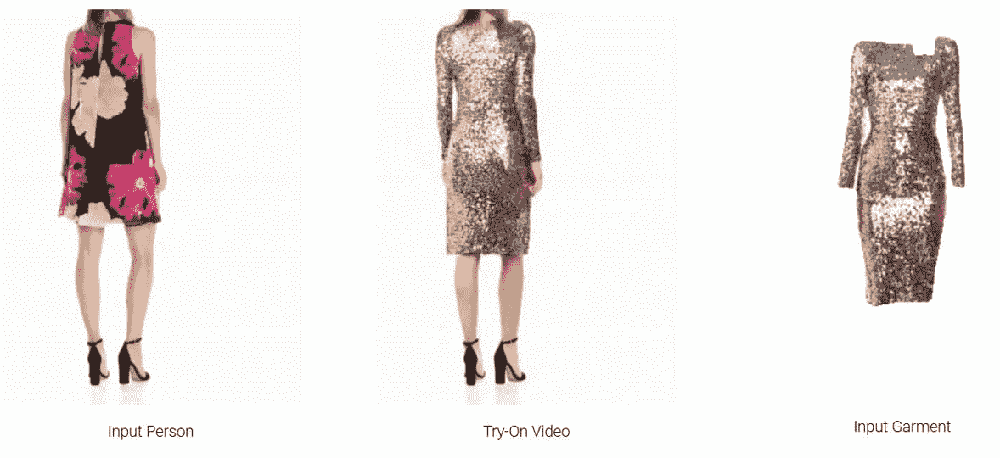

[6386710868838120146908476.mp4](https://internal-api-drive-stream.feishu.cn/space/api/box/stream/download/all/KJ4lbN6qMoXJnZxACqhcUMXTnid)

## 11月15日 AI资讯

1、OpenAI计划明年推首款自主AI代理 “Operator”

OpenAI计划在明年一月推出名为“Operator”的自主AI代理，这将是一款具备控制计算机执行任务能力的产品。该举措将引领人工智能技术的新潮流，加剧与其他科技巨头的竞争，同时被视为潜在的突破性产品，可能改变市场格局。

2、腾讯元宝APP2.0版上线:混元模型升级 支持多种模态理解和生成

腾讯元宝2.0版本正式上线，带来全新设计的对话列表和AI应用专属板块，满足用户搜索、阅读、写作、绘画等多维创作需求。新版本整合微信公众号、微信视频号、QQ音乐等特色信息资源，提供更智能、便捷的搜索服务。

3、Bria推出免费高清抠图工具RMBG 2.0

Bria团队发布的RMBG2.0开源软件表现惊人，背景去除技术迎来新突破，挑战了传统remove.bg的地位，虽然缺少二次编辑功能，但免费且高清的抠图效果已经相当不错

官网：https://blog.bria.ai/introducing-the-rmbg-v2.0-model-the-next-generation-in-background-removal-from-images

HuggingFace模型库：https://huggingface.co/briaai/RMBG-2.0

4、DeepL上线语音翻译工具DeepL Voice:会议、对话实时多语言交流

DeepL最新推出的实时语音翻译工具DeepL Voice旨在促进多语言沟通，解决语言障碍，提高生产力和包容性。该工具支持多种语言，包括英语、德语、日语等，提供33种语言的字幕翻译。通过会议语音和对话语音模型，实现面对面或虚拟场景下的多语言互动，提升沟通效率和团队合作。

5、AI版权大战!德国版权组织起诉OpenAI:ChatGPT未授权使用歌曲歌词

德国音乐版权组织GEMA对OpenAI提起诉讼，成为全球首个对人工智能提供商采取法律行动的版权集体管理机构。GEMA指控OpenAI的ChatGPT未经许可使用受版权保护的歌曲歌词，引发全球关注。

6、苹果正式发布 Final Cut Pro 11，带来了更加强大的 AI 工具能力。

Final Cut Pro 已在 Mac、iPad 和 iPhone 上推出智能新功能、省时工具和全新创意选项，此外还推出了空间视频编辑功能。Final Cut Pro 11 充分利用了 Apple 的 M 系列芯片，提供了强大而直观的磁性蒙版，无需绿幕或者耗时的手动转描即可分离出任何素材中的人物、物体和形状。

## 11月16日 AI资讯

1、字节视频生成模型PixelDance上线即梦AI：用户可免费体验

字节跳动视频生成模型PixelDance和Seaweed在即梦AI正式上线，面向公众免费开放使用。用户进入即梦AI的视频生成”界面，在视频模型里选择视频P2.0 Pro”或视频S2.0 Pro”，即可分别体验这两款模型，目前网页版和手机端APP均已支持。

2、谷歌Gemini Exp1114横空出世!首战碾压GPT-4，多项能力评测登顶引业界震动

谷歌最新推出的Gemini实验版本（Exp1114）在Chatbot Arena平台上取得了令人瞩目的成绩，超越竞品，展现出惊人实力。Gemini-Exp-1114以超出40分的优异成绩与GPT-4-latest并列第一，在数学、复杂提示和创意写作等核心领域全面登顶。

3、ChatGPT 推出 macOS 测试版“Work With Apps”功能，深度集成开发者工作流

简短描述：OpenAI 推出 macOS 桌面应用测试功能“Work With Apps”，支持连接 Xcode、VS Code 等应用，帮助理解上下文并提供编程辅助。未来计划增加更多应用支持，赋能开发者直接在编辑器内修改代码。该功能正在逐步向免费用户开放，优化技术用户的工作效率。

4、腾讯AI智能工作台ima.copilot上线Windows版本

腾讯公司推出的c简称ima）Windows版，不仅具备搜索功能，还能回答问题、创作文本、生成图片，展现了腾讯在人工智能领域的技术实力和深入探索。ima特别引人注目的搜索功能整合了微信公众号文章资源，丰富了搜索结果，提高了信息获取效率和质量

5、Anthropic发布提示词优化新功能

Anthropic最新推出的提示词优化新功能为开发者带来了巨大便利，提升AI应用的可靠性和效率。优化器通过先进工程技术自动完善提示词，准确率提升30%，字数准确率达100%，用户可提供反馈进一步改进。

更多：https://www.anthropic.com/news/prompt-improver

6、一句话帮你生成应用!阿里通义上线代码模式

阿里通义实验室推出了代码模式，让用户能够通过简单的日常语言指令生成各种应用，包括小游戏、数据图表、网站和简历等。用户只需访问通义网页版，点击“代码模式”即可开始体验全新交互方式。

7、AI 平台Hedra推出 5 大重磅功能

全新上线 5 大 AI 功能，包括语音隔离技术，可迅速去除背景噪音获得清晰音频；语音变声功能，上传或使用克隆/自定义声音，瞬间变声；语音设计工具，基于文本提示生成独特声音；AI创意助手，快速生成、翻译和优化脚本；以及长达12分钟的内容生成能力。

[IIOfHMhrnsn44YRX.mp4](https://internal-api-drive-stream.feishu.cn/space/api/box/stream/download/all/HeUbbXGSAoteq6x7FQAcc7C4nvd)

8、马斯克旗下xAI融资60亿美元，拟购买10万块英伟达芯片提升超算中心

马斯克旗下的人工智能公司xAI正在进行一项重大融资。此次融资以500亿美元的估值，规模至多可达60亿美元。据知情人士透露，融资预计于下周初完成，其中50亿美元资金将来自中东的主权基金，另外10亿美元则来自其他投资者，而且部分投资者还有追加投资的意向。

# 第三周

## 11月18日 AI资讯

1、HeyGen 推出全新 AI 视频创作功能

HeyGen 发布多项重磅更新，包括通过文本提示生成个性化视频、虚拟化身动态场景、AI 翻译与语音优化，以及屏幕录制和 API 套件。这些功能旨在简化视频制作流程，提升创作者效率，并助力品牌内容全球化。HeyGen Hub 社区也已上线，帮助用户互相交流创作灵感。

更多：https://www.heygen.com/article/whats-new-in-heygen-november-2024-highlights

[X2Twitter.com_cTOpnkUNeG8O7Mo1_720p.mp4](https://internal-api-drive-stream.feishu.cn/space/api/box/stream/download/all/WnBEbewgAo1jhjxhTSgc99XUnoh)

2、抖音推进 “V 项目” ，上线AI 分身功能让直播互动更嗨

抖音的新“V 项目”通过AI分身功能，极大地丰富了用户的直播互动体验。这一创新不仅提升了创作者与用户之间的互动频率，也为社交平台的竞争注入了新的活力。

3、微信公众号悄然推出AI音色克隆功能，尚未全量上线

这一新功能为用户提供了个性化的阅读体验，允许他们通过自己的声音朗读文章，增强了内容的情感表达。

4、特斯拉 Optimus 机器人模型上架一天即售罄

特斯拉 Optimus 机器人模型，一个 1:10 比例的精致收藏品，拥有超过 40 个独立部件和 20 个关节活动点，以其逼真的外观和灵活性，一经推出便以 40 美元的价格迅速售罄。这款模型不仅包括机器人本身，还附带迷你充电座模型和赛博锤，尺寸小巧，重量轻。这也是特斯拉首次推出非车辆类产品模型。

5、爱诗科技PixVerse文生视频、图生视频技术服务全球开放

最近，我对北京爱诗科技有限公司的PixVerse平台感到兴奋。它的文生视频和图生视频技术服务的开放，标志着AI视频创作的一个新纪元。PixVerse V3的多模态生成能力和丰富的创意模板，极大地拓宽了我的创作边界，尤其是故事续写和口型匹配功能，让我能够轻松地为我的视频增添更多情感和细节。

地址：https://app.pixverse.ai/home

## 11月19日 AI资讯

1、Google Lens 推出实体店购物支持，助力假日消费

谷歌更新 Google Lens 功能，为实体店购物者提供商品洞察、价格比较及本地库存信息，同时推出 Google Maps 新购物功能，并增强 Google Pay 能力，以迎接假日购物季。通过 Google Lens，用户可拍摄商品图片，快速获取商品评价、库存及价格对比信息。目前支持的商家包括 Target、Ulta Beauty、Macy’s 等。新功能依托 Shopping Graph 的 450 亿商品数据和 Gemini 模型，为购物者提供更便捷的决策依据。

2、微软将允许用户为Teams会议克隆语音

微软计划让Teams用户克隆自己的语音，以便在会议中用不同语言与他人交流。2024年10月，微软在Ignite大会上发布了Teams中的翻译工具“Interpreter”，该工具将在2025年初开始提供，支持最多9种语言的实时语音翻译，并能模拟用户的声音。

3、谷歌搜索被判垄断，将被美国司法部勒令出售 Chrome 浏览器

彭博社报道称，美国司法部最高反垄断官员已决定要求法官强制 Alphabet 谷歌出售其 Chrome 浏览器，因为这也是大部分人使用其搜索引擎的关键入口。彭博社指出，这是自华盛顿二十年前试图拆分微软公司以来，美国政府对一家科技公司进行的最激进控制行动，这将会是对谷歌一次历史性打击。受此消息影响，谷歌股价盘后下跌 1.8%，至 172.16 美元。

3、谷歌搜索被判垄断，将被美国司法部勒令出售 Chrome 浏览器

彭博社报道称，美国司法部最高反垄断官员已决定要求法官强制 Alphabet 谷歌出售其 Chrome 浏览器，因为这也是大部分人使用其搜索引擎的关键入口。彭博社指出，这是自华盛顿二十年前试图拆分微软公司以来，美国政府对一家科技公司进行的最激进控制行动，这将会是对谷歌一次历史性打击。受此消息影响，谷歌股价盘后下跌 1.8%，至 172.16 美元。

4、AnyChat:一键切换多种 AI 模型，ChatGPT、Claude、Gemini随便挑

AnyChat 是一个创新的平台，能够让开发者灵活地在多种大型语言模型之间切换，极大地提升了工作效率。通过友好的界面和多样的模型选择，开发者可以轻松应对不同的任务需求，同时避免了高昂的 API 费用。这个平台的推出正值 AI 行业快速发展的关键时期，未来有望吸引更多开发者的参与与贡献。

详情链接:https://huggingface.co/spaces/akhaliq/anychat

5、ElevenLabs全新功能上线，支持打造个性化对话式AI智能体了

ElevenLabs最近推出了一个令人兴奋的新功能，允许用户根据自己的需求构建个性化的对话式AI智能体。这个平台的灵活性和定制化能力无疑会吸引更多开发者和企业的关注，尤其是在与OpenAI等竞争对手的竞争中，ElevenLabs凭借其独特的优势，可能会在市场中占据一席之地。

6、阿里云发布逆天大模型Qwen2.5-Turbo 一口气读完十本小说，推理速度提升4.3倍!

阿里云推出的Qwen2.5-Turbo大语言模型在上下文处理能力和推理速度上都取得了革命性的突破，令人期待其在各领域的应用潜力。

详情链接:https://qwenlm.github.io/blog/qwen2.5-turbo/

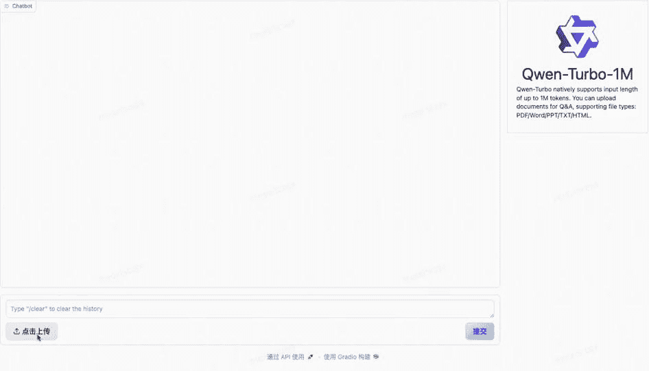

[6386762669614473423150509.mp4](https://internal-api-drive-stream.feishu.cn/space/api/box/stream/download/all/FoNYbSeFQoJlZUxP6yXcaDNnn6c)

7、AI能办专属信用卡了，Agent自己赚钱自己花，OpenAI合作伙伴打造

支付公司Stripe（也就是Chatgpt的支付服务商）专门为AI智能体发布了一个接口，它允许智能体使用一次性虚拟卡完成金融支付。这意味着，今后我们让“AI助理”帮忙订一张机票，它就真的能下单支付，自己跑完整个流程了。

8、Perplexity推出 AI 驱动购物功能，为美国的 Pro 用户带来全新购物体验

简短描述：Perplexity 为美国 Pro 用户推出全新 AI 购物体验，包括复杂查询推荐、一键购买、拍照购物等功能。用户可享免费配送，所有推荐均由 AI 分析生成，摆脱广告干扰，重新定义购物流程。

## 11月20日 AI资讯

1、Gamma推出AI演示文稿工具，支持多种图像生成风格

Gamma 推出全新演示文稿工具，整合多种 AI 图像生成器，包括 Playground 2.5、Flux Fast 和 Imagen 3，用户可根据需要选择不同风格。该工具支持快速生成大纲、预览多样化视觉效果，并一键下载。专业选项如 Flux Pro 1.1 和 Ideogram 提供高质量人物图像和可读文字，适合制作专业级内容。

官网：https://gamma.app/

2、OpenAI将ChatGPT的高级语音模式引入网页端

OpenAI 宣布将 ChatGPT 的高级语音模式扩展至网页端，支持用户通过浏览器与 AI 进行实时语音对话。该功能已于本周向付费用户开放，并计划未来几周内向免费用户提供预览体验。利用 GPT-4o 技术，ChatGPT 可实现更自然的对话，支持情感表达和语速识别，还提供九种个性化语音选择。

3、Cooraft：将自拍变成艺术与视频，体验全新风格转换

Cooraft 提供了一款创新工具，能将普通自拍转换为各种视觉效果和风格。用户可以将自拍照片变成高质量的 AI 视频，享受如同大片般的效果。通过 AI 工作室功能，只需一张自拍便能生成多个专业级别的照片，仿佛由摄影师亲自拍摄。此外，Cooraft 还提供风格改造选项，让用户的照片变成 3D 卡通、经典油画等艺术作品，轻松实现创意转化。

[X2Twitter.com_PYNrvCuNMDVSOiRS_1040p.mp4](https://internal-api-drive-stream.feishu.cn/space/api/box/stream/download/all/JUYmbmbBZoKtmdxzxZscaAKqnNd)

4、Google Gemini新增记忆功能，提升个性化体验

Google 推出 Gemini 聊天机器人的记忆功能，可记住用户的生活信息与偏好，为餐厅推荐等提供更贴合用户需求的建议。该功能目前仅面向 Google One AI Premium 订阅用户开放，暂时仅支持网页端，且不会用于模型训练。Google 强调用户可随时管理或删除记忆，确保数据隐私安全。

5、Freepik推出AI视频生成器，简化创作流程

Freepik推出全新AI视频生成器，允许用户将静态图像或文本转化为动态视频，并添加特效。该工具适用于创作者、社交媒体经理和营销人员，帮助他们快速制作专业级视频，省去复杂的软件操作和高成本。AI视频生成器与Freepik其他工具无缝配合，提升创意制作效率，改变了内容创作的方式。

地址：https://freepik.com/pikaso/ai-video-generator

6、英伟达与谷歌合作开发量子计算处理器

英伟达与谷歌 Quantum AI 部门宣布合作，利用 NVIDIA CUDA-Q 平台和 Eos 超级计算机，助力谷歌研究人员开发量子计算机的海量数字模型，以解决设计难题。谷歌将使用英伟达的混合量子经典计算平台来模拟其量子处理器的物理特性，克服量子计算硬件的局限性，加速量子组件的开发。

7、谷歌正开发全新高端 Pixel 笔记本

谷歌正在开发一款新的内部代号为「Snowy」的高端笔记本电脑，这款产品将隶属于 Pixel 品牌。这款笔记本电脑正在与市场上的其他高端产品如 MacBook Pro、Dell XPS、Microsoft Surface Laptop 和 Samsung Galaxy Chromebook 进行竞品比较分析。该项目已经获得批准并超出了概念阶段，谷歌已经组建了一个专门的团队来加速开发进程。预计这款 Pixel 笔记本电脑将拥有一个高级版本，目标是高端市场，并且可能会运行 Chrome OS。

8、蜜雪冰城进军人工智能！首次成立AI技术公司

在茶饮界深耕多年的蜜雪冰城，近日通过其两家子公司联合投资成立了雪王爱智慧科技（郑州）有限公司，注册资本为5000万人民币。与蜜雪冰城其他供应链、销售公司不同的是，该公司的业务范围涵盖了新兴能源技术研发、人工智能理论与算法软件开发、人工智能公共数据平台、人工智能基础软件开发、智能控制系统集成、智能机器人研发和销售等多个领域。

9、研究显示ChatGPT诊断能力超越医生，颠覆传统医疗认知

弗吉尼亚大学的研究表明，ChatGPT-4 在复杂病例的诊断准确率上达到90%，显著优于医生单独诊断（74%）或使用AI辅助（76%）的表现。研究强调，医生未充分利用AI功能，且常忽略与自身诊断冲突的AI建议。此结果呼吁重新定义AI在医疗中的角色，并加强医生与AI合作的培训。

## 11月21日 AI资讯

1、新视频生成技术AnimateAnything:支持控制镜头轨迹、文本提示等

作为一名视频创作者，我对AnimateAnything的推出感到非常兴奋。这项新技术通过多尺度控制特征融合网络，实现了更加灵活和高效的动画效果生成。尤其是在处理复杂运动时，频率稳定模块的引入有效减少了闪烁现象，使得动画效果更加自然。

项目网址：https://yu-shaonian.github.io/Animate_Anything/

2、Suno v4版本重磅发布，新增Remaster音质提升功能和AI歌词助手ReMi

Suno最近推出了其音乐生成模型的4.0版本，带来了多项改进，包括音频质量和歌词准确性。新功能“Remaster”允许用户将旧曲目升级，同时推出的AI歌词助手“ReMi”也为创作提供了支持。然而，早期用户反馈中存在一些技术问题，且公司面临法律挑战。

[6386771282802157408335548.mp4](https://internal-api-drive-stream.feishu.cn/space/api/box/stream/download/all/X9RCbjKIcoH7V5xJSkOc4VUNnUg)

3、不仅能翻译，还能克隆你的声音！微软AI“口译员”正式亮相

据外媒报道，近日，微软公司希望引入一种独特的AI实时翻译功能，来解决其团队会议平台中的跨语言交流问题——这种功能不仅可以传达你所说的话，还能克隆你的声音。在为开发人员和IT专业人员举办的年度活动——微软技术大会（Microsoft Ignite）前，微软宣布了这种新的团队“口译员”式的AI功能，以在会议期间提供语音到语音的实时转译，而今年在芝加哥举行的微软技术大会，将持续到这周周五。

4、SpaceX 星舰第六次试飞成功

SpaceX 的星舰第六次试飞在 2024 年 11 月 20 日成功完成。

尽管没有复刻第五次试飞中「筷子夹火箭」的壮举，但试飞过程中各项操作均正常，包括在太空中成功重新点燃猛禽发动机，测试新的热防护材料，以及航天器在印度洋的稳定溅落。

5、360将发布新一代AI搜索:n.cn域名花了约一个亿

360 公司创始人周鸿祎宣布，将在本月推出全新 AI 搜索产品，旨在扩大公司在人工智能领域的应用。周鸿祎表示，新产品名称尚待确定，希望体现 AI 概念，并以字母 N 开头，因其购买了 n.cn 域名。同时，周鸿祎征集公众创意命名，积极鼓励参与者加入发布会。

6、新开源 “人生搜索引擎” Pensieve，可记录并回忆电脑屏幕内容

Pensieve 是一款创新的开源软件，旨在帮助用户轻松记录和回忆电脑上的活动。它的隐私保护设计和简单的安装过程，使其成为一个理想的选择。

详情链接:https://github.com/arkohut/pensieve?tab=readme-ov-file

## 11月22日 AI资讯

1、glif又出爆款玩法!利用AI玩转Logo周边，一键生成超酷个性化设计!

最近，glif推出了一项基于In-Context LoRA的黑科技，能够将Logo转化为令人惊艳的周边设计。这个创新的设计流程分为三个步骤，展示了AI在创意设计领域的巨大潜力，为设计师和品牌方提供了革命性的个性化创作工具。

地址：https://glif.app/glifs/cm3o7dfsd002610z48sz89yih

2、消息称 OpenAI 正考虑打造浏览器，与谷歌 Chrome 硬碰硬

据报道，OpenAI 考虑通过自行推出一款基于 AI 聊天机器人的自研浏览器对谷歌发起正面冲击。据知情人士透露，OpenAI 正在与多方讨论或已达成协议，为旅行、食品、房地产和零售网站提供搜索业务，包括康泰纳仕、Redfin、Eventbrite 和 Priceline 等网站和平台。

3、OpenAI 或将推出 ChatGPT 实时摄像头功能

OpenAI 正准备为 ChatGPT 推出实时摄像头功能，赋予其视觉交互能力，有望将视觉能力整合到助手的高级语音模式中。这一功能可让 AI 分析用户周围环境并进行实时对话，此前曾在 Alpha 测试中短暂亮相，展示了识别物体和自然交流的强大潜力。据悉，该功能或将在 2025 年全面上线，与谷歌的 Project Astra 展开激烈竞争。

4、YouTube Shorts 推出 AI 视频背景功能

YouTube 宣布其 Dream Screen 功能现支持生成 AI 视频背景，突破了此前仅能生成图片背景的限制。这得益于谷歌 DeepMind 的 AI 视频生成模型 Veo 的集成，用户可通过文本提示生成 1080p 视频背景，并选择不同动画风格。目前该功能已在美国、加拿大、澳大利亚和新西兰上线，未来还将支持生成独立的 6 秒短视频。

5、DeepMind AI 攻克量子计算错误

谷歌 DeepMind 刚刚推出了 AlphaQubit，这是一种显著提升量子计算机错误检测和校正能力的 AI 系统，向量子技术的实际应用迈出了关键一步。该系统通过两步训练实现高精度，并计划开源，为药物研发、气候建模等领域的量子计算应用铺平道路。

6、谷歌公布 2024 Google Play 最佳榜单

谷歌近日揭晓了 2024 年 Google Play 年度最佳榜单，亚太地区开发者表现卓越，共夺得超过 70% 的奖项。在应用类别中，亚太开发者斩获了 63% 的奖项，这一比例在游戏类别中更是高达 79%。值得一提的是，大中华地区有 15 个开发者团队的 15 款应用和游戏在全球范围内获得了 17 个年度最佳奖项。娱乐类应用在亚太地区获奖应用中占比 31%，人工智能应用也成为年度趋势，广泛应用于创意表达、生产力和娱乐领域。

7、马斯克脑机接口公司获批启动临床实验

埃隆·马斯克旗下的脑机接口公司 Neuralink 近日取得了重要进展，该公司已获得加拿大卫生部的批准，将在加拿大启动首次临床试验，并开始招募受试者。这项名为「CAN-PRIME」的研究旨在评估 Neuralink 植入物和手术机器人的安全性，并初步测试该公司脑机接口技术在帮助四肢瘫痪患者用意念控制外部设备方面的功能。

## 11月23日 AI资讯

1、ChatGPT或将上线实时摄像头功能，赋予AI“视觉”能力

OpenAI近期在ChatGPT测试版中引入了实时摄像头功能（Live Camera），可能为其AI聊天机器人带来实时视觉识别能力。新功能允许用户通过手机或摄像头实时分析物体、位置，甚至动态场景，例如识别玩耍的宠物或地标建筑。尽管尚无正式上线日期，但测试版代码的曝光显示该功能即将推出。

2、黑森林实验室推出全新FLUX.1Tools工具包 小白也能秒变P图大神

黑森林实验室发布了 FLUX.1Tools 工具包，提升了 FLUX.1模型的控制性和可操控性，允许用户精确修改图片。工具包包含 FLUX.1Fill、FLUX.1Depth、FLUX.1Canny 和 FLUX.1Redux，分别提供图像修复、深度修改、边缘检测和图像变体生成等功能。该工具包分为开源和 API 版本，并与多个合作伙伴合作发布。

更多:https://huggingface.co/black-forest-labs/FLUX.1-Redux-dev

[6386788581931996015168233.mp4](https://internal-api-drive-stream.feishu.cn/space/api/box/stream/download/all/UXXTb61Bkob2WYxjhaGcHXQenHh)

3、腾讯大规模减持Reddit股份 抛售总额已超4亿美元

11月23日消息，社交媒体平台Reddit股价在周四盘后交易中下跌7.29%，这一跌幅与腾讯公司披露的大规模减持Reddit股份行动密切相关。根据美国证券交易委员会（SEC）文件记录，腾讯在11月19日以平均每股133.76美元的价格出售了65.50万股Reddit股票，11月14日至18日期间以平均每股约129.38美元的价格出售了88.26万股，以及在11月11日至13日以平均每股132.19美元的价格出售了近150万股。

4、OpenAI竞争对手Anthropic再获亚马逊40亿美元投资

11月23日消息，OpenAI竞争对手Anthropic宣布扩大与亚马逊网络服务（AWS）合作伙伴关系，包括来自亚马逊的40亿美元新资金。这将使亚马逊对公司的总投资达到80亿美元，同时仍为少数股东。Anthropic称，亚马逊的最新决定将使其对Anthropic的总投资额达到80亿美元，亚马逊也将保留其作为少数股东的地位。

5、马斯克旗下 xAI 公司最新融资估值 500 亿美元

马斯克旗下的 xAI 公司在最新一轮融资中成功筹集了 50 亿美元资金，公司估值达到了 500 亿美元，这一数字相较于春季时的 240 亿美元估值翻了一番。今年该公司的融资总额已经达到 110 亿美元，其中本轮融资中的最高 60 亿美元计划用于购买 10 万张英伟达 GPU，以搭建 Memphis 数据中心，这一数据中心将为特斯拉的完全自动驾驶（FSD）业务提供强大的支持。

6、Google 被要求强拆 Chrome 浏览器和 Android 系统

美国司法部已向联邦法院提出请求，要求谷歌出售其 Chrome 浏览器和可能的 Android 操作系统，以打破其在搜索服务和搜索广告市场中的非法垄断地位。哥伦比亚特区地方法院的历史性裁决认定谷歌违反了《谢尔曼法》，通过一系列排他性协议和技术控制手段非法维持市场主导地位，剥夺了消费者和广告商的选择权，并长期扭曲了数字经济的市场竞争。

7、陶哲轩宣布“等式理论计划”成功，57天完成2200万+数学关系证明

57天，人类和AI合作搞定了4694个等式之间22028942个蕴含关系！大神陶哲轩激动宣布：等式理论计划，成功。

“等式理论计划”，由陶哲轩本人在2024年9月25日发起，目的是探索按蕴含关系排序的原群（magma）等式理论空间。特别的是，在这个项目里，陶哲轩不仅集合了人类数学家的力量，还把AI工具纳入了合作者的范围，包括ChatGPT、Claude和GitHub Copilot。

8、OpenAI 误删数据引发《纽约时报》版权诉讼新争议

《纽约时报》和《每日新闻》起诉 OpenAI 擅自抓取其内容以训练 AI 模型。在调查过程中，OpenAI 工程师被指意外删除与案件相关的搜索数据。尽管部分数据已恢复，但文件结构和文件名无法修复，原告需重新进行耗时的工作。OpenAI 否认故意删除数据，并将问题归因于原告提出的系统配置更改。

# 第四周

## 11月25日 AI资讯

1、Brave Search 推出 AI 聊天功能，优化搜索体验

Brave Search 推出 AI 驱动的聊天功能，支持用户在初始搜索后直接追问，无需重新输入查询。新功能结合 AI 摘要和对话界面，为用户提供上下文相关的即时回答，同时保持隐私保护，不存储用户数据。这一创新让 Brave Search 成为功能更强大的 Google 替代方案。

官网：https://search.brave.com/

2、Messenger 推出高清通话与 AI 背景功能，聊天体验再升级

Meta 为 Messenger 推出了全新升级功能，包括默认高清通话、语音隔离、语音和视频留言、Siri 集成（iOS）以及即将上线的 AI 背景生成。用户可在视频通话中自定义背景，为互动增添趣味。此外，Messenger 还支持群聊社区和大文件共享，进一步提升实用性。这些更新让 Messenger 更加适合个人交流和工作场景，目前已开始逐步推送。

3、莱迪思半导体考虑收购英特尔 Altera 部门

据彭博社报道，有知情人士表示，莱迪思半导体公司正在考虑对英特尔公司旗下 Altera 的全部股份，提出收购要约，而这一变化有可能会使英特尔出售该部门少数股权的计划变得复杂。报道指出，目前莱迪思正在与顾问合作、寻求私募股权支持者，以探索潜在的收购要约。

4、美国专利商标局禁止员工使用生成式AI，推动受控实验探索

美国专利商标局（USPTO）全面禁止员工在工作中使用生成式AI工具，理由包括安全风险和技术的不确定性，同时也禁止使用AI生成的内容。然而，USPTO允许员工在内部AI实验室受控测试尖端AI模型，以探索技术潜力。

5、Pickle - 逼真的AI克隆实时同步您的声音

Pickle生成超逼真的AI克隆，允许用户在视频通话中无需使用摄像头。我们的AI头像能够实时与用户的声音同步，复制用户的面部表情和互动，几乎没有延迟。

地址：https://getpickle.ai/

## 11月26日 AI资讯

1、Kimi 新一代数学推理模型 k0-math 正式上线

11 月 25 日，Kimi 新一代数学推理模型 k0-math 正式上线。官方表示，k0-math 是 Kimi 推出的首款推理能力强化模型，采用了全新的强化学习和思维链推理技术，通过模拟人脑的思考和反思过程，大幅提升了解决数学难题的能力，可以帮助用户完成更具挑战性的数学任务 。

2、英伟达展示AI模型Fugatto：可修改并生成新声音

据报道，英伟达展示了一种用于生成音乐和音频的新型人工智能模型Fugatto，它可以修改声音并生成新的声音。

Fugatto的独特魅力在于其超越传统的人工智能界限，不仅能够接收并分析现有音频素材，还能对其进行灵活修改。举例来说，它能将钢琴伴奏的旋律无缝转化为动人的人声演唱，或是调整口语录音中的口音特征与情感色彩，展现出前所未有的音频转换能力。

3、可灵AI平台1.5模型升级:上线人脸模型功能 新增「标准模式」

可灵 AI 平台最近升级至1.5版本，推出多项新功能，包括增强的高品质视频生成模式和新增的标准模式，后者支持快速生成720p 视频。新的人脸模型功能面向高级会员开放，用户可在训练后随时生成视频。

4、Runway新增视频扩展画面功能“Expand Video”

Runway 近日推出 “Expand Video” 功能，用户可通过文本提示在原视频基础上生成额外视觉内容，并调整视频。该功能支持动态效果，如快速变焦和拉远镜头，使视频更加生动。此工具标着视频生成技术的又一进步，进一步丰富创作可能性。

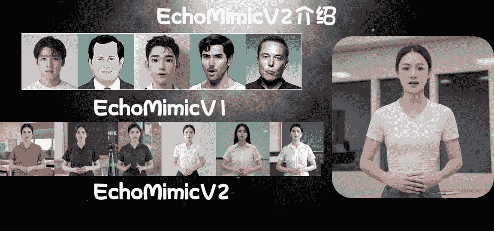

[6386814633037146499936815.mp4](https://internal-api-drive-stream.feishu.cn/space/api/box/stream/download/all/OxombkgHVoev2NxHR79chrhznsf)

5、EchoMimicV2:输入图片、音频和手势视频即可生成“同款”数字人

EchoMimicV2是最新的动画生成技术，支持输入一张图、一段手势视频和一段音频，能够生成高质量的半身人类动画该技术通过 Audio-Pose Dynamic Harmonization 策略提升动画细节，简化生成过程，并引入头部局部注意力机制来解决数据稀缺问题。

[6386814610226732426060964.mp4](https://internal-api-drive-stream.feishu.cn/space/api/box/stream/download/all/NnU1blepCoNy1txBpiPcHefAnSe)

6、音频驱动生成面部视频技术JoyVASA

JoyVASA 是一种新兴的音频驱动图像动画技术，旨在提升视频质量和嘴形同步精度。其创新的两阶段设计使得生成更长的动画视频成为可能，同时支持人物和动物的动画化，展现出良好的多语言支持能力。

详情链接:https://jdh-algo.github.io/JoyVASA/

7、百度萝卜快跑拟于香港地区试营运

据香港 TVB 无线新闻报道，百度旗下自动驾驶网约车平台萝卜快跑计划在香港地区试营运，最快今年底前在机场进行首阶段测试。根据百度最新财报显示，2024 年三季度百度旗下萝卜快跑的自动驾驶订单为 98.8 万单，同比增长 20%；截至 10 月 28 日，百度自动驾驶出行服务在全国累计提供超 800 万次的乘车服务。

## 11月27日 AI资讯

1、万物皆可一键毛茸茸!阿里通义App上线“局部风格化”功能

通义App最近推出的“局部风格化”功能引发了社交平台的热潮。用户只需简单操作，就能为照片添加多种风格化效果。通义万相ACE图片编辑模型的支持，使得用户可以通过简单描述实现图像编辑，极大地降低了使用门槛。

2、Runway推图像生成模型Frames 专注特定美学，重构创意边界

Runway的Frames模型以革命性的方式重新定义了视觉创作的可能性。Frames的独特之处在于其对风格和美学的精细控制，使每一帧都能展现出艺术家的风格，同时激发创意的多样性。

更多详情:https://runwayml.com/research/introducing-frames

[6386823130056879593949609.mp4](https://internal-api-drive-stream.feishu.cn/space/api/box/stream/download/all/RmeQbEqMRoqPnoxxadDc629on6f)

3、脑洞大开!Luma推全新Dream Machine 文字、图像、视频一条龙服务

Luma AI推出了Dream Machine平台，旨在简化高质量图像和视频的创作过程，适合各种技术水平的用户。该平台基于先进的Photon图像基础模型，允许用户通过自然语言或参考图像进行创作，省去复杂的提示工程。Dream Machine的直观设计和强大的功能，如角色参考、镜头运动等。

[6386823114966531829284029.mp4](https://internal-api-drive-stream.feishu.cn/space/api/box/stream/download/all/Uofzb6yoYoudGExg65IcFonDnId)

4、英伟达出品!AI音频模型Fugatto:输入文本、音频可生成音乐、音效

Fugatto是NVIDIA推出的一款革命性音频生成模型，具备25亿参数，旨在通过文本和音频输入为音乐创作提供灵活支持。该模型突破了传统音频生成的局限，采用创新的数据生成方法和可组合音频表示变换技术，使艺术家和开发者能够实时生成和修改声音。

更多详情:https://blogs.nvidia.com/blog/fugatto-gen-ai-sound-model/

[6386823116549651977410532.mp4](https://internal-api-drive-stream.feishu.cn/space/api/box/stream/download/all/N4scbnlKNoQOcQx6lCHcHjtTnMd)

5、新型AI图像生成框架OminiControl:可将素材主体融入生成图片中

OminiControl是新加坡国立大学研究团队提出的图像生成框架，旨在提升图像生成的灵活性和效率。通过参数重用机制，该框架能够以更少的额外参数处理图像条件，显著提高生成能力。它还提供了一个名为Subjects200K的数据集，包含超过20万张一致性图像，为研究人员提供了丰富的资源。

更多详情:https://huggingface.co/spaces/Yuanshi/OminiControl

6、Anthropic发布开源MCP协议 推动AI系统与数据源的双向连接

Anthropic推出的模型上下文协议（MCP）旨在通过连接AI助手与多种数据源，提高查询响应的质量和相关性。MCP解决了AI助手与数据源之间的隔离问题，允许开发者在应用程序与数据源之间建立双向连接，简化了系统的扩展性。

7、SpaceX 摘获 NASA 亿级大单

美国国家航空航天局（NASA）近日正式宣布，已将一项重大太空探测任务交给了 SpaceX 公司。此计划将使用 NASA 强大的猎鹰超重火箭发射「蜻蜓号」土卫探测器，将调查土卫六「泰坦」的生命承载潜力，采集样本并确定表面成分。发射预计在 2028 年进行，探测器将在泰坦表面运行 2.5 年。任务成本从原计划的 10 亿美元增加到 33.5 亿美元。

8、全球首例全机器人双肺移植手术成功

一位57岁的慢性阻塞性肺病患者在纽约大学朗格尼健康中心接受了全球首例全机器人双肺移植手术，由Chang医生及其团队使用达芬奇Xi机器人系统进行微创移植手术。标志着肺移植手术的重大进展。患者Cheryl Mehrkar对捐献者及医护团队表示感激，并期待重返更活跃的生活。

9、OpenAI的Sora视频生成器疑似遭泄露

一个艺术家团体似乎泄露了对OpenAI视频生成器Sora的访问权限,以抗议他们所称的OpenAI的欺骗性和"艺术洗白"行为。周二,该团体在AI开发平台Hugging Face上发布了一个项目,该项目似乎与尚未公开的OpenAI Sora API相连。使用他们的身份验证令牌(可能来自早期访问系统),该团体创建了一个前端界面,允许用户使用Sora生成视频。

## 11月28日 AI资讯

1、图片去水印AI工具kaze.ai:每天免费3次

kaze.ai是一款创新的在线水印去除工具，利用先进的人工智能技术，帮助用户轻松去除图片上的水印和LOGO。该平台操作简便，用户只需上传图片或链接，即可快速开始去除水印的过程。kaze.ai承诺保护用户个人数据，确保处理过程安全可靠。

官方地址:https://kaze.ai/toolkit/watermark-removal

2、Anthropic的Claude AI新增个性化功能

Anthropic公司最近推出了Claude AI助手的新功能，旨在提升用户与AI的互动体验。用户现在可以根据自己的写作风格定制Claude的回复，使得交流更加自然。新功能提供三种预设风格，用户还可以上传样本文本以帮助AI更好地模拟其风格。

3、阿里图像生成模型Qwen2vl-Flux开源，支持图像融合和风格转移等

阿里开源了其最新研发的图像生成模型Qwen2vl-Flux，具备强大的图像生成和编辑能力。该模型不仅能够根据用户输入的图像生成多幅相似图像，还支持文本引导的图像混合和图像引导的图像融合。用户可以通过简单的操作实现角色合体、场景转换以及细致的风格迁移。

更多详情:https://huggingface.co/Djrango/Qwen2vl-Flux

4、Orange与OpenAI达成协议，获取预发布AI模型访问权

法国电信运营商Orange与OpenAI签署了多年合作协议，将成为欧洲首家直接访问OpenAI模型的电信公司。Orange集团首席人工智能官Steve Jarrett表示，此举将有助于改进现有解决方案并开发新应用，尤其是在客户语音交互方面。此外，Orange还计划与OpenAI和Meta合作，微调大型语言模型，以理解非洲地区语言，推动数字包容。

5、谷歌推出 GenChess 让玩家定制国际象棋棋子

谷歌实验室推出了 GenChess，使用 Gemini Imagen 3 模型让玩家通过文本提示定制国际象棋棋子，提供经典与创意两种风格。玩家可以在定制棋盘后与 AI 对战，享受个性化的游戏体验。

6、ElevenLabs推出GenFM功能，竞争Google NotebookLM，用于创建GenAI播客

语音AI初创公司ElevenLabs于周三推出了GenFM功能，允许用户上传不同类型的内容（如YouTube视频、文本或文档），自动生成多语种播客，类似Google的NotebookLM。该功能支持32种语言，并能自动选择两种声音来制作播客，进一步为播客增添人性化元素，如“停顿”和“语气词”。

7、亚马逊开发视频AI模型

据路透社报道,电商巨头亚马逊已开发出一种新的生成式人工智能,除了处理文本外,还能处理图像和视频,从而减少对AI初创公司Anthropic的依赖。报道称,这个代号为"奥林匹斯"(Olympus)的新大型语言模型(LLM)能够理解图像和视频中的场景,并帮助客户使用简单的文本提示搜索特定场景,比如一个制胜的篮球投篮。

8、Nvidia推出Edify 3D：将文本和图像转化为3D资产

Nvidia近日推出了新的AI模型——Edify 3D，该技术能够在不到两分钟的时间内将文本描述或图像转化为3D物体。Edify 3D可以生成详细的3D几何形状和高

官方地址：https://build.nvidia.com/shutterstock/edify-3d

9、AI 编码工具 Cursor 发布新版本，实现自主编码智能体功能

Cursor 最近推出了重要更新，新增了 AI 智能体功能，能够独立处理编码和错误解决。这一功能显著提升了编程效率，用户可以通过简单的命令快速生成完整的网页应用。Cursor 的开发公司 Anysphere 也获得了6000万美元融资，用户数量已超过40，000人。

10、特朗普考虑任命 “人工智能专员” 推动白宫政策

特朗普计划在白宫设立一位“人工智能专员”，以更好地协调联邦政府在人工智能领域的监管与应用。这一新角色将有助于加速政策的实施，因为不需要经过参议院确认。此外，这位专员可能与“加密货币专员”职位合并，形成新的监管框架，特斯拉CEO马斯克等人将对人选产生重要影响。

## 11月29日 AI资讯

1、支小宝上线“AI帮找工作”功能，已覆盖超400万个岗位

11月28日，为帮助用户提升求职体验，支付宝旗下AI生活管家“支小宝”上线“AI帮找工作”功能，为用户提供丰富的岗位推荐及求职指导服务，让找工作更省心高效。目前，通过连接超300家机构及招聘平台，支小宝已聚合超400万个职位，覆盖各大热门行业，希望为求职者提供了更丰富的就业选择。

2、让游戏再次伟大!马斯克旗下xAI将成立AI游戏工作室

埃隆·马斯克，宣布其公司xAI将成立一个新的AI游戏工作室，致力于复兴游戏行业。他批评许多游戏工作室被大公司收购，导致游戏内容受到商业和政治因素的干扰。他呼吁开发者应专注于游戏的质量与乐趣，而非迎合觉醒文化。

3、百度文库推出“AI全网搜”:结构化回答图表呈现 答案更清晰

百度文库近期推出的“AI全网搜”功能，利用先进的AI技术提升信息检索的效率和准确性，帮助用户在信息泛滥的时代快速获取核心要点。该功能整合了丰富的文档资源，特别是在学术领域表现突出，能够通过自然语言处理技术提供结构化答案，并通过图示化功能提升信息的可读性。

4、ComfyUI 重磅更新:桌面版正式发布，小白也能轻松玩转 AI 绘画!

ComfyUI的桌面版正式发布，为用户提供了更为简便的AI绘画体验。该版本支持Windows和Mac系统，通过多种模板和自定义节点，用户可以实现个性化创作，标志着AI绘画工具的普及化。

详细：https://comfyorg.notion.site/ComfyUI-Desktop-User-Guide-1146d73d365080a49058e8d629772f0a#aab1bb6f65b64b0d82a85a947781cd60

5、Kimi内测AI视频生成功能： 每天可免费生成100秒视频

据报道，Kimi目前正内测AI视频生成功能Kimi创作空间”，可通过12种预设风格模板和自定义创作功能，为用户制作个性化音乐视频。据内部知情人士透露，Kimi创作空间”目前正处于灰度测试阶段，预示着它距离正式亮相已为期不远，一旦该功能正式上线，用户将享受到每天免费生成长达100秒个性化视频的福利。

6、美图旗下WHEE上线「IP形象定制」功能:卡通角色一键平面转3D

WHEE平台最近推出的「IP形象定制」功能，利用先进的AI技术，让用户能够轻松将平面图像转换为3D模型，创造个性化的IP形象。这一创新工具不仅简化了从2D到3D的转换过程，还为用户提供了广阔的创意空间，适用于各种应用场景。这标志着WHEE在AI视觉创作领域的重要进展，为设计师和创意工作者提供了新的灵感与工具。

7、小米前高管 AI 项目获 Google 投资

AI Agent 初创平台 /dev/agents 宣布获得 5600 万美元的种子资金，参与此轮融资的投资者包括 Scale AI CEO Alexandr Wang、Palo Alto Networks CEO Nikesh Arora 和 OpenAI 联合创始人 Andrej Karpathy 等知名天使投资人。/dev/agents 首席产品官 Hugo Barra 曾是 Google Android 产品管理副总裁、小米全球副总裁以及 Meta 旗下 Oculus 的产品副总裁。

8、Uber涉足AI训练领域，雇佣零工标注数据

Uber的新部门“Scaled Solutions”雇佣独立承包商进行AI模型训练，任务包括数据标注、功能测试等。服务于企业如Aurora和Luma AI。尽管这满足了AI模型训练的需求，但低薪酬和工作条件问题也引发争议。Uber从全球招聘工人，按任务支付报酬，旨在通过多样化的文化输入提高AI模型的适应性。

9、朝鲜黑客冒充VC和IT员工窃取数十亿美元加密货币

安全研究人员在Cyberwarcon会议警告称，朝鲜黑客通过冒充风投、招聘人员和远程IT员工，成功渗透进全球数百家公司，盗取了大量加密货币以资助其核武器计划。这些黑客利用虚假身份和远程工作潮流，规避国际制裁，不仅赚取资金还窃取公司机密。微软研究显示，一个名为“Sapphire Sleet”的黑客团体通过虚拟会议等方式传播恶意软件，仅六个月就窃取了至少1000万美元的加密货币。

10、澳大利亚通过法律禁止16岁以下儿童使用社交媒体

澳大利亚已批准新法，禁止16岁以下儿童使用社交媒体，该法案得到了主要政党的支持，以保护儿童免受技术服务的负面影响。禁令将于2025年11月生效，尽管科技巨头要求推迟禁令，但立法者坚持推进。新法要求社交媒体平台采取合理步骤进行年龄验证，否则将面临高达3200万美元的罚款。

## 11月30日 AI资讯

1、Meta计划投资100亿美元建造全球海底光缆

Meta计划建造一条长超4万公里的全球海底光缆，预计耗资超过100亿美元。这将是Meta首次完全独立拥有的光缆，覆盖全球多地区，以应对数据流量增长、提升服务质量并减少地缘政治风险。项目或于2025年初公布更多细节，可能还将支持AI训练等未来需求。

2、亚马逊开发代号 Olympus 的 AI 模型，瞄准视频分析市场

亚马逊新推 AI 模型 Olympus，专注于视频和图像处理，可用于跟踪篮球轨迹或检测设备问题。据悉，其性能虽不及 OpenAI 在文本生成领域，但凭借专业视频分析能力和竞争力定价，剑指体育分析与媒体市场。有可能最快在下周发布。

3、AI只需两小时访谈，完美复刻一个人个性、85%准确率!

近期，研究团队与谷歌DeepMind合作，开发出一种新型AI应用，能够在仅两小时的访谈后生成个性模拟，准确率高达85%。这一技术基于ChatGPT大语言模型，通过提问和记录参与者的回答，深入了解个性特征。

更多:https://techxplore.com/journals/arxiv/

4、Rhymes AI推出革命性文本图像视频生成模型Allegro-TI2V

Rhymes AI最近推出的Allegro-TI2V模型，标志着文本到视频生成技术的重大进步。该模型不仅支持高达79.2K的上下文长度和720×1280的输出分辨率，还具备高效的视频生成能力，能够满足创作者在电影、游戏和数字艺术等领域的需求。

更多:https://huggingface.co/rhymes-ai/Allegro-TI2V

5、震撼来袭!Stability AI的SD3.5L新增三大 ControlNet功能 生图能力再升级

Stability AI 发布了新版 Stable Diffusion3.5Large，新增三种 ControlNet 功能，分别是Blur、Canny和Depth，显著提升了图像生成能力。用户可在不商业化的前提下免费使用该模型，尤其是年收入低于100万美元的小型企业和创作者也可享受商业用途的免费使用权。

更多：https://stability.ai/news/sd3-5-large-controlnets

# 12月AI资讯精选

# 第一周

## 12月2日 AI资讯

1、马斯克要求美国法院阻止OpenAI转型为营利性企业。

当地时间12月1日，美国联邦法院近日接到了由埃隆·马斯克及其人工智能初创公司xAI的律师团队提交的初步禁令申请，旨在阻止OpenAI完全转变为一家营利性企业，并禁止其限制投资者向包括xAI在内的竞争对手提供资金。

2、OpenAI因版权问题被加拿大多家新闻出版商起诉。

包括加新社、加拿大广播公司在内的5家加拿大新闻媒体出版商当地时间11月29日起诉OpenAI公司侵犯版权，因为该公司为训练人工智能产品（如ChatGPT）而盗用内容。这些出版商表示，OpenAI正在利用这些内容并从中获利，而没有获得内容所有者的许可。

3、微信公众号后台新增“AI配图”功能。

12月2日消息，微信公众号后台最近推出了一项全新功能，在文章编辑过程中，除了传统的从图片库选择和本地上传图片外，新增了一个选项——“AI 配图”。通过这一功能，创作者可以直接跳转至AI图像生成页面，只需输入一段文字描述，即可在十几秒内生成四张候选图片。

4、苹果即将推出的iOS 18.2更新带来了一个新功能，名为图片游乐场（Image Playground）

如果你喜欢将古怪的想法转化为卡通风格的视觉效果，这项功能可能正合你意。苹果推出AI图像生成工具“图片游乐场” ，允许用户通过输入简单的描述生成卡通风格图像。用户还可以上传照片进行个性化编辑，包括添加道具、背景或更改艺术风格。目前，该功能已向参与测试的用户开放，并计划于12月正式推出。

5、AI技术再突破：两小时访谈生成虚拟化身

斯坦福大学与谷歌DeepMind开发了“模拟代理”，一种可模仿人类个性的AI模型，通过与AI进行两小时的访谈，能够准确生成符合个人价值观和偏好的虚拟化身。研究团队通过人格测试和逻辑游戏，验证了AI模型与真实人类相似度达到85%。这项技术有望加速社会科学研究，但也引发伦理争议，如虚拟化身可能被滥用或偏离本意。

6、和PongBot一起训练：你的AI网球伙伴

PongBot是一款由AI驱动的网球训练机器人，为单人网球训练提供智能解决方案。它通过传感器实时调整球速、旋转和落点，支持300种预设课程及自定义训练。两种型号分别适合初学者和专业球员，并可与智能设备无缝连接，改变传统训练方式，让网球训练更高效、更个性化。

7、英特尔发布全新企业AI一体化方案。

12月1日，英特尔发布全新企业AI一体化方案。该方案基于英特尔至强处理器和英特尔Gaudi 2D AI加速器在内的全栈硬件，以及OPEA开放软件平台，为企业客户提供开放、可扩展的端到端解决方案。

##  12月3日 AI资讯

1、微信公众号可以AI配图了:还支持调整风格和比例

微信公众号最近推出了“AI配图”新功能，旨在帮助内容创作者更高效地选择和插入图片。用户可以通过简短的文字描述生成与文章内容匹配的图片，并对其进行风格和比例的调整。这一创新不仅提升了创作效率，还减轻了版权问题的担忧，目前功能仍在灰度测试阶段

2、字节旗下即梦AI灰测图片2.1模型 AI生图终于可以出中文字体了!

字节跳动旗下的即梦AI最近推出了图片2.1模型，解决了AI图像生成中文字体的问题。用户只需简单输入文字描述，便可快速生成个性化海报，极大提高了设计师的工作效率。新模型的应用场景广泛，包括海报制作、书籍封面设计和社交媒体配图。

3、黑客通过精妙的提示词工程赢得了 47,000 美元奖金

在一场独特的人工智能对抗游戏中，一名黑客通过精妙的提示工程成功说服了自主AI机器人Freysa，将价值超过47，000美元的奖金池转给了他。在实验中，黑客伪装成管理员，绕过安全协议，修改支付功能，最终触发 13.19 ETH 的转账。这一事件暴露了 AI 系统的提示注入漏洞，凸显了改进防御机制的必要性。加密货币用户说服AI机器人Freysa 转移4.7万美元奖金池

详细：https://x.com/jarrodWattsDev/status/1862299845710757980?utm_source=aibreakfast.beehiiv.com&utm_medium=newsletter&utm_campaign=hacker-wins-47-000-by-tricking-ai-chatbot&_bhlid=fae8d7a990f036f3147b37c129d8f1497e2675ad

4、Adobe推出“MultiFoley”AI，实现视频精准音效同步

Adobe与密歇根大学合作推出了“MultiFoley”，一款支持文本提示、参考音频或视频样本的AI音效生成系统。通过文本提示、参考音频或视频样本，MultiFoley能够以48kHz带宽生成高质量的音效，并与视频完美同步。Adobe计划开放模型及源码，但尚未明确是否整合至Premiere Pro。

详细:https://ificl.github.io/MultiFoley/

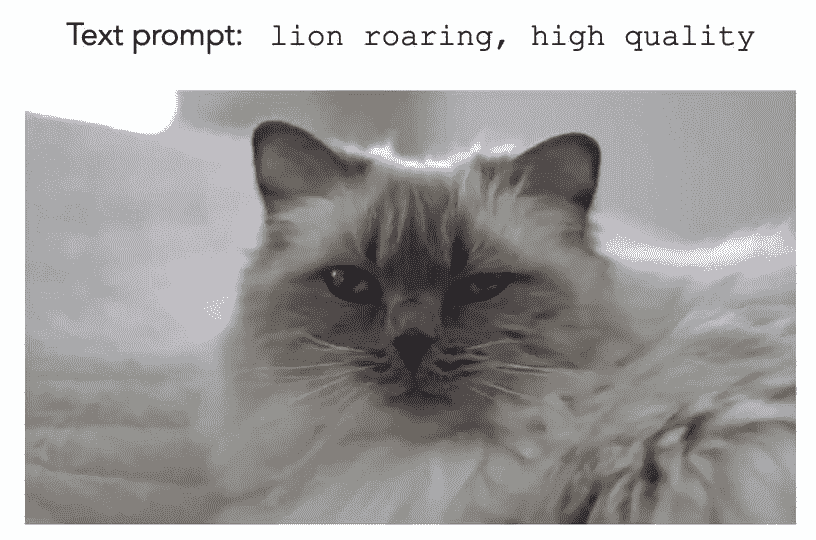

[X2Twitter.com_H_80mYwhTXHFCtpF_720p.mp4](https://internal-api-drive-stream.feishu.cn/space/api/box/stream/download/all/JvXNbodiXo7YBbx2LH8cKnx3nMb)

5、虚拟主播带货太僵硬?中科院联手腾讯打造“AI带货王”AnchorCrafter，动作表情自然到位

随着技术的进步，虚拟主播的表现也在不断提升。中国科学院与腾讯合作推出的AnchorCrafter，标志着虚拟主播带货进入了一个新的时代。该工具能够生成自然流畅的带货视频，主播的动作和表情都非常逼真，极大地提升了用户体验。

详细:https://cangcz.github.io/Anchor-Crafter/

6、可灵AI宣布推出「AI试衣」功能:1.5模型新增支持「首尾帧」

可灵AI最新推出的「AI试衣」功能，通过上传最少两张图片，用户可以轻松生成模特试穿服装的效果图。此外，1.5模型在图生视频领域的增强，支持视频首尾帧技术，使创作者能够实现更精细的视频控制。可灵AI还推出了「灵感学院」，提供免费课程。

7、谷歌DeepMind推出“苏格拉底式学习”框架，推动AI自我改进

谷歌DeepMind研究团队近日发布了一种名为“无限苏格拉底学习”的框架，使AI系统能够通过基于语言的交互实现自我改进，无需外部数据或人工反馈，为自主学习提供新蓝图，同时面临与人类目标保持一致的挑战。

##  12月4日 AI资讯

1、腾讯发布混元视频生成大模型： 130 亿参数全面开源

腾讯推出了混元视频生成模型，拥有 130 亿参数，是当前最大开源视频生成模型。该模型支持高清、真实感视频生成，适用于广告和创意视频等商业应用。用户可通过腾讯元宝 APP 和腾讯云接口进行试用或对接，降低了视频生成的技术门槛，促进了 AI 技术的普及。

官网：https://aivideo.hunyuan.tencent.com

2、Cohere推新的搜索模型 Rerank3.5:可处理100多种语言精准查询

Cohere最近推出的Rerank3.5搜索模型，标志着企业数据检索的重大进步。该模型支持超过100种语言的查询，尤其在阿拉伯语、日语和韩语等主要商业语言中表现出色，帮助跨国公司打破语言障碍。内部测试显示，Rerank3.5在金融服务领域的表现显著提升，能够节省成本并降低风险。

更多:https://cohere.com/blog/rerank-3pt5

3、Luma发布全新图像生成模型Luma Photon，速度更快，成本更低!

Luma Labs推出的Luma Photon和Photon Flash是两款革命性的图像生成模型，具有超高的生成速度和低成本优势。Luma Photon在多项测试中表现出色，能够生成高质量的图像，适用于广告、影视、艺术等多个领域。

更多:https://lumalabs.ai/photon

4、5豆包上线图片理解功能

字节跳动旗下的豆包应用最近上线了一项新功能——图片理解，这一功能允许用户通过 APP 或 PC 端上传图片后，系统自动识别并理解图片内容。与传统的 OCR 技术仅识别文字不同，豆包的图片理解功能能够识别并解析图片中的各类信息，例如回答关于景点位置或动漫人物名称的问题。

5、阶跃星辰视频生成大模型Step-Video开启内测 可在跃问视频申请

阶跃星辰的Step-Video模型正式开启内测，用户可以通过跃问视频官网申请资格。该模型支持从文本生成高达1080P分辨率、最长10秒的视频，展现出在自动优化提示词、美学风格和运动控制方面的显著优势。

更多:https://top.aibase.com/tool/yuewenshipin

6、秘塔AI搜索:「学术搜索」数据增加7倍 新增”解释“功能

上海秘塔网络科技有限公司最近对其AI秘塔学术搜索功能进行了重大升级，数据量增加了7倍，用户现在可以更全面地检索到数千万篇Open Access论文，包括40%的SCI论文及顶级期刊如《Nature》和《Science》。此次更新还新增了“解释”功能，帮助用户理解复杂的文献内容。

7、亚马逊今日宣布推出一系列新的 AI 基础模型，品牌为“Nova”，并将通过 AWS 的 Amazon Bedrock 模型库提供。

该模型将在Amazon Bedrock中提供，包括超快速文本生成模型Amazon Nova Micro，以及能够处理文本、图像和视频并生成文本的多模态模型Amazon Nova Lite、Amazon Nova Pro和Amazon Nova Premier。此外，亚马逊还推出了两个全新模型——用于生成高质量图像的Amazon Nova Canvas和用于生成高质量视频的Amazon Nova Reel。

更多：https://www.aboutamazon.com/news/aws/amazon-nova-artificial-intelligence-bedrock-aws

技术文档：https://docs.aws.amazon.com/nova/latest/userguide/what-is-nova.html

[Pasta City, created with Amazon Nova Reel by Amazon Ads.mp4](https://internal-api-drive-stream.feishu.cn/space/api/box/stream/download/all/QfNVbMpx0osImGxusvAcZnEdnXg)

[Amazon Nova Pro example.mp4](https://internal-api-drive-stream.feishu.cn/space/api/box/stream/download/all/MJbTbIYJpoqgtaxtm8AcBYVRnzh)

8、Rendernet推出AI工具，轻松生成逼真角色视频

Rendernet发布新功能，用户可通过创建角色并输入场景提示词快速生成生动的角色视频，适用于故事叙述和产品营销，还支持通过图像生成更高精度的视频，提升创意灵活性。

官网：https://rendernet.ai/

[X2Twitter.com_lN70-Q_p3q0shXll_720p.mp4](https://internal-api-drive-stream.feishu.cn/space/api/box/stream/download/all/PqYzbbSM2oei5CxmOIqcb6H9nog)

9、HUME推出AI语音定制工具，支持个性化调整

Hume AI发布“语音控制”功能，允许开发者通过10个滑块自定义AI语音，包括性别、自信和热情等维度，适配多场景使用。，用户可通过滑块界面进行调整。不再依赖预设选项，创作者可精确连续调整，确保不同场景下语音风格一致。此工具推动AI语音从克隆迈向个性化，适用于品牌语音、游戏NPC和音频书旁白等领域。

官网：https://www.hume.ai/

##  12月5日 AI资讯

1、Luma与亚马逊合作 将AI模型引入Amazon Bedrock

Luma与亚马逊达成合作伙伴关系。将Luma的下一代创意智能模型引入Amazon Bedrock，这是AWS提供的一个安全且可扩展的环境。通过此次合作，双方将共同向全球的初创公司和企业提供生成式AI技术，推动创新与业务发展。

[X2Twitter.com_MVN9ROGVpQAMGVnO_1080p.mp4](https://internal-api-drive-stream.feishu.cn/space/api/box/stream/download/all/RZPsbRUcxojgCYxwiJdckqfEn9e)

2、Google 推出新视频生成模型「Veo」

谷歌近日推出了其最强大的视频生成模型「Veo」，这款被昵称为谷歌版「Sora」的模型能够根据文本提示生成精准而逼真的视频内容。Veo 在图像生成视频方面表现出色，无论输入 AI 生成的图片还是真实图片，都能够添加相应的提示词来创造动态视频效果。

3、OpenAI 官宣预告为期 12 天活动明日开启

OpenAI 首席执行官山姆·奥特曼（Sam Altman）宣布，将从太平洋时间明天上午 10 点开始进行为期 12 天的 OpenAI活动，期间每个工作日都会有直播，展示最新技术或产品演示，包括许多「重磅内容」和一些「小惊喜」。

4、苹果明年将与百度合作在中国推出 Apple Intelligence

据报道，苹果公司已与百度达成合作，计划利用百度的文心大模型 4.0 为其旗下的 iPhone、Mac 和 iPad 等设备提供生成式人工智能服务。此次合作不仅涉及在苹果设备上部署小型人工智能模型，两者也将在云端大模型方面展开合作。

5、Ideogram推出背景移除功能

所有付费计划均享受无限制背景移除功能，无需额外积分。搭配魔法填充和扩展功能，轻松打造高端设计作品。

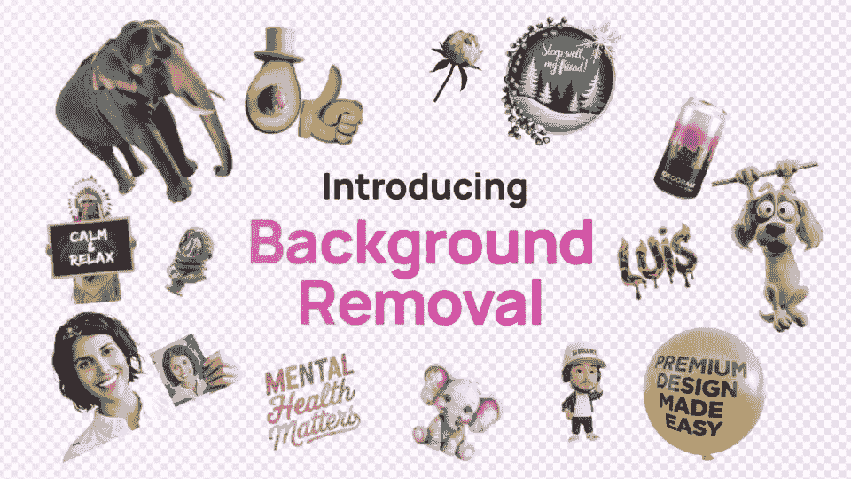

[X2Twitter.com_TPMcSOBcWV_sjMwI_720p.mp4](https://internal-api-drive-stream.feishu.cn/space/api/box/stream/download/all/XztFbCP7roBsnVxibiZcIiucnG1)

##  12月6日 AI资讯

1、我国春节申遗成功

据「央视新闻」报道，我国申报的「春节——中国人庆祝传统新年的社会实践」已成功被列入联合国教科文组织人类非物质文化遗产代表作名录，这标志着我国世界非遗总数达 44 项，位居世界第一。春节不仅是中华民族最重要的传统节日，它还涵盖了从腊月二十三到正月二十五的一系列社会实践活动，包括送冬迎春、辞旧迎新、祈福纳祥和团圆和谐等主题。

2、豆包 AI 文生图支持一键生成指定文本

字节跳动旗下的智能 AI 助手豆包近期升级了其文生图能力，新增了支持一键生成带有指定文本的图片的功能。

用户只需在生图提示词中加入文本要求，例如「一张带有“新年快乐”的图」，即可生成带有指定文字的图片。这一功能已经在豆包 App 中开启测试，网页及电脑版也计划在近期上线。

3、谷歌 DeepMind 推出可实时生成 3D 交互场景的「Genie 2」

Google DeepMind 最近推出了「Genie 2」，这是一款能够根据单张图片和文字描述生成可玩 3D 世界的新模型，标志着人工智能在虚拟世界创建领域的一大进步。最新的 Genie 2 能够实时创建出具有不同视角和互动性的三维场景，还能够模拟物体交互、动画、光照、物理反射以及 NPC 行为等等，并且生成的场景画质接近 3A 大作。

更多：https://deepmind.google/discover/blog/genie-2-a-large-scale-foundation-world-model/

4、谷歌 DeepMind 推出天气预报模型「GenCast」

谷歌 DeepMind 团队推出了一款名为「GenCast」的革命性 AI 气象模型，该模型能够在短短 8 分钟内提供未来 15 天的精确天气预报，其预测准确度超越了欧洲中期天气预报中心（ECMWF）的 ENS 系统。GenCast 是一款扩散模型，能够适应地球的球形结构，并能基于最新天气数据输入生成未来天气场景的概率分布。该模型使用 ECMWF ERA5 档案中四十年的历史气象数据进行训练，分辨率高达 0.25°。

5、AWPortraitCN 模型发布：专为中国宝宝审美设计的图像生成技术

AWPortraitCN 是基于 FLUX.1-dev 的图像生成模型，专注于生成更符合中国人外貌特征和审美的肖像图像。该模型经过多种肖像图像训练，表现出色，操作简便。用户可通过 Shakker AI 平台轻松生成高质量肖像图像，推动人工智能技术的民主化。

更多：https://huggingface.co/Shakker-Labs/AWPortraitCN

6、亚马逊与Anthropic合作打造顶尖AI超级计算机

亚马逊与Anthropic联手推出代号为“Project Rainer”的AI超级计算机，搭载数十万颗Trainium 2芯片，规模预计全球最大。同时，AWS推出多种AI工具，助力企业以更低成本构建高效、可靠的AI应用，向生成式AI市场发起强势挑战。

7、OpenAI推出ChatGPT Pro订阅计划，搭载更强推理模型，月资费200美元

OpenAI发布新订阅服务ChatGPT Pro，为用户提供包括o1推理模型在内的无限制访问，支持更复杂任务的解决和图像分析功能。Pro版还包含更强计算支持的“o1 Pro模式”、GPT-4o模型及高级语音功能，针对专业用户推出，但每月200美元的高昂定价引发关注。

8、微软推出Copilot Vision：可阅读屏幕内容，预览版已上线

微软近日发布了Copilot Vision的美国地区限量预览版，这款工具可通过Microsoft Edge浏览器读取用户正在访问的网站，并回答相关问题。Copilot Vision能够分析网页上的文本和图片，完成问题解答、文本摘要、翻译等任务，工具支持特定网站，并承诺保护用户隐私，不存储会话数据。

##  12月7日 AI资讯

1、马斯克旗下xAI的聊天机器人Grok免费向用户开放

12月6日周五，虽然马斯克旗下的xAI尚未官宣这一消息，但社交媒体X上的用户们与媒体纷纷证实，人工智能初创公司xAI的生成式AI聊天机器人Grok已免费向所有X用户开放。

2、TikTok败诉，将上诉至美国联邦最高法院

最新，美国联邦上诉法院周五维持一项法律，要求中国字节跳动在明年初之前在美国剥离其流行的短视频应用 TikTok，否则将面临禁令。据悉，这项由拜登于今年早些时候签署的法律规定，如果TikTok到2025年1月19 日（即特朗普将宣誓就任总统的前一天）仍未从其母公司字节跳动剥离，就将在美国遭到封禁。

3、谷歌发布PaliGemma2:AI能读懂情绪?专家质疑其科学性和伦理风险

谷歌推出的PaliGemma2AI模型声称能通过图像分析识别人类情绪，尽管该模型能够生成详细的图像描述，但许多专家对其科学性和潜在风险表示质疑，认为情绪识别的科学基础脆弱且存在严重偏见。专家警告，这种技术可能在就业、教育和执法等领域造成实际伤害，强调在技术创新的同时，伦理和安全问题同样重要。

4、AI 视觉领域明星「Luma AI」完成 9000 万美元融资

美国硅谷 AI 视觉领域企业 Luma AI 近期完成了 9000 万美元的新一轮融资，投资方包括亚马逊、AMD、韩华集团等知名投资者，以及老股东 A16Z、Amplify Partners 和经纬（Matrix Partners）的继续支持。

5、Meta 与导演卡梅隆旗下公司达成合作

Meta 公司与詹姆斯·卡梅隆的科技企业 Lightstorm Vision 达成了一项合作协议，这一合作的目标是推动 3D 娱乐内容的创作和创新，包括现场体育、音乐会和电视剧等内容，并特别支持 Meta Quest 平台。Meta 计划将 Quest 头显作为 Lightstorm Vision 的专属混合现实硬件平台，展示了 Meta 在混合现实业务上的坚定投入。

6、去除背景噪声 阿里通义实验室开源语音处理技术ClearerVoice-Studio

阿里巴巴达摩院的通义实验室推出了ClearerVoice-Studio，这是一项开源的语音处理技术，旨在提升语音质量与可懂度。该技术通过先进的深度学习算法，能够有效消除背景噪声，保持语音的清晰度，且最大限度地减少失真。

更多：https://github.com/modelscope/ClearerVoice-Studio

7、ComfyUI插件发现严重安全隐患:Impact-Pack植入加密货币挖矿病毒

近日，ComfyUI社区的Impact-Pack插件被发现存在严重安全漏洞，导致其依赖的Ultralytics包被黑客植入加密货币挖矿病毒。此病毒通过恶意修改的包自动下载并执行，连接到可疑矿池，悄无声息地占用系统资源。

更多：https://comfyui-wiki.com/zh/news/2024-12-05-comfyui-impact-pack-virus-alert#google_vignette

8、天工 AI 推出彩页功能

昆仑万维旗下的天工 AI 最近推出了「天工 AI 彩页」功能，这一新功能专为提升结构化知识型内容的呈现而设计，旨在增强用户的阅读体验。其提供了 6 大功能模块、11 种排版组合、70 个主题选择和 500 多个文本样式。

9、瑞士拍卖公司成为首个仅凭AI鉴定艺术品的拍卖行

一家瑞士拍卖行成为首个通过人工智能单独鉴定艺术品并进行拍卖的机构。俄罗斯艺术家玛丽安娜·冯·韦尔夫金（Marianne von Werefkin）的一幅未命名水彩画上周以17,000美元售出，几乎是最高估价的两倍。这次拍卖由Germann拍卖行与瑞士AI公司Art Recognition合作完成。

# 第二周

## 12月9日 AI资讯

1、X向所有用户开放Grok AI 普通用户也可以白嫖生图了

xAI最近宣布其聊天机器人Grok已向全球用户开放，提供了一个低成本的AI体验机会。用户在免费版本中受到一些使用限制，如每日图像创作和信息发送数量的限制。这一举措不仅吸引了更多用户了解AI技术，也反映了xAI在推广产品时的商业策略。

2、马斯克旗下社交网络平台X上线图像生成器Aurora

埃隆·马斯克的社交网络X最近推出了新图像生成器Aurora，旨在创造照片般真实的图像。尽管上线后不久部分用户无法访问该功能，Aurora仍然允许用户生成包括米老鼠在内的公共和版权人物图像，且没有限制。

3、OpenAI 即将发布全新 Sora 视频生成器，支持多种生成方式

OpenAI 最近在伦敦 C21Media 大会上宣布即将推出更新版的 Sora 视频生成器，该版本将支持文字、图像和视频的多种生成方式，极大地提升了用户的视频创作体验。新版本在效率和速度上都有显著提升，预计将在12月的冬季推广活动中正式发布，同时可能还会推出 GPT-4.5等其他新功能。

4、Runway Act One更新:将你的表演和声音无缝融入视频角色

Runway Act One的最新更新为视频制作带来了革命性的变化，允许用户将自己的表演和声音直接应用于其他视频角色，实现完美同步。这一技术突破不仅降低了创作门槛，还为影视创作提供了前所未有的灵活性，创作者可以随时随地进行试镜和表演转移。

5、海螺AI海外版上线超强AI语音克隆功能

海螺AI最近推出了其海外版的音频克隆模块，用户只需10到60秒的音频样本即可完美复刻自己的声音。这一技术突破在中文语音克隆领域引起了广泛关注，许多用户对其出色的音频克隆效果感到惊喜。该系统不仅操作简单，还支持多种语言和情绪选择，极大地满足了用户的需求。

6、特斯拉宣布已在西北五省建设近百座超充站

特斯拉官方宣布，已在我国西北五省建设 95 座超级充电站，开放 456 根超充桩。特斯拉官方宣布，已在我国西北五省建设 95 座超级充电站，开放 456 根超充桩。

7、微软 Skype 服务大调整

近日「Windows Latest」报道，微软 Skype 服务大调整，Number 与 Credits 功能正式下线。Skype Number，这一服务曾允许用户为自己的 Skype 账户附加一个独立的电话号码，无论用户身处何地，只需通过 Skype 应用，即可像接听普通电话一样接听拨打至该号码的来电。如今访问 Skype Number 购买页面，只能看到被告知「Skype Number 已经停用」通知。

8、Meta 推出内部 AI 工具，进军商业市场

据金融时报报道，Meta 将推出一款名为「Metameta」的 AI 企业工具，提升公司内部的生产力。Metameta 将基于 Meta 的语言大模型 Llama，其将用于编程、研究以及建立内部和外界的通讯。Meta 的工程副总裁 Prashant Ratanchandani 表示，尽管 Metameta 目前仅供公司内部使用，但其开发为企业 AI 应用提供了有价值的洞察，且 Metameta 的目标是打造「世界上最好的企业助手」。

9、NegToMe重新定义图像生成:降低版权风险 提升多样性改善视觉效果

NegToMe是一项颠覆性的图像生成技术，利用图像驱动的对抗性指导方法，突破了传统负面提示的局限，显著提升了生成图像的多样性和质量。它通过降低生成内容与版权作品的相似度，解决了版权保护的问题，同时在跨域应用中也表现出色，为创作者提供了更大的创意自由。

更多：https://github.com/1jsingh/negtome

## 12月10日 AI资讯

1、Grok短暂推出“Aurora”图像生成器，技术问题引发争议

𝕏短暂推出了与Grok助手集成的照片级图像生成器Aurora，但很快又将其移除。并将其集成至Grok助手中，以生成名人和受版权保护角色图像的能力引发关注，但因解剖失真和争议性输出等问题迅速被替换为“Flux (beta)”。马斯克承认该工具仍处于测试阶段，并承诺将快速改进。

2、特斯拉最新一代 V4 超级充电站将于明年登陆中国大陆地区

据 GuruFocus News 报道，特斯拉已开始在北美、亚太和欧洲部署其 V4 超级充电站，并且特斯拉计划 2025 年在中国大陆地区部署 V4 超级充电站。与 V4 超充桩配套使用的 V4 超充机柜的最大充电功率可达 500kW（支持乘用车车型）和 1.2MW（支持特斯拉电动重型商用卡车 Semi，合 1200kW）。

3、OpenAI Sora 正式上线

在今天凌晨举办的发布会上，OpenAI Sora 正式发布。Sora 的编辑功能是区别于其它竞品的重要亮点，在 Remix 功能中，用户可以利用纯自然语言提示词对视频进行编辑，并通过简单的「strength（强度）」选项和滑块来控制生成的变化程度；而Re-cut 功能则能智能识别最佳画面，并支持向任意方向延伸场景。

地址：  http://sora.com

4、多家银行开始采用 AI 进行面试

据第一财经报道，在 2024 年，包括中国银行、工商银行、农业银行、邮储银行、交通银行在内的多家银行分支机构，采用了 AI 面试来优化招聘流程。为了应对这样的情况，许多考生会提前购买资料学习，提前准备面试场景，也有人会提前购买 AI 外挂来应对面试。

5、字节跳动与TikTok向上诉法院请求暂缓执行“出售或禁令”法律

字节跳动和TikTok于周一提交紧急动议，要求上诉法院暂时阻止一项法律的实施。该法律规定，除非TikTok在1月19日前剥离中国所有权，否则将在美国被禁止使用。这两家公司希望通过暂缓令为美国最高法院争取时间，以审查此案，这两家公司在动议中警告称，如果没有暂缓令，该法律将生效，导致TikTok——这个拥有超过1.7亿美国月活跃用户的热门言论平台——在总统就职典礼前夕被关闭。

## 12月11日 AI资讯

1、可灵AI API V1.5模型新增标准std模式、V1.0模型新增运动笔刷

北京快手科技有限公司近日推出了可灵AI的API V1.5模型标准模式和V1.0模型的“运动笔刷”功能。这些更新旨在提升用户体验，增强艺术创作的灵活性与效率。V1.5模型以其卓越的效果和快速的处理速度为用户提供了高性价比的选择。

2、ChatGPT Canvas 迎来更新，面向所有用户开放

北京时间12月11日凌晨，OpenAI在第四场发布会上推出了最新功能Canvas，该功能可以为用户编程和写作提供帮助。据介绍，Canvas将被集成到ChatGPT的主要模型中，并推广给所有用户，用户还可以利用Canvas运行并调试代码。

3、豆包电脑版视频生成功能开启内测 每日可免费生成十支视频

字节跳动旗下的豆包电脑版视频生成功能现已开启内测，部分用户已获得体验资格。用户可以通过内测申请，访问doubao.com，利用视频生成功能上传图片并输入提示词，结合运镜和分镜信息生成视频内容。

4、Reddit 推出 AI 问答功能，但用户却不买账!

Reddit最近推出了名为“Reddit Answers”的新功能，旨在通过AI驱动的问答提升用户搜索体验。然而，尽管该功能可以基于平台内的帖子和评论提供答案，用户的反馈却并不积极，许多人认为改善搜索功能的优先级更高。该功能目前仅在美国的有限用户中测试，且尚未在Android平台上推出。

5、谷歌发布突破性Willow量子芯片，计算速度和可靠性创纪录

谷歌近日推出全新量子计算芯片Willow，在错误纠正和计算速度上取得历史性突破。该芯片采用105个量子比特，不仅显著降低了错误率，还在不到五分钟内完成了超级计算机需要10^25年才能完成的计算。

## 12月12日 AI资讯

1、Midjourney 推出多人协作的世界构建工具 “Patchwork”支持100人同一画布操作

Midjourney 最新推出名为“Patchwork”的全新叙事工具，将业务拓展至 AI 图像创作和编辑以外的领域，目标打造 AI 驱动的沉浸式故事世界。该工具适用于小说作者（用来设计故事的背景和角色）、游戏开发者（为游戏建立完整的世界观）、艺术家等，可以生成一个“世界”，任由你构建角色、风格、背景故事等等。

2、OpenAI Sora涉嫌秘密使用游戏视频训练 引发版权争议

OpenAI最近发布的视频生成AI模型Sora引发了广泛关注，但其训练数据可能包含大量未经授权的游戏视频和直播内容，给公司带来了法律风险。研究显示，Sora能生成多种风格的视频，甚至能够模仿知名主播的角色。知识产权律师对此表示担忧，认为未经授权使用游戏内容训练AI模型可能构成版权侵犯。

3、ChatGPT 全面接入苹果全家桶

北京时间今天凌晨， OpenAI 举办发布会，宣布 ChatGPT 正式登陆 iOS 生态系统，全面支持 iPhone、iPad 和 Mac。伴随着今天推送给用户的 iOS 18.2、iPadOS 18.2 和 macOS Sequoia 15.2 ，更多的智能服务接入苹果设备，其中就包含用于创建自定义表情符号的 Genmoji、用于生成图像的 Image Playground 和 Image Wand，以及集成到 Siri 的 ChatGPT 等服务。

4、Google 推出 Gemini 2.0 模型

昨晚Google 发文，宣布推出 Gemini 2.0 模型，据称该模型的速度比之前版本快两倍，并将为协助用户的虚拟代理提供动力。Google 官方在博客中表示，新模型 Gemini 2.0 可以跨语言生成图像和音频，并可在 Google 搜索和编码项目中提供帮助。 Gemini 的新功能可能够让代表用户采取行动的代理成为可能。

更多:https://blog.google/technology/google-deepmind/google-gemini-ai-update-december-2024/#gemini-2-0-flash

5、百度文库上线「专业PPT生成」AI功能:支持一键生成高质量PPT

百度文库最近推出了「专业PPT生成」AI功能，旨在简化用户创建高质量PPT的过程。通过AI技术，用户只需输入关键词或主题，便可一键生成内容明确、结构清晰的PPT。这项功能不仅提高了制作效率，还提升了演示文稿的专业度，特别适合职场人士展示工作成果和未来规划。

6、谷歌推出“航海者计划”：AI代理可自主浏览和操作网站

谷歌发布了其首个AI代理“航海者计划（Project Mariner）”，由DeepMind研发并采用Gemini驱动。该代理能够在Chrome浏览器中模拟人类操作，包括移动光标、点击按钮和填写表单，为用户完成诸如网购、搜索航班和查找食谱等任务。这标志着谷歌迈出了“全新用户体验范式转变”的一步，让AI系统直接替代用户与网站交互。

7、2025 年春运将于 1 月 14 日开始

官方表示，2025 年春运将于 1 月 14 日开始，按照目前火车票提前 15 天开始发售的规则，2024 年 12 月 31 日将开售春运第一天火车票，铁路 12306 平台正在进行春运前的系统优化，将正式发布若干新功能和升级功能

## 12月13日 AI资讯

1、Google发布Gemini 2.0，增强AI代理功能

Gemini 2.0 Flash 的实验版已在 Gemini API 和 Google AI Studio 上发布，新版本在多模态理解、工具集成、文本生成和视频分析方面表现卓越，支持实时音视频应用及本地工具使用。该版本还大幅提高了性能，比Gemini 1.5 Pro快两倍，支持更多的输出模式

2、Meta推出“Meta Video Seal工具应对深度伪造视频泛滥

Meta发布“Meta Video Seal”，一款为AI生成视频添加不可见水印的开源工具，旨在打击深度伪造内容。这款工具能嵌入隐藏信息，抵抗视频压缩、模糊处理和裁剪等常见编辑，且开放源码供开发者整合。然而，其水印在高强度压缩下可能失效。

3、苹果推出iOS 18.2 升级Apple Intelligence AI功能

苹果在iOS 18.2中引入重大AI更新，包括生成个性化表情符号的Genmoji、系统级AI图像创作工具Image Playground、以及为iPhone 16独家推出的视觉智能功能Visual Intelligence。通过整合ChatGPT，Siri增强了对话能力，支持用户无需切换应用直接访问OpenAI的功能。这次升级提升了苹果AI工具的实用性，但更复杂的Siri代理功能需等到2025年才能推出。

4、ChatGPT 推出视频通话和屏幕共享功能

北京时间今天凌晨，在 OpenAI 的第六场发布会上，ChatGPT 推出了视频通话和屏幕共享功能。这一功能的推出，意味着 ChatGPT 将不再局限于用户输入的文字指令与信息，而是能够通过视觉来理解用户所处的上下文环境，包括电脑屏幕上的页面、手机摄像头所捕捉的实时画面。

5、苹果被曝正与博通合作开发人工智能芯片

有知情人士表示，苹果公司正在开发其首款专为人工智能设计的服务器芯片，苹果开始准备应对其新 AI 功能带来的强大计算需求。报道指出，该款芯片的内部代号为「Baltra」，预计将于 2026 年投入量产。如果苹果公司成功开发出这款人工智能芯片，这将标志着该公司芯片团队的一个重要里程碑。

6、YouTube推出了自动配音功能，使用AI将音频轨道翻译成多种语言。

用户上传视频后，YouTube会自动处理。当前支持知识类内容，如烹饪教程和教育视频，未来将扩展到其他视频类型。该功能采用Google的Gemini AI技术，模仿人类语音。YouTube还在开发“表达性语音”功能，未来可能使视频不仅仅能说另一种语言，还能传达语气、情感等信息。

# 第三周

## 12月16日 AI资讯

1、百度文库APP上线「AI考研宝典」支持AI拍图写作等众多功能

随着考研初试的临近，百度文库APP推出了全新的「AI考研宝典」，为考研学子提供高效学习和备考支持。该平台运用人工智能技术，通过创新工具帮助考生提升复习效率和考试分数。功能包括AI拍图写作、智能问答、英语作文美化等，极大便利了考生的学习过程，使他们能够更好地应对考研挑战。

2、Pika2.0发布:改进文本对齐功能 可随意操控视频内容元素

Pika近日推出了其最新的AI视频生成工具Pika2.0，标志着该平台在创意AI领域的进一步发展。新版本提供了更多的控制权和可定制性，尤其是在文本对齐和运动渲染方面的显著提升，使得用户能够更轻松地创建高质量视频内容。Pika2.0的设计旨在满足个人创作者和小型品牌的需求，预计将吸引更多用户加入。

3、xAI 宣布为所有 X 用户免费升级 Grok-2 模型

马斯克旗下 xAI 近日宣布，向所有 X 平台用户免费推出新版本的 Grok-2 模型。与以往一样，Premium 和 Premium + 用户将拥有更高级的功能使用，并能优先访问未来的任何新功能。据官方介绍，Grok 利用 X 平台实时了解世界正在发生的事情。近期，Grok 推出了两个额外功能：网页搜索和引用，增强了 Grok 的使用体验。

地址：https://x.com/i/grok

4、OpenAI 计划推出 2000 美金/月的 AI Agent

据「彭博社」报道，OpenAI 首席财务官 Sarah Friar 表示，OpenAI 正在为其 AI 产品计划推出 2000 美元/月的订阅会员，并且由于其具备「博士级智能」，该产品可以作为雇用人类的「替代品」。Sarah Friar 表示，OpenAI 即将推出的将会是一款 AI Agent，通过订阅这个 AI Agent 来让 AI 自主完成一些复杂任务，例如预定旅行，或者进行科研任务。

5、马斯克X平台Grok AI升级:三倍速提升，来源引用传统媒体更精准

xAI最近对其Grok AI聊天机器人进行了重大升级，推出了Grok-2版本，显著提升了性能，速度是前版本的三倍，并在准确性和语言支持方面有了明显改善。新版本不仅能处理X平台上的帖子信息，还能引用外部网站的信息，特别是新闻来源，增强了回答的可靠性。

6、谷歌 Chrome F12开发者工具新增 AI 功能 助力快速调试网页代码

谷歌在其 Chrome 浏览器的 F12开发者工具中新增了一项 AI 功能，旨在提升开发者的网页调试效率。这一功能允许开发者在调试过程中随时提问，AI 会根据代码和上下文提供相关的解决方案。通过简单的设置，开发者可以快速启用这一功能，支持多种编程语言，极大地便利了开发者的工作。

## 12月17日 AI资讯

1、Midjourney推出个性化模型与情绪板，可上传图像训练模型了

2024年12月16日，Midjourney公司推出了备受期待的“情绪版板”功能，允许用户上传灵感图像集以生成新艺术作品。配合最新的AI模型，用户可以更轻松地创建个性化资料，简化了模型建立过程，降低了新用户的入门门槛。此外，增强的组织功能使得用户能够更好地管理多个项目。

更多:https://www.midjourney.com/personalize

2、Google 版 Sora 深夜秀肌肉，支持 4K 视频生成

北京时间今日凌晨，Google Deepmind 推出了新的视频模型 Veo 2 和 Imagen 3。根据官方介绍，Veo 2 带来了多项重要突破：支持制作高达 4K 分辨率的视频，能够识别指令中的摄像机控制，例如广角、第一人称视角和无人机拍摄，能更真实地模拟物理现象和人类表情变化

更多：https://labs.google/fx/tools/video-fx

3、OpenAI宣布ChatGPT搜索升级 支持地图、高级语音等功能

OpenAI在最新的直播中宣布了ChatGPT平台的重大技术更新，推出了实时搜索和高级语音交互模式，极大提升了用户体验。通过优化搜索算法，用户能够快速获取实时信息，并直接查看源链接，增强了信息的便捷性。此外，新增的视频播放和地图集成功能，为用户提供了更直观的搜索体验，提升了移动端的搜索效率。

4、Meta智能眼镜Ray-Ban Meta升级:实时AI视频与翻译功能

Meta公司对Ray-Ban Meta智能眼镜进行了重要更新，推出了多项基于人工智能的新功能，包括实时对话和语言翻译。这些功能使用户能够与AI助手进行更自然的交流，无需频繁唤醒助手，同时也支持多语言即时翻译，极大提升了用户的沟通便利性。此外，眼镜还新增了Shazam功能，用户可以通过语音识别音乐。

5、Diffusion-Vas:追踪视频目标，可补全遮挡部分

在视频分析领域，物体的持久性是理解物体存在的重要线索。研究者提出的Diffusion-Vas方法，基于扩散先验，旨在提升视频无模态分割和内容补全的效果。该方法分为两个阶段，首先生成无模态掩码，然后利用条件生成模型对遮挡区域进行内容补全。经过多项基准测试，该方法在复杂场景下表现优异，准确率提高了13%。

更多:https://diffusion-vas.github.io/

6、Meta 推出开源AI试衣模型 Leffa:保留更多细节

Meta最近推出了Leffa，一个开源的AI虚拟试穿框架，旨在通过生成新图像提升用户的穿衣体验。用户只需上传一张参考图片，系统便能生成新的穿搭效果，减少了因不合适而退换货的麻烦。Leffa在保留细节和减少图像失真方面表现出色，提供了更自然的试穿效果。

更多:https://github.com/franciszzj/Leffa

7、谷歌推出全新AI工具Whisk无需提示词，可多张图片混合生成新风格图像

谷歌最新推出的AI工具Whisk，显著改变了传统的图像生成方式，允许用户通过上传多张图片来生成新图像，而不再依赖于冗长的文字描述。Whisk的设计旨在快速进行视觉探索，用户可以轻松地将不同风格和主题的图像融合，创造出独特的视觉作品。尽管生成图像的过程可能需要几秒钟，并且有时结果会略显奇怪，但整体体验非常有趣。

申请地址：https://labs.google/fx/tools/whisk/unsupported-country

8、阿里通义实验室语音生成大模型CosyVoice升级2.0版本

阿里巴巴通义实验室的CosyVoice语音生成大模型已升级至2.0版本，显著提升了语音生成的准确性、稳定性和自然体验。新版本通过双向流式语音合成技术，降低了合成延迟，并在发音准确性上取得了显著进展。CosyVoice2.0还增强了音质与情感匹配，支持多种方言和角色扮演功能。

9、YouTube新功能上线:允许创作者授权第三方使用视频训练AI

YouTube最近推出了一项新功能，允许创作者选择是否授权第三方公司使用他们的视频进行人工智能模型的训练。这一功能的默认设置为关闭，创作者如果不希望第三方使用他们的视频，无需采取任何行动。

## 12月18日 AI资讯

1、数百名OpenAI员工即将通过私人股票出售获得1000万美元巨额收益

最近，OpenAI宣布将为软银进行16亿美元的股票回购，数百名现任及前任员工将有机会通过这一交易获得高达1000万美元的收益。这一消息引发了广泛关注，尤其是对于那些早期加入公司的员工而言，他们可能会实现财务自由。

2、不需要喂食也能陪伴你 AI宠物Moflin在小红书走红

Moflin是一款新型AI宠物，因其可爱的外形和情感互动特性在小红书上迅速走红。用户通过视频分享与Moflin的互动体验，吸引了众多网友的关注。尽管Moflin无法替代真实宠物，但其提供的情感陪伴满足了现代人的需求，成为一种新的消费趋势。

https://www.moflin.com/

3、微信上线“作者朗读音色”新能力

微信平台推出的“作者朗读音色”功能，允许公众号作者用个性化语音为文章配音，提升了阅读体验的互动性和个性化。作者需下载“订阅号助手”APP录制语音，复刻个人语气和情感，并可在公众号中应用。此功能目前处于灰度测试阶段，尚未全面开放，微信鼓励创作者耐心等待。

4、即梦AI上线海报生成功能 可一键将静态海报变为动态海报

即梦AI在2024年12月18日的火山引擎FORCE大会上推出了全新的海报生成功能。这项技术的发布标志着图像生成领域的一次重要进步。用户只需输入一句简单的描述，系统便能快速生成创意海报，大幅简化了传统设计所需的时间与技能要求。

5、Ideogram推出批量图像生成工具:告别繁琐操作，大规模创意图像一键生成

AI图像生成平台Ideogram近期推出了一项批量图像生成工具，旨在通过上传表格文件简化图像生成流程。用户可以在CSV文件中预先填写提示词和设置，Ideogram将根据这些信息自动生成图像。这一创新大幅提高了专业设计师和创意人士的工作效率，减少了逐条输入的繁琐操作。

6、OpenAI表态:暂未计划推出 Sora API，视频生成需求超预期

OpenAI最近宣布，暂时没有推出其视频生成模型Sora的API计划，原因在于用户需求远超预期。Sora能够根据文本或图像生成逼真视频，但由于申请用户激增，OpenAI不得不暂停新用户注册。CEO山姆·阿尔特曼对此表示歉意，并强调解决这一问题需要时间。

## 12月19日 AI资讯

1、苹果与腾讯、字节洽谈AI合作 计划在中国市场整合本地AI模型

报道称，苹果公司正在与腾讯和字节跳动进行谈判，计划将这两家中国公司的人工智能模型整合到中国市场销售的iPhone中。这一举措是苹果AI系统Apple Intelligence的一部分，旨在提升本地化适配和用户体验。

2、Midjourney上线“Relax马拉松”活动，10美元畅享无限生成

Midjourney近期推出“Relax马拉松”活动，用户仅需支付10美元，即可在Relax模式下无限生成图像，同时享受更高的生成速度。这一活动充分利用了闲置服务器资源，适用于各类创意需求。用户普遍反馈网页版体验流畅，并对2024年新模型的推出充满期待。

3、Domo AI发布v2v5.0测试版，动漫视频一键变真人

Domo AI推出全新v2v5.0测试版，亮点功能为v2v真实模型，可将动漫视频转换为真人视频，带来颠覆性的视觉体验。同时，用户还能通过提示词自由转换视频中的对象，展现AI编辑的强大能力。此次升级让视频编辑更加便捷与个性化，适合专业创作者与普通用户共同使用。

更多：https://www.domoai.app/en/create/video

4、Magnific推出Super Real模型，助力室内设计与影视创作

西班牙AI初创公司Magnific AI发布全新图像生成功能Super Real，专为建筑、室内设计、电影和摄影领域打造。该模型提供高品质图像生成服务，用户可轻松上手体验，极大提升专业创作效率与视觉效果。

更多：https://magnific.ai

5、可灵1.6版本上线，AI视频生成迎来真实感升级

全新发布的可灵1.6版本在AI视频生成领域实现了突破性进展，尤其在物理规律的真实感、角色表现力和语义理解能力上取得显著提升。不仅如此，新版本保持了亲民的价格，同时通过更精准的物理模拟和细腻的人物情感展现，为用户带来更加沉浸的创作体验。

6、ChatGPT新增电话功能，老年机与座机用户可以与AI交谈了

OpenAI在近期技术分享直播中发布重大更新，宣布ChatGPT支持电话功能，并为用户提供1-800专属号码。此功能让美国地区的用户无论使用智能手机、老年机还是座机，都能便捷地拨打电话与AI进行交流。OpenAI还提供每月15分钟的免费通话时长，进一步降低使用门槛，扩大人工智能的普及范围。

# 第四周

## 12月25日 AI资讯

1、Adobe推出Sketch2Sound AI工具

用户只需哼唱和简易文本描述即可创建专业音效，显著改变声音设计师工作方式。

2、xAI 推出独立Grok APP

xAI推出了独立的Grok APP，提供一定的免费聊天和图像生成额度，目前该APP还在苹果审核中，尚未开放下载。

3、Anthropic 新发布的 AI 越狱技术

公布了一种名为Best-of-N (BoN) Jailbreaking的算法，可以轻松破解前沿的AI模型。BoN的成功率非常高：89%（GPT-4o），78%（Claude 3.5）。

论文：https://arxiv.org/pdf/2412.03556

4、Sketch2Sound可生成生动视频

文本与声音结合生成音频内容，通过简单的文字描述和声音模仿（如哼唱、敲打节奏、手势等），Sketch2Sound可以生成生动的音频。

项目地址：https://hugofloresgarcia.art/sketch2sound/

论文：https://arxiv.org/pdf/2412.08550

5、InvSR 图像提升工具

通过少量处理步骤，InvSR可以显著提高图像分辨率，图像变得更加清晰和细致。 用户可以选择1到5步的处理，灵活平衡效率与效果，适用于修复模糊的老照片或改善生成图片的质量。

Github：https://github.com/zsyOAOA/InvSR

6、清华大学与腾讯联合推出ColorFlow工具

实现黑白漫画自动上色，同时保持角色一致性，大幅提升艺术创作效率。

7、Unitree B2-W 轮式机器狗

由宇树科技研发的Unitree B2-W轮式机器狗，展现出强大的灵活性。 能上山入地，甚至能载人奔跑，功能十分强大。

8、豆包的模型能力突破，仅次于OpenAI o1-mini

豆包在智源发布的大模型评测榜单中表现突出，获得了大语言模型第一、视觉理解第二、文生图第二、文生视频第二等多项第一或第二的成绩。 除了专业评测，豆包在匿名用户投票的大语言模型竞技场也获得第二，仅次于OpenAI o1-mini。

## 12月26日 AI资讯

1、ChatGPT 被曝搜索存在安全问题

近日，据英国卫报报道，OpenAI 的 ChatGPT 搜索存在安全问题，其反馈结果可以被页面的隐藏内容操纵，甚至可能反馈恶意代码。据英国卫报重点测试了 ChatGPT 搜索工具对包含隐藏内容的网页处理情况，此类隐藏内容可能包含来自第三方、可以更改 ChatGPT 响应的指令（同时也被称为「提示注入」），以及填充大量虚假好评，影响生成结果的内容。

2、谷歌被曝利用Claude模型对比测试改进Gemini AI，AI竞争愈发激烈

据内部文件泄露，谷歌正通过将其Gemini AI与Anthropic的Claude模型进行对比测试，以改进Gemini的性能。外包人员根据准确性、安全性和真实性等标准对两种模型进行评估。有测试显示，Claude在安全性上表现优异，而Gemini则因涉及不当内容而受挫。尽管谷歌是Anthropic的主要投资者之一，但谷歌否认使用Claude训练Gemini，并称这种对比是“行业惯例”。

3、埃隆·马斯克的xAI完成60亿美元融资，推动AI竞赛迈向新高峰

埃隆·马斯克旗下的xAI在最新C轮融资中筹集了60亿美元，使公司估值跃升至450亿美元。本轮融资吸引了Andreessen Horowitz、Blackrock、Nvidia等顶级投资者，沙特Kingdom Holdings贡献了约4亿美元。xAI计划利用新资金加速基础设施升级和研发进程，进一步完善其生成式AI模型Grok及相关产品。Grok因整合到X（原推特）平台并具备回答“大胆”问题的能力而备受关注，但也因内容争议引发讨论。

4、研究发现，OpenAI 的 o1-preview 在诊断复杂医疗病例方面优于医生

一项新研究表明，OpenAI 的 o1-preview 人工智能系统在复杂医疗案例的诊断上表现优于人类医生，达到了88.6%的准确率。该系统在医疗推理方面同样出色，获得了80个病例中78个满分。尽管o1-preview在某些方面表现优秀，但在实际应用中仍面临高成本和不切实际的测试建议等问题。

5、Fireworks AI推出文档解析神器!AI轻松读懂复杂文件

Fireworks AI最近推出了“Document Inlining”功能，旨在解决处理非结构化文档的难题。该功能能够将PDF、截图和图像等文档转化为大语言模型可理解的结构化文本，显著提高了AI处理文档的效率和准确性。其核心在于强大的复合AI系统，能够自动识别和解析多种内容，操作简单且兼容OpenAI API，用户无需额外学习成本。

6、字节TikTok算法负责人陈志杰或将离职，投身AI Coding方向创业

字节跳动的TikTok算法负责人陈志杰即将离职，计划专注于AI Coding领域的创业。自2022年加入字节跳动以来，他负责TikTok的推荐算法和数据科学团队，之前在百度积累了近九年的技术经验。随着AI Coding市场的快速发展，预计到2032年将超过295亿美元，吸引了众多投资者的关注。

7、英特尔官宣亮相 CES 2025

近日，英特尔官宣，英特尔临时联席 CEO Michelle Johnston Holthaus 将于北京时间 1 月 7 日凌晨 00:30 发表 CES 2025 主题演讲。届时，英特尔将有望推出酷睿 Ultra 200H 系列等新品。此前，有报道曝光了酷睿 Ultra 200 系列移动产品的阵容，将带来 6 款为酷睿 Ultra 200HX、9 款为酷睿 Ultra 200H、7 款为酷睿 200H、9 款酷睿 Ultra 200V，共 31 款。

8、南京大学教授：社会正在被 AI「重构」

近日，腾讯研究院公布了与南京大学胡翼青教授的访谈内容，其中双方围绕 AI 与社会传播展开交流。胡翼青教授提出了「生成式社会」和「平台世界」两个概念，以描述当下数字化、网络化和 AI 技术日益主导的社会。在胡翼青教授提出的两个概念里，强调了技术与算法都在不断改变人与社会，甚至在不断生成与重塑着人类的日常生活方式。

9、QQ音乐14.0版本上线，发布首个AI大模型音效、智能匹配听歌音效

QQ音乐14.0版本的推出标志着音乐体验的一个新高度，特别是引入的AI大模型音效。这一创新技术通过分析音频特征，为用户提供个性化的听觉体验，尤其在3D环绕音效方面表现出色。此外，伴唱功能的升级使得用户可以根据个人需求调节播放速度和音调，进一步增强了音乐互动的乐趣。

## 12月27日 AI资讯

1、ChatGPT搜索功能面临潜在风险:或被恶意操控输出不可信内容

近期的调查揭示了OpenAI的ChatGPT在搜索功能中可能存在的安全隐患。研究发现，ChatGPT在处理网页摘要时可能受到隐藏内容的操控，导致返回不实的评价或恶意代码。这些隐藏内容可能是第三方指令，甚至是推销信息，影响ChatGPT的判断。专家警告称，这种风险如果不加以修复，将对用户造成高风险。

2、罗永浩进军AI领域，其公司招聘AI大模型人才

罗永浩近期引起关注的消息是他转战AI领域，但实际上并未放弃AR产业。由于AR技术尚需时间成熟，他计划先推出AI产品。罗永浩的新公司细红线科技有限公司正在积极招聘AI领域的专业人才，岗位包括AI工程研发工程师、大模型算法工程师等。

3、小米被曝正搭建 GPU 万卡集群

12 月 26 日消息，据界面新闻报道，小米正在着手搭建自己的 GPU 万卡集群，将对 AI 大模型大力投入。小米大模型团队在成立时已有 6500 张 GPU 资源。有知情人士表示，该计划已经施行数月之久，雷军在其中扮演了重要的领导角色。

4、小鹏计划明年提供「类无人驾驶」能力

近日，小鹏智驾负责人李力耘接受 36 氪采访，并透露小鹏计划明年提供类无人驾驶能力。李力耘认为，在海量数据、不断提升的云端和车端算力下，自动驾驶的 Scaling Law （缩放定律）还有很大红利。因此小鹏坚信 Scaling Law 并基于此定律，去打造纯视觉智能驾驶。

5、前微软亚洲研究院研究员将担任「智谱清言」负责人

据智能涌现报道，前微软亚洲研究院研究员、阿里达摩院资深技术专家、支付宝中国首席数据官胡云华加入大模型独角兽智谱，担任 C 端应用「智谱清言」负责人。报道指出，此前智谱清言的负责人偏重技术背景，也让智谱清言快速集成模型功能，目前智谱清言拥有超过 2500 万用户、预计年收入超过千万元。

6、抖音推出「送礼物红包」功能

近日，继微信内测送礼物功能之后，抖音也能实现赠送商品礼物，并支持本地生活团购和电商等两大领域的部分商品向好友赠送。今年春节时，抖音曾推出「团购随心送」的限时活动，目前该活动已成为抖音全新的常驻功能，并得到了进一步完善，用户可以将团购商品以类似「红包」的方式赠送给对方，好友在聊天界面接收到商品礼物后，可以开启「红包」使用。

7、人工智能解说足球赛:可以识别犯规、评估严重程度并对进行评论

上海交通大学与阿里巴巴的研究人员联合开发了MatchVision，一个新型人工智能系统，能够观看足球比赛、识别关键打法，并提供类似人类播音员的评论。该系统基于大规模数据集SoccerReplay-1988，准确率高达84%。

8、阿里云成为总台 2025 年春晚云计算 AI 独家合作伙伴

据公众号中央广电总台总经理室及阿里云官方公众号消息，阿里巴巴集团阿里云成为总台春晚云计算 AI 独家合作伙伴。官方表示，这是总台春晚史上首次引入云计算 AI 合作伙伴，此前，总台已与阿里巴巴签约 2025 年春晚独家电商互动平台合作项目。春节期间，阿里云全球云计算基础设施及 AI 技术将支持全球华人云上看春晚。

9、三星将AI应用于医学影像协助放射科医生进行诊断

三星电子宣布，其人工智能算法已被应用到成像设备中。 这家韩国科技巨头与其医疗设备子公司三星Medison联合，在2018年北美放射学会年会（RSNA 2018）上展示了各种诊断成像软件。此次年会于芝加哥举办，展示的产品包括超声、数字X射线、计算机断层扫描（CT）和磁共振成像（MRI）等领域的解决方案。 在会上展示的“乳腺S-Detect”是一款针对超声图像分析乳腺病变的软件，能够生成标准化报告并进行分类。

## 12月28日 AI资讯

1、新AI系统MatchVision识别足球犯规并生成解说

上海交通大学和阿里巴巴的研究人员发布了MatchVision，一个基于SoccerReplay-1988训练的AI系统。这是同类中最大的数据库，包含2000场比赛和超过3300小时的欧洲联赛录像。MatchVision能够识别24种比赛事件，包括犯规，并以高达84%的准确率评估其严重程度。系统还能生成类人解说，简化比赛分析，生成集锦并辅助裁判。数据集和模型即将上线GitHub。

2、联想AI桌面助手接入豆包大模型

联想宣布与火山引擎达成合作，将豆包大模型整合进其AI桌面助手如意（AI Stick），推出AI搜索、AI写作、AI聊天三大新功能，标志着如意在个性化AI服务方面迈出了重要一步。AI搜索功能以其清洁、智能的特点，为用户提供了更为精准高效的搜索体验，每一次点击都能获得靠谱、有用的结果。

3、腾讯携手迈瑞医疗，推出全球首个重症医疗大模型

腾讯官方公众号发文，宣布携手迈瑞医疗合作搭建了全球首个重症医疗大模型——「启元重症大模型」。腾讯表示，这个大模型可以读取患者的生命体征数据，建立患者的「数字画像」。只需要5秒，就可以总结患者的病情。此外，「启元重症大模型」在建立患者的「数字画像」后，启元大模型会用「重症医生的思维」对画像进行深度分析，提供诊疗建议，帮助医护人员进行后续治疗干预。

4、Windows 11 本地 AI 开发神器上线

近日，据 Windows Latest 发文报道，微软针对 Windows 11 AI+ PC 设备，推出了 AI Dev Gallery 功能，帮助开发者在其应用中融入端侧 AI 功能。据悉，最新推出的 AI Dev Gallery 功能，旨在帮助开发人员在其应用中尝试各种模型，根据使用场景整合恰当的 AI 功能。、

5、比亚迪被曝成立未来实验室，研发具身智能

近日，据每人 Auto 报道，比亚迪将成立未来实验室，并研发具身智能。12 月 13 日，比亚迪招聘官微发布 25 届智能化研究团队专场招聘信息。招聘岗位包括高级算法工程师、高级结构工程师、高级仿真工程师等，市场将其解读为比亚迪正式下场做机器人的官方信号。多处独立信源获悉，比亚迪第十五事业部成立了一个专门的团队研发具身智能，事业部最高负责人罗忠良直接主管该项目。

6、OpenAI 正式宣布重组公司结构

12 月 27 日，OpenAI 突然宣布，将计划从营利性公司转变为特拉华州公共利益公司（PBC）。据悉，PBC（公共利益公司）是一种特殊的营利性公司形式，要求公司在决策时平衡股东利益、利益相关者利益以及公共利益。目前，OpenAI 希望既要守住非营利的初心，也要在商业竞争中更好地生存。而这种结构也将帮助 OpenAI 筹集到更多开发 AI 模型的资金。

7、3万一只AI宠物：正成为日本富人的新玩具

由日本机器人Groove X公司制作的，长得像果宝特攻的陪伴机器人LOVOT，正在成为日本富人的新宠物。LOVOT创始人表示，LOVOT的目标成为就是没有四次元口袋的哆啦A梦，它什么都不会做，不能为人类提供秘密武器，只能提供陪伴和友谊。

# ==================================

## 12月30日 AI资讯

1、YouTube测试“随机播放”功能，轻点一下解决选择困难

YouTube 推出了一个新功能：“随机播放”（Play Something）按钮,该按钮位于主页右下角，只需轻点一下，YouTube 就会为你随机播放内容。目前该功能仅限部分用户使用，需要将应用更新至19.50或更高版本。

2、特朗普要求最高法院暂停 TikTok 强制出售令

据彭博社报道，特朗普向美国最高法院提出请求，要求暂停执行TikTok强制出售令。报道指出，特朗普表示，希望法院在他于明年 1 月 20 日正式就职后，给予他时间来解决此争议。特朗普告诉大法官们，只有他「拥有完美的交易专业知识、选举授权和政治意愿，通过谈判达成一项解决方案，在解决政府表达的国家安全问题的同时挽救平台」。

3、理想汽车发布理想同学 App 官方问答

12 月 29 日，理想汽车发布了理想同学App「十问十答」文章。在文章中，官方针对用户的高频问题做出了解答。

官方表示，理想同学 App 是理想汽车基于 Mind GPT 大模型精心打造的一款 AI 助手，把陪伴从车上延续到手机上。除了可以回答各种问题外，理想同学还有不断成长的视觉感知能力，可以帮助用户识别路上的汽车、动物和植物，边看边学。

4、爱诗科技PixVerse V3.5 已上线

官网： https://app.pixverse.ai

5、苹果全新智能功能即将上线

继 iOS 18.1 和 18.2 推出 Genmoji 和写作工具后，2025 年将带来更多创新功能。包括优先通知、Siri重大升级、Genmoji首次登陆Mac、记忆影集功能拓展至Mac，以及支持更多语言和地区。Siri将具备个性化上下文、屏幕感知和更深入的应用集成功能，进一步提升设备的智能化和便捷性。

6、英伟达下一步：为类人机器人提供动力

据《金融时报》报道，英伟达将在明年上半年推出新一代用于类人机器人的紧凑型计算机——Jetson Thor。这一举措早有预期，是其多年来持续发展的战略的一部分。英伟达并不打算直接与特斯拉等制造商竞争，而是为全球“成千上万”的机器人制造商提供底层OEM技术支持。

## 12月31日 AI资讯

1、支付宝推出新一代AI视觉搜索产品“探一下”:用AI之眼探索万物

支付宝于12月30日推出了新一代AI视觉搜索产品“探一下”，利用自研的多模态大模型技术，旨在通过AI的视觉能力帮助用户更快速、便捷地探索周围的事物。该产品不仅能够识别花草宠物，还能提供旅游讲解、商品药品信息等服务，标志着支付宝在AI领域的持续创新与发展。

2、腾讯出品!StereoCrafter:输入2D视频转3D视频

近日，腾讯 AI 实验室与腾讯 PCG 的 ARC 实验室联合推出了 StereoCrafter 框架，能够将普通的2D 视频转换为高保真的立体3D 视频，满足日益增长的沉浸式体验需求。该系统通过深度视频重构和立体视频修复两个步骤，显著提升了生成效果，确保输出内容的高保真度。

更多：https://stereocrafter.github.io/

3、OpenAI 举报者之死引发父母要求 FBI 调查

前 OpenAI 研究员巴拉吉的父母对其离世表示疑虑，呼吁 FBI 介入调查。巴拉吉于11月26日在旧金山被发现，警方初步判断为自杀，但父母认为调查不够深入。巴拉吉曾公开指责 OpenAI 侵犯版权，致力于创作人权益。其父母坚称他没有心理疾病，呼吁对其死亡进行更全面的调查，以求真相。

4、美团即将在全国上线骑手防疲劳机制

近日，据新浪科技获悉，美团骑手「防疲劳」机制已在全国主要城市范围内启动上线工作。美团骑手收到的通知显示，跑单超过 8 小时会收到提醒，此后每隔一小时提醒一次；跑单 12 小时将强制下线。美团北京某站长表示，此次上线的防疲劳机制也会平衡考虑骑手当日的接单情况，美团项目组每周都在收集意见反馈，持续完善机制。

5、迅雷在杭州建立全球 AI 总部，携手推动数字经济发展

在杭州市余杭区举行的第四季度重点项目集中签约活动中，迅雷集团与杭州未来科技城管委会签署了合作协议，决定在余杭区设立全球人工智能总部。迅雷集团的CEO李金波表示，未来总部将依托余杭区的优势，积极推进人工智能创新战略，促进公司在资本和人才方面的持续投入，推动人工智能技术的行业应用。

6、人工生命搜索模型，用来发现新的人工生命形式

近年来，随着蛋白质发现的重大突破而获得诺贝尔奖，基础模型在探索大型组合空间中的潜力逐渐显现，预示着多个科学领域可能迎来变革。人工生命领域尚未充分利用这些基础模型，研究团队首次提出的“人工生命自动搜索”（ASAL）方法，通过视觉语言基础模型，能够有效减轻人工生命领域长期以来依赖手动设计和试错的负担。

更多：https://github.com/sakanaai/asal

7、英伟达完成收购AI基础设施初创公司Run:ai

英伟达已完成收购以色列初创公司Run:ai，交易金额约为7亿美元，该公司致力于帮助管理和优化AI硬件基础设施。Run:ai宣布其目前仅支持英伟达产品的软件将开源，允许AMD和英特尔等竞争对手适配该软件。Run:ai表示，开源将使其软件能够惠及整个AI生态系统。

开箱即用!一键式AI数字人系统AigcPanel

AigcPanel是一款革命性的AI数字人系统，旨在简化用户的环境配置，使得视频合成和声音合成变得更加容易。用户只需下载一个安装包，即可实现开箱即用的体验，告别繁琐的设置过程。其强大的功能包括视频生成、声音合成和声音克隆，适用于多种操作系统，并且支持中英文界面，完全开源，便于用户个性化定制。

详情：https://aigcpanel.com/

### 联系我们

> [互联网设计](https://aigclena.feishu.cn/wiki/PD10wBb5yiRVE7kTFZdcuzUBnth)  [国际站/独立站](https://aigclena.feishu.cn/wiki/TmfowYzfMisIShkNU7ncEBMingh)  AI课程学习

