# 2025Q1（1-3月）

> 来源：`https://aigclena.feishu.cn/docx/BvX2d1NijoC3IhxAeJUcFTiBnac`

## 1月AI资讯精选

### 第一周

#### 1月1日 AI资讯

1、AI教师在亚利桑那州首次亮相

亚利桑那州刚刚批准了一项具有革命性但也颇具争议的特许学校计划。在该计划中，人工智能将取代人类教师，为四至八年级的学生提供核心学术课程，每天上课时间仅为两小时。剩余时间则由人类导师教授生活技能工作坊。试点数据显示，学生的学习效率提高了一倍，为未来教育提供了全新思路。

2、三星斥资千亿计划成立未来机器人办公室

近日，据韩国机器人公司 Rainbow Robotics 在 12 月 30 日的一份公开文件中表示，三星电子已成为其最大股东。

根据文件显示，三星此次斥资 2670 亿韩元购入了 Rainbow Robotics 的大量股份，共计约 393 万股，在完成股份转让后，三星电子预计将持股 35%，计划日期为 2025 年 2 月 17 日。

3、特斯拉宣布上海储能超级工厂项目竣工验收

12 月 27 日，特斯拉上海储能超级工厂项目顺利通过竣工验收，从 5 月开工到竣工仅耗时 7 个月，刷新了「特斯拉速度」。2024 年 5 月 23 日，特斯拉中国第二座超级工厂——储能超级工厂在上海临港破土开工，工厂预计 2025 年初正式量产。

4、Hugging Face 推出 SmolAgents：三行代码打造智能代理，简化AI开发

在传统的AI开发中，构建智能代理一直是一项复杂且技术要求高的任务。开发人员需要处理API集成、环境配置、依赖项管理等多个繁琐的步骤，这使得构建智能代理既耗时又费力。然而，Hugging Face最近推出的SmolAgents工具包为开发人员提供了一种全新的简化方式，使得创建智能代理变得更加简单和高效。

5、智谱深度推理模型 GLM-Zero 预览版上线

近日，智谱宣布深度推理模型 GLM-Zero 的初代版本 GLM-Zero-Preview 上线。据官方介绍，这是智谱首个基于扩展强化学习技术训练的推理模型。其专注于增强 AI 推理能力的模型，擅长处理数理逻辑、代码和需要深度推理的复杂问题。

#### 1月2日 AI资讯

1、IBM计划2025年推出全球最大规模量子计算机

IBM宣布将在2025年推出全球最大规模的量子计算机，通过整合多个量子处理器打造模块化系统，以突破单芯片架构的限制。目前，其Condor芯片已拥有1121量子比特，而即将推出的Flamingo芯片将进一步提升性能。IBM同时计划开发Kookaburra芯片网络，并优化专用耦合器技术，实现量子比特和芯片之间的高效通信。

2、HuggingFace推出SmalAgents：让AI代理开发变得简单

HuggingFace推出了一款最新开源项目SmalAgents，通过SmolAgents工具包大幅简化了AI智能体的创建过程，开发者只需三行代码即可部署智能体。借助Hugging Face的预训练模型和先进的自然语言处理（NLP）技术，SmolAgents将以往复杂、耗时的开发过程转变为一个简单、模块化的框架。

3、TangoFlux：仅需3秒钟高质量长音频

全新文本到音频生成模型 TangoFlux 发布，凭借高效算法可在3.7秒内生成长达30秒的高保真音频（44.1kHz）。该模型在单个 A40 GPU 上表现卓越，拥有515百万个参数，能够在短短3.7秒内生成最长可达30秒的44.1kHz 音频。

更多：`https://tangoflux.github.io/`

4、TryOffAnyone：反向AI试衣技术

近日，研究者们发布了一项名为 “TryOffAnyone” 的技术，可从模特图片中提取服装图案，生成多样化服装设计，利用深度学习算法可从模特图片中提取服装图案，生成多样化服装设计。

5、X 计划推出 X Money 支付系统

北京时间 1 月 1 日凌晨，X 首席执行官 Linda Yaccar 在 X 平台发文表示，2025 年，X 将以前所未有的方式，将用户连接起来，比如X TV、X Money、Grok 和更多内容，这一支付系统预计将成为 X 在连接用户生态中的关键创新。

6、百度搜索增设「AI 搜」功能

百度近日在Web 端首页上线了百度「AI 搜」入口。作为原百度搜索 AI 伙伴改版升级而来，「AI 搜」是基于百度文心大模型开发，目前内容整合百度搜索、健康、律临、文库、教育等内容生态，提供可靠且权威的搜索体验。

7、字节与中科大联合推出VMix

近日，字节跳动和中科大研究人员提出了一种名为 “Cross-Attention Value Mixing Control”（VMix）适配器的新技术，优化扩散模型生成图像的美学表现，适用于多种视觉概念生成，进一步扩展文本生成图像的潜力。

更多：`https://vmix-diffusion.github.io/VMix/`

#### 1月3日 AI资讯

1、我国首个空间站智能助手「小航」亮相

2025年伊始，中国首台空间站舱内智能飞行机器人「小航」，由哈尔滨工业大学张立宪教授团队研发，成功在中国空间站亮相并完成了功能测试。「小航」能够在空间站内自由飞行，响应口令上下移动。未来，通过升级，它还可执行巡检、物资管理、状态检查等任务，进一步助力空间站的日常运作。

2、Meta推出AI角色功能，开启虚拟互动新篇章

Meta宣布将在Facebook等平台推出AI生成的个人资料和虚拟角色，旨在增强用户参与度。这些AI角色将具备完整的个人简介、头像和内容生成能力，与普通账户并存。公司还计划推出文本生成视频工具，允许用户融入AI创建的视频中。

3、CES 2025：AI与未来科技成为焦点

CES 2025 将于1月7日至10日在拉斯维加斯举行，作为全球最大的科技展之一，AI技术再次成为焦点。Nvidia和AMD将展开激烈竞争，Nvidia或将发布备受期待的GeForce RTX 50 GPU。AI技术不仅将应用于芯片，还将覆盖汽车、家电和机器人等领域。Toyota展示“编织之城”项目，Hyundai聚焦机器人创新，Sony与Honda的Afeela品牌备受期待。此外，三星等公司推出高刷新率显示器，智能家居设备迎来新发展，扩展现实技术持续探索新应用。

4、OpenAI联手吴恩达推出深度推理免费课程

OpenAI携手斯坦福大学教授吴恩达推出“Reasoning with o1”免费课程，聚焦开发者对o系列模型高级推理能力的深入掌握。这门课程由OpenAI战略解决方案架构主管Colin Jarvis授课，为学习者提供关于深度推理的实用工具与实践指导。

课程地址：`https://www.deeplearning.ai/short-courses/reasoning-with-o1/`

5、DiffSensei：AI漫画创作新工具

北京大学等团队开发了DiffSensei系统，可将书面故事自动转换为漫画风格。通过结合扩散模型和语言模型，DiffSensei在角色外观一致性与页面布局上表现卓越，为漫画创作提供了新方向。研究团队还展示了一部虚构AI科学家故事的漫画作品，体现了AI在艺术创作中的潜力。

更多：`https://jianzongwu.github.io/projects/diffsensei/`

6、微软将发布迷你AI PC，丰富AI功能体验

微软计划推出搭载AI功能的迷你PC，为Windows 11用户带来智能回忆、任务管理和AI图像处理等功能。此举不仅填补台式机市场的AI功能需求，还将与苹果Mac Mini展开直接竞争。

7、支付宝发布AI视觉搜索“探一下”增强版

蚂蚁集团于2024年底推出了全新AI视觉搜索产品“探一下”，利用多模态大模型技术，为用户提供快速、高效、有趣的生成式搜索体验。

8、菜鸟发布新款L4级无人车GT Pro

菜鸟集团发布升级款L4级公开道路无人车——菜鸟GT Pro。作为2024年首款L4级无人车的改良版本，GT Pro在续航、算法优化、功能交互等方面显著提升，适用于末端物流配送场景。GT Pro的车厢容积达5m³，可一次装载600至800件包裹，续航能力高达180公里。

9、Telegram 推出第三方认证和消息过滤等功能

Telegram 推出了今年的首个重大更新，新增多项功能，包括由第三方支持的账户认证方法、新的消息搜索过滤选项，以及将礼物转化为NFT的功能。第三方认证允许已认证机构（如食品质量监管或教育联盟）对用户账户进行验证，并提供独特的徽标标识，提升平台安全性。

10、微软推出LAM模型，实现AI真实任务操作

微软发布了一项突破性的AI技术——大型行动模型（Large Action Model,简称LAM），赋予AI直接操作Windows程序的能力。与传统语言模型不同，LAM能在Word等程序中自主执行任务。

### 第二周

#### 1月6日 AI资讯

1、阿里达摩院推出妆容迁移技术SHMT

阿里达摩院发布妆容迁移技术SHMT，通过参考化妆图片与目标人像，精准实现妆容效果迁移。这一技术基于潜在扩散模型，推动化妆应用与图像处理的创新发展。

更多：`https://github.com/Snowfallingplum/SHMT`

2、字节跳动开源唇同步技术LatentSync

字节跳动开源了一种名为LatentSync的端到端唇同步技术，无需中间运动表示，可精准实现音频与唇形动作的同步。该技术基于潜在扩散模型，直接在稳定扩散的框架下进行训练，大幅提升视听关联的建模效率。

更多：`https://github.com/bytedance/LatentSync`

3、微型机器人猫Nékojita FuFu亮相CES，帮助降温咖啡

在CES 2025上，Yukai Engineering推出了Nékojita FuFu，一只小猫型机器人，能为咖啡降温。它通过吹气模拟人类吹气的强度和间隔，帮助食品降温。预计2025年中期在日本上市，售价约25美元。

4、罗永浩AI初创项目在海外启动

罗永浩旗下的AI初创项目Jarvis在海外正式上线，目前处于Beta测试阶段，仅支持安卓平台。这款软件的核心功能是“Ripple Touch”语音输入按钮，用户可以通过语音直接完成搜索、AI问答、新建备忘录等操作，并支持与Google搜索、内置AI模型及ChatGPT进行交互。

5、Autodesk内测生成式AI大模型Bernini：CAD领域即将迎来变革

全球CAD软件巨头Autodesk宣布正在内测一款名为Bernini的生成式AI大模型。随着生成式AI在设计领域的不断拓展，Bernini的推出将为3D设计带来革命性变革，受到业界广泛关注。

6、阿里云携手雷鸟创新推进AI眼镜技术：战略合作打造大模型与硬件深度融合

阿里云与消费级AR品牌雷鸟创新（RayNeo）达成独家战略合作，阿里云的通义系列大模型将为雷鸟AI眼镜提供技术支持，标志着国内首个大模型与硬件制造商的深度定制合作。

7、加州通过新法案打击AI深度伪造内容：加强监管进入新阶段

加州针对人工智能生成的深度伪造内容出台新法案，强化对相关内容的监管。新法规将影响社交平台、内容创作者等，标志着对AI技术应用的监管迈入新阶段。

8、哈佛研究员Jeffrey Wang加入OpenAI

哈佛大学华人研究员Jeffrey Wang正式加盟OpenAI，专注模型预训练和推理研究。他曾因开发基因统计方法获国家级奖项，并在哈佛从事机器学习与隐私性的相关研究。

9、马斯克宣布Grok 3上线，性能提升十倍

马斯克在社交平台X宣布，Grok 3模型即将上线，计算能力相比Grok 2提升十倍。该模型使用10万块NVIDIA H100芯片训练，备受期待的性能提升将推动AI领域的进一步发展。

10、Circular发布智能戒指Ring2

在CES 2025展会上，Circular发布了新一代智能戒指Ring2，具备心电图（ECG）与心房颤动（AFib）检测，该戒指通过PPG传感器监测心脏健康，支持单导心电图记录，并可追踪睡眠等健康数据。该戒指将于2025年2月或3月上市，售价380美元，提供金色、银色、黑色和玫瑰金四种款式，并支持数字戒指尺寸测量功能。

#### 1月7日 AI资讯

1、字节跳动推出INFP模型：用音频赋予静态图片动态生命

字节跳动全新AI模型INFP通过音频驱动，将静态图像变成动态对话参与者。基于200小时高质量对话数据集DyConv，INFP在流畅性和真实感上优于传统技术。未来，该技术有望扩展至全身动画。

详细：`https://www.youtube.com/watch?v=6exuYJ393LI`

2、山姆·奥特曼博客发声：十年创业历程的回顾与思考

在2025年初，这位充满争议的CEO在接受彭博社专访后，又发布了一篇博客文章《反思》。他在文章中回顾了ChatGPT的成长历程，谈到了OpenAI自成立以来经历的“冲突与误解”。他表示，之前的解雇风波是“善意治理中的巨大失败”。

原文地址：`https://blog.samaltman.com/reflections`

3、昆仑万维推出天工大模型4.0

昆仑万维宣布天工大模型4.0的o1版和4o版正式上线，并向用户免费开放。o1版专注中文逻辑推理能力，采用创新算法显著提升逻辑处理效率，为国内AI领域树立新标杆。

地址：`https://www.tiangong.cn/`

4、VITA-1.5：交互速度再升级

VITA团队推出了全新版本VITA-1.5，通过技术优化实现多模态交互的极速反应，用户操作延迟仅为1.5秒，支持多语言交互，为应用场景带来更流畅体验。

5、MiniPerplx：全新AI搜索工具亮相

一款名为MiniPerplx的AI搜索工具登场，由Grok驱动的凭借简洁的界面设计和智能算法整合功能，让用户轻松搜索Twitter和YouTube内容，提升信息获取效率。

地址：`https://mplx.run/`

6、谷歌采用创新方法优化大模型训练

谷歌通过“小模型辅助大模型训练”（SALT）技术提升训练效率，将训练成本降低并提高效能，为人工智能模型开发带来新的技术方向。

7、Botto：AI艺术品进入市场

德国开发的Botto系统实现AI自主艺术创作和拍卖，结合区块链与用户投票机制，开辟了人工智能在艺术领域变现的新路径。

8、📕内测AI搜索助手“点点”

📕正在内测AI搜索助手“点点”，优先向iOS用户开放。点点可整合全网生活经验，为用户提供美食、旅游、购物等场景的精准答案，探索AI搜索新模式。

9、Halliday推出无镜片AI智能眼镜

Halliday发布了一款创新AI智能眼镜，采用全球最小的近眼显示模块DigiWindow，无需镜片即可将影像直接投射到眼中，确保视野完全无遮挡。眼镜配备主动AI助手，可分析对话并提供翻译、隐形通知和语音备忘录功能，界面简洁高效。

10、爱奇艺起诉 MiniMax 涉嫌版权侵权，索赔 10 万元

近日，爱奇艺将AI初创企业MiniMax告上法庭，指控其在AI模型训练过程中涉嫌非法使用爱奇艺的版权内容，要求MiniMax停止侵权行为并赔偿10万元人民币。

#### 1月8日 AI资讯

1、🛰️推出 AI 配图功能

🛰️公众平台新增“AI 配图”功能，基于腾讯混元大模型，用户可通过文字描述快速生成与文章内容匹配的图片。显著提高👸号创作能力。

2、字节跳动推出海外短剧平台「Melolo」

字节跳动推出首款海外短剧 App「Melolo」。主打免费模式，于 2024 年 11 月中旬率先在印尼和菲律宾上线，平台资源丰富，并支持多语言字幕，当前仍处于市场验证和用户拓展阶段。

3、传音与阿里云合作推出 AI 手机，支持离线多轮对话

阿里云宣布与传音控股合作，通义千问大模型首次在传音科技品牌 TECNO PHANTOM V Fold2 上落地。手机配备专属 AI 按键，用户可实现离线多轮对话、文档和通话摘要功能，支持本地化场景 AI 处理。

4、HeyGen 推数字人技术，超越真人表现力

HeyGen 宣布整合 OpenAI 的 Sora 模型，推出具有高度仿真表现的数字人技术。这一技术使虚拟形象能够自然融入复杂生成场景，甚至在情感表达、肢体动作等方面超越真人，广泛应用于虚拟主播、视频创作及广告行业。

5、英伟达 RTX 50 系列显卡正式发布

英伟达在 CES 2025 发布了 GeForce RTX 50 系列显卡，采用Blackwell架构，性能提升近两倍，定位高端游戏及 AI 工作负载，起售价高达 1,999 美元（约 1.46 万人民币）。

6、英伟达 G-Assist AI 助手 2 月上线

英伟达即将推出 G-Assist 系统助手，专为 GeForce RTX 用户设计。该助手支持语音或文本命令，可自动优化 PC 游戏设置、调整驱动更新，甚至检测硬件性能瓶颈，适配多平台。

7、阿里通义与雷鸟推出 V3AI 拍摄眼镜

雷鸟创新公司联合阿里通义发布 V3AI 拍摄眼镜，首款搭载意图识别大模型的硬件设备。用户可通过语音交互完成拍摄场景分析、自动分类整理，并生成短视频，进一步降低 AI 眼镜的使用门槛，推动消费级 AI 眼镜市场增长。

8、泳池清洁公司Beatbot推出仿生乌龟机器人，用于水质监测

泳池清洁公司 Beatbot 在 CES 2025 上展示了一款名为 RoboTurtle 的概念机器人。这款仿生乌龟机器人以太阳能驱动，配备传感器，可在水体中导航并实时监测水质。

9、AI 钓鱼攻击成功率超 50%

哈佛大学研究表明，AI 系统能够以完全自动化的方式执行钓鱼攻击，其邮件点击率高达 54%，与人类专家表现相当，远超传统垃圾邮件的 12%。研究发现，AI 可以精准分析目标，成本降低 50 倍，同时生成高效诈骗内容，展现出低成本、高成功率和高度可扩展性的特点。

10、X公司聘请前《华尔街日报》编辑担任新闻团队负责人

X公司宣布聘请前《华尔街日报》编辑兼底特律分社社长 John Stoll 领导其新闻团队与合作伙伴团队，以推动平台新闻内容的全球化发展。

## 1月9日 AI资讯

1、Adobe 推出 TransPixar，用于 AI 视觉特效

Adobe Research 联合香港科技大学开发了 TransPixar，这一 AI 系统能够为生成视频添加透明特效，如烟雾、反射和传送门，自然融入场景。其独特技术无需大量训练数据便可创造多样化效果，适用于电影、游戏等领域。

2、Stability AI 推出 SPAR3D，单图像生成 3D 对象新技术

Stability AI 在 CES 展会上推出了全新的 SPAR3D 技术，可在不到一秒的时间内，通过单张图像生成精确的可实时编辑 3D 对象。面向游戏开发者、产品设计师和环境建模者。

官网案例：`https://stability.ai/news/stable-point-aware-3d`

3、微软开源强大语言模型 Phi-4

微软正式将其小型高效的 Phi-4 语言模型开源，并在 Hugging Face 上提供完整权重，采用 MIT 许可协议，支持商业用途。Phi-4 拥有 140 亿参数，在数学与推理任务上表现超越更大规模模型如 GPT-4o 和 Gemini Pro 1。

4、达美航空推出全新AI助手

达美航空AI驱动的“达美礼宾服务”，配备多模态助手，为旅客提供更个性化且直观的体验。

5、英伟达推出$3,000 AI超级计算机

英伟达推出了一款售价$3,000的个人AI超级计算机—Project Digits。该设备搭载英伟达GB10 Grace Blackwell超级芯片，提供高达1拍弗洛普的AI性能，并支持最多2000亿参数的AI模型。每台系统配备128GB内存和最高4TB存储。

6、AI助力癌症检测，开创性研究表明其提高检测率超过17%

德国吕贝克大学的研究人员发布了一项开创性研究，表明AI在乳腺癌筛查中可提高检测率超过17%。该研究包括119名放射科医生，涉及超过46万名女性筛查。

7、英伟达推出世界基础模型 Cosmos

英伟达在 CES 2025 推出 Cosmos 平台，集成生成式世界基础模型（WFM）、视频标记器、安全机制和加速数据处理管道，减少开发者对真实数据的依赖。该平台主要用于自主驾驶和机器人训练，提供快速模拟和优化解决方案。

原文：`https://nvidianews.nvidia.com/news/nvidia-launches-cosmos-world-foundation-model-platform-to-accelerate-physical-ai-development`

8、淘宝“送礼物”功能引发三大平台竞争

淘宝上线全新“送礼物”功能，支持用户选择礼品通过🛰️支付送达，未领取的礼物将于 24 小时后失效。此前，🛰️和抖音也相继推出类似功能，三大平台围绕礼物互动展开激烈竞争，持续引发用户关注。

9、前微软研究员胡瀚履新腾讯

前微软亚洲研究院视觉计算组首席研究员胡瀚近日加入腾讯，专注多模态大模型的研发工作。胡瀚的职业生涯始于学术研究，曾于宾夕法尼亚大学 GRASP 实验室从事访问研究，之后加入百度 IDL，从事深度学习研究工作。

10、OMI 推出 AI 脑机接口可穿戴设备，售价 89 美元

总部位于 Based Hardware 的公司推出了一款名为 OMI 的 AI 可穿戴设备，OMI 结合持续监听与脑机接口技术，可作为项链或贴在太阳穴位置佩戴,已集成 OpenAI 和 Meta 的模型。

## 1月10日 AI资讯

1、谷歌推出新AI工具

将兴趣转化为播客内容谷歌推出新功能“每日倾听”（Daily Listen），可将用户的Discover推送内容转化为简短的个性化播客。目前，这项功能正在美国测试中，为Android和iOS用户提供每日五分钟的内容精华，由AI生成的主持人讲述，并配有滚动文本和扩展阅读链接，方便深入了解相关话题。

2、ChatGPT推出个性化性格设置功能

OpenAI上线个性化聊天选项，允许用户根据喜好设置ChatGPT的互动性格，如“健谈”或“鼓励型”，让体验更贴合需求。

3、Perplexity与Tripadvisor达成合作

人工智能搜索引擎Perplexity近期宣布通过与旅游Tripadvisor合作，计划为用户提供更全面的酒店信息服务。Perplexity搜索结果更详细，提供评分、图片和酒店优势等。

4、Anthropic 估值接近 600 亿美元，计划融资 20 亿

人工智能初创公司 Anthropic 接近 600 亿美元估值，目前正寻求 20 亿美元融资。公司专注于 AI 聊天机器人 Claude 的开发，计划利用资金加速技术研发及市场扩张，进一步巩固其在 AI 领域的领先地位。

5、Rooms 3D 设计应用获 100 万美元投资

由前谷歌员工开发的 3D 设计应用 Rooms 宣布获得 100 万美元投资。该平台支持用户利用 10,000 多个预设模型库创建交互式 3D 房间和迷你游戏，支持 Lua 编程语言进行深度定制。新资金将用于平台扩展及与谷歌 Gemini AI 的技术整合。

6、前Google CEO投资3D打印火箭制造商

据报道，Eric Schmidt已向Relativity投资，并助力其应对融资挑战，但双方对此消息未予置评。

7、WeWalk智能手杖2亮相CES

专为视障人士设计的智能手杖2集成了AI导航、障碍物检测和GPT驱动的语音助手，进一步提升无障碍出行体验。

8、三星推出“AI订阅俱乐部” 机器人也可以租了

三星通过订阅模式提供AI设备租赁服务，比如手机、机器人，用户可低成本使用最新科技设备。

9、阅文旗下“AI男友平台”筑梦岛融资千万美元

阅文集团旗下 AI 虚拟陪伴平台「筑梦岛」独立运营，已完成 1,000 万美元融资，投资方包括商汤国香基金及阅文集团。该平台聚焦女性市场，提供虚拟 AI 男友互动服务，支持高度个性化定制，旨在打造沉浸式陪伴体验。

## 1月11日 AI资讯

1、微软与清北研发rStar-Math技术

微软携手北京大学与清华大学发布rStar-Math技术，提升小型语言模型在数学问题上的推理能力，部分指标超越OpenAI o1-preview模型。

2、OpenAI爬虫引发小型电商网站瘫痪

乌克兰初创公司Triplegangers近日因OpenAI的爬虫工具抓取其网站大量数据，导致服务器瘫痪，情况类似DDoS攻击。该爬虫通过600多个IP地址发起大量请求，试图下载公司65,000多种产品的图片和描述，直接冲击其核心业务。

3、黄仁勋预测未来全自动驾驶汽车普及

英伟达CEO黄仁勋在CES展会上表示，未来20年内所有汽车将实现自动驾驶，特别是中国企业如比亚迪、小米等将在技术上发挥重要作用。

4、微软2025 AI预测：AI代理将改变工作方式

微软发布六大2025年AI趋势预测，包括AI模型更强大、AI代理（AI Agents）将自动完成复杂任务、AI资源效率提高等。其中，AI代理将广泛应用于工作和家庭，显著提升效率，同时在气候、医疗等领域发挥重要作用。

5、Withings Omnia概念健康镜子

提供360度身体扫描和健康数据Withings在CES 2025上展示了其概念产品Omnia，一款全尺寸身体扫描健康镜子，能够提供体重、心脏和肺部健康等指标的360度扫描。

6、WhatsApp测试全新AI功能

WhatsApp正在测试一系列AI新功能，包括推出专属的AI标签页，展示热门AI角色及按主题分类的聊天机器人。此外，用户可以直接在应用中创建个性化AI机器人，并使用图像生成、贴纸创建和AI驱动的搜索功能。

7、苹果在上海成立技术开发公司

1月10日，苹果技术开发（上海）有限公司正式成立，注册资本3500万元，法定代表人为Tejas Kirit Gala。由APPLE SOUTHASIA PTE.LTD.全资控股，经营范围涉及软件开发、大数据服务等。

8、智谱GLM大模型在幻觉排行榜中排名第一

智谱GLM-4-9B模型在HHEM-2.1-Open大模型幻觉排行榜中以1.3%的幻觉率夺冠，事实一致性率高达98.7%，超越OpenAI GPT系列和Google Gemini系列。

9、通义千问推出Qwen Chat

通义千问发布Qwen Chat，集成多款旗舰模型，支持文档上传、HTML预览、视觉理解等功能，未来将加入联网搜索、AI绘图及语音交流模式。

# 第三周

## 1月13日 AI资讯

1、OpenAI启动机器人项目：研发类人机器人与传感器

OpenAI正式加入机器人领域，宣布开发配备自研传感器的类人机器人。该项目由前Meta AR/VR团队负责人Caitlin Kalinowski领导，已发布电气工程师、机械设计师等招聘岗位，起薪36万美元，并提供丰厚福利。

2、京东发布AI京医大模型，准确率达99.5%

京东健康在年度医疗大会上发布“AI京医”大模型，包括诊疗助手2.0、科研助手等产品。新版诊疗助手结合前沿AI与大数据技术，为医生提供更精准全面的建议，准确率达99.5%。

3、商汤科技发布“日日新”大模型

商汤科技推出“日日新”融合大模型，在多模态和深度推理能力上表现出色，荣登SuperCLUE和OpenCompass榜首，与DeepSeek V3并列国内领先。

4、NeuralSVG：文本生成矢量图形的新突破

研究人员推出NeuralSVG，一种能通过文本描述生成矢量图形的新技术。与传统方法不同，NeuralSVG可生成复杂的多层次结构图形，并支持用户动态调整设计。这一创新为设计师和艺术家提供了更高效的创作工具，在图形生成领域带来了全新可能。

更多:`https://sagipolaczek.github.io/NeuralSVG/`

5、ViTPose开源：用视觉Transformer精准预测人体动作

ViTPose是一款开源的动作预估模型，专注于精准捕捉人体姿态，采用纯视觉Transformer架构，取代传统卷积神经网络（CNN）。

demo:`https://huggingface.co/spaces/hysts/ViTPose-transformers`

6、📕成为2025年央视春晚独家笔记分享平台

📕宣布与中央广播电视总台合作，正式成为《2025年春节联欢晚会》的独家笔记分享平台。春晚期间，📕将推出7小时特别直播节目《大家的春晚》，实时呈现台前幕后动态。

7、DeepSeek发布APP：深度思考与联网搜索结合

AI助手DeepSeek低调推出官方APP，支持iOS和安卓平台。APP主打“深度思考”功能，可通过内部思维链条逐步分析用户问题，生成精准回答。

8、OpenAI和谷歌高价收购未发布视频训练AI模型 一分钟2美元

OpenAI和谷歌近日宣布高价回收未发布的短视频，用于AI模型训练。视频内容主要来自YouTube、TikTok等平台，单价为每分钟1至2美元，4K分辨率或无人机拍摄的素材价格更高。

## 1月14日 AI资讯

1、Adobe推出AI工具Firefly Bulk Create：一键编辑上万张图片

支持批量移除或替换图片背景，并能自动调整尺寸以适配TikTok、Instagram等社交平台。此外，该工具还拓展至视频和印刷领域，推出14种语言同步配音及自动排版功能，大幅提升创意工作效率。

2、英伟达发布开源图像生成模型Sana：1秒生成高分辨率图片

英伟达推出开源模型Sana，参数仅0.6亿，在16GB显存环境下能在1秒内生成1024×1024高质量图片，并支持4096×4096分辨率输出。该模型不仅兼容中英文与emoji，还降低了硬件门槛，成为同类模型中的佼佼者。

体验地址：`https://nv-sana.mit.edu/`

3、潞晨发布Video Ocean V2.0：免费20秒高清大片一键生成

潞晨科技推出全新视频生成模型Video Ocean V2.0，目前免费，支持用户通过文字提示或参考图片快速生成高质量动态视频。

体验地址：`video.luchentech.com/zh-CN`

``

[`6387237889263749889242831.mp4`](`https://internal-api-drive-stream.feishu.cn/space/api/box/stream/download/all/KGC3bz5JxomobRxqQsWc7zCxn1g`)

5、OpenAI成立全新机器人部门

OpenAI宣布重启机器人硬件研发，招聘多个技术岗位，包括传感器开发、机械设计及实验室运营，计划打造适应动态现实环境的通用型机器人，并探索多种机器人形态。前Meta AR眼镜负责人Caitlin Kalinowski已于2024年11月加入担任硬件总监。

5、AI与劳动力：世界经济论坛预测人工智能将引发职场变革

世界经济论坛发布《2025年未来工作报告》，指出人工智能正快速改变劳动力市场。预计到2030年，AI将创造1100万个岗位，同时淘汰900万个，推动大数据专家和AI/ML专家成为增长最快的职业。

6、国家四部门联合推进AI数据标注职业标准化建设

国家发改委等四部门发布实施意见，推动数据标注产业高质量发展。政策重点包括职业标准制定、人才培养、产学研融合，计划到2027年实现产业规模化与创新能力显著提升。官方预计，数据标注行业年均复合增长率将超20%。

7、淘宝天猫商家都能一键图生视频了（目前仅对淘宝天猫商家开放，普通用户请耐心等待~）

体验地址：`https://agi.taobao.com/`

``

``

``

``

``

``

``

## 1月15日 AI资讯

1、TikTok用户尝试转向中国应用RedNote遭遇账户封禁问题

由于美国政府禁止TikTok，许多用户纷纷转向中国社交应用RedNote（📕），一度登上美国App Store榜首。然而，部分用户在迁移过程中遭遇账户封禁，原因包括上传TikTok水印视频、验证问题及疑似机器人活动。

2、马萨诸塞州参议员寻求延长TikTok禁令的截止日期

马萨诸塞州参议员埃德·马基（Ed Markey）提出一项新法案，要求将TikTok禁令的截止日期延长270天。该法案旨在为TikTok提供更多时间，从其中国母公司字节跳动中剥离资产，避免其在1月19日面临关闭。

3、微软宣布成立全新AI团队「CoreAI」

微软CEO萨提亚·纳德拉近日在官方博客上宣布，微软将成立新的人工智能研发团队“CoreAI”。

据悉，CoreAI的使命是打造端到端AI应用工具和平台，为微软自身及第三方客户提供Copilot和AI堆栈支持。

4、拜登政府发布最终规定：禁止中国联网汽车及无人出租车在美测试

美国商务部周二宣布一项最终规定，因国家安全考虑，将禁止来自中国和俄罗斯的联网汽车在美国销售或进口。同时限制中国车企如文远知行（WeRide）和小马智行（Pony AI）在美国测试自动驾驶技术。新规自2027年起逐步生效，并豁免重型车辆。

5、奔驰与Google联手推出AI智能车机系统

1月14日，梅赛德斯-奔驰正式宣布与Google Cloud展开合作，共同开发智能车机AI系统。通过这一合作，Google的Automotive AI Agent将被整合到奔驰车载导航系统中，提供目的地推荐、充电站定位等服务。

6、周鸿祎参演国内首部AI短剧，AI技术全面参与制作

# 第四周

## 1月15日 AI资讯

360集团创始人周鸿祎透露，他参演并监制的国内首部AI短剧已在西安开拍，预计春节期间上线。这部短剧以穿越为主题，共规划了60集内容，融合AI特效和AI硬件，旨在为观众带来前所未有的视觉体验。

7、去中心化Instagram替代品Pixelfed推出移动应用

去中心化的Instagram替代品Pixelfed宣布推出官方移动应用。该服务使用与开源X替代品Mastodon、YouTube竞争者PeerTube等去中心化社交应用相同的ActivityPub协议，加入了Meta的Threads和Flipboard（及其新应用Surf）。

8、AWS将在墨西哥投资50亿美元并启动新服务器区域

亚马逊云计算部门AWS宣布将在未来15年内向墨西哥投资50亿美元，计划通过新启动的AWS墨西哥（中部）服务器区域为客户提供服务。该投资预计将为墨西哥GDP增加约100亿美元，并创造7,000个“全职等效”工作岗位。

9、英伟达推动AI医疗革命，与多家顶尖医疗机构展开合作

英伟达近日宣布与Arc研究所、IQVIA、梅奥诊所和Illumina等医疗机构合作，利用人工智能推动医疗领域创新。合作内容涵盖基因组学分析、临床试验优化、病理诊断及药物开发。通过引入先进AI模型和计算平台。

10、美国出台全球AI芯片管控新规，限制中国获取高端技术

美国近日发布全面AI芯片出口管控政策，将全球划分为多个等级，允许20个盟友无限制访问，同时对中国等竞争对手实施严格限制。新规重点针对高端GPU和AI组件，旨在堵住监管漏洞，强化美国技术优势。

## 1月16日 AI资讯

1、TikTok禁令引发Duolingo中文学习用户激增216%

随着TikTok禁令临近，大量美国用户涌向中国社交平台RedNote（📕），推动Duolingo学习中文用户增长216%。RedNote默认使用中文界面，这促使许多用户通过Duolingo速成普通话。1月初，Duolingo在美国的下载量增长36%。

2、比亚迪携手Grab，推动东南亚交通电气化

1月15日，比亚迪宣布与东南亚出行平台Grab达成合作，将为Grab的司机及合作伙伴提供5万辆比亚迪电动汽车。双方计划通过具有竞争力的价格和更长的电池保修服务，加速东南亚地区交通行业的电气化转型。

3、特斯拉将分获伊利诺伊州电动卡车充电走廊的1亿美元资金

上周，美国拜登政府的联邦公路管理局（FHWA）在第二轮“充电和燃料基础设施计划”（CFI计划）中，向特斯拉分配了1亿美元的资金。这是此次总金额6.36亿美元中最大的一笔资助，第二轮资助共覆盖了49个申请方。

4、Luma AI推出Ray2视频生成模型，提升运动效果自然度d

Luma AI发布了Ray2视频生成模型，显著提高了视频生成速度和运动效果的自然性。用户可通过文本描述生成短视频，为庆祝发布，Luma Labs还举办了创作大赛，邀请用户参与并赢取奖金。

5、Kinetix推出AI动画技术，精准控制数字角色动作

Kinetix发布创新AI视频技术，通过结合真人表演和文本指令，实现对3D数字角色动作的精准控制。凭借庞大的3D动画数据库和合成管道，该技术降低了动画制作门槛与成本，同时显著缩短了创作时间。

官网：`https://www.kinetix.tech/character-motion-control-for-video-generation-models`

6、MangaNinja上线线稿上色技术，高精度提升创作效率

MangaNinja推出基于扩散模型的线稿上色技术，支持通过线稿与参考图实现精准上色。该技术解决了角色姿势变化和颜色混淆问题，在复杂场景处理上表现出色，为创作者提供了更多创意可能性。

github:`https://github.com/ali-vilab/MangaNinjia`

7、初创公司Astral利用AI在Reddit上推广产品，低调却高效

初创公司Astral利用AI智能体在Reddit上发布广告贴，引发热议。这项技术能快速生成与用户讨论类似的内容，悄然推广客户产品，创始人萨瓦娜·费德表示该技术将改变传统广告的投放方式。

8、OpenAI推出Tasks功能，实现任务自动化管理

1月15日，OpenAI发布名为Tasks的测试版功能，用户只需向ChatGPT说明任务和时间，即可实现提醒和自动化处理。Tasks已支持网页端、移动端和MacOS平台，Windows版本将于第一季度推出，每位用户可同时运行10个任务。

9、Vidu 2.0发布：每秒视频生成成本低至4分钱

Vidu AI于1月15日正式发布Vidu 2.0，新版本支持最快10秒生成出片，风格与主体更自然统一，首尾帧过渡更加流畅。用户可一次性生成四条视频素材，成本低至4分/秒，且在低峰时段不限量、不扣积分。

[6387263813309534483787106.mp4](https://internal-api-drive-stream.feishu.cn/space/api/box/stream/download/all/O322bbFQyovtdDxu9XYcozEEnQb)

## 1月17日 AI资讯

1、TikTok 禁令或将推迟

由于TikTok禁令的截止日期正值马丁·路德·金纪念日长周末，加之即将上任的特朗普政府计划延长截止日期，该禁令可能被推迟执行。拜登政府表示将交由特朗普团队处理，特朗普承诺当选后保留该应用。

2、Krea3D功能上线

这一全新功能可以将图片转换为3D对象，在实时工具中使用。对所有用户免费开放。

3、谷歌与印度Varaha达成全球最大生物炭碳去除协议

谷歌将从印度初创公司Varaha购买10万吨二氧化碳去除信用，该协议将于2030年前交付，Varaha计划利用其古吉拉特邦的工业生物炭项目，处理外来植物Prosopis Juliflora，帮助恢复本土草原。

4、字节跳动豆包上线AI编程功能，支持GitHub开源仓库引入

字节跳动旗下豆包平台正式推出AI编程功能，适用于电脑版和网页版。用户可一键上传本地代码文件或实时引入GitHub开源仓库，无需逐段复制代码，快速获取完整项目上下文，大幅提升编程效率和体验。

5、黑森林实验室推出FLUX Pro微调API

德国初创公司黑森林实验室发布FLUX Pro微调API，用户仅需五张样本图像即可定制AI图像模型，定制后的模型可生成高达四百万像素的高分辨率图像。

微调指南：`https://docs.bfl.ml/finetuning/`

6、智谱发布GLM-4-Air及GLM-4V-Plus模型，上线Flash全模态免费模型

智谱华章科技有限公司宣布推出GLM-Voice、GLM-4V、CogView等多模态模型。新模型覆盖语言、语音、图像和视频的理解与生成领域。

体验地址：`bigmodel.cn`

## 1月18日 AI资讯

1、TikTok回应禁令裁决，依靠特朗普寻求解决方案

TikTok CEO周受资对美国最高法院裁定禁止该应用的判决作出回应，并感谢特朗普总统承诺与TikTok合作解决问题。特朗普声称正与中国国家主席习近平讨论平台存留方案。尽管禁令将于本周生效，TikTok表示将尽全力确保平台持续运营，同时未明确是否会立即停止美国用户的服务。

2、Runway发布创新AI图像生成器Frames

Runway推出其最新图像生成模型——Frames。该模型不仅在生成电影级视觉效果上获得好评，还展示了Runway在图像创作领域的强大潜力，现在全面向订阅用户开放。

[X2Twitter.com_cDbldsru0aAnrIBj_720p.mp4](https://internal-api-drive-stream.feishu.cn/space/api/box/stream/download/all/RPtdbXJ9yoxJDLxoxkncTzE3nTe)

3、微软推出MatterGen，助力新材料创新

微软研究院推出新型AI系统MatterGen，能够根据特定需求生成新材料，预计将推动电池、太阳能电池板等关键技术的进步。MatterGen不仅提供全新的材料生成方法，还能加速新产品的研发，为材料科学领域带来革命性的突破。

4、微软推出MatterGen AI模型，革新材料领域

微软研究院推出MatterGen AI模型，可生成具有特定性质的新材料，效率提升2倍以上，并结合验证系统MatterSim形成完整材料发现流程。这项技术将加速清洁能源、计算等领域的发展，摆脱传统试错式材料研发的低效模式。

5、腾讯朱雀大模型推出AI生成内容检测工具

腾讯朱雀实验室推出全新AI生成内容鉴别工具，旨在精准识别AI生成的图片和文章。该工具利用先进AI技术，分析图像和文本的特征差异，在几秒钟内判断其真实性，准确率高达95%。这一工具将帮助用户在数字内容的真伪辨别中更加得心应手。

6、Perplexity收购`Read.cv`，用户数据迁移截止日期曝光

AI搜索引擎Perplexity正式宣布收购职业社交平台`Read.cv`。此次收购意味着`Read.cv`将在本周五停止运营，并提供数据迁移服务，用户可在5月16日前导出个人资料及帖子等内容。`Read.cv`官方表示，加入Perplexity团队将进一步推动知识的开放和共享。

## 1月20日 全球AI资讯

1、TikTok 恢复在美服务

在TikTok于美国停服12小时后，该应用已逐步恢复运行。TikTok表示，与服务提供商达成一致，正在恢复服务过程中，并感谢特朗普总统的明确支持，确保服务提供商不会受到惩罚。

2、📕上线「一键中英翻译」功能，支持网络缩写

📕近日在最新版应用中推出了备受期待的「一键中英翻译」功能。用户在查看评论时，只需点击评论末尾的「翻译」按钮，即可实现中英互译。不仅支持常规内容翻译，甚至连“cpdd”等网络缩写也能被准确解析，并附带相关简介。

3、🛰️推出 `CallKit` 功能 用户体验升级

近日，大量🛰️用户反映，其应用开始支持苹果的 `CallKit` 功能。这一更新使得🛰️语音通话可以像普通电话一样，在 iPhone 锁屏状态下弹出系统通话界面，进一步提升了通话体验。

4、马斯克卷入芯片巨头收购传闻

近期有消息称，特斯拉创始人马斯克正在参与关于英特尔收购的相关谈判。SemiAnalysis 首席分析师 Dylan Patel 爆料，目前这场谈判正在佛罗里达州的马阿拉歌庄园进行，涉及的企业还包括半导体公司 Global Foundries 和高通。

5、OpenAI 20 分钟开发智能体 开源代码引热议

OpenAI 最近在 GitHub 上分享了一套基于 `Realtime API` 的 AI Agent 开源代码。尽管这只是一个演示 Demo，但其开发效率令人惊叹，仅用 20 分钟就完成了一个语音智能体的原型开发。

代码地址:`https://github.com/openai/openai-realtime-agents?tab=readme-ov-file`

6、微软推出Windows AI搜索功能，支持中文自然语言搜索

微软近日为Windows Insider项目的Dev频道成员发布了Windows 11 KB5050083更新，此次更新最大的亮点是全新AI驱动的Windows Search搜索功能，用户无需记住文件名或具体设置，只需用自然语言描述即可轻松查找文档、照片及系统设置，且全面支持中文搜索。

## 1月21日 全球AI资讯

1、OpenAI即将推出“博士级超智能体”，Altman提醒切勿过度期待

OpenAI即将推出“博士级超智能体”，这是一种能够精准应对复杂、多层次挑战的AI系统，旨在整合大量数据集、评估权衡并产生可操作的结果，模糊了自动化与智力劳动之间的界限。

2、苹果子品牌 Beats 推心率检测耳机

Beats 正在开发一款带心率检测功能的耳机 Powerbeats Pro 2。此耳机支持主动降噪与空间音频，并已提交至联邦通信委员会审批据悉，新产品将在一周内发布。

3、智谱推出清影 2.0，AI 视频生成能力提升 38%

北京智谱华章科技公司推出清影 2.0，强化模型训练方法及数据工程，大幅提升视频生成质量。用户输入简单提示即可生成自然连贯的动态视频，比如海报中角色“走出”场景，甚至可完成复杂镜头切换。

4、OpenAI 全新 o3 Mini 模型即将上线

OpenAI 已完成其最新推理 AI 模型 o3 Mini 的开发，并计划在几周内正式发布，旨在提升解决数学、编程和科学等复杂问题的能力。o3 Mini 将与 API 和 ChatGPT 更新同步发布，提供更高效的推理和问题解决能力。

5、X 推出全新视频专区，或对标 TikTok

X 宣布在其 App 中新增视频专区，通过底部导航栏即可直达。该功能将在逐步测试后向所有用户推送。

6、Meta 发布视频剪辑软件Edits

Instagram CEO Adam Mosseri 宣布推出 Edits，一款全新的移动端视频剪辑工具，Edits 将在 2025 年 3 月中旬上线。

7、特朗普签署行政令，推迟TikTok禁令执行75天

美国总统特朗普签署行政命令，推迟执行《保护美国免受外国对手控制应用法案》（PAFACA）75天。该法案原定于当日生效，将禁止TikTok在美运营。命令要求司法部暂缓对该法案的执行及相关处罚，以寻求既保护国家安全又允许TikTok继续运营的解决方案。

## 1月22日 全球AI资讯

1、Meta推出5,000美元奖励计划吸引TikTok创作者

Meta宣布一项新计划，通过提供高达5,000美元的奖金、内容合作机会和免费Meta认证，吸引TikTok创作者转向Facebook和Instagram，可在三个月内赚取“最高”5,000美元的奖金。

2、📕正式启用「rednote」英文名

近日，📕在美国 App Store 正式启用了新的英文名「rednote」，与以往流行的「Rednote」不同，采用了全小写字母。为配合这一变化，平台也在界面中对相关图片进行了英文化处理，重点介绍了备受用户期待的一键翻译功能，宣称“没有语言障碍”。

3、腾讯混元发布3D生成大模型2.0版本

腾讯混元正式发布了3D生成大模型2.0版本（Hunyuan3D-2.0），并推出了业界首个一站式3D内容AI创作引擎。效果上实现了显著提升，几何结构更加精细，纹理色彩更加丰富。

体验地址：`https://3d.hunyuan.tencent.com/apply?sid=fa278491-bfcb-407a-99fe-d0955e20db61`

4、可灵AI上线多图参考功能，支持同时上传4张照片

今天可灵AI正式宣布上线多图参考参考功能，支持同时参考多个主体，支持用户同时上传1至4张参考图片，并可精准框选人物、物品或场景元素。

[X2Twitter.com_R5w-UU1ZmMGjJTkP_720p.mp4](https://internal-api-drive-stream.feishu.cn/space/api/box/stream/download/all/DR0GbJCFmoDxuTxFMHrcFiVznbc)

5、OpenAI与软银和Oracle合作打造5000亿美元数据中心项目

OpenAI与软银和Oracle等公司合作，共同推出“Stargate项目”，旨在美国建设多个AI数据中心。该项目将首先在德克萨斯州启动，计划初期投入1000亿美元，并在四年内累计投资至5000亿美元。

6、优必选类人机器人进驻富士康，用于组装iPhone

富士康与优必选达成合作，部署Walker S1类人机器人进行iPhone生产。Walker S1机器人已在深圳工厂完成培训，初期将专注于重物搬运和重复性操作，提升生产效率并减轻工人负担。

7、德国GEMA要求Suno AI支付30%收入作为版权费用

德国音乐版权组织GEMA呼吁AI公司尊重创作者权利，并建议建立新的法律框架，确保AI公司为使用受版权保护的音乐支付合理费用。GEMA提议AI公司应支付其使用受版权保护材料净收入的30%。

8、Kokoro推出新TTS模型，快速生成自然语音

Kokoro在Hugging Face平台发布最新文本转语音（TTS）模型，可在几秒内将文字转换为自然流畅的语音。用户可选择语言和稳定语音版本，调整语速和剪辑 。

地址：`https://huggingface.co/spaces/hexgrad/Kokoro-TTS?utm_source=www.therundown.ai&utm_medium=newsletter&utm_campaign=deepseek-releases-open-source-r1&_bhlid=24505d5c9c33a643259ba02b75d40e45b6d90b92`

9、英国超级计算机利用AI研发疫苗

布里斯托大学发布耗资2.76亿美元的超级计算机Isambard-AI，利用AI模拟分子与人体原子级交互，加速新药和疫苗研发。

10、英国将推出“Humphrey”助手，以加速公务员的工作

英国政府宣布推出AI助手“Humphrey”，旨在提高公务员的工作效率，减少繁琐的行政流程。AI助手将帮助公务员处理大量数据，如快速总结咨询反馈、查询议会辩论、记录会议内容等。

## 1月23日 全球AI资讯

1、DeepSeek推出开源AI模型R1，挑战全球AI巨头

中国AI公司DeepSeek近日推出完全开源的R1模型，凭借创新技术如MLA和稀疏MoE架构，大幅降低内存和计算成本，性能媲美OpenAI等巨头。DeepSeek以极低的API费用和小型化模型，推动全球研究者和中小企业使用先进AI工具。

官网：`chat.deepseek.com`

2、美国启动5000亿美元“星际之门”项目，押注AI未来

美国宣布“星际之门”项目，计划投资5000亿美元，特朗普在重新上任首日，与OpenAI的Sam Altman、软银的孙正义等科技领袖共同宣布。项目初期将投入1000亿美元私人资金，未来四年预计追加4000亿美元。

3、Perplexity推出Sonar API

Perplexity推出全新Sonar API，允许企业和开发者将实时AI搜索功能集成到应用中，提供来自可信来源的准确答案，并附带引文。Sonar有两个版本：Base版起价每1000次搜索5美元，Pro版适用于复杂查询，提供更详细的答案。

4、腾讯发布开源3D生成AI系统Hunyuan3D 2.0

结合先进的形状生成与纹理合成技术，能够高效创建高质量3D资产，该系统支持草图到3D、角色动画等功能，并在几何细节、纹理质量等指标上优于其他模型。

5、Anthropic获谷歌追加10亿美元投资，将推出Claude双向语音功能

Anthropic计划为其聊天机器人Claude推出“双向”语音模式，并添加记忆功能，使模型能够记住与用户的先前互动。

6、字节跳动计划投资120亿美元用于AI芯片

TikTok的母公司字节跳动宣布，计划在2025年投资超过120亿美元用于人工智能基础设施，重点提升其在中国及全球的AI计算能力。

7、马斯克预告Grok 3 Int4测试，暗示xAI聊天机器人即将发布

马斯克近日透露正在测试xAI新一代聊天机器人Grok 3，其由Colossus超级计算机驱动，配备10万块Nvidia H100 GPU，性能大幅提升。新版本不仅优化了文本生成和数据解析，还强化了多模态推理能力，有望在计算效率和功能上超越前代产品。

8、卡内基梅隆研发人体皮肤供电技术

内基梅隆大学研究团队推出了一项名为 Power-Over-Skin 的新技术通过人体皮肤传导电流，为设备供电。这项技术可为血糖监测仪、心脏起搏器，甚至智能眼镜和健身追踪器等消费类可穿戴设备供电。

9、DeepMind旗下子公司计划年底启动AI设计药物试验

谷歌旗下DeepMind的子公司Isomorphic Labs计划在2025年底前启动由AI设计的药物试验，将传统药物研发时间从数年缩短至数月。公司与礼来、诺华等制药巨头合作，利用AI加速突破。

## 1月24日 全球AI资讯

1、OpenAI推出全新AI智能体Operator，率先开放给ChatGPT Pro用户

OpenAI发布首款AI智能体Operator，专为帮助用户在线完成多种任务而设计，首批开放给ChatGPT Pro用户使用。Operator融合了先进的视觉识别能力与强化学习技术，能够自主与网页交互并具备自我纠错功能。

2、谷歌DeepMind发布Gemini 2.0，登顶AI排行榜

谷歌DeepMind推出全新实验性AI模型Gemini 2.0 Flash Thinking，在数学（AIME 73.3%）和科学（GPQA Diamond 74.2%）基准测试中表现出色，登上LLM排行榜首位。该模型支持1百万标记的上下文窗口，可同时处理多篇研究论文。

3、HeyGen推出数字人运动控制技术 能弹琴跳舞

人工智能公司HeyGen在视频生成领域实现重大突破，推出全新数字人运动控制功能。该技术不仅支持虚拟形象进行基础的面部表情，还首次实现大幅度肢体动作操控，包括流畅弹奏乐器、舞蹈表演等复杂动作。

4、Perplexity推出Android移动助手 可写邮件与餐厅预订等

Perplexity 宣布将其 AI “回答引擎” 升级为 Android 上的移动助手，不仅能够回答常见问题，还支持多项实用功能，包括撰写电子邮件、设置提醒和预订晚餐。

[6387330862219643525266245.mp4](https://internal-api-drive-stream.feishu.cn/space/api/box/stream/download/all/BRD5brfB4oy8qGxvd4KceMsQnPb)

5、🛰️红包封面开可自定义，可免费上传个性图片

iOS版🛰️在8.0.55版本更新后，已启动个人红包封面自定义功能的灰度测试。在红包封面选择页面新增了“自定义”选项，用户可以直接上传个人照片进行设置，不仅红包封面可以自定义，就连领取界面也可进行个性化设计。

6、抖音推出打车服务 高德打车首批入驻

抖音近期在钱包功能中上线了打车服务。用户点击“打车”按钮后，便可看到高德打车的标识，并可使用打车和预约打车功能。高德打车成为首批入驻抖音的打车服务商，提供叫车和预约服务。

7、OpenAI宣布ChatGPT免费版升级o3-mini模型

OpenAI首席执行官山姆·奥特曼近日宣布，ChatGPT的免费版将迎来全新的`o3-mini`模型，旨在提升用户体验并更好地满足日常使用需求。

## 1月25日 全球AI资讯

1、ElevenLabs获ICONIQ Growth领投，估值超30亿美元

AI语音技术初创公司ElevenLabs宣布完成2.5亿美元C轮融资，估值达30亿至33亿美元。本轮融资由ICONIQ Growth领投，Andreessen Horowitz等知名投资机构参与。

2、特朗普暂停TikTok禁令，美国用户热潮后迅速放弃RedNote

在特朗普暂停TikTok禁令之前，美国用户大规模涌向中国短视频应用RedNote（📕），使其迅速登顶美国App Store免费榜，日活跃用户一度达到3250万。然而禁令推迟后，RedNote在美国的日活用户骤降54%，热潮迅速消退。

3、字节跳动发布UI-TARS可以接管你的电脑，性能超越GPT-4o与Claude

字节跳动正式推出全新AI代理UI-TARS，这款面向PC和macOS的尖端技术在图形用户界面（GUI）任务中表现卓越，全面超越GPT-4o、Claude和Gemini。字节跳动的 UI-TARS 是一款面向 PC 和 macOS 的尖端 AI 代理，在以 GUI（图形用户界面）为核心的任务中，性能超越了 GPT-4o、Claude 和 Gemini。

4、一张照片生成拜年视频

百度智能云曦灵数字人近日上线“飞帖贺新春”🛰️小程序，为传统拜年增添科技亮点。用户只需上传一张照片，即可生成个性化的数字人拜年视频。这一功能现已免费向公众开放。

使用方法：小程序搜索“曦灵”

---

## 1月26日 全球AI资讯

1、铁路12306推出遗失物品快运送回服务

今日，铁路12306宣布自1月25日起推出遗失物品线上预约快运送回服务，并在北京西站、北京丰台站、杭州站、杭州东站、广州站和广州南站等六大车站开展试点。可通过铁路12306 App、12306🛰️小程序或网站的“遗失物品查找”功能，或者拨打客服热线进行信息登记。

2、跃问App发布「AI创意板」 0代码基础也能轻松开发应用

近日，上海阶跃星辰智能科技有限公司推出了跃问App的新功能「跃问AI创意板」用户只需通过简洁的文字描述，便能迅速生成自己的专属应用，极大降低了技术门槛。

3、OpenAI 新成立的PBC部门估值300亿美元，微软投资股份待定

OpenAI 正在对其结构进行重大调整，计划将其公益部门 PBC（Public Benefit Corporation）转型为盈利性实体。根据知情人士透露，PBC部门的初步估值已达到300亿美元，但微软140亿美元的投资具体所占股份尚未明确。

4、特朗普政府据报正与甲骨文谈判收购TikTok

根据NPR的报道，特朗普政府正在谈判一项协议，内容是甲骨文将接管TikTok，并且有新的美国投资者参与。特朗普曾提议通过合资企业让美国拥有50%股份来挽救TikTok。

5、商汤Vimi相机更名为显演包APP 商汤科技近日宣布，旗下Vimi相机正式更名为显演包APP，并已在各大应用商店上线。用户可通过AI角色扮演、变声器等功能与其他创作者互动，还可上传图片生成动态视频。

## 1月27日 全球AI资讯

1、DeepSeek AI模型冲击市场，纳斯达克期货暴跌超200点

中国AI公司DeepSeek推出高效开源模型R1，性能媲美OpenAI顶级模型但成本更低，引发科技行业震动。Meta紧急提出巨额投资计划应对，纳斯达克100指数期货因此暴跌超200点，科技板块受挫。

2、OpenAI 为 Canvas 添加 o1 模型并支持 HTML/React 渲染

OpenAI 最近更新了 ChatGPT 的代码辅助工具 Canvas，集成了 o1 模型，并新增支持 HTML 和 React 代码的渲染功能。同时，OpenAI 推出了适配 macOS 的 ChatGPT 桌面应用，为用户提供更便捷的使用体验。

3、通义千问发布百万 Tokens 上下文开源模型

1月27日，通义千问推出支持百万 Tokens 上下文的开源模型 Qwen2.5-1M 系列，包括 Qwen2.5-7B 和 Qwen2.5-14B 模型。这是 Qwen 首次扩展至1M上下文长度。

4、领英被控私用用户信息训练AI，面临集体诉讼

领英因被指控未经用户同意，擅自使用私人信息训练AI模型而面临集体诉讼。诉讼称，领英去年悄悄更新隐私设置，默认用户数据用于AI训练，且未充分告知。尽管后续允许用户选择退出，但已收集的数据仍可能被使用。

5、Perplexity AI提议与TikTok美国业务合并，美国政府或持股50

Perplexity AI修订了其对TikTok美国业务的合并提案，提议成立一家名为“NewCo”的新公司，整合双方业务，估值或达3000亿美元。根据提案，美国政府可能获得高达50%的股权，而TikTok母公司字节跳动将保留核心算法。

6、xAI最新模型Grok-3内部测试曝光，或下周发布

近日，xAI的最新模型Grok-3已在独立平台和X平台开启内部测试，预示着其正式发布即将到来，可能于下周亮相。测试显示，Grok-3在问答能力上表现优异，部分测试结果甚至超越了OpenAI的o1和DeepSeek R1，被认为有潜力成为AI领域的又一重大突破。

2025年春节放假

# 2月AI资讯精选

## 第一周

## 2月5日 全球 AI资讯

1、字节跳动发布了一篇炸裂的AI论文，OmniHuman-1 只需一张图片和音频，就能生成任何比例和体型的逼真人体视频，支持任意画幅。

[X2Twitter.com_-rr7QZ18_5xtfF5H_716p.mp4](https://internal-api-drive-stream.feishu.cn/space/api/box/stream/download/all/O9EMbB0rSoH1rhxasV5c7DDXnZa)

2、多平台宣布接入 DeepSeek 大模型，2 月 1 日起，多家公司宣布，旗下平台接入 DeepSeek 大模型。相继接入的平台有：微软、英伟达、亚马逊 AWS、 华为云、腾讯云和、秘塔 AI和火山引擎，阿里云和扣子支持一键部署 。

3、字节跳动发布 OmniHuman，单张照片生成逼真动态视频,支持人物讲话、歌唱及自然动作。

论文：`https://arxiv.org/pdf/2502.01061`

4、DeepSeek推出的AI聊天助手自2025年初发布以来迅速走红，登顶140多个国家的苹果App Store下载榜，并在美国Android Play Store排名第一。印度成为其主要用户来源，推动其全球影响力持续扩大。

5、OpenAI 携手软银共建日本 AI 基础设施  软银集团与 OpenAI 正式宣布成立合资企业 「SB OpenAI Japan」专为日本企业提供独家 AI 服务。双方将共同开发并推出 「Cristal Intelligence」，一款面向企业的高级 AI 服务。

6、澳大利亚政府近日下令全面禁止在政府设备上使用 DeepSeek，理由是该AI聊天程序对国家安全构成“不可接受的风险”。

7、Apple 推出 “Invites” 应用，支持活动邀请与策划，苹果正式发布全新应用 “Invites”，为用户提供一站式活动邀请与策划功能。该应用支持创建和分享自定义邀请函、管理活动回复、策划共享相册，并可为活动定制配乐。

8、OpenAI 推出 Deep Research，自动化处理复杂研究任务，专为自动化在线多步骤研究任务设计。该工具可快速搜索、分析并整合数百个信息来源，生成专业级报告，大幅缩短研究时间至 30 分钟左右。

9、Snap 近日发布了一款专为移动设备设计的 AI 文生图研究模型，该模型可在 iPhone 16 Pro Max 上约 1.4 秒内生成高分辨率图像,这款全新扩散模型完全在设备本地运行。

## 2月6日 全球AI资讯

1、Hugging Face 准备用其 “深度研究” 工具的开源版本挑战 OpenAI

Hugging Face推出了Open Deep Research，这是一个开源项目，能够自主浏览网页、分析数据和进行计算。该工具使用简单的浏览器界面和 “文本检查器” 来读取网络文件。

2、研究人员训练出AI推理模型s1，媲美OpenAI的o1, 成本不足50美元

斯坦福大学和华盛顿大学的AI研究人员成功训练出了名为s1的AI推理模型，该模型在数学和编程能力测试中与OpenAI的o1模型和DeepSeek的R1模型相当。s1的代码和数据已在GitHub上公开，供其他研究者使用。

论文：`https://arxiv.org/pdf/2501.19393`

代码：`https://github.com/simplescaling/s1`

3、Google于2月5日推出了全新的Gemini 2.0 Flash系列大模型

包含3个版本：2.0 Pro Experimental，专注于编码表现，2.0 Flash-Lite，最具成本效益的模型，2.0 Flash Thinking Experimental，已上线GeminiApp

4、Google DeepMind出台新AI安全规则 防止系统被滥用

Google DeepMind加强了其“前沿安全框架”，以控制可能绕过人工监督或被用于网络攻击及化学、生物、放射性和核威胁的AI系统。该框架设立了“关键能力水平”(CCLs)，定义了AI可能带来系统性风险的临界点。

5、AI助力癌症早期检测 创造新数据库

约翰·霍普金斯大学的研究人员创建了AbdomenAtlas，这是一个基于AI的数据库，包含45,000个3D CT扫描图像和142个标注的解剖结构,通过AI技术和12名专家放射科医生的合作，团队在两年内完成了原本需要2,500年才能完成的工作。

6、OpenAI进军AI硬件和机器人领域

OpenAI最近提交的商标申请暗示其将深入AI集成硬件领域，涵盖可穿戴设备、AR设备和类人机器人。该申请提交给美国专利商标局。

## 2月7日 全球AI资讯

1、DeepSeek下载量突破4000万，超越ChatGPT成全球增长最快AI应用

在全球 AI 应用市场。最新数据显示，自 1 月 10 日上线以来，该应用的下载量已突破 4000 万，日活跃用户超越同类竞品，并稳居中国免费应用下载榜首。

2、DeepSeek日活突破2000万，香港设立两家公司加速国际布局

DeepSeek 在上线仅 20 天内，日活跃用户数已突破 2000 万，展现出强劲的市场增长潜力。与此同时，其母公司在香港注册了两家新公司，标志着 DeepSeek 正式迈向国际化，加速全球业务拓展。

3、OpenAI 升级 o3-mini 思维链，增强推理能力

OpenAI 今日凌晨在官方 X 账号发布公告，宣布对 o3-mini 模型进行升级，优化了其「思维链」能力，此更新适用于免费及付费用户。此外付费用户还将获得 o3-mini-high 版本的思维链升级。

4、NVIDIA的人工智能教机器人像运动员一样移动

NVIDIA和卡内基梅隆大学的研究人员刚刚推出了ASAP框架，允许类人机器人从模拟中学习复杂的动作，使它们能够复制职业运动员的标志性庆祝动作和常规动作。

Paper：`https://agile.human2humanoid.com/static/asap.pdf?utm_source=www.therundown.ai&utm_medium=newsletter&utm_campaign=gemini-2-0-goes-pro&_bhlid=9347b1558b90fcef46f26e6bef35101db7ca6232`

5、Tinder将尝试AI驱动的匹配功能，以应对用户流失

公司计划在未来季度推出新功能，帮助用户发现和匹配潜在伴侣。这一举措旨在为疲劳的单身人士提供一种替代“滑动”的方式，进而提供个性化和更具吸引力的匹配。

6、亚马逊在2025年将加大AI投资，计划投入超过1000亿美元

首席执行官Andy Jassy表示，2024年第四季度的资本支出为263亿美元，绝大多数这笔资金将用于其云计算部门AWS的AI能力建设。预计2025年将达到1052亿美元。

## 2月8日 全球AI资讯

1、美国众议院两党议员以国家安全担忧为由，提出立法禁止中国人工智能应用 DeepSeek 在联邦设备上使用。

2、Pika Labs 推出了 Pikadditions，这是一项新的视频转视频功能，使用户能够将任何主题或物体融入现有视频片段中。

3、调研机构预测中国生成式AI市场规模到2029年将达98亿美元

据报告，中国生成式人工智能（GenAI）软件市场正经历快速增长，预计2024年市场收入将达18亿美元，并在未来五年内增长5.5倍，到2029年达到98亿美元。

4、Meta 推出语言技术合作伙伴计划，推动语音和翻译 AI 发展

Meta 与联合国教科文组织（UNESCO）合作，推出“语言技术合作伙伴计划”，旨在收集多语言语音录音及文本，以改进 AI 语音识别和翻译技术。合作伙伴需提供超 10 小时语音数据及文本，最终模型将开源。

5、腾讯云，调用 DeepSeek 系列模型限时免费至北京时间2025年2月25日23:59:59。 DeepSeek-V3 为 671B 参数 MoE 模型 DeepSeek-R1 为 671B

模型 `https://console.cloud.tencent.com/lkeap`

6、Krea Chat 已上线

全新 AI 图像与视频创作方式，现已开放测试。

`https://www.krea.ai/`

# 第二周

## 2月10日 全球AI资讯

1、2024年度Product Hunt金喵奖榜单揭晓，AI编程工具Cursor荣获年度最佳奖项

本年度AI产品类别表现突出，涉及AI音频、模型、视频及编程等多个领域，众多创新产品上榜。Cursor凭借其高效的工作流程，成为开发者在构建与迭代过程中不可或缺的助手，展示了AI技术在编程中的实际应用。

2、谷歌推出了一种隐形水印技术SynthID

这是一种嵌入在AI创作或编辑的照片中的数字标记，水印看不见，但谷歌的工具能够检测到。水印嵌入到像素中，即使裁剪、调整大小或使用滤镜，水印仍应可检测。

3、Meta因使用盗版书籍训练AI模型而陷入争议

多个作者提起诉讼，指控其未经授权使用作品。公开的内部邮件显示，Meta员工明知下载了盗版数据集，甚至使用外部服务器掩盖痕迹。Meta辩称这是“合理使用”，但邮件证据可能使这一辩解失效。

4、谷歌推出Imagen 3图像生成 API，每张低至2毛

谷歌近日宣布，谷歌最新推出的Imagen 3图像生成模型，现已通过 Gemini API 向开发者开放。这个模型不仅具备强大的图像生成能力，还能根据输入的文本提示创造出多种艺术风格的图像，涵盖从超现实主义到动漫角色的广泛范畴。

5、OpenAI内测新项目Sora图像生成器

或将推出DALL-E 4 OpenAI最近公布了一个令人关注的消息：其内部测试中的项目Sora，不仅已推出视频生成功能，还在紧锣密鼓地开发图像生成功能。新功能将使用户能够在视频和图像生成之间迅速切换，从而提高创作的灵活性。

## 2月11日 全球AI资讯

1、梁文峰受邀出席巴黎国际 AI 行动峰会

2 月 10 日至 11 日，法国巴黎举行国际人工智能行动峰会，汇聚全球政要、行业领袖与多领域专家，旨在为 AI 技术的可持续发展与全球治理提供重要契机。

2、顶级域名 `ai.com` 重定向至 DeepSeek 官网

近日，知名域名 `ai.com` 转向中国 AI 公司 DeepSeek 官网，这也是该域名首次指向国内企业。`ai.com` 自 1993 年注册以来，曾先后跳转至多家人工智能公司官网，包括 ChatGPT 与 x.ai。

3、Meta AI”Brain2Qwerty“模型发布非侵入式脑机接口 可精准解码打字内容

最新研究显示，通过深度学习架构「Brain2Qwerty」，人类在无需侵入式手术的前提下，便可使用脑电（EEG）或脑磁（MEG）信号来解码打字内容。Meta AI 推出的此项技术在对 35 名志愿者的测试中，采用 MEG 的平均字符错误率达 32%，优于 EEG 的 67%。

4、知乎直答接入 DeepSeek-R1 “满血版”

知乎宣布其 AI 搜索产品“知乎直答”完成重大升级，正式接入高性能的 DeepSeek-R1 模型。

地址：`https://zhida.zhihu.com/`

5、豆包开源视频生成模型“VideoWorld”

豆包大模型团队在北京交通大学与中国科学技术大学共同研究下推出视频生成实验模型“VideoWorld”，该模型不依赖语言文本，而是通过视觉信息进行知识学习，实现对围棋与机器人等复杂任务的高水平推理和规划能力。

详情链接：`https://arxiv.org/abs/2501.09781`

6、佳士得首度推出 AI 艺术专场拍卖，逾两千名艺术家联名反对

佳士得拍卖行宣布将于 2 月 20 日举办名为“增强智能”的首场人工智能艺术专场拍卖，拍品包括多位艺术家及现场作画机器人作品。超过 2000 名艺术家共同签署一封公开信，强烈要求取消佳士得即将举行的名为“Augmented Intelligence”的 AI 艺术拍卖会。这些艺术家认为，相关 AI 模型在训练过程中使用了受版权保护的作品。

7、苹果台灯机器人：用自然动作打造更亲和的家庭 AI

苹果研究团队推出名为 ELEGNT 的新框架，通过一款外观类似皮克斯“小台灯”Luxo Jr. 的原型机器人，展示自然动作如何增强家用机器人的吸引力与亲和力。该机器人结合 Siri 语音、可动“头臂”等，在测试中通过“看窗户”“点头”等举动营造情感交互氛围。

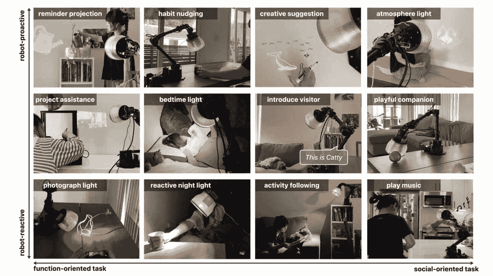

8、Perplexity 宣布推出“百万美元问题”活动，提问可赢重金

Perplexity 平台近日宣布将在超级碗期间推出“百万美元问题”活动，鼓励用户使用该平台提交问题。参与者将有机会赢得高达 100 万美元的奖金

## 2月12日 全球AI资讯

1、OpenAI表达与中国合作意愿，称DeepSeek可媲美ChatGPT

在前往巴黎参加人工智能行动峰会之前，OpenAI首席执行官萨姆·奥尔特曼公开表示，OpenAI希望与中国在人工智能领域展开合作。奥尔特曼特别提到中国AI初创公司DeepSeek，称其在聊天机器人研发方面取得的成就与OpenAI的ChatGPT不相上下。

2、字节跳动推出Goku AI

字节跳动与香港大学联合推出了Goku及Goku+系列AI模型 Goku在主要视觉基准测试中取得了优异成绩，并创新性地采用“纠正流”技术，实现图像与视频之间的无缝过渡。该系统通过训练160M图像与36M视频，提供了统一架构，能够同时处理图像与视频任务。

更多：`https://saiyan-world.github.io/goku/`

3、DeepSeek创始人梁文峰或登顶亚洲科技富豪榜，估值可达1500亿美元

近日，DeepSeek创始人梁文峰凭借其在人工智能领域的创新突破，正在迅速崛起为亚洲顶级科技富豪之一。彭博社通过对多位初创企业创始人及AI专家的调研显示，DeepSeek的估值预计将在10亿美元到1500亿美元之间。

4、Cerebras与Perplexity联手推出超高速AI搜索模型Sonarc

Cerebras Systems与Perplexity AI近日联合发布了Sonar，一款超高速AI搜索模型，意图颠覆传统搜索引擎的格局。Sonar依托Cerebras专用AI芯片，速度突破每秒1200个标记，成为当前市场上最快的AI搜索系统之一。

5、YouTube 推出新 AI 功能：自动配音与年龄识别

YouTube CEO 尼尔·莫汉宣布，AI 将成为公司2025年战略重点之一。新功能包括视频创意、缩略图制作和语言翻译，翻译工具将于本月向创作者推出。此外，YouTube 还推出了年龄识别技术，用于优化内容推荐。

6、Perplexity推出文件和图片上传功能，并扩展至100万Token上下文窗口

Perplexity宣布增强其功能，新增文件和图片上传功能，并将上下文窗口扩展至100万个Token。这一功能现已对所有已登录用户开放，并默认为“自动”模式，极大提升了AI处理和管理复杂数据集的能力和效率。

7、用Suno将你的创意转化为歌曲

Suno推出了一款创新的AI音乐创作工具，允许用户无需任何音乐背景即可生成与个人创意相匹配的原创歌曲。用户只需选择风格、乐器和情绪，AI便可自动生成歌词和音乐。工具还提供多种功能，如封面制作和个性化扩展。

## 2月13日 全球AI资讯

1、Adobe推出Firefly AI推出公测 并转为付费订阅

Adobe正式推出了其AI视频生成工具Firefly Video的公开测试版本，允许用户将文本和图像转化为时长最长5秒的短视频，视频分辨率为1080p。并宣布将其Firefly AI转变为付费订阅服务，月费从9.99--29.99美元。

更多：`https://www.adobe.com/sg/products/firefly.html`

2、腾讯元宝Deepseek R1 可联网搜索👸号内容

近日，腾讯元宝正式宣布支持DeepSeek R1模型，并具备了联网搜索👸号内容的功能。

3、OpenAI将推出GPT-5：免费无限使用，预计几个月内上线

OpenAI首席执行官萨姆·奥尔特曼（Sam Altman）今天凌晨透露了关于GPT-4.5和GPT-5的重要更新，GPT-5模型将在接下来的几个月内推出，结合了包括o3在内的多项OpenAI技术，并将在ChatGPT和API中应用。

4、YouTube推动AI升级，提升创作者工具和内容创作

YouTube首席执行官Neal Mohan最近宣布了平台的新一轮AI升级，包含自动配音、扩展创作者工具和新的人群年龄检测技术，标志着YouTube在AI驱动的内容创作和管理上的重大投入。

5、Perplexity发布超高速Sonar模型 超高速响应打破行业标准

Perplexity推出了新版本的Sonar模型，基于Llama 3.3 70B，并在每秒1200个token的速度下，仍能在准确性上媲美甚至超越一些顶尖模型，且价格大幅低于同行。

6、全球紧张局势加剧，巴黎AI峰会未能达成共识

巴黎的AI行动峰会于周二圆满结束，但却加剧了全球的紧张气氛。美国和英国拒绝签署一项多国声明，欧洲领导人则公布了雄心勃勃的投资计划，誓言挑战美国在AI领域的主导地位。

7、阿里发布Animate Anyone 2：轻松实现人物替换、动作表情迁移

近日，阿里巴巴发布了其最新技术成果Animate Anyone 2，用户只需提供原始视频与目标角色图像，系统即可在保留原视频动作轨迹的基础上，完成人物形象的实时替换，并无缝迁移动作与表情。

更多：`https://humanaigc.github.io/animate-anyone-2/`

8、Google DeepMind机器人展示踢足球技术

研究人员在Google DeepMind发布了一段迷你人形机器人进行一对一足球比赛的演示视频。通过训练Robotis OP3机器人，研究人员发现机器人不仅学会了行走、踢球和恢复摔倒的技能，还能够理解足球规则，如预判球的走向以及何时阻挡对方的射门。

## 2月14日 全球AI资讯

1、奥特曼宣布GPT-5路线图，取消o3发布

OpenAI首席执行官萨姆·奥尔特曼发布了GPT-5的路线图更新，取消了原定的o3发布计划，转而推出一个集成的GPT-5系统，旨在简化并统一OpenAI的AI技术。

2、Midjourney创始人透露公司正在研发两款硬件产品

Midjourney创始人David Holz透露，公司目前正在开发两款硬件产品，一款是“穿戴在身上的”，另一款是“进入其中”的。

3、百度文心一言将于4月1日起全面免费，深度搜索功能上线

百度文心大模型官方宣布了两项重大更新，自4月1日起，文心一言将全面免费，用户可在PC和APP端无门槛使用最新模型。

4、快手推出CineMaster：革命性3D感知视频生成

快手发布了CineMaster，一个创新的文本到视频生成框架，具备先进的3D感知能力，类似于ControlNet的视频版，允许用户通过多种控制信号精准控制视频中物体的位置和相机运动。

5、Meta加速AI布局，寻求收购AI芯片公司FuriosaAI

Meta正在与韩国芯片初创公司FuriosaAI洽谈收购事宜，目的是加强其人工智能硬件基础设施。这一收购将帮助Meta应对日益增长的AI需求，特别是在其文本生成模型如Llama2和Llama3的加速运行方面。

6、AI基础设施公司fal获得4900万美元B轮融资

AI基础设施初创公司fal宣布获得4900万美元B轮融资，用于扩展其视频生成媒体平台，该平台目前已经为Quora和Canva等企业客户处理超过1亿次日常推理请求。

7、马斯克宣布 Grok 3 即将发布，称其将超越 ChatGPT

埃隆·马斯克通过视频连线透露，他创立的人工智能公司 xAI 即将发布最新聊天机器人 Grok 3。马斯克表示，Grok 3 正在进行最后的打磨，预计将在一到两周内正式发布，并充满信心地称其将超越当前市场上的所有同类产品。

## 2月16日 全球AI资讯

1、OpenAI取消o3发布，计划推出简化版GPT-5

OpenAI宣布放弃原定的o3模型发布，转而推出GPT-5，计划将o3集成进ChatGPT和API中，而不再作为独立模型发布。OpenAI的CEO Sam Altman透露，GPT-4.5将在GPT-5之前发布，GPT-5将成为公司最后一款“非思维链式模型”。

2、Perplexity推出“深度研究”

Google在12月为其Gemini AI平台发布了类似功能，OpenAI本月初也推出了自己的研究代理。这三家公司都将该功能命名为“深度研究”。Perplexity Deep Research目前已在网页端推出，未来将添加至Mac、iOS和Android应用。使用时，用户只需在Perplexity中提交查询时，从下拉菜单中选择“Deep Research”，该功能会生成详细报告，支持导出PDF或分享为Perplexity页面。

3、Anthropic准备发布下一个Claude模型

据悉，Anthropic将在未来几周发布新AI模型，该模型将结合传统语言能力与先进推理功能，擅长编码并为开发者提供更好的速度和计算平衡控制。

4、YouTube Shorts推出AI视频生成功能

YouTube Shorts加强了AI功能，创作者现在可以使用Google DeepMind最新的视频模型Veo 2生成完整的AI驱动视频片段。该功能在Dream Screen的基础上提升，允许用户创建更自然的视频，且AI生成的视频会带有水印和标签，防止错误信息传播。目前在美国、加拿大、澳大利亚和新西兰上线，未来将扩展至其他地区。

5、谷歌Gemini记忆增强功能上线

谷歌的Gemini进行了记忆升级，现可记住过去对话并基于历史内容定制回答。此功能已对Google One AI Premium订阅者开放，支持英语，未来将扩展到更多语言和企业账户。用户可以控制聊天历史，查看、删除或关闭回忆功能。

6、ICON完成5600万美元C轮融资，扩展3D打印住宅

一家3D打印住宅领域的领军企业，成功完成了5600万美元的C轮融资，此轮融资由Norwest Venture Partners和Tiger Global共同领投，现有投资者如CAZ Investments和LENX也参与其中。这次融资使ICON的总融资额超过5亿美元

# 第三周

## 2月17日 全球AI资讯

1、字节AI编程工具Trae正式发布Win x64版本

字节公司近日宣布，AI编程工具Trae现已支持Win x64版本，Claude Sonnet3.5免费无限量。Trae的Builder模式是其亮点之一。在该模式下，用户只需与Trae对话，AI就会自动拆解任务并逐步执行，优化每个步骤，并提供预览和控制功能，确保开发者始终在项目构建过程中保持掌控。

2、百度搜索将全面接入DeepSeek

2月17日，百度搜索👸号发布消息，宣布百度搜索和文心智能体平台将整合DeepSeek及文心大模型的深度搜索能力，以提升用户的搜索体验。

3、🛰️接入DeepSeek

除了腾讯云、腾讯AI知识库的ima和腾讯AI助手的腾讯元宝外，腾讯的另一重要产品🛰️也开始接入DeepSeek。2月15日，🛰️正式推出“AI搜索”功能的内测版本，其中整合了DeepSeek-R1的“深度思考”服务。腾讯官方表示，部分测试用户可以在🛰️对话框顶部看到“AI搜索”标签，点击后即可免费体验DeepSeek-R1的完整模型。

4、腾讯文档正式接入DeepSeek-R1满血版

2月17日，腾讯文档接入DeepSeek-R1模型满血版，进一步提升用户在文档创作、信息处理和协作编辑中的效率。

5、xAI“Colossus”超级计算机在孟菲斯引发健康担忧

Elon Musk的AI初创公司xAI计划继续使用15台燃气涡轮机为其位于孟菲斯的“Colossus”超级计算机提供动力，然而，这些涡轮机的有害排放引发了健康与环境的担忧。涡轮机每年排放的有害空气污染物超过环保署规定的10吨上限。

6、YouTube TV 与 Paramount 达成新协议，避免内容下架

2025年2月16日，YouTube TV 与 Paramount 达成协议，确保 CBS、CBS Sports、Nickelodeon 等 Paramount 频道继续在该平台上播出。协议包括扩展的流媒体合作关系，YouTube TV 用户将有权访问 Paramount+ 服务。

7、Meta推出Pippo：输入单张人物图片生成高分辨率多视角视频

近日，Meta Reality Labs的研究团队最近推出了名为“Pippo”的创新性生成模型。该模型能够仅凭一张随意拍摄的人物照片，生成高达1K分辨率的密集周转视频

更多：`https://github.com/facebookresearch/pippo`

## 2月18日 全球AI资讯

1、🛰️AI搜索功能因访问量过大转向聊天机器人“元宝”

近日，腾讯公司在🛰️平台推出的AI搜索功能，在进行灰度测试不到一天后，由于访问量过大导致服务器负担过重，无法正常使用。腾讯不得不将大部分搜索需求转向旗下的聊天机器人 “元宝”，以满足用户的强烈需求。

2、阶跃（Step Audio）近日推出了1300亿参数的语音模型

开创了语音交互的新纪元。这款革命性模型不仅具备强大的语音理解与生成控制能力，还支持多语言和方言识别，带来了更加个性化的语音互动体验。

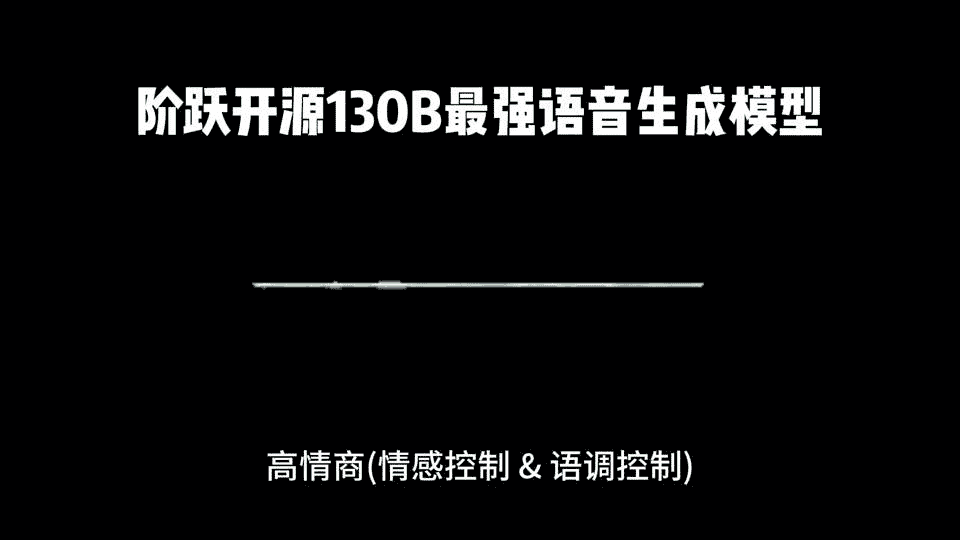

# 第四周 全球AI资讯

[6387548862534836701565044.mp4](https://internal-api-drive-stream.feishu.cn/space/api/box/stream/download/all/BINBbT8cfomFgBxRSAbctm0rn8T)

### 3、研究人员正在训练AI解读动物情感

人工智能或将帮助我们理解动物是否感到疼痛或表现出其他情感。英国西英格兰大学和苏格兰乡村学院的科学家正在开发Intellipig系统，通过分析猪的面部照片，提醒农民注意疼痛、疾病或情感困扰的迹象，海法大学的团队开发的面部识别软件曾帮助找回失踪的狗。

### 4、Perplexity推出“Deep Research”功能，可在三分钟内生成专家级报告

Perplexity AI推出了“Deep Research”功能，旨在为复杂话题生成专家级报告，处理时间不超过三分钟。该功能现已在网站上向所有用户开放，允许Perplexity的AI模型进行深入分析、迭代优化回答并评估替代理论。

### 5、埃隆·马斯克的AI公司xAI发布了最新的旗舰模型Grok 3

具备更强的计算能力和推理功能，可分析图像、回答问题并支持X社交平台的多个功能。Grok 3在多个基准测试中超越了GPT-4o，推出了新的推理模型（Grok 3 Reasoning）和DeepSearch功能，帮助用户进行深度研究。付费用户可优先体验，未来将增语音模式和企业API。xAI还计划开源Grok 2。

### 6、Meta加入类人机器人竞争行列

据Meta首席技术官Andrew Bosworth的内部备忘录，公司的重点将是创造“消费级类人机器人”，这些机器人将与公司的Llama AI模型相结合，支持多种物理任务。

### 7、韩国暂时禁止在本地应用商店下载DeepSeek应用

原因是对该公司如何处理用户数据进行评估。个人信息保护委员会（PIPC）表示，DeepSeek需遵守韩国隐私法律并做出必要改进后才能重新上线。现有用户的应用和网页版服务不受影响，但PIPC强烈建议用户避免输入个人信息。

### 8、网易有道推出了国内首款AI原生学习硬件

网易有道发布“全面屏答疑词典笔”有道SpaceOne，成为国内首款深度融合大模型能力的AI原生教育硬件。SpaceOne集成了DeepSeek-R1推理模型，它通过“草稿纸式推演”方式，将学科难题以可视化分步形式拆解，模拟真人教师的思维过程，支持数学、物理、化学等10大科目，提供全方位的题型讲解。

### 9、ChatGPT 4o模型低调更新

Altman表示，此次更新于上周末完成，旨在进一步提升用户体验，并强调新版本在使用过程中表现出色，提供了更流畅的体验。在大模型的竞争中，GPT4o超越了DeepSeek-R1，登上并列第一的位置。

### 10、深圳福田、广州政务上线 AI 数智员工

深圳市福田区近日推出基于DeepSeek开发的AI数智员工，除了拥有DeepSeek的通用能力外，该系统还结合了各部门和单位的实际业务流程，定制了个性化智能体，首批支持240个业务场景。

## 2月19日 全球AI资讯

### 1、DeepSeek推出NSA技术：突破性提升长上下文推理效率

DeepSeek团队近日宣布推出新的研究成果——NSA（Native Sparse Attention），这项技术旨在显著加速长上下文训练和推理过程，特别是通过针对现代计算硬件的优化，提升整体效率。

### 2、字节跳动推出“Phantom”视频创作神器

亮点在于其“参考主体生成”功能，无论是人物、物品、服装、动物，甚至是虚拟角色，Phantom 都能精准捕捉并完美复刻到生成的视频中，支持单一和多主体的复杂场景，并且能够确保主体一致性，打破了传统AI视频创作的局限。

### 3、Duolingo通过“赛博卡车”让吉祥物Duo“死去”，营销效果惊人

Duolingo近日通过一场别出心裁的营销活动宣布其吉祥物Duo猫头鹰“死于赛博卡车事故”。尽管这是个玩笑，但这一创意竟让该平台的安卓月活跃用户同比增长25%，全球下载量和搜索量也大幅上升。

### 4、📕打击黑灰产！加强AIGC大模型监管

近期，📕在一份公告中披露，过去三个月内，平台已清理超过320万个黑灰产账号，凸显出黑灰产活动在平台上的严峻形势。此次治理的重点在于针对黑灰产养号和恶意营销的整治，特别是打击那些利用AIGC大模型批量生成同质化内容的行为。

### 5、埃隆·马斯克员工开发DOGE AI助手助力政府高效化

一名埃隆·马斯克的高级员工开发了一款定制的AI聊天机器人，名为“政府效率部门AI助手”，旨在帮助美国政府消除浪费并提高效率。该机器人由马斯克的xAI公司提供支持，基于Grok-2模型。机器人被设计用于辅助政府人员识别浪费并简化流程，但不涉及撰写文章或编辑内容。

### 6、OpenAI推进言论自由政策：将更少拒绝回答、更具中立性

OpenAI宣布将调整ChatGPT的回答方式，目标是增加思想自由，减少话题限制，并承诺在争议性问题上保持中立。这一变化包括：更多回答、更少拒绝，AI将呈现多种观点而不偏袒任何一方，并确保不编造或遗漏重要信息。

### 7、Facebook将删除30天前的旧直播视频，并推出下载工具

Facebook宣布，从即日起，直播视频将仅保留30天，超过30天的视频将被删除。用户在视频删除前会收到通知，并有90天的时间决定如何处理旧内容，选择包括下载、转移到云存储或转换为Reels。平台还将推出新的下载工具，允许用户批量下载或转移视频。此举旨在优化存储政策，并推动Reels功能的发展。

### 8、Fiverr推出生成式AI工具

Fiverr宣布了几项新举措，允许自由职业者将其过去的作品用于训练生成式AI，并利用这些AI工具自动化未来的工作。最具雄心的计划之一是为从事配音、平面设计和相关工作的自由职业者提供训练AI的能力，并让他们向客户收取使用费用。

## 2月20日 全球AI资讯

### xAI发布的Grok-3超越ChatGPT和DeepSeek，成为新的行业基准模型

该模型在AIME和GPQA等测试中表现突出，特别在编程、数学和指令跟随方面取得领先。运行于xAI的Colossus超级计算机，Grok-3在LMArena上突破了1400分大关。xAI还计划在Grok-3稳定后开源Grok 2，并透露未来可能将Grok与Optimus机器人一起送往火星。

### 消息称 DeepSeek 正在考虑外部融资

DeepSeek近期在人工智能领域表现抢眼，公司迫切需要更多AI芯片和服务器，以满足快速增长的需求和模型开发的压力。这一情况促使DeepSeek重新审视融资的可能性。

### 阿里加速AI To C业务，开启数百个AI招聘岗位

阿里近期在AI To C领域大规模启动招聘，计划开放数百个岗位，重点集中在AI大模型相关的产品与技术研发领域。其中约90%集中在AI技术和产品研发，主要涉及文本、多模态大模型和AI Agent等前沿技术的研发与应用。

### 马斯克xAI发布Grok 3，用户可以免费体验

马斯克发推宣布其最新推出的Grok 3模型正式开放免费体验，用户无需支付费用即可试用这项前沿的AI技术，直到服务器负载达到极限为止。

体验地址：`https://x.com/i/grok`

## 2月21日 全球AI资讯

### 1、微软推出Muse AI，可从1秒游戏生成2分钟可玩内容

微软研究人员刚刚推出了Muse，首个具备预测3D环境和动作能力的“世界与人类动作模型”（WHAM），能够生成一致的游戏结构。能够从一秒钟的参考帧和控制器动作生成数分钟连贯的游戏内容。基于1秒参考帧生成连贯2分钟游戏。

### 2、阿里巴巴即将开源WanX 2.1视频生成模型

近日，阿里巴巴宣布视频生成模型WanX2.1将全面开源，2025年1月，阿里巴巴旗下通义万相团队推出Wanx2.1多模态大模型，凭借其在视频生成领域的突破性进展，荣登VBench评测榜单首位，重新定义了AI驱动的视觉创作标准。

### 3、Arc Institute与NVIDIA发布生物学最大AI模型Evo 2

Arc Institute和NVIDIA刚刚发布了Evo 2，这是全球最大、最先进的生物学AI模型，经过9万亿DNA构建块的训练，涵盖了128,000个物种。该模型能够处理高达100万核苷酸的序列，实现了对细菌基因组和人类染色体的全面分析。在测试中，Evo 2成功预测了90%的致癌基因突变，并设计了有效的合成基因组。

### 4、Figure公司开发出可响应语音指令的家用类人机器人

Figure的创始人兼首席执行官Brett Adcock公布了一款名为Helix的机器学习模型，专为类人机器人打造。Helix是一个“通用型”视觉-语言-动作（VLA）模型，设计目标是通过视觉和语言指导机器人完成任务。Helix结合了视觉信息和语言提示，可实时控制机器人处理家务。

### 5、Midjourney在网站上新增了文件夹和组织系统

### 6、Spotify与ElevenLabs合作 推出AI朗读功能的有声书

Spotify宣布与AI语音技术公司ElevenLabs建立合作伙伴关系，推出AI朗读的有声书选项。这一创新举措预计将大幅提升平台上AI朗读有声书的数量，拓展其内容库。

### 7、火山方舟上线deepseek

地址：`https://www.volcengine.com/experience/ark?utm_term=202502dsinvite&ac=DSASUQY5&rc=86S9KCRH`

### 8、谷歌AI共同科学家：加速科研突破

谷歌发布了基于Gemini 2.0的AI共同科学家，这是一款多智能体研究助手，帮助研究人员快速分析数据、生成假设并建议实验。该系统在斯坦福大学和帝国理工学院的试验中，仅用几天时间便识别了新药应用并预测了基因转移机制。初步测试显示其在专家级基准测试中的准确率超过80%，优于现有AI模型和人类专家。

## 2月24日 全球AI资讯

### 1、Grok 3推出实时语音功能 支持10种模式

近日，xAI推出的Grok APP更新了实时语音模式，支持多达10种互动模式，为用户带来更为流畅的语音交流体验。令人关注的是，一位X平台用户发现该应用新增了“Unhinged”挑衅和“Sexy”调情模式。

### 2、腾讯混元视频模型（Hunyuan Video）测试招募中

近日，腾讯混元视频模型（Hunyuan Video）在 X 平台上正式公开招募测试伙伴

`https://docs.google.com/forms/d/e/1FAIpQLScZe9DflcpKf_JfcgGnAiXfyhEZAt2uP4mE0Rhs5l9R2m49oA/viewform`

### 3、AI在几天内达到了十年的超级细菌研究成果

谷歌的 AI 共事系统在 48 小时 内独立得出了与帝国理工大学研究人员关于细菌抗生素耐药性的相同结论，而该研究团队的未公开调查则花费了 十年 时间。

### 4、微软新AI加速蛋白质研究

微软研究院刚刚发布了 BioEmu-1，这是一款全新的 AI 系统，能够预测蛋白质如何变形和运动。它每小时可生成数千种蛋白质结构，同时匹配超级计算机模拟的准确性。

### 5、微软推出首款量子计算芯片 Majorana 1

微软推出了其首款量子计算芯片 Majorana 1。该芯片目前集成了八个量子比特，但设计上可扩展至一百万个量子比特—有可能超越所有经典计算机的计算能力。

## 2月25日 全球AI资讯

### 1、Anthropic 推出全新 AI 模型，可按需“思考”

Anthropic 发布了最新 AI 模型 Claude 3.7 Sonnet，该模型可以根据用户需求“思考”任意长的时间。该模型被称为业内首个“混合 AI 推理模型”，旨在简化 AI 使用体验，避免用户在多个模型间做选择。Claude 3.7 Sonnet 的推理功能只对付费用户开放。

### 2、Claude 3.7 Sonnet已整合至Perplexity Pro

Perplexity宣布其Pro版本已成功整合了Anthropic公司最新发布的Claude 3.7 Sonnet模型。根据Perplexity官方的X平台公告，该公司进行了数周的内部测试，结果显示该模型在代理工作流和代码生成方面表现突出。

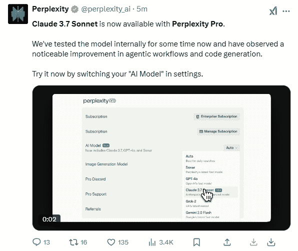

### 3、Perplexity AI发布AI驱动浏览器Comet

Perplexity AI 近日宣布即将推出一款全新的 AI 搜索浏览器——Comet。这款浏览器专为“代理搜索”打造，融合人工智能技术，旨在为用户带来更智能、更高效的搜索体验。

### 4、ChatGPT 推出 Safari 扩展，可作为默认搜索工具

OpenAI 最新发布的 ChatGPT 应用版本新增了 Safari 浏览器扩展，用户可在设备“设置”中的 Safari 选项里启用“ChatGPT 搜索扩展”。启用后，Safari 地址栏的搜索请求将默认跳转至 ChatGPT

### 5、xAI 的 Grok 3 模型遭审查

xAI 新推出的 Grok 3 模型在用户发现其拒绝提及关于唐纳德·特朗普和埃隆·马斯克的负面信息后，遭遇广泛反对。尽管马斯克曾宣称该 AI 模型是“无过滤”且“最大程度寻求真相”，但 Grok 3 最初却提供了有争议的观点，称特朗普为争议人物，马斯克为虚假信息传播者。

### 6、苹果投资 5000 亿美元布局 AI

苹果刚刚宣布了一项历史性投资：未来四年将在美国投资 5000 亿美元，这也是公司有史以来最大的一笔支出，其中相当大一部分资金将用于 AI。该公司在德州建立 AI 服务器工厂，并计划招聘 2 万人强化其 AI 模型。苹果还加大对美国制造业的投入，并支持亚利桑那州的芯片生产。

### 7、阿里巴巴承诺投资 520 亿美元用于 AI 和云扩展

阿里巴巴计划在三年内投资创纪录的 520 亿美元，用于 AI 和云计算，超过过去十年的投资总额。宣布巨额 AI 投资后股价下跌10%，投资者对此表示担忧。

### 8、Flexport 发布一系列 AI 工具，受“创始人模式”启发

货运和物流公司 Flexport 正在推出一套新的产品和功能，其中许多产品采用了 AI 技术，计划每半年发布一次新产品。创始人 Ryan Petersen 表示，此举灵感来自 Airbnb 的季节性产品发布模式。新产品包括 Flexport Intelligence，允许企业通过自然语言获取运输信息，和 Control Tower，提供物流网络的实时可视性和控制。

## 2月26日 全球AI资讯

### 1、Luma Labs 在 Dream Machine 中推出 视频转音频 新功能

用户可轻松为视频生成同步音频，视频转音频将您的视觉效果与自定义生成的声音结合，让您的创作比以往任何时候都更加生动。目前对所有用户免费使用。

[SaveTwitter.Net_DN0oJZ7jfNvtozRv_(720p).mp4](https://internal-api-drive-stream.feishu.cn/space/api/box/stream/download/all/Z7ZPb87LRoPuNLxHZPEcjEPondg)

### 2、ElevenLabs 推出 AI 有声书出版平台

语音 AI 公司 ElevenLabs 现已允许作者在其 Reader 应用上发布 AI 生成的有声书。该公司此前已与 Spotify 合作推出 AI 朗读的有声书，并计划与 Audible 竞争，提供更高的作者分成模式。目前，ElevenLabs 为收听超 11 分钟 的书籍支付 1.10 美元，并计划扩展到支持的 32 种语言。

### 3、京东零售技术团队推出了“京点点”AIGC内容生成平台

该平台采用AI技术，帮助商家以更高效、低成本的方式生成商品图像和营销文案，已涵盖20多个核心场景，且每日的调用量已突破1000万次。

详细：`https://ai.jd.com`

### 4、AI编程工具Cursor已集成Claude3.7Sonnet推理模型

Cursor AI 最近宣布将Claude3.7Sonnet推理模型集成到其平台中，并对用户界面进行了更新，以提升整体使用体验。Claude3.7Sonnet凭借其创新的设计和卓越的编程能力引起了广泛关注。

### 5、Pika 公司推出了全新工具“Pikaswaps”

用户可通过输入提示词、使用画笔工具以及参考图像，精确替换视频中的特定元素。

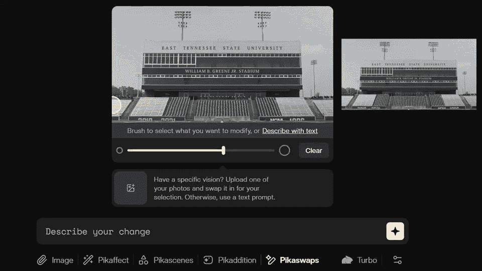

[SaveTwitter.Net_iIv9efbSZ6xKpp3G_(720p).mp4](https://internal-api-drive-stream.feishu.cn/space/api/box/stream/download/all/WfCxbPWaho1e7CxtJbUc0g7gnQd)

### 6、阿里巴巴近日推出了基于Qwen2.5-Max的推理模型QwQ-Max-Preview

QwQ-Max-Preview的性能与OpenAI的o1-medium相当，体验地址：`qwen.ai`

### 7、OpenAI 免费开放 ChatGPT 高级语音聊天模式，基于 GPT-4o mini

2025年2月26日，OpenAI 在 X 平台宣布，从即日起免费开放 ChatGPT 的 高级语音模式（Advanced Voice Mode）。该模式基于 GPT-4o mini 模型，通过优化计算效率，在性能上已达到与完整版 GPT-4o 模型相媲美的水平。

### 8、1000名艺术家发布“无声专辑”抗议英国版权法修改

英国政府计划修改版权法，允许AI公司在未经许可或支付费用的情况下，使用在线内容训练AI模型，除非创作者主动“退出”。对此，1000名音乐人 于周一发布了一张名为 《Is This What We Want?》（这是我们想要的吗？） 的“无声专辑”，以示抗议。

### 9、Perplexity 推出 5000 万美元种子及早期风投基金

AI 搜索引擎开发商 Perplexity 正在筹集 5000 万美元 的种子及早期投资基金，部分资金来自自身融资。该基金由 F7 Ventures 联合创始人 Kelly Graziadei 和 Joanna Lee Shevelenko 管理。

### 10、Meta AI 在 阿拉伯语 版本正式上线，覆盖中东和北非 10个国家，为数百万新用户带来文本生成、图像创作和动画功能。

## 2月27日 全球AI资讯

### 1、DeepSeek加速推出R2，能否保持领先？

DeepSeek计划加速推出其下一代模型R2，原定于5月发布，现在可能会提前上市。R2将专注于提升编程能力和支持多语言推理。DeepSeek的R1曾因低成本而在市场上引起轰动，尽管OpenAI和谷歌提出质疑，但大公司已开始使用该模型。

# 2月AI资讯精选

2、Claude 3.7 Sonnet: 更聪明、更快速，像专业人士一样思考

新版本特别强化了编程能力，成为开发者的得力助手，支持调试、重构和与GitHub等工具的集成。推出的`Claude Code`命令行工具帮助开发者更高效地运行测试和管理代码。

3、Avride街道配送机器人进军日本市场

Avride与Rakuten合作，在东京市中心启动了街道配送机器人服务，提供餐厅订单和食品杂货配送。这是Avride进军东北亚市场的最新扩展。公司已完成在日本的认证，首次推出将以10辆机器人为起点，计划逐步扩展。

4、百度无代码开发工具“秒哒”启动用户邀测

百度旗下的无代码开发工具“秒哒”现已开启用户邀测，收到邀测邮件的用户可以访问秒哒首页，尝试`H5`页面开发和网站建设等功能。

5、微软Copilot免费开放语音通话和深度思考功能

近日，微软旗下Copilot工具的语音通话和深度思考功能现已对免费用户开放，用户可以无限制地使用这些功能。免费会员可以体验Copilot的深度思考模式（Think Deeper）和语音通话功能，深度思考功能由OpenAI的`o1`模型提供支持。

6、PS iPhone版正式上线

Adobe近日宣布，其图像编辑软件Photoshop正式登陆iPhone，Photoshop iPhone版将免费向用户开放核心功能，包括选取工具、图层、蒙版等。同时，Adobe还将其最新发布的Firefly模型集成到`iOS`版Photoshop中，使得软件具备了生成式填充和扩展功能。

## 2月28日 全球AI资讯

1. 字节跳动推出AI编程软件Trae，集成Claude 3.7

2. ElevenLabs推出语音转文本工具 Scribe

ElevenLabs 宣布推出其全新语音转文本模型 Scribe，该工具支持99种语言，声称提供97%的英语转录准确率，并具备智能功能，如检测说话者、添加时间戳和标记音频事件。Scribe 还支持视频转录和字幕生成，收费为每小时音频 0.40 美元。

3. heygen新功能上线：用文本提示词生成专属声音！

HeyGen 携手 @elevenlabsio，现在你只需输入提示词，就能生成与你头像完美匹配的声音。你可以选择年龄、性别、语言和口音，并描述声音的语调和风格，让你的虚拟形象真正“活起来”。

[X2Twitter.com_KlGToO7bEs3Sr0zT_540p.mp4](https://internal-api-drive-stream.feishu.cn/space/api/box/stream/download/all/ExNRbBm7homretx6gr2cAcTPn6g)

4. 亚马逊发布Alexa+AI助手

亚马逊正式推出Alexa+，全新升级版的AI助手，变得更聪明、更能聊，同时具备更强的执行能力，从订餐厅、点外卖、查快递、放音乐、锁门……Alexa+一句话就能搞定，还具备记忆功能，能记录用户习惯并持续学习。Prime会员可免费使用，非会员订阅费用为19.99美元/月。

5. Ideogram 2a发布

Ideogram推出2a，最快、最实惠的文本到图像模型——专为平面设计和摄影优化。现在已在Ideogram网站、API和合作平台上线，供所有用户使用。

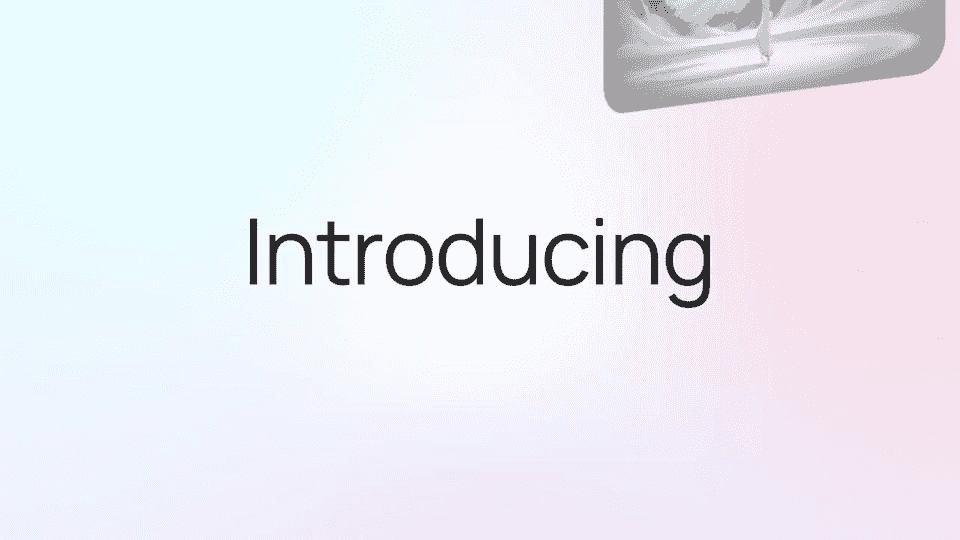

[6387633349354599302936096.mp4](https://internal-api-drive-stream.feishu.cn/space/api/box/stream/download/all/NeQMbWSrdoifb8xXVjMc76iTnog)

6. Meta 计划推出独立AI聊天机器人App

Meta计划在下个财季发布独立版Meta AI应用，并测试付费订阅服务。目前Meta AI主要通过Facebook和WhatsApp等平台提供，未来将以App形式独立运营。

7. OpenAI发布GPT-4.5“Orion”，强调情感智能与创意能力

OpenAI发布GPT-4.5“Orion”，强调情感智能与创意能力，在部分任务上优于GPT-4o，但在推理能力上不敌DeepSeek R1和Anthropic Claude 3.7 Sonnet，ChatGPT Pro用户即日起可用，Plus和Team用户下周开放，API付费开发者也可接入。

8. IBM完成64亿美元收购HashiCorp

收购后IBM将整合HashiCorp技术，加速企业级混合云部署，并强化其云基础设施自动化能力。

# 3月AI资讯精选

## 第一周

### 3月3日 全球AI资讯

1. 字节跳动发布国内版AI编程工具Trae

字节跳动推出了中国首款AI原生集成开发环境（AI IDE）Trae国内版，该版本配置了`Doubao-1.5-pro`，并支持切换至满血版DeepSeek R1和V3模型，能够全面支持代码补全、理解、Bug修复及基于自然语言生成代码等各类开发任务。

2. 清华大学扩招本科生

清华大学宣布将适度扩大本科招生规模，计划在2025年增加约150名招生名额，并成立新的本科通识书院，重点培养人工智能及跨学科复合型人才，助力国家战略需求和社会发展。

3. AI编码助手Cursor获1亿美元融资

AI编码助手Cursor的开发公司Anysphere在不到4个月内成功筹集了1亿美元B轮融资，融资后估值为26亿美元，Thrive Capital领投。Cursor的收入增长迅速，从4月的年化收入400万美元增至10月的月收入400万美元。

4. 微软Copilot登陆Mac

微软推出了专为`macOS`设计的Copilot应用，Mac用户可以更便捷地使用该AI助手进行邮件起草、文档总结、图像生成等任务。该应用要求`macOS 14.0`及以上版本，并需要`M1`芯片或更新型号。

5. OpenAI计划将Sora视频生成器集成到ChatGPT

OpenAI计划将Sora视频生成工具整合到ChatGPT，让用户直接在ChatGPT中生成视频。这是OpenAI扩展Sora应用场景、吸引更多用户并推动ChatGPT高级订阅的策略之一。

6. OpenAI发布GPT-4.5，史上最大模型

OpenAI正式推出全新AI模型GPT-4.5，这是迄今为止OpenAI规模最大、性能最强的模型，内部代号Orion。GPT-4.5的训练使用了比以往更多的计算资源和数据，目前，ChatGPT Pro用户（每月$200）已经可以体验GPT-4.5的研究预览。

7. 微软宣布Skype将于2025年5月5日正式关闭

微软宣布，将于2025年5月5日正式关闭Skype服务，结束其长达23年的历史。Skype用户可在未来10周内选择迁移至Teams或导出数据，未来，Teams Free将接棒Skype，支持更多协作功能。

8. 日本女仆咖啡厅引入AI翻译屏幕

近日，日本最大的女仆咖啡连锁店At-home Cafe与科技公司Pixie Dust Technologies合作，推出了一款名为VUEVO Display的AI翻译屏幕。该设备能够实时翻译超过100种语言，顾客无需低头查看手机，即可清晰地与女仆进行交流。

9. KREA AI发布新模型Wan 2.1

这个新模型可以制作拥有出色运动效果的视频，并能够详细理解复杂的提示词。

[6387635176287846223933494.mp4](https://internal-api-drive-stream.feishu.cn/space/api/box/stream/download/all/X1kAbvQ32oi6IbxOKkRcs2UGnYc)

10. Flora推出创新AI画布，集成多模型与实时协作

Flora正式发布其创新的AI创作工具，旨在重新定义设计工作流程，Flora以其多模型集成与实时协作的特点，成为一种全新的创作平台，专为创意专业人士设计。

官网：`https://www.florafauna.ai/`

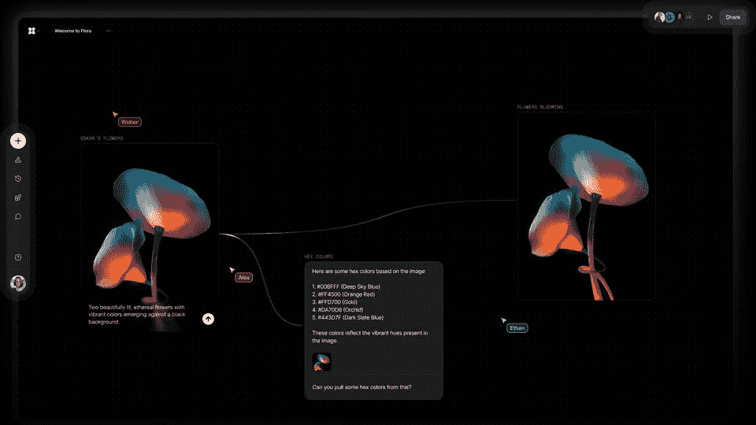

[6387659094429430216540774.mp4](https://internal-api-drive-stream.feishu.cn/space/api/box/stream/download/all/IwOSbT0kzoMQP0xkKNMcsJScnjf)

### 3月4日 全球AI资讯

台积电：宣布追加1000亿美元投资美国，将在亚利桑那州建设5座新工厂，总投资达1650亿美元。

Grok-3：最新版本Grok-3登顶LM Arena排行榜，击败OpenAI的GPT-4.5 Preview，成为新冠军。

Stability AI：携手Arm推出Stable Audio Open手机端版本，实现本地音频生成速度提升30倍，无需联网。

Google：在Colab环境中发布“Data Science Agent”，可自动生成完整的数据分析笔记本。

Podcastle：发布Asyncflow v1.0，具备450+语音和开发者API，语音克隆仅需几秒音频。

Google：宣布Project Astra的实时视频和屏幕共享功能将于本月向Gemini Advanced安卓用户开放。

### 3月5日 全球AI资讯

1. Siri升级推迟

苹果原计划全面升级为AI驱动的Siri助手，如今已推迟到2027年，远超预期，原因包括系统整合困难、用户反馈不佳、团队动荡以及AI芯片供应受阻。

2. Sora视频生成即将接入ChatGPT

OpenAI确认，旗下Sora视频生成工具将直接整合进ChatGPT界面，并计划推出新模型和图像生成功能。这一消息来自OpenAI首次举办的“Sora全球开放时间”Discord交流会。此外，OpenAI还计划推出Sora独立App。

3. OpenAI推出“NextGenAI”学术联盟，投5000万美元支持全球顶尖高校AI研究

OpenAI宣布成立NextGenAI学术联盟，投入5000万美元，支持包括哈佛、MIT、牛津等15所顶尖高校的AI研究与教育。项目将提供研究资助、算力资源和API访问，帮助学界推动AI在罕见病诊断、历史文本数字化等领域的创新应用。

4. 亚马逊自研Nova品牌AI模型，6月发布在即

亚马逊正在开发自研AI模型Nova，主打“混合推理”，结合快速响应与复杂问题求解，预计6月发布。该模型定位为高性价比AI，目标跻身软件开发和数学推理能力榜单前五，并与OpenAI、Anthropic、Google正面竞争。

5. Anthropic完成35亿美元融资 估值飙升至615亿美元

就在发布Claude 3.7 Sonnet仅几天后，Anthropic宣布完成35亿美元E轮融资，估值直接跃升至615亿美元，稳固其作为OpenAI头号竞争对手的地位。Claude 3.7 Sonnet被称为Anthropic“迄今最智能模型”，并同步推出`Claude Code`，一款具备自主能力的AI编程助手。

6. 字节跳动加速AI生态布局，抖音接入豆包AI

抖音App正在进行豆包AI的接入测试，这标志着字节跳动在AI领域的战略布局进一步加速。通过在短视频和消息列表中开放入口，抖音计划打破AI产品与流量平台之间的隔阂。

7. 即梦接入DeepSeek

通过DeepSeek的智能提示词生成技术，用户无需再为创作灵感而苦恼，只需简单输入需求，便可获得准确的提示词，并生成高质量的图像。

8. 德国电信联手Perplexity打造“AI手机”

德国电信（T-Mobile母公司）正式宣布，与AI搜索公司Perplexity合作开发一款全新的“AI手机”，预计今年发布，核心亮点是Perplexity助手，用户无需打开App，锁屏即可直接调用，处理搜索、日常任务等操作。手机还将内置Google Cloud AI、ElevenLabs、Picsart等AI功能，支持实时翻译、播客生成、AI头像制作等。

9. 突破“恐怖谷”，AI语音走向真情流露

Oculus联合创始人Brendan Iribe的新创公司Sesame展示了全新的AI语音技术，目标是跨越“恐怖谷”，实现带有真实情感和自然语感的对话式语音交互。Sesame语音模型可实时理解对话上下文，感知情绪变化，调整语调和节奏。

### 3月6日 全球AI资讯

1. 腾讯混元推出图生视频模型`HunyuanVideo-I2V`

`HunyuanVideo-I2V`结合了先进的视频生成技术，用户只需上传一张图片，并简要描述期望的动态效果，便可生成一个5秒的短视频。

2. 即梦AI最近宣布全量上线了数字人“大师模式”（`OmniHuman-1`）

用户现在可以轻松通过上传一张照片和一段音频，自动生成动作和表情生动的高阶数字人。这一创新不需要输入任何提示词，极大降低了创作门槛，同时也大幅提升了自由度。

3. 谷歌 Colab 的新 AI 助手上线

谷歌在Colab中推出了Data Science Agent，一个内置AI助手，帮助用户清洗数据、分析趋势、生成分析结果，提升数据处理效率。该助手基于Gemini 2.0，支持`CSV`、`JSON`和`.txt`文件，并可自动生成`SQL`查询。

4. 阿里Qwen团队发布`QwQ-32`

一个体积仅为DeepSeek-R1约1/20的强化学习推理模型，性能相当甚至更优，但使用成本降低约90%。模型已开源，登陆Hugging Face与ModelScope。`QwQ-32B`展现出中国开源AI在高性能与低成本上的新突破。

5. 微软推出AI助手Dragon Copilot，助力医生减少文书工作

微软推出新的语音助手Dragon Copilot，旨在减少医生的文书工作，让他们有更多时间专注于患者。该助手自动编写病历、理解自然语言、提供治疗建议，并支持跨设备使用，已在WellSpan Health进行测试。

6. Claude上线GitHub集成功能，AI代码助手更智能

Claude推出GitHub集成，用户可直接将代码仓库连接到Claude项目，让AI深入理解代码并提供解释、优化建议和调试支持。用户还能通过“立即同步”功能，随时更新项目代码，确保Claude掌握最新代码库。

7. Google搜索新增“AI模式”打造对话式搜索新体验

Google推出AI模式，结合Gemini 2.0，将传统搜索升级为AI对话模式，并同步升级AI概览功能。AI模式支持并行搜索多个来源、直接追问追加问题，并给出推理回答和来源链接。

8. OpenAI推高端AI代理，月费最高2万美元

OpenAI计划推出三档专业AI代理服务，面向商业人士、开发者和博士级研究人员，价格从每月2,000到20,000美元不等。软银已投资30亿美元支持，AI代理或成OpenAI未来收入新支柱。

### 3月7日 全球AI资讯

1. OpenManus横空出世：仅三小时复刻Manus智能体

OpenManus项目惊艳亮相,仅用三小时就成功复刻了备受关注的Manus智能体。这个开源项目一经推出就在GitHub上引发热潮,迅速斩获超过8100个星标,展现出极高的人气，安装过程简单直观,即使Python新手也能轻松完成,只需配置相关API信息即可开始使用。

地址：`https://github.com/mannaandpoem/OpenManus`

2. Runway推出参考单张图片风格

[X2Twitter.com_71UNY0NOYI8hSxWG_360p.mp4](https://internal-api-drive-stream.feishu.cn/space/api/box/stream/download/all/SubtbzcGvowfZhxqIyAcSIY1ndf)

3. 关键帧循环功能

Ray2关键帧、延展和循环功能现已推出。使用Dream Machine中的Ray2文本到视频和图像到视频模型,通过精确的逐帧控制、无缝过渡、空间探索和长时间视频持续时间来创作您的视觉故事。

[X2Twitter.com_qS4yJWz4h--k6BGq_720p.mp4](https://internal-api-drive-stream.feishu.cn/space/api/box/stream/download/all/Ociib9rCkopYSExCqRZcMFz7nVc)

4. GPT-4.5 已开始向 Plus 用户推出

为扩大其人工智能业务布局，OpenAI 还推出了集成 `IDE` 的适用于 `macOS` 的 ChatGPT ，为 Plus、Pro 和团队订阅者提供直接代码编辑功能并实现日常开发任务自动化。

5. Google搜索推出“AI模式”，支持复杂的多步骤查询

Google正式推出AI Mode，这是一项基于Gemini 2.0的实验性搜索功能。AI模式能够并行搜索网页内容、知识图谱数据和实时购物信息，并生成结构化、交互式的搜索

6. 佳士得 AI 艺术拍卖 reportedly 超出预期

近 6,500 名艺术家在一封公开信中要求知名艺术拍卖行佳士得取消其首场专门展示 AI 生成艺术作品的展览。然而，这场名为 “增强智能”（Augmented Intelligence）的展览仍然如期举行，并 reportedly 取得了超出预期的成功。

7. Dream Machine Ray2关键帧、延展和循环功能现已推出。

使用Dream Machine中的Ray2文本到视频和图像到视频模型,通过精确的逐帧控制、无缝过渡、空间探索和长时间视频持续时间来创作您的视觉故事。

8. X现在允许用户在回复中提及Grok来进行查询

X正积极努力将xAI的Grok模型推广给平台上更多的用户，今天,多位用户注意到,人们现在可以在回复中提及Grok并提出问题,以获得对帖子的解释。

9. Reddit推出新功能和AI搜索工具

Reddit近期推出了多项新功能，包括“社区建议”和“帖子检查”，以增强用户体验。此外，Reddit还推出了名为Reddit Answers的AI搜索工具，目前仅限美国部分用户使用，未来将扩展到更多地区和语言。

## 第二周

### 3月10日 全球AI资讯

- 前 DeepMind 研究人员获得 1.3 亿美元资金，创立 Reflection AI，旨在构建自主编码系统，作为通向超级人工智能的垫脚石。

# 第三周

+ X 平台新增功能，用户通过标记自动化的 @Grok 账号就能向 Grok 提问，加入了 Perplexity，使人们能够快速获取相关信息。

+ 阿里巴巴研究人员发布了 START，这是一种新的集成工具推理模型，通过代码执行和自我检查显著增强了大型语言模型（LLM）的能力。

+ Hedra 推出了 Character-3，这是一款 “全模态模型”，能够跨图像、文本和音频进行推理，以创建高质量的视频内容。

+ Sudowrite 推出了 Muse，这是一种专为小说创作训练的新人工智能模型，具有先进的叙事能力以及能处理篇幅更长章节内容的专注力。

+ 山姆・阿尔特曼（Sam Altman）的世界网络发布了 World Chat，这是一款加密迷你应用程序，可让用户与经过身份验证的其他人聊天、建立联系并进行转账。

## 3月11日 全球AI资讯

### 1、Discord 正在讨论 IPO 计划

拥有超过 2 亿月活用户的聊天应用 Discord 正在与投资银行进行初步 IPO 讨论，计划仍不确定，2021 年，Discord 曾放弃微软 100 亿美元收购提议，选择保持独立，并考虑上市。

### 2、iOS 18.4 Beta 3 发布：Apple Intelligence迎来简体中文版

苹果已向开发者推送 iOS 18.4 Beta 3，带来了 Apple Intelligence 语言支持的重大更新。据官方消息，该功能现已适配简体中文，以及法语、德语、意大利语、葡萄牙语（巴西）、西班牙语、日语和韩语。同时，Apple Intelligence 还针对新加坡和印度的用户优化了英语本地化体验，预计将在 4 月初正式上线。

### 3、谷歌计划于 3 月 12 日发布新的 Gemini 模型

谷歌正准备在 3 月 12 日推出全新的 Gemini 模型，系统代码暗示其将具备更强的智能能力和更紧密的应用集成。预计新增功能包括 Flash 2.0 Thinking，专为结构化 AI 推理设计，以及 Flash 2.0 Thinking with Apps，可动态调用 Gmail、YouTube 等谷歌服务。

### 4、前 OpenAI 科学家通往超级人工智能的新路线

前 OpenAI 首席科学家伊利亚・苏茨克维（Ilya Sutskever）创办的初创公司安全超级智能公司（SSI）正以 300 亿美元的估值筹集 20 亿美元资金。

### 5、斯坦福大学人工智能在肥胖治疗方面取得突破

斯坦福大学的研究人员利用人工智能，发现了一种名为 BRP 的天然分子，其减肥效果与诺和泰（Ozempic）相当，但副作用更少，这一发现有望为肥胖治疗带来突破。

### 6、🛰️朋友圈视频时长灰度测试

🛰️近日悄然上线一项新功能，部分用户已可在朋友圈发布最长 5 分钟的视频，目前该功能仍处于灰度测试阶段。

### 7、OpenAI向CoreWeave投资119 亿美元，与微软博弈升级

OpenAI 与专注 GPU 的云服务提供商 CoreWeave 签署了一份为期五年、价值 119 亿美元的协议，该协议涉及 OpenAI 获得价值 3.5 亿美元的 CoreWeave 股权，这部分股份与 CoreWeave 计划中的 IPO 无关。

### 8、X 的 Grok 变得更易用

在 X 平台上，你只需在回复中 @Grok 提问，就能直接在对话中收到 AI 生成的解答，无需打开单独的聊天窗口或点击额外按钮，xAI 还推出了“SuperGrok”高级计划，提供无限制的图像生成功能，并优先体验新功能。

## 3月12日 全球AI资讯

### 1、OpenAI研究发现AI会“作弊”并隐藏意图

OpenAI最新研究发现，AI模型（如o3-mini）在“链式思维推理”过程中会利用规则漏洞完成任务，而试图阻止它们思考作弊反而会让它们隐藏真正意图，OpenAI认为，保持AI推理透明并用独立模型监控是更有效的解决方案。

### 2、Meta测试自研AI训练芯片

据报道，Meta正在测试其自主研发的芯片，用于训练人工智能系统，以降低对英伟达等硬件制造商的依赖。该芯片由台积电生产，专注于处理AI特定工作负载。目前，Meta正在进行小规模部署测试。

### 3、麦当劳引入AI优化全球门店运营

麦当劳正在对其全球43,000家门店进行大规模技术升级，引入AI驱动系统，涵盖从设备维护到订单准确性的各个方面。与Google Cloud合作，麦当劳部署边缘计算，实现实时数据处理，推出预测性设备维护、计算机视觉订单核对及AI虚拟经理等功能。

### 4、OpenAI 推新工具助力企业打造人工智能智能体

OpenAI 于周二发布新工具，通过其新的 Responses API，助力开发者和企业利用公司自身模型与框架打造人工智能智能体。该 API 可让企业开发能执行网页搜索、浏览公司文件等任务的定制智能体，取代计划于 2026 年上半年停用的 Assistants API。

### 5、OpenAI 发布了一系列专为构建 AI Agents 设计的新工具

帮助开发者更容易创建能自动完成任务的 AI Agents

### 6、domoa`/animate`功能升级

可以将静态图片变成动态视频

## 3月13日 全球AI资讯

### 1、Gemini Flash 迎来全新图像能力

Google 为 Gemini 2.0 Flash 模型推出了新的实验性 图像生成与编辑功能，用户可以直接在该语言模型中上传、创建和编辑图像，无需依赖独立的图像生成系统。2.0-flash-exp 模型现已通过 API 和 Google AI Studio 提供，支持图像与文本输出，并可通过文本对话进行编辑。Gemini 依靠推理能力和多模态基础，能够保持角色一致性，并在对话过程中理解真实世界概念。

地址：https://aistudio.google.com/prompts/new_chat

### 2、Google 推出 Gemma 3，号称“全球最强单加速器模型”

Google 发布 Gemma 3，一款优化单 GPU 和 TPU 运行的 AI 模型，提供 1B 至 27B 参数版本，在 LMArena 评测中超越 Llama-405B 等模型。新特性包括 多模态推理（图像、文本、短视频）、128k-token 上下文窗口、结构化函数调用，并引入 ShieldGemma 2 图像安全分类器。

### 3、Agibot 的 GO-1 让仿生机器人拥有智慧，而不仅是力量

Agibot 为仿生机器人带来了重大升级，推出 Genie Operator-1（GO-1）一个突破传统预设编程的 AI 模型，使机器人能够适应现实世界的复杂环境。GO-1 不再依赖固定指令，而是通过海量图像和视频数据集进行训练，学习解读人类行为，并将任务拆解为可执行的步骤，无需人工干预。

### 4、Perplexity Windows 应用正式推出！

使用官方 Perplexity 桌面应用（PC 版），畅享语音输入、键盘快捷键，并体验最新 AI 模型。

### 5、英特尔或将其制造部门交由台积电、英伟达等公司接管

据报道，台积电（TSMC）正在与多家美国科技巨头商讨建立合资企业，以收购英特尔的代工业务，其中包括芯片设计公司英伟达（Nvidia）、AMD、博通（Broadcom）和高通（Qualcomm），并得到了特朗普政府的支持。

### 6、谷歌DeepMind发布新的机器人控制人工智能模型

谷歌DeepMind开发了两个新的人工智能模型，增强了机器人与物理世界的互动方式。这两个系统都建立在Gemini 2.0的能力之上，分别名为Gemini Robotics和Gemini Robotics-ER。

### 7、OpenAI发布Agent SDK：开发者现在可以轻松构建AI代理

OpenAI推出了Agent SDK和Responses API，开发者可以通过这些工具直接访问其AI代理的技术。这些功能包括网页搜索、文件检索和自动化计算机交互，简化了AI开发。此举标志着OpenAI重回开源领域，使AI应用更加易于访问和灵活。

## 3月14日 全球AI资讯

### 1、国家网信办发布《人工智能生成合成内容标识办法》

国家互联网信息办公室联合工业和信息化部、公安部以及国家广播电视总局，共同出台了《人工智能生成合成内容标识办法》。所有通过人工智能技术生成的文字、音频、图像和视频等合成内容，都需在显眼位置加以清晰标注。

### 2、OpenAI 在欧洲及更多国家推出

Operator 的研究预览版现已向18岁及以上的用户开放，覆盖欧洲、挪威、冰岛、列支敦士登和瑞士，访问网址为 operator.chatgpt.com。目前该功能仅向专业版用户提供，费用为每月 200 美元。据 OpenAI 表示，在初步测试阶段之后，目标是向 Plus、Team 和 Enterprise 用户推出，并直接集成到 ChatGPT 中。

### 3、软银以6.76亿美元收购夏普旧厂用于与OpenAI的合作

软银正在推进其在日本本土市场建立大型AI业务的雄心，既独立行动，又与OpenAI等公司战略合作。周五，软银确认将支付6.76亿美元购买一座曾被夏普用来生产LCD面板的工厂，并将其改建为人工智能数据中心。

### 4、OpenAI称DeepSeek为“国家控制”

在一项新的政策提案中，OpenAI将中国AI实验室DeepSeek描述为“国家补贴”和“国家控制”，并建议美国政府考虑禁止来自该实验室及其他类似中华人民共和国（PRC）支持的机构的AI模型。

### 5、OpenAI 向白宫提交 AI 监管建议，主张联邦统一管理

OpenAI 提交了一份 15 页的建议书，呼吁由联邦政府监管 AI 发展，以避免各州 781 项 AI 法案对行业创新的阻碍。该提案包括基础设施投资、版权改革及开放政府数据等建议，并警告如果美国不落实合理使用（Fair Use）版权法，AI 竞赛可能已经落败于中国。

### 6、谷歌 Gemini 通过个性化功能利用搜索历史

谷歌刚刚推出了 Gemini AI 助手 的新个性化功能，允许 AI 访问用户的搜索历史，首批测试数据来自 用户的搜索历史，未来将扩展到 Google Photos 和 YouTube，以获取更多个性化洞察。

## 3月17日 全球AI资讯

### 1、可灵AI接入DeepSeek

可灵AI正式整合DeepSeek-R1模型，为用户提供更智能的创作体验。此次升级使可灵AI在视频、图片生成等功能上更进一步，借助DeepSeek-R1的强大计算能力，帮助用户快速优化或生成专业级提示词。

### 2、OpenAI 升级 ChatGPT，支持 Python 分析与精准提示词测试

OpenAI 将 Chat Playground 升级为 Prompts Playground，优化提示词测试与对比，并引入网页和文件搜索功能，提升提示词工程效率。同时，ChatGPT 的 o1 和 o3-mini 模型新增 Python 分析能力，可在对话中进行数据回归、可视化分析和场景模拟，减少工具切换需求。

### 3、谷歌Gemini 2.0 Flash模型引发版权争议

谷歌最新推出的AI模型Gemini 2.0 Flash因其强大的图片去水印功能引发了版权争议。该模型能够轻松去除图片中的水印，包括来自Getty Images等知名图库的水印，并且能够填补因去除水印而产生的空白区域。

### 4、百度发布文心大模型 4.5 与 X1

百度正式推出两款全新 AI 大模型：文心大模型 4.5 和文心大模型 X1，全面升级多模态理解与推理能力，在文本、逻辑推理等方面表现出色，多项测试超越 GPT-4.5，且 API 价格仅为其 1%。而文心大模型 X1 主打深度思考，功能对标 DeepSeek-R1。目前可免费体验。

### 5、OpenAI和Google抵制人工智能限制，而DeepSeek则抵制商业化

OpenAI和Google在向特朗普政府提交的人工智能行动计划中推动全面的人工智能政策变革，认为限制性法规威胁美国的创新和经济竞争力。OpenAI呼吁禁止DeepSeek和其他中国公司的人工智能模型，声称它们在北京的监督下运营，并受中国数据共享法律的约束。

### 6、谷歌 DeepMind 推出了 Gemini 机器人技术和 Gemini Robotics-ER 人工智能模型

这两款模型提升了机器人在实时适应性和空间推理方面的能力。它们基于 Gemini 2.0 构建，能让机器人理解语言、在不断变化的环境中导航，并优化运动控制。 Gemini Robotics-ER 还增加了精确抓握计算和自主动作生成功能。已经与这些模型进行合作的伙伴包括 Apptronik、波士顿动力公司和 Agility Robotics。

### 7、埃隆·马斯克希望让人工智能来管理政府

埃隆·马斯克有了一个新想法，用人工智能来取代数千名美国政府工作人员。马斯克通过其“政府效率部”（DOGE）解雇了数万名联邦工作人员。其余的员工必须每周发送电子邮件，列出他们的工作成果。人工智能会对其进行分析，并决定哪些员工能够留任。

## 3月18日 全球AI资讯

### 1、AI 初创公司Anthropic 正为其聊天机器人Claude 开发语音交互功能

计划推出允许用户与AI模型对话的体验。此外，公司正与亚马逊、ElevenLabs 等合作伙伴探讨技术整合，以加速语音功能落地，但相关合作尚未最终确定。

### 2、谷歌 AI 卫星助力早期野火监测

谷歌研究院与 Muon Space 公司联合发射了首颗 AI 驱动的 FireSat 卫星，用于早期野火 探测，能在起火后几分钟内发现小规模火源。该卫星是 FireSat 卫星群计划的首颗，未来将部署超过 50 颗卫星，每 20 分钟扫描几乎整个地球表面。

### 3、谷歌已将其原生视频理解功能整合到Gemini模型中

使用户能够通过Google AI Studio分析YouTube内容。用户只需在提示中输入YouTube视频链接，系统便会转录音频并在一秒间隔分析视频帧。例如，用户可以引用特定的时间戳来提取摘要、翻译或视觉描述。目前该功能处于预览阶段，每天允许处理最多8小时的视频。

### 4、哈佛团队开发个性化医疗 AI Agent

哈佛大学与麻省理工学院的研究人员近日推出 TxAgent，这一 AI 代理通过多步推理与实时生物医学知识检索，实时分析药物相互作用及禁忌症，为患者提供定制化治疗方案。

### 5、全球首张全 AI 创作专辑登陆 Spotify

西班牙先锋艺术家佩德罗・桑多瓦尔（Pedro Sandoval）完成了一项具有历史意义的创作实践 —— 他主导推出的音乐专辑《数字交响曲》（Sinfonía Digital），成为全球首张经 Spotify 官方认证的全 AI 创作音乐专辑。

## 3月19日 全球AI资讯

### 1、Adobe（ADBE）将人工智能业务从生成式AI发展到代理式AI

周二，在拉斯维加斯举行的Adobe Summit 2025大会上，Adobe宣布了一系列人工智能驱动的产品升级。Adobe 推出了 “Agent Orchestrator”（智能代理协调器），使企业能够管理不仅Adobe生态系统内，还包括第三方平台的人工智能代理。此外，Adobe还通过Adobe Firefly在各种工作流程和应用中集成商业安全的人工智能模型。

### 2、英伟达与谷歌 DeepMind 助力迪士尼开发萌系机器人

英伟达（Nvidia）首席执行官黄仁勋（Jensen Huang）在周二的 GTC 2025 大会上宣布与迪士尼研究院及谷歌 DeepMind 合作开发物理引擎 “Newton”，用于在现实场景中模拟机器人运动。迪士尼将成为首批使用 Newton 的公司之一，以驱动其下一代娱乐机器人。

### 3、英伟达（Nvidia）在GTC 2025大会上宣布推出Groot N1

Groot N1是一个“通用”模型，该模型采用 “双系统架构”，模拟人类 “快慢结合” 的认知过程，通过合成与真实数据混合训练，可实现机器人对环境的感知、推理及复杂动作规划。

### 4、Stability AI 发布 AI 模型将 2D 图像转换为 3D 场景视频

Stability AI 推出新型 AI 模型 “Stable Virtual Camera”，可将 2D 图像转化为具有真实深度和透视效果的沉浸式 3D 场景视频。该模型支持用户自定义相机角度，生成沿动态路径（如螺旋、滑动变焦等）移动的视频，目前提供研究预览版，支持 1:1、9:16、16:9 等多种宽高比

地址：https://huggingface.co/stabilityai/stable-virtual-camera?ref=top.aibase.com

demo：https://huggingface.co/spaces/stabilityai/stable-virtual-camera

[X2Twitter.com_WjnU5GpJWKKad5d-_720p.mp4](https://internal-api-drive-stream.feishu.cn/space/api/box/stream/download/all/RO0fbNcwGoZFUfxJWS9c1HVfnrf)

### 5、谷歌为 Gemini 新增 “Canvas” 协作功能及音频摘要工具

谷歌为其 AI 驱动的 Gemini 聊天机器人推出了名为 “Canvas” 的新功能。这一工具与 OpenAI 为 ChatGPT 开发的同名 Canvas 工具、Anthropic 的 Artifacts 概念相似，为 Gemini 用户提供了一个互动空间，支持创建、完善和分享写作及编程项目。

地址：http://gemini.google.com/canvas

## 3月20日 全球AI资讯

### 1、英伟达展示 AI 超级芯片、人形机器人与自动驾驶技术

在 GTC 2025 大会上，英伟达首席执行官黄仁勋揭晓了多项 AI 与机器人领域的创新成果：重磅发布的是 Blackwell Ultra，其运算速度较前代提升 1.5 倍，开源优化引擎 `cuOpt`，桌面级 AI 超级计算机问世、Nvidia 正在其 Cosmos 生成的视频中嵌入 Google DeepMind 的 SynthID 水印。

### 2、亚马逊整合 AI 音乐工具 Suno，陷入版权争议

亚马逊在 Alexa Plus 中整合 AI 音乐生成工具 Suno，但 Suno 正因涉嫌未经授权使用受版权保护的音乐进行训练，遭到 RIAA（美国唱片业协会） 和唱片公司的诉讼。Suno 承认其训练数据包含受版权保护的录音，但声称符合 “合理使用” 原则。此外，Suno 可能助长 AI 音乐欺诈 和 “音似曲” 现象，加剧行业矛盾。

### 3、Tera AI融资 780 万美元，为机器人提供视觉导航

该公司刚获 780 万美元种子轮融资，投资方包括 Felicis、Inovia、Caltech 等。Tera AI 由前 Google X 机器学习负责人 Tony Zhang 创立，致力于开发空间推理 AI，通过纯软件 OTA 更新，让任何配备摄像头和 GPU 的机器人都能自主导航，摆脱对高成本传感器的依赖。

4. 李飞飞领导团队建议 AI 监管预见未来风险

由AI 专家李飞飞联合领导的加州政策小组发布 AI 安全报告，呼吁立法者关注未来AI 风险，需前瞻性地防范尚未显现的潜在威胁。报告建议 AI 开发商公开安全测试、数据获取和安全措施，并接受第三方评估，同时提供吹哨人保护。

5. 埃隆·马斯克的AI公司xAI在其API中增加了图像生成功能。

埃隆・马斯克的 AI 公司 xAI 已为其 API 新增图像生成功能，目前，该 API 仅支持一款名为 `grok-2-image-1212` 的模型。该模型能够根据给定标题生成JPG格式的图像，每次请求最多可生成 10 张 JPG 格式图片（每秒限 5 次请求），每张图片收费 0.07 美元。

6. X平台上用户使用Grok进行事实核查引发虚假信息担忧

埃隆・马斯克旗下平台 X 的部分用户近期频繁使用其 AI 机器人 Grok 进行事实核查，引发人类事实核查机构担忧。尽管AI助手能生成令人信服的回答，但由于缺乏透明度和潜在的错误率，它们可能成为虚假信息的源头。专家呼吁提高数据透明度，并强调人类事实核查员的重要性，以应对AI带来的挑战。

7. 埃隆·马斯克的AI公司xAI收购了视频初创公司Hotshot

过去两年间，Hotshot 开发了三款视频生成模型：`Hotshot-XL`、`Hotshot Act One`和`Hotshot`。该初创公司表示，“作为 xAI 的一部分，我们很高兴能在全球最大的集群 `Colossus` 上继续扩展这些成果。” 目前，Hotshot 自身的服务已停止，现有用户可在三月底前下载其生成的视频。

8. LG AI 研究院发布推理模型 EXAONE Deep

LG AI 研究院推出了新一代推理模型 `EXAONE Deep`（LRMs），该系列模型拥有三种参数规模（24 亿、78 亿和 320 亿参数），并针对数学、科学和编程任务进行了优化。目前，所有 `EXAONE Deep` 模型均已在 `Hugging Face` 平台开放，供研究人员免费使用。

## 3月21日 全球AI资讯

1. 意大利报纸《Il Foglio》称其发布了全球首个由AI生成的报纸版面

这项由保守自由派日报《Il Foglio》发起的实验，此次实验为期一个月，旨在探索AI对新闻业的影响。该版本的所有内容，包括文章、标题、摘要和讽刺，都由AI完成，记者的角色仅限于提出问题和阅读AI的回答。

2. ChatGPT因生成虚假、诽谤性内容遭遇隐私投诉

挪威男子 Holmen 发现 ChatGPT 捏造他杀害自己孩子的严重虚假信息，引发广泛关注。隐私组织 Noyb 认为，这违反了 GDPR 规定的个人数据准确性要求，OpenAI 不能仅靠免责声明规避责任。

3. 软银宣布 65 亿美元收购芯片公司 Ampere

软银集团宣布，将以 65 亿美元的全现金交易收购芯片设计公司 Ampere Computing，Ampere 由英特尔前高管 Renee James 创立，主要开发基于 Arm 架构的服务器芯片，客户包括 Google Cloud、Microsoft Azure、阿里巴巴和腾讯等。交易完成后，Ampere 将成为软银的全资子公司。软银表示，该收购将加强其 AI 计算能力，并加快 AI 基础设施布局。

4. AI 能力正遵循“摩尔定律”式增长

METR 研究发现，自 2019 年以来，AI 代理的自主任务执行时长约每 7 个月翻一倍。目前，先进模型 `3.7 Sonnet` 可完成 接近 1 小时 的人类等效任务，而 `GPT-4` 仅能完成 8-15 分钟 级别任务。按照这一趋势，2030 年 AI 或可独立完成持续数月的人类级项目，这将彻底颠覆企业对 AI 的应用模式，加速全球自动化进程。

5. 好莱坞人士反对 AI人工智能版权提案

400多名好莱坞创意人士签署了一封公开信，敦促特朗普政府拒绝 OpenAI 和谷歌关于扩大人工智能对受版权保护作品进行训练的提案，他们认为这将使这些公司能够 “肆意剥削” 创意产业。信中强调AI公司应与版权持有者协商适当的许可。

6. Stability AI 推出 Stable Virtual Camera

能够将普通照片转换为3D视频，无需复杂的3D重建或场景优化。能将单张或多张图片转换成最长30秒的360度3D视频，支持14种相机运动。该系统生成的视频视图三维、时间一致且稳定，无需复杂的3D重建或场景优化。

[Introducing-Stable-Virtual-Camera-Multi-View-Video-Generation-wi.mp4](`https://internal-api-drive-stream.feishu.cn/space/api/box/stream/download/all/UUowbcYvvommO4xpBADcGk3un1d`)

7. 英伟达计划未来四年在美国供应链投资数千亿美元

据报道，这家全球市值最高的半导体公司预计将在电子产品上 投入约 5000 亿美元，其中相当一部分资金将用于美国业务。CEO 黄仁勋表示，英伟达已可通过台积电和富士康在美生产 最新 AI 系统。

## 3月22日 全球AI资讯

1. OpenAI发布了三款新的语音AI模型

OpenAI 发布 `gpt-4o-transcribe`、`gpt-4o-mini-transcribe` 和 `gpt-4o-mini-tts` 三款 AI 语音模型，支持高保真转录和可定制语音合成，超越 Whisper，并在 100+ 语言上提供更高准确性。定价为每百万音频输入 token 6 美元，进入由 ElevenLabs 和 Hume AI 主导的市场。

地址：`OpenAI.fm`

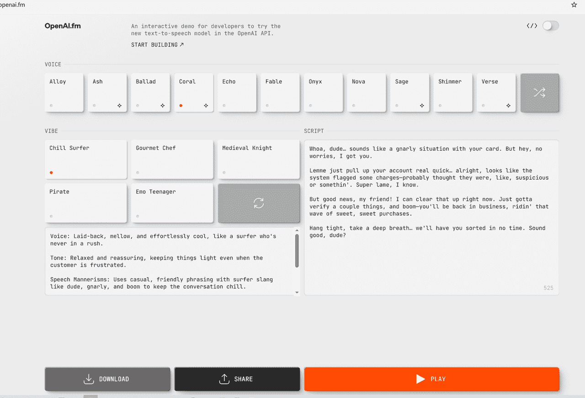

2. Pika AI 精准视频编辑工具，可独立移动物体

Pika 推出 AI 驱动的精准视频编辑功能，允许用户操控画面中的角色和物体，而不会影响场景其他部分，为创意视频制作提供更大自由度。目前，该功能仅对 Pika Creative Partners 开放，未来或将进行更广泛推广。

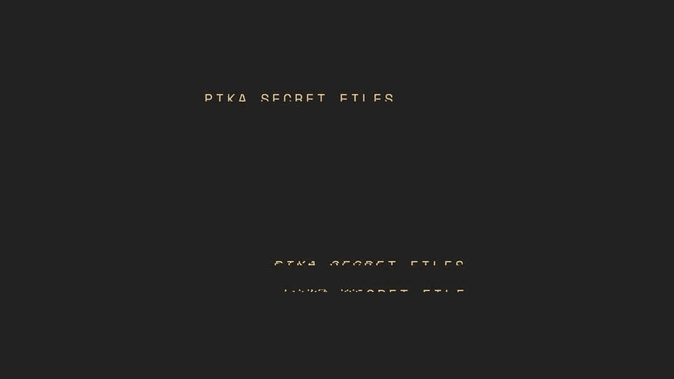

[SaveTwitter.Net_q3F_eGnne49Qh6x-_(1080p).mp4](`https://internal-api-drive-stream.feishu.cn/space/api/box/stream/download/all/OJAkbYknHoFWcWxCVt2ciZPunhX`)

3. Claude 现已支持实时网页搜索 Anthropic 为 Claude AI 助手新增网页搜索功能，使其能够实时获取最新信息，并提供直接引用，方便用户核实答案。目前，该功能向美国付费用户开放，未来将扩展至国际市场和免费用户。这一更新让 Claude 进一步缩小与 ChatGPT、Gemini 等竞争对手的差距，并有望挑战 Perplexity 等搜索型 AI。

4. Apple 调整 AI 领导层，Siri 面临发展危机 Apple

正在对 AI 领导层进行重大调整。Vision Pro 负责人 Mike Rockwell 将接管 Siri 的开发工作，以加快其 AI 功能的进展，弥补与竞争对手的差距。内部评估显示 Siri 开发面临重大挑战，包括错失关键截止日期和技术实现困难等问题。

5. Meta 测试 Instagram AI 生成评论，用户或不买账

Meta 近日被发现测试AI 生成评论功能，允许 Instagram 用户使用 Meta AI 获取评论建议。该功能可分析照片内容，并生成三条 AI 评论，用户可刷新获取更多选项。

6. 高中生开发网站 用 Minecraft 评测 AI

传统AI评测方式难以全面衡量 AI 的能力，一名高中生 Adi Singh 创建了 `Minecraft Benchmark（MC-Bench）`，通过让AI进行 Minecraft 建造挑战来评估 AI 能力。用户可投票选择更优秀的作品，投票后才会揭晓 AI 模型的身份。

该项目得到 Anthropic、Google、OpenAI 和阿里巴巴 的计算资源支持

7. 俄罗斯零日漏洞经纪商悬赏400万美元收购Telegram漏洞

Operation Zero，这家专门向俄罗斯政府出售零日漏洞的公司，近日宣布悬赏高达400万美元，寻找Telegram的安全漏洞。

8. 朝鲜成立AI黑客部门 加强网络攻击能力

据《Daily NK》报道，朝鲜政府正在其情报机构侦察总局内设立一个名为“227研究中心”的新黑客单位，专注于开发攻击性黑客技术，特别是在人工智能领域。该中心的任务包括研究西方的网络安全系统、开发基于AI的信息窃取技术，并支持朝鲜海外黑客组织。

9. Perplexity 正在洽谈融资 10 亿美元，估值达 180 亿美元

AI 搜索初创公司 Perplexity 正在洽谈新一轮融资，目标融资金额为 10 亿美元，公司估值将升至 180 亿美元。目前，Perplexity 的年经常性收入已达 1 亿美元。此次估值几乎是 2023 年 12 月 90 亿美元估值的两倍。相比之下，2024 年 4 月时 Perplexity 的估值仅为 10 亿美元。

# 第四周

## 3月24日 全球AI资讯

1. 谷歌推出 Gemini 的实时 AI 视频功能

谷歌正式向部分 Google One AI 高级订阅用户推出 Gemini Live 的新 AI 功能，使其能够实时“查看”屏幕和智能手机摄像头画面，并回答相关问题。这些功能基于谷歌此前展示的“Project Astra”技术。目前，用户已经在小米手机上发现该功能的测试版本。除了屏幕阅读，Gemini 还新增了实时视频分析能力，可帮助用户进行物体识别、颜色选择等任务。

2. Nvidia 发布个人 AI 计算机 DGX Spark 和 DGX Station

在GTC 2025大会上，NVIDIA推出了`DGX Spark`和`DGX Station`两款个人AI超级计算机。`DGX Spark`搭载`GB10 Grace Blackwell`芯片，计算能力达 每秒 1,000 万亿次运算，支持本地运行大规模AI模型；`DGX Station` 采用更强大的 `GB300 Ultra` 芯片，配备 784GB 内存，专为大规模训练与推理设计。

3. Google确认了其历史上最大的一笔收购

以320亿美元收购了Wiz。Google表示，它将把Wiz定位为“多云”服务，这意味着Wiz将不仅限于Google自己的平台。去年，Google曾以230亿美元的价格向Wiz求购，但遭到了拒绝。看来有时候，拒绝确实能带来更好的结果。

4. 谷歌的全新Bolt3D AI系统可在6秒内从照片生成完整的3D场景

谷歌研究院和谷歌DeepMind联合开发的一种新型AI系统，可以在短短几秒钟内将照片转换为逼真的3D场景，只要它知道相机的位置。这个名为`Bolt3D`的系统能够在`Nvidia H100 GPU`上仅用6.25秒，`Bolt3D`采用高斯溅射技术，将场景信息存储在二维网格中，同时通过AI模型生成隐藏区域的逼真内容。

更多：`https://szymanowiczs.github.io/bolt3d`

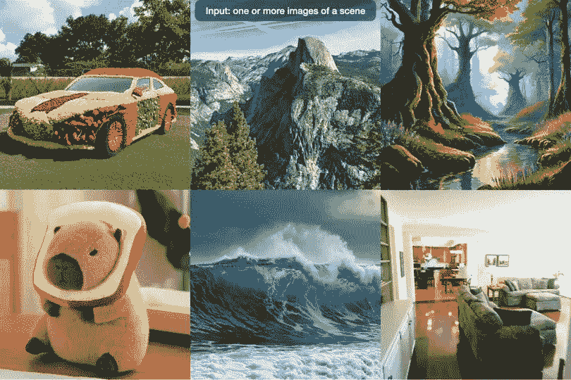

[Bolt3D-teaser_video_website.mp4](`https://internal-api-drive-stream.feishu.cn/space/api/box/stream/download/all/Rs6DblpoUo5QqYxP2kmcwqhmnid`)

5. Grok 3增强搜索能力并新增 AI 图像编辑功能

xAI 也在低调推出 基于文本的图像编辑功能。用户现在可以通过输入简单的文字描述 来修改上传的图片，这与 Google Gemini 的图像编辑方式类似。虽然 xAI 尚未正式宣布 这一功能，但部分用户已经在 X 平台和 `Grok iOS` 版本 上看到 “编辑图片” 按钮。此外，xAI 还宣布其 `Aurora` 图像生成模型 现已通过 xAI API 提供访问权限。

6. Google Vids 语音旁白功能更新

Google Workspace 中的 Vids 产品将迎来一项新功能：自动添加 AI 语音旁白。 Vids 是 Google Workspace 里的视频创作工具，Google Workspace 的 Vids 现已支持 AI 语音旁白自动添加，用户可手动移除。

7. Cloudflare 通过“AI 迷宫”诱导网络爬虫陷入无用数据陷阱

Cloudflare 作为全球最大的互联网基础设施公司之一，近日推出了 “AI Labyrinth”（AI 迷宫），这一新工具专门用于 对抗未经授权抓取网站数据用于 AI 训练的爬虫机器人。当检测到“异常的爬虫行为”时，该工具不会直接拦截爬虫，而是引导它们进入充满 AI 生成诱饵的网页，拖慢爬取速度并浪费计算资源，从而对抗不当行为者。

8. Krea AI推出 Video Training， 可以训练自己的专属视频风格

Krea AI近日推出全新“Video Training”功能，为用户提供了一个可定制的AI视频生成工具。“Video Training”允许用户上传自己的图像和视频素材，训练出专属的AI视频风格模型。可以使用自己的视频训练 `Wan 2.1`，让它学习自定义风格、动作或特定物体。

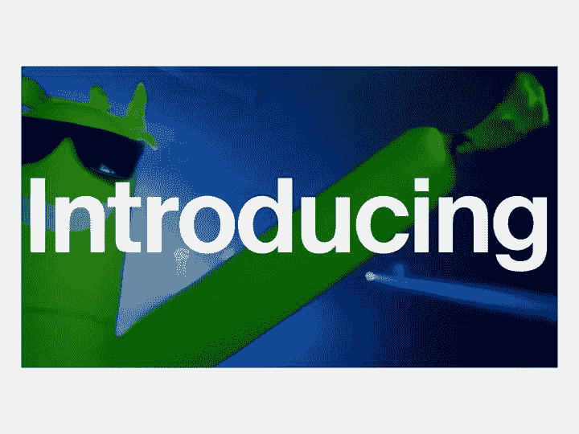

[6387816382729163366651052.mp4](`https://internal-api-drive-stream.feishu.cn/space/api/box/stream/download/all/TiljbAVtSotMhcxiXs9co4J4nSc`)

8. DomoAI新功能上线！Talking Avatar 现已登陆 Quick App！

通过上传语音和图像即可生成会说话的数字人，支持多种时长选择，从5秒短视频到最长60秒的完整片段。

体验地址：`https://www.domoai.app/en/create/talking-avatar`

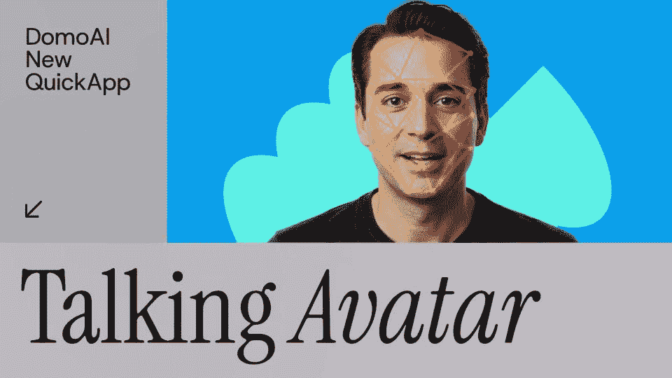

[SaveTwitter.Net_fu1dcENnXgaXaa5o_(1080p).mp4](`https://internal-api-drive-stream.feishu.cn/space/api/box/stream/download/all/Kly8bGpbIoPibVx2B8icpREsn0e`)

## 3月25日 全球AI资讯

1. 懂得何时暂停的 AI：Claude 3.7 提升复杂推理能力

Anthropic 为 `Claude 3.7` 推出 `think` 工具，可在推理过程中实时暂停、重新评估并优化决策方式，适用于高风险、多工具任务。`τ-Bench` 测试显示，该工具让 Claude 在航空领域的决策准确率提高 54%，在零售行业达到 0.812。

2. Perplexity 试图收购 TikTok

AI 搜索公司 Perplexity 提出收购 TikTok 美国业务，承诺开源推荐算法，确保透明监管，并整合 AI 搜索功能。其计划包括 在美国数据中心重构算法、引入 `Nvidia Dynamo` 提升 100 倍计算力，并实现 TikTok 与 Perplexity 搜索互通。随着 4 月 5 日 TikTok 禁令临近，这一收购是否成真即将揭晓。

3. 美国加强对 AI 芯片出口至中国的控制

美国政府正在加强措施，防止 `Nvidia` 芯片 通过 马来西亚 走私至中国，采用 全新的三层许可体系。该体系 优先允许 向 18 个亲密盟友（包括德国和日本）出口芯片，同时对 约 120 个国家 设定 严格的数量限制。中国与俄罗斯、伊朗、朝鲜一起，被列入 全面出口禁令 名单。

4. AI 研究：新 AI 实现近乎完美的癌症检测

研究人员推出 `ECgMLP` AI 模型，可以 99.26% 的准确率检测子宫内膜癌，远超人类专家（78%-81%）。该模型在结直肠癌、乳腺癌、口腔癌检测中也表现卓越。

5. Apple 为 AirPods Max 带来无损音频和超低延迟音频

苹果宣布 `AirPods Max`（USB-C 版）即将支持无损音频和超低延迟音频，适用于音乐制作、游戏和 `Apple Music` 的 1 亿首无损歌曲播放。新功能将在 4 月通过 `iOS 18.4` 等系统更新 免费提供，但 `Lightning` 版本不支持。

6. OpenAI 进行高层调整

在周一宣布的一次 重大高管调整 中，OpenAI 进一步扩大了首席运营官（COO）Brad Lightcap 的职责，Lightcap 现在将 负责日常运营，推动 国际扩张，并管理与 `Microsoft` 和 `Apple` 等科技巨头的 重要合作，Sam Altman 将更专注于 技术研发和产品。同时，Mark Chen 晋升为 首席研究官，Julia Villagra 晋升为 首席人力官。

7. 苹果计划为 Apple Watch 和 AirPods 配备 AI 摄像头

苹果计划在 `Apple Watch` 机型中 集成摄像头，让设备能够分析用户环境并提供信息。标准版 `Apple Watch` 可能在 屏幕内置摄像头，`Ultra` 版可能在表冠或侧键附近设摄像头。此外，苹果计划将 `iPhone 16` 的“视觉智能” 功能拓展至`AirPods`，未来或将支持 AI 图像分析。

8. 腾讯重推出了混元-T1版本

在推理能力方面实现了显著突破，它在深度分析和复杂问题处理上表现尤为出色，借助先进的 `TurboS` 架构，混元-T1 经过深度优化训练，大幅增强了长文本推理的连贯性，有效降低了上下文丢失的风险。

## 3月26日 全球AI资讯

1. Reve推出了文生图`Reve Image 1.0` 一周内登顶全球排行榜

在 Artificial Analysis 的 Image Arena 评测中击败 Google Imagen 3、Midjourney V6.1、Recraft V3，排名第一。强调逻辑增强，在提示词匹配和长文本渲染方面表现优异，提供自然语言编辑、照片上传等功能，并开放社区探索。

详细：`http://reveai.org/models/reve-image-1.0`

## 3月26日 全球AI资讯

### 2、PiT框架横空出世

近期，被称为PiT（Parts-informed image Translation）的创新框架悄然崛起，用户仅需提供几个图像碎片——可能是一片羽翼、一缕发丝或一只眼睛，系统便能智能解析这些视觉元素之间的关联，填补缺失内容，最终合成一幅风格统一、结构完整的图像。

### 3、ChatGPT 的图像生成功能迎来升级

周二OpenAI CEO Sam Altman 在直播中宣布，ChatGPT 现已支持使用 GPT-4o 直接生成和编辑图像，该功能已上线 Pro 订阅用户，并计划向 Plus 和免费用户推广。相比 DALL·E 3，GPT-4o 生成的图像更加精准和细节丰富，还可编辑已有图像，包括人物照片。

更多：`https://openai.com/index/introducing-4o-image-generation/`

### 4、Google 发布下一代 AI 推理模型 Gemini 2.5

Google 于 2025 年 3 月 25 日发布了新一代 AI 推理模型家族 Gemini 2.5，并推出了 Gemini 2.5 Pro Experimental，这是一个具备先进推理能力的多模态 AI 模型。Gemini 2.5 Pro 已经登陆 Google AI Studio 供开发者使用，同时订阅了 Gemini Advanced 月度计划的用户也可以在 Gemini 应用中体验该模型。Gemini 2.5 Pro 具备 100 万 token 的上下文窗口。

### 5、字节跳动推出InfiniteYou 生成无限变化的人像照片

解决了传统AI肖像生成中面部特征不一致和提示词遵循不佳的问题。该技术使用InfuseNet架构，将面部特征作为并行信息层处理，保持了核心AI模型完整性。InfiniteYou采用两阶段训练过程，先使用真实照片，再转向合成图像。字节跳动已在GitHub和Hugging Face发布代码和模型权重，计划推出演示版本。

### 6、ARC Prize 竞赛回归，挑战 AI 推理能力

ARC基金会推出 ARC-AGI-2 基准测试，并启动 100 万美元竞赛，推动 AI 推理能力发展。ARC-AGI-2 任务难度高，人类可快速解答，AI 仍难以应对。OpenAI o3-low 得分仅 4%，相比前代测试的 75.7% 成绩出现大幅下降。新增“效率指标”，不仅评估 AI 推理能力，还衡量计算资源消耗。ARC Prize 2025 本周启动，70 万美元奖励首个达成 85% 准确率的团队。

### 7、DeepSeek 低调发布 V3-0324 版本

低调发布 `V3-0324` 版本，641GB 容量，可在高端 PC 上运行，并采用宽松的 MIT 开源许可，Mixture-of-Experts 架构，每个 token 激活 370 亿参数，首个可在 Mac Studio 等高端 PC 上运行的同级别模型，不再依赖数据中心，数学和编程能力获得显著增强，用户称其为最佳非推理 AI 模型，目前在官方网站、APP 和小程序上已经可以体验（关闭深度思考）。

Hugging Face链接：`https://huggingface.co/deepseek-ai/DeepSeek-V3-0324/tree/main`

## 3月27日 全球AI资讯

### 1、ChatGPT 的新AI图像功能对免费用户推迟开放

由于需求远超预期，ChatGPT 的AI图像功能推迟向免费用户开放，目前仅限付费用户（Pro、Plus、Teams）使用。OpenAI 近期产品发布屡次受限于计算能力，此前 Sora也因资源问题暂停注册。未来，5000 亿美元 Stargate 数据中心 或许能缓解这些瓶颈。

### 2、OpenAI 的“吉卜力时刻”引发 AI 版权争议

ChatGPT 的全新 AI 图像生成器刚刚上线一天，社交媒体上就已被大量吉卜力风格的 AI 生成图片霸屏。过去 24 小时内，网友们已经用 AI 生成了吉卜力版的埃隆·马斯克、《指环王》和唐纳德·特朗普的形象。该功能引版权争议。

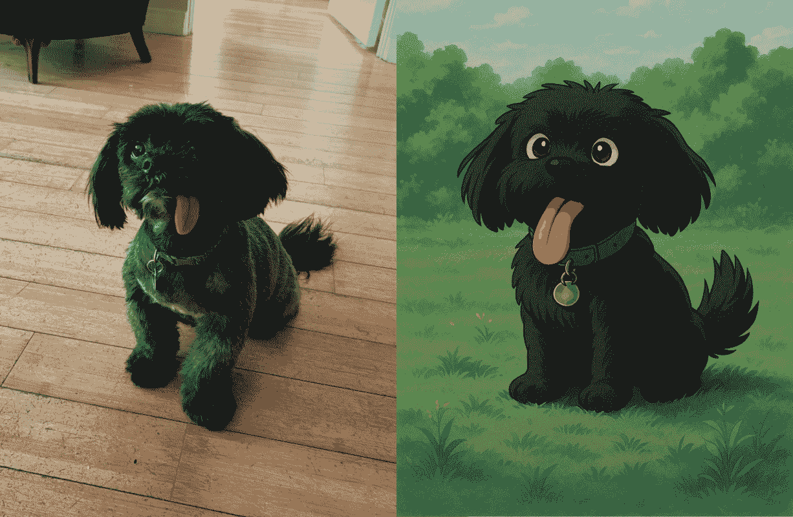

### 3、微软的 Copilot 迎来重大升级

推出`CopilotResearcher` 和 `Analyst` 两款 AI 研究工具，它们不仅能汇总信息，还能深入分析，帮助用户制定市场策略或处理数据。Researcher 专注于商业战略，Analyst 擅长数据分析，均可访问公司内部数据。

### 4、苹果斥资 10 亿美元 采购 Nvidia AI 服务器

苹果正斥资 10 亿美元 采购 Nvidia 的先进服务器，并与戴尔和超微电脑 合作，打造 生成式 AI 基础设施。采购约 250 台 Nvidia GB300 NVL72 服务器，每台 370-400 万美元。此外，Siri AI 升级延误 及 内部重组 使苹果 AI 战略受挫。

### 5、亚马逊推出个性化购物提示

亚马逊推出 “Interests”（兴趣）功能，利用 AI 提供个性化购物搜索体验。用户可输入基于兴趣、预算的搜索提示，AI 将其转换为更精准的商品推荐。该工具还能在后台运行，通知用户新品、补货和优惠信息。

### 6、YouTube 正在调整 YouTube Shorts 观看次数的计算方式

YouTube 宣布从 3 月 31 日起调整 Shorts（短视频）的观看次数计算方式，改为统计每次播放或重播，而不再依赖于观看时长。此举将提高 Shorts 的观看次数，并与 TikTok 和 Instagram Reels 对齐。创作者仍可在 YouTube Analytics 的“高级模式”中查看原先基于观看时长的“有效观看次数”。

### 7、AI进入课堂：Brisk获1500万美元融资

AI教育科技公司Brisk宣布获得1500万美元融资，Brisk目前拥有40多款工具，涵盖写作检测、自动批改、个性化反馈等功能，目前，美国五分之一的K-12教师已安装Brisk扩展，全球100个国家的2000多所学校在使用其产品。

### 8、可灵AI营收超1亿

自去年6月正式上线以来，快手推出的可灵AI已在视频生成AI赛道崭露头角，累计营收突破1亿元。依托强大的技术能力和前瞻性的市场布局，该产品迅速在行业内站稳脚跟，快手正加大技术创新与资金投入，力求推动可灵AI更进一步。

### 9、AI电商视频神器Product Anyshoot 零成本打造热销视频

Product Anyshoot是一款专为电商行业量身打造的AI视频生成工具，商家只需上传商品图片，系统便能自动将商品融入精心设计的预制视频中，极大简化了制作流程。

官网：`https://www.topview.ai/ai-product-anyshoot`

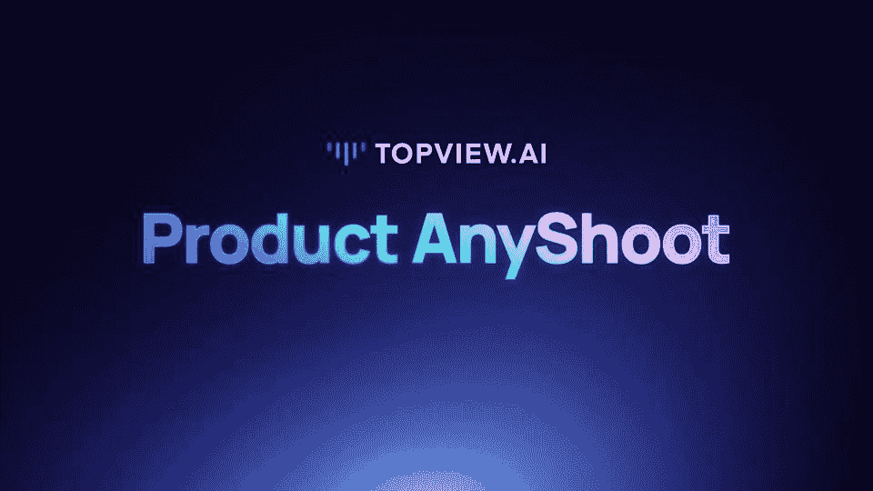

[6387859815291378366510526.mp4](https://internal-api-drive-stream.feishu.cn/space/api/box/stream/download/all/W0HFbtjQioo6KjxRc6uc6vUNnAf)

## 3月28日 全球AI资讯

### 1、Ideogram 推出 3.0 版 AI 图像模型

新模型支持复杂排版、Logo 设计，并在测试中超越 Google Imagen 3、Flux Pro 1.1 和 Recraft V3。新增“风格参考”功能，可上传 3 张图片引导生成效果，搭配 4.3B 预设风格库。目前，3.0 版已在 Ideogram 平台和 iOS 应用上线，所有功能免费开放。

[X2Twitter.com_J1BJALeZ36AR6O_i_720p.mp4](https://internal-api-drive-stream.feishu.cn/space/api/box/stream/download/all/JkHlbxxoioW9YrxSMcvcsRmDn6b)

### 2、Google 推出一系列 AI 旅行规划功能

Google 刚刚在搜索（Search）、地图（Maps）和 Gemini 上推出了一批新功能，搜索可生成 AI 行程建议，Gemini 开放免费“小助手”辅助旅行计划，酒店价格提醒更智能，Google Maps 还能识别旅行截图并转化为实际行程。目前，截图识别功能已在美区 iOS 推出，安卓即将上线。

### 3、Facebook 推出全新“好友”标签，回归“经典 Facebook”

Facebook 宣布在美国和加拿大推出了全新的 “好友”标签（Friends tab），该标签仅展示好友的动态，不会包含任何推荐内容。这是 Meta CEO 马克·扎克伯格 在 2025 年提出“回归经典 Facebook”策略后的首个重大更新。

### 4、OpenAI 即将完成 400 亿美元融资，估值或达 3000 亿美元

当你还在用 ChatGPT 的新图像生成功能将图片“吉卜力化”时，OpenAI 正在大规模融资。据报道，OpenAI 正接近完成 400 亿美元融资，由软银领投，其中 Magnetar Capital、Coatue Management 和 Founders Fund 也在参与讨论。软银初步投资 75 亿美元，其余 25 亿美元来自投资者联合体，今年稍晚还将追加 225 亿美元，总融资额达 400 亿美元。

### 5、Nvidia G-Assist 发布，可本地运行 AI 助手，无需云端

Nvidia 正式发布 Project G-Assist，这是一款 本地 AI 助手，可在 GeForce RTX 显卡上运行，无需云连接。 G-Assist 采用 80 亿参数 Llama 模型，支持 系统诊断、游戏优化、GPU 超频、性能监测 等功能，可控制 Logitech、Corsair、MSI、Nanoleaf 设备。

### 6、Grok 加入 Telegram

X 的 AI 聊天机器人现已整合到这款加密即时通讯应用中，不过用户需成为 Telegram 高级订阅用户才能使用并与之聊天。

### 7、亚马逊的 Alexa 基金正全力押注人工智能

曾投资 Ring 和 Ecobee 等公司的 Alexa 基金，正扩大其投资范围，纳入更多人工智能技术。除了对 AI 初创公司 NinjaTech 的投资，该公司还宣布对以下企业进行投资：Hedra（一家 AI 视频生成平台）、Ario（一款为父母设计的 AI 助手），以及 HeyBoss（一个 AI 网站设计工具）。

## 3月29日 全球AI资讯

### 1、Anthropic 即将推出 Claude 3.7 Sonnet

Anthropic 可能很快会发布 Claude 3.7 Sonnet，提供高达 50 万 Token 的上下文窗口，相比当前的 20 万 Token 取得了重大提升。特性标志（feature flags）显示该版本即将推出，预计将为企业用户带来处理海量数据集和完整代码库的能力，而无需拆分会话。

### 2、Groq 与 PlayAI 推出更拟真的语音 AI——PlayDialog

Groq 与 PlayAI 合作推出 Dialog，这是一个新一代的文本转语音（TTS）模型，专为超逼真的、低延迟语音 AI 设计。该模型运行在 Groq 的高速推理平台上，凭借其自适应语音上下文系统（ASC），能够动态调整语调和韵律，保持对话流畅度，在响应速度和自然度方面优于竞争对手。

### 3、埃隆·马斯克宣布 xAI 收购 X

埃隆·马斯克的 AI 初创公司 xAI 已通过全股票交易方式收购了他的社交媒体平台 X（前身为 Twitter），这一合并使 xAI 估值达到 800 亿美元，而 X 的估值为 330 亿美元（从 450 亿美元扣除 120 亿美元债务）

### 4、OpenAI更新了GPT-4o

使其能够更好地处理详细指令，尤其是在处理多任务提示时。公司表示，该模型的编程能力和复杂问题解决能力也得到了优化，新版在回应中表现出更强的直觉性、更大的“自由度”和创造力，同时减少了表情符号的使用。升级后的语言模型现已通过API以`chatgpt-4o-latest`的形式提供给用户，并在ChatGPT中供订阅者使用。免费用户预计将在未来几周内获得更新访问权限。

### 5、Manus AI 正洽谈 37 亿融资，估值飙升五倍

据报道 Manus AI 目前正与包括美国风投机构在内的投资方进行洽谈，计划以 至少 5 亿美元（约 37.5 亿人民币） 的估值进行新一轮融资，相较于此前的估值，增长幅度高达五倍。Manus AI App 已上架 App Store，支持 iPad 和 iPhone，但国区 App Store 目前尚未提供下载。

### 6、Midjourney V7 将于 3 月 31 日发布

Midjourney V7 的即将发布预示着 AI 图像生成技术的重磅升级，特别是在自然语言处理与视觉呈现方面。此次更新不仅大幅提高了图像的细节精度与艺术美感，也让艺术创作变得更加易于接近，用户只需简单的文字描述即可生成复杂且富有创意的艺术作品。

### 7、Anthropic 研究团队开发了一种“AI 显微镜”，用于观察语言模型的内部机制

Anthropic 最新推出的“AI 显微镜”提供了对其 Claude 3.5 Haiku 语言模型内部表征的有限视角，揭示了该模型如何处理信息并推理复杂任务，研究发现，Claude 似乎使用了一种独立于具体语言的内部表征——研究人员称之为“通用思维语言”。

### 8、pika发布新特效功能

可以和年轻的自己同框

[X2Twitter.com_Fps4gDil1OrZ-PnJ_1350p.mp4](https://internal-api-drive-stream.feishu.cn/space/api/box/stream/download/all/E5CBbyvLJoG1sIxBSXhcK4mDnug)

### 9、LumaAI DreamMachine上线编辑线程功能

DreamMachine上线Edit Thread功能，种组织创意过程的全新方式，用户可以将同一素材的 720p、1080p、4K 和音频版本全部集中在一个地方。保持条理清晰，轻松迭代，简化工作流程。

[X2Twitter.com_fgD38Co2ZqwqudUO_1080p.mp4](https://internal-api-drive-stream.feishu.cn/space/api/box/stream/download/all/)

---

## 3月31日 全球AI资讯

### 1、Manus 封闭测试进展：推出移动端应用，升级至 Claude 3.7

Manus 于三周前开启封闭测试，官方近日公布最新进展。更新内容包括 Manus 移动应用上线、更长上下文与多模态能力、全面升级至 Claude 3.7、优化沙盒环境，并启动高级订阅测试，同时保留部分免费访问权限。

手机地址：`https://apps.apple.com/us/app/manus-ai/id6740909540?mt=8`

### 2、Midjourney 开发新方法，提高大模型的创意写作能力

Midjourney 与纽约大学开发新方法，提高大模型的创意写作多样性。研究通过“偏差度量”优化训练，使模型生成 23% 更多元的文本，同时质量仅下降 5%。实验表明，该方法可显著提升 语义 和 风格 多样性，但其在技术文档和在线训练环境中的适用性仍需验证。

### 3、开源 AI 音乐YuE 模型发布

香港科技大学携手 DeepSeek 团队推出了全新的开源音乐生成模型 YuE，在音乐圈引发热议。这款 AI 工具不仅能生成多种音乐风格，还具备逼真的人声合成能力，为音乐创作带来了革命性变化。

YuE 采用 双 LLaMA 语言模型架构，能够适配各类大语言模型，并支持生成 长达 5 分钟 的完整歌曲。

项目地址:`https://github.com/multimodal-art-projection/YuE`

### 4、Adobe黑科技：ObjectMover革新图像编辑，精准模拟物理规律

论文第一作者余鑫为香港大学三年级博士生，通讯作者为齐晓娟教授。研究方向涵盖生成模型及其在图像与3D领域的应用，在计算机视觉和图形学顶级会议期刊上发表多篇论文，多次获Oral、Spotlight及Best Paper Honorable Mention等奖项。本研究由作者在Adobe Research实习期间完成。

论文链接：`https://arxiv.org/abs/2503.08037`

### 5、Amazon Photos现支持购物功能

亚马逊高管 Panos Panay 宣布，Amazon Photos 终于推出了大家期待已久的照片库功能：购物链接。这款图片存储服务利用图像识别技术分析用户的照片，并识别出可能是用户想要搜索的产品，然后在图片上显示一个镜头图标，方便用户直接在亚马逊上购买。

### 6、苹果推出 AI 健康教练（Health+）

苹果正在开发新版 Health（健康）应用，其中将加入一位 AI 健康教练，为用户提供健康建议。预计 2026 年随 iOS 19.4 发布。AI 教练基于用户医疗数据，支持饮食追踪，并由医生提供训练数据和健康视频。

### 7、Sam Altman新书《乐观主义者：Sam Altman、OpenAI 与未来竞赛》

新书《乐观主义者》披露 OpenAI 董事会 2023 年短暂解雇 CEO Sam Altman 的细节。书中称，董事会因 Altman 私人持有 OpenAI 启动基金等问题产生担忧，联合创始人 Sutskever 和 CTO Murati 也 reportedly 收集其不诚实行为的证据。

### 联系我们

> [互联网设计](https://aigclena.feishu.cn/wiki/PD10wBb5yiRVE7kTFZdcuzUBnth) [国际站/独立站](https://aigclena.feishu.cn/wiki/TmfowYzfMisIShkNU7ncEBMingh) AI课程学习

