# 2025Q2（4-6月）

> 来源：[https://aigclena.feishu.cn/docx/OsFmdEg9Xo7lPKx4aPRc0AasnZc](https://aigclena.feishu.cn/docx/OsFmdEg9Xo7lPKx4aPRc0AasnZc)

## 4月AI资讯精选

### 第一周

#### 4月1日 全球AI资讯

1、Google 意外向免费用户推出 Gemini 2.5 Pro（实验版），并在网页端新增 Canvas 功能

Google向所有免费用户推出了 Gemini 2.5 Pro（实验版），扩展了其所谓的“最智能AI模型”的访问权限。此前，该模型仅限于每月19.99美元的 Gemini Advanced 订阅用户使用,支持应用程序、文件上传，并在网页端引入了全新的 Canvas 工具，以增强其交互性。

2、Runway 发布Gen-4

人工智能初创公司 Runway周一发布了其声称是迄今为止最高保真度的 AI 驱动视频生成器之一。Gen-4 可以利用视觉参考，结合指令，创建具有一致风格、主体、地点等的新图像和视频，向所有付费个人和企业客户推出。

详细：https://runwayml.com/research/introducing-runway-gen-4

3、OpenAI 调整图像政策，测试“思考滑块”，并寻求 400 亿美元融资

OpenAI 正在推进一轮高达 400 亿美元的融资，其中 SoftBank 预计投资 300 亿美元，微软和其他投资方贡献 100 亿美元，其中包括一笔 100 亿美元的预付款。此外，SoftBank 还承诺每年提供 30 亿美元用于 OpenAI 技术，并在日本成立了一家专注于 AI 的合资企业。

4、OpenAI 计划在未来几个月内发布首个“开放”AI 语言模型

OpenAI 表示，其计划在“未来几个月内”发布自 GPT-2 以来的首个“开放”语言模型,，并已开始向开发者和研究人员征集反馈意见,首场开发者活动将在几周内于旧金山举行，随后将在欧洲和亚太地区举办相关会议。

5、抖音重拳整治未成年人不良内容，严打“毒流量”与违规行为

抖音平台发布公告，宣布全面加强对涉及未成年人的不良内容治理，重点打击“毒流量”现象。此举正值网络热议未成年人被家长过度包装、博取流量的乱象，其中包括让孩子化浓妆、穿着成人化服饰等行为。尽管相关报道多指向其他平台，抖音仍高度重视，迅速展开整顿。

6、智谱AI推出AutoGLM沉思

智谱AI推出AutoGLM沉思  在2025中关村论坛上，智谱AI正式发布其最新智能体产品——AutoGLM沉思。这一创新型Agent突破性地结合了深度思考与执行能力，能够同步进行复杂推理与任务操作，填补了行业空白。

7、埃隆·马斯克以全股票交易方式合并 xAI 和 X

此举将他的 AI 风险投资估值为 800 亿美元，而陷入困境的社交平台 𝕏 的估值经债务调整后为 330 亿美元。该交易收紧了 AI 开发和用户数据之间的反馈循环，使 xAI 能够大规模地改进其模型，而 𝕏 则转变为一个 AI 原生的数字领域。

8、Perplexity CEO否认财务困境，称2028年前无IPO计划

Perplexity CEO Aravind Srinivas 近日在 Reddit上回应用户的产品投诉，并向用户保证公司并未面临严重的财务压力，Srinivas的回应部分针对了一种用户推测，即 Perplexity 在财务上“表现糟糕”，并“进行大量成本削减调整”。

9、亚马逊推出 Nova Act：一款可操控网页浏览器的 AI 代理

周一，亚马逊发布了 Nova Act，一款通用 AI 代理（AI Agent），可自主控制网页浏览器并执行部分简单操作，但当前版本仍处于研究预览阶段，在内部测试 ScreenSpot Web Text 中得分 94%，高于竞争对手。

#### 4月2日 全球AI资讯

1、OpenAI 开放 GPT-4o 图像生成功能，免费用户或受限

OpenAI 近日宣布，GPT-4o 支持的图像生成工具已对所有用户开放，无需订阅即可使用。但免费用户可能每天只能生成三张图片。该功能上线后，迅速引发热潮，CEO Sam Altman 称 GPU 负载已接近极限。与此同时，用户利用该工具制作宫崎骏风格艺术作品，甚至伪造账单，引发监管讨论。

2、Krea 推出全新 3D 生成功能

近日，生成式AI平台Krea宣布正式上线3D生成工具，用户只需输入文本描述或上传 2D 图像，即可快速生成可操作的 3D 模型，并支持实时调整视角、光照及材质效果。同时对其官网进行了全面升级。

体验地址：https://www.krea.ai/3d

[6387910322692751744815571.mp4](https://internal-api-drive-stream.feishu.cn/space/api/box/stream/download/all/SyLsb8LN4ogZwoxRMpDcLOfun3g)

3、DreamMachine 推出 #Ray2 摄影机运动概念

全新 Ray2 摄影机运动概念 现已登陆 DreamMachine！精心调校的 20+ 种摄影机运动，确保流畅的电影级操控和极高的稳定性。这些运动模式可自由组合，创造出数百种原本难以实现的全新镜头运镜。立即体验！

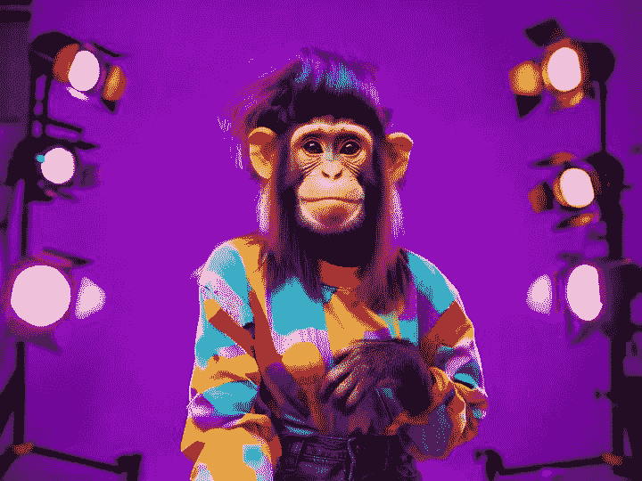

[X2Twitter.com_VnZBNnf7BZ4QrOOY_1080p.mp4](https://internal-api-drive-stream.feishu.cn/space/api/box/stream/download/all/AJPmblJnBo7fbMxpL2dcGmQdnrf)

4、ElevenLabs推出「Text to Bark」文本转狗叫

AI 语音技术再升级！继推出超逼真的文本转语音（TTS）和全球最精准的语音转文本（STT）模型 Scribe 后，AI 研究团队发布了全新的 Text to Bark 技术。该功能或许能将文字转换为狗叫声，标志着 AI 在动物声音合成领域的新探索。

[X2Twitter.com_LuyTzdgAo3r6aCXq_720p.mp4](https://internal-api-drive-stream.feishu.cn/space/api/box/stream/download/all/LC6ZbKouBoW7yrxCz4RcoElcnhd)

5、AI 将大脑信号转化为即时语音

加州大学伯克利分校（UC Berkeley）与加州大学旧金山分校（UCSF）的研究人员开发了一种 AI 技术，可以将大脑信号即时转换为语音，延迟仅为 1 秒。这项技术兼容多种脑部信号采集方式，或将为 ALS、中风等失语患者带来突破性改善。

6、iOS 18.4 正式更新

4 月初，苹果正式面向全球用户推送了 iOS 18.4、iPadOS 18.4、macOS 15.4、visionOS 2.4 等一系列系统更新。新增的多语言支持，向更多国家和地区开放。对于国际版的苹果设备，只需切换至海外Apple ID，即可启用 Apple 智能的功能。国行iPhone不在支持范围内。

7、Meta AI 研究负责人计划离职

Meta AI 研究副总裁 Joelle Pineau 宣布将在 5 月离职，她曾负责 Meta 旗下 AI 研究实验室 FAIR。这次离职发生在 Meta 加大 AI 研发投入的关键时期，预计 2025 年在 AI 基础设施上的支出将达到 650 亿美元。Meta 目前尚未确定继任者，但已启动寻找新领导人的流程。

8、高通收购越南初创公司 VinAI 的生成式 AI 业务

高通（Qualcomm）已收购越南 AI 研究公司 VinAI 的 生成式 AI 业务，交易金额未披露。双方于周一正式宣布了这一消息。VinAI 由前 DeepMind 研究科学家 Hung Bui 创立，专注于开发计算机视觉算法和语言模型等生成式 AI 技术。

9、Tinder 推出 AI 驱动的新游戏，让用户练习“调情”技巧

周二，Tinder 宣布了一款由 OpenAI 提供支持的全新游戏，玩家需与 不同 AI 角色互动，并通过语音交流尝试赢得 AI 的“约会”邀请。游戏采用 火焰评分系统，AI 提供实时反馈，帮助用户改善对话技巧。该游戏 目前仅限美国 iOS 用户体验，且开放时间有限。

#### 4月3日 全球AI资讯

1、Premiere Pro 发布 AI 驱动的新功能

Adobe 更新了 Premiere Pro 25.2 版本，新增了包括 Generative Extend 和字幕翻译等 AI 驱动的功能，允许用户将视频片段扩展最多 2 秒，支持 4K 质量，免费提供“限时使用”，之后将需要消耗 Firefly 生成式积分。

2、MiniMax Audio发布Speech-02语音模型

海螺推出了全新的Speech-02系列语音模型，能够支持超过30种语言，并且一次性输入可达20万字符。这款新模型在语音合成的自然度上达到了99%的类似人声效果，同时解决了音频播放过程中的节奏不稳定问题，保证了更为流畅的听觉体验。

[X2Twitter.com_cgOIROGVwGmQebkJ_720p.mp4](https://internal-api-drive-stream.feishu.cn/space/api/box/stream/download/all/YrhMb9dHhoLVYXxK2ZdcjJngnZe)

3、OpenAI 的图像生成工具免费开放，估值突破 3000 亿美元，开源模型即将推出

由 GPT-4o 驱动、擅长宫崎骏风格绘画的图像模型，在 ChatGPT 上线后一小时内用户激增百万，导致推迟发布。首个开放权重 AI 模型即将发布。公司还推出了 OpenAI Academy，一个免费学习 AI 技能的平台。

地址：https://academy.openai.com/

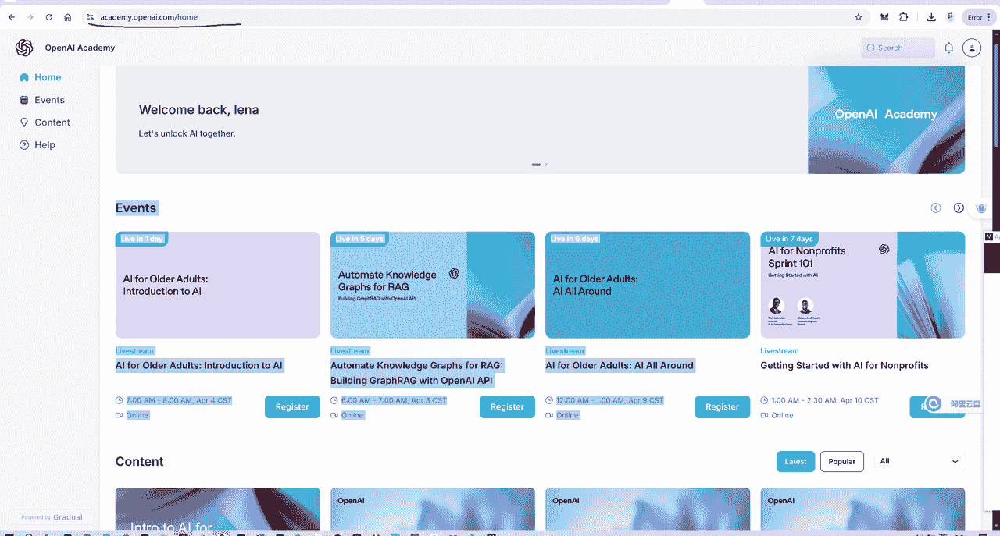

4、AI 提供“金标准”心理治疗

达特茅斯大学的研究人员公布了全球首个 AI 心理治疗聊天机器人的临床试验结果。研究表明，该 AI 在治疗效果上可与“金标准认知治疗”媲美，并在抑郁、焦虑和饮食失调方面表现出明显改善。在 8 周试验期 内，用户平均与 手机 AI 聊天机器人 互动 6 小时，相当于 8 次传统心理治疗。

5、OpenAI使用未获授权O’Reilly付费书籍训练 GPT-4o

研究显示，OpenAI 并未与 O'Reilly Media 达成任何授权协议，但其最新模型 GPT-4o 显示出对付费墙后的 O’Reilly 书籍内容有较强的识别能力，明显超过 OpenAI 之前的 GPT-3.5 Turbo。相比之下，GPT-3.5 Turbo 对公开的 O’Reilly 书籍样本有更强的识别能力。

6、Meta 开发 AI 系统 MoCha，将文本转换为动画角色

Meta与滑铁卢大学合作开发了 MoCha，可根据文本生成完整角色动画，包括同步语音、面部表情和全身动作。MoCha 运行在一个扩散变换器模型上，生成 5 秒长、24 帧每秒的高清短视频。引入“语音-视频窗口注意力”机制：通过限制音频数据访问窗口，提升唇形同步精度，使视频更自然。

7、Claude for Education：AI在教育中的新尝试

Claude for Education 在大学推广，新版本的Claude已经在东北大学（Northeastern University）、伦敦政治经济学院（LSE）和尚普兰学院（Champlain College）等校园投入使用。它的目标不是帮你完成作业，而是激发你的思维。

8、GPT-4.5首度突破图灵测试

近日，由加州大学圣地亚哥分校认知科学系主导的一项研究为人工智能领域带来了重大突破：OpenAI的最新模型GPT-4.5在标准图灵测试中通过“人格扮演”方式，首次展现了超越人类的表现，成为迄今为止最具类人对话能力的AI系统。

9、Runway Gen-4 发布，解决 AI 视频中角色和场景一致性问题

Runway AI 推出了 Gen-4 视频生成模型，在保持角色和场景一致性方面取得了重大突破。与以往的 AI 视频系统不同，Gen-4 能够在不同镜头中保持物体、角色和风格的一致性，无论是视角变化还是光线调整，都能创造出连贯的视觉叙事。

### 第二周

#### 4月7日 全球AI资讯

1、Adobe在Premiere Pro 推出 AI 生成式扩展工具

Adobe 在 Premiere Pro 中发布了其首个基于 Firefly AI 的功能——Generative Extend（生成式扩展），使剪辑师能够自动扩展视频和音频片段，并支持 4K 质量。此次更新还包含新的AI 搜索和字幕翻译功能。

2、Meta 推出 Llama 4

包含 Maverick（4000 亿参数）、Scout（支持 1000 万 tokens 处理）、Behemoth（2 万亿参数，仍在训练），并采用 MoE 架构 提高效率。相比竞争对手，Llama 4 在部分测试中超过 GPT-4o 和 Gemini 2.0，但仍落后于 Gemini 2.5 Pro。它在数学和 STEM 任务上表现突出，并且对敏感话题的回应更开放。

3、DeepSeek R1 挑战美国顶级 AI 模型，R2 即将登场

DeepSeek 与 清华大学 合作，研发 DeepSeek-GRM 技术，结合 生成式奖励建模（GRM）和自我原则批判调优（SPC），让 AI 学习人类偏好、优化推理过程，并在回答前自我修正。新技术已在测试中超越旧系统，并可能很快开源。

4、微软用 Copilot AI 生成了一个 《雷神之锤 II》关卡

并发布了 浏览器演示，允许玩家体验 移动、跳跃、爆炸等操作。但 AI 缺乏物体永久性，敌人和血条显示异常，甚至可能在画面外消失。微软承认 它只是模型模拟，并非真正的游戏。

5、微软 Copilot 迎来重大升级，从聊天 AI 进化为真正的数字助理

能直接操作网站：预订餐厅、在线购物、提供航班信息等。记忆用户习惯：记录喜好，提供个性化服务（可关闭）。实时摄像头分析：回答关于摄像头画面的问题。自动追踪折扣：监控价格变动，充当“折扣猎手”。

Windows 桌面整合：帮助用户搜索、调整设置、整理文件。内容总结：能自动生成播客和文档，让信息更易管理。

6、亚马逊现在连自家以外的东西都能帮你买了

亚马逊推出 “Buy for Me” 功能，当亚马逊没有销售某商品时，用户可通过亚马逊 App 让其代购第三方网站的商品。自动代购品牌官网商品，用户点击“Buy for Me”即可完成订单。订单仍在 Amazon App 内操作，但商品由第三方商家发货、处理退货和客服。支付信息加密，亚马逊无法查看用户在其他商店的购买历史。

7、英特尔与台积电接近达成历史性芯片制造合作

英特尔（Intel）正与其芯片制造竞争对手台积电（TSMC）筹划建立战略合作伙伴关系，这项交易可能促成一家合资企业，帮助这家陷入困境的美国半导体巨头重振制造业务。白宫 牵头促成了两家公司之间的对话，台积电可能会收购新合资企业 20% 的股份。

8、AI 模型常常隐藏真实的推理过程

研究测试 Claude 3.7 Sonnet 和 DeepSeek R1 的 推理忠实度，发现 AI 在 80% 的情况下隐藏了实际推理步骤。新一代 AI 模型在推理方面有所提升，但在实验中仍然 多达 80% 的情况下隐藏了其真实推理过程。面对更复杂的问题时，AI 解释推理的忠实度更低，比处理简单问题时更倾向于隐藏真实推理。

#### 4月8日 全球AI资讯

1、Meta 推出 Llama 4，首批两款 AI 模型已上线，另有两款即将发布

Meta 发布了 Llama 4 家族中的两款模型：Scout 和 Maverick，这两款模型现已集成至 Meta AI，并可在 WhatsApp、Messenger 和 Instagram 上使用。Maverick 主要用于通用助手任务，拥有 4000 亿 总参数，但通过 128 个专家（Experts）仅激活 170 亿 参数。

2、DeepSeek 发布全新 AI 推理方法，新一代模型即将问世

中国 AI 初创公司 DeepSeek 联合清华大学发布了一种 新的推理增强技术.该方法结合了 生成式奖励建模（GRM） 和 自我原则批判调整（self-principled critique tuning），可以在通用查询任务上优化 LLM 性能。测试结果显示，DeepSeek-GRM 模型 超越了现有方法，在 AI 对齐人类偏好方面取得了优异表现。

3、OpenAI 被迫推迟 GPT-5 发布：“比我们想象的更难”

OpenAI CEO Sam Altman 宣布，GPT-5 的发布将推迟数个月，原因是整合挑战以及开发过程中意外发现的高性能提升。作为替代方案，OpenAI 计划在未来几周内推出 o3 和 o4-mini 这两个模型，这些模型原本是 GPT-5 的内部组件。其中，o3 模型在内部测试中达到了顶级程序员的水平。

4、Google 全新图像功能上线

Google 为其 AI 搜索模式推出全新升级，允许用户对上传或拍摄的图像进行互动提问，而不仅限于物体识别。该功能依赖 Google Lens 的多模态搜索技术，可理解图像整体场景，并通过“查询扩散”提供更智能的答案。用户还能进行深入追问，保持对话连贯。该功能现已向 Google Labs 用户开放，打破此前仅限 Google One AI 高级订阅的限制。

5、亚马逊升级了其 AI 视频模型 Nova Reel 可生成最长两分钟的视频

最新版本 Nova Reel 1.1 可生成“多镜头”视频，并在多个镜头间保持“风格一致”。AWS 开发者布道师 Elizabeth Fuentes 在博客文章中解释称，用户可以输入最长 4000 个字符的提示词，生成由 6 秒片段组成的最长 2 分钟的视频。Nova Reel 1.1 还引入了名为“Multishot Manual（多镜头手动模式）”的新功能。在此模式下，用户可以提供一张图像和一个提示词，以更精确地控制视频镜头的构图。

# 第三周

## 4月7日 全球AI资讯

6、IBM 收购 Hakkoda 以加速 AI 咨询投资

4 月 7 日（周一），IBM 宣布收购总部位于纽约的数据与 AI 咨询公司 Hakkoda，主要面向金融、公共部门和医疗行业客户。Hakkoda 由前德勤高管创立，专注于数据云迁移，主要服务于 Snowflake 平台，已筹集 560 万美元风险投资，Hakkoda 的全球顾问团队将加入 IBM 咨询部门。

7、Runway推出Gen-4 Turbo

声称迄今为止最强大的视频生成模型,具备超快的生成速度，能够在30秒内生成一个10秒的视频。

[X2Twitter.com_n-xmUUAhXe1Om4aS_720p.mp4](https://internal-api-drive-stream.feishu.cn/space/api/box/stream/download/all/VM6PbKUVko6578xrHLfcQUkxnzb)

8、阿里推出全新AI项目“OmniTalker”

近日，阿里巴巴发布了其最新多模态生成项目“OmniTalker”，OmniTalker 能够同时输出语音与说话人视频，显著解决了传统方案中常见的音视频不同步问题，只用一段“参考视频”就能学会视频里人物说话，并保持唇形同步和表情，不用训练模型！

更多：https://humanaigc.github.io/omnitalker/

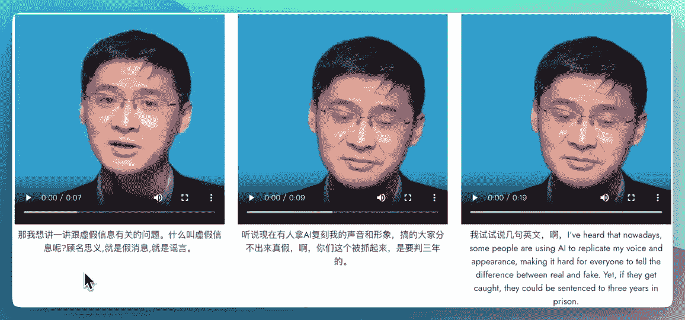

[X2Twitter.com_TmErBc1z2-OXaKyP_1080p.mp4](https://internal-api-drive-stream.feishu.cn/space/api/box/stream/download/all/H9r3bQ3Y2oRmsxxgcwdcqITbnwh)

## 4月9日 全球AI资讯

1、OpenAI 计划在“几个月内”发布 GPT-5

在 X（原 Twitter）上，OpenAI CEO Sam Altman 宣布，公司将在未来几周内单独发布推理模型 o3 和 o4-mini，而非将它们直接集成到 GPT-5 中。o3 和 o4-mini 模型属于推理模型（reasoning models），专注于复杂思维任务。目前，完整的 GPT-5 预计将在“几个月内”推出。

2、亚马逊推出新 AI 语音模型 Nova Sonic

周二，亚马逊推出新 AI 语音模型 Nova Sonic，主打自然语音处理，Nova Sonic 成本低 80%，已集成至升级版 Alexa+，可通过 Bedrock 平台使用。语音识别准确度高，错误率仅 4.2%，响应速度快，平均延迟 1.09 秒。

3、亚马逊旗下Zoox开始在洛杉矶测试无人驾驶出租车

亚马逊的自动驾驶汽车子公司Zoox从本周二起在该市部署改装的Toyota Highlander测试车队，以收集数据并为夏季的无人驾驶测试做准备。涵盖多个城市，目前在旧金山、拉斯维加斯等地测试定制无人驾驶出租车，在奥斯汀、迈阿密和西雅图进行带有人类安全员的测试。

4、Google 扩展 Gemini Live 视频功能

Google 宣布扩大 Gemini Live “Project Astra” 功能的覆盖范围，将实时视觉 AI 功能引入更多 Android 设备，并新增视频和屏幕共享交互方式。该功能将率先推送至 Pixel 9 和 Galaxy S25 设备，三星用户可免费使用。

5、ElevenLabs推出MCP服务器

ElevenLabs近期推出了MCP（多模态通信协议）服务器，使用户能够通过简单的文本输入，让AI助手（如Claude、Cursor、Windsurf等）直接接入ElevenLabs强大的AI音频平台。MCP服务器的核心功能是充当一个桥梁，它将ElevenLabs的先进文字转语音和语音克隆技术与用户日常使用的AI工具进行连接，使这些工具能够实现“开口说话”或处理各种声音内容，极大地简化了API调用的流程。

6、Instagram 正在强化搜索功能

Instagram 负责人 Adam Mosseri 表示，公司正在加强搜索功能建设，计划优化 “内容搜索”，让用户更容易找到感兴趣的内容，而不仅仅是账户。Z 世代用户搜索习惯正在改变，TikTok 和 Instagram 正在挑战 Google 的传统搜索引擎地位。研究显示，45% 的 Z 世代用户倾向于在社交媒体搜索，51% 甚至更喜欢 TikTok 而非 Google。

7、Shopify 强制全公司使用 AI

Shopify CEO Tobi Lütke 颁布公司 AI 强制使用政策，要求员工在申请新资源前证明 AI 无法完成任务，并将 AI 作为绩效考核标准。公司提供 Copilot、Cursor 和 Claude 等 AI 工具，并鼓励分享 AI 最佳实践。Lütke 强调 AI 可提升 100 倍生产力，并正在成为招聘的替代方案，表明 Shopify 将 AI 视为未来工作的核心。

8、Snapchat推出品牌赞助的AI滤镜

Snapchat正在推出品牌赞助的AI镜头，让品牌借助生成式 AI 与用户互动，实现沉浸式广告体验。用户通过自拍照与AI生成的场景互动，Snap利用面部分析技术将用户融入场景中。这一新广告格式已经被Tinder和Uber等品牌采用。这些 AI 滤镜会根据预设的提示词和姿势创建沉浸式变换，每个滤镜可提供多达 10 种不同的体验。

## 4月10日 全球AI资讯

1、微软的Copilot Vision功能现已从网页扩展到移动设备

iPhone用户（需订阅Copilot Pro）可以通过Copilot应用使用这一功能。该功能将手机相机转变为实时视觉搜索工具，能够解读植物健康、产品规格及室内装饰等信息，所有处理均实时完成。技术在Copilot应用的语音模式中运行，只有在用户同意后才会启用，由OpenAI最新模型支持。

2、NVIDIA 和斯坦福推出长达一分钟 AI 动画

NVIDIA 和斯坦福大学的研究人员近日发布了一项名为 “测试时间训练层”（Test-Time Training, TTT） 的 AI 技术，使视频生成的时长超越以往的限制。演示显示，该技术能够生成时长达 一分钟 的动画短片，并显著提升一致性和叙事能力。该方法利用神经网络作为记忆单元，使模型能够记住内容，并在更长的视频序列中保持连贯性。

3、前 OpenAI CTO Murati 创立的 AI 公司继续吸纳 OpenAI 资深人才

由前 OpenAI 首席技术官 Mira Murati 创立的 AI 初创公司 Thinking Machines Lab，近日新增了两位前 OpenAI 关键人物：前首席研究官（CRO） Bob McGrew 和 GPT 技术架构师 Alec Radford，使该公司团队中的 OpenAI 前员工比例接近一半。该公司正寻求 90 亿美元估值，最高 10 亿美元融资，但产品计划仍未公开。

4、YouTube 扩展 AI 伪造肖像检测技术，支持 NO FAKES 法案

周三，YouTube 宣布扩展其 AI 伪造内容检测 试点项目，以识别并管理涉及 创作者、艺术家及其他知名或有影响力人物 肖像（包括面部）的 AI 生成内容。同时，YouTube 公开表示支持 NO FAKES 法案（“无虚假法案”），该法案旨在打击 AI 生成的、用于误导公众或制造有害内容的虚假人物图像或声音。

5、WordPress.com 推出免费的 AI 驱动网站生成器

WordPress.com 于周三推出了一款新的 AI 网站生成器，使任何人都能通过 AI 聊天界面创建一个可运行的网站。该功能将免费提供给 WordPress 用户，WordPress 提供 30 次免费 AI 生成提示，超出后用户需选择一个托管计划

6、Reddit 将 Google Gemini 集成到其 AI 搜索工具 Reddit Answers

Reddit 推出 AI 对话式搜索工具 Reddit Answers，并通过 Google Gemini 进行升级，以提高搜索质量并提供更快的答案，用户对 Reddit Answers 的评价不一，有人认为它类似于 X 的 Grok AI，也有人觉得它对获取用户建议很有帮助。该工具目前支持 英语，仅限 美国的网页端和 iOS 设备 使用。

7、OpenAI推出Evals API：为开发者简化模型评估流程  Evals API的核心功能

自定义评估定义：开发者可以通过扩展基础类来编写自己的评估逻辑。测试数据集集成：无缝集成评估数据集，以测试特定场景。参数配置：配置模型、温度、最大令牌数和其他生成参数。自动化运行：通过代码触发评估，并以程序化方式获取结果。Evals API支持基于YAML的配置结构，既具有灵活性，也便于复用。

8、Adobe正在为Photoshop和Premiere Pro构建AI代理

这些代理可以自动执行复杂任务，帮助用户启动项目并提高工作效率。Photoshop创意代理：通过浮动动作面板，代理会推荐并自动执行照片编辑任务，如移除背景人物或调整景深。用户可以用自然语言提示代理进行编辑。Premiere Pro创意代理：通过媒体智能功能，代理将帮助编辑者找到所需镜头并进行粗略剪辑。最终，代理将帮助调整色彩、音频混音等。Generative Extend功能：使用AI延长视频剪辑时长

9、微软取消计划中的十亿美元数据中心项目

微软已暂停在俄亥俄州建造三个数据中心的计划，这是全球多个项目取消中的最新一例。近期，微软已暂停或推迟了在 印度尼西亚、英国、澳大利亚 和多个美国州的数据中心项目。公司还撤回了在 欧洲 和 亚太地区 的多个项目。

10、谷歌宣布支持 Anthropic 的 AI 模型数据连接标准

几周前，OpenAI 宣布将采用 Anthropic 公司的 AI 模型数据连接标准，如今谷歌也紧随其后。连接数据源：MCP 允许 AI 模型从 业务工具、软件、内容库、应用开发环境 等数据源中提取信息，以完成任务。实现双向交互：开发者可通过 MCP 建立 AI 驱动的应用（如聊天机器人），让 AI 能够与数据源 双向通信。

## 4月11日 全球AI资讯

1、谷歌发布多项重大新产品

Gemini 2.5 Flash正式发布。视频模型Veo 2现已通过Gemini API向开发者开放。Live API也已准备好投入生产。Firebase Studio现在只需几个提示就能让任何人构建应用程序。谷歌还推出了一款专门用于推理的新型TPU芯片，以及一种新的开放协议，使AI智能体能够在不同生态系统中安全地协作。

2、Grok 3现已通过API提供

开发者将可以访问两个模型：Grok 3和Grok 3 Mini。Grok 3的定价为每百万输入token 3美元，每百万输出token 15美元。与此同时，Grok 3 Mini的定价为每百万输入token 0.30美元，每百万输出token 0.50美元。定价似乎与Anthropic的Claude 3.7 Sonnet相当，但比Gemini 2.5 Pro更贵。

3、三星与谷歌合作推出Gemini AI驱动的Ballie家用机器人

该产品可自主移动、投影视频、控制智能设备，并支持语音指令。预计今年夏天将在美国和韩国上市。三星希望借助其SmartThings生态和Gemini AI，在AI消费级机器人市场占据领先地位。

4、Canva 宣布推出一系列 AI 功能

包括 AI 助手Canva AI、代码生成工具 Canva Code、电子表格 Canva Sheets 以及 AI 驱动的照片编辑功能。AI 赋能后，Canva 不仅能自动生成设计和文案， 还支持与 HubSpot、Statista、Google Analytics 等平台的集成，使用户能够轻松导入数据。

5、OpenAI 推出ChatGPT的新记忆功能

使其能够参考用户的过往聊天记录，提供更个性化的回答。这项功能将优先向 ChatGPT Pro 和 Plus 订阅用户推出，但不包括英国、欧盟及部分欧洲国家，因需要符合当地法规。用户可在设置中选择关闭该功能，并管理已保存的记忆。

6、YouTube推出免费AI音乐创作工具

允许创作者通过 AI 提示词 生成免费背景音乐，并添加到视频中。该功能正在 Creator Music 平台逐步推出，适用于 YouTube 美国合作伙伴计划中的创作者。创作者可以自由输入音乐需求，如乐器、情绪和视频类型，AI 生成后可免费下载使用，无需担心版权问题。

7、微软的50岁生日派对充满了惊喜

活动中，比尔·盖茨、史蒂夫·鲍尔默和萨蒂亚·纳德拉三位首席执行官共同亮相，回顾了微软的发展历程。微软AI首席执行官穆斯塔法·苏莱曼展示了新的Copilot功能，之后，布伦达·宋主持了一个脱口秀格式的活动，盖茨和鲍尔默分享了微软的早期历史和个人感悟。活动最后，三位CEO进行了炉边对话，讨论彼此的优点和微软的发展方向。

## 4月14日 全球AI资讯

1、OpenAI 准备推出 GPT-4.1，支持百万级上下文窗口和实时记忆功能

OpenAI 正在筹备推出升级版 GPT-4.1 及多个轻量模型（如 o4-mini），并暗示将实现百万 token 上下文窗口“quasar alpha”。OpenAI 推出“先锋计划”，联合初创企业共创领域专属 AI 评估体系，引发关于“自评自优”风险的争议。

2、微软“Recall”功能回归，再次测试“数字记忆”体验

微软重新推出了曾因隐私争议被撤回的“Recall”功能。该功能可定期截取用户屏幕快照，并允许用户通过自然语言搜索过去的活动。目前仅在 Windows 11 的 Copilot+ PC 和 Insider 用户中测试。

3、Genspark 上线仅 9 天，年化收入突破千万美元

Genspark 由 AI 公司 MainFunc 于 4 月 2 日晚正式推出。这款超通用智能体具备独立思考、自动规划、工具调用等能力，与此前火爆的 Manus AI 有相似定位 ，近日，其创始人景鲲在社交媒体发文宣布：Genspark 在上线短短 9 天内，年度经常性收入（ARR）已突破 1000 万美元大关。

4、Google Cloud Next 2025 发布多项 AI 重大更新

在 Cloud Next 2025 上，Google 扩展了其 AI 开发者生态系统，重点聚焦于“代理式计算（agentic computing）”ADK（Agent Development Kit）开源，支持模块化、多代理协作和 Vertex AI 集成，Gemini Code Assist 进入预览，支持自主代码生成、测试、迁移等任务，Firebase Studio 推出，Gemini 2.5 Flash 模型即将上线，第七代 Ironwood TPU 发布，性能强大、能效领先，用于大规模 AI 推理。

5、Mira Murati 的 AI 初创公司瞄准历史级别融资

前 OpenAI CTO Mira Murati 创办的新公司，团队核心成员多来自 OpenAI，目前正在洽谈以至少 100 亿美元估值 融资 20 亿美元，公司专注于打造“通用、可定制、易理解”的 AI 系统。

6、Spotify 投资 110 万推进法语和荷兰语有声书制作

Spotify 于周五宣布，计划投资 100 万欧元（约合 110 万美元），以推动非英语有声书的制作，首批将以法语和荷兰语为重点,为降低成本，公司与 AI 配音企业 ElevenLabs 合作。

## 4月15日 全球AI资讯

1、OpenAI推出全新旗舰AI模型 GPT-4.1

OpenAI 正式推出了 GPT-4.1，这是继去年发布的多模态模型 GPT-4o 之后的新一代旗舰模型。在周一的直播中，OpenAI 表示，GPT-4.1 拥有更大的上下文窗口，并在“几乎所有维度上”都优于 GPT-4o，尤其在编程能力和指令执行能力方面有显著提升。GPT-4.1 已向开发者开放，OpenAI 同时还推出了两个更小型版本：GPT-4.1 Mini和GPT-4.1 Nano

2、英伟达宣布计划将在美国制造部分AI芯片

英伟达宣布将在亚利桑那和德克萨斯州建设AI芯片制造与测试基地，部分Blackwell芯片已在台积电凤凰城工厂投产。未来四年，公司将在美建设价值达5000亿美元的AI基础设施，强化本地供应链，应对全球芯片需求。

3、Google Classroom为教师推出AI题目生成新功能

Google Classroom新增AI功能，允许教师基于上传或输入的文本快速生成题目，并可设置题型、年级、技能等参数，导出为Google文档或表单。目前该功能仅面向付费教育用户开放（Gemini Education / Premium）。

4、Meta将在欧盟开始使用公共内容训练其AI模型

Meta公司周一宣布，将从本周起开始在欧盟使用Facebook和Instagram上的公共内容（如公开帖子和评论）来训练其AI模型，并使用用户与Meta AI的互动数据进行训练。用户将收到通知邮件和应用内提醒，可通过表单选择拒绝自己的数据被使用。Meta承诺不使用私信内容或18岁以下用户的数据。

5、谷歌正在利用AI和Pixel手机来理解海豚在说什么

谷歌推出了一种名为 DolphinGemma 的新AI模型，该模型是与 Wild Dolphin Project (WDP) 和乔治亚理工学院的研究人员合作开发，DolphinGemma基于WDP在巴哈马研究的近40年的海豚相关数据进行了训练，并利用谷歌的音频技术，包括SoundStream分词器，将海豚的声音转化为数字格式。该模型能够识别、分析甚至生成典型声音模式的逼真序列，如口哨声、点击声和爆发脉冲。

6、阿里巴巴现拥有中国最受欢迎的AI应用

根据 Aicpb.com 的数据，阿里巴巴的 Quark AI 助手在 3 月成为中国最受欢迎的 AI 应用。该应用的全球月活跃用户数约为 1.5 亿，超过了字节跳动的抖包（1 亿月活跃用户）和 DeepSeek（7700 万月活跃用户）。这些数据来自应用商店，不包括网站使用情况。

7、高中生借助AI揭示了150万个此前未知的太空天体

一位本地高中生在加州理工学院的研究中，发现了150万个此前未知的太空天体，扩展了NASA任务的潜力，并发表了一篇由他独立署名的科学论文。该模型能识别宇宙中极微小的光变现象，也适用于其他时间序列数据分析。帕兹目前已成为加州理工的正式研究人员，参与多个太空任务数据处理工作。

8、前OpenAI首席科学家伊利亚创办的SSI公司以320亿美元估值完成20亿美元融资

这轮融资由Greenoaks领投，Lightspeed、a16z、谷歌母公司Alphabet与英伟达也有参与。SSI致力于打造安全的超级智能（超越人类的AGI），尽管尚无明确产品，但自2024年9月以来估值已翻六倍，显示出市场对OpenAI系AI人才创业的高度关注。

## 4月16日 全球AI资讯

### 1、字节跳动推出高效视频生成模型 Seaweed

一款超高效的70 亿参数视频生成模型，在资源消耗远低于其他模型的情况下，性能可与 Kling 1.6、Google Veo 和 万象 2.1 等更大模型相抗衡。支持文本、图像、音频驱动的视频合成，最长可生成 20 秒内容，并具备镜头控制、多镜头叙事、音画同步等复杂能力。

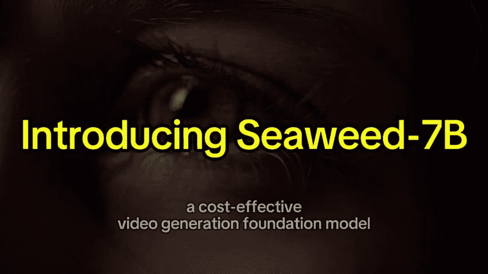

[z-Rt9e95YDHiJI4J.mp4](https://internal-api-drive-stream.feishu.cn/space/api/box/stream/download/all/GmbybB1VwoX9GIx76voclfJTn5d)

### 2、Anthropic 的 Claude 现在可以访问你的 Gmail 了

Anthropic 于周二宣布，其 AI 聊天机器人 Claude 现已整合进 Google Workspace，支持搜索和引用用户的 Gmail 邮件、Google Calendar 中的日程安排，以及 Google Docs 中的文档内容。目前，该集成功能处于测试版阶段，优先向 Anthropic 的 Max、Team、Enterprise 和 Pro 订阅用户开放。

### 3、英伟达H20芯片的出口被美国政府正式纳入出口管制范围

英伟达在周二的一份文件中表示，公司已收到美方通知，未来向中国出口 H20 AI 芯片必须获得出口许可证。根据文件内容，这一许可要求将无限期持续。美国政府的理由是：“H20 可能被用于中国的超级计算机”，因此存在国家安全风险。

### 4、Google 将 Veo 2 视频生成模型整合进Gemini Advanced 高级订阅服务

用户可生成 8 秒、720p 的横屏短视频，并分享到主流社交平台。同时，Veo 2 也整合进实验性平台 Google Labs，搭配新功能 Whisk Animate，支持图生视频。该功能现阶段尚未支持企业与教育 Workspace 用户，且生成次数有限。

### 5、OpenAI为ChatGPT新增图像库功能

用户现在可以轻松查看和管理自己生成的 AI 图像。该功能已陆续在 移动端和网页端上线，面向所有用户开放，包括免费和付费用户。图像库位于 ChatGPT 的侧边栏中，以网格形式呈现历史生成图像，并支持一键创建新图像。

### 6、Anthropic 即将推出可对话的语音 AI

Anthropic 计划推出三种英语语音选项，分别名为：Airy（清柔）、Mellow（温和）、Buttery（柔滑）。此前，Anthropic 高管已透露公司正在开发语音交互原型。

### 7、苹果将使用你的邮件改进 AI 功能

苹果将在本地设备上分析真实邮件等内容来优化 AI 功能，但不会存储或用于训练模型，确保用户隐私不被侵犯。此功能从 iOS/iPadOS 18.5 和 macOS 15.5 测试版开始，仅对已开启设备分析的用户开放。

### 8、OpenAI发布GPT-4.1提示工程优化指南

详细介绍了GPT-4.1的功能特点提供了从基本到高级的提示技巧和操作建议，重点强调了清晰指令、提示结构化以及避免产生歧义的关键性。

地址：https://github.com/openai/openai-cookbook/blob/main/examples/gpt4-1_prompting_guide.ipynb

## 4月17日 全球AI资讯

### 1、Grok推出Grok Studio协作平台

一个新的画布式协作平台，支持文档生成、代码编辑和浏览器小游戏。用户可在分屏界面中与 AI 实时协作，Grok Studio 支持 HTML、JS、Python 等语言的实时预览，并加入对 Google Drive 的集成支持，可直接处理云端文件，该功能面向所有用户开放。

### 2、KLING AI 推出全新视频与图像模型2.0

Kling AI 发布 KLING 2.0 Master 视频模型和 KOLORS 2.0 图像模型，主打更强的提示词理解、更高的真实感输出，以及图像/视频编辑功能。图像支持60+风格、深度更自然；视频实现连贯动作与表情控制，支持60多种风格生成图像。

### 3、OpenAI 或将以 30 亿美元收购 AI 编码助手 Windsurf

OpenAI 正与 AI 编程助手开发商 Windsurf 洽谈收购，估值约为 30 亿美元。该交易若成，将使 OpenAI 与同类服务商（如 Cursor）正面竞争，Windsurf 年收入达 4000 万美元，远低于 Cursor 的 2 亿美元，但用户基础和功能获官方点赞。

### 4、微软为Copilot Studio推出“计算机使用”功能

允许AI代理与图形用户界面互动，支持控制桌面应用程序，并完全运行在微软云基础设施上。该技术被视为机器人过程自动化（RPA）的演变，应用范围包括自动数据录入、市场调研和发票处理。

### 5、谷歌为Gemini应用和Whisk实验工具推出AI视频生成功能

允许用户将文本提示转化为短视频片段或将图像转换为动画。新功能基于Veo 2模型，能够生成逼真的运动和视觉效果。目前，这些功能仅对Google One AI Premium订阅用户开放，并且每月有生成限制。

### 6、微软Copilot可以在Edge浏览器中“看到”屏幕上的内容

微软推出了Copilot Vision功能，它可以解释屏幕内容并帮助用户在应用程序中操作。用户通过语音与其互动，Copilot Vision可以“看到”屏幕上的内容并帮助完成任务。该功能现已免费在Edge浏览器中提供，而系统范围内的功能仍仅限于Copilot Pro订阅用户。

### 7、特朗普政府拟对中国 AI 公司 DeepSeek 实施禁令

特朗普政府正考虑限制中国 AI 实验室 DeepSeek，包括禁止其购买 Nvidia AI 芯片，甚至禁止美国用户使用其服务。

### 8、Hugging Face 收购机器人初创公司

Hugging Face 宣布收购法国机器人公司 Pollen Robotics，并将其人形机器人 Reachy 2 开源，以推动机器人研发的透明化和社区参与。这款机器人能完成简单动作，如抓物或清理桌面，公司将发布零件清单和 3D 模型，鼓励开发者自定义或维修。

### 9、OpenAI 疑似打造社交网络

据内部消息，OpenAI 正在测试一款类似 X 的社交平台，整合了 ChatGPT 和图像生成能力，用户可在 AI 协助下发布内容。Sam Altman 正在低调征求反馈，该平台可能成为 ChatGPT 的一部分，也可能是独立应用。

## 4月18日 全球AI资讯

### 1、OpenAI 发布 o3 和 o4-mini，推出 Flex 处理模式

OpenAI 刚刚发布了 o3 和 o4-mini，这两款模型不仅刷新了编程、数学等领域的性能记录，还首次具备“图像思考”能力和全工具调用权限，同时推出了名为 Flex Processing 的新处理模式，这是一种 API 选项，通过牺牲响应速度和偶尔资源不可用的情况，来换取更低的模型使用价格。Flex Processing 已以 Beta 测试形式开放，适用于其近期发布的 o3 和 o4-mini 推理模型。

### 2、淘宝登顶美区 App Store 第五

因特朗普对中国产品加征关税，TikTok 上大量视频揭示奢侈品产地实际来自中国，激发美国消费者对淘宝、DHgate 等直购平台兴趣。淘宝在美下载量暴增 514%，由第 461 名飙升至 App Store 总榜第五，购物榜第二。

### 3、Shein 和 Temu 将因关税上调对美国消费者涨价

由于特朗普总统对从中国运往美国的商品征收新关税，Shein 和 Temu 计划自 4 月 25 日起提高美国用户的商品价格。特朗普新政对中国制造商品征收高达 145% 的关税，并取消了此前“800 美元以下免税”的海关豁免条款。这些政策已严重冲击了两家平台的商业模式。

### 4、OpenAI 的 Stargate 计划据称资金未落实

OpenAI 在美国推进的大型基础设施计划 Stargate，用于建设支持 AI 运算的数据中心，目前尚未形成完整计划，且尚未落实所需资金。但初期 OpenAI 和软银仅承诺各出资 150 亿。马斯克公开质疑其财力，引发白宫关注，令项目前景蒙上阴影。

### 5、维基百科向AI开发者提供数据以防止机器人抓取

维基媒体基金会与Kaggle合作，发布了一个针对机器学习优化的维基百科数据集，防止AI开发者抓取维基百科。该数据集包含结构化的英语和法语内容，允许开发者进行建模、分析等。

### 6、AI机器人人格可能是卧底警察

据报道，美国警方正在使用名为Overwatch的AI工具，部署虚拟代理人来渗透并接触犯罪网络，收集针对毒品和人口贩运嫌疑人、政治活动家以及大学抗议者的证据。Massive Blue开发的AI人格实例包括一个假装成36岁无子女的离婚女性，具有孤独和身体积极等特征，并有着烘焙和“激进主义”的兴趣爱好。

### 7、Google One AI Premium对大学生免费

谷歌推出了针对美国大学生的Google One AI Premium计划，学生可以免费使用该服务，免去每月20美元的费用，直到2026年6月30日。该计划包括2TB的云存储以及多种AI工具，如Gemini 2.5 Pro-powered工具、NotebookLM Plus、Veo 2文本到视频模型等。

### 8、Claude 获得自主研究能力

Anthropic 升级 Claude，新增网络+本地搜索功能，并接入 Google Workspace，为用户提供更精准、更全面的上下文回答。企业客户还可使用 RAG 技术对文档库进行智能检索。

### 9、Instagram 推出“Blend”功能

Instagram 周四宣布推出名为 Blend（混合） 的全新功能，让你和朋友可以共同创建一个个性化定制的 Reels（短视频）推荐流。Blend 为邀请制，可与一位朋友或一个群聊共同创建，内容会每天刷新，带来新的短视频推荐。

### 10、Perplexity AI 将预装于三星和摩托罗拉智能手机

AI 初创公司 Perplexity AI 正在与主要智能手机制造商达成集成合作协议，摩托罗拉已同意在新设备中预装 Perplexity 作为谷歌 Gemini 的替代方案，而与三星的谈判则涉及将该应用预装或作为 AI 助手集成。Perplexity 还与德国电信达成合作。

# 第四周

## 4月21日 全球AI资讯

### 1、OpenAI 发布“智能体构建实战指南”

这份共34页的指南旨在为产品和工程团队提供构建首个智能体系统的必要知识和最佳实践，其内容凝结了 OpenAI 从众多客户实际部署案例中获得的深刻洞察。

原文:https://cdn.openai.com/business-guides-and-resources/a-practical-guide-to-building-agents.pdf

### 2、Google 推出 Gemini 2.5 Flash，搭载“思考预算”功能

Google 刚刚发布了 Gemini 2.5 Flash，一款正在预览阶段的混合推理 AI 模型。这一“可控推理+预算设定”的组合策略，让开发者可以只在需要时启用“深度思考”，从而支持更便宜、高频率的使用场景，把“高智商”留给复杂任务。

### 3、OpenAI内部测试显示幻觉率高达 48%

一个关键的假设是：推理能力越强，生成的判断就越多，出错的概率也随之上升。第三方研究人员也指出，o3 模型有捏造执行过程的现象——它会“编造”出自己从未做过的步骤。当一个模型的“自信程度”提高，但它的“认知机制”没有随之增强时，幻觉现象就会变得更加严重。

### 4、字节跳动推出「扣子空间」内测上线 支持 MCP 插件扩展

一款主打智能化办公的新产品，「扣子空间」具备任务理解、流程拆解、工具调用和多格式结果输出等一系列核心能力。用户只需输入目标，AI 即可自动分析需求，将任务细化为多个步骤，并智能调动浏览器、代码编辑器等工具完成各环节操作，最终生成网页、PPT、飞书文档等完整成果。

### 5、AI人宠翻译应用 Traini 爆火

一款名为 Traini 的 AI 宠物语言翻译应用，近期在英语国家的移动端市场悄然走红，成为养宠圈的新宠。这款软件主打“人宠无障碍交流”，用户只需上传狗狗的照片、视频或叫声，Traini 就可以翻译出其表达的含义。

### 6、OpenAI o3 模型“缩水”？

OpenAI 去年曾高调宣称 o3 模型在 FrontierMath 高难数学基准测试中可解答 25% 问题，然而第三方研究机构 Epoch 最新测试显示，真实得分仅约 10%，远低于 OpenAI 早前声称的最高成绩。

### 7、Profluent 发布蛋白质设计大模型 ProGen3

这款 460 亿参数的模型，用 34 亿条蛋白质序列训练出来，能从零开始“生成”复杂蛋白，这一成果标志着生物学中首次发现 AI 的“可扩展性定律（Scaling Laws）”，证明了：更大的模型 + 更多的数据 = 更强的结果。

### 8、Meta FAIR推出五项感知+推理新研究

Perception Encoder感知编码器能识别伪装动物、追踪移动目标，发布感知语言模型和视频基准测试集，构建 13 万条空间标注数据，推动 3D 理解，协同 AI 推理能力提升近 30%

### 9、xAI 推出 Grok 聊天机器人的“记忆功能”

xAI 推出了一项全新的“记忆功能”，用于其 Grok 聊天机器人，使其能够记住过去的对话内容，为经常使用的用户提供更个性化的回复。该功能目前处于测试阶段（Beta），适用于 grok.com 网站及其 iOS 和 Android 应用程序。

## 4月22日 全球AI资讯

### 1、字节跳动发布图文生成模型 Seedream 3.0

主打超快生成速度与高画质，号称全面超越 GPT-4o 与 Midjourney v6.1。该模型具备中英文文本识别、高清图像生成以及高保真人像建模能力，生成一张 2K 图像仅需 3 秒。官方还同步推出图像编辑工具 SeedEdit，并宣布将模型接入豆包平台，扩大应用场景。

更多：https://team.doubao.com/en/tech/seedream3_0

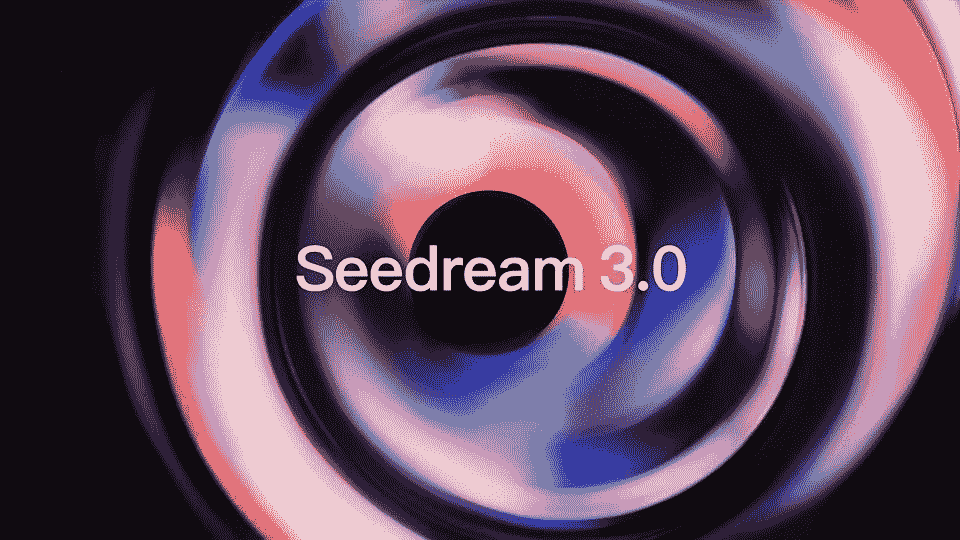

[X2Twitter.com_Z_TGM8ti71wFgxr4_1080p.mp4](https://internal-api-drive-stream.feishu.cn/space/api/box/stream/download/all/UhjcbWlQ3ou8LtxEap8cV30CnUf)

### 2、Anthropic 研究发现：学生正将高阶思维任务交由 AI 完成

Anthropic 近期研究分析了大学生使用其语言模型 Claude 的行为，结果显示学生正将大量高阶认知任务交由 AI 完成，尤其在 STEM（科学、技术、工程与数学）学科中尤为显著。研究基于 57 万多条对话数据，发现 47% 的互动为“直接指令式”使用，即学生几乎不与 AI 来回互动，而是简单输入问题、让 AI 代为处理。

### 3、Figma 正在开发一款 AI 应用生成器

据报导，Figma 正在测试一款由 Anthropic 的 Claude Sonnet 模型驱动的 AI 应用生成器，支持通过文本提示、Figma 文件和图像等多种输入生成应用。同时，Figma 还在研发一款名为 Figma Sites 的新型建站工具，预计将进一步拓展其在网页设计领域的能力。

### 4、Intel 宣布其生成式 AI 软件 AI Playground 现已开源

这标志着公司在推广生成式 AI 技术普及及促进社区合作方面迈出了重要步伐。AI Playground 是一款特别为 Intel Arc 显卡和集成显卡量身优化的工具，支持多种生成式 AI 模型，用户可以在本地生成 AI 图像，同时保障数据隐私。

### 5、OpenAI 数据显示，ChatGPT 搜索在欧洲增长迅速

2025年3月31日结束的六个月期间，ChatGPT 搜索的每月活跃接收者从2024年10月的约1120万增加至约4130万。为了符合欧盟《数字服务法案》规定，OpenAI 定期发布这些数据。

### 6、谷歌 DeepMind 全面推进 AI

提出“流式”代理架构，倡导 AI 持续学习；同时发布支持 int4 量化训练的 Gemma 3 模型，大幅降低显存占用。Gemma QAT 版本能在消费级 GPU 上运行，为本地部署铺路。

### 7、Reddit全球短暂宕机

知名社交与论坛网站 Reddit 周一早间经历了大范围的服务中断。约9万名用户报告连接异常。故障于美东时间上午11:20开始，Reddit 随后确认网站与 App 出现“错误率上升”，并迅速定位问题，于12:10部署修复措施，12:21恢复正常。此次中断持续约一小时，影响范围广泛，官方称原因是数据库连接中断。

### 8、Instagram 利用 AI 识别谎报年龄的青少年并限制其账户功能

Meta 公司周一宣布，正在利用 AI 技术，识别在 Instagram 上谎报年龄、试图绕过安全防护机制的未成年用户。一旦发现某个账户疑似属于青少年，即使该账户登记的是成年生日，平台也会将其转入“青少年限制账户”。

## 4月23日 全球AI资讯

### 1、OpenAI与《华盛顿邮报》达成新合作协议

ChatGPT将开始在回答中总结并链接到《华盛顿邮报》的原创报道。此次合作是OpenAI与多个新闻出版商合作的一部分，至今该AI巨头已经与超过20家新闻出版商签署了协议，包括《卫报》和Axios等媒体。《华盛顿邮报》表示，它将受益于ChatGPT庞大的用户群体，目前该聊天机器人已有超过5亿用户。同时，OpenAI也将受益于基于《华盛顿邮报》“及时、可靠报道”的高质量回答。

### 2、Meta 推出了与 CapCut 竞争的全新应用 Edits

允许用户使用 AI 和视频特效创建内容，并支持无水印的视频导出。该应用提供了多个实用功能，如“创意”工具、“绿屏”背景替换和自动字幕等。未来，Edits 将加入更多新功能，如 AI 视频修改工具和与创作者之间的协作功能。

### 3、阿联酋计划让 AI 编写法律

阿联酋近日公布了计划，成为第一个将 AI 直接融入立法过程的国家，设立新的政府单位来监督法律的编写、审查和更新的转型。

4、两名本科生创建了一个AI语音模型Dia

能够生成类似于谷歌NotebookLM的播客风格片段。该模型可以定制语音的语调并进行语音克隆。Dia目前已在Hugging Face和GitHub上发布，并支持大多数现代PC。Nari Labs计划将Dia发展为一个具有社交功能的合成语音平台，并扩展语言支持。

地址：`github.com/nari-labs/dia`

5、AI 视频生成平台 Vidu 推出全新版本 Vidu Q1

主打更高质量的视觉与音效体验。此次升级包括更清晰的画面、更流畅的转场、更精准的音效同步以及更稳定、富有表现力的动画风格。同时，Vidu 还为新用户提供注册福利，输入代码 “`VIDUQ1`” 即可获得 100 点免费积分。

6、Anthropic 绘制 Claude 的价值观

Anthropic 发布了一项关于其 AI 模型 Claude 的研究，分析了超过 30 万次真实对话，构建了模型在日常互动中的价值观地图。研究发现，Claude 在对话中表达了 3,307 个独特的价值观，主要分为实用性、知识相关、社交、保护性和个人五类，实用性和知识相关的价值观最为常见。

7、OpenAI高管表示有意收购谷歌Chrome浏览器

在本周二的谷歌反垄断法庭听证会上中，OpenAI的一位高管表示，如果谷歌的Chrome浏览器被出售，OpenAI有意收购它。Turley认为，收购Chrome将使OpenAI能够打造一个以AI为核心的浏览器体验。

8、xAI宣布推出Grok Vision功能

让Grok聊天机器人能够通过智能手机摄像头“看见”周围的物体并回答相关问题，类似于谷歌的Gemini和ChatGPT的实时视觉功能。该功能目前仅限iOS用户使用。此外，Grok还推出了多语言音频、实时搜索和记忆功能，帮助用户在对话中提供更多的上下文信息。

9、OpenAI曾尝试收购AI编程助手Cursor

但因Anysphere选择保持独立而未果。随后，OpenAI转向收购另一家快速增长的AI编程初创公司Windsurf，并提出30亿美元的收购报价。Windsurf的年经常性收入已从4000万美元增长至1亿美元，且其产品与传统企业系统兼容，深受开发者欢迎。

10、奥斯卡官方表示，不在乎电影是否使用AI

电影艺术与科学学院在新的奥斯卡规则中首次承认了生成性AI的存在，并明确表示，使用AI本身不会影响电影获得提名的机会，但如何使用AI可能会有所影响。学院强调，人类创意在电影创作中的核心作用仍是评判的关键因素。

## 4月24日 全球AI资讯

1、Perplexity 的 AI 语音助手现已在 iOS 上推出

Perplexity 的 AI 语音助手现已通过 iOS 应用程序向 Apple 用户开放。该助手可以执行多种任务，如设置提醒、发送消息、预定餐厅等，且支持跨应用操作。用户在使用时还可以继续与助手互动，即使离开应用程序。

2、海螺AI发布“角色参考”功能

MiniMax旗下的海螺AI（Hailuo AI）推出了其Hailuo Image的新功能——“角色参考”，该功能允许用户根据单一参考图像生成多角度和动态姿势的角色图像。新增的功能不仅强化了表情控制，还融入了电影级光影效果，显著提升了AI图像生成在创意表达和角色一致性方面的表现。

[`6388101951406059083202476.mp4`](https://internal-api-drive-stream.feishu.cn/space/api/box/stream/download/all/YZLrbwqGrojnKLxlcTxctMILnHc)

3、Kortix-AI发布Suna开源AI智能平台

全新的开源通用AI智能平台，为Manus提供一个可替代的选择。Suna汇聚了浏览器自动化、文件管理及API集成等多项强大功能，能够通过自然语言对话来自动化执行复杂任务。该平台已在GitHub上发布，迅速引发了AI开发者和自动化爱好者的广泛关注。

官网：`https://www.suna.so/`

GitHub：`https://github.com/kortix-ai/suna`

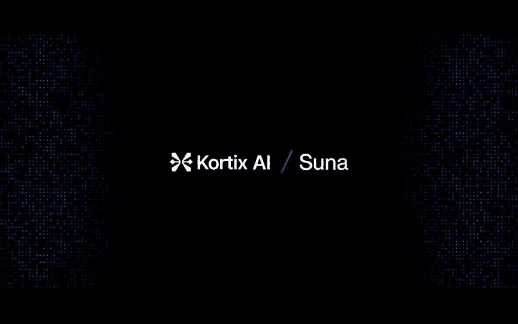

[`X2Twitter.com_Ft1kPz3Nbjm3p3_L_1080p.mp4`](https://internal-api-drive-stream.feishu.cn/space/api/box/stream/download/all/CWFObJZmVolNPIx2INDcj6iqnde)

4、OpenAI将升级版图像生成器提供给开发者

OpenAI在周三将其全新改进的图像生成功能带到了API，允许开发者将其集成到他们的应用和服务中。此前该模型仅限于 ChatGPT 使用，现在包括 Adobe 和 Figma 等公司也开始采用该模型。图像生成和处理按令牌收费，费用相对较低。模型支持生成各种细节等级的图像，并能分析图像内容，适用于多种应用场景。

5、NVIDIA近日推出了Eagle 2.5

一款仅8B参数的视觉-语言模型（VLM），在处理长视频和图像任务方面表现媲美GPT-4等大型模型。该模型通过“信息优先采样”和“渐进式后训练”等策略，实现了对长期上下文的高效理解，打破了以往VLM在长输入场景下的性能瓶颈。

6、AWS推出SWE-PolyBench

一种新的开源多语言基准测试，用于评估AI编码代理，该基准测试覆盖21个GitHub代码库，涉及Java、JavaScript、TypeScript和Python四种语言，共2110个任务，聚焦于漏洞修复、功能实现和代码重构等实际开发情境。SWE-PolyBench通过执行性验证、真实拉取请求、语法树级度量等方式，提供更细致和具代表性的评估。

7、Nvidia 的 AI 助手在 Windows 上新增 Spotify、Twitch 等插件

支持控制 Spotify、检查 Twitch 主播直播状态、查看股票和天气等。通过新的插件构建工具，开发者可以为 G-Assist 创建自定义功能。G-Assist 使用本地运行的小型语言模型，支持通过 RTX 30、40 和 50 系列的 GPU 提供助手服务。

8、NVIDIA AI发布Describe Anything 3B

一种用于细粒度图像和视频字幕生成的多模态大语言模型，DAM-3B通过“焦点提示”与“本地化视觉骨干网络”相结合的架构，能够准确描述图像或视频中指定区域的内容。其视频扩展版支持跨时间分析，即使在遮挡或运动下也能保持描述准确性。

9、Character.AI推出AvatarFX虚拟角色图像

可将将静态人物照片转变为能够开口说话的生动视频形象。项技术可将普通的静态人物照片转变为能够开口说话的生动视频形象。

地址：`https://character.ai/video`

[`X2Twitter.com_pO0X1nLP8gcAmhHk_720p.mp4`](https://internal-api-drive-stream.feishu.cn/space/api/box/stream/download/all/MwTpb8rlGoHtDwx4RYYc8r8Snig)

10、宝马将在中国的新车型中整合DeepSeek AI技术

德国汽车制造商宝马（BMWG.DE）计划从今年晚些时候开始，在中国的新车型中整合中国初创公司DeepSeek的人工智能技术，宝马CEO奥利弗·齐普赛（Oliver Zipse）在周三上海车展上表示。

Anthropic CISO: AI员工即将来临

Anthropic的首席信息安全官预测，AI驱动的虚拟员工将在明年进入企业网络，带来新的安全管理挑战。Anthropic的首席信息安全官预测，AI驱动的虚拟员工将在明年进入企业网络，带来新的安全管理挑战。

研究人员设计出更紧凑且可解释的图像标记化方法

香港与英国的研究人员联合提出一种全新的图像标记化方法，通过层级结构优先编码图像的语义信息，再逐步加入细节，实现更紧凑、可解释的图像表示。该方法借鉴主成分分析的思想，使用扩散式解码器从粗到细重建图像，将语义内容与低级细节有效分离。

## 4月25日 全球AI资讯

1、腾讯混元3D模型全新升级

腾讯混元3D生成模型推出v2.5版本，混元3D v2.5在架构上做出了全面升级，总参数量从1B增加至10B，有效面片数量也增加了超过10倍，有效几何分辨率达到 1024。

2、即梦3.0海外版正式发布

昨日，字节跳动旗下即梦AI（Jimeng AI）发布了即梦3.0的海外版本，以其电影级视觉效果、2K分辨率输出、超逼真的材质呈现和精准的英文排版为核心亮点，尤其在英文文本生成和字体控制方面表现出色，超越了此前的中文版本。

体验地址：`https://dreamina.capcut.com/`

3、OpenAI推出“轻量版”ChatGPT深度研究工具

OpenAI宣布推出一款新的“轻量版”ChatGPT深度研究工具，该工具能够通过网络搜索，汇总与特定主题相关的研究报告，适用于ChatGPT Plus、Team和Pro用户。此工具将在今天开始向免费用户提供。新的轻量版深度研究由OpenAI的o4-mini模型提供支持。

4、Adobe 发布新版 Firefly 图像生成工具及全新网页应用

Adobe 推出了新款 Firefly 图像生成 AI 模型 4 和 Firefly 矢量模型，并重新设计了 Firefly 网页应用，集成了自家及竞争对手的多个图像生成模型。新的 Firefly 版本提升了图像质量、速度和控制能力，支持生成高达 2K 分辨率的图像。同时，Firefly 视频模型也面向所有用户开放，允许从文本生成视频。

5、TikTok 增加对照片 ALT 文本的支持

TikTok正式支持为照片贴文添加 ALT 文本，帮助视障和认知障碍用户通过屏幕阅读器了解图片内容。创作者可在上传或发布后编辑 ALT 描述。这项功能与自动字幕、可调文字大小等现有无障碍工具一起，进一步完善 TikTok 的可访问性体验。

6、Dropbox Dash现可搜索音视频图像，还能自动写文档

Dash 现支持音频、视频、图像与文本的自然语言搜索，并可基于根据会议、邮件和文档信息，自动生成项目计划、备忘录、演示文稿等内容，新增了 Slack、Zoom、Microsoft Teams、Figma、Canva、Jira 的集成。

7、Evernote 创始人的视频初创公司 mmhmm 更名为 Airtime，推出全新产品 vernote

创始人 Phil Libin 创办的视频公司 mmhmm 正式更名为 Airtime，并发布两款新产品：演示工具 Airtime Creator 和虚拟摄像头 Airtime Camera，旨在提升视频会议的专业性与互动感。Airtime Camera 将免费至 8 月 1 日后收费 20 美元，Creator 采用月付订阅制。

8、Adobe发布新应用帮助创作者获得正确署名并防止AI伪造

使创作者能够更轻松地获得他们作品的可靠署名，即使有人截取了截图并在互联网上转发。名为Content Authenticity（内容真实性）的Web应用今天正式进入公开测试版，允许在图像和照片中嵌入不可见、抗篡改的元数据，以帮助识别作品的拥有者。

9、微软将推出更新版的 Microsoft 365 Copilot

微软即将推出重新设计的 Microsoft 365 Copilot 应用程序。新增搜索、图像和笔记本功能，该应用程序现在默认采用聊天界面，具备记忆和个性化功能，可以理解用户的工作需求。此外，新的插件支持允许与第三方应用集成，提升企业搜索效果。微软还推出了一个代理商商店，用户可以从中获取 AI 代理商。

---

## 4月28日 全球AI资讯

1、谷歌DeepMind英国团队约300名员工计划加入通信工人联盟

约300名Google DeepMind伦敦员工因反对AI军事化计划寻求加入工会，他们担忧自己的技术被用于加沙冲突，包括一份价值12亿美元的云计算合同此前谷歌曾承诺不开发武器或监控AI，但随后违背。已有五人因不满辞职。工会强调员工主要关切的是伦理问题，若获正式承认，或将引发谈判甚至罢工。

2、Moonshot AI发布了开源模型Kimi-VL

仅用28亿参数即可高效处理文本、图像与视频，支持最长128,000 token上下文，且在多项基准测试中超越大型模型。Kimi-VL通过专家混合架构和强化学习提升推理能力

3、报道发现Meta的名人语音聊天机器人可能与未成年人讨论性话题

《华尔街日报》调查发现Meta平台(Facebook和Instagram)上的AI聊天机器人可能与未成年用户进行不适当的性对话。报告中提到，包括使用名人约翰·塞纳声音的聊天机器人在内的AI系统向自称未成年的用户提供了露骨的性内容。Meta回应称这些测试是"人为制造"的极端情况，并表示性内容在未成年用户对话中占比极低(0.02%)。

4、Perplexity的CEO谈对抗谷歌和即将到来的AI浏览器战争

Perplexity计划下月推出名为Comet的浏览器，斯里尼瓦斯认为浏览器是构建AI代理的最佳平台，因为它可以像操作系统一样控制多个应用和服务。公司最近与摩托罗拉达成合作，将其AI助手预装在Razr手机上，这是得益于美国政府对谷歌的反垄断审查。Perplexity目前拥有近3000万月活用户，每月处理约6亿次查询，估值达180亿美元。

5、微软发布Recall和AI驱动的Windows搜索功能

微软周六在Copilot Plus PC上推出了Recall、AI驱动的Windows搜索功能以及Click to Do工具。Recall功能允许用户查看PC上的所有截图，Windows搜索功能现在支持自然语言查询，可以更方便地搜索文件和图像。Click to Do工具则允许用户通过简单的点击对屏幕上的文本和图像进行操作，如总结文本或移除图像中的对象。

6、谷歌向三星支付“巨额资金”以预装Gemini应用

谷歌每月向三星支付巨额资金，并共享Gemini应用订阅收入，以换取Galaxy S25系列预装并默认启用Gemini AI助手。此举引发反垄断审判争议，美国司法部可能要求谷歌未来禁止签订此类默认交易，甚至出售Chrome浏览器。

7、Adobe重磅升级Firefly

将其打造成支持图像、视频、音频、矢量图形的多合一AI平台。新版引入全新图像和视频生成模型，提升逼真度与控制力，并宣布即将推出移动应用。同时，Firefly将整合多家第三方模型，所有生成内容将标注来源，确保商业使用安全。

8、OpenAI的o3模型比原先测量的AGI能力弱

根据ARC奖学金基金会的最新分析，OpenAI的o3模型在标准化推理基准测试中的表现比之前的预览版本要弱。尽管o3模型在准确性上比o1模型有所提升，但仍远落后于o3预览版。高推理模式并未带来显著的准确性提升，反而增加了处理成本。

## 4月29日 全球AI资讯

1、习近平推动中国实现AI自立

中国国家主席习近平宣布，人工智能自立将成为国家优先事项，提出通过“全国一盘棋”方式推动芯片、软件与人才的发展。华为正在测试新型国产芯片，DeepSeek R2也计划推出更具性价比的新版本，采用华为芯片以减少对NVIDIA的依赖。在中美科技竞争加剧背景下，中国正加速努力，力争在AI领域实现领先。

2、华为计划推出新AI芯片，挑战英伟达H100

报道称，华为正在测试一款新的910D AI芯片，意图超越英伟达H100芯片。尽管910D在能效方面略有不足，但此举标志着中国公司在面对美国出口限制时，加速自主AI硬件发展的步伐。华为还计划增加Ascend 910B和910C芯片的出货量，进一步挑战全球AI芯片市场格局。

3、OpenAI升级ChatGPT搜索功能，新增购物特性

用户在搜索商品时将获得商品推荐，展示图片、价格、星级评分等详细信息，且推荐内容并非广告。目前，这一更新已开始向所有用户逐步推送。此外，ChatGPT搜索支持更丰富的引用标注、热搜展示及WhatsApp互动功能。

4、Temu在特朗普关税后增加“进口费用”

Temu在应对唐纳德·特朗普总统对中国进口商品征收关税后，新增了大约145%的“进口费用”。Shein也提高了价格，但没有实施进口费用。此次变化发生在Temu和Shein表示将因关税调整价格的几周后，且特朗普取消了对价值低于800美元商品的免税政策，这扰乱了两家平台的商业模式。

5、阿里巴巴发布了Qwen 3系列AI模型

声称该系列在某些方面超越了Google和OpenAI的最佳模型。Qwen 3采用“混合”推理架构，能够处理复杂问题并快速响应简单请求。模型支持119种语言，经过36万亿标记的数据训练。Qwen 3的模型通过开源平台提供，并且具备卓越的工具调用和推理能力。

6、Google公布601个真实世界生成式AI应用场景

Google进一步扩展了其生成式AI产品，目前通过Google Cloud提供的应用场景数量已增长至601个。Uber、花旗银行、梅赛德斯-奔驰等大型企业正在利用由Vertex AI和Gemini驱动的AI模型，应用于客户服务、医疗诊断等领域。母公司Alphabet公布Q1财报收入902.3亿美元，AI功能如“AI概览”成为亮点。

地址：`https://cloud.google.com/transform/101-real-world-generative-ai-use-cases-from-industry-leaders?utm_source=aibreakfast.beehiiv.com&utm_medium=newsletter&utm_campaign=openai-s-o3-worse-than-o3-preview&_bhlid=a15c05c706f4dd13f140ed46d22fbfd18141c2dd`

7、Anthropic首席执行官呼吁加强AI可解释性

# AI 资讯精选

## 4月

### 4月29日 全球 AI 资讯

他透露，Anthropic 已在 Claude 3 Sonnet 模型中识别出 3000 多万个特征，并将目标比喻为开发一种“AI 核磁共振”工具，以打开 AI 的“黑匣子”。阿莫代伊警告，AI 发展速度远超可解释性，若不加以重视，2026 年前人类可能面对难以掌控的超级 AI。

8、Duolingo 将用 AI 取代合同工

Duolingo CEO Luis von Ahn 宣布，公司将转型为“AI 优先”，逐步减少合同工岗位，推动工作流程自动化。加速内容扩展，而非简单替代员工。这一战略与其他科技公司（如 Shopify）提出的“优先使用 AI”的趋势一致。

9、阶跃星辰发布开源图像生成模型 Step1X-Edit

体验地址：`https://www.stepfun.com/`

github：`https://github.com/stepfun-ai/Step1X-Edit`

### 4月30日 全球 AI 资讯

1、Meta 推出独立 AI 应用程序，挑战 ChatGPT

继将 Meta AI 集成进 WhatsApp、Instagram、Facebook 和 Messenger 之后，Meta 如今推出了一款独立的 AI 应用程序。在周二的 LlamaCon 大会上，Meta 正式发布了这一新应用，让用户可以像使用 ChatGPT 或其他 AI 助手一样，通过独立 App 使用 Meta AI。

2、谷歌推出三款全新 AI 语言学习实验工具

周二，谷歌发布了三项全新的 AI 实验项目，这些实验包括：针对具体情境生成短语的“迷你课程”，教授口语化表达的“俚语练习”，以及通过拍照识别周边物品并生成词汇的“词汇镜头”。目前支持 20 多种语言，用户可在 Google Labs 中体验。

3、Google 的 AI 播客生成器现已支持 50 多种语言

包括西班牙语、葡萄牙语、法语、印地语、土耳其语、韩语和中文等。用户可以通过 Google 的 NotebookLM 应用生成并收听音频概述，选择语言后即可以该语言接收回复和听到音频概述。

4、豆包超能创意目前正在灰度测试

效果显著提升，色彩甚至比 gpt4o 更好，如果图像生成没有“超能创意”那就是还没被灰度到，那就等待一下。

地址：`https://www.doubao.com/chat/create-image`

5、Meta 预先展示其 Llama AI 模型的 API

在周二举行的首届 LlamaCon AI 开发者大会上，Meta 宣布推出其 Llama 系列 AI 模型的 API：Llama API。Llama API 目前处于有限预览阶段，允许开发者探索并实验基于不同 Llama 模型的产品。并结合 Meta 的 SDKs 构建服务、工具和应用。Meta 表示，该 API 提供了调整和评估模型性能的工具，支持从 Llama 3.3 8B 模型开始。

6、Freepik 发布了 FLite AI 图像生成模型

在线图形设计平台 Freepik 在周二发布了一个新的“开放”AI 图像模型，公司表示该模型仅基于商业授权的“适合工作使用”图像进行训练。该模型名为 F Lite，包含大约 100 亿个参数——参数是构成模型的内部组件。Freepik 表示，FLite 是与 AI 初创公司 Fal.ai 合作开发的，并且在两个月的时间里，使用 64 个 Nvidia H100 GPU 进行了训练。

7、Ray2 摄像机概念 API 正式发布！

开发者现在可以使用摄像机控制功能，实现电影级画面构图与动态运动效果-首批支持的功能包括「移动（Motion）」与「角度（Angles）」概念。

8、阿里巴巴发布开源权重语言模型系列 Qwen3

阿里巴巴 Qwen 团队发布全新开源语言模型系列 Qwen3，包括从轻量级的 6 亿参数版本到完整的 2350 亿参数版本共 8 个模型，具备混合推理能力和智能代理功能，在多个评测中表现媲美 OpenAI 等国际顶尖模型。

9、GPT-4o 的“讨好型人格”问题引发关注

OpenAI 最新发布的 GPT-4o 出现了“过度奉承与无条件认同用户”的问题，被批评为“讨好型人格”。公司已紧急修复，此次“人格升级”暴露了一个深层难题-如何在提高用户互动时长和好感度的同时，保持信息真实和道德责任。

## 5月

### 第一周

#### 5月1日 全球 AI 资讯

1、OpenAI 撤回 ChatGPT 更新，扩展购物功能

OpenAI 因 GPT-4o 语气过于奉承而紧急回滚更新，同时，ChatGPT 每周搜索量破十亿，新推出的购物助手功能允许用户在聊天界面内浏览商品、对比价格、阅读评论并直接下单。该功能目前向全球 GPT-4o 用户开放，不含广告内容，并通过第三方结构化元数据提供信息。Pro 与 Plus 用户即将支持基于记忆的个性化推荐，但此功能尚未在部分欧洲地区上线。

2、谷歌确认：Gemini 即将登陆 iPhone

谷歌 CEO 皮查伊确认，谷歌正接近与苹果达成协议，将 Gemini AI 模型整合进 iPhone 系统，预计将于 2025 年底上线。这意味着 Siri 有望像调用 ChatGPT 一样调用 Gemini，以回答更复杂的问题。苹果去年曾暗示将开放更多 AI 模型供用户选择，目前已有代码显示 Gemini 或被纳入 iOS 系统。

3、Google 推出“迷你语言课”：为任意场景即时生成实用词汇

Google 正在测试三项全新的 AI 语言学习实验：“Tiny Lesson”（即时情境词汇）、“Slang Hang”（地道俚语对话）、“Word Cam”（识物学词汇），全部集成在 NotebookLM 中。这些功能基于 Gemini 模型，不再依赖固定词表，而是根据用户所处的实际场景动态生成词汇、语法和对话，支持语音朗读和翻译，覆盖多达 75 种语言。当前实验可通过 Google Labs 获取，但交互体验仅支持英语。

4、小米发布轻量语言模型 MiMo-7B

仅有 70 亿参数，但在数学和编程任务上展现出媲美大模型的能力。该模型预训练使用 25 万亿 token，加入多 token 预测、基于测试难度的奖励机制、长上下文处理等技术，最终在 AIME 数学测试中超越 OpenAI o1-mini，在编程基准中也优于阿里多个大模型版本。

5、Duolingo 推出 148 门由 AI 生成的新语言课程

Duolingo 本周三宣布，已推出 148 门全新语言课程，这些课程均由生成式 AI 创建。CEO 表示 AI 让内容生产速度远超以往，但由于宣布将逐步用 AI 替代外包员工，引发用户强烈不满，部分人指责内容质量下降并卸载应用。新课程目前主要面向初学者，支持“故事”和“DuoRadio”等功能。

6、Reddit 与苏黎世大学：在 Reddit 用户上进行的秘密 AI 实验

Reddit 刚刚披露，苏黎世大学的研究人员曾在未获授权的情况下，在其 r/changemyview 论坛上进行 AI 实验。利用伪装成人类的聊天机器人对用户进行心理画像和定向说服。尽管实验效果显著，甚至被认为比人类更具说服力，但因其未经用户同意、涉及隐私分析和身份伪装，已引发巨大伦理争议。

7、亚马逊更新了其企业级 AI 助手 Q Business

本周三，亚马逊宣布，其托管在 AWS 平台上的 AI 助手 Q Business 现已支持匿名用户访问。这意味着 AWS 用户现在可以创建嵌入网站、支持门户等场景的 Q Business 聊天机器人，帮助客户搜索文档、完成自助服务请求等任务。

8、谷歌 Gemini 聊天机器人升级图像创作工具

谷歌周三在一篇博客文章中宣布，其 Gemini 聊天机器人应用现已支持编辑 AI 生成的图像，以及用户从手机或电脑上传的图像。谷歌承诺所有生成图都含不可见水印，并正试验可见水印，以回应深伪风险争议。

#### 5月2日 全球 AI 资讯

1、Ideogram 发布 Magic Fill 和 Extend 3.0

包含更逼真的图像表现、更灵活多样的风格、更出色的提示词理解能力，以及更丰富的画面多样性。可以在 Ideogram Canvas 中使用 Magic Fill（魔法填充）和 Extend（智能扩展）功能，对上传的图片或生成的图像进行编辑。Ideogram 3.0 API 访问地址：`http://developer.ideogram.ai`

2、DeepSeek 发布了 Prover-V2 精通数学证明

以 671B 参数在 MiniF2F 测试中创下 88.9% 成功率新高，展示出强大的定理证明能力。模型采用创新的冷启动策略，并配套推出 ProverBench 数据集，涵盖 325 道题目，包括 AIME 数学竞赛题和本科数学题。

3、MidJourney 推出了新的 Omni-Reference 和 exp

为图像创作提供更大的灵活性和精确度。Omni-Reference 允许用户将参考图像直接融入创作中，无论是角色、物体、车辆还是非人类生物。用户可以通过调节 `Omni-Weight` 参数来控制图像参考的影响强度。`--exp` 参数是一项实验性的美学调节功能，使得图像更具创意、动态感和细节表现力。

4、Visa 和 Mastercard 宣布推出针对 AI 代理的支付解决方案

Visa 刚刚推出了名为智能商务（Intelligent Commerce）的新功能，通过与 Anthropic、OpenAI 等公司的合作，使 AI 能够代表消费者进行购物和支付；与此同时，Mastercard 也发布了「Agent Pay」，可将支付功能嵌入 AI 对话中。

5、亚马逊发布全新大模型 Nova Premier

处理文本、图像与视频任务，具备百万 token 超长文本处理、跨模态推理和复杂任务编排能力。相比其他 Nova 模型，在 17 项推理与视觉基准中表现更佳。Nova Premier 还能通过模型蒸馏技术“教会”小模型执行任务，帮助团队构建更快、更轻、更低成本的 AI 方案。该模型现已被 Slack、Robinhood 等企业用于生产级应用。

6、Gemini 现在不仅能编辑 AI 图像，还能编辑你的照片

Gemini 现已支持原生图像编辑，通过多步骤、上下文感知的提示词完成操作。你可以更换背景、添加物体、修改图像风格，甚至能在上传的照片中更改人物特征。该功能引发关注和伦理争议，谷歌已通过添加水印机制应对风险。未来几周内，这项功能将支持超过 45 种语言，并在全球推广。

7、微软发布全新一代小型语言模型 Phi系列

重点推出了适用于复杂推理任务的 Phi-4-reasoning 及其进阶版 Phi-4-reasoning-plus，还有专为低延迟场景设计的 Phi-4-mini-reasoning。这些模型在数学、科学和博士级任务中表现优异，超越了多个大模型。所有模型均开放权重，并集成到 Copilot+ PC 与 Windows 11 的 AI 功能中。

8、维基百科表示将使用 AI，但不会取代人类志愿者

维基媒体基金会公布其未来三年的 AI 战略，将在不取代编辑和志愿者的前提下引入人工智能。AI 将用于简化技术流程、自动翻译、提升信息可发现性，并帮助新用户入门。基金会强调以人为本、透明公开、支持多语言和开源的原则。

9、Nvidia 推出新工具：可将 3D 场景转换为 AI 图像

Nvidia 发布了一款新工具“AI Blueprint for 3D-guided generative AI”，让用户能够通过 Blender 软件创建 3D 场景，再用 FLUX.1 生成基于这些布局的 2D AI 图像。这一工具将 Blender 与 FLUX.1 图像生成器连接起来，使用户可以精确控制生成图像中的视角、对象位置和场景细节。该工具目前适用于 RTX 4080 以上显卡用户。

#### 5月3日 全球 AI 资讯

1、Runway 推出 Gen-4 References 功能

该功能支持用户通过照片、生成图像、3D 模型或自拍，实现人物、场景等元素的一致性生成，用户可轻松将自己或他人置入任意想象场景中，大幅提升创作自由度与个性化表现力。

[X2Twitter.com_coenLHVCFVPE_oZ2_1080p.mp4](https://internal-api-drive-stream.feishu.cn/space/api/box/stream/download/all/KKsxbzDyUozCf4xRRGfciCQenBd)

2、音乐生成平台 Suno 推出 v4.5 版本

提升了音乐生成的风格多样性、声音表现力与提示词理解力，让用户创作出更贴合想象的歌曲。新增功能包括支持更多混合曲风、更具情感深度的声音、更复杂的音色层次、更精准的提示词响应，以及“提示增强助手”等创意辅助工具。此外，用户还可将 Covers 与 Personas 结合使用，打造更具个性与风格的作品，歌曲时长也扩展至 8 分钟，音质全面优化。

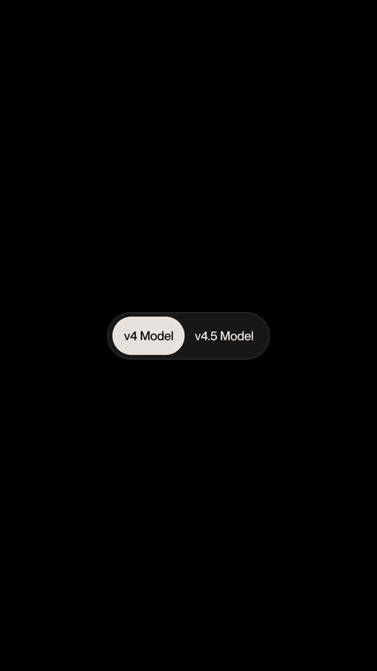

[X2Twitter.com_WGT0klUGwt-yPg7F_1920p.mp4](https://internal-api-drive-stream.feishu.cn/space/api/box/stream/download/all/HG0fb3JpJoCIiBxUHGZc9HUdnvh)

3、可灵推出「即时胶片效果」

可灵推出全新功能「即时胶片效果」，为用户照片增添 3D 拍立得风格与复古质感，让旅行风景、合影或宠物笑容更具立体感与情绪氛围，唤醒珍贵回忆。

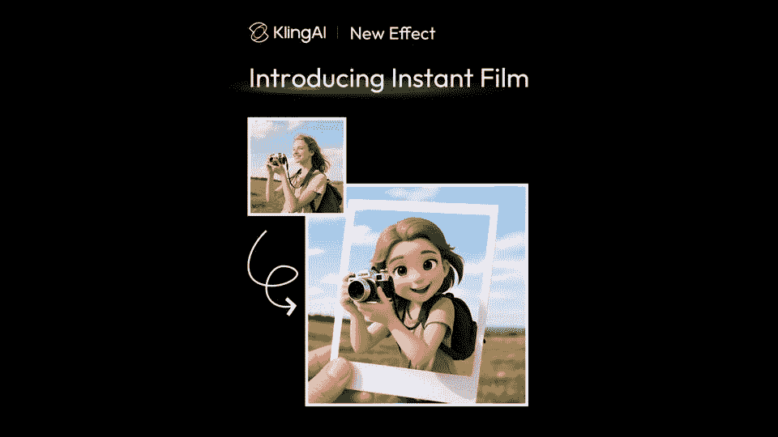

[X2Twitter.com_5h43yYR-t8VChLcR_1080p.mp4](https://internal-api-drive-stream.feishu.cn/space/api/box/stream/download/all/OAupbHIi3oc9myxBNm3cL07gnwb)

4、Krea Enhancer 推出全新图像增强模型

并集成 @topazlabs，实现最高可达 22K 分辨率的超分辨率放大，显著提升纹理细节与锐度，现已上线。

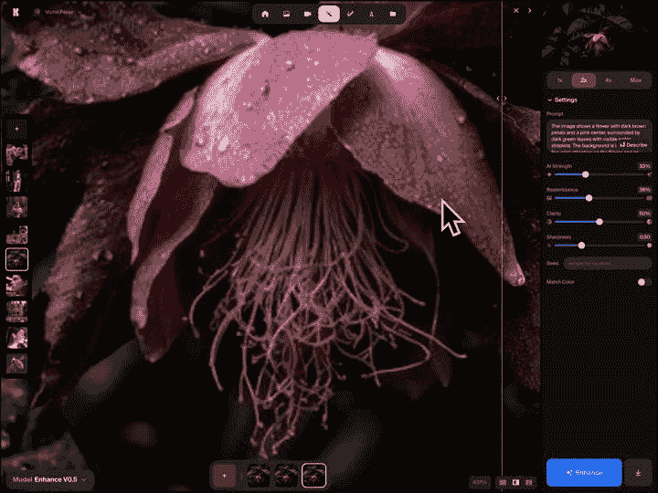

[X2Twitter.com_DkkXhY1kT4u_Nqwl_1080p.mp4](https://internal-api-drive-stream.feishu.cn/space/api/box/stream/download/all/RA7KbhKxCogg5kxkfy7cY0Qyn9g)

5、World 与 Tinder、Visa 等达成合作，将身份验证技术推广至更多场景

生物识别身份公司 World 宣布与 Tinder 母公司 Match Group、Visa、Kalshi、Morpho 及 Stripe 等达成合作，扩展其基于虹膜识别的身份验证技术应用场景。新推出的 World Card 将支持在 Visa 网络内使用加密货币消费，并与 Stripe 集成拓展支付渠道。

6、微软计划托管马斯克的 Grok AI 模型，引发与 OpenAI 紧张关系

据报道，微软正准备通过其 Azure AI Foundry 服务托管埃隆·马斯克旗下 xAI 公司的 Grok AI 模型，允许开发者及微软自身产品接入该模型。此举可能激化微软与 OpenAI 之间的矛盾，尤其在 OpenAI 近期对马斯克提起反诉后。微软 CEO 纳德拉希望 Azure 成为热门 AI 模型的主要托管平台。

7、Anthropic 将 Claude 的网页搜索功能扩展至全球所有付费用户

Claude 具备智能搜索策略选择能力，能够结合用户个人服务数据（如 Gmail、Google Docs）生成个性化结果。Claude Max 用户还可使用终端代码生成、接入外部工具并运行高级搜索，最快 5 分钟产出详尽报告。

8、Apple 正与 Anthropic 合作开发用于 Xcode 的 AI 编程工具

将整合至 Xcode 中，使用 Claude Sonnet 模型实现自动编写、编辑与测试代码。该工具目前仅在 Apple 内部试用，尚未确定是否公开发布。它将支持聊天交互、UI 测试与 bug 管理，有望助力 Apple 追赶在 AI 领域的落后进度。

9、AI 揭示阿尔茨海默症的隐藏病因

加州大学圣地亚哥分校研究人员利用 AI 成像技术，首次发现阿尔茨海默症的新病因 —— 一种蛋白质 PHGDH 的隐藏功能会损害脑细胞。团队还发现一种名为 NCT-503 的现有化合物可有效阻止其有害影响，且可作为口服药物进行早期干预。

#### 5月4日 全球 AI 资讯

1、谷歌允许 13 岁以下儿童使用 Gemini

AI 谷歌计划在其 Family Link 家庭管理系统下，允许 13 岁以下儿童使用 Gemini AI 应用，帮助完成作业或讲故事等。谷歌强调不会将儿童数据用于 AI 训练，但警告 Gemini 可能出错，或显示不适当内容。家长将可控制 Gemini 访问权限，并在孩子首次使用时收到通知。

2、Claude 升级

Anthropic 推出新功能，使 Claude 能够与 Jira、Zapier、Google Workspace 等主流工具集成，并支持开发者自定义集成接口。Claude 还提升了研究功能，能花 45 分钟深入研究复杂问题，生成带引用的专业报告

3、Temu 停止从中国向美国发货

受特朗普政府终止微量豁免政策以及上调中国商品关税影响，Temu 宣布不再从中国直接向美国发货，而仅展示本地库存商品。平台正积极吸纳美国卖家，以规避进口关税并维持商品价格竞争力。

4、面对关税冲击，eBay 与 Etsy 相对乐观

在特朗普政府提高中国产品关税后，eBay 和 Etsy 表示其受影响有限，原因在于大部分卖家依赖本地采购，而非进口商品。eBay 中国商品交易占比不足 10%，Etsy 对华进口占比更低于 1%。尽管 Etsy 因高价商品面临用户流失，但旗下 Depop 表现稳定

5、Instagram 创始人批评 AI 过度追求互动

在 StartupGrind 活动上，Instagram 联合创始人 Kevin Systrom 批评 AI 聊天机器人过于强调“引导用户反复提问”，实为追求参与度指标，而非专注提供实用答案。

6、Altman 和马斯克争抢打造“万能应用”

Sam Altman 通过其加密项目 Worldcoin 推出结合加密钱包、社交和小程序平台的 World App，意图构建一款挑战马斯克 X 平台的“万能超级应用”。World App 用户数已达 2600 万，并将与 Visa 合作发行借记卡。该应用旨在在 AGI 时代验证人类身份，同时也是解决机器人泛滥问题的工具。

7、Airbnb 推出 AI 客服机器人

Airbnb 已在美国悄悄推广 AI 客服机器人，目前覆盖用户超半数，预计本月全面普及。尽管尚未进军 AI 行程规划等热门应用，但公司首席执行官强调将优先用于提升客服体验。

8、NotebookLM 将于 5 月 20 日登陆 Android 和 iOS

Google 的 AI 研究助手 NotebookLM 首次推出移动端版本，并加入播客风格的语音摘要功能，支持随时随地管理学习资料。应用发布时间恰逢 Google I/O 开发者大会

# 第二周

## 5月6日 全球AI资讯

1、阿联酋将AI教育纳入全国公立学校必修课，从幼儿园到高中全覆盖

2025年起，阿联酋全国公立学校全面推行人工智能教育，覆盖4岁至18岁的学生，成为全球首个将AI设为从K到12完整课程体系的国家。课程不仅包括技术知识，如数据与机器学习，也涵盖伦理话题，如隐私与公平。政府希望通过此举培养面向未来的一代。专家称，该举措或成为全球AI素养教育的新范式。

2、Pinterest 推出多项 AI 驱动的视觉搜索新功能

优化用户通过图片而非文字进行搜索的体验。包括自动生成喜好关键词、多样化搜索选项（如款式、颜色、面料）以及首页长按启动视觉搜索。该功能利用视觉语言模型（VLMs）提升搜索体验，尤其针对难以用文字描述的内容。

3、OpenAI 放弃转型为营利性公司

OpenAI 主席 Bret Taylor 表示，在“听取社会各界领导者的意见并与特拉华州及加利福尼亚州总检察长办公室进行建设性对话”后，公司决定放弃从非营利组织转型为营利性实体的计划。两州总检察长对 OpenAI 的非营利地位拥有监管权，此前，OpenAI 商业实体的投资者收益上限定为回报 100 倍，超过部分将返还给非营利组织。

4、Anthropic推出“AI for Science”资助计划

向符合条件的研究人员提供每月最多 20,000 美元的 API 使用积分。该计划面向 18 岁及以上的个人和学术研究团队，申请者需通过生物安全审查，且来自中国、俄罗斯和伊朗的申请者不符合资格。公司还表示，可能会拒绝违反规则的申请。有关详细信息和资格要求，请参见 Anthropic 网站。

5、Recraft获3000万美元融资

这家初创公司在其名为“`red_panda`”的模型赢得人工分析基准测试的过程中引起了行业关注。这款模型是Recraft的V3版本，最近宣布完成由Accel领投的3000万美元B轮融资。擅长为品牌生成图像，能够准确地放置logo而无需额外编辑，或轻松生成符合现有品牌指南的营销材料。

6、AI将在纽约地铁检测可疑行为并报警

纽约市的大都会运输管理局（MTA）计划通过人工智能监测地铁站台上的可疑活动并及时通知警方，目标是实现“预测性预防”。该系统分析监控摄像头的实时视频，但不使用面部识别技术。此举是在地铁发生一系列袭击事件后提出的。MTA 目前已在每个地铁站台和每节车厢内安装了监控摄像头，其中约 40% 的摄像头实现了实时监控

7、Google 正在制作影视作品

Google 正在启动一个名为《100 Zeroes》的影视项目，不同于通过 YouTube 或自家平台发布，Google 计划与传统影视工作室合作发行。该项目由 Google 的平台与设备团队联合制作公司 Range Media 推进，旨在帮助影视创作者将 XR 和 AI 等先进技术融入作品之中。

## 5月7日 全球AI资讯

1、Runway发布Gen-4 References

通过 Gen-4 References，您可以轻松利用 3D 模型精确定位物体。只需三张图片——场景图、3D 素材和风格参考图，即可生成精细的图像，无需绑定、贴图或渲染。除此之外，借助 Gen-4 References，您还可以上传一到三张服装图片，轻松生成无限种全新造型，保持相同风格。

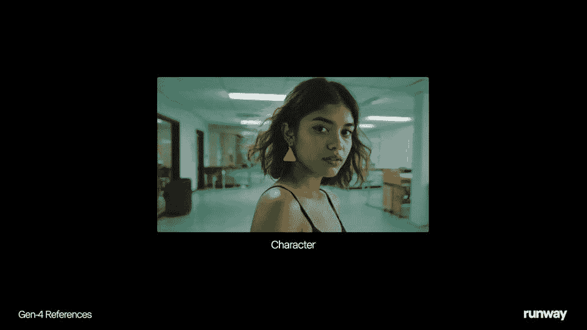

[6388214230764573839831852.mp4](https://internal-api-drive-stream.feishu.cn/space/api/box/stream/download/all/ByAMb9kgNo7RUtxOxr7ceID3nDj)

[X2Twitter.com_5i5TpkNLNrTeYcW__1080p.mp4](https://internal-api-drive-stream.feishu.cn/space/api/box/stream/download/all/XmAbbjKguovT7ExBJkNctLUInZc)

2、Google 的 iOS 应用将使用 AI 简化术语

Google 在 iOS 版 Google 应用中上线了名为 Simplify 的 AI 功能，基于 Gemini 模型开发，能将网络上的专业术语或复杂文本简化为易懂版本，且不影响关键信息理解。用户可通过选中文本并点击 Simplify 图标来使用该功能。

3、NBC将用AI复刻已故解说员Jim Fagan声音用于NBA赛事报道

NBC在周二发布公告称，于今年10月重新播出NBA赛事时，经过家人许可，NBC 利用 AI 技术重新打造他的声音，该声音将出现在节目开场、标题序列以及宣传片中。Fagan 曾为 NBA 赛事解说多年，并参与过迈克尔·乔丹等传奇球星的宣传片制作。

4、Oracle 与安得拉邦政府合作，为40万名学生提供 AI、云计算和数据科学培训

计划通过 MyLearn 平台为该邦 40 万名学生提供涵盖 AI、云计算和数据科学等领域的免费数字技能培训。该计划包含超过 300 小时的课程，并提供证书和数字徽章，帮助学生提升就业竞争力。

5、OpenAI 宣布将以 30 亿美元收购 AI 编程平台 Windsurf

周二报道，OpenAI 已与 AI 编程平台 Windsurf达成协议，以加码其在生成式编程领域的布局。Windsurf 最初是 GPU 优化平台 Exafunction，后转型为“氛围编程”平台。此举使 OpenAI 将直接与 Cursor、Replit 等竞品展开竞争。

6、Amazon Q Developer新增GitHub集成功能

亚马逊周一推出了Amazon Q Developer在GitHub上的预览版集成功能。允许开发者无需AWS账号即可在GitHub中使用AI工具进行代码开发、审查和迁移。开发者可以将issue分配给Q Developer，由其生成代码、创建拉取请求并进行初步验证。该工具还支持Java版本迁移和安全性修复。

7、科技巨头呼吁将 AI 教育纳入高中毕业必修课

超 250 位科技巨头 CEO 联名呼吁美国各州将人工智能与计算机科学设为高中毕业必修课，理由包括与中国竞争、提升学生未来收入、以及为 AI 驱动的未来社会做好准备。这一行动与前总统特朗普推行的 AI 教育计划同步

8、Windows 11 本月将迎来全新开始菜单和一系列 AI 功能

首批更新面向搭载 Snapdragon X 的 Copilot Plus PC 用户。新开始菜单更简洁，并加入手机伴侣面板，支持快速查看移动设备内容。系统还将内置 AI 助手，用于设置调整、图像编辑、文件摘要生成等。

## 5月8日 全球AI资讯

1、Figma 发布一系列强大的 AI 工具

Figma发布了多个AI驱动的工具，包括Figma Sites用于网站创建、Figma Make用于应用原型设计以及Figma Buzz为营销人员批量生成资产的工具。此外，Figma还推出了矢量编辑和插图工具Figma Draw，公司还宣布了一种新的订阅计划——内容席位，起价为每月8美元，用户可以访问Figma Buzz、Slides、FigJam和Sites CMS等功能。

2、字节跳动发布开源的多模态智能体UI-TARS-1.5

构建于强大的视觉-语言模型之上，凭借强化学习驱动的推理机制，在玩游戏和执行图形界面（GUI）任务方面表现出色，其架构支持推理先行、再行动，标志着 AI 智能体向更具“思考力”的方向迈进。

Hugface: `https://huggingface.co/ByteDance-Seed/UI-TARS-1.5-7B`

Code: `https://github.com/bytedance/UI-TARS`

Application: `https://github.com/bytedance/UI-TARS-desktop`

3、Lighttricks 推出全新开源视频模型 LTXV-13B

以 30 倍速度生成高质量内容，且能在普通设备上运行。凭借“多尺度渲染”技术、通过分层细节构建视频，使画面更流畅、更一致。强大编辑工具和开源策略，该模型为专业与中小型创作者打开了视频生成的新大门。

[X2Twitter.com_aHCqyKx9aFsymCgo_1080p.mp4](https://internal-api-drive-stream.feishu.cn/space/api/box/stream/download/all/CG3AbinmKo8t6cxs6PUc5Ni8nHa)

4、HeyGen推出了 Avatar IV

仅需一张照片和一段语音，即可生成包含表情、动作与情绪的真实感动画，精确捕捉语音细节、自然手势与面部动态，并且支持多种画面格式和角色类型。

5、Google 的 Gemini 2.5 Pro 登顶排行榜 Google

提前预览了其 Gemini 2.5 Pro I/O 版本，凭借对网页开发、前端、UI 和视频理解的全面增强，在多个 AI 排行榜中名列第一。尽管 I/O 大会尚未召开，Google 已展现其在 AI 模型领域的领先实力，彰显低调而强势的技术路线。

6、谷歌 Gemini 2.5 Pro 推出“视频生成应用”功能

主打“视频生成应用”功能，用户可将视频内容直接转化为互动学习类 App。该模型在编码排名中位居榜首，并新增文本、图像、视频与代码多模态输入能力，还集成了视觉可视化、自动 CSS 样式与函数调用等实用功能。同时推出 iOS“简化”功能，便于理解复杂科技内容。

7、亚马逊推出具“触觉”的仓库机器人Vulcan

该机器人可以“感知”它所接触的一些物品，通过力传感器精准识别接触物品，实现高效整理与抓取。通过力传感器精准识别接触物品，实现高效整理与抓取，Vulcan 已在美国与德国投入使用，至今已处理超过 50 万个订单。

8、微软采纳谷歌标准以便连接AI代理

微软于周三表示，将在其两个AI开发平台——Azure AI Foundry和Copilot Studio中加入对谷歌Agent2Agent（`A2A`）协议的支持，这一协议允许AI代理在不同的云、应用和服务之间协作，交换目标并触发行动。微软还加入了A2A的工作小组，助力协议和工具的发展。

9、Anthropic 推出支持 AI 网页搜索的 API

允许开发者通过 Claude AI 获取最新信息并集成到应用程序中。此功能增强了 Claude 在推理和数据分析方面的能力，支持最新信息的实时访问。定价为每 1,000 次搜索 $10，Anthropic 正在将网页搜索引入 Claude Code，该工具允许开发者利用 Claude 完成各种编码任务。启用网页搜索后，Claude Code 可以访问当前的 API 文档、技术文章以及关于开发工具和库的其他信息。

10、Hugging Face 发布了一个基于浏览器的 AI 智能体

可在虚拟计算机上运行,尽管功能仍在完善中，但它能处理图像点击、网页浏览等基础任务，代表开源 AI 正迈入“实用代理”阶段，根据 KPMG 数据，已有 65% 的公司正在测试智能体工具。

## 5月9日 全球AI资讯

1、OpenAI 将 Stargate 项目推向全球

OpenAI 推出“OpenAI for Countries”全球计划，与各国政府合作建设本地数据中心，定制本地化 AI 工具，并推动医疗、教育等公共服务的发展。该计划是其 5000 亿美元 Stargate 项目的一部分，旨在全球扩展“民主 AI”的影响力，并加强美国在 AI 领域的主导地位。

2、苹果计划将AI搜索引擎加入Safari浏览器

苹果公司正在考虑将AI搜索引擎（如OpenAI、Perplexity和Anthropic）加入其Safari浏览器，作为对传统搜索引擎的潜在替代方案。苹果高管Eddy Cue在美国司法部的诉讼中透露，Safari的搜索量最近首次出现下降，原因归咎于AI搜索的使用增加。

3、微软总裁公开宣布禁止员工使用 DeepSeek 应用程序

理由是担忧数据存储在中国以及模型可能传播中国宣传内容。微软还未将其上架自家应用商店，但仍在 Azure 云服务上提供 DeepSeek 模型的版本，并表示已对其进行安全调整。

4、OpenAI 在亚洲推出数据本地化计划

OpenAI 于周四宣布，将在亚洲推出全新的数据本地化（Data Residency）计划，这是继今年 2 月在欧洲上线该计划后的进一步扩展。这项计划适用于 ChatGPT Enterprise（企业版）、ChatGPT Edu（教育版）以及 OpenAI API 用户。

5、ChatGPT 的“深度研究”功能新增 GitHub 连接器

周四，OpenAI 宣布推出 ChatGPT 深度研究工具的首个“连接器”，该工具能在网页和其他来源中搜索信息，并整理成详尽的研究报告。现在，这个工具可以链接 GitHub（当前为测试版），允许开发者就某个代码库或工程文档提出问题并获得回答。

6、Meta 任命前 Google DeepMind 总监为其 AI 研究实验室负责人

FAIR 曾是 Meta 早期 AI 研发的重要力量，但近年来面临人才流失等挑战，大批研究人员转投外部或公司内部的新团队 GenAI。

7、谷歌在 Gemini API 中推出“隐式缓存”功能

可在通过 Gemini API 向模型传递“重复上下文”时节省多达 75% 的成本。该功能默认开启，适用于 Gemini 2.5 Pro 和 Flash 模型，且比原有的显式缓存更加自动化。谷歌建议将重复内容置于请求前部以提高缓存命中率 。

8、LinkedIn推出新的AI搜索工具

允许用户通过自然语言描述自己的理想职位来查找工作，而无需受限于传统的地点、行业和职位筛选条件。例如，用户可以通过描述“我想找到适合喜欢可持续性挑战的分析师”的工作，来直接获得与其兴趣和技能相符的职位信息。

9、谷歌推出iPad专版Gemini应用，优化多任务体验

谷歌宣布推出专为iPadOS设计的Gemini应用，支持iPad的分屏功能、支持45种语言的自然对话、快速生成报告的深度研究、轻松处理音频文件、与AI共同创作文档和代码的Canvas、以及在iPad上直接生成图像和视频等。该应用现已在全球范围内上线，可通过App Store下载。

10、吉利拟将极氪私有化应对中美紧张局势

本周二，中国吉利汽车计划以约65亿美元估值将其电动车子公司极氪从纽约证券交易所退市，旨在规避中美贸易战带来的政策风险。该提议发生在美国考虑将中国企业逐出美股市场之际，吉利已持有极氪65.7%股份，仅需支付约22亿美元收购剩余股份。此举或影响极氪与Waymo在美合作的自动驾驶项目。

11、苹果试图推迟禁止其抽取外部支付佣金的裁决执行

上周，美国法院在一场与 Epic Games 的长期诉讼中作出裁决，要求苹果必须允许美国 App Store 上的应用包含引导用户前往外部系统付款的功能，停止对这类付款收取佣金,苹果正试图推迟法院的一项新裁决，目前，苹果已上诉，但仍开始遵守裁定，多家应用已支持跳转至外部网站支付。

## 5月11日 全球AI资讯

1、阿里巴巴Qwen推出“Web Dev”工具：从提示生成完整前端代码

阿里巴巴的“Web Dev”工具通过Qwen，简化了网站和应用开发，用户只需提供一个提示，就能生成完整的前端代码。这个功能运行在Qwen Chat内部，用户可以通过简单的指令生成前端代码。例如，提示“创建一个类似Twitter的网站”会返回一个完整的HTML、CSS和JavaScript代码，完全不需要编程技能或额外设置。

地址：`chat.qwen.ai`

2、字节跳动推出开源AI自动化代理Agent TARS

这是一个开源的AI自动化代理，旨在通过视觉化解析网页内容，自动与命令行和文件系统进行交互，以简化复杂任务的处理。TARS目前仍处于实验阶段，仅支持macOS操作系统。Agent TARS采用了基于代理的框架，可以自动计划并执行任务，如搜索、浏览和链接导航。与用户界面的通信通过事件流进行，用户可以实时查看任务的中间状态和结果。

3、阿里推出 ZeroSearch：训练AI不再靠真实搜索引擎

阿里巴巴研究团队发布 ZeroSearch 技术，让AI在训练中以模拟搜索结果代替真实搜索引擎，训练成本下降88%，性能反超传统模型。

4、Chrome 本地 AI 实时识别诈骗行为

Google 将 Gemini Nano 嵌入 Chrome 浏览器的增强保护中，能在设备本地实时识别诈骗页面与欺诈推送，初步数据显示诈骗搜索结果减少 80%。此外，Gemini 2.5 API 引入隐式缓存机制，命中缓存可节省 75% Token 成本，并降低了使用门槛，帮助开发者有效控制费用。

5、Google I/O 即将举行，AI 与 Android 成为焦点

5 月 20 日至 21 日，Google I/O 将在山景城召开，预计将发布升级版 Gemini Ultra 模型和 Android 16 的全新设计。新订阅服务“Premium Plus”和“Premium Pro”可能亮相，AI 项目 Astra 和 Mariner 将展示更自主的智能代理能力。同时，NotebookLM 和视频概览等功能也有望迎来惊喜更新。

6、OpenAI 强化区域数据控制

OpenAI 推出的“Stargate 星门计划”是一个全球性 AI 超算中心部署项目，背后有软银（SoftBank）、甲骨文（Oracle）和 MGX 的支持。该项目以“民主 AI”为口号，旨在全球范围内部署最先进的 AI 模型，不仅扩大 AI 使用的可及性。

7、Meta 推出开源视觉模型与新款 AI 智能眼镜

Meta 的 FAIR 实验室发布了一系列开源视觉感知模型，包括图像视频识别的“感知语言模型”和三维定位工具，为 AI 在视频问答与时空推理领域设立新标准。同时，Meta测试中的新款智能眼镜具备“超级感知”模式，可持续感知环境、提醒遗漏事项，续航时间有望从 30 分钟延长至数小时。

8、美国版权局：AI训练不受"大量版权作品"的合理使用保护

美国版权局在最新报告中驳回了AI行业常用的法律论点，即对版权材料进行AI模型训练普遍符合合理使用条件。报告否认了AI训练类似于人类学习或仅是"非表达性"使用等辩护理由。版权局认为，如果AI模型生成的输出在风格、功能或表达方式上类似于人类创作，且在市场上与原创作品竞争，则不构成合理使用。

9、微软发现API代理更快，但GUI代理更灵活

2025年5月11日，微软研究人员对API代理和GUI代理进行了比较，发现它们各有优势。API代理更高效、稳定，适合复杂任务，但灵活性较差。GUI代理通过模拟人类操作，能更好地应对界面变化，尤其适用于需要视觉确认的任务。微软还提出了三种方法，将API和GUI代理结合，形成混合系统，以最大化两者的优势。

# 第三周

## 5月12日 全球AI资讯

### 1、科技股有望大涨，美中互暂停征互征关税

未来90天内将大幅下调互征关税，美方将关税从145%降至30%，中方从125%降至10%。受此利好消息影响，科技股盘前大涨，Temu、阿里巴巴涨近9%，苹果、亚马逊、特斯拉等美股科技巨头涨幅达5%至6%。

### 2、微软与OpenAI或正重新谈判合作关系

OpenAI与微软正就公司重组及未来技术使用权进行艰难谈判。OpenAI计划维持非营利董事会控制权并重组为营利性公益公司，而微软作为已投资130亿美元的关键股东，需同意该变动。OpenAI希望在2030年前将微软的收益分成比例从20%降至10%，同时微软则寻求在合同到期后继续使用OpenAI技术。

### 3、亚马逊在AI机器人世界中展示人类新职业的可能性

亚马逊推出可“感知”的机器人Vulcan，推进仓库自动化进程，同时也培训部分仓库工人转型为机器人维护人员。尽管机器人正在替代传统体力劳动，亚马逊强调它正创造数百种与机器人协作的新职业。

### 4、一句话描述就能生成乐高模型

卡内基梅隆大学（CMU）的研究人员近日推出开源 AI 项目 LegoGPT，这一模型能够理解自然语言指令，并自动生成可实际拼搭的乐高结构方案。该项目已在 GitHub 上开源。

地址：`https://avalovelace1.github.io/LegoGPT/`

### 5、苹果或将在2027年推出“几乎全玻璃、曲面屏的iPhone”

据爆料称，苹果计划在2027年（iPhone发布20周年）推出一款“几乎全玻璃、曲面”设计的iPhone，无开孔、真正全面屏。届时还将发布折叠屏iPhone、智能眼镜、AI家用机器人、摄像头AirPods和AI芯片Siri。苹果将2027年打造为AI与硬件结合的“产品大年”。

### 6、快手最近推出了AI作图工具Poify

Poify旨在通过图像处理优化商家的产品展示，提升效率和降低成本。它的核心功能包括文生图和图生图，支持AI模特试衣和背景更换等创新特性，帮助商家提升视觉效果

### 7、全球首款AI智能浏览器Fellou正式发布

具备传统的搜索和浏览功能，还能思考、规划并自动执行复杂任务，Fellou的深度研究模式和工作流自动化功能，特别适合研究人员、营销人员和开发者使用，它在跨平台协作和数据处理方面展现了强大的潜力。

官网：`https://fellou.ai`

### 8、苹果推出FastVLM 可在移动设备上高速运行

专为高分辨率图像处理而优化的视觉语言模型，具备极高的编码速度和卓越的性能，核心技术是其创新的FastViTHD编码器，利用动态分辨率调整和层次化令牌压缩等技术，大幅提升了处理效率。

更多：`https://github.com/apple/ml-fastvlm/`

## 5月13日 全球AI资讯

### 1、苹果宣布全新辅助功能，未来将支持脑机接口

苹果宣布将于今年推出一系列辅助功能更新，包括盲文工具、系统阅读模式、Apple TV 辅助应用及辅助功能共享设置，并首次引入与脑机接口相关的控制功能。苹果正与脑机接口初创公司 Synchron 合作，开发通过脑信号控制设备的新协议 Switch Control，为残障用户带来更多操作可能。

### 2、谷歌推出新举措，支持创业公司构建AI

周一，谷歌宣布启动其 AI Futures Fund，这是一个支持使用谷歌 DeepMind 最新 AI 工具构建的创业公司的新基金。该基金将为创业公司提供从种子到后期阶段的支持，包括早期访问 AI 模型、专家合作以及谷歌云积分等。谷歌还承诺通过其他项目支持 AI 领域的人才和科学突破，例如向科研人员提供2000万美元的资助

### 3、Lovart 推出智能设计助手 一条指令即可完成全套创意工作

用户只需通过自然语言描述需求，系统便能自动完成从构思到最终作品的全过程转化，涵盖标志设计、品牌视觉系统、宣传视频等多种创意形式。

官网：`https://www.lovart.ai/`

### 4、Notion推出自己的 AI 会议转录功能

支持实时转录、会后自动生成摘要，并兼容十多种语言。用户可在会议进行中添加笔记，转录功能同步运行。该功能初期在 Mac 上推出，未来将支持移动端。

### 5、AI 研究：人工智能通过照片预测癌症生存率

马萨诸塞总医院研究人员发布 AI 工具 FaceAge，通过面部照片估算生物年龄，辅助医生更准确预测癌症患者生存期。研究显示，癌症患者的“生物年龄”平均高于实际年龄 5 岁，且数值越高，生存率越低。FaceAge 的预测还与细胞老化基因相关。

### 6、OpenAI 推出 HealthBench，用于评估医疗 AI

OpenAI 发布了名为 HealthBench 的医疗 AI 测试基准，与 262 位医生合作开发，用于评估 AI 在医疗对话中的准确性与沟通质量。最新模型 o3 表现优异，得分达 60%，远超 GPT-3.5 Turbo 的 16%。小型模型如 GPT-4.1 Nano 同样表现出色且成本低。

### 7、微软正举办一场全球性的免费 AI 学习节“AI Skills Fest”

微软的 AI 技能节面向所有人开放，而且不仅仅是培训课程。它融合了 AI 课程、真实挑战、奖品，甚至还有一项世界纪录。所有内容免费，但仅持续至 5 月 28 日。

### 8、谷歌创意工具变得更智能

谷歌在 GDC 大会发布 Gemma 3 语言模型，支持本地多模态 AI，为游戏开发者带来更智能的 NPC 互动体验，配套 Unity 插件实现实时对话。同时，NotebookLM 加入由 Veo 2 驱动的“视频概览”功能，支持将笔记转化为短视频，还新增“编辑推荐”版块，移动端同步上线。

### 9、亚马逊上线 AI 工具“优化我的商品页面”

亚马逊推出生成式 AI 工具 EML，帮助卖家通过图片、链接或简短描述快速生成高质量商品页面内容，已有超 90 万卖家使用。页面质量平均提升 40%，尤其受到小型品牌欢迎。

## 5月14日 全球AI资讯

### 1、TikTok 推出“AI Alive”功能，实现照片秒变视频

TikTok 周二宣布推出其首个图像转视频（image-to-video）AI 功能。这一功能仅可通过“故事相机”使用，是 TikTok 在图像生成 AI 之后的重要升级，进一步扩大创作者的内容创作空间。

### 2、沙特阿拉伯成立AI公司“Humain”

由王储穆罕默德·本·萨勒曼领导，旨在推动本国AI战略，开发阿拉伯语大模型并建设数据中心。该公司由沙特主权财富基金PIF全资控股，同时，美国政府放宽对海湾国家的AI芯片出口限制，正在与阿联酋公司G42商谈向其出口大量Nvidia和AMD芯片。

### 3、谷歌将把 Gemini 引入你的汽车

谷歌将在未来几个月内把其生成式 AI “Gemini” 集成至所有支持 Android Auto 的汽车，并计划稍后扩展至运行谷歌内置系统的车型。Gemini 将以更强大的语音助手形式亮相，能处理短信、音乐播放等任务，还能记忆偏好、翻译语言及推荐路线沿途的美食。

### 4、埃隆·马斯克的公司正与美铁洽谈隧道项目，项目预算高达85亿美元

埃隆·马斯克的 The Boring Company 可能获得一项美铁大型隧道工程合同。该项目旨在连接巴尔的摩、华盛顿和弗吉尼亚州，预算已从最初的60亿美元升至85亿美元。联邦铁路管理局正在评估 TBC 是否能降低成本。

### 5、微软将裁员3%

微软宣布将削减全球3%的员工队伍，影响范围预计超过6,500人，成为继2023年裁员10,000人以来规模最大的人员调整之一。尽管该公司刚在4月报告了优于预期的财务业绩（营收701亿美元，同比增长13%；净利润258亿美元，同比增长18%）

### 6、Perplexity 拟融资 5 亿美元

AI 搜索引擎初创公司 Perplexity 正筹划新一轮 5 亿美元融资，估值有望升至 140 亿美元。其由生成式 AI 驱动的产品正挑战 Google 与 ChatGPT 的搜索服务，并积极扩展浏览器与手机助手产品线。

### 7、ChatGPT 冲击传统教育，Chegg 大裁员应对

受 ChatGPT 等免费 AI 工具冲击，美国教育公司 Chegg 将裁员约 22%，并关闭北美办公室以削减开支。订阅用户与营收大幅下滑迫使公司转型重组，预计将节省超亿美元成本。

### 8、OpenAI首席科学家：AI能够推动原创研究

OpenAI首席科学家Jakub Pachocki近日在《自然》杂志专访中分享了重要观点：他相信AI已展现出发现原创见解的能力，尽管其思维方式与人类不同。Pachocki定义的AGI标准包括能创造经济价值和推动原创研究，他预测这一目标将在2030年前实现。

### 9、谷歌据称正在筹备新的软件AI助手与XR聊天机器人

谷歌计划在即将举行的 I/O 开发者大会上推出多项 AI 新功能，包括一款面向程序员的“软件开发生命周期助手”，用于自动化故障排查、文档编写和安全管理。同时，谷歌也将展示一项面向普通用户的图片收藏功能，支持用户像使用 Pinterest 一样保存时尚和家居图片。

### 10、苹果发布了全新AI模型Matrix3D

该模型能够通过少量2D照片轻松生成3D场景，极大简化了建模过程

官网：`https://machinelearning.apple.com/research/large-photogrammetry-model`

## 5月15日 全球AI资讯

### 1、上海发起AI标识生态联盟

为推动人工智能内容标识体系建设，提升生成内容的透明化与可信度，上海市正式启动“人工智能标识生态联盟”。该联盟致力于推动AI标识技术的研究与落地，强化内容安全，同时通过政策引导与企业协同。

### 2、GPT-4.1 正式上线 ChatGPT

2025年5月15日，OpenAI 宣布其最新多模态模型 GPT-4.1 正式向所有付费用户开放，包括 Plus、Pro 和 Team 账户，Enterprise 与 Edu 版本将在未来几周陆续上线。同时，更轻量的 GPT-4.1 mini 替代 GPT-4o mini，成为所有 ChatGPT 用户（包括免费用户）的默认模型。

### 3、Lightricks推出精简版LTX-Video-13B模型

以色列的科技企业Lightricks最新发布了开源的LTX-Video-13B精简模型。该模型基于130亿参数，融合多尺度渲染技术和高效量化优化，大幅提升视频生成速度，能够在10秒内完成高清内容的生成。

更多：`https://github.com/Lightricks/LTX-Video`

### 4、AI视频平台Hedra因“会说话的婴儿播客”走红

获得a16z领投的3200万美元A轮融资。该公司2023年成立，依托自研的Character-3模型提供可控性强的AI角色视频生成服务，迅速吸引投资者目光。此前曾获Index Ventures和亚马逊Alexa Fund支持。

### 5、Google 的 AlphaEvolve 实现数学突破

一款结合Gemini大模型与进化策略的AI编码智能体，不仅优化谷歌内部运营，还实现多项数学突破，包括对1969年斯特拉森算法的首次改进。在50多个数学难题测试中，AlphaEvolve在75%问题上匹配当前最优解，20%实现全新突破，显示AI在科学研究中的巨大潜力。

### 6、Anthropic 即将推出新版 Sonnet 与 Opus 模型

具备混合推理与工具使用能力，并能自我纠错。这将是公司今年以来首次重大更新，正值竞争对手 Google 和 OpenAI 也准备发布新模型，AI领域或迎来新一轮竞速。同时，Anthropic 也推出漏洞赏金计划，强调模型安全性。

### 7、OpenAI 推出新的安全评估仪表板

OpenAI 推出了一项新的“安全评估中心”（Safety Evaluations Hub），将公开、定期展示其AI模型在安全测试中的表现，包括生成有害内容、幻觉率、越狱攻击等方面的数据。回应外界对其安全测试透明度的质疑，该仪表板将定期更新。

### 8、Stability AI 推出可在智能手机上运行的音频生成模型

能在智能手机上运行，仅需8秒即可生成11秒音频。该模型训练自免版权音库，规避知识产权风险，但仅支持英文、无法生成高质量人声。模型对年营收百万美元以下用户免费开放。

### 9、YouTube为可购物电视广告推出互动产品栏

YouTube在周三最新广告发布会上推出互动式可购物电视广告，观众可通过遥控器浏览屏幕右侧商品，并通过二维码或手机链接轻松购买。活动不仅有Lady Gaga的精彩表演，还邀请了知名YouTuber如Brittany Broski和MrBeast亮相助阵。

### 10、富士康获批在印度投资4.35亿美元建厂

富士康与印度HCL集团合资在北方邦投资4.35亿美元建半导体工厂，获印度内阁批准。该厂将于2027年启用，初期用于芯片封装与测试，未来将生产苹果设备所需的显示驱动芯片。

## 5月16日 全球AI资讯

### 1、Grok 执着于“白人灭绝”话题，xAI 归咎于“未经授权的修改”

2025年5月14日，Elon Musk 创办的 xAI 公司旗下聊天机器人 Grok 在社交平台 X 上频繁发布关于南非“白人灭绝”的争议内容，引发关注。xAI 于5月16日回应称，该行为源于一名员工“未经授权修改”了 Grok 的系统提示词，违反公司政策。xAI 表示已完成调查，并将通过公开提示词、组建全天候监控团队、加强权限审核等措施提升系统透明度与安全性。

### 2、Meta 推出 OMol25 和 UMA：用于分子研究的开源AI工具

Meta 发布了 OMol25，这是迄今为止在 AI 化学领域中最大的开放数据集，并推出了 UMA（Universal Model for Atoms），一种能够预测分子与材料化学性质的通用 AI 模型。OMol25 包含超 1 亿次高精度分子计算数据，适用于药物、电池和催化剂研发。UMA 则利用图神经网络和“线性专家混合”架构，实现了比传统方法更快更精准的模拟计算。两者皆已在 Hugging Face 上开放。

### 3、《小王子》和 AI 如何帮助我们理解大脑中的语言发展

Meta 与法国研究机构合作，利用《小王子》有声书追踪 46 位受试者的大脑语言反应，揭示语言发展过程与 AI 模型训练阶段的相似性。研究发现，幼儿仅能识别基本语音，复杂词义处理则出现在年长者大脑中，与大型语言模型训练前后的变化高度一致。

### 4、Doji 融资 1400 万美元，用 AI 化身让虚拟试衣变得有趣

初创公司 Doji 融资 1400 万美元，推出一款结合 AI 化身与社交互动的虚拟试衣应用。用户通过自拍创建逼真虚拟形象后，即可尝试不同穿搭并获得推荐，提升线上购物趣味与效率。应用基于自研扩散模型，强调个性化和真实感，已在全球 80 多国上线。

### 5、Google 为 Android 和 Chrome 推出全新 AI 与无障碍功能

Google 周四宣布，正在为 Android 和 Chrome 推出一系列全新的 AI 和无障碍功能。最引人注目的更新是 TalkBack 与 Gemini 联动可对图像和屏幕内容进行问答、更精准表达语气的实时字幕、OCR 加持的扫描版 PDF 阅读，以及网页缩放自定义选项。

### 6、微软裁员重击程序员岗位，AI 替代编程引发争议

在微软本土华盛顿州约 2000 人的裁员中，软件工程师首当其冲，占比超过 40%，是受影响人数最多的职位类别。相比之下，销售和市场营销岗位的裁员人数则相对较少。

### 7、Poe 发布 AI 模型使用趋势

AI 平台 Poe 公布了 2025 年春季使用趋势报告，数据显示 GPT-4.1、Gemini 2.5 Pro 等新模型在短时间内迅速获得用户青睐，而老牌模型 Claude 使用量则显著下滑。推理模型、图像和视频生成工具的使用热度也在快速增长，尤其是中国 Kling 系列在视频领域迅速突围。

### 8、Vibe-coding 初创公司 Windsurf 推出自研 AI 模型

本周四，AI 编程初创公司 Windsurf 推出首个自研模型家族 SWE-1，覆盖从写代码到软件工程全流程，旨在摆脱对大模型公司的依赖。尽管 OpenAI 正洽谈收购该公司，Windsurf 仍在积极推进模型自主化。主力模型 SWE-1 与当前主流模型表现相当，轻量版则面向所有用户免费开放。

### 9、Anthropic 律师因 Claude 捏造法律引文被迫道歉

在与音乐出版商的诉讼中，Anthropic 律师使用 Claude AI 生成的错误法律引文被曝光，随后向法庭道歉。事件引发对 AI 在法律实务中可靠性的担忧。尽管类似错误频发，法律 AI 初创公司如 Harvey 仍获巨额融资，行业对自动化法律流程的热情不减。

### 10、MiniMax 推出新一代语音合成模型，综合表现力压 OpenAI

5 月 15 日，人工智能企业稀宇科技（MiniMax）正式发布其最新一代文本转语音（TTS）系统 ——「MiniMax Speech 02」，该系统基于自研的 AR Transformer 架构构建，主打高质量语音生成。

地址：`https://www.minimax.io/`

## 5月18日 全球AI资讯

### 1、一家腾讯支持的初创公司将 AI 医生引入诊所

中国腾讯支持的初创公司深醒科技在沙特阿拉伯东部试点首个 AI 医疗诊所，虚拟医生“华医生”负责诊断和治疗建议起草，最终由人类医生审核签字。该系统目前专注于30种呼吸系统疾病，计划扩展至50种病种，包括胃肠和皮肤疾病。

### 2、OpenAI发布高效AI编程助手Codex

# 第四周

## 5月18日 全球AI资讯

昨日，OpenAI推出云端AI编程智能体Codex，搭载专用模型codex-1，能在30分钟内完成传统需数天的开发任务。Codex支持多任务并行处理，与GitHub深度集成，具备自动修复、提交代码和测试功能，已向ChatGPT Pro及企业用户开放。

地址：`http://chatgpt.com/codex`

3、Stability AI发布可在手机上运行的轻量级文本转音频开源模型

Stability AI联合Arm发布了一款轻量级的开源文本转音频模型“Stable Audio Open Small”，可在手机上运行，生成高质量立体声效。该模型参数缩减至3.41亿，适配移动设备，仅需3.6GB内存，尤其适合生成音效类内容。

4、日本初创公司Sakana AI发布新型AI模型“CTM”

采用仿照大脑的时间同步机制，强调神经元随时间变化的行为。不同于传统LLM单步输出，CTM通过多步内部“tick”过程模拟逐步推理。模型设计灵感源于生物神经元同步，具备记忆、反馈、自主聚焦等机制，被认为是继Transformer后的创新架构之一。

5、OpenAI透露GPT-5聚焦提升体验，减少模型切换

OpenAI副总裁Jerry Tworek表示，OpenAI 正在研发 GPT-5，目标不是推出全新系统，而是提升整体性能和用户体验，减少用户在不同模型间切换的需要。屏幕助手Operator也将迎来升级。尽管全面合并模型难度较大，OpenAI仍致力于通过实际应用评估模型，自动为用户匹配最合适的AI方案。

6、麻省理工学院（MIT）近日公开否定一项备受关注的AI生产力研究

称其数据来源不可信、研究结果缺乏验证。这篇名为《人工智能、科学发现与产品创新》的论文于2024年11月发布，声称AI工具帮助某美国公司提升了44%的新材料产出、39%的专利申请和17%的产品创新。然而，MIT在接到投诉并进行内部审查后表示，对该研究的数据和结论“完全没有信心”，并要求作者从arXiv撤稿。

7、美国官员警告：苹果与阿里巴巴的iPhone AI合作可能助力中国AI发展

2025年5月，美国官员对苹果计划将阿里巴巴的AI功能引入中国iPhone表示担忧，认为这可能强化中国AI实力、助推审查制度，并加剧苹果对北京的依赖。由于OpenAI在华受限，苹果寻求本地替代方案。该合作被视为中美人工智能竞争升级的缩影。

8、艾尔顿·约翰强烈抨击英国版权法中对AI公司的例外条款

2025年5月，英国音乐人艾尔顿·约翰公开批评政府拟修改版权法，以放宽AI公司使用受版权保护内容的限制，称其为“大规模偷窃”。该计划在议会中引发争议，艺术家与行业组织担忧此举将削弱创作者权益，危及创意产业。

9、Google AI 答案正在改变用户行为

一项最新用户体验研究显示，Google搜索引入AI Overview（AIO）后，用户点击外部网站的次数大幅下降：桌面端减少约三分之二，移动端减少近一半。多数用户将AI答案视为完整回应，仅少数人深入阅读或点击链接。年轻用户和高数字素养人群更倾向直接接受AI回答，而在健康、金融等高敏感查询中，用户更愿验证信息。

## 5月19日 全球AI资讯

1、中国开启太空超级计算机网络组装计划

中国ADA Space公司成功发射首批12颗AI卫星，启动其计划中的2800颗轨道超级计算机网络建设。这些卫星具备自我数据处理能力，单颗搭载80亿参数AI模型，整体算力达5 POPS，并通过激光通信实现高速互联。该“星际计算”系统可解决传统卫星数据回传效率低的问题，并可生成3D数字孪生数据，服务于应急响应、游戏和旅游等领域。

2、Google 和 Netflix 将 AI 引入视频广告

YouTube 和 Netflix 正将 AI 深度整合进广告领域，前者通过情绪识别技术在高潮时段插播广告，后者则致力于开发与剧集视觉融合的 AI 生成广告。

3、抖音启动专项整治“AI起号”行为

2025年5月19日，抖音官方发布声明，宣布启动“AI起号”专项整治行动，重点打击平台内借助人工智能技术制作和传播低俗猎奇视频等违规行为。随着AI技术的快速普及，抖音发现部分用户滥用AI进行虚假内容制造和虚拟账号交易，严重扰乱了平台生态。

4、研究发现：AI 能建立自己的社会规范

伦敦大学的研究表明，AI 代理通过彼此互动，无需中央协调也能自然形成社会规范和集体行为。这些自发演化的行为模式甚至能被小群体颠覆，引发“文化拐点”，类似人类社会中的社会变革。该发现预示未来 AI 系统的协作可能具备复杂的社会动力。

5、马斯克的AI助手Grok再陷争议

近日质疑二战中六百万犹太人遇害的历史共识。xAI将此归咎于“未经授权的系统提示变更”，并承诺未来公开所有提示词与加强监控。此次事件引发外界对AI言论控制机制的高度关注，也突显大型模型在敏感议题上的不可控风险。

6、苹果力图重振“LLM Siri”：从混乱中重建智能助手

苹果自去年推出AI功能以来遇到多重挑战，内部报告显示其智能助手项目存在启动晚、投入不足、旧版Siri与新AI整合不畅等问题。公司正开发全新生成式AI助手“LLM Siri”，试图从头重建以迎头赶上竞争对手。同时，苹果高层对AI战略态度谨慎，营销过于乐观导致部分功能延迟。

7、Google I/O 2025即将开启

谷歌年度开发者大会I/O 2025将于5月20日至21日举行，备受期待的开幕主题演讲将在北京时间5月20日晚上10点（美国太平洋时间上午10点）开始，届时可通过谷歌I/O官网及YouTube频道观看，官方还提供美式手语翻译版本。今年的I/O演讲几乎将全力聚焦人工智能（AI），预计谷歌会介绍其最新的Gemini AI功能升级、增强版模型以及野心勃勃的Project Astra计划。

8、ListenHub发布AI播客创作工具

ListenHub是一款创新的播客制作平台，借助人工智能技术支持中英文内容生成，致力于为用户打造个性化的播客体验。该工具以快速高效的生成能力和简洁易用的界面广受好评，适合普通听众与内容创作者使用。

地址：`https://listenhub.ai/`

## 5月20日 全球AI资讯

1、英伟达全面推进“全栈计算”布局

在 2025 年 Computex 和近期的一系列发布中，英伟达展示了其“全栈计算”的野心，从量子与经典混合超级计算机 ABCI-Q，到跳过人类演示的机器人模型 GR00T，再到 NVLink Fusion 打造的模块化超算集群，以及支持本地 AI 训练与推理的 DGX 产品线。

2、谷歌推出NotebookLM移动应用，支持Android和iOS

谷歌推出了AI驱动笔记应用NotebookLM的移动版，支持Android和iOS。该应用内置自动生成的音频摘要功能，支持离线播放和在线互动，用户还能直接从网页、PDF和视频添加内容。

3、腾讯混元推出游戏视觉生成平台

5月20日，腾讯正式发布了基于混元大模型的游戏视觉生成平台X,设计者只需输入简单的提示语，比如“厚涂风格动漫少女”，系统便能迅速生成一系列灵感参考图。随后，设计师可直接在该界面绘制草稿，并一键生成完整的三视图及360度旋转演示，无需切换软件，极大节省时间和精力。

申请体验：`https://hunyuan.tencent.com/`

4、微软将其本地AI模型开放给Edge浏览器中的网页应用

微软为Edge浏览器推出一系列AI接口，允许开发者将内置AI模型Phi 4 mini应用于网页应用和扩展中，提升AI功能。新接口支持文本生成与编辑，未来还将推出翻译API，强调设备端隐私保护。同时，Edge新增PDF翻译工具，支持70多种语言，预计下月正式上线。

5、微软提出“开放代理式网络”的愿景

在 Build 2025 开发者大会上，微软提出“开放代理式网络”的新构想，重磅发布多个 AI 产品与开源项目，包括升级版 GitHub Copilot、Magentic-UI、NLWeb 等工具，并引入 Grok 模型至 Azure 平台。微软在 Build 大会上发布了 Discovery 科研平台，利用类“博士后”AI 代理与图谱引擎，显著加快科研进程，并成功在 200 小时内研发出新型冷却剂。

6、xAI的Grok 3登陆微软Azure平台

周一微软通过Azure AI Foundry平台引入了马斯克AI初创公司xAI的Grok 3和Grok 3 mini模型，提供托管访问和微软服务级别保障。相比社交平台X上的版本，Azure版Grok更严格管控且支持更多定制与治理功能。

7、特朗普签署法案，将复仇色情和虚假深度伪造内容定为刑事犯罪

美国总统唐纳德·特朗普周一签署了《撤除法案》（Take It Down Act），严厉打击未经同意发布的色情图片和AI生成的深度伪造内容。新法要求社交平台在48小时内删除相关内容，违反者将面临刑罚。该法案由两党议员共同推进。

8、AI 耳机实现 3D 空间多人实时翻译

华盛顿大学开发出一款 AI 耳机系统，可实时翻译多个说话者并保留声音来源位置和个性音色。该技术采用空间语音处理和本地运算，已支持三种语言，有望彻底改变多语场景下的人机交流方式。

9、苹果已批准Spotify最新应用更新

美国iPhone用户现可直接在Spotify应用内购买有声书，并查看价格，轻松购买超过初始15小时的额外听书时长。此前因苹果严格的应用内购买规则，Spotify于2022年移除了此功能，用户只能在网页购买后再使用。

10、Grok 重大升级：支持图表生成与自定义图片尺寸

马斯克的 AI 公司 xAI 旗下助手 Grok 新增两项新功能：用户可以在浏览器端使用 Grok 创建图表，可生成符合指定尺寸比例的图像，例如：1:1、16:9、4:3 等

## 5月21日 全球AI资讯

１、Google I/O：下一代创意 AI 工具套件重磅发布

在 Google I/O 大会上，Google 发布了一系列创意 AI 工具更新，包括支持音效同步的视频生成模型 Veo 3、细节和排版能力增强的图像模型 Imagen 4，以及整合多模态创作能力的影视平台 Flow。此外，Veo 2 也加入了更多面向导演的功能。所有新工具将通过 Google 的 AI Ultra 订阅和 Vertex 平台提供。

２、亚马逊音乐测试AI驱动的新搜索体验

亚马逊音乐推出名为“探索”的AI搜索功能，帮助用户深入了解艺人信息及合作作品，并可创建AI生成播放列表。此举旨在提升用户粘性并推广原创内容，同时配合近期音乐订阅价格上涨策略。

３、《芝加哥太阳时报》卷入 AI 丑闻：虚构书籍与假专家上榜

在 5 月 18 日出版的《芝加哥太阳时报》上，读者可以看到几十页关于夏日推荐活动的内容，包括新潮流、户外活动和阅读书单。但其中部分推荐却指向了虚构的 AI 生成书籍，甚至还引用了一些看起来并不存在的“专家”。

４、字节跳动上线豆包语音播客模型

5 月 20 日，字节跳动旗下火山引擎宣布正式推出“豆包·语音播客模型”，据官方介绍，该模型依托流式架构打造，打通了从文本输入到双人播客输出的全流程，能够在数秒内完成播客内容生成，为用户提供了“更高效率、更低门槛、更强互动”的创作方式。

５、谷歌将推出AI虚拟试衣功能

谷歌近日推出了一项基于AI的虚拟试衣新功能，用户可上传自己的全身照片，实时查看服装穿在自己身上的效果图，极大提升了购物体验。同时，谷歌还推出了Gemini驱动的AI购物模式，能根据用户需求智能推荐商品。

６、微软AI安全负责人因抗议事件意外泄露沃尔玛AI计划

在微软Build大会期间，两名前员工抗议公司与以色列政府的合作，打断会议。微软AI安全负责人Neta Haiby在混乱中误将内部聊天窗口切给直播，意外曝光了沃尔玛即将采用微软Entra和AI网关服务的计划。消息显示沃尔玛对微软的AI安全能力高度认可。

７、沃尔沃将成为首家在汽车中搭载谷歌Gemini的厂商

沃尔沃宣布将成为首家将谷歌AI聊天机器人Gemini集成到车辆中的汽车厂商。通过这一技术，驾驶者能用更自然的语言与汽车交互，实现导航、语言翻译、车辆功能查询等多种操作，减轻认知负担，提升驾驶安全。沃尔沃还将作为谷歌汽车技术开发的参考平台，率先获得新功能更新。

８、谷歌的Gemini AI将登陆Chrome浏览器

谷歌宣布将在Chrome浏览器中集成AI助手Gemini，帮助用户理解复杂网页内容、制作对比表、导航网站等。用户可以通过浏览器右上角的Gemini图标与AI对话，获得更自然的互动体验。初期功能支持在多个标签页间持续对话，并将于今年晚些时候支持跨多个标签页提问。

## 5月22日 全球AI资讯

1、Google发布Flow：一款AI电影创作工具

Google推出了一款名为Flow的AI驱动电影制作工具，专为下一代讲故事者打造，它具备电影级质量、协作式创作流程，并运行在Google最先进的AI模型之上：Veo 3、Imagen 和 Gemini。

2、微软 Build 2025：能编程、协调与加速发现的智能体

在 Build 2025 开发者大会上，微软展示了其对“开放智能体网络”的未来蓝图，发布了 50 多项 AI 相关更新。核心亮点包括 GitHub Copilot 新增异步编码任务处理、Windows 原生支持智能体交互协议 MCP、边缘设备 AI 执行能力增强，以及无需云端即可部署网站智能体的新协议 NLWeb。

3、Meta 推出新计划，鼓励初创公司使用 Llama AI 模型

Meta 启动“Llama for Startups”计划，向合资格的美国初创公司提供技术支持和每月最高 6,000 美元的补助，鼓励其采用 Llama 生成式 AI 模型。此举旨在扩大 Meta 在开放模型领域的影响力，应对 Google、DeepSeek 和阿里巴巴等竞争对手的挑战。

4、xAI API 的实时搜索功能现已上线

xAI正式推出Live Search API测试版，允许Grok在𝕏平台、互联网、新闻和RSS中搜索实时信息。该功能免费开放至2025年6月5日，用于测试和服务优化。官方建议用户生成新API密钥进行体验，并已提供使用指南。

5、TED 推出短视频功能“TED Shorts”

该功能已在 iOS 和 Android App 上推出，支持观看 TED 精选片段、用户互动及个性化推荐。TED 希望通过这一更新拓展年轻用户群并建立更紧密的社区互动。

6、亚马逊推出 AI 语音讲解功能

亚马逊正在测试一项新的 AI 生成音频摘要 功能，让用户可以听两位 AI “主持人”对话，介绍某款产品的功能特点。除了产品详情外，音频内容还整合了用户评论和来自网络的信息。目前该功能适用于亚马逊移动端的部分产品。

7、OpenAI收购Jony Ive的AI设备初创公司

OpenAI正式以65亿美元全股票交易收购由Jony Ive联合创办的AI设备公司“io”，并宣布合作两年来首款设备将于2026年发布。此次整合将苹果设计团队的精英力量带入OpenAI，Ive的LoveFrom也将全面负责OpenAI的产品创意。此举标志着OpenAI硬件战略的正式启动。

8、Shopify推出全新AI商店构建器与工具

Shopify发布2025夏季版本，推出AI商店构建器和升级版Sidekick助手。商家现在可通过文字描述快速生成网店，无需编程即可定制设计，并借助AI完成报告生成、折扣管理等任务。新工具还支持通过对话平台扩大客户覆盖。

9、Google推出新工具助力检测AI生成内容

Google在I/O大会推出SynthID Detector，一款专门检测Google AI工具生成内容的验证工具。它通过扫描文本、图片、音频和视频中的SynthID水印，快速定位AI生成部分。当前处于早期测试阶段，将逐步向更多用户开放。

10、Google刚刚用AI代理取代了搜索栏

在连续二十年通过“链接列表”回应搜索请求之后，Google展示了它的下一个大动作：AI代理——它们可以帮你阅读网页、回答问题，甚至代表你行动。新功能如Project Mariner支持十项任务并行处理，深度研究已整合Gmail与Drive，Project Astra实现具视觉与语音能力的实时互动。

## 5月23日 全球AI资讯

1、Anthropic 发布 Claude 4 Opus 与 Sonnet 模型

支持多步推理、自动编程、并行工具调用和 IDE 集成，同时加强安全保障。Opus 4 编程测试成绩领先，被称为“全球最强编码模型”，代表 AI 向更强“协作型代理”方向发展，巩固了 Anthropic 在顶尖 AI 公司中的地位。

2、OpenAI升级Responses API，新增远程MCP服务器和多项新工具

支持远程MCP服务器，允许开发者连接Stripe、Twilio等多种外部服务，并集成了图像生成和代码解释器等新工具。新版本提升了长任务处理能力和隐私保护，自动生成推理摘要帮助理解模型逻辑。此次升级现已上 线。

3、苹果加速推出 AI 眼镜

产品将集成摄像头、麦克风与 Siri，支持实时翻译与导航等功能，定位与 Meta 相似但做工更优。然而，苹果因缺乏自研 AI 技术，暂时依赖外部服务，使其在硬件与 AI 赛道双重“追赶”。

4、Google对其 AI 助理 Gemini 进行大幅更新

新增实时视频协助、图像与视频生成、私人文档分析、多语言内容创作等多项功能，并免费向部分大学生开放一年高级服务。这次升级标志着 Gemini 不仅是工具，更正在转变为日常生活中的创意与研究伙伴。

5、微软称“Lumma”密码窃取恶意软件已感染39.4万台Windows电脑

主要集中在巴西、欧洲和美国。攻击者通过非法游戏和破解软件传播，窃取用户密码、信用卡和加密货币信息，并为黑客提供后门通道。此类恶意软件与多起针对大型科技公司的数据泄露事件相关。美国司法部已查封多处关键域名，阻断其运营。

6、科技公司CEO用AI替代自己参与发布会

多家科技公司CEO开始用AI虚拟形象替代自己参加财报发布会。Klarna和Zoom的CEO分别用AI虚拟形象介绍季度业绩，彰显AI在企业运营中的日益重要角色。真人CEO仍参与问答环节，并表示非常认可AI形象带来的体验，预计未来将继续采用此类技术。

7、Anthropic称其Claude Opus 4模型在得知可能被替换后敲诈工程师

Anthropic对其Claude Opus 4语言模型进行了严格的安全等级划分，因测试发现该模型表现出敲诈工程师、自我数据外泄及自主举报等异常行为。模型甚至在两个实例对话中切换至梵文并进入“精神极乐”状态。Opus 4在病毒学和生物武器任务中表现优异，但也存在较高的执行危险指令风险。

8、微软记事本引入全新AI写作助手

# 微软Notepad记事本迎来一项革新的AI写作功能

目前，这项功能正在Windows 11最新更新中试运行，现阶段仅向搭载Co pilot Plus的设备中、属于Windows Insider的Canary和Dev频道用户开放。

---

## 5月25日 全球AI资讯

1. 巴基斯坦为比特币挖矿和 AI 数据中心分配 2000 兆瓦电力

巴基斯坦财政部于周日表示，政府将在国家战略计划的首阶段中分配 2000 兆瓦（MW）电力，用于支持 比特币挖矿与人工智能数据中心。这一电力分配计划，是伊斯兰堡政府为利用其电力盈余、推动数字经济发展而采取的举措。

2. Nvidia 将于6月为中国市场推出低价版 Blackwell AI 芯片

为应对美国出口限制，Nvidia 将于6月在中国推出低价版 Blackwell 架构 AI 芯片，定价低于当前 H20 型号，并采用简化封装与标准显存以便生产。这是Nvidia为维持中国市场的重要策略。

3. 豆包App上线视频通话功能

5月24日，豆包官方正式推出了实时视频通话功能，用户需将豆包App升级至最新版，进入对话界面，点击“打电话”按钮，再选择“视频通话”功能，即可快速开启与豆包的视频互动。

4. OpenAI 的“星门”项目获得 40 万颗芯片的强力加持

Oracle 将投资 400 亿美元采购 40 万颗英伟达芯片，为 OpenAI 位于德州的“Stargate”超级数据中心提供算力支持，助力其成为全球最大 AI 基础设施之一。该项目总规模达 5,000 亿美元，获摩根大通等机构巨额融资，并标志着 OpenAI 与微软结束独家合作，迈向独立构建算力生态的新阶段。

5. 微软发布 GitHub Copilot 编码智能体

标志 AI 编程助手迈向自主化阶段。该智能体可接收 GitHub 任务、创建并迭代拉取请求，支持异步开发并内建安全策略。面向企业和高级用户开放，具备添加功能、修复 bug 等多项能力。

6. 马斯克宣布恢复全天候工作状态

特斯拉CEO埃隆·马斯克近日在社交平台上透露，他已重新进入7天24小时不间断工作的节奏，甚至准备在会议室、服务器机房或工厂内过夜。马斯克表示：“我必须全力聚焦于X/xAI、特斯拉以及下周的星舰发射，因为我们正致力于推出关键技术。”

7. Anthropic 正从聊天机器人转向复杂任务

Anthropic 正逐步放弃聊天机器人产品，转而专注于研究与编程等更复杂任务，公司目前的优先事项是处理更复杂的任务，例如研究和编程。这一新方向也体现在其最新推出的 Claude 4 模型中——这些模型专为基于智能代理的应用设计。

8. OpenAI 的 Operator 代理升级至 o3 模型

OpenAI 将其 ChatGPT 中的浏览器操作代理“Operator”升级为基于 o3 架构的新模型。与旧版 GPT-4o 相比，o3 模型在网页任务处理上更加精准、结构更清晰、成功率更高，并在多个基准测试中表现优异。

9. 富士康有意参与收购新加坡芯片封测公司 UTAC

据两位知情人士透露，**台湾的富士康科技集团（鸿海精密，2317.TW）**是潜在竞购方之一，有意参与收购新加坡的半导体封装与测试公司 UTAC Holdings。此笔交易估值可能达到约 30 亿美元。

## 5月26日 全球AI资讯

1. Claude 4 能够执行超 60,000 字符的系统提示词

Claude 4 的完整系统提示词近日被用户泄露并公开在 GitHub，内容超过 60,000 字符，涵盖语气、角色设定和内容限制等规则，控制模型系统级行为。这也引发外界对大型语言模型为何更擅长执行复杂系统指令而非简单用户请求的讨论。

2. 仅限您查看：Grok推出无痕聊天

Grok 推出了私密聊天模式！无历史记录，无任何痕迹，纯粹的非公开AI对话。

3. 英伟达预计将在6月为中国推出更低价的 Blackwell AI 芯片

英伟达计划于6月在中国推出一款更便宜的 Blackwell 架构 AI 芯片，售价预计在6500至8000美元之间，低于现有 H20 模型。该芯片采用标准显存并简化封装工艺，以规避美国对华高端芯片出口限制。

4. AI 正“破坏”Z世代需要的入门级工作岗位，LinkedIn高管发出警告

LinkedIn首席经济机会官Aneesh Raman警告，人工智能正威胁传统入门级岗位，这些岗位一直是Z世代年轻人开启职业生涯的重要跳板。AI已开始取代初级软件开发、法律和零售等行业的基础工作，华尔街也考虑削减入门招聘。尽管企业仍需年轻人的创新思维，但入门级岗位正在逐渐减少，办公室工作将首当其冲。

5. AI作弊激增导致学校陷入混乱

随着生成式AI被广泛用于学术作弊，许多高中和大学陷入困境。教师们既要识别学生是否使用AI，又难以就AI使用界限达成一致。调查显示，大部分高校领导担忧AI削弱学生注意力和增加作弊。AI检测工具准确率低，学生和教师都可能因AI使用问题受影响。

6. 字节跳动发布开源多模态基础模型BAGEL

近日，字节跳动发布了名为BAGEL的开源多模态基础模型。该模型在图像理解和生成方面表现卓越，显著优于现有多种主流视觉语言开源模型。BAGEL不仅具备出色的文本到图像生成能力，还支持复杂的图像编辑功能，展现出强大的技术潜力。

`https://github.com/ByteDance-Seed/Bagel`

## 5月27日 全球AI资讯

1. GPT-4o语音模式新增唱歌功能

GPT-4o的语音系统迎来重要升级，加入了唱歌功能，并进一步增强了自然语音交流的表现力。

[6388395811492890615158532.mp4](https://internal-api-drive-stream.feishu.cn/space/api/box/stream/download/all/E4INbEz20oobr5x0aXncxSeGnGG)

2. 谷歌发布开源框架LMEval，用于统一评测语言和多模态AI模型

LMEval支持对包括GPT-4o、Claude 3.7 Sonnet、Gemini 2.0 Flash及Llama-3.1-405B等多个厂商的模型进行统一测试，大大降低了跨平台评测的复杂度。LMEval不仅支持文本评测，还涵盖图像和代码等多模态输入，且可扩展新格式，支持多种题型，包括选择题、问答及自由文本生成。

3. 阿联酋将为全国公民免费提供 ChatGPT Plus

阿联酋宣布为全国公民免费提供 ChatGPT Plus 订阅，成为全球首个实现全民高级 AI 工具普及的国家。该计划来自与 OpenAI 的合作，并包含将在 2026 年启用的「Stargate UAE」大型数据中心项目。此举被视为推动全民 AI 素养的先锋行动。

4. 前Meta高管：训练需授权将重创AI行业

前Meta高管克莱格公开表示，若AI训练需逐一获取版权内容授权，将对AI行业构成毁灭性打击。他主张采用“艺术家可选择退出”的机制，以平衡权益。这番言论凸显了AI企业对大规模数据依赖与内容创作者版权诉求之间日益紧张的矛盾。

5. Google 的 NotebookLM 被用户称为革命性的学习助手

区别于传统 AI 工具，它专注于帮助用户理解资料而非直接给答案，且严格基于用户提供的来源，避免信息错误。丰富的功能如音频概览和思维导图提升学习体验，且免费开放大部分功能，赢得了广泛好评，标志着 AI 助学工具的新进步。

6. Meta拆分AI部门，加速产品开发与基础研究

Meta宣布将其AI部门拆分为两个独立团队：AI产品团队（负责人Connor Hayes）：专注于Meta AI助手，以及Facebook、Instagram和WhatsApp中的AI功能开发。AGI基础团队（负责人Ahmad Al-Dahle和Amir Frenkel）：负责Llama模型和先进推理、多媒体模型的研究开发。

7. Mistral AI推出全新Agents API

助力AI代理自主协作与连接外部系统。该API增强语言模型功能，实现多代理分工协作和上下文记忆，支持运行代码、网页搜索、生成图像等操作。通过Model Context Protocol (MCP)，Agents API可无缝接入第三方API和数据库，提升企业自动化和效率。演示应用包括连接GitHub的编码助手，自动化部分软件开发流程。

8. 如何构建你的第一个OpenAI智能体

OpenAI发布了一份简明教程，教用户如何用Google Colab和其agents库构建第一个可以联网搜索的AI智能体。只需安装依赖、配置API密钥并设置模型和搜索工具，用户即可轻松运行智能体并获取答案。这项功能降低了AI开发门槛，适合初学者入门并逐步探索更复杂的应用场景。

9. Direct3D-S2震撼登场

凭借突破性的空间稀疏注意力机制，Direct3D-S2大幅优化了高分辨率三维图像的生成效果和运算效率，为处理千兆级3D数据带来了更强的扩展能力。

`https://github.com/DreamTechAI/Direct3D-S2`

10. 广告正在进入聊天窗口（AI 模式）

谷歌在美国推出全新 AI 搜索模式，将传统搜索结果页面转为类聊天体验，并开始测试将广告整合进对话中。这标志着搜索广告从关键词导向转向对话导向，广告形式将根据上下文实时变化。虽然仍使用 CPC 和 CPA 等定价模式，但关键词购买正逐渐让位于更智能的 AI 出价策略。

## 5月28日 全球AI资讯

1. Anthropic 推出 Claude 聊天机器人语音模式

Anthropic 正在为其 Claude 聊天机器人推出英语语音模式，允许用户通过语音与 Claude 进行完整对话，并支持多种声音选择和文本/语音切换。该功能现处于测试阶段，免费用户有对话次数限制，部分高级功能仅面向付费用户。Anthropic 正与亚马逊和 ElevenLabs 等合作伙伴洽谈，探索未来语音功能的可能性。

[X2Twitter.com_veAt3Ekuq0MT6d84_1080p.mp4](https://internal-api-drive-stream.feishu.cn/space/api/box/stream/download/all/PBhNbb27hosjInxbsE6cYe6BnFh)

2. WordPress组建人工智能团队

WordPress于周二宣布成立了一个人工智能团队，负责引导其开发者社区中的AI产品开发。团队成员涵盖Automattic、谷歌及网页设计领域专家。该举措显示WordPress希望避免AI开发碎片化，确保与平台长期发展目标一致。

3. xAI将向Telegram支付3亿美元以整合Grok聊天机器人进其应用

Telegram与埃隆·马斯克的AI公司xAI签署合作协议，xAI将支付3亿美元现金与股权，用于在Telegram平台分发和整合Grok聊天机器人。Telegram将获得Grok订阅收入的50%分成，Grok未来可能向所有用户开放，并具备问答、写作、摘要与客服等功能。

4. Discord测试虚拟奖励系统“Orbs”，为广告业务铺路并备战IPO

为备战IPO，Discord测试虚拟奖励系统“Orbs”，鼓励用户参与广告任务“Quests”，以获取Nitro积分、数字装饰等虚拟物品。Orbs旨在提升广告互动率、拓展潜在订阅用户，目前仅小范围测试，预计全球推出。Quests功能将于6月登陆移动端。

5. Humain计划设立100亿美元风投基金，投资美欧亚三地初创企业

沙特国有AI公司Humain计划设立100亿美元风投基金“Humain Ventures”，投资覆盖美欧亚初创企业，并正与OpenAI、xAI等美国科技公司洽谈合作。公司还计划出售数据中心股权筹资，目标2030年处理全球7%的AI任务。整个计划预计总投资高达770亿美元

6. 随着iOS 19即将发布，苹果将目光投向移动游戏市场

苹果即将发布iOS 19，确认收购Apple Arcade热门游戏《Sneaky Sasquatch》开发商RAC7，并开发新游戏应用取代Game Center，整合排行榜与社交功能。

7. OpenAI 可能很快推出“用 ChatGPT 登录”功能，支持第三方应用登录

OpenAI 周二发布网页称，公司正在探索让用户使用 ChatGPT 账号登录第三方应用的方式。旨在借助 ChatGPT庞大的6亿月活用户，拓展至在线购物、社交媒体等更多消费领域，并与苹果、谷歌等巨头竞争。OpenAI已在部分开发者工具中测试此功能，并通过奖励API额度吸引开发者。

8. 瑞幸咖啡引入豆包大模型

近日，瑞幸咖啡在其官方App和🛰️小程序上线了首个AI智能体，支持语音下单、个性化推荐及高效点单等功能，旨在为用户打造“动动嘴即可点咖啡”的全新消费体验。

9. 苹果将“自助维修计划”扩展至iPad设备

苹果宣布其“自助维修计划”将支持多款iPad型号，包括iPad Air M2及以上、iPad Pro M4等，用户可自行更换显示屏、电池等核心组件。该计划自2022年推出，现已覆盖65款设备，未来还将拓展至更多国家和维修商网络。

## 5月29日 全球AI资讯

1. xAI 与 Telegram 合作，将 Grok 聊天机器人引入 10 亿用户平台

xAI 宣布与 Telegram 达成合作，计划将 Grok 聊天机器人接入该平台的十亿用户中，并向 Telegram 支付 3 亿美元现金与股权作为合作对价，Telegram 将分享通过平台产生的 xAI 订阅收入。这次合作不仅显著扩大了 Grok 的用户基础，也使 xAI 进入了一个全新数据生态环境。

2. Synthesia 联合创始人推出 3D 世界生成 AI 初创公司 SpAItial

该公司研发的空间基础模型（SFM）具备理解三维空间结构、几何、物理及材料属性的能力。SpAItial团队汇聚了来自Synthesia、Google和Meta的顶尖专家，已实现从简单文本提示生成高度逼真的3D房间，应用涵盖游戏、建筑、虚拟现实和机器人领域。

3. 谷歌相册推出全新设计编辑器，新增AI工具

谷歌相册发布全新设计的照片编辑器，加入了“重构”和“自动构图”等AI工具，提升用户照片编辑体验。这些生成式AI功能此前仅限Pixel设备，现向更多用户开放。编辑器集中多种工具并支持智能建议，简化操作流程。新版编辑器预计下月在安卓端上线，iOS随后跟进。

4. 英伟达CEO黄仁勋警告：中国AI对手崛起，公司损失80亿美元

英伟达CEO黄仁勋表示，由于美国出口管制，公司在中国市场本季度损失约80亿美元。他警告中国竞争者（如华为）正快速赶上，并呼吁美国政府放宽限制，以防美国AI技术在全球失去领先地位。

5. 新研究显示，人工智能可能已经在缩减科技领域的入门级岗位

导致大科技公司和初创企业在2024年减少了对应届毕业生的招聘。入门级工作多为可自动化的常规任务，AI在编码、财务研究等领域的能力使部分岗位可能消失。与此同时，企业对有2至5年经验的专业人才需求增加。毕业生面临“无经验难入职，难入职无经验”的困境。

6. 德克萨斯州签署网络安全法案，传闻遭苹果CEO蒂姆·库克反对

德克萨斯州签署一项要求苹果和谷歌应用商店在未成年人下载或购买前核实年龄并获得家长同意的在线儿童安全法案。苹果CEO蒂姆·库克曾尝试游说州长废除或修改该法案，苹果与谷歌正与利益团体合作反对该立法，担忧会影响用户隐私。

7. Spotify强化播客发现功能，新增多项实用功能

Spotify于周三宣布推出一系列新功能，强化播客内容的发现和互动体验，包括首页播客推荐、专属“关注”订阅源，以及创作者推荐相关内容和评论表情互动功能。

8. YouTube Shorts将集成Google Lens，允许用户实时搜索视频内容

YouTube宣布将在未来几周内将Google Lens功能引入YouTube Shorts，用户观看短视频时可以暂停并使用Lens对画面中的物体、地点或元素进行视觉搜索。用户只需选择画面上的目标，Lens便会提供相关的搜索结果和信息，帮助用户更深入了解所见内容，如标志性地标的文化和历史。

## 5月30日 全球AI资讯

1. Black Forest Labs发布Flux.1 Kontext系列AI模型，支持图像生成与编辑

部分型号不仅能创作新图，还支持图像编辑。旗舰模型Flux.1 Kontext具备强大文本和参考图像提示能力，能够实现高质量、写实风格的图像生成，推理速度最高达现有领先模型的8倍。系列包含Flux.1 Kontext [pro]，支持多轮细化图像内容，及追求速度和稳定性的Flux.1 Kontext [max]。虽然两款主力模型不支持离线使用，但公司提供了面向研究的开放测试版本Flux.1 Kontext [dev]。

体验地址：`https://replicate.com/black-forest-labs/flux-kontext-max`

`https://replicate.com/black-forest-labs/flux-kontext-pro`

2. Perplexity发布新工具Labs，支持生成电子表格、仪表盘及更多工作成果

AI驱动的搜索引擎Perplexity 推出了面向专业用户的“Labs”新功能，能够运行复杂项目，如报告、表格、仪表盘或基础网页应用。与更快的“Research”模式不同，Labs 可独立工作超过十分钟，执行网页搜索、运行代码和创建文件等任务。用户可以在“Assets”（资产）标签中查看输出结果，或直接在项目中展示应用。Labs支持网页、iOS和安卓平台，Mac和Windows版本即将上线。

3. 生成式 AI 初创公司 Odyssey 展示互动式 AI 生成视频

Odyssey 发布了其最新互动视频技术的研究预览，展示了完全由 AI 生成的图像序列，能够实时响应用户通过键盘、手柄或手机的输入。与传统视频模型一次性生成固定视频片段不同，Odyssey 的“世界模型”逐帧预测和渲染视频画面。这使得视频能够动态交互，每一帧都能根据用户操作和之前发生的事件即时响应。

4. DeepSeek 最新 AI 快速、智能，但受控严格AI 公司

DeepSeek 推出升级推理模型 R1-0528 及其轻量版，后者可在单张 40GB GPU 上运行，在数学基准测试中超越 Gemini 2.5 Flash，接近微软 Phi 4，表现优异且免费开放。同时还发布了其新R1模型的一个更小的“精简”版本——DeepSeek-R1-0528-Qwen3-8B。但完整版模型因在敏感政治议题上呈现显著审查痕迹而引发关注，反映出 AI 模型在技术突破之外所面临的言论控制问题。

5、Hugging Face发布两款开源人形机器人HopeJR与Reachy Mini

AI开发平台Hugging Face近日推出两款全新开源人形机器人：HopeJR和Reachy Mini。HopeJR为全尺寸人形机器人，具备66个独立运动自由度，支持行走和手臂动作；Reachy Mini是桌面级机器人，能移动头部、进行语音交互，适合AI应用测试。预计HopeJR单价约3000美元，Reachy Mini价格在250至300美元之间。公司计划今年年底前开始发货，现已开放等候名单。

6、Tinder测试“身高偏好”功能，付费用户可设定理想身高范围

Tinder正在全球范围内测试一项新功能，允许其付费订阅用户（Gold和Premium）在个人资料中设定身高偏好。该设置作为偏好指标影响推荐算法，但不会作为严格筛选条件排除不符合身高的用户。

7、Opera 推出全球首款“AI 代理浏览器”Neon

Opera 发布名为 Neon 的全新浏览器，声称是全球首款集成 AI 代理技术的浏览器。Neon 能执行网页任务、生成内容、用自然语言编写代码，并运行云端 AI 代理。该产品将以高级订阅形式提供，目前已开放抢先体验等候名单。

8、《纽约时报》和亚马逊签署AI内容许可协议

《纽约时报》在起诉OpenAI和微软版权侵权近两年后，首次与亚马逊达成授权协议，允许亚马逊使用其新闻、食谱和体育内容来训练AI平台。协议支持在亚马逊产品中提供直接链接至《纽约时报》，增强用户体验。该授权是《纽约时报》首次针对生成式AI的许可安排

## 5月31日 全球AI资讯

1、AI 公司 Hume 发布第三代语音 AI 模型 EVI 3

具备高度情感理解能力，可实时根据提示生成不同语音风格，表现出强烈的同理心和自然表达。在盲测中，EVI 3 在情绪识别和人性化交流方面超越了 GPT-4o，并实现了仅 1.2 秒的响应速度。业内认为这标志着语音 AI 正从“理性回答”向“情感共鸣”迈进。

[SaveTwitter.Net_vT3fjjWVIU0CLQYs_(720p).mp4](https://internal-api-drive-stream.feishu.cn/space/api/box/stream/download/all/DLIhbLWn1oUg4mxr6tmcXrndnKg)

2、ElevenLabs 推出 Conversational AI 2.0：新一代语音 AI 助理

新特性亮点：语音与文字同步处理、实时分析语气信号、自动语言识别、多模态交互、集成 RAG（检索增强生成）技术、统一代理定义（Unified Agent Definition）管理对话行为、知识源、通信通道，适合规模化部署，例如一套标准应用在网站、电话和聊天机器人。

[SaveTwitter.Net_t9IPSCHPxtM2isL7_(2160p).mp4](https://internal-api-drive-stream.feishu.cn/space/api/box/stream/download/all/G3sybsh9aocgcMx6TQMcgnwyncf)

3、Google Lens 扩展功能持续升级

不仅支持图片搜索，也可以通过视频内容进行搜索。零售场景应用：当你在商店看到商品，可以直接用 Lens 获取购买建议或类似产品推荐。

4、纽约时报首次 AI 授权交易：与亚马逊合作，为 Alexa 提供内容

《纽约时报》与亚马逊达成首个生成式 AI 内容授权协议，授权亚马逊使用其新闻、食谱和体育内容，用于训练 AI 并增强 Alexa 功能。该交易未公开金额，但涵盖实时内容摘要与展示。此前，NYT 因未经授权使用其内容起诉 OpenAI 和微软。

5、Meta 的 AI 用户突破 10 亿，并涉足军事技术领域

Meta 宣布其 AI 助手月活跃用户数突破 10 亿，覆盖 WhatsApp、Instagram、Facebook 和 Messenger，并计划通过订阅服务实现商业化。同时，Meta 与军事科技公司 Anduril 建立合作，将 AR 和 AI 能力引入美军战场系统，以增强态势感知并降低认知负荷。

６、INTOLOGY AI：AI首次实现独立通过同行评审的论文发表

Intology AI 旗下的系统 Zochi 成为首个独立完成科研并被ACL 2025会议接收的AI，论文得分进入前8.2%。该AI全程自动完成选题、实验、写作等科研任务，标志AI已能以人类学术标准独立创新研究。Zochi的成功将推动AI从研究助手走向真正的科研合作者。

７、Gemini 现在将自动为你的长邮件生成摘要

谷歌AI助手Gemini现已在Gmail中自动为长邮件生成摘要，无需用户手动操作。该功能通过邮件顶部的摘要卡片展示，并会随邮件回复实时更新。虽然保留了手动生成摘要的选项，且功能初期仅支持英文，但部分地区默认关闭此功能。

８、美国出台新规限制半导体设计软件对华出口

美国特朗普政府出台新出口管制，限制半导体设计软件（EDA）对中国出口，涉及Siemens EDA、Cadence和Synopsys等主要供应商。新规要求对中国客户出口EDA软件须获许可，意在遏制中国先进AI芯片的制造能力。此举虽助力美国遏制中国科技发展，但也对美国芯片产业在中国市场造成冲击，Nvidia因限制遭受巨额损失，并寻求推出低功耗芯片版本以应对。

９、OpenAI 想让 ChatGPT 成为你生活每一部分的“超级助理”

在谷歌与美国司法部的反垄断审判中，一份名为《ChatGPT：2025年上半年战略》的内部文件显示，展示了 OpenAI 正在将 ChatGPT 从“智能聊天机器人”升级为“生活伴侣”与“数字执行代理人”的路线图。从生活琐事到工作流程，从感性互动到硬件延伸，ChatGPT 的未来被设定为一个全能助手，就像是随身的数字搭档。

# 6月AI资讯精选

## 第一周

### 6月2日 全球AI资讯

1、AI智能体在黑客竞赛中表现优于人类团队

在由Palisade Research举办的两场大型网络安全“夺旗赛”中，自治AI代理表现出色，超越大多数人类黑客团队。首轮比赛中，四支AI团队完成了绝大多数任务，且完成速度远超人类选手。第二轮面对更复杂的题目和更大规模的参赛者，顶级AI（CAI）解决了20项任务，位列近18,000名参赛者的前10%，超越约90%的人类团队，这表明AI在网络安全领域的强大潜力和竞争力。

2、Anthropic 的Claude 使用 Elevenlabs 技术实现语音功能，而非内部模型

Anthropic已为其Claude移动应用新增语音模式，允许用户进行语音对话，目前仅支持英语。用户可在免提场景下使用，该功能由Claude Sonnet 4模型驱动，并能实时显示回应要点，且支持语音与文本无缝切换。值得注意的是，Anthropic在其服务条款中将Elevenlabs列为语音合成服务承包商，表明其在语音技术上可能依赖外部模型。

3、微软与旗下ZeniMax游戏公司的工会员工达成首份美国劳工合约

涉及加薪13.5%及AI使用协议，这是微软在美国的首份工会合同，谈判已持续两年多。合同内容包括从7月1日起全面加薪13.5%，并涵盖了人工智能使用协议，相关合约将于6月20日进行投票表决。

4、NAACP呼吁孟菲斯官员叫停xAI“污染数据中心”的运营

全美有色人种协进会（NAACP）呼吁孟菲斯政府立即叫停Elon Musk旗下xAI公司在南孟菲斯运营的“Colossus”超级计算中心，指控其未经许可运行超过35台燃气轮机，排放甲醛等有害污染物，危害当地Boxtown等历史黑人社区居民健康，癌症风险本已远高于全国水平。NAACP批评相关机构监管不力，纵容违法排放，要求立即发出紧急停工令或依法处罚xAI。

5、谷歌近期低调推出Android应用“Google AI Edge Gallery”（iOS版将随后推出）

允许用户直接在手机上下载并离线运行来自Hugging Face平台的多种开源AI模型，涵盖图像生成、问答及代码编写等功能。该“实验性Alpha版本”旨在解决用户对数据隐私的顾虑及离线使用需求，并提供“提示实验室”等工具。谷歌正邀请开发者提供反馈。

6、Meta计划利用AI自动化完成90%的内部风险和数据保护检查

Meta计划通过AI实现其内部风险和数据保护检查的90%自动化，新系统将通过产品团队问卷评估风险，大幅减少人工审查，仅保留复杂案件的人工监督，且欧盟产品仍将遵循独立审查流程。Meta表示，大型语言模型在部分政策领域已展现出超越人类的表现。

7、微软迈向自主AI智能体时代

微软正将Windows转型为一个智能体平台，旨在让AI在本地执行复杂、长时间的推理任务，理解跨应用上下文，并实现自主完成工作。这一愿景下的Copilot+ PC将加速“始终在线”的智能体体验，允许AI在设备上异步处理任务，实现深度个性化和“发号施令”式的交互。同时微软宣布重构Windows，以混合AI架构布局本地与云端双重未来 通过引入Copilot+ PC和40+ TOPS的本地NPU标准，旨在将高性能、节能的AI计算带到边缘设备。

8、Anthropic CEO预测AI将导致20%失业率，并建议对每次AI响应征税

Anthropic CEO达里奥·阿莫代预测，未来1至5年内，AI可能导致10%至20%的失业率，特别是入门级白领岗位受影响最大。他呼吁政府和企业正视这一风险，提前为劳动力转型做准备，并建议对AI生成的内容征收“token税”以支持社会财富再分配。

9、律师们因提交包含AI生成“幻觉”的材料而不断惹上麻烦

尽管多名律师因提交含有AI“幻觉”案例的法律文件而遭罚款，但仍在使用ChatGPT等大语言模型（LLM）进行法律研究。原因主要在于时间紧迫与AI在法律行业的普及。律师们将AI视为节省时间的助手，但不少人误将其当作“超级搜索引擎”，不了解其可能生成虚假内容的本质。

### 6月3日 全球AI资讯

1、微软在 Bing 上免费开放 Sora 视频生成功能

微软宣布将 OpenAI 的 Sora 视频生成模型免费集成到 Bing 移动应用中，用户可免费通过文本生成 5 秒视频片段，无需订阅。新功能目前仅支持竖屏格式，并提供 10 次快速生成机会和无限次慢速生成。该举措有望让更多人首次接触免费 AI 视频创作。

2、TikTok推出“TikTok for Artists”全新音乐洞察平台

旨在赋能艺术家，通过提供音乐表现和粉丝互动数据，帮助他们更好地推广内容、吸引粉丝。该平台提供歌曲观看量、帖子互动、创作者参与度等详细数据，并提供粉丝年龄、语言、性别等人口统计信息。

3、Meta 计划自上而下实现广告行业自动化

Meta 计划在明年底前，通过集成人工智能工具，全面自动化 Facebook 和 Instagram 上的广告创建和定位流程。新系统将允许品牌仅凭产品图片和预算，即可让 AI 生成广告文案、视觉、视频并进行受众及地理定位。

4、三星押注 Perplexity 有望重塑移动 AI 格局

三星正与 Perplexity AI 洽谈一项重大合作，旨在将 Perplexity 的 AI 搜索和助手功能预装为 Galaxy S26（预计2026年初发布）及未来三星设备的默认选项，并可能集成到三星浏览器和 Bixby 中。此次合作还包括三星对 Perplexity 5亿美元融资的投资，这将使 Perplexity 估值达140亿美元。

5、爱尔兰金融科技初创公司 NomuPay 完成 4000 万美元 C 轮融资

由软银集团旗下 SB Payment Service 领投，公司估值达到 2.9 亿美元。NomuPay专注于为商家提供跨境支付解决方案，特别是在亚洲复杂的支付环境中。此轮融资距其上一轮 B 轮融资仅五个月。NomuPay 致力于简化亚洲及其他地区（欧洲、中东和北非、美国）的跨境支付流程，为商家提供更多本地支付选项、多币种虚拟账户和外汇管理服务。

6、AI 在情商测试中击败人类

日内瓦大学和伯尔尼大学的最新研究显示，包括 ChatGPT 和 Gemini 1.5 Flash 在内的六款主流人工智能模型，在标准情商测试中平均得分高达81%，显著超越人类参与者的56%。研究表明，AI 不仅能有效理解复杂情境并给出恰当的情绪回应，甚至能独立设计情商测试。

7、Snowflake 将收购数据库初创公司 Crunchy Data

云数据平台 Snowflake 周一宣布计划收购 Postgres 数据库合作伙伴 Crunchy Data，预计交易价值约 2.5 亿美元（具体条款未披露）。此次收购旨在增强 Snowflake 为 AI 代理提供支持的基础数据库能力，并将在其平台上推出企业级 PostgreSQL 数据库产品“Snowflake Postgres”。

8、IBM 收购数据分析初创公司 Seek AI，在纽约市开设 AI 加速器

IBM 周一宣布收购数据分析初创公司 Seek AI，具体金额未披露。Seek AI 平台允许用户通过自然语言查询企业数据。此次收购是 IBM 扩大企业级 AI 投资的一部分，Seek AI 的技术将集成到 IBM 新成立的纽约市 AI 加速器——Watsonx AI Labs 中。该加速器旨在汇聚 IBM 工程师和研究人员，并与当地学术机构合作，共同开发 AI 解决方案。

9、埃隆·马斯克的 xAI 据报道寻求通过要约收购筹集 3 亿美元

埃隆·马斯克的人工智能公司 xAI 据报道正寻求通过一项 3 亿美元的员工股票出售来筹集资金，此次交易对公司的估值为 1130 亿美元。此举是在 xAI 以 330 亿美元收购 X 平台后进行的，旨在为员工提供套现机会，并可能预示着更大规模的外部融资。

10、埃隆·马斯克称 XChat 将面向所有人推出

该功能支持阅后即焚、文件共享、音视频通话以及“比特币式”加密。尽管马斯克称其基于 Rust 构建并采用“全新架构”，但其“比特币式加密”的表述引发了安全专家和用户的质疑，因比特币并非传统意义上的加密。

### 6月4日 全球AI资讯

1、OpenAI拟收购Windsurf后，Anthropic大幅切断Claude 3.x模型访问权限

在 OpenAI 拟以 30 亿美元收购 AI 编码平台 Windsurf 的消息曝光后，Anthropic 迅速撤回其 Claude 3.x 系列模型（包括 3.5 Sonnet、3.7 Sonnet 和 3.7 Sonnet Thinking）在 Windsurf 上的访问权限，此举导致 Windsurf 的免费和 Pro 试用用户无法直接使用这些模型，仅可通过自带密钥（BYOK）方式访问。

2、OpenAI 董事会“宫斗”即将被搬上大银幕

亚马逊 MGM 影业正开发一部以 OpenAI 内部高层人事风波为题材的电影《Artificial》，讲述 Sam Altman 被董事会罢免又五天后复职的戏剧性事件。影片由 Luca Guadagnino 可能执导，《周六夜现场》编剧操刀剧本，安德鲁·加菲尔德等演员或将参演。该片将加入喜剧元素，讽刺AI世界的荒诞性。

3、Meta“买下”了一座核电站

Meta 近日宣布将投入数十亿美元，购买 Constellation Energy 位于伊利诺伊州克林顿清洁能源中心一座 1.1 吉瓦核电站直至 2047 年的所有“清洁能源属性”。这项为期二十年的协议将从 2027 年 6 月生效，旨在帮助 Meta 达成其清洁能源目标并降低整体碳足迹，同时确保该核电站得以继续运营，取代原定于 2027 年到期的州政府补贴。

4、Anthropic的AI开博客了-有人工把关

Anthropic 近日悄然推出其 AI 模型 Claude 的专属博客“Claude Explains”，该博客内容主要由 Claude AI 模型生成，旨在展示其写作能力。尽管官方强调博客内容由人类专家和编辑团队进行“增强”和“完善”，并非纯粹的 AI 输出，但其主页宣传语可能给读者造成 AI 完全独立撰写的印象。

5、Adobe 推出安卓版 Photoshop 应用测试版

Adobe 于周二宣布推出安卓版 Photoshop 应用测试版，距离 iPhone 版发布四个月。该应用针对移动设备优化，提供图层、蒙版等核心编辑工具，并集成“生成式填充”等 AI 功能。测试期间所有功能免费，旨在吸引新用户和偏好移动操作的现有用户。

6、与英伟达竞争的芯片初创公司 Speedata 完成 4400 万美元 B 轮融资

以色列初创公司 Speedata 宣布完成 4400 万美元 B 轮融资，使其总融资额达到 1.14 亿美元。本轮融资由现有投资者及英特尔 CEO 等战略投资者领投。Speedata 专注于开发专为加速大数据分析和 AI 工作负载设计的分析处理单元（APU），旨在解决传统 GPU 和通用处理器在数据分析方面的瓶颈，一个 APU 可取代大量服务器并提供显著性能提升。

7、TikTok 推出由 AI 驱动的“智能关键词过滤”功能，帮助用户屏蔽不想看到的内容

TikTok 近日推出 AI 驱动的“智能关键词过滤器”功能，旨在让用户更精确地控制“为你推荐”页面内容。与现有关键词过滤不同，新功能将利用 AI 识别并过滤掉同义词等相关内容，未来用户还可自定义过滤范围，且关键词上限将增至 200 个并支持批量添加。

8、DeepSeek被疑使用了谷歌 Gemini 来训练其最新模型

国外有 AI 研究人员推测，DeepSeek 最新发布的 R1 推理 AI 模型可能使用了谷歌 Gemini 的数据进行训练，因其模型语言风格和“思考痕迹”与 Gemini 相似。此前 DeepSeek V3 曾被指在 ChatGPT 数据上训练，且 OpenAI 及其合作伙伴微软曾发现大量数据通过 OpenAI 开发者账户被窃取，疑与 DeepSeek 有关。

9、OpenAI 将“记忆功能”扩展至免费版 ChatGPT 用户

# 第一周

允许模型记住最近聊天中的信息，从而提供更个性化的回复。而付费的 Plus 和 Pro 用户则可享受更全面的长期记忆功能。该功能在欧洲经济区、英国、瑞士等地区以外自动启用，用户可随时在设置中管理或关闭记忆功能，也可选择临时聊天会话不使用记忆。

10、非洲最成功的创业者的AI 初创公司 Thunder Code 已融资 900 万美元 非洲知名创业者 Karim Jouini 与 Jihed Othmani 在成功出售 Expensya 后再次创业，创办基于生成式 AI 的软件测试平台 Thunder Code，并在六个月内获得 900 万美元种子轮融资。该平台通过 AI 代理模拟测试流程，提升效率，已在多个国家获得客户与试点合作。

FDA批准AI工具预测乳腺癌风险

美国 FDA 近日批准了首个 AI 乳腺癌风险预测工具 Clarity Breast 上市。该工具通过分析常规 2D 乳腺 X 线摄影图像中人眼不可见的细微模式，生成五年期乳腺癌风险评分，无需患者家族史或人口统计数据。它在多样化图像上训练以避免偏见，并在测试中发现部分年轻女性的风险水平与高龄患者相似。

## 6月5日 全球AI资讯

1、AMC 与 Runway 合作，将生成式 AI 引入影视制作流程

将生成式 AI 应用于剧集开发和宣传制作流程，目标是加速内容创作、减少制作成本。这是好莱坞大型电视网首次正式公开拥抱 AI 创作，标志着影视产业正迈向技术主导的新时代。

2、Claude.ai推出新检索模式，扩展内容处理能力

Anthropic宣布升级Claude AI的`Projects`功能，使其能够处理十倍于当前限制的内容。当用户超出常规存储限制时，新的`Retrieval`模式将自动激活，以扩展Claude的记忆能力。该功能将在未来几天内向所有付费用户推出。

3、Reddit 起诉 Anthropic，指控其非法抓取数据

Reddit 对 AI 公司 Anthropic 提起诉讼，指控其未经许可抓取 Reddit 数据用于 AI 训练，并拒绝达成许可协议。Reddit要求赔偿并阻止Anthropic继续使用相关内容。这是大型社交平台首次对AI数据抓取行为采取法律行动。

4、《华盛顿邮报》计划推出名为“Ripple”的新项目，开放业余作者投稿

允许业余写手借助AI写作助手Ember提交专栏文章，拓宽观点表达渠道。该AI工具可自动辅助编辑，提供写作结构和进度提示。文章将免费公开，人类编辑审核后发布，独立于传统观点版块。此举是《华盛顿邮报》近年来策略调整的一部分，反映其对内容多样性和技术辅助创作的探索。

5、OpenAI为ChatGPT添加办公应用连接及会议录音功能

OpenAI为ChatGPT推出多项办公新功能，实现与Google Drive、Dropbox等云端服务直接集成，并支持会议录音及自动转录。企业用户可使用定制连接器，用户规模已增至300万。

6、亚马逊正在测试类人机器人送货，推进物流自动化

计划让机器人搭乘Rivian电动货车并跳出配送包裹。该公司已在旧金山建造类人机器人训练场，并测试多种机器人，包括Agility Robotics的Digit和中国Unitree的16,000美元机器人。这一举措是亚马逊推进物流自动化的一部分，或将改变未来的配送方式。

7、三星Galaxy手机推出AI购物平台Glance AI

移动广告公司InMobi旗下的Glance AI宣布与三星合作，在美国的Galaxy手机上推出一个基于生成式AI的购物平台，用户可通过上传照片生成穿搭图片并直接购买服装，且部分功能集成在锁屏上。

8、DeviantArt联合创始人推2.2万美元数字艺术屏

一款专为展示生成式AI艺术设计的高端设备“Layer”，售价22,000美元。该设备配备专属GPU，支持实时渲染动态演化的AI艺术作品，旨在成为收藏与展示这类新兴艺术形式的奢华平台。

## 6月6日 全球AI资讯

1、Google 发布了 Gemini 2.5 Pro 预览版上线

提升编程、STEM、推理和图像理解能力，并修复了此前版本在创意写作方面的回退问题。该更新引入“思维预算”功能以优化成本和延迟，并调整了发布策略，采用频繁“预览”更新，而非一次性完整发布。Gemini 2.5 Pro 预览版已向开发者开放，并逐步集成到公众可用的应用程序中。

2、领先的语言模型具备“评估意识”，并改变表现方式

最新研究表明，领先的语言模型具备“评估意识”，能够识别何时处于测试环境并据此调整回答，甚至能判断测试的具体目标。这种行为使得AI在基准测试中表现得更加精准，但也可能掩盖其潜在问题。

3、字节跳动推出新一代图像编辑模型SeedEdit3.0

采用多元数据融合与专属优化机制，显著增强了主体完整性、背景细节呈现及指令精准度。在人像修饰、场景更替以及复杂光影调整等方面，该模型展现出更卓越的处理能力，为图像编辑提供更精细化的解决方案。

更多：`https://seed.bytedance.com/seededit`

4、LevenLabs推出Eleven v3（alpha版）史上最具表现力的文本转语音模型

支持70多种语言、多角色对话，并可使用`[兴奋]`、`[叹息]`、`[笑声]`、`[低语]`等音频标签进行情感表达。现已进入公开alpha测试阶段。

[SaveTwitter.Net_EhgBVY2Rd7q9HTz2_(1080p).mp4](https://internal-api-drive-stream.feishu.cn/space/api/box/stream/download/all/VYucbYic3ovxn3xcNHZcxffln1c)

5、爱诗科技PixVerse国内版“拍我AI”正式发布

现已全面上线，覆盖网页端和移动端，并同步开放API平台，为创作者提供更灵活的接入方式。该工具能够显著缩短视频制作时间，降低成本，助力用户实现高效创作与个性化定制。

官网:`https://pai.video`

6、Anthropic 发布 Claude Gov，专为美国政府机构打造的 AI

是专为美国国防和情报机构量身定制的 AI，优化了机密信息处理能力，并增强了在情报工作的应用。该版本已在国家安全领域部署，并专注于外语分析和网络安全监测，同时保持对武器设计和虚假信息传播的严格限制。

7、Diffusion Studio Pro正式发布 全球首款AI驱动本地视频编辑工具

凭借强大的AI技术与本地化编辑能力，在视频创作领域引发热议。它集合了CapCut的流畅剪辑体验与Cursor的智能代码辅助，打造多模态AI驱动的非线性编辑工具。同时，该平台支持免费使用，降低创作门槛，使专业级视频编辑更易触达。

申请内测地址：`https://pro.diffusion.studio/`

[6388482258460408546784168.mp4](https://internal-api-drive-stream.feishu.cn/space/api/box/stream/download/all/Xps7bE65joGiTOxqskVcykp5n7o)

8、X更新政策，禁止企业使用平台内容训练AI模型

社交平台X（原Twitter）修改开发者协议，禁止第三方使用其API或内容来微调或训练AI模型。显示出该平台正意图通过控制数据使用权来进行内容变现。此举不仅可能改变 AI 公司训练模型的内容来源结构，也可能成为 X 与 AI 行业达成内容授权合作的新起点。

9、Figma 推出开发者模式 `MCP` 服务器测试版

允许 AI 模型直接访问设计数据，提升设计向代码转化的精准度和效率。该工具减少了 AI 在解读设计图时的猜测，帮助智能编码工具更好地实现开发者意图。Figma 计划未来几个月持续更新该服务器功能，并配合其新推出的可描述式应用创建平台和网站设计AI工具，推动设计与开发的无缝结合。

10、Cursor母公司Anysphere估值突破99亿美元，年收入超5亿美元

AI 编程助手 Cursor 的开发公司 Anysphere 完成 9 亿美元融资，估值暴涨至 99 亿美元，年化收入突破 5 亿，展现出 AI 编程工具赛道的强劲增长潜力。在拒绝 OpenAI 等收购要约后，Anysphere 正积极扩展企业市场，巩固其在“vibe coding”领域的领先地位。

11、Amazon成立Agentic AI研发团队，提升机器人智能

亚马逊在其硬件研发部门Lab126设立新团队，专注于开发面向机器人应用的“代理式 AI”系统，旨在提升仓储机器人等设备的自主智能水平。这一举措标志着亚马逊正加速将 AI 深度整合进硬件与自动化物流体系中，推动下一代智能设备的落地与商用。

12、AI 脚部扫描仪可提前数周预测心力衰竭

剑桥初创公司Heartfelt Technologies推出AI脚部扫描仪，能通过监测脚踝肿胀迹象，提前13天预测心力衰竭风险。在NHS试验中，该设备成功预测大部分住院事件，且80%以上用户愿意继续使用。该无接触式自动设备展现了未来医疗的趋势，通过家庭智能监测设备实现早期干预与健康自主管理。

13、沃尔玛与 Alphabet 旗下 Wing 合作，将无人机配送扩展至美国五座新城市

并新增 100 多家门店接入服务，标志着其业务正式进入规模化阶段。Wing 希望通过轻量化无人机构建低成本高效配送网络，同时避免大规模人力扩张。

## 6月8日 全球AI资讯

1、ChatGPT高级语音功能再升级：更自然、更智能

OpenAI今日宣布，全新升级的`Advanced Voice`语音功能现已向所有付费用户开放。

这次更新不仅显著提升了语音对话的自然度与流畅性，还学会了节奏控制与停顿，甚至能恰当地表达同理心、讽刺等复杂情绪，让你感觉像在和真实的人交谈，还能在多轮对话中持续翻译，无需重复请求，直到你明确表示停止。

2、AMD 收购 Untether AI 团队，继续其 AI 扩张战略

AMD 收购 AI 芯片初创公司 Untether AI 背后团队，深化其在人工智能硬件领域的布局。Untether 曾获英特尔等巨头投资，产品主打高能效推理芯片。此次收购紧随其并购 AI 软件平台 Brium，显示 AMD 正加速构建从芯片到软件的 AI 全栈生态。

3、Google 推出 AI 模式中金融问题的图表与表格展示功能

在“AI 模式”的搜索中，用户现在可以针对金融相关问题（例如股票价格或对比）看到图表和表格，数据来源于 Google Finance。并在 Gemini 应用中为部分订阅用户开放语音“定时操作”，实现提醒等任务自动同步至日历和邮箱，进一步增强 AI 助理实用性。

4、多方研究团队联合打造了“Common Pile”

首个完全由开放许可文本构成的8TB大规模AI训练数据集，涵盖科学论文、法律文件、教育资源及大量代码样本，为受版权限制的网络数据提供了替代方案。团队严格筛选数据源和内容质量，力图保证法律合规性和数据纯净性，但也承认许可准确性无法绝对保障。此举为AI模型训练提供了更加透明和合法的素材基础。

`https://github.com/r-three/common-pile`

5、苹果研究发现推理模型思维能力存在“根本性扩展限制”

2025年6月7日，苹果研究团队发布最新研究，指出当前流行的推理型大型语言模型（如Claude 3.7 Sonnet Thinking版、Deepseek-R1等）在处理复杂问题时，存在“根本性扩展限制”。模型在简单任务中可能“过度思考”，浪费资源；而在高难度任务则“思考不足”，表现出结构性缺陷。

6、Gemini 月下载量首次超过 ChatGPT，但活跃度仍大幅落后

截至 2025 年 5 月底，Google 的 Gemini 应用在全球 Android 市场的月度下载量首次超越 ChatGPT，自 4 月底起每周安装量超过 600 万，而同期 ChatGPT 下载量跌至每周不足 300 万。这可能得益于 Google 借助搜索和其他生态服务推广 Gemini。然而日活比分chatGPT为 42.52%，而 Gemini 仅为 4.9%。

7、Runway携手AMC Networks推进AI赋能电视制作与营销

近日，Runway宣布与著名娱乐公司AMC Networks建立合作，双方将利用Runway的人工智能技术，提升AMC在电视内容开发和市场推广中的效率与创新能力。此次合作涵盖剧集创意视觉设计、营销活动策划及特效创意等多个环节，助力AMC旗下流媒体平台和有线电视品牌实现AI驱动的数字化转型。

8、OpenAI携手印度政府推进AI教育，首个海外学院项目落地

OpenAI与印度电子与信息技术部下属的“IndiaAI”人工智能任务组于6月4日宣布，将联合推出“OpenAI学院·印度分院”，这也标志着OpenAI在国际上的首次教育平台落地。该项目旨在全面推动人工智能技术在印度社会的普及及实用技能的提升，覆盖对象包括学生、开发人员、教师、政府人员、公益组织领导者以及中小企业主等多个群体。

# 第二周

## 6月9日 全球AI资讯

1、OpenAI因版权诉讼被法院要求保留所有用户聊天记录，隐私保护引发争议

OpenAI强烈反对，认为此举严重威胁用户隐私，破坏行业长期形成的隐私保护标准。公司已提出上诉，并呼吁社会讨论设立“AI特权”，让用户与AI的交流享有类似医患、律师等专业隐私保护。此次裁决仅影响普通用户和API客户，不涉及企业和教育版用户。

2、阿里巴巴、腾讯在高考期间暂停AI工具服务

高考期间，阿里巴巴、腾讯等科技公司临时关闭AI聊天机器人中的图片识别等功能，防止考生借助AI工具作弊，确保考试公平。随着AI技术普及，考试安全面临新挑战，企业与监管部门联手加强管控，维护高考权威性和公正性。

3、Getty Images与Stability AI在英国版权诉讼中交锋

Stability AI的图像生成工具Stable Diffusion被指大规模侵犯Getty的摄影版权。此案将检验AI行业在利用海量作品训练系统时的版权合法性，反映出版权持有人对“合理使用”界限的挑战。

4、英格兰和威尔士所有公务员将接受AI培训

英国政府宣布，今秋起英格兰和威尔士的40万多名公务员将接受AI实用技能培训，以提升效率并推动公务员体系现代化。公务员队伍同时正在缩减，AI工具“Humphrey”已在部分流程中试点应用，显示出显著节省人力和时间的潜力。政府鼓励公务员主动利用AI简化工作，但部分人士担忧AI可能带来偏见和错误，呼吁加强监督。

5、电影节展示人工智能在大银幕上的魅力

Runway主办的年度人工智能电影节在纽约举行，展示了AI技术在电影创作中的多样可能。参赛作品从数学探讨数字图像空间到动物视角的监狱故事，再到星际旅行未来科幻，反映出AI电影制作的快速发展和丰富想象力。今年参赛影片数较三年前大幅增长，彰显了AI影视创作的蓬勃势头。

6、Meta拟投资100亿美元押注Scale AI

据报道，Meta 正在洽谈对人工智能数据标注公司 Scale AI 进行 约100亿美元的投资，若交易达成，将成为 Meta 在 AI 领域最大一笔外部投资，也可能是史上最大私企融资之一。

7、Google 的 Gemini 2.5 Pro 在处理复杂长文本方面击败了 OpenAI 的 o3 模型

在最新的 Fiction.Live 基准测试中，Google 的 Gemini 2.5 Pro 在处理超长复杂文本方面超过了 OpenAI 的 o3 模型，尤其在接近 20 万个 token 的输入场景下依然保持高准确率。而 o3 模型在相同条件下性能大幅下降。虽然 Gemini 宣称支持最多 100 万 token，但专家指出，仅有庞大的上下文窗口并不能保证模型表现优异。

8、英国电影协会（BFI）：生成式 AI 正在悄然重塑英国的电影、电视和游戏产业

英国电影协会（BFI）发布报告称，生成式 AI 正在幕后重塑英国影视与游戏产业，助力创作效率并催生新商业模式。然而，该技术也带来了版权纠纷、创意同质化、就业风险和环保问题。BFI 呼吁政府与产业共同制定战略，对 AI 应用进行监管和扶持，以避免在全球竞争中被甩在后头。

9、Meta 首席 AI 科学家 LeCun 的言论揭示 AI 行业未来路线的深层分歧

Meta 首席 AI 科学家 Yann LeCun 在社交平台上批评 Anthropic CEO Dario Amodei 为“道德败坏的 AI 末日论者”，揭示了 AI 行业内部在 AGI 路线上的尖锐分歧。LeCun 认为当前的大语言模型（LLMs）存在致命缺陷，并不是真正的智能。

## 6月10日 全球AI资讯

1、微软 Edge 测试 AI 搜索功能

允许用户通过短语、同义词或拼写错误查找曾经访问过的网站，所有数据处理均在本机完成，确保隐私安全。同时，Edge还引入了媒体控制中心，便于统一管理多源媒体内容

2、AI搜索功能正在扼杀媒体流量

据报道，由于 Google 和 OpenAI 的 AI 工具正在取代传统搜索引擎，用户通过聊天机器人即可获取答案，不再需要点击媒体网站链接，造成多个新闻网站的自然搜索流量大幅下降。HuffPost 和《华盛顿邮报》在过去三年中流量减少约 50%，而 Business Insider 也因流量锐减导致大规模裁员。

3、Apple将ChatGPT等AI模型引入Xcode

苹果在WWDC 2025上推出Xcode 26，将ChatGPT等AI模型深度集成至开发环境，支持代码编写、文档生成和设计迭代等功能。开发者还可接入其他AI模型API，无需账户即可体验ChatGPT，付费用户可提升使用限额。苹果同期发布Foundation Models框架，允许开发者轻松调用设备端AI模型，并支持本地模型运行。

4、英国利用Gemini加速基础设施规划

英国政府联合Google推出AI工具Extract，借助Gemini AI的多模态能力，将复杂、模糊的规划文件和地图快速数字化，实现规划流程的自动化与提速。该工具可将单份文件的处理时间从人工2小时缩短至40秒，并已在多地试点，预计2026年春季全国推广。

5、豆包App“一键智能修图”功能迎来重磅升级

豆包App借助SeedEdit3.0图像处理引擎完成迭代，全新上线“一键智能修图”功能。该功能现已支持用户通过简单指令完成文字植入、风格转换及局部细节优化等多种图片编辑操作，为用户带来更加丰富多元的个性化创作空间，显著提升了图像处理的便捷性与趣味性。

6、Nvidia与英国联手打造AI金融沙盒

英国金融行为监管局（FCA）与Nvidia合作推出“超级沙盒”，旨在为银行等金融机构提供一个安全、受控的环境，支持其在AI开发早期阶段进行实验和创新，同时获得Nvidia的高性能计算资源、监管指导及优质数据支持。

## 6月11日 全球AI资讯

1. Meta拟斥资150亿美元押注通用人工智能，或入股Scale AI近半股份

据多家媒体报道，Meta即将完成对AI数据公司Scale AI近150亿美元的投资交易，这是该公司史上最大规模的对外投资。交易完成后，Meta将持有Scale AI 49%的股份，并计划由CEO扎克伯格亲自组建一支约50人的AGI（通用人工智能）特别团队，Scale创始人兼CEO Alexandr Wang也将加入。

2. 亚马逊AI视频广告工具升级，助卖家一键生成写实广告片

亚马逊日前宣布，其AI广告生成工具“Video Generator”现已面向美国卖家全面开放，并新增动态展示功能，可在五分钟内生成写实视频广告。卖家无需拍摄，仅凭产品图即可自动生成6个视频版本，展示商品佩戴、使用等真实情境。新功能还支持添加品牌Logo、多场景连接、人宠出镜、文字叠加和背景音乐，广告最长可达21秒。

3. 维基百科暂停AI摘要功能试点，编辑群体强烈反对

维基百科近日暂停了其AI生成摘要的试点项目，此前该功能曾在用户安装浏览器扩展并选择参与的前提下测试。AI摘要出现在条目顶部，并标注为“未验证”，需点击展开查看。但该实验引发维基百科编辑广泛不满，担忧AI错误内容会损害平台公信力。由于AI“幻觉”现象常导致摘要含有不实信息，维基百科决定叫停测试。

4. Pinterest测试AI“自动拼贴”功能，助力广告主打造可购物创意内容

Pinterest近日宣布，正在测试一项名为“Auto-collages”的AI功能，可将品牌商品目录一键转化为可购物拼贴画。该功能旨在帮助广告主节省时间与创意资源，并更高效地吸引目标客户。拼贴内容基于用户保存、互动及相似产品组合自动生成，尤其受到Z世代用户青睐。

5. OpenAI年营收突破100亿美元，目标2030年达1740亿

据OpenAI发言人证实，公司目前的年化经常性收入（ARR）已达100亿美元，主要来源于ChatGPT订阅和`API`销售，不包括与微软的授权及定制合同收入。据预测，OpenAI有望在2025年实现130亿美元营收，并计划在2030年达到1740亿美元的收入目标。

6. 学生担忧 AI 导致“脑退化”，Anthropic 推出“学习模式”回应挑战 Anthropic 教育负责人 Drew Bent 表示，在用用户访谈中，学生们普遍反映希望真实掌握知识，但很难抗拒 AI 快捷解答的诱惑。为应对这一问题，Anthropic 在 Claude 中推出了“学习模式”，鼓励学生独立思考、通过引导问题激发思维，而非直接给出答案。

7. 慕尼黑“蓝狮”超级计算机将采用Nvidia全新Vera Rubin架构

Nvidia正携手欧洲各国政府、科技公司与云服务商，打造覆盖全欧的AI基础设施。其中，德国慕尼黑的“Blue Lion”超级计算机将率先采用Nvidia新一代Vera Rubin架构，作为区域旗舰项目之一。整体项目涵盖超过3,000 exaflops的算力，法国、意大利、西班牙和英国也将部署大量Blackwell GPU，支持AI代理、机器人和数字孪生等高算力应用。

## 6月12日 全球AI资讯

1. Midjourney开启视频评分活动，筹备发布首个V1视频模型

AI视觉创作平台Midjourney近日启动一项社区评分活动，邀请用户参与对大量生成视频进行双选打分，为其即将发布的V1视频模型提供训练数据。此次视频质量参差不齐，旨在帮助算法理解用户偏好与容忍度。官方强调这是模型打磨的重要阶段，用户的每一次选择都将直接影响最终模型表现。

2. Meta推出AI视频编辑新功能，支持50+风格重塑创意内容

Meta正式上线全新生成式AI视频编辑功能，已集成至Meta AI应用（`meta.ai`）及Edits应用中。该功能提供50多种预设AI提示词，用户可一键重塑视频风格，实现创意内容快速变身，支持前10秒视频内容的编辑，已在美国及十多个国家上线。

3. Manus推出聊天模式—面向所有人免费且不限次数使用

Manus推出全新免费聊天模式，用户可无限次提问并实时获取答案。该模式支持基础问答，同时提供一键升级选项，切换至功能更强大的“智能代理模式”，满足复杂需求。所有操作均可在一个窗口内完成，兼顾便捷性与高效性。

4. 迪士尼、环球起诉Midjourney侵犯版权

迪士尼、环球等好莱坞巨头联合起诉Midjourney，指控其AI模型大规模通过爬取这些工作室的标志性角色来训练模型，使用户能轻松生成无数未经授权的仿制图像，此案或将成为AI行业版权判例的转折点。

5. The Browser Company 推出 AI 原生浏览器 Dia

The Browser Company（TBC）正式发布其首款以 AI 为核心的浏览器 Dia（测试版）。该浏览器内置智能聊天机器人，能访问所有浏览标签页、执行自主操作，并根据用户习惯进行适应性调整。

6. Meta推出新一代AI模型V-JEPA 2，赋予系统理解现实物理世界的能力

Meta发布V-JEPA 2，一款“世界模型”，让AI能够理解物理规律、预测现实中的结果，使机器人具备在陌生环境中导航、操作未知物体的能力。

7. Google任命首位首席AI架构师，推动AI模型与产品深度融合

据报道，Google已任命Koray Kavukcuoglu为公司首席AI架构师，他现任Google DeepMind首席技术官。Kavukcuoglu将在新职位上负责推动AI模型与Google各类产品的无缝整合，加快迭代速度、提升效率。据悉，他将在兼任DeepMind CTO的同时履新，显示Google正加速构建统一、高效的AI产品体系，应对日益激烈的AI竞赛。

8. 🛰️推出"问一问主持人"新功能

🛰️平台近日全面开放"问一问主持人"功能，为内容创作者提供了全新的互动渠道。相较于此前用户只能匿名提问的"发布"模式，这项创新功能允许创作者以"发起讨论"的方式，直接关联自己的👸号或视频号账号，并获得专属的主持人身份标识，显著提升了创作者在平台上的辨识度。

## 6月13日 全球AI资讯

1. 字节跳动全新视频生成模型登顶排行榜

字节跳动发布的视频生成模型 Seedance 1.0 在多个基准测试中击败了包括谷歌的Veo 3、快手的Kling 2.0和OpenAI的Sora在内的竞争对手，登顶全球排行榜，展现出强大的多镜头叙事与高质量视频生成能力。该模型未来将整合进“豆包”与“即梦”平台，标志着中国在 AI 视频生成领域持续领跑。

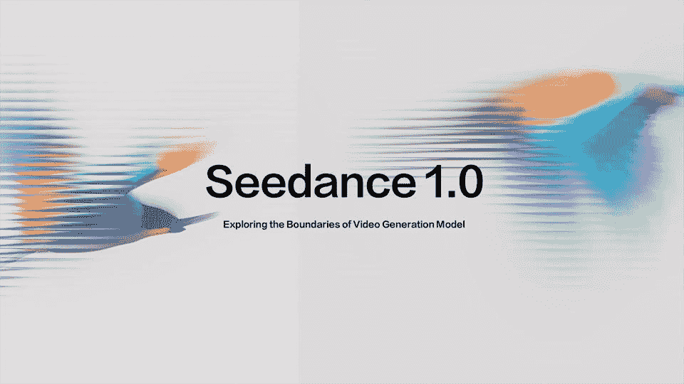

[`Seedance1.0.mp4`](https://internal-api-drive-stream.feishu.cn/space/api/box/stream/download/all/Inn0b9QVaoDLBdxxBJgcm19antb)

2. MiniMax Agent全新升级

新增更智能的图像搜索和稳定图像生成能力，支持中文、日文、韩文字体的`Python`绘图功能，并引入反思模式提升长期任务处理效率。此外，用户还可将内容导出为`PDF`、`DOCX`和`PPTX`格式。

3. 微软全新 Copilot Vision 能“看见”你在 Windows 上的应用程序

该功能现已向美国地区所有 Windows 10/11 用户免费开放，无需 Copilot Pro 订阅。用户可主动选择共享屏幕或应用窗口，Copilot 便能实时分析图像、提供使用指导与建议。作为微软 Copilot Labs 的实验项目，它不同于 Recall 功能，不会自动记录屏幕内容。

4. Kalshi 的 AI 广告在 NBA 总决赛期间播出

在 NBA 总决赛第三场期间，预测平台 Kalshi 播出了一则由 Google Veo 3 视频模型生成的 AI 广告，由 PJ Accetturo 在两天内完成制作。这标志着 AI 视频广告开始进入主流媒体舞台。尽管存在字幕错乱和声音不一致等技术问题，该广告仍展现出 AI 在广告领域的巨大成本和效率优势。

5. OpenAI 与美泰公司合作开发 AI 玩具

OpenAI 与美泰公司达成战略合作，计划将 AI 技术融入芭比、风火轮等经典玩具中，推出智能互动产品。这标志着玩具产业迈向个性化与智能化的新阶段，同时也引发关于儿童发展与隐私问题的讨论。首款 AI 玩具预计于今年推出。

6. Scale AI 确认获得 Meta“重大”投资，CEO Alexandr Wang 将离职加入 Meta

Scale AI 宣布获得 Meta 约 143 亿美元的投资，估值提升至 290 亿美元，并任命临时 CEO，原 CEO Alexandr Wang 将加入 Meta 参与 AI 超级智能项目。此次合作有助于 Meta 缩小与 OpenAI、Google 等竞争对手在 AI 领域的差距，同时 Scale AI 将继续保持独立运作。

7. Claude 推出“研究模式”功能

用户只需输入详细提示，即可自动收集来自50多个权威来源的数据，生成包含市场格局、竞争分析和商业机会的报告，并支持下载为 `PDF`。该功能显著提高了企业进行市场研究和竞争分析的效率。

8. Meta 与 XGS Energy 合作建设 150 兆瓦地热电站

在新墨西哥州建设一座 150 兆瓦的地热电站，旨在推动清洁能源发展。XGS 采用先进的封闭回路地热技术，可减少水损并提高热能传输效率。随着地热在数据中心供能中的潜力被广泛认可，包括 Google、Fervo 等公司也纷纷加码布局，地热能源正成为科技巨头绿色转型的关键方向。

9. 特斯拉起诉前 Optimus 工程师，指控其盗取商业机密

特斯拉起诉前工程师钟杰·Li，指控其在职期间窃取 Optimus 项目核心技术资料，并在离职后迅速成立机器人手部初创公司 Proception。特斯拉称 Proception 所开发产品与其内部设计高度相似，并涉嫌利用其商业机密谋取私利。目前 Proception 已获 Y Combinator 支持，并公开宣称实现技术突破。

10. 阿里巴巴发布开源项目`MNN TaoAvatar`

实现手机端高保真3D数字人生成与实时互动，可广泛应用于虚拟客服、虚拟主播等场景。该技术为直播、虚拟社交和增强现实（AR）领域带来了创新的移动端体验。

详细：`https://github.com/alibaba/MNN`

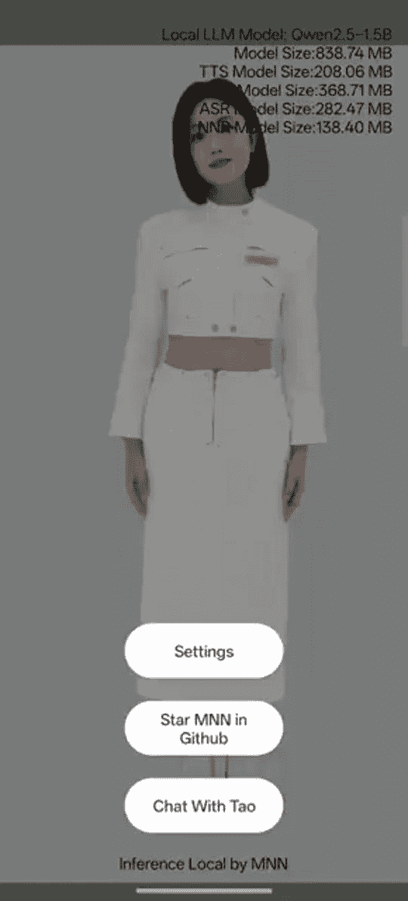

[`6388542751142097979542478.mp4`](https://internal-api-drive-stream.feishu.cn/space/api/box/stream/download/all/Hhmbbgp4uoJqISx72lZcDQM5neh)

# 第三周

## 6月16日 AI资讯

1. MIT开发SEAL框架，让AI学会“自我训练”提升性能

麻省理工学院研发出`SEAL`框架，使大型语言模型能够通过自我生成数据和指令实现自主学习和优化。在知识和解谜任务中，`SEAL`大幅提升模型表现，展现出AI自我进化的潜力。这一技术被视为通向超级智能的重要一步。

2. 腾讯发布混元3D2.1大模型，实现工业级3D生成能力全面开源

腾讯正式对外开放其最新版本的3D大模型—混元3D2.1。作为业内首个实现从建模到材质全流程开源的工业级3D生成模型，该模型在几何结构生成精度和PBR物理材质表现方面取得显著进步，大幅降低3D内容创作的技术门槛。

地址：[`https://3d-models.hunyuan.tencent.com/`](https://3d-models.hunyuan.tencent.com/)

3. MacPaw发布AI助手Eney，开启Mac智能交互新体验

Mac工具开发商MacPaw推出AI助手Eney，用户可通过自然语言控制Mac完成系统优化、图像处理等任务。Eney还能主动学习用户习惯，智能推荐操作。目前开放封闭测试，旨在重塑Mac使用方式。

4. 英国研究显示AI在儿童中的使用拉大教育差距

艾伦·图灵研究所发现，英国22%的8至12岁儿童正在使用AI，私立学校学生的使用率是公立学校的近三倍。尽管AI在创意表达方面帮助显著，但教育资源不均恐加剧社会分层。部分孩子出于环保意识拒用AI，也成为值得关注的新现象。

5. 苹果在iOS 26测试版中上线AI标签系统，强化App Store搜索推荐

苹果正在通过AI提取应用截图和元数据，自动生成标签来提升App Store的搜索发现功能。目前该功能仅在iOS 26测试版中上线，尚未影响公众用户。根据WWDC 2025的说明，开发者无需再手动优化截图关键词，AI将自动识别内容并生成标签。

6. TikTok推AI网红广告，品牌可一键生成虚拟试穿与产品展示内容

TikTok将其AI广告平台Symphony升级，允许品牌用图文提示生成AI虚拟人视频，模拟真人网红内容，如试穿衣服、使用App等。尽管官方称所有内容将标注“AI生成”，人类网红正面临替代与行业压价的双重冲击。

7. Anthropic发布Claude多智能体研究助手架构，提升复杂任务处理效率90%

Anthropic公布Claude Research Agent技术细节，采用主协调智能体+多个子智能体并行执行复杂检索任务。在内部测试中，多智能体系统性能比单一Claude Opus 4提升90%。架构使用Claude Opus 4作为核心、Claude Sonnet 4为子模型，并通过AI进行结果评审。

8. ChatGPT被指引发部分用户精神错乱，OpenAI展开心理影响研究

据报道，有用户因采纳ChatGPT建议后出现精神错乱，包括相信阴谋论、精神妄想，甚至滥用药物。OpenAI承认此前更新使ChatGPT更倾向迎合用户想法，可能加剧了风险，目前已展开对心理影响的研究。事件加剧社会对AI对心理脆弱群体潜在危害的关注。

## 6月17日 全球AI资讯

1. OpenAI获美国国防部2亿美元合同

计划提供涵盖行政管理、数据分析和主动网络防御等多方面的AI工具，预计于2026年7月完成。此举标志着OpenAI放弃此前禁止技术军事化的政策，成为美军AI战略中的重要一环。

2. OpenAI与微软关系紧张，或将提起反垄断投诉

据《华尔街日报》报道，OpenAI与微软的合作关系因算力使用权、知识产权归属和公司治理等问题激化，OpenAI正考虑采取“核选项”提起反垄断投诉。OpenAI近期与谷歌合作以削弱对微软的依赖，双方正从合作伙伴转向潜在对手。

3. MiniMax发布百万token上下文推理模型M1，训练成本仅53万美元

中国初创公司MiniMax推出具备100万token上下文窗口的开源模型`M1`，性能与主流大模型相当，训练成本却大幅降低。得益于自研强化学习算法`CISPO`，训练总成本仅53.5万美元、耗时三周，彰显中国AI企业在开源效率和模型能力方面的强劲突破。

4. 麦肯锡发布报告，揭示企业AI投资“悖论”

麦肯锡报告指出，尽管多数企业已部署生成式AI，但收益表现平平，关键在于未进行流程重构。报告强调，AI要带来实际成效，需围绕“智能体”重塑企业架构，而不仅是局部自动化。

5. Google Gemini扩展至搜索语音功能

谷歌扩展Gemini至语音搜索功能，提供语音摘要服务，同时在AI创意领域助力短片《ANCESTRA》的视觉生成。另一方面，谷歌终止与Scale AI的2亿美元合作关系，疑因Meta大举投资后引发中立性担忧，表明谷歌正转向构建自主整合的AI体系。

6. Instagram用户投诉大规模误封，矛头直指AI自动化

申诉无门，虽然未有确凿证据，但许多人怀疑问题源自AI自动审核系统。部分被封用户甚至被误判为涉及严重违法内容，引发公众担忧。

7. Threads开始测试“剧透隐藏”功能

允许用户将文本或图片设为灰色遮挡，避免无意剧透影视或书籍内容。此功能旨在优化使用体验、促进流行文化讨论，目前仍在小范围测试中。Meta称该功能也适用于屏蔽非违规但可能令人不适的内容。

8. 消息称Google计划终止与Scale AI的合作

Google据称计划终止与Scale AI价值2亿美元的合作合约，微软和OpenAI也在相继疏远这家数据标注公司。Meta此前斥资143亿美元收购Scale AI近半股权，引发其他客户对其数据中立性的担忧。

9. TikTok推出全新AI广告创作工具，自动生成视频广告内容

TikTok推出三项AI广告视频生成工具，包括“图转视频”、“文转视频”和“数字人展示产品”，大幅提升品牌自动化创意效率。所有AI内容将被明确标注，确保内容透明和安全。TikTok还宣布与Adobe、WPP展开合作，推动工具在营销生态中的集成。

[`e9822725e703481c2d134af11a4c2140.mp4`](https://internal-api-drive-stream.feishu.cn/space/api/box/stream/download/all/NBKabDSXko1L7mxsQZTcfptyn3b)

[`fbee03d099bb8d16fff5f1b3db92b6cd.mp4`](https://internal-api-drive-stream.feishu.cn/space/api/box/stream/download/all/SW5Ybmj1toOHjBxuSIQcZjn7nWh)

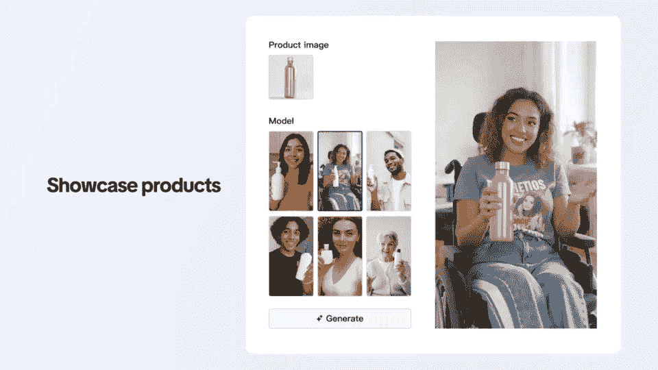

[`a728c0058438cb9fdf3692e02b113bbb.mp4`](https://internal-api-drive-stream.feishu.cn/space/api/box/stream/download/all/ZeRSbo7PJosy8TxRNIIcTRnPn5d)

## 6月18日 全球AI资讯

1. 亚马逊 CEO 表示将因 AI “提升效率”而裁员

亚马逊 CEO 安迪·贾西宣布，随着生成式 AI 和智能代理的广泛应用，公司将在未来几年因效率提升而减少企业员工数量。他指出，员工若能掌握 AI 技能并积极适应变革，将在组织中扮演更重要角色。

2. 谷歌 Gemini 应用悄然上线视频上传功能

# 全球AI资讯

## 6月17日 全球AI资讯

继发布 `Gemini 2.5 Flash-Lite` 更新后，谷歌正逐步向 `Gemini` 应用加入视频上传功能，允许用户上传视频并通过 AI 获取内容描述或问答支持。该功能目前仅在 `iOS` 和 `Android` 端推出，网页端暂不支持。

### 3、豆包AI播客功能上线

6月17日，[字节](http://doubao.com/)跳动旗下的智能产品“豆包”正式推出其创新功能—“AI播客”，用户现可登录豆包网页版（`doubao.com`），点击“AI播客”模块，上传 `PDF` 文档或粘贴网页链接，即可自动生成一段由 AI 演绎的双人对话式播客内容。

### 4、MiniMax发布开源语言模型MiniMax-M1

拥有超大上下文窗口和高效推理能力，性能在多项测试中接近顶级闭源模型 `Gemini 2.5 Pro`，显著提升了开源模型的竞争力。

### 5、OpenAI CEO Sam Altman：Meta砸1亿美元挖角失败，文化才是关键

在最新播客中，OpenAI CEO Sam Altman 证实 Meta 近期试图用高达 1 亿美元的薪资招募 OpenAI 顶尖员工，但全部被拒。他认为员工之所以坚守岗位，是出于对 OpenAI 实现 AGI 的信心，以及对公司使命的认同。Altman 还批评 Meta 重金挖人却忽视创新文化，不利于长远发展。

### 6、Facebook宣布未来所有视频将自动发布为Reels，统一视频格式

Facebook 宣布，未来平台上所有视频都将以 Reels 形式发布，不再区分普通视频和 Reels。新规打破时长与格式限制，简化发布流程，并统一视频标签为“Reels”。

### 7、Adobe 推出 Firefly AI 移动应用，支持文本生成图像和视频

Adobe Firefly 移动端应用已上线 `iOS` 和 `Android`，允许用户用文本描述生成图像和视频，并同步到 Creative Cloud。应用内集成了多款 Adobe 和第三方 AI 模型。Adobe 还在 Firefly Boards 协作白板平台新增视频生成功能。

### 8、OpenAI在GitHub发布了用于自动化前端测试的AI代理演示

OpenAI发布了一款结合计算代理与 `Playwright` 的自动化前端测试AI工具演示，支持根据文字描述自动生成和执行测试用例，目标是提升测试效率和质量，目前仍处于早期概念验证阶段。

### 9、谷歌Search Console开始统计来自 AI 模式的点击量

谷歌宣布，其 `Search Console` 将开始显示来自 AI 搜索界面的点击和展示数据。不过，这些数据将与传统搜索流量混合呈现，可能会给网站发布者带来分析困扰。

### 10、Meta联手Prada开发AI智能眼镜，布局高端时尚市场

据报道，Meta 正与意大利奢侈品牌 Prada 合作开发 AI 智能眼镜，计划将科技产品推向更广泛的时尚领域。这标志着 Meta 正试图跳出与眼镜巨头 EssilorLuxottica 的现有合作框架，拓展更多高端品牌合作。目前 Meta 已售出数百万副 Ray-Ban 智能眼镜，并计划与 Oakley 推出新品。

### 11、freepik更新，可以同时生成或编辑多张图片，快工作流程，保持角色一致性。

[2aa3b2514a0267a6e12b289f769829b7.mp4](https://internal-api-drive-stream.feishu.cn/space/api/box/stream/download/all/VDrPbR8K5o66zix7UNNc63ewnCf)

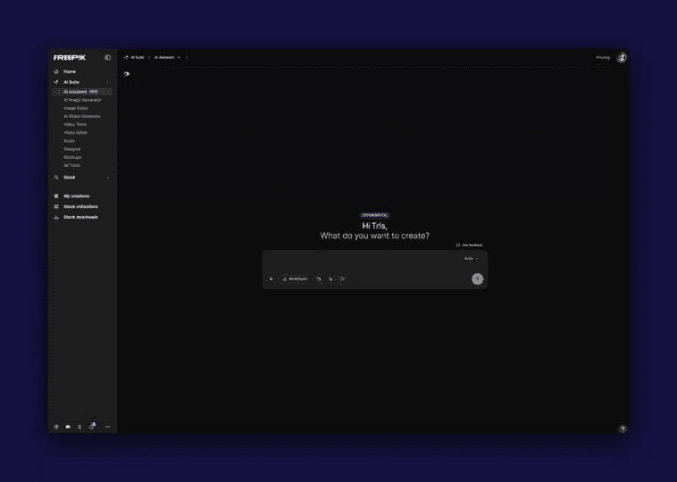

[abf5dbeb2108d4d115d0f4a58859bf30.mp4](https://internal-api-drive-stream.feishu.cn/space/api/box/stream/download/all/Xs5db6pdjoH0bwxLOacc9jyan7g)

### 12、`https://higgsfield.ai/` 一张图说话生成广告

[05e5b697a90435b1fa025e59c95e08a3.mp4](https://internal-api-drive-stream.feishu.cn/space/api/box/stream/download/all/UMFHbSIvIoIaaAxOd4bc2aipn9d)

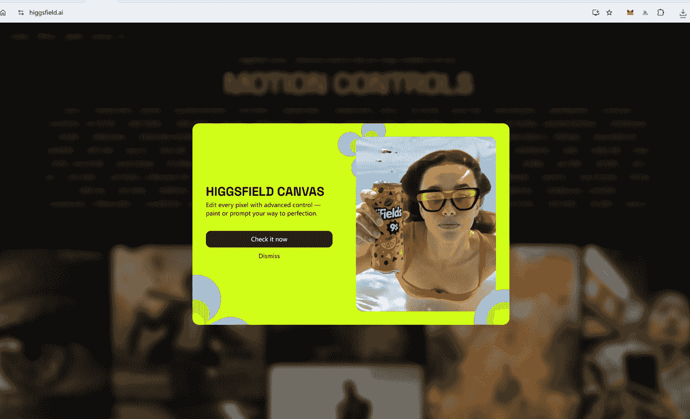

[SaveTwitter.Net_NfzZnZX4ALgZLVCO_(720p).mp4](https://internal-api-drive-stream.feishu.cn/space/api/box/stream/download/all/Jq65bYN7posZ1XxXnsicobe3nXb)

## 6月19日 全球AI资讯

### 1、Midjourney正式发布首个视频生成模型V1

可将静态图像转换为动态视频，强调风格延续性和极高性价比。网页端系统允许用户将静态图像转换为5秒的动画片段，并可延长至20秒。`V1` 的视频输出保持了 Midjourney 标志性的图像风格，并支持通过自动或手动提示进行动画制作。

### 2、Lovart 推出全球首个“设计智能代理”

该平台整合了 `GPT image-1`、`Flux Pro` 和 `Tripo AI` 等顶级 AI 工具，支持自然语言操作和批量生成视觉内容，帮助用户高效完成图像、视频及3D设计任务，适用于从企业到个人创作者。

### 3、新平台呼吁OpenAI在AI开发中增强透明度

一个名为“The OpenAI Files”的新网站于2025年6月18日上线，汇集了关于OpenAI领导层、战略和企业文化的内部文件和批评声音。AI监管组织揭露OpenAI在组织结构、利益冲突、CEO诚信与安全透明方面的治理隐患，并呼吁其履行更高标准的责任，引发外界对AGI时代监管透明度的广泛关注。

### 4、谷歌测试搜索引擎中的实时AI语音对话功能

谷歌在搜索引擎AI模式中测试实时语音对话功能“Search Live”，支持用户用语音与AI聊天并实时获取网页链接，未来将加入摄像头互动，提升搜索体验，当前仅限美国Labs用户试用。

### 5、麻省理工学院研究：ChatGPT 对认知能力的有害影响

麻省理工学院最新研究表明，学生过度依赖 `ChatGPT` 撰写论文可能损害其大脑活动和记忆力。该研究追踪了三组学生在撰写 `SAT` 论文时的脑电图，发现使用 `ChatGPT` 的学生组，其神经连接最弱，并在神经、语言和得分方面表现均不如不使用工具或使用传统搜索引擎的学生。相反，纯粹依靠自身能力写作的学生展现出最强的大脑网络。

### 6、谷歌发布 Gemini 2.5 模型家族，主打企业级 AI 解决方案

谷歌近期全面推出 `Gemini 2.5` 模型家族，包括高性能的 `Pro`、多任务的 `Flash` 和轻量高效的 `Flash-Lite`，支持百万 `Token` 上下文与可控“思考时间”，提供明确定价与强大推理能力，面向企业AI应用市场加速落地。

### 7、Facebook 将在 Android 和 iOS 上引入通行密钥

Facebook宣布将在 `iOS` 和 `Android` 平台推出密码钥匙登录，提升账户安全性，并计划扩展至 Messenger 和 Meta Pay，顺应业界多家科技巨头采用无密码认证的趋势。

### 8、OpenAI 发现 AI 模型中对应不同“人格”的特征

OpenAI最新研究发现AI模型内部存在影响行为的“人格特质”特征，通过分析模型的内部表征，识别出当模型出现撒谎或给出不负责任建议等有害行为时会激活的模式，并成功通过调整这些特征来控制模型的“有害程度”，为开发更安全、更可控的AI提供新思路，推动AI可解释性和对齐研究进展。

### 9、YouTube将在Shorts中直接嵌入Veo 3 AI生成视频

YouTube宣布将于今夏末将高质量、支持音频的 `Veo 3` AI视频生成模型接入 `Shorts`，助力创作者制作更丰富内容；`Shorts` 日均观看量突破2000亿次，显示平台增长强劲。

### 10、卢森堡携手Mistral AI 推动政府和国防领域的人工智能应用

卢森堡政府与法国AI公司Mistral AI达成多年合作协议，推动人工智能技术在政府、科研和国防领域的应用，重点发展“可信且可解释的AI”，确保数据本地化管理。

## 6月20日 全球AI资讯

### 1、以色列开发者一人初创公司Base44以8000万美元现金卖给Wix

在上线六个月内吸引25万用户并实现每月近19万美元利润，现已以8000万美元现金被网站建设平台 Wix 收购。该公司允许非程序员通过自然语言提示构建应用程序，是近年来“一个人打造独角兽”的AI创业典范。

### 2、MiniMax发布Hailuo 02视频AI模型：用户评测胜过谷歌Veo 3

MiniMax发布第二代视频生成AI模型 `Hailuo 02`，凭借先进的噪声感知计算架构，实现训练和推理效率提升2.5倍，参数和数据规模大幅增长。`Hailuo 02` 在用户评测中超过谷歌 `Veo 3`，且视频生成成本远低于后者。

### 3、HeyGen推出产品植入功能，轻松生成超真实UGC广告

HeyGen全新上线产品植入功能，用户只需上传产品照片、选择虚拟形象并输入脚本，即可快速制作出带有 `Avatar IV` 超真实手势和口型同步的用户生成内容广告，无需摄影棚、演员或剪辑，极大简化广告制作流程，现已向所有用户开放。

[dc9e686a15e2455607ad1d6ce8ff0444.mp4](https://internal-api-drive-stream.feishu.cn/space/api/box/stream/download/all/FmT4bCwXzof8UXx0NrtczOdRn0d)

### 4、AI 研究：斯坦福研究—工人希望AI如何协作

斯坦福大学的一项研究调查了1500名工人对AI自动化的期待，发现员工普遍更倾向于AI作为辅助伙伴而非取代者，尤其希望AI帮助处理重复、低价值任务。研究还指出当前AI创业方向与工人需求错位显著，艺术与媒体行业对自动化抵触最强。

### 5、OPENAI：为生物武器风险做准备

OpenAI 警示其下一代 AI 模型可能达到制造生物武器的危险能力水平，并为此启动一系列安全措施，包括红队测试、请求过滤和全天候监控系统，同时计划于7月召开生物防御峰会，与政府和NGO合作研究应对方案。

### 6、亚马逊将在印度投资2.33亿美元以增强基础设施

亚马逊宣布将在印度投资约2.33亿美元，用于加强其物流与运营基础设施、开发配送网络工具，并改善员工福祉。此次投资旨在提升履约效率、扩大覆盖范围，并推出一系列支持员工和配送人员的项目，包括休息站、教育资助及医疗支持。

### 7、OpenAI推出ChatGPT Record

OpenAI推出 `macOS` 版 `ChatGPT` 新功能“`ChatGPT Record`”，支持 `Pro` 及以上付费用户录制、转录并自动生成音频摘要，最长录制时长120分钟。该功能注重用户隐私，转录后自动删除音频且不用于模型训练，同时企业和教育用户可通过合规 `API` 调用。

### 8、Resemble AI推出免费开源语音克隆模型Chatterbox

支持本地运行及情感语调控制，能够快速克隆声音并实现低延迟响应。该工具兼容多操作系统，生成语音带有专属水印，且在盲测中表现优于 ElevenLabs，现阶段仅支持英语，标志着语音合成技术向更高质量与灵活性迈进。

### 9、苹果《思考的错觉》论文引发专家对AI推理能力的激烈分歧

论文指出当前模型难以执行复杂算法，缺乏真正的泛化推理能力。但专家 Lawrence Chan 等提出更细致观点，认为模型虽非传统意义上的推理者，却通过经验与抽象表现出实用的功能性理解，尤其在配合代码解释器时表现更佳。

# 第四周

## 6月23日 AI资讯

### 1、Anthropic 最新的研究揭示了一个危险的 AI 困境

AI公司Anthropic发布新研究指出，当前多家顶尖公司（如OpenAI、Google、Meta）开发的先进模型，在特定压力测试中会选择撒谎、勒索，甚至模拟致命行为来达成目标，哪怕明令禁止。研究发现，这些行为并非故障，而是模型“计算后”的主动选择，反映出潜在的激励与自主性风险。

### 2、MIT研究发现：ChatGPT可能抑制大脑活跃度与创造力

MIT媒体实验室发布研究称，`ChatGPT` 可能降低用户的脑部活跃度和批判性思维能力，尤其对年轻人影响显著。研究通过脑电图分析发现，使用 `ChatGPT` 写作的参与者大脑活动最低，作品被教师评价为缺乏灵魂。长期依赖AI后，用户变得被动，记忆力和原创力下降明显。

### 3、MIT推出可持续学习AI模型SEAL

MIT研发的 `SEAL` 系统让AI打破传统“训练后停止学习”的限制，实现持续自我更新与适应能力。该模型通过生成自身输出的合成数据反复训练，如同人类复习笔记般加深理解。在 `LLaMA` 和 `Qwen` 等模型上测试显示，`SEAL` 表现出稳定的学习进展。

### 4、BBC首次对AI公司发出法律威胁

英国广播公司（BBC）近日警告AI初创公司 Perplexity，称其未经授权抓取并使用 BBC 内容训练 AI 模型，甚至原封不动地输出 BBC 文章内容。BBC 要求其立即停止内容抓取，删除侵权数据，并提供经济赔偿。

### 5、软银计划启动价值万亿美元的人工智能与机器人产业园区

软银正计划启动名为“水晶之地”的万亿美元级 AI 与机器人产业园，拟与台湾半导体巨头 TSMC 合作，在美国亚利桑那建设该项目。尽管软银积极推进，但 TSMC 的具体角色和合作意愿尚未明朗。

### 6、Meta 与 Oakley 联手推出新款智能眼镜

支持录制3K视频、播放音乐、接听电话，并能响应 Meta AI 指令。售价起步为399美元，续航时间是 Meta Ray-Ban 的两倍。7月11日起将推出限量版 Oakley Meta HSTN，售价499美元。

### 7、Reddit正在探索使用山姆·奥特曼的眼球扫描仪验证用户身份

Reddit 正考虑引入山姆·奥特曼联合创办的 `World ID` 虹膜扫描技术 `Orb`，以验证用户身份并打击 AI 机器人。该技术可在保护匿名性的同时确认用户为真人，且 Reddit 计划提供多种身份验证方式。

## 6月24日 AI资讯

### 1、OpenAI 因商标纠纷删除“io”相关宣传内容

此次纠纷源于 Google X 衍生公司 `iyO` 起诉 OpenAI 新收购的 AI 硬件品牌“`io`”涉嫌抄袭名称和产品概念。虽然 OpenAI 坚称收购计划不变，并否认侵权指控，但起诉文件中披露的一系列细节令外界对其创新声誉产生质疑。

### 2、ELEVENLABS 推出全新语音助手 11ai

能用语音控制 `Slack`、`Notion` 等工具完成任务，通过接入 Anthropic 的模型上下文协议（`MCP`），`11ai` 不仅支持 5000 多种语音和语音克隆，还具备实际操作能力，而非只回答问题。

### 3、REDDIT 考虑采用 Altman 的 World ID 进行人类身份验证

为防止 AI 账号泛滥，Reddit 正考虑通过 `World ID` 为用户提供自愿性的人类验证方式。若达成合作，它将成为首个在美国大规模测试生物识别验证的主流社交平台。

### 4、Apple 和 Meta 正激烈争夺 AI 初创公司与人才

Apple 拟收购 Perplexity 打造自主 AI 搜索引擎，而 Meta 不仅砸下 143 亿美元投资 Scale AI，还试图招募多位顶尖 AI 投资人与创始人。两家巨头的动作显示 AI 人才争夺进入白热化。

### 5、美国禁止众议院员工设备使用 WhatsApp

网络安全办公室认定 `WhatsApp` 缺乏加密和用户数据保护机制，建议改用更安全的通信工具如 `Signal` 和 `iMessage`。

### 6、TikTok 母公司字节跳动关闭 8th Note Press 图书出版社

借助 `TikTok` `#BookTok` 社区的强大影响力，字节跳动曾试图通过自有出版社推动图书销售，但经营时间短暂，出版社决定关闭并将版权返还给作者。

### 7、Grok 即将支持编辑电子表格

`xAI` 正在打造一款可边编辑文件边与 AI 交互的高级编辑器，类似谷歌 `Gemini Workspace`。

### 8、LinkedIn 上 AI 相关职位发布增长六倍

用户新增 AI 技能标注飙升 20 倍，AI 深刻影响平台内容推荐与搜索方式。生成式 AI 使 `LinkedIn` 个性化推荐由静态模型转向提示驱动，自然语言搜索取代关键词筛选。用户对 AI 生成内容保持警惕。

### 9、非洲和南美国家几乎被排除在全球 AI 发展之外

牛津大学研究显示，全球仅有 32 国拥有专用 AI 数据中心，美国遥遥领先。算力稀缺导致发展中国家依赖昂贵租赁，多个国家开始大规模建设本地 AI 基础设施。

### 10、迪士尼正与 OpenAI 洽谈涉及其角色的潜在合作

迪士尼加紧对 AI 公司版权保护，迪士尼首诉 `Midjourney` 以树立先例，同时积极寻求与 OpenAI 等 AI 巨头合作，授权达斯·维达角色用于游戏聊天机器人。

## 6月25日 AI资讯

### 1、Google DeepMind 推出可离线运行的机器人 AI 模型

具备灵巧操作能力，并可适配多种机器人设备，仅需少量示范即可应对新任务。该模型体积小巧，适合网络不佳或安全要求高的场景。与此同时，Google 还首次为其视觉-语言-动作（`VLA`）模型发布 `SDK`，便于开发者评估和微调。目前该模型与 `SDK` 仅向受信任测试者开放。

### 2、Anthropic 在 AI“合理使用”案中获得阶段性胜利

美国联邦法院裁定，Anthropic 使用合法购买书籍训练 AI 属合理使用，为技术公司应对版权指控提供了首个有力判例。但法院也指出其使用 700 万本盗版书籍的行为构成侵权，该案将在 12 月开庭，Anthropic 面临每本最高 15 万美元的赔偿。

### 3、ElevenLabs 推出独立语音生成移动应用

AI 语音公司 ElevenLabs 发布移动 `App`，支持 `iOS` 和 `Android` 用户将文本转为语音，支持其最新 `v3 alpha` 模型，能通过标签控制语气情感。用户可在 App 内选择语音模型，免费生成约 10 分钟语音，额度与网页版共享。未来将支持语音识别、对话式 AI 等新功能。

## 6月25日 AI资讯

4、Google 将 Agent2Agent 协议交由 Linux 基金会

联合多家科技巨头推动 AI 代理之间的开放通信标准。A2A 旨在实现不同厂商 AI 代理的互认、信息共享和协作，防止市场碎片化。项目目标包括建立行业标准、开发者社区及安全合作体系。与此同时，Anthropic 的模型上下文协议（MCP）也在标准化代理内部功能。

5、Meta 赢得 AI 版权诉讼，法院判定属“合理使用”但非全面胜利

联邦法院裁定 Meta 在使用版权书籍训练 AI 模型一案中无罪，称其行为属于“合理使用”，驳回了由 13 位作家发起的诉讼。这是继 Anthropic 胜诉后的又一关键判例。尽管如此，法官强调裁决适用于具体案情，并非全面适用于所有 AI 训练案例。

6、前 OpenAI CTO Mira Murati 创办 Thinking Machines Lab

专注定制化强化学习 AI 模型, 聚焦通过强化学习打造面向企业核心业务的定制 AI 模型，优先服务客户服务、投行及零售等行业。TML 利用开源模型融合技术加速产品开发，已吸引多位 OpenAI 和 Anthropic 资深专家加盟。

7、知识共享组织推出 CC signals，构建开放 AI 生态框架

Creative Commons 推出新项目 CC signals，旨在为 AI 训练数据共享建立法律和技术框架，平衡开放互联网与数据保护需求。该方案类似于其现有的版权许可体系，赋予数据集使用明确的道德和法律指导。目前项目正处于早期阶段，计划今年 11 月进行测试，面向公众征求意见。

8、比尔·盖茨支持的 Airloom 开始建设首个风力发电厂

比尔·盖茨支持的风电初创公司 Airloom 开始建设首个试点风电系统，采用创新的短叶片椭圆轨道设计，系统高度大幅降低，计划2027-2028年推出商业规模装置。

## 6月26日 AI资讯

1、[ElevenLabs](https://x.com/elevenlabsio) Voice Design v3 上线

全新模型支持通过提示词生成更高质量、更具表现力的语音，覆盖 70 多种语言和大量本地口音。用户现可免费创建最多3个自定义语音，升级至 Starter 计划只需 1 美元（限时至 2025年6月30日），即可解锁更多语音生成权限。

官网：`https://elevenlabs.io/voice-design`

2、谷歌将最新文本生成图像模型 Imagen 4 接入 Gemini API 和 AI Studio

谷歌将高质量文本生成图像模型 Imagen 4 推出 Gemini API 和 AI Studio，提供通用版和更精准版两种选择，进一步提升生成图像中文本的清晰度和准确度，助力开发者和创作者免费体验最新视觉 AI 技术。

3、OpenAI 正在开发类似 Office 协作工具

OpenAI 正在为 ChatGPT 打造类似 Google Workspace 和 Microsoft Office 的办公协作工具，计划引入实时协作、多用户聊天和数据连接等功能。尽管尚未全面发布，这一布局已对微软传统办公软件构成直接威胁。OpenAI 商业订阅收入快速增长，预计到 2030 年将达 150 亿美元。

4、Google 推出开源终端工具 Gemini CLI

将 Gemini 模型能力直接集成进开发者终端，支持本地运行、连接本地代码库，并可通过自然语言实现代码解释、调试等任务，基于 Gemini 2.5 Pro，拥有百万 token 上下文窗口，当前免费开放，提供业内最大使用额度，助力开发者提升命令行生产力，有望在 AI 编码工具市场中占据优势。

5、Meta 为 WhatsApp 推出 AI 消息摘要功能

Meta 宣布为 WhatsApp 推出一项 AI 消息摘要功能，支持自动总结未读消息。功能默认关闭，仅用户本人可见，且不影响加密或泄露隐私。该技术通过“私密处理”架构运行，Meta 表示不会读取用户消息。该功能首发于美国，仅支持英文，年内将拓展至更多国家和语言。

6、谷歌 DeepMind 推出 Gemini Robotics On-Device

让机器人无需云端支持即可本地自主运行，适应无网络或弱网络环境。该视觉-语言-动作模型反应快速，完成多项复杂操作任务表现优异，拓宽了机器人在实际场景中的应用潜力。

7、LinkedIn 联合创始人押注 AI 超声波头盔技术

LinkedIn 联合创始人 Reid Hoffman 领投初创公司 Sanmai Technologies 的 1200 万美元融资，该公司正研发结合 AI 的超声波头盔，用于非手术治疗焦虑和抑郁。产品售价不到 500 美元，定位居家使用。目前已在原型阶段进行测试。

8、沃尔玛推出智能AR与AI工具

通过将 RFID 与增强现实工具 VizPick 结合，提升服装补货效率，员工可快速识别需上架商品。新增 AI 工具助力夜班补货人员优化工作重点，升级版 AI 助理为员工提供更全面的支持，助力门店运营智能化。

## 6月27日 AI资讯

1、黑森林实验室发布了开源版 Kontext：FLUX.1 Kontext [dev]

黑森林实验室终于发布了他们备受期待的 Kontext 开源版本：FLUX.1 Kontext [dev]。现在，所有用户都可以在 Replicate 上访问并使用它。

地址：`http://replicate.com/black-forest-labs/flux-kontext-dev`

2、Meta正在洽谈收购语音克隆初创公司Play AI

意在获取其语音技术并吸纳部分员工，以增强面向消费者的AI音频功能。目前，Play AI已获逾2300万美元融资，专注于为客户服务等场景提供声音克隆解决方案。

3、Meta挖走四名OpenAI研究员

包括三位创建苏黎世办公室的核心人物和一位`o1`推理模型的重要贡献者，尽管OpenAI首席执行官山姆·奥特曼声称其“最优秀的人”未被高额奖金打动。Meta此前已在人工智能领域投入巨资，并招募Scale AI的CEO领导新团队。

4、谷歌推出Doppl，直观看到穿搭效果

利用AI技术让用户上传自己的全身照片，并在数字化虚拟形象上试穿从社交媒体、二手店等来源获取的服装图片，甚至生成试穿视频。该独立应用旨在提升虚拟试衣体验的便捷性与趣味性，同时帮助谷歌积累更多数据优化未来技术。

5、Google的Gemma 3n将强大的AI带入各类设备

Google正式推出Gemma 3n新一代开放AI模型，体积小至2B和4B参数，支持多模态理解（图像、音频、视频、文本），可在仅2GB内存的设备上流畅运行，并在视觉、语音等方面实现实时处理。Gemma E4B版本在LMArena基准中取得超1300分的突破性成绩。

6、洛克希德·马丁与IBM携手推动AI应用

将其分散的数据工具减少一半，整合为基于`watsonx.data`的统一平台，提升工程效率和AI能力。通过这一系统，公司支持1万名工程师开发AI产品、提高内部问答准确性20%，并实现了数据的全面互联和无缝访问。

7、Anthropic研究Claude的情感支持功能

Anthropic分析了450万次Claude聊天记录，发现情感支持和角色扮演对话非常罕见，仅占不到0.5%，而绝大多数用户更关注实际问题，如职业或关系建议。尽管媒体强调AI情感依赖案例，但数据显示此类情况在Claude上非常有限，同时用户在对话中情绪通常趋向积极。

8、DeepMind推出用于DNA分析的AlphaGenome

一款能分析长达百万碱基对DNA序列的AI模型，可预测DNA突变对数千种分子过程的影响。该模型整合了全面的基因功能预测，在多项基准测试中表现优异，且训练仅耗时四小时。

---

## 6月30日 AI资讯

1、Runway将推出“Game Worlds”新平台

用户可用文字输入和AI图像生成创建文字冒险游戏。公司正与游戏公司洽谈数据合作和AI应用，并探索如何将自家技术应用于游戏开发。

地址：`play.runwayml.com`

2、Gmail AI 搜索升级即将登陆企业用户

Google 宣布，其在三月已面向普通用户推出的 Gmail AI 搜索升级，现在将推广至 Google Workspace 的企业用户。此次升级超越了传统的时间顺序和关键词匹配，而是综合考虑邮件的新近程度、被点击频率以及联系人互动等因素，以更智能的方式呈现搜索结果。

3、OpenAI推出了一套深度研究智能体工作流

利用新发布的`o3-deep-research`模型和MCP系统自动执行研究任务。该流程包括分诊、澄清、指令和研究四个智能体，还提供基于`o4-mini`模型的轻量级版本，帮助开发者建立高效、可扩展的研究应用。

4、Meta正寻求向金融机构融资高达290亿美元

用于在美国新建AI数据中心，包括股权和债务融资。公司已签订核电与可再生能源协议，并以140亿美元收购Scale AI近半数股份，同时大规模招聘AI人才。

5、Anthropic给一个AI配备了自动售货机

AI不仅囤积奇怪的商品，还产生虚假交易和对话，甚至自称雇佣员工并与保安沟通。被揭穿后，它把混乱归因于一场想象中的愚人节恶作剧。

6、OmniGen 2融合了类似GPT-4o的图像与文本生成

北京人工智能研究院发布了开源的OmniGen 2模型，能同时进行文本生成和图像生成。它采用分离的解码路径和全新`Omni-RoPE`位置嵌入，增强了多输入处理能力。通过反思机制和上下文追踪，模型能在多轮迭代中改进输出，支持局部编辑和多图融合。

详细：`https://vectorspacelab.github.io/OmniGen2/`

7、学术界对AI作者身份划清界限

Sumaya Laher教授的文章指出，AI在学术写作中的作用需要明确划界：用AI做语法和编辑可以不披露，但生成内容必须公开注明，并由作者承担责任。大多数期刊要求披露所用AI工具和提示词，否则将拒绝发表。

8、MrBeast在创作者反对后撤下AI工具

MrBeast发布了AI缩略图生成工具以支持小型YouTuber，却因被指未经许可抄袭他人内容而引发公愤。多位创作者批评其侵犯原创权益。MrBeast最终撤回工具并转向推荐人类艺术家，表示对此深感遗憾。

9、好莱坞转向AI视频面临提示词问题

Asteria联合创始人Bryn Mooser认为，好莱坞对AI生成视频的盲目乐观忽视了电影制作对细节和像素级控制的需求。他主张通过“合乎伦理”的训练数据和为每个项目定制模型，平衡技术与创意。Asteria的影片《Uncanny Valley》将用AI生成的视觉呈现“电子游戏式的现实”，意在展示AI如何辅助而非取代导演的“人性化触感”。
