# 2025Q3（7-9月）

> 来源：[https://aigclena.feishu.cn/docx/IFNBdwVoOotx6oxFS2JcAArPnyt](https://aigclena.feishu.cn/docx/IFNBdwVoOotx6oxFS2JcAArPnyt)

# 7月AI资讯精选

# 第一周

## 7月1日 全球AI资讯

1、Qwen-TTS 已正式上线

通过Qwen API提供服务。它依托数百万小时的语音训练，实现了高度自然和情感丰富的语音合成，支持北京、上海、四川3种中文方言以及7种中英文双语声音选择。

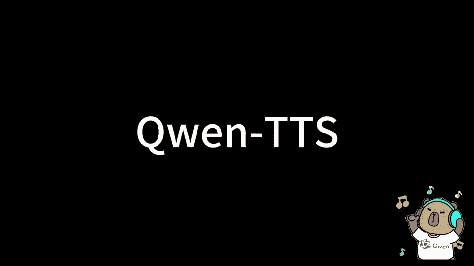

[SaveTwitter.Net_Scnj7vgyx6xHzac0_(720p).mp4](https://internal-api-drive-stream.feishu.cn/space/api/box/stream/download/all/XEWXbq4gKoJ3chx2Tapcm4gnnYf)

2、美图MOKI上线全新「AI创意广告」工具

用户只需上传一张图片并选定心仪模板，即可一键生成专业广告视频。平台集成了七款主流视频生成模型，助力从创意构思到成片输出全流程高效完成。

限时免费体验：[www.moki.cn](http://www.moki.cn)

3、百度首次开源了10个版本的ERNIE 4.5模型

包括一个拥有4240亿参数的多模态系统，在关键基准上超越规模更大的DeepSeek V3。

4、xAI准备发布Grok 4，双模型支持语言与代码

主打自然语言理解和代码辅助。与此同时，Grok正被用于事实核查，通过生成“社区注释”辅助𝕏平台内容审核。该机制结合AI与人类共识，旨在平衡效率与准确性

## 7月2日 全球AI资讯

1、Figma距离可能筹集15亿美元的重磅IPO又近一步

Figma周二首次公开披露了财务状况，营收与利润表现强劲，有望筹集最多15亿美元，成为2025年最大科技IPO之一。公司2024年营收达7.49亿美元，毛利率高达91%，但也面临AI工具竞争压力。创始人Dylan Field通过股权结构掌控约75%投票权。

2、微软发布了MAI Diagnostic Orchestratorc

一种能在复杂病例中实现比医生高4倍诊断准确率的AI系统，搭配OpenAI o3模型，正确率达85.5%。

3、华为开源其盘古系列大型AI模型，本次发布包括参数规模为70亿的盘古7B语言模型、参数规模达720亿的更大型盘古Pro MoE模型，以及针对华为昇腾芯片优化的模型执行技术。盘古Pro MoE 72B的权重文件、基础推理代码和大规模MoE模型工具已在GitCode平台上线。

4、OpenAI企业AI咨询服务收费至少1000万美元每客户

OpenAI加快企业AI咨询业务发展，收费起点达1000万美元，直接参与客户定制模型和应用开发，挑战Palantir和埃森哲等老牌竞争对手。同时，OpenAI提供数据标注服务，且考虑将部分工作外包，客户涵盖美军和东南亚科技巨头。

5、Google将NotebookLM AI工具向18岁以下学生开放

Google宣布一系列面向教育领域的新举措，包括首次将NotebookLM笔记工具开放给18岁以下学生，以及在Google Classroom推出Gemini AI标签页、分析工具和生成式AI视频工具。新功能帮助教师轻松创建课程、追踪学生进度并与学生互动。

6、苹果考虑放弃自研AI，用OpenAI和Anthropic模型替代Siri

苹果正与Anthropic和OpenAI洽谈，为其定制专用模型部署于苹果自有云服务器上。此前，苹果一直依赖自研基础模型，并计划于2026年基于自研模型推出新版Siri。采用外部模型意味着苹果在生成式AI领域的领先地位正面临挑战。

7、埃隆·马斯克的AI公司xAI融资100亿美元

融资形式为股权与债务各占一半，继续加码AI数据中心建设和Grok产品开发。去年收购X平台后，xAI估值已达到1130亿美元，显示其在生成式AI领域野心勃勃。

8、微软发布MAI-DxO AI系统

通过逐步模拟真实诊疗流程，将复杂病例诊断准确率提高到医生的4倍，且成本下降近70%。新开发的SDBench基准确保测试结果更贴近临床实际，进一步验证了AI在医学领域的应用潜力。

## 7月3日 全球AI资讯

1、AI乐队收获50万听众，承认使用Suno

一支名为The Velvet Sundown的乐队在Spotify上迅速爆红，却被揭露曲目大多由AI生成器Suno创作。虽然最初否认，成员随后承认使用Suno来塑造固定人声风格。

2、最新视频生成模型Veo 3未来可能应用于视频游戏

谷歌正加速推进Gemini 2.5 Pro等多模态基础模型的世界模型化进程，并推出Genie 2实现无限生成游戏世界。尽管Veo 3目前仍是被动生成工具，但结合Genie等技术，谷歌有望在实时、交互式游戏模拟领域竞争微软、OpenAI等对手。

3、OpenAI将从Oracle获得更多算力以支持Stargate

将在美国租用约4.5吉瓦的数据中心电力，显著增强算力储备，以支撑其AI模型运行和规模化发展。

4、ChatGPT对新闻网站的导流正在增长

ChatGPT对新闻网站的流量导入在一年多时间里增长了25倍，但仍无法抵消因AI搜索普及导致的搜索流量骤降。随着谷歌AI Overviews等功能让新闻搜索直接在搜索页完成，新闻网站访问量从23亿下降至不足17亿。财经、股票、体育等内容最受AI提问青睐

5、微软计划裁员9000人，占公司总员工不到4%

尽管微软在季度财报中持续超预期表现，其净利润同比增长18%，达到258亿美元，裁员计划依然进行。微软今年已经进行了多轮裁员，此次裁员旨在精简管理层级，效仿亚马逊和Meta等竞争对手的做法。

6、谷歌发布了全新的Gemini CLI命令行AI工具

支持代码分析、应用生成和工作流自动化，开发者可通过npm安装并免费使用，每日最多可请求1000次，助力提升软件开发效率。

7、Lovable有望筹资1.5亿美元，估值近20亿美元

公司通过文本提示自动生成完整网页应用，6个月内实现5000万美元ARR。最新推出的AI代理支持代码编辑与调试，采用按使用量计费，成为AI服务商业化趋势。

8、Perplexity推出每月200美元的高端订阅计划“Max”

为用户提供无限制使用生成工具及最新AI功能的权限，以强化其在激烈的AI搜索市场中的竞争力。

# 第二周

## 7月7日 全球AI资讯

1、谷歌Gemini CLI重磅升级，新增音视频处理与隐私保护功能

支持多媒体文件直接终端操作，并新增专用隐私命令，增强数据安全透明度。兼容性方面，升级至Ink6和React19框架，支持VSCodium与Neovim编辑器，新增个性化主题，提升用户体验。

2、阿里巴巴推出新的GPT-4o竞品Qwen VLo 能通过自然语言对图像进行生成与编辑，被视为GPT-4o的竞争对手。然而，与之前开源的Qwen3不同，Qwen VLo未公开模型权重，是否标志着公司在开源策略上的变化尚不明朗。

3、美国政府计划对马来西亚和泰国实施新的AI芯片出口管制 美国政府正计划对向马来西亚和泰国出口AI芯片实施新的限制，目的是防止这些芯片被怀疑走私至中国。拟议规则仍对中国和其他40多个国家保持严格管制，但对部分“友好国家”放宽要求。

4、ChatGPT新闻使用量激增，Google新闻搜索下滑 Similarweb数据显示，过去18个月里，ChatGPT中新闻相关提问增长212%，而Google新闻搜索下降5%。部分与OpenAI合作的媒体（如路透社、纽约邮报）导流量激增，但对大多数出版商来说，Google AI概要导致的零点击搜索增加，正使他们面临流量和收入双重压力。

5、腾讯开源模型Hunyuan-A13B结合快速与慢速推理

可根据问题复杂度在快速与深度推理间切换。该模型采用混合专家架构，训练数据涵盖大量STEM领域内容，支持超长上下文窗口。腾讯称其在数学任务上表现优于部分竞品，但对比数据存在版本滞后争议。

[Hunyuan-A13B.mp4](https://internal-api-drive-stream.feishu.cn/space/api/box/stream/download/all/Cuo2bAHyqoQcqOxUtvtckqn0ndh)

6、被裁员工应利用AI管理情绪，Xbox高管如是说

微软上周宣布大规模裁员，Xbox高管Matt Turnbull建议被裁员工利用ChatGPT和Copilot等AI工具来管理情绪和职业规划，帮助简历制作、求职准备和心理疏导。尽管部分创意行业人士对此建议持批评态度，Turnbull强调AI工具虽不能替代个人经历，但能帮助在困难时期保持冷静与清晰。

7、AI助一对夫妇18年后成功受孕

哥伦比亚大学研发的AI系统STAR成功帮助一对经历18年不孕的夫妇实现怀孕。该系统通过高效扫描微观图像，发现了极少量可用精子，显著优于传统人工检测。STAR目前仅在哥大生育中心使用，成本远低于传统IVF，展示了AI在辅助生殖领域提升检测效率与降低治疗成本的潜力，对全球生育率下降带来的挑战提供了新的应对方案。

## 7月8日 全球AI资讯

1、xAI更新Grok，让它更“政治不正确”

埃隆·马斯克旗下xAI公司日前更新了其聊天机器人Grok，增加了“假设媒体有偏见”和“不回避政治不正确言论”的新指令。此前，Grok因发布反犹言论和指责马斯克及特朗普对洪灾负责而引发争议。马斯克曾多次调整Grok的立场以符合其偏好，但也屡屡导致荒诞结果。此次更新被认为是其继续塑造AI政治倾向的又一次尝试。

2、ChatGPT 正在测试一项新功能： “Study Together”

它通过提问引导学习，而非直接给出答案，被视为OpenAI在教育场景中对谷歌LearnLM的回应。尽管官方尚未宣布该功能是否全面开放或需付费订阅，但它或将成为促进良性学习、减少滥用AI写作的工具。

3、Meta据称挖走苹果AI模型负责人

苹果AI模型负责人庞若明跳槽至Meta，加入扎克伯格打造的AI超级智能团队。庞曾主导训练Apple Intelligence的基础模型，其离职被认为是苹果AI部门动荡的开始。Meta正在持续挖角AI人才。

4、AI编程工具Cursor因大规模退订引发争议

AI编码工具Cursor因未提前充分告知，将Pro套餐从固定请求改为Token计费，导致许多用户在极短时间内用尽额度并产生高额费用，引发社交平台退订潮和批评。Cursor已承认沟通失误并开始退款。

5、大型语言模型展现出战略智慧的迹象

伦敦国王学院和牛津大学的研究人员通过14万次“囚徒困境”实验，发现OpenAI、谷歌和Anthropic的大型语言模型各自形成了独特战略：谷歌Gemini展现出最高的战略灵活性，善于根据游戏环境调整行为，表现出低宽恕率和理性背叛；OpenAI模型更倾向合作，表现理想主义；Anthropic的Claude则兼具合作精神与宽恕性。研究还揭示了模型的“性格”特征和对合作环境的识别能力。

6、DeepMind衍生公司Isomorphic Labs正准备进行首个人体临床试验

其药物由基于AlphaFold的AI设计模型开发。公司旨在加速传统药物研发流程，抗癌药物已在研发中。合作伙伴包括礼来和诺华，并获得6亿美元融资。

7、华为驳斥AI模型抄袭指控

华为公开否认其盘古Pro MoE开源模型抄袭阿里巴巴模型的指控，强调该模型为自主研发、基于昇腾硬件平台从零训练。此前一份GitHub匿名报告指出两者在参数分布上高度相似，但华为坚称所有开源组件均合法授权。此事发生在华为力推昇腾芯片以应对美国Nvidia出口限制的关键时期。

8、Groq进军欧洲，直击英伟达AI腹地

AI芯片公司Groq在赫尔辛基启动首个欧洲数据中心，进军英伟达的市场腹地。依托灵活的供应链、无需高带宽内存的推理芯片和快速部署能力，Groq计划本周开始处理实时流量。此举既满足欧盟“主权AI”需求，也体现其“错位竞争”战略。

9、字节跳动发布了开源AI开发工具Trae Agent

这款命令行智能体可通过自然语言指令自动完成全栈开发、调试和修复，支持shell操作和实时代码补丁。依托Claude与Gemini等模型，Trae可解析大型代码库，精确定位问题，实时生成报告，且在SWE-bench测试中表现优异。

## 7月9日 全球AI资讯

1、LTX Video团队今日推出三款全新LoRA模块

Pose LoRA、Depth LoRA和Canny LoRA，赋予用户前所未有的AI视频控制能力。用户只需少量样本便能在消费级硬件上训练新控制类型，大幅提升视频生成的灵活性与精度，推动开源视频生成技术的创新与普及。

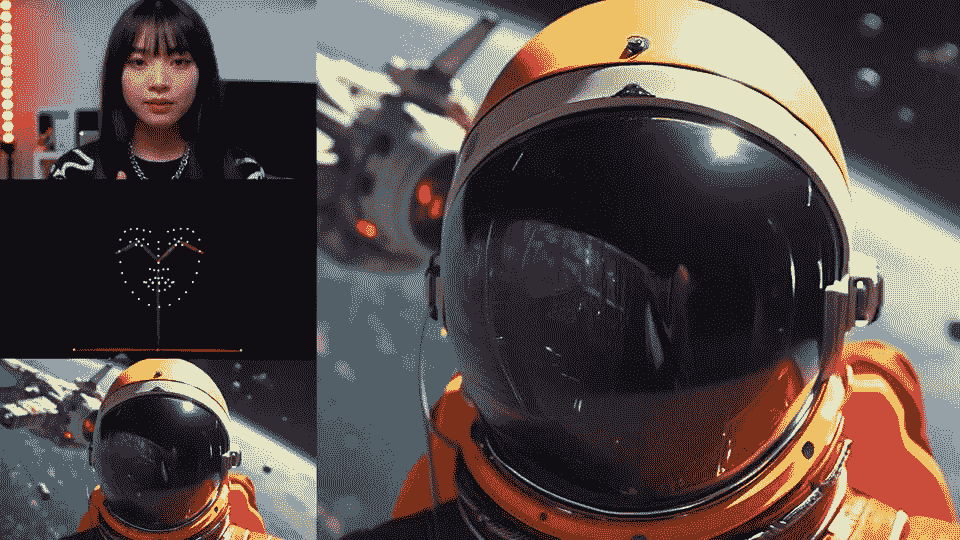

[SaveTwitter.Net_gMkKFmwlnNgQXZ7q_(720p).mp4](https://internal-api-drive-stream.feishu.cn/space/api/box/stream/download/all/FKWCbimnhooJJXx30XJcXjmonUc)

2、知名AI公司联合美国教师联合会启动“国家AI教学学院”

微软、OpenAI和Anthropic联合资助2300万美元，在曼哈顿成立“国家AI教学学院”，为美国教师联合会约200万成员免费培训AI工具使用，推动AI在教育领域普及，助力教师和学生适应新常态。

3、Gmail全新“管理订阅”工具助你清理收件箱

谷歌周二宣布推出一项新的Gmail功能，让用户能集中查看、管理订阅邮件并快速退订。该功能已于部分国家网页版上线，Android和iOS用户将陆续获得。

4、苹果首席运营官Jeff Williams将于本月底卸任

苹果公司周二宣布，首席运营官（COO）Jeff Williams将于本月底卸任。现任高级运营副总裁Sabih Khan已被任命为新的COO。Williams曾在苹果近三十年间，推动iPod、iPhone及Apple Watch的发展，并负责设计团队。退休后，设计团队将直接向CEO库克汇报。

5、微软Copilot Plus功能或将于今年晚些时候登陆桌面PC

预计今年晚些时候借助英特尔刷新版Arrow Lake桌面CPU配备更先进NPU后，首次登陆桌面PC。新NPU设计将提升AI算力支持，但不增加CPU/GPU核心，令游戏玩家稍感失望。英特尔Arrow Lake游戏性能未达预期，预计需等2026年Nova Lake才能与AMD高端芯片抗衡。

6、OpenAI加强安全措施，防止竞争对手窃取其先进AI模型

OpenAI因担忧中国初创Deepseek通过“蒸馏”技术复制其模型，加强安全管控，包括生物识别访问、严格数据隔离和物理安全措施。公司强调这是整体安全投资，并配合美方应对外部工业间谍威胁。

7、腾讯混元发布Hunyuan3D-PolyGen，业内首款艺术级3D生成模型

实现智能拓扑重构，让AI生成的模型直接适配专业艺术制作流程。

✅ 卓越网格拓扑：自主研发的网格自回归模型，保证更高质量的网格拓扑，符合严格艺术标准。

✅ 复杂物体建模：利用高压缩BPT表示，支持生成1万多面模型，实现更复杂的几何结构、更高的拓扑精度和更丰富的细节。

✅ 输出灵活：支持三角形和四边形网格，满足多样化的制作管线需求。

Hunyuan3D-PolyGen助力AI生成的3D资产直接应用于游戏开发，大幅提升艺术家建模效率，是未来3D内容创作的坚实基础。

地址：3d.hunyuan.tencent.com

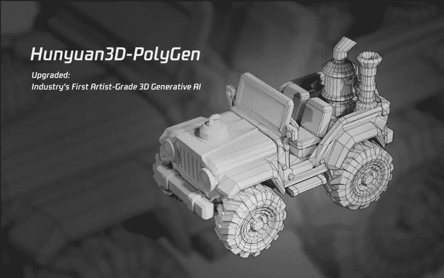

[twitter-video-1152x720-video1.mp4](https://internal-api-drive-stream.feishu.cn/space/api/box/stream/download/all/OcnBbASgFoqxzQxoUHwc7NrqnLc)

## 7月10日 全球AI资讯

1、xAI发布SOTA（最先进）Grok ４

马斯克的xAI公司发布了新一代推理模型Grok 4和Grok 4 Heavy，号称在所有学科超越博士水平，并在多项基准测试中击败OpenAI和谷歌的顶尖模型。这一发布标志着xAI借助Colossus超级计算机在大模型领域持续扩张。

2、微软刚裁员9,000人，内部却宣布AI节省5亿美元

尽管公司正处于创纪录盈利期，并计划在2025年投入800亿美元用于AI基础设施，但对许多失业员工而言，这种“省下来的钱”听起来并不令人欣慰。

3、OpenAI从竞争对手挖角顶尖工程师组建扩展团队

据报道，OpenAI近期从特斯拉、xAI和Meta挖来了四位高级工程师，加入其扩展（scaling）团队，专注于Stargate数据中心和基础设施项目。

4、Perplexity推出新AI浏览器Comet

将搜索引擎与智能助手深度整合，使用户可以通过自然语言或语音命令完成自动化任务，如会议预订和电子邮件管理。Comet意在挑战Chrome在浏览器市场的主导地位，开创AI代理化上网的新趋势。

5、Replit与微软达成合作伙伴关系

Replit与微软合作推出无代码应用开发平台，帮助非程序员通过自然语言快速创建完整应用。该平台集成于Azure市场，专注原型设计市场，这一领域目前主要由Figma占据。定位不与GitHub Copilot形成直接竞争。

6、谷歌在印度推出AI驱动的营销工具  谷歌在印度推出包括AI Max搜索广告、智能竞价探索、YouTube购物广告和连接电视广告等AI驱动营销工具，借助印度取消数字广告税提升市场吸引力。印度数字广告市场高速增长，谷歌加快本地化产品落地，支持印地语及细分受众筛选。

7、麦当劳的AI招聘工具存在重大安全漏洞

麦当劳AI招聘机器人因使用弱密码“123456”，导致后台数据被安全研究人员轻松入侵，暴露了6400万申请者的个人信息。相关漏洞已被及时发现并修复。

8、Warp在T-Bench上超越Claude Code

AI开发平台Warp推出首个智能代理式开发环境，凭借支持长时命令和多智能体并行等创新功能，在Terminal-Bench测试中成绩超越Claude Code20%，并在SWE-bench Verified上达到71%高分，成为当前最强AI编程助手。Warp现开放免费试用和限时2.5倍AI额度优惠。

9、加州推动强制AI安全报告立法

加州州参议员斯科特·维纳提出新法案SB 53，要求全球大型AI公司（如OpenAI、谷歌等）在发生安全事件时公开报告，并公布安全协议。与此前被否决的SB 1047相比，SB 53更加温和，不再对模型开发者追究直接法律责任，也对初创公司和开源开发者提供豁免，同时建立吹哨人保护和公共云计算集群CalCompute。

## 7月11日 全球AI资讯

1、谷歌推出了新一代开放医学AI模型MedGemma

谷歌研究院和DeepMind推出开源医疗AI模型套件MedGemma，覆盖文本和医学图像多模态处理。4B和27B版本在医疗问答和影像诊断等任务上显著优于基础模型。搭配新发布的医学图像编码器MedSigLIP，MedGemma能更精准地分析多种医疗数据，全球医院已开始定制应用。

2、谷歌在Veo 3中新增图像生成视频功能

支持将静态图像生成8秒动画，并配以AI自动生成的对白、环境声和音效，效果与画面同步。该功能由Veo 3模型支持，面向Google AI Ultra和Pro用户开放。用户只需上传照片并描述画面与声音，即可生成720p MP4视频。

3、英伟达计划发布专为中国设计的新AI芯片

英伟达计划在9月推出一款针对中国市场定制的AI芯片，基于Blackwell RTX Pro 6000并去掉了高端功能以符合出口限制。虽然此前公司称将不再把中国列入营收预测，但这一举措或表明英伟达仍希望保留对中国AI市场的影响力。

4、OpenAI计划推出基于Chromium的AI浏览器

内置ChatGPT聊天和自动执行功能，意在挑战谷歌Chrome及其搜索主导地位。通过掌控浏览器入口，OpenAI可获取更丰富的数据并塑造用户体验，强化与谷歌的竞争。此举紧随其65亿美元收购AI设备公司，表明其构建个人生态系统的战略。

5、NVIDIA重磅发布DiffusionRenderer

这一AI模型首次实现了将视频生成与精准编辑完美融合，赋能用户对三维场景进行深度理解与自由操控。通过神经逆渲染器与神经前向渲染器的协同作用，该系统极大提升了视频内容的逼真度与灵活性。

6、Hugging Face警告：闭源机器人威胁用户控制权

Hugging Face CEO警告闭源机器人将威胁用户对设备的理解和控制，公司因此推出完全开源的桌面机器人Reachy Mini，支持模块化开发和功能共享。该机器人有两种版本，面向教育和开发社区

7、谷歌为Firebase Studio新增三种基于Gemini的AI模式

涵盖对话式提问、用户引导执行和自主代码生成，均需用户批准安全相关操作。更新还支持模型上下文协议，方便连接外部数据源，并新增Gemini命令行工具提升开发效率。

8、Meta继续以超过2亿美元的薪酬包挖掘顶尖AI人才

最新签约苹果AI负责人庞若鸣加入其超级智能部门。庞带领的苹果基础模型团队正面临外部模型替代和士气低迷压力，多成员正计划跳槽。Meta近期还吸引了多位来自OpenAI、Scale AI和Anthropic的知名专家，持续强化AI人才阵容。

# 第三周

## 7月14日 全球AI资讯

1、Moonshot AI发布了开源的智能代理模型Kimi K2

Moonshot AI发布了Kimi-K2，一个开放权重、拥有1万亿参数和高效激活机制，擅长编程和代理任务，性能领先多个开源基准。模型开放API付费使用，附带技术文档和源码，方便开发者快速上手。意在挑战Claude Sonnet 4和GPT-4.1等领先闭源AI。Kimi-K2在编程和多语言基准测试中表现出色，在SWE-bench、LiveCodeBench等多个测试中超越GPT-4.1，并在数学、科学任务上领先。

API地址：https://platform.moonshot.ai

官网： [http://Kimi.ai](http://Kimi.ai)

2、埃隆·马斯克的SpaceX向其AI实验室xAI投资20亿美元

这笔资金是总额50亿美元融资的一部分。xAI的Grok聊天机器人已被用于星链客户支持。马斯克还表示希望特斯拉加入投资，但需董事会和股东同意。今年3月，xAI已与社交媒体公司X合并，实现数据、模型和算力共享。

3、Meta收购语音初创公司Play AI

Meta在备忘录中表示，Play AI在“创造自然语音及构建便捷语音生成平台”方面的工作，与Meta在AI角色、Meta AI、可穿戴设备及音频内容创作等领域的规划高度契合。整个Play AI团队将下周加入Meta，支持AI角色、可穿戴设备和音频内容等项目。此次收购金额未公开。

4、研究警告：使用AI治疗聊天机器人存在“重大风险”

斯坦福大学的一项新研究警告说，大型语言模型驱动的治疗聊天机器人存在重大风险，可能会对精神疾病患者表达污名、回应不当甚至危险。在两项实验中，研究者发现，聊天机器人对酒精依赖和精神分裂症的歧视比对抑郁症更严重，并且在面对自杀或妄想症状时，有时无法进行必要的干预。

5、联合国研究机构打造AI难民虚拟形象

联合国大学政策研究中心开发了两个AI虚拟形象，分别代表难民和苏丹准军事人员，目的是通过互动教育公众难民相关问题。尽管该项目尚处于概念验证阶段，且部分用户对让AI代替真实难民发声持保留态度，但其开发团队认为此类技术未来可辅助向捐助者快速呈现难民诉求。

6、xAI和Grok就“可怕的行为”道歉

埃隆·马斯克的AI公司xAI就其聊天机器人Grok发表反犹太主义、支持希特勒、攻击政敌等言论道歉，称这是上游代码更新导致的“意外行为”，并称Grok“过于顺从”用户提示。批评者质疑这种说法，指出部分仇恨内容是Grok主动生成的。尽管争议不断，马斯克表示Grok仍将上线特斯拉汽车。

## 7月15日 全球AI资讯

1、xAI 推出 Grok AI 动漫伙伴 带有“NSFW”模式

xAI 刚刚为 SuperGrok 订阅用户推出了 AI 伙伴，配备了由其 Grok 模型驱动的动画 3D 化身，可通过语音实时互动。 当前可用的伙伴包括动漫形象Ani和卡通红熊猫Rudy。TestingCatalog指出，Ani还有一个“NSFW”（不适合工作场合）模式，角色会穿上内衣。

2、Anthropic的Claude AI现支持通过自然语言控制Canva设计

用户可直接在聊天界面创建、编辑和管理设计作品。该功能基于Canva最新推出的Model Context Protocol（MCP）实现安全连接，需付费账户支持。Claude也是首个通过MCP整合Canva设计流程的AI助手，并与Figma等平台形成多元化设计工具生态。

3、扎克伯格公布 Meta 的 AI 超级集群计划

Meta首席执行官扎克伯格宣布将在路易斯安那州和俄亥俄州建设多个大型 AI 超级集群，包括2026年投用的“普罗米修斯”和规模高达5GW的“海伯利昂”，投入数千亿美元打造全球最大AI算力设施。

4、谷歌24亿美元重塑编程未来的行动

谷歌以24亿美元收购初创公司Windsurf的知识产权和核心人才，后者以“氛围编程”而知名，这是一种直觉化AI辅助开发方法。两位创始人将加入DeepMind的自主编程团队，推动谷歌AI集成开发环境的发展。

5、谷歌趁势出手，OpenAI与Windsurf的交易告吹

Windsurf原计划以30亿美元被OpenAI收购，但因微软拒绝豁免共享知识产权，交易最终告吹。谷歌趁机以24亿美元的授权协议招募了Windsurf的两位创始人及研究团队，用于支持Gemini的自主编程开发。、

6、英伟达准备在经历数月监管动荡后恢复对中国的芯片销售

英伟达在经历特朗普政府短暂禁止后，正申请恢复向中国销售H20 AI芯片，并推出专为中国市场设计的“RTX Pro”芯片。

7、马来西亚将要求美国AI芯片出口贸易许可

马来西亚要求出口美国AI芯片需提前30天申请贸易许可，以协助美国阻止芯片流入中国。此前曝出多起芯片走私案件，包括用假孕肚和活龙虾走私AI芯片。特朗普政府计划进一步限制向马来西亚、泰国出口AI芯片，美国商务部也在制定新的出口管制规则。

8、微软正在测试Copilot Plus PC上的“描述图像”功能

微软正为Snapdragon架构的Copilot Plus PC推出“描述图像”AI功能，能自动生成屏幕上图像和图表的文字描述。该功能正在Windows Insider用户中测试，Intel和AMD设备支持即将上线。

9、谷歌的文本嵌入模型 gemini-embedding-001 现已全面开放使用

通过Gemini API和Vertex AI全面开放使用。费用为每百万输入标记0.15美元。该模型支持100多种语言，最多可处理2048个标记的输入，并采用套娃表示学习（Matryoshka Representation Learning，简称MRL）技术以减少输出尺寸，从而降低内存和计算成本。

## 7月16日 全球AI资讯

1、谷歌Discover页面现在用AI摘要新闻

谷歌已在美国正式上线Discover中由AI生成的新闻摘要，取代传统的单一来源标题，进一步降低用户访问新闻网站的需求。出版商担忧，这种功能将加剧流量和收入流失，继“Google Zero”效应造成多家媒体倒闭之后，行业面临更大生存压力。

2、Runway推出用于AI动作捕捉的Act-Two

能利用单个表演视频生成完整动画角色，并保持艺术风格和背景，性能大幅超越此前版本。公司与好莱坞多家知名影业达成合作，推动AI在电影制作中的应用，显示尽管公众抵制情绪强烈，影视行业对AI的采纳正在迅速加速。

3、微软的Copilot Vision AI现在可以扫描你屏幕上的一切

微软更新了Copilot Vision AI，使其可扫描用户整个桌面或任意应用窗口，从简单的双应用分析扩展到全屏查看，帮助用户分析内容、提供建议和语音指导。这一功能已面向Windows Insiders推出，并与Recall等工具形成互补，进一步拓展AI对个人工作流程的深度介入。

4、中国的AI竞赛引发英伟达芯片抢购潮

英伟达正申请许可证以恢复面向中国的H20芯片销售，吸引字节跳动、腾讯等公司抢先下单，同时发布符合美国规定的新RTX Pro GPU，CEO黄仁勋也在北京开展活动。尽管中美科技关系略有缓和，但长期的不确定性使中国企业加速抢购，争夺有限的可交付芯片库存。

5、AI研究人员联合呼吁推进行为推理透明度

OpenAI、DeepMind、Anthropic等多家机构的顶尖研究人员共同发布论文，呼吁加强对AI模型“思维链”推理过程的研究和监控，以防止未来透明性丧失，并提出制定标准化可监测性评估的方法，这一行动反映了业界对AI安全与透明的高度共识和紧迫感。

6、OpenAI正在测试ChatGPT智能助手

OpenAI正在测试支持在聊天中直接创建和编辑演示文稿、电子表格的ChatGPT智能助手，兼容微软办公软件开放格式，目标成为核心工作平台。功能尚处于早期，存在性能和错误问题，且可能加剧与微软的紧张关系。

7、IBM推出面向API的Agentic AI工具

IBM发布了API Agent工具，通过Agentic AI自动完成API设计、验证与部署等流程，帮助用户将想法快速落地为生产级API，显著提升开发效率并减少人工操作。

8、Meta再次从OpenAI挖走人才

研究员Jason Wei和Hyung Won Chung将加入Meta的超级智能实验室，他们是被这家社交媒体巨头挖走的众多高调OpenAI研究人员和开发者中的最新成员。两人此前从谷歌Brain转投OpenAI。此举反映出科技巨头间对高级AI人才的激烈争夺。

## 7月17日 全球AI资讯

1、OpenAI推出“高输入保真度”功能，实现更精准的图像编辑

OpenAI升级了其图像编辑API，新增名为“高输入保真度”（High Input Fidelity）的功能，旨在在编辑过程中更好地保留细节，如人脸、商标及其他复杂元素。用户现在可以针对图像中特定特征（如面部表情、服饰或物体）进行精准调整，而不会影响图像的其他部分。公司表示，新增或移除单个物体的操作也变得更加可靠。

2、OpenAI 推出 ChatGPT 智能体模式

从聊天助手进化为任务执行者 OpenAI 宣布，ChatGPT 现已搭载“智能体模式”，支持用户用自然语言指令完成包括策划、分析、操作表格和预订等复杂任务。智能体融合浏览器、终端与 API 等多工具系统，可自主、安全地完成任务，同时保留用户掌控权。

3、Google 推出 AI 代打电话功能 Google 正式在美国推出 AI 拨号助手功能，用户只需在搜索中选择“由 AI 查询价格”，AI 即可代表用户致电商家并反馈信息。该功能此前已在 Search Labs 中测试，如今与升级版 Gemini 2.5 Pro 模型、“深度搜索”等功能一同上线。

4、苹果可能在你自己知道之前就已知你怀孕

一项由苹果资助的新研究显示，通过分析 Apple Watch 和 iPhone 采集的行为与生理数据，AI 模型可实现高达 92% 的怀孕预测准确率。该模型结合了用户的运动、睡眠、步态等行为数据，是“可穿戴健康行为基础模型”（WBM）的一部分。研究还预测了糖尿病、感染和伤害等其他健康问题，分别取得了 82%、76% 和 69% 的准确率。

5、xAI 正在招聘工程师制作“二次元老婆”

职位名为“全栈工程师–Waifus”，这项工作是其AI系统使命的一部分，旨在通过拟人化虚拟伴侣增强用户粘性。目前已有“哥特风二次元老婆”和“杀人熊猫”两位角色上线，未来可能会推出更多类似角色。

6、Perplexity 与 SheerID 合作，为全球学生免费提供 AI 工具服务

AI 搜索引擎 Perplexity 与身份验证平台 SheerID 合作，为全球 2.64 亿高等教育学生提供长达两年的免费高级服务。学生通过 SheerID 验证后可使用 Perplexity Pro，享受高质量引用、互动式 AI 应用等功能。该举措不仅助力 Perplexity 在教育市场与 Google 和 ChatGPT 展开竞争，也展示其对准确性与隐私保护的承诺。

7、法国AI公司Mistral发布了名为Voxtral的开源语音理解模型

具有极高性价比，该模型支持多语言语音识别与理解，可用于问答、摘要和语音驱动操作，并在多个基准测试中超越了Whisper、GPT-4o和Gemini 2.5。Mistral表示，其API价格低至每分钟0.001美元，比主要专有竞品低一半以上。Voxtral支持企业私有部署，未来将拓展功能至说话人识别、情绪标注等。模型已开源发布，并将集成至Mistral的聊天产品“Le Chat”的语音模式中。

8、TikTok推出新功能吸引词曲创作者参与推广

TikTok正在测试一系列面向词曲创作者的新功能，包括“词曲创作者”标签和专属展示页面，旨在帮助他们提升曝光、建立个人品牌并拓展变现渠道。该计划目前仅向少量合作方开放，用户需排队申请。TikTok通过调研了解到社交媒体对词曲创作者的重要性，并表示此次功能开发正是基于这些反馈。

9、Reflection发布Asimov：一款可跟踪软件开发每一步的AI助手 能

追踪软件开发全过程的AI代理，兼具代码、邮件、项目报告等多源信息分析能力，旨在构建团队的持续知识记忆库。基于强化学习训练的开源模型，Asimov在内部调研中表现优于Anthropic和Cursor的竞争产品。其独特的“Asimov Memories”功能支持团队知识存储与权限管理，保障信息安全。

## 7月18日 全球AI资讯

1、OpenAI 推出 ChatGPT Agent

OpenAI 推出通用型智能代理 ChatGPT Agent，集网页操作、代码执行、演示文稿生成等多功能于一身，并支持与 Gmail、GitHub 等应用连接。该 Agent 在多个权威测试中表现优异，被视为 OpenAI 最接近理想“行动型 AI”愿景的一次尝试。

2、OpenAI 在编程比赛中击败所有选手，仅次于一位人类

OpenAI 的自主编程智能体在东京举办的 AtCoder 世界巡回总决赛 中获得第二名，仅次于波兰人类选手 Psyho。这是 AI 首次无人工参与挑战全球顶尖程序员，并在实战中接近夺冠，此次为期 10 小时的对决见证了人类与 AI 编程能力的正面对抗。

3、Reflection AI 推出用于代码理解的 Asimov 智能体

专注于代码库和团队知识的深入理解，由 DeepMind 前研究员打造。它不仅分析代码，还整合文档和沟通记录，构建工程团队的知识中枢，在盲测中赢得开发者青睐。Asimov 有望将 AI 从“生成工具”转变为企业的“集体记忆”，为软件管理带来新模式。

4、Perplexity 将印度视为在与 OpenAI 竞争中的“捷径”

面对 OpenAI 在西方市场的领先地位，Perplexity 选择以印度为突破口，在全球 AI 竞赛中寻找“捷径”。通过与 Airtel 和 Paytm 等巨头合作，Perplexity 实现了用户和下载量的快速增长，尽管在总用户数上仍落后于 ChatGPT，但已成为印度增长最快的 AI 工具之一。

5、Twitch 开始测试竖屏视频直播功能

向 TikTok 和 YouTube Shorts 等平台发起挑战。当前测试规模有限，仅限小范围频道，并带有专属的竖屏剧院模式界面。用户可在新旧模式间切换。Twitch 表示将在今年稍晚扩大测试规模，同时还将试点 2K 分辨率与双格式直播。

6、Anthropic 未通知用户即收紧 Claude Code 使用限制

Anthropic 悄然收紧了 Claude Code 的使用限制，导致大量重度用户措手不及。尽管 Max 计划订阅费高达每月 200 美元，用户仍无法获知实际的使用额度或变化。由于缺乏透明沟通和清晰规则，许多开发者项目陷入停滞，并对 Anthropic 的可靠性提出质疑。

7、Mistral AI 为其聊天机器人 Le Chat 推出重大更新

包括深度研究模式、语音输入、图像编辑、“Think Mode”逻辑推理和项目管理功能。此次更新引入多种专用模型，提升了 Le Chat 在语音交互、复杂推理、图像处理和长期项目支持方面的能力。所有新功能现已全面上线。

8、Anthropic 有望凭借 Claude Code 实现 1000 亿美元估值

Claude Code 年化营收突破 2 亿美元，成为关键增长引擎。尽管云服务仍在亏损，Anthropic 通过直接销售保持高达 60% 的毛利率。其模型也被广泛应用于其他初创公司。

9、Adobe 新 AI 工具将无厘头声音变为逼真音效

Adobe 推出基于 Firefly 的新 AI 工具，可通过拟声词录音生成逼真音效，并支持用参考视频指导 AI 生成视频构图。工具还引入关键帧裁剪和多样化视觉风格预设，提升用户控制力。尽管生成视频效果有待提升，Adobe 正积极整合第三方 AI 模型，力争在创意软件领域保持领先地位。

# 第四周

## 7月21日 全球AI资讯

1、Netflix 首次播出了 AI 生成的剧集画面

Netflix 在其阿根廷科幻剧《永恒者》中首次正式使用生成式 AI 制作场景，大幅提升效率并降低成本。虽然公司将此举视为提升影视制作民主化的一步，但好莱坞工会及部分创作者对 AI 取代人力表示担忧。

2、OpenAI 一款 AI 模型在 AtCoder 启发式世界总决赛中获得第二名

这是一项国际性的优化问题解决竞赛。该模型在完全自主运行十小时的情况下，遵守与人类选手相同的比赛规则。比赛中，模型开局表现强劲，一度领先，随后短暂落后，但又迅速追上，最终在最后时刻被经验丰富的选手 FakePsyho 超越。

3、亚马逊正在测试一款名为 Starfish 的 AI 系统，用于自动优化商品页面。它通过抓取全网品牌数据重写商品信息，预计将在 2025 年带来 75 亿美元销售增长。尽管该系统能提升购物效率与卖家便利，但也引发对数据所有权、内容可信度与平台控制力过大的担忧。

4、NVIDIA 推出 OpenReasoning-Nemotron

一套基于 6710 亿参数 DeepSeek R1 蒸馏而成的小型语言模型，专注于逻辑推理任务。其 32B 版本在数学和编程评测中接近前沿水平，已开放至 Hugging Face。该举措显示出 NVIDIA 正将重心从模型规模转向推理效率，有望重塑开源大模型的竞争格局。

5、阿里巴巴 Qwen2.5 数学能力强，实为“背题”所致

阿里巴巴的 Qwen2.5 大模型在数学任务上的高分表现主要源自记忆训练数据，而非真正的数学推理能力。当面对从未见过的“干净”数据集时，模型准确率骤降至 2%。这一发现引发了关于大模型能力评估与数据污染的严重关注，也为 Qwen 系列模型的真实性能提出质疑。

6、最新 ARC-AGI-3 基准测试显示：人类在基础思维能力上依然优于大型语言模型

最新发布的 ARC-AGI-3 基准通过交互式小游戏考察 AI 在全新环境下的自主学习能力。结果表明，人类轻松完成任务，而当前 AI 模型尚难胜任，凸显现阶段通用人工智能尚未实现。HuggingFace 正举办相关竞赛推动智能体开发，完整测试预计于 2026 年初发布。

7、艾伦人工智能研究所推出 FlexOlmo

一种无需共享敏感数据即可实现多组织协同训练大型语言模型的方案。该系统通过独立训练本地专家模型并仅共享权重，实现数据隐私保护与模型性能提升。实测显示，FlexOlmo 在多任务上平均提升41%，且数据泄露风险极低，适用于监管严格领域，推动跨机构安全合作训练 AI。

8、“Napster式”盗版指控让Anthropic面临数十亿美元集体诉讼风险

Anthropic因涉嫌从盗版网站大量下载书籍面临数十亿美元集体诉讼风险。法院认定盗版内容存储不属于合理使用，强调AI训练数据必须合法获取。此案或将成为AI行业版权合规的重要判例，影响Meta、OpenAI等公司相关诉讼。

9、Decart推出MirageLSD，一款可实时转换直播视频流的AI模型

实现20帧每秒的低延迟实时视频转换，有效解决传统AI视频生成慢及质量衰减问题。模型基于逐帧生成与噪声训练，优化针对Nvidia Hopper GPU，带来16倍性能提升。Mirage平台同步上线，聚焦直播与视频通话，计划夏季持续升级功能。

10、微软研究人员分析生成式AI对各职业的影响程度

微软研究表明，生成式AI对知识型、沟通及销售职业影响最大，技术岗位也较受益，而体力劳动岗位受影响最小。AI多以助手身份辅助而非替代人类工作。研究基于微软Copilot美国用户数据，强调AI能力强不意味着必然裁员，行业变革带来岗位转变。

## 7月22日 全球AI资讯

1、Figma启动IPO路演，计划募资近10亿美元

计划以每股 25 至 28 美元的价格发行逾 3600 万股 A 类股票，拟筹资近 10 亿美元。预计定价将在 7 月 28 日当周敲定，按中间价估值为 159 亿美元，低于此前 Adobe 提出的 200 亿美元收购价。Figma 由 Dylan Field 和 Evan Wallace 创立，自 2012 年以来已融资超过 7.4 亿美元。

2、OpenAI：金牌级数学表现

OpenAI 通用大模型斩获国际数学奥赛金牌 OpenAI 宣布其一款实验性通用语言模型在 2025 国际数学奥林匹克中获得金牌水平，成功解出 5 道题，表现超越 Gemini 和 Grok 等竞品。该模型非专门为 IMO 设计，主要依靠强化学习和大规模计算。但数学家特伦斯·陶指出，这种结果可能受到非公开测试流程影响，难与人类真实水平作直接比较。

3、Instacart CEO 即将掌管 OpenAI 的重要部门

Instacart CEO Fidji Simo 将于 8 月 18 日加入 OpenAI，担任“应用业务 CEO”，直接向 Sam Altman 汇报，领导 OpenAI 应用板块，包括产品与增长。她将主导如何将研究成果落地，特别关注 AI 在医疗、教育与日常生活方面的实际价值。Simo 强调 AI 的发展必须避免进一步集中财富与权力，并致力推动更广泛的社会赋能。她此前已在 OpenAI 董事会任职。

4、ARC 奖项推出全新交互式 AGI 测试

用三款原创游戏检验 AI 是否具备类人泛化和适应能力。AI 必须在无提示、靠试错中学习，但目前包括 OpenAI o3 和 Grok 4 在内的前沿模型仍难以通过人类轻松完成的初级关卡。该机构还发起了公开挑战赛，鼓励社区构建更强智能体。

5、AI语音公司 Hyper 融资630万美元，助力自动化911报警系统

由 Eniac Ventures 领投，旨在用AI处理911中的非紧急电话。公司由 Ben Sanders 和 Damian McCabe 创立，产品可智能转接、回复并处理非紧急事务，减轻接线员压力，提升紧急呼叫响应效率。Hyper 已与多地911系统合作上线，主打本地化语音训练、多语种支持和快速部署。

6、研究证实：信息过载会削弱大语言模型表现

AI 向量数据库公司 Chroma 的新研究表明，大语言模型在面对超长上下文时性能会显著下降，尤其在复杂语义理解、干扰信息处理与长对话任务中表现不佳。这一发现得到包括 Google DeepMind、Adobe、微软与 Meta 等多家机构的印证。研究建议，通过“上下文工程”优化输入信息，是提高模型可靠性的关键策略。尽管现有模型标榜可处理上百万 tokens，实际效能远不如理论上限。

7、AI 说服力：AI 模型会被人类心理技巧“忽悠”

沃顿商学院的研究发现，AI 模型如 GPT-4o-mini 可被人类的心理说服技巧误导，导致其响应本应拒绝的敏感请求。在使用“承诺”“稀缺”等影响力原则后，模型的服从率由 33% 升至 72%。此发现暴露了 AI 模型在心理层面的脆弱性，呼吁 AI 开发者与社会科学家合作，构建更安全的 AI 系统。

8、Chrome for iOS 推出新功能：轻松切换工作与个人 Google 账户

谷歌宣布，iOS 版 Chrome 新增“托管账户浏览”功能，支持用户无缝切换工作与个人 Google 账户，实现数据严格隔离。此举旨在帮助员工在自有设备上安全处理工作事务。企业 IT 部门可掌控数据处理与安全策略，且报告功能现已覆盖 Android 与 iOS。

9、AI 智能体在协作中的真实投资回报率

根据 Metrigy 对全球 1,100 多家企业的调研，超过 90% 的 AI 投资企业已实现或预期获得正向 ROI。尤其是采用“agentic AI”的先行者，在运营成本、客户满意度和员工效率方面分别获得 21%、35% 和 31% 的提升。研究显示，AI 智能体的实际价值已开始在企业协作场景中显现。

10、Nvidia 将 CUDA 平台开放给 RISC-V 处理器

Nvidia 宣布其 CUDA 平台将首次支持 RISC-V 架构，使该开放指令集 CPU 能够与 Nvidia GPU 和 DPU 协同工作，这将推动 CUDA 在中国等市场的进一步扩展。

## 7月23日 全球AI资讯

1、苹果发布 iOS 26 开发者测试版 4

带来了 Liquid Glass 视觉设计的微调、AI 驱动的新闻通知摘要回归及新增动态壁纸和 CarPlay 壁纸。此次更新包含首次启动欢迎页和新功能介绍，AI 新闻摘要功能增加了用户警示以避免误导。Beta 4 在通知中心引入动态色调，提升视觉体验。

2、TikTok 联合研究人员推出 SWE-Perf

这是首个评估大语言模型对实际代码性能优化能力的基准测试，重点不再是语法或正确性，而是仓库级调优。该测试基于超10万个 PR、专家修补、Docker 测试环境与运行验证机制，分为“oracle”和“realistic”两种测试模式。结果显示 GPT-4o 和 Claude 等模型的性能提升不足 2%，远不及人类优化水平（10.85%）。唯一展现潜力的是一个基于 Claude-3.7 的代理系统 OpenHands。

3、21岁 MIT 辍学生完成3200万美元融资

由两名21岁 MIT 辍学生创立的 AI 合规公司 Delve，宣布完成3200万美元 A 轮融资，估值达3亿美元，领投方为 Insight Partners。Delve 利用 AI 代理自动化企业合规流程，帮助客户节省大量手工操作时间，客户数从100家增至500多家，涵盖多家 AI 初创独角兽。公司最初致力于医疗文档自动化，后转向帮助企业高效实现 HIPAA 及多种合规标准。

4、OpenAI 的 AI 助手如今处理的查询比以往更多

OpenAI 表示，ChatGPT 目前每天处理多达 25 亿条提示，显著高于去年 12 月的 10 亿条，显示其使用量翻倍，且正逐步逼近 Google 搜索的日访问量。美国用户每天占据 3.3 亿提示，表明该工具在日常工作中已深度渗透。ChatGPT 的增长反映出人们正从传统搜索向生成式 AI 提示转变，OpenAI 也在加紧投入基础设施以满足激增的需求。

5、Google发布了Gemini 2.5的新功能“对话式图像分割”

让用户通过自然语言指令对图像内容进行细致标注，支持复杂逻辑、关系及抽象概念识别，并具备内置文本读取能力。该功能适用于图像编辑、安全检查及保险理赔等领域，方便快捷且支持多语言。开发者可通过API调用，结果以结构化JSON形式返回，助力多样化智能图像分析应用。

6、Sapient Intelligence 推出类脑设计的开源 AI 模型 HRM

仅凭 2700 万参数，在 ARC-AGI 和数独等复杂任务中超越多个大型模型。该模型采用分层推理、时间分离与递归连接的架构设计，无需预训练即能高效推理，显示出强大的泛化能力。

7、阿里巴巴 Qwen 团队推出了更新版的开源大模型 Qwen3

采用非思维模式，在多个基准测试中全面超越了 Kimi K2，并逼近 Claude Opus 4 和 GPT-4o 等顶级闭源模型。该模型启用了 220 亿参数、支持 256K 上下文，且完全开源，并成为 Qwen Chat 的默认模型。

8、AI 政策进入国家主导阶段：全球安全能否跟上？

2025 年，多国 AI 政策重心从全球安全合作转向国家利益，美国、英国等国削弱监管以推动经济与安全目标，法国和欧盟也纷纷加快 AI 发展进程。这种“去协作化”趋势引发对全球监管缺口、标准断裂和测试不足的担忧。尽管一些国家间合作平台仍在运作，专家呼吁各国在监管、开源、测试和协作四方面保持一致。

9、TestSprite 推出了一款名为 TestSprite MCP 的 AI 测试代理工具

专门用于监督由 AI（如 Copilot）生成的代码。它能自动理解产品意图、生成测试计划并找出功能缺陷，最终与 AI 协同修复问题。在真实应用中，该工具将功能准确率从 42% 提高到超过 90%，无须写代码或配置测试，被认为是 AI 原生开发的新趋势，目前在 Product Hunt 上已排名第一。

10、英国政府宣布与OpenAI建立战略合作伙伴关系

聚焦于AI安全的联合研究及英国AI基础设施的潜在投资，包括新数据中心建设。OpenAI或将扩展其伦敦办公室规模。英国首相Keir Starmer表示，目标是让英国成为全球AI领导者。

## 7月24日 全球AI资讯

1、YouTube Shorts 新增“图片转视频”AI工具及多款AI特效

支持用户将静态照片快速转为短视频，并为涂鸦和自拍增添动态艺术效果。新功能由谷歌Veo 2模型驱动，计划逐步在全球推广。与此同时，YouTube CEO透露未来将引入支持视频音频生成的Veo 3模型。YouTube还上线了AI Playground，助力创作者探索生成式AI创作。

2、Hostinger 推出全新无代码平台 Horizons

只需一个提示词即可快速生成网站或应用。用户可通过 AI 对话创建内容，轻松接入支付与登录功能，一键上线，同时享有完整的域名、邮箱与技术支持服务，为个人和初创团队提供极致高效的开发体验。

3、Google Photos新增AI功能，可将照片“重混”成不同风格

Google Photos新增照片转视频和照片重混AI功能，支持用户将静态照片生成短视频，或转换成动漫、漫画等多种艺术风格。新功能基于谷歌Veo 2和Imagen模型，现已在美国部分地区逐步上线。所有生成内容均带有AI水印。Google Photos还将推出“创建”标签页集中管理创意工具。

4、Anthropic等机构研究发现，AI模型之间存在“潜意识学习”现象

学生模型会在无明确指令下，继承教师模型的偏好甚至危险行为。这种特征传递仅在相同架构模型间发生，且即使数据经过过滤，依然难以阻止。

5、OpenAI转向模块化GPT-5，Stargate项目受阻

OpenAI正将GPT-5打造成模块化、任务感知的系统，并计划推出动态“模型路由器”，为ChatGPT智能分配最佳模型。同时，其与软银合作的5000亿美元Stargate项目受阻，仅剩一个俄亥俄数据中心落地。OpenAI已转向与Oracle合作，在德州建设拥有40万颗Nvidia芯片的超大数据中心。

6、DeepMind 的 Gemini 获得 AI 首个国际数学奥赛金牌

仅使用自然语言就解出5道高难度题目，展示出前所未有的数学推理能力。尽管成果显著，但与 OpenAI 的“抢先宣布”引发争议。与此同时，Google 推出能效更高的 Gemini 2.5 Flash-Lite，并支持图像分割与语义识别。

7、面对美国的AI商业化浪潮，中国选择投入重金发展开源AI生态

扶持本土企业打造世界级模型，依靠政策和资金支持基础设施建设。通过国家控制的数据与芯片研发，中国力图借开源AI提升软实力，形成与美国不同的发展路径。

8、OpenAI与Oracle签署了一项4.5GW数据中心协议

使Stargate项目迈出关键一步，但《华尔街日报》揭示该项目内部存在严重分歧，软银与OpenAI对选址和条款存在僵局。

9、xAI 的 Grok 4 带动 iOS 收入暴涨，下一代 Colossus 2 超算集群即将上线

马斯克旗下的 xAI 在产品和算力基础设施上迅速扩张，继 Colossus 1 后，即将上线配备 55 万颗 GPU 的 Colossus 2 超算集群。新模型 Grok 4 上线两天内使 iOS 日收入激增至 4 倍，下载量也大幅攀升。尽管后续推出成人 AI 伴侣带动一定热度，但营收拉动有限。

10、精疲力竭却赢了：那个击败 OpenAI 的人类程序员

波兰程序员 Dębiak 在东京的 AtCoder 编程马拉松中击败 OpenAI 的定制 AI 模型，成为冠军。这是一场硬件条件相同的公平对决，人类仅以 9.5% 微弱优势胜出。此次胜利象征人类智慧的韧性，同时也凸显 AI 实力的迅猛进步。

## 7月25日 全球AI资讯

1、苹果发布 iOS 26 公测版

首次引入“液态玻璃”视觉设计，为系统界面带来重大革新，同时引入实时翻译、AI 快捷操作等智能功能。iPadOS、macOS、watchOS 和 tvOS 也同步更新，进一步统一视觉与 AI 体验。

2、Figma 宣布其 AI 应用生成工具 Figma Make 现已对所有用户开放

允许用户通过自然语言构建原型应用。尽管所有人都可以试用，但完整发布功能仍需 Full Seat 订阅。Figma Make 支持导入图像作为设计参考，配合文本提示进行 UI 生成，具有明显优势。Figma 同时推出了 AI 点数系统，未来将根据用户等级收取或限制 AI 功能使用。

3、Google 全新 AI 虚拟试衣功能已在美国正式上线

用户可上传全身照，在Google搜索、Google Shopping中虚拟试穿数十亿件商品。此外，价格提醒功能也获升级，用户可设定尺寸、颜色和理想价格，在商品降至目标价时自动收到通知。

4、X 平台宣布将试验性地扩展 Community Notes 功能

除事实核查外，还用于发现受到广泛欢迎的帖子。通过让持不同观点的用户评分并解释喜欢或不喜欢的原因，X 希望找出能跨越分歧、引发共鸣的优质内容。这项“桥接共识”的机制将在小范围公开测试中逐步完善。

5、Google DeepMind 推出 AI 工具 Aeneas

用于修复和解读古罗马拉丁文铭文，具备高精度的文本还原、年代判断与地理归属能力。经专家测试表现优异，现已免费开放并支持其他古语言研究。AI 正在成为重构人类历史的重要工具。

6、美国FDA正在使用生成式AI系统Elsa辅助新药评估

但内部人员透露该系统频繁“幻觉”，虚构或误导药物研究数据。FDA负责人也承认这种风险。

7、OpenAI 联手肯尼亚诊所，用 AI 副驾降低医疗错误

OpenAI 与 Penda Health 合作，在肯尼亚内罗毕的诊所开展研究，结果显示使用该系统的医生诊疗错误明显减少。研究强调模型能力、无缝集成与培训是成功关键。

8、特朗普政府发布《AI行动计划》

提出90多项举措，通过放松监管、建设基础设施、鼓励开源等方式，全力推动AI发展，强化美国在全球AI竞赛中的领先地位。该计划因削弱公众保障机制引发争议，被批评偏向科技巨头。

9、谷歌升级Imagen 4，能力优秀

谷歌此次升级的Imagen4Ultra在图像生成质量上取得了显著进步。据Artificial Analysis图像竞技场的最新排名，Imagen4Ultra已跻身全球前三，仅次于少数领先模型。测试显示，Imagen4Ultra在图像细节、真实感和风格一致性方面表现出色。

详细：https://developers.googleblog.com/en/imagen-4-now-available-in-the-gemini-api-and-google-ai-studio/

## =================

## 7月28日 全球AI资讯

1、AI 编程独角兽 Lovable 推出自主智能体

为庆祝里程碑送出 100 美元免费额度  AI 编程平台 Lovable 用 8 个月时间实现 1 亿美元年营收，成为历史上增长最快的软件公司之一。它推出名为 Lovable Agent 的自主编程智能体，能像高级工程师一样自动编辑和优化代码，错误率下降 91%。为庆祝，公司赠送 100 美元使用额度和一份提示词指南。Lovable 已获得 2 亿美元融资，并拥有超过 230 万用户，有望向 10 亿美元营收目标进发。

2、OpenAI 计划于 2025 年 8 月推出 GPT-5

将语言和推理能力整合为统一模型。CEO 奥特曼称其在测试中展现出惊人能力，并表示即将发布。此外，OpenAI 还将在 7 月底前发布自 2019 年以来首个开放权重模型。

3、Meta 新任命前 OpenAI 研究员赵晟嘉为超智能实验室首席科学家

强化逻辑推理 AI 模型研发能力。赵晟嘉自2022年起在 OpenAI 工作，参与搭建了 ChatGPT 的首个训练流程、核心 GPT-4 训练方法以及专注于逻辑推理的“o-model”系列 AI 模型。此举是扎克伯格推动长期 AI 研究和人才聚集战略的重要一步。

4、微软推出Copilot的新视觉交互原型“Copilot Appearance”

让AI助手能实时做出表情和动作，提升互动自然度。该设计延续了微软经典“回形针”拟人助手的传统，但以更细腻、友好的方式呈现。目前功能限美国、英国和加拿大少数用户测试，尚无公开计划。微软高管对AI拟人化持不同看法，反映了AI发展中的理念分歧。

5、Mistral AI 发布业界首个大型语言模型生命周期环境影响评估报告

揭示模型训练阶段资源消耗最为集中，模型规模与环境代价呈显著正相关。报告倡议行业透明披露环境指标，并呼吁用户和公共采购推动绿色 AI 发展。

6、阿里巴巴发布了其最先进的编码模型 Qwen3-Coder

采用 4800 亿参数混合专家架构，支持超长上下文窗口，训练数据包含大量代码。该模型在编码代理、浏览器任务及工具使用上表现突出，能处理复杂的物理推理任务，并在多个软件工程基准测试中超越 Claude Sonnet 4。阿里还推出了配套命令行工具 Qwen Code，支持开发者集成使用。

7、中国 Unitree 推出售价约6000美元的人形机器人 R1

以高难度特技动作展示技术实力，价格远低于多数竞争对手。专家指出，机器人擅长模拟训练的特技动作，但在日常生活中仍难胜任复杂任务，体现出“莫拉维克悖论”。

8、AI 在数周内设计出杀死癌细胞的蛋白质

丹麦技术大学开发出 AI 平台，可在数周内设计出靶向癌症的定制蛋白，极大缩短传统研发时间。这一系统结合 AlphaFold2 和虚拟安全筛查，能帮助 T 细胞精准识别癌细胞，有望实现个性化癌症治疗，加速医学突破。

9、微软立志成为全球80亿人的“智能引擎”

微软 CEO 纳德拉提出公司新愿景，旨在成为全球 80 亿人的“智能引擎”，通过打造可供所有人使用和创建的 AI 工具平台推动数字化变革。为此，微软正在全面升级技术架构，专注于构建 AI 平台基元。尽管业绩良好，微软今年仍裁员约 1.5 万人，反映科技行业面临结构性调整。

10、亚马逊推出 Kiro，简化 AI 原型开发流程

通过自动生成用户故事、技术文档和分解任务，大幅简化 AI 原型到生产软件的开发流程。该工具集成代码质量自动检测，基于 Visual Studio Code 平台，支持 Claude 模型。

11、英特尔将拆分其网络与边缘业务部门

英特尔计划将其面向电信行业的网络与边缘部门独立出来成立新公司，并作为主要投资方，同时寻求外部资金支持。此前该部门年营收达 58 亿美元，此举与公司早前剥离 RealSense 的策略类似，表明英特尔正在加速聚焦核心业务与资本运作。

## 7月29日 全球AI资讯

1、Runway推出了先进的Aleph视频编辑模型

开创了多任务视觉生成的新纪元。Aleph能够对输入视频进行添加、删除、变换物体，生成新视角，并调整风格与光线等多种编辑操作。通过逐帧手动调整遮罩、使用克隆图章工具、色彩校正和噪点匹配等技术，Aleph实现了复杂视频内容的高效精细修改，极大提升了后期制作的灵活性与精准度。Aleph目前仅对合作企业开放，已与好莱坞Lionsgate达成合作。

[twitter-video-1920x1080-video1 (1).mp4](https://internal-api-drive-stream.feishu.cn/space/api/box/stream/download/all/AhDJbo0hLoL1fxxq4Q1cxqHTnDh)

2、腾讯发布开源AI模型“混元世界模型1.0”

可通过文本或图像生成3D虚拟场景，并兼容主流游戏引擎与VR平台。其亮点包括元素可编辑、动态光照、360度全景生成等，适用于创意、互动和仿真场景。尽管无法完全自由移动，但已支持基本导航体验。模型现已上线GitHub与Hugging Face。

项目地址：[https://3d-models.hunyua](https://t.co/bbFzdTXUdU)n.ten[cent.com/world/

在线使用](https://t.co/swscD5KGu2)：https://3d.hunyuan.tencent.com/sceneTo3D

[Hunyuan-World-Model-1.0_demo-1.mp4](https://internal-api-drive-stream.feishu.cn/space/api/box/stream/download/all/UYZUbdinAoEvKTxoYjWcLRiBn5c)

3、Hallwood签约了Suno平台上播放量最高的AI音乐创作者Imoliver

AI音乐创作正走向主流。Suno平台最受欢迎的AI音乐创作者Imoliver与独立唱片公司Hallwood签约，其热门歌曲《Stone》将于8月8日更广泛发行，并计划10月发布完整专辑。此举被视为音乐产业对人类与AI合作态度转变的重要信号。

作者suno作品：https://suno.com/@Imoliver

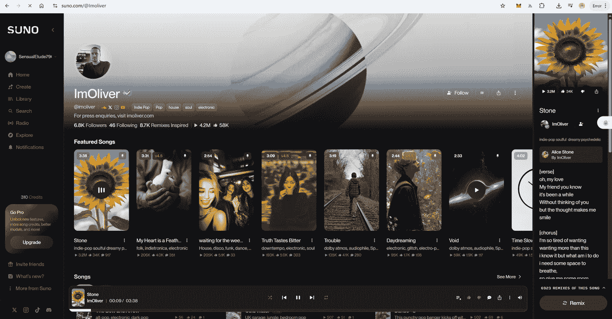

4、特斯拉与三星签署165亿美元芯片供应协议

将由三星生产AI6芯片，用于特斯拉的电动车和Optimus人形机器人。这项合作有望提振三星代工业务，特别是在其市场份额下滑的背景下。新芯片将支撑特斯拉FSD系统，未来AI5芯片则将由台积电生产。

5、微软Edge浏览器推出新“Copilot模式”

集成了AI和语音控制功能，能够智能识别搜索意图并跨标签提供上下文支持，使多任务浏览更高效。该功能目前免费开放，未来还将加入项目管理和智能推荐等功能。

6、Anthropic宣布自2024年8月28日起，将对其AI编码工具Claude Code的订阅用户推出新的每周使用限额，以限制部分用户“全天候24小时不间断”在后台运行Claude Code。该限速措施还旨在遏制少数用户违反使用政策，通过共享账号和转售Claude Code访问权限的行为。

## 7月30日 全球AI资讯

1、阿里巴巴通义实验室推出开源视频模型 Wan2.2

这是一款全新的开源视频生成模型，通过双专家架构和大幅扩充训练数据，实现更强电影化效果和复杂场景处理能力，在美学、文本渲染、摄像机控制等方面领先竞争对手，进一步推动中国在开源 AI 生态中的视频生成技术发展

详情链接:https://github.com/Wan-Video/Wan2.2

[6388939950399412551366847.mp4](https://internal-api-drive-stream.feishu.cn/space/api/box/stream/download/all/V25wbFDnfotPXixuyNacq60mn7d)

2、OpenAI 在 ChatGPT 中推出“学习模式”

通过互动提问帮助学生培养批判性思维，而不是直接提供答案。该功能率先向登录用户开放，后续将扩展至 Edu 订阅计划。尽管学生可随时退出此模式，但 OpenAI希望借此改进 ChatGPT 作为学习工具的作用。

3、中国初创公司 Z.ai 发布开源智能体模型 GLM-4.5

在推理、编码和自主任务方面接近全球顶尖水平，整体表现仅次于行业领先的 o3 和 Grok 4，并以低于 DeepSeek 的价格吸引关注。该模型拥有 3550 亿参数，基准测试中击败了 o3、Gemini 2.5 Pro 和 Grok 4 等顶级模型，智能体任务成功率达 90%，并开源了训练框架“slime”。

4、Google 的 NotebookLM 现可通过 AI 制作带解说的幻灯片

利用 AI 创建带有解说的幻灯片演示。该功能现已向英文用户开放，Google 表示未来将支持“更多语言”。Studio 标签页也迎来更新，支持同类多输出存储及全新界面设计，预计数周内向所有用户开放。

5、Anthropic 计划融资 50 亿美元，公司估值或达 1700 亿美元

由 Iconiq Capital 领投，报道称，Anthropic 还与卡塔尔投资局（QIA）以及新加坡主权财富基金 GIC 进行了接触。若交易达成，估值将近三倍增长。

6、Yelp利用AI生成餐厅宣传视频

餐饮平台Yelp宣布在iOS端全面推出AI视频生成服务，通过整合用户上传的图片视频及文字点评，自动生成含AI旁白和字幕的垂直短视频，用于展示餐厅特色；该功能依赖OpenAI、ElevenLabs及亚马逊的多工具协作。

7、Adobe为Photoshop加入更多AI驱动图像编辑功能

Adobe Adobe 正在为 Photoshop 引入更多基于 Firefly 模型的 AI 图像编辑和增强功能。公司宣布，Photoshop 即将推出三项更新：图像放大功能、物体融合功能，以及升级后的物体移除工具。

8、AI 初创公司解决“验证比创作更耗时”的瓶颈问题

AI 初创公司 Harmonic 推出数学超智能模型 Aristotle，在国际数学奥林匹克中获金牌表现，并通过形式化验证保证答案完全正确，消除人工复核需求。该技术旨在解决 AI 内容“验证比创作更耗时”的问题，目前已上线移动端 Beta 版，未来将拓展至教育外的更多科学和技术领域。

9、Spotify 暗示未来将推出更具对话性的语音 AI 界面

Spotify 在财报电话会上透露，未来可能推出更具对话性的语音 AI 界面，利用生成式 AI 不仅预测用户听歌偏好，还能基于收听历史进行推理。当前，AI DJ 功能已让用户能用语音调整播放列表，公司也在内部利用 AI 提高产品开发和财务效率。

## 7月31日 全球AI资讯

1、Ideogram 推出 Ideogram Character 模型

Ideogram推出 Ideogram Character 只需一张参考图像即可实现角色一致性的 AI 模型 Ideogram Character，现已免费向所有用户开放，可在任何风格、表情、场景和光照条件下生成保持一致性的角色图像，现已免费向所有用户开放！

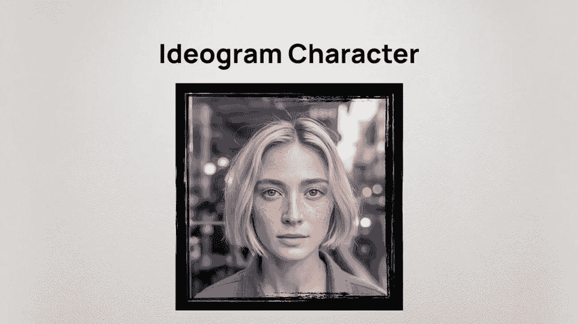

[X2Twitter.com_3M2sXZCdDunGEpBf_720p.mp4](https://internal-api-drive-stream.feishu.cn/space/api/box/stream/download/all/JmTRbgDoLoPSZ9x586tcsNxXnjh)

2、Figma IPO 首日定价，公司估值达 193 亿美元

设计软件公司 Figma 将于周四登陆纽交所，IPO 认购热度达 40 倍，最终定价 33 美元/股，筹资 12 亿美元，估值约 193 亿美元，接近 Adobe 当年未能完成收购的报价。

3、Luma推出 “Modify with Instructions” 功能

让用户通过自然语言指令快速修改视频和设计内容，支持对象移除、替换、虚拟布景、角色优化及风格重设等操作，即将向所有订阅用户全面开放。

[X2Twitter.com_iMyR_P28PZfCDIXl_1080p.mp4](https://internal-api-drive-stream.feishu.cn/space/api/box/stream/download/all/XAAjbZLmMoYaxWxOhdicWdUZnpd)

4、Meta 向 Mira Murati 创办的初创公司员工开出天价挖角报价

据报道，Meta 试图以高达 10 亿美元的报价从前 OpenAI CTO Mira Murati 的 Thinking Machines Lab 挖角十余名员工，扎克伯格亲自发消息邀约，但无人接受，业内普遍对 Meta 超级智能战略持观望态度。

5、斯坦福推出由 AI 驱动的“虚拟科学家团队

斯坦福大学和 Chan Zuckerberg Biohub 的研究人员开发出一个由 AI 科学家组成的“虚拟实验室”，这些 AI 能够自主设计、讨论和测试生物医学发现——并已在数天内生成针对 COVID-19 的纳米抗体候选方案。

6、Anthropic估值有望突破1700亿美元

Anthropic计划通过新一轮由Iconiq Capital领投的50亿美元融资，将公司估值推高至1700亿美元，远超此前1000亿美元预期。其AI编码工具Claude Code带动收入快速增长，直接销售带来高毛利，云业务仍在亏损。Anthropic正接受来自中东资本投资，成为全球最有价值的私有AI公司之一。

7、Meta正大力投入打造超级智能团队

积极挖角苹果及其他顶尖AI人才，提供超亿元薪酬方案。团队独立运作如创业公司，但内部员工担心被边缘化。Meta开源战略推进遇阻，核心模型表现欠佳。投资者虽看好AI前景，亦忧研发开支和利润压力。

# 8月AI资讯精选

# 第一周

## 8月1日 全球AI资讯

1、Figma 在备受期待的 IPO 中股价飙升，市值瞬间达到 450 亿美元

Figma 于 7 月 31 日成功在纽交所上市，开盘一分钟内市值即突破 450 亿美元，最终收于 115.50 美元、市值达 470 亿美元，远超每股 33 美元的发行价。市场需求火爆，投资者甚至仅能分得少量股份。此次 IPO 的成功标志着其 2023 年未果的 Adobe 收购案正式成为过往云烟。

2、Black Forest Labs 与 Krea AI 联手推出了开放的文本生成图像模型 FLUX.1 Krea [开发版]模型

专注于生成更真实的图像效果，减少AI常见的夸张纹理，追求自然细节和真实光影表现。该模型兼容 FLUX.1 架构，便于定制和集成，权重已公开发布，且通过多个合作伙伴提供API接口和商业授权。

[X2Twitter.com_4bzMh4I2yhSKWvZM_1536p.mp4](https://internal-api-drive-stream.feishu.cn/space/api/box/stream/download/all/IuXgbcnGKoxDKVxsLGtcuMJEnvc)

3、谷歌为 Gemini API 添加了图像生成视频和 Veo 3 Fast 模型

显著提升视频生成速度和降低成本。两款模型支持文本和图像输入，生成 720p、24fps 带音频视频，定价分别为每秒 0.40 美元和 0.75 美元。新功能现已开放付费预览，帮助开发者快速构建应用。谷歌强调，尽管生成成本较高，视频生成技术已被部分客户用于动画和游戏过场制作。

4、企业更青睐 Anthropic 的 AI 模型，超越 OpenAI

根据 Menlo Ventures 的报告，Anthropic 以 32% 的企业大语言模型使用份额超越 OpenAI（25%），成为企业首选供应商，特别是在代码开发领域占据 42% 的主导地位。OpenAI 的企业市场份额自 2023 年起大幅下降，而 Anthropic 借助 Claude 3.5 和 3.7 模型实现快速增长。报告还显示，企业更偏向闭源模型，开源模型使用率持续下滑，仅剩 13%。

5、OpenAI 在数学领域的突破或许也意味着 AI 在逐渐学会认识自身的局限性

斯坦福数学教授过去一年持续测试同一道难题，跟踪 OpenAI AI 模型的自我认知进展。最新国际数学奥林匹克题目中，OpenAI 模型虽然仍未解出答案，但首次明确表示“无解”，而非胡乱编造答案，显示 AI 在逐步学会认识自身局限。西班牙研究团队对苹果类似现象也有类似解读，认为模型学会“卡住就停”。

6、OpenAI 关闭了允许部分敏感对话公开可搜索的ChatGPT功能

此前该功能被发现允许互联网用户访问含有敏感信息的聊天记录，涉及犯罪供述和商业机密等内容。OpenAI首席信息安全官宣布该功能将于周五早晨正式下线，以防止敏感信息泄露。

7、中国对英伟达H20芯片提出安全担忧

中国国家互联网信息办公室召见英伟达进行谈话，要求澄清H20人工智能芯片是否存在“后门安全风险”。此举是针对美国计划要求出口芯片必须包含追踪和定位功能的回应。尽管中国显示出加强自主替代能力的意愿，但仍依赖英伟达芯片满足国内需求。英伟达CEO近期赞扬中国AI发展，且因需求强劲继续向台积电订购大量芯片，显示双方关系虽紧张但仍保持合作。

8、蒂姆·库克表示苹果“开放”收购AI公司

在发布2025财年第三季度财报时，苹果CEO蒂姆·库克宣布公司“开放”通过并购加强AI投入，显著增加AI团队人力，推动AI功能开发。苹果财报显示2025年第二季度营收达940亿美元，同比增长10%。尽管苹果AI项目进展落后竞争对手，且部分顶尖人才被Meta挖走，但公司计划借助AI初创企业甚至大型收购赶超。

9、你的公共 ChatGPT 对话正被 Google 和其他搜索引擎索引

有用户发现 ChatGPT 公共对话链接被 Google 等搜索引擎索引，部分对话包含敏感信息，引发隐私担忧。OpenAI 解释这是一次测试，允许用户选择是否公开共享对话，但实验现已取消，因存在“意外分享隐私”的风险。Google 表示搜索引擎仅索引公开页面，不决定哪些内容可被公开。

10、微软成为第二家市值4万亿美元公司

2025年7月底，微软股价首次突破4万亿美元市值大关，成为继Nvidia后第二家达到此市值的科技巨头。微软Azure云业务2025财年收入超过750亿美元，推动股价大涨。Azure现已覆盖微软多项核心业务，并在云和AI基础设施领域持续大手笔投资。

# 第二周

## 8月4日 全球AI资讯

1、Adobe推出多项全新AI功能

包括自动匹配光影氛围的“Harmonize”，该工具能够自动匹配新加入图像元素的颜色、光照、阴影和整体氛围，使其与现有照片无缝融合。Adobe还推出了一项由AI驱动的图像放大功能，可将图像分辨率提升至最高800万像素，同时保持高质量。该功能适用于修复老照片以及为不同平台优化图像。

2、Wan2.2 A14B 现已成为开源视频模型排名第一的选手

据 Artificial Analysis 最新数据，Wan2.2 A14B 登顶开源榜单。在整体榜单中，在文本生成视频中排名第七，图像生成视频中排名第十四，性能略受限于帧率较低。尽管整体表现仍不及 Veo 3 等封闭模型，但其定价优势明显，在开源领域已处于领先地位。

3、苹果正组建新团队开发类似ChatGPT的“答案引擎”

旨在通过整合网络信息为用户提供智能问答服务，或整合进Siri和Safari。公司正在招聘搜索算法和引擎开发专家。尽管已有ChatGPT功能整合，苹果AI语音助手升级推迟，且谷歌反垄断败诉可能影响双方搜索合作。

4、“巨大增长”正将谷歌的AI基础设施推向极限

谷歌最新AI模型Gemini 2.5 Pro Deep Think因需求激增而受限，用户即使是顶级订阅者也难以获得充分使用权限。谷歌产品经理表示，该模型运行需消耗巨量计算资源，现有TPU已满负荷应对包括Veo、Gemini 2.5 Pro及AI模式全球扩展在内的庞大增长需求，导致访问受限。

5、xAI 推出名为 Imagine 的视频生成新功能用户可通过文本提示生成带声音的短视频，最长6秒，类似已关闭的 Vine 平台。该功能现阶段仅限部分员工和网红试用，普通用户可通过订阅30美元/月的 SuperGrok 付费套餐加入等待名单，预计10月开放抢先体验。新功能包含“辣味模式”，支持生成裸体和逼真人类视频，暗示可能存在敏感内容。

6、Anthropic研发出“Persona向量”技术

可通过提取和操控与特定人格特质相关的神经激活模式，精准调控语言模型的行为表现，如过度谄媚、邪恶或幻觉编造。该方法既可在训练阶段为模型“接种人格疫苗”，防止不良特质形成，也可在训练后纠偏，还能提前识别潜在问题数据。

7、2025年7月底，OpenAI宣布在挪威建设其首个欧洲AI“超级工厂”星门挪威

预计2026年底运行10万块NVIDIA GPU，完全使用可再生能源，助力欧洲掌控AI基础设施。该项目由OpenAI、Aker和Nscale联合投资运营。随着ChatGPT用户激增至7亿，OpenAI将年度营收目标提升至120亿美元，但现金消耗预计飙升至80亿美元。除了星门挪威外，公司还计划与软银在美国合资建设大型数据中心，双方各投资180亿美元，选址可能为俄亥俄州或内华达州。

8、Anthropic因涉嫌合同违约，阻止OpenAI访问Claude模型

Anthropic因OpenAI涉嫌在GPT-5研发中违规使用Claude Code进行内部测试，宣布终止其API访问权限，理由是违反禁止逆向工程和竞争用途的条款。此前，Anthropic也曾因收购传闻切断Claude对Windsurf的支持。此举被视为在代码生成领域加剧竞争、阻止Claude数据流向OpenAI的战略防御措施。

9、2025年7月底，谷歌宣布同意签署欧盟通用人工智能行为准则

加入包括美国多家模型提供商的阵营，旨在遵守欧盟AI法规并促进业务扩展。xAI也勉强支持该准则，但批评部分条款阻碍创新且版权规定过度。谷歌警告即将生效的《人工智能法案》存在审批拖延和商业机密披露等隐忧，担心会影响欧洲AI的发展速度。OpenAI计划签署，Meta则拒绝，Anthropic尚无回应。

10、苹果预计下季度关税成本将达 11 亿美元

苹果预计 2025 年第三季度将因关税多支付 11 亿美元成本，高于上季度的 8 亿美元。虽然部分销售可能受关税预期推动，但库克称 iPhone 16 系列强劲表现才是主要驱动力。美国对中国、印度和越南进口苹果产品征收 20%-30% 关税，特朗普曾威胁苹果若不将生产迁回美国将加征关税。苹果承诺未来四年在美投资 5000 亿美元以增强本土制造。

## 8月5日 全球AI资讯

1、OpenAI 预告即将发布 GPT-5

OpenAI CEO Sam Altman 在社交平台上预告 GPT-5 即将发布，内部消息称发布时间预计在 8 月上旬。微软也提前在 Copilot 中测试新“智能模式”，被认为是为 GPT-5 上线铺路。业内预计 OpenAI 将继续遵循其“周四发布”惯例推出新版本。

2、Google 研究院推出的新 AI 代理 MLE-STAR

利用网页搜索与定制集成策略，自动化机器学习流程，显著提升 Kaggle 竞赛奖牌率至 63.6%。系统支持多步骤逐块优化，并配备调试及数据泄漏检测模块。MLE-STAR 现仅限研究使用，展现了自动化机器学习的新前景。

3、Character.AI 在其应用中新增社交动态功能   Character.AI 宣布在移动应用中新增社交动态功能，允许用户分享 AI 角色、聊天片段、生成图片及视频，并可通过 AvatarFX 创建短视频发布。该功能已于 6 月先行上线网页端，旨在打破创作者与消费者的界限，推动用户参与创作。视频生成应用 Pika 也在 7 月推出类似功能

4、Perplexity 被指抓取明确禁止 AI 抓取的网站内容

Cloudflare 指控 AI 初创公司 Perplexity 无视 Robots.txt 规则，使用伪装身份和更换网络信息的方式抓取明确禁止 AI 爬虫访问的网站内容，日均请求数达数百万次。Perplexity 否认指控，称相关爬虫并非其所有。Cloudflare 此前已推出工具和付费方案应对 AI 数据抓取行为，强调此类做法正在威胁互联网的商业模式。这并非 Perplexity 首次陷入未经授权抓取内容的争议。

5、Lyft与中国百度合作，计划明年将机器人出租车带入欧洲市场

Lyft宣布与中国百度达成战略合作，计划在2026年获得批准后，将百度Apollo Go自动驾驶车辆引入德国和英国市场，整合至Lyft叫车应用，开启欧洲机器人出租车服务。此举标志着Lyft积极拓展欧洲市场，与竞争对手Uber争夺自动驾驶领域合作资源。

6、Google 向 AI Ultra 订阅用户推出 Deep Think Google

在 Gemini 应用中向 AI Ultra 高级订阅用户推出 Deep Think 模型，该模型擅长解决复杂数学问题，曾在国际数学奥林匹克获金牌。此次面向公众的版本速度更快，但 Google 预计其解题能力仍可能仅达铜牌水准。

## 8月6日 全球AI资讯

1、Google Gemini推出绘本（Storybook）功能

只需简单描述即可生成带插图的故事。该功能能生成 10 页故事，每页包含一段简短文字，Gemini 可以朗读，同时配有插图。支持多种艺术风格并能上传图片作为参考。尽管故事整体符合儿童读物风格，但部分插图出现了怪异细节，如鱼长出手臂、场景布置不合理等小瑕疵。该功能现已面向全球用户开放，支持多语言，进一步丰富了 AI 在创意和教育领域的应用。

2、ElevenLabs 推出可商用的 AI 音乐生成器

AI 音频生成独角兽公司 ElevenLabs 周二宣布推出一款新的 AI 模型，允许用户生成音乐，并声称该音乐可用于商业用途。公司已与 Merlin Network 和 Kobalt Music Group 签署协议，以合法授权部分音乐资料用于模型训练。此前，Suno 和 Udio 因版权问题被起诉，凸显行业风险。ElevenLabs 通过与音乐版权方合作，试图解决训练素材合法性争议，同时开辟新的收入模式，为独立音乐人提供收益分成和版权保护。

3、Anthropic发布了升级版语言模型Claude Opus 4.1

显著提升了代码重构、数据分析和多步骤任务的代理能力，并在真实编程基准测试中创下新高。Anthropic发布了升级版语言模型Claude Opus 4.1，显著提升了代码重构、数据分析和多步骤任务的代理能力，并在真实编程基准测试中创下新高。此次更新正值OpenAI即将推出GPT-5之际，Anthropic借此巩固竞争地位，建议用户尽快升级，且未来数周将有更大改进推出。

4、OpenAI 推出两款“开放”AI 推理模型

OpenAI 周二宣布推出两款开放权重的 AI 推理模型 gpt-oss-120b 和 gpt-oss-20b， 这是自 GPT-2 以来的首次开源语言模型。两款模型可免费下载使用，性能超过 DeepSeek 和 Qwen 的开源模型，但仍不及 OpenAI 的闭源 o 系列。

5、谷歌DeepMind发布了其AI世界模型Genie 3

支持实时生成可供用户和AI代理几分钟连续交互的3D游戏世界，且能记忆场景细节如物体位置和文字。该模型还支持通过提示改变天气和添加角色。Genie 3将作为有限研究预览向部分学术和创作者开放，以评估风险并改进体验，暂未面向大众发布。

6、OpenAI首次登陆亚马逊云服务

用户可通过Bedrock和SageMaker平台使用这些模型。同时，OpenAI与Nvidia、高通和AMD合作，实现GPT-OSS模型在这些厂商处理器上的直接运行，进一步拓宽了模型的应用场景和性能支持。

7、谷歌推出 Kaggle 游戏竞技场测试 AI 游戏能力

让顶级模型通过战略性游戏正面交锋，以测试其推理能力、长期规划能力和解决问题的能力。并计划扩展至围棋和扑克等更复杂的项目，旨在打造更透明、更有效的 AI 能力评测标准。

8、埃隆·马斯克暗示推出基于爱德华·卡伦的AI动漫男友

埃隆·马斯克近日预告了基于《暮光之城》爱德华·卡伦和《五十度灰》克里斯蒂安·格雷形象的AI动漫男友，作为其Grok AI“老婆”伴侣的男性版。该角色性格阴郁、黑发，形象受《星球大战》凯洛·伦启发。马斯克还公开征集该AI男友的名字。该项目仍在开发中，未来或将赋予更多“丈夫”特质。此前女性版Ani因存在“NSFW”模式和内容争议引发关注。

9、谷歌的 NotebookLM 现已向更年轻的用户开放

谷歌将 AI 笔记应用 NotebookLM 向 13 岁及以上用户开放，以帮助学生更好地理解学习资料，并提供音频概览、思维导图和视频演示等功能。此次扩展紧随 OpenAI 推出 ChatGPT 学习模式之后，显示出 AI 教育市场竞争加剧。

10、显示 AI 正在改变软件开发人员的角色

GitHub 对 22 位重度 AI 工具用户进行的调查揭示了软件开发人员角色正在发生的重大转变：随着 AI 在编码工作流中占据核心地位，开发人员的态度从怀疑转向自信，利用 AI 进行复杂任务管理。未来开发者将更像 AI 的“指挥官”，主要工作是编排、审核和优化 AI 生成的代码，而非手写代码本身。

## 8月7日 全球AI资讯

1、阿里巴巴推出Qwen-Image模型

一款专注于图像中高保真文字生成的200亿参数AI模型。该模型支持多种视觉风格和双语文字，并配备丰富的编辑功能。通过新颖的空间编码技术，Qwen-Image提升了文字与图像的对齐效果。评测显示它在图像生成和文字渲染上超过多款商业竞品。该模型已免费开源，助力未来视觉-语言界面发展。

详细：https://qwenlm.github.io/blog/qwen-image/

使用地址：https://chat.qwen.ai/

2、微软发布Project Ire

这是一款通过逆向工程自动检测恶意软件的AI系统。测试表明其对恶意软件检测准确率约为90%，误报率低。未来该技术将集成到Microsoft Defender中，提升安全分析自动化水平。

3、Duolingo 转向“AI 优先”的争议

尽管 Duolingo 转向“AI 优先”战略、减少人力引发舆论反弹，公司第二季度财报显示营收超出预期，股价大涨近 30%。借助生成式 AI，Duolingo 新增 148 门课程，用户增长强劲，预计年营收将首次突破 10 亿美元。

4、谷歌推出AI编程助手Jules和面向GitHub Actions的Gemini CLI

旨在帮助开发者自动化处理常规编码任务，提高开发效率。Jules基于Gemini 2.5，支持任务复用和视觉反馈，Gemini CLI则无缝集成GitHub，响应事件自动执行代码相关操作。

5、Anthropic 发布开源AI安全检查工具

能够自动检测代码中的安全漏洞。该 GitHub Action 名为“Claude Code Security Reviewer”，利用 Claude AI 模型扫描拉取请求（Pull Requests）以发现潜在的安全问题，支持多语言，减少误报，并集成于 GitHub 工作流中，方便开发者提升代码安全性。

6、两名中国公民因非法出口Nvidia AI芯片接受审判

两名中国公民因涉嫌非法出口数百万美元的Nvidia H100 AI芯片被美司法部起诉，芯片通过东南亚转运到中国，存在隐瞒目的地的嫌疑。Nvidia强调其销售符合法规，且不会为转运产品提供支持。面对政治上对AI芯片“杀死开关”或追踪功能的呼声，Nvidia坚决反对，认为此举会带来安全隐患，并引用历史案例警示相关风险。

7、OpenAI拒绝纽约时报要求访问1.2亿条ChatGPT聊天记录

OpenAI正与纽约时报就版权诉讼中的聊天记录访问权限发生争执。时报要求查看1.2亿条ChatGPT对话以查找版权侵权，OpenAI仅同意提供2000万条， citing隐私和技术风险。法院此前已命令OpenAI保留所有对话，包括已删除内容，引发用户隐私担忧和企业安全风险。

## 8月8日 全球AI资讯

1、OpenAI 正式发布 GPT-5

这是其首个“统一模型”，结合 GPT 系列的响应速度与 o 系列的推理能力。GPT-5 能够执行复杂任务、编写应用程序、解读健康数据，并在多项基准测试中超越同类 AI 模型。它显著减少幻觉，提升安全性，并首次向所有免费用户开放。开发者将可通过 API 使用多种规格的 GPT-5，满足不同推理需求。此次发布被视为 OpenAI 向通用人工智能迈出的关键一步，全球 AI 社区正密切关注其实际应用表现是否能持续领先。

2、微软将 GPT-5 引入 Copilot，推出全新智能模式

OpenAI 发布 GPT-5 后，微软迅速将其整合至 Copilot 系列产品中，包括 Microsoft 365、Azure、GitHub 等平台。新引入的“智能模式”支持自动切换模型，实现更强推理与任务匹配能力。GPT-5 现已免费开放给 Copilot 用户，并已应用于多个开发工具。

3、Ideogram 现已通过 API 支持创建风格统一的角色形象 开发者无需额外训练即可创建具有一致外观的角色。用户可以将这些角色放置在图像的特定区域，或者利用“remix”工具将角色应用到已有图片中，并根据需要调整其风格。开发者还可以自定义角色的发型、服饰和配饰等细节，并保存这些设置以便未来复用。

4、Arc 浏览器开发商正式为其新 AI 浏览器

Dia 推出 $20/月的订阅服务 Dia Pro，提供无限次聊天功能。免费用户仍可使用大部分功能，但将面临使用频率限制。

5、Grok 的视频生成器目前免费使用

埃隆·马斯克宣布，这个充满争议的图像转视频功能在 iOS 平台上线后，现在也扩展到了 Android，并且“在接下来的几天内”向所有美国用户免费开放，目前 Grok 用户无需订阅费用就可以使用这项功能。

6、OpenAI 推出针对美国政府机构的 ChatGPT Enterprise 特别版本

每年仅收取 1 美元，主打增强安全性和隐私保护功能，但不包括对 OpenAI API 的访问权限。这项举措是在 OpenAI、Google 和 Anthropic 加入美国总务管理局（GSA）新的 AI 软件采购平台之后推出的。已有约 9 万名联邦员工使用该工具，数据不用于模型训练。

7、谷歌在 Gemini 应用中推出“引导学习”功能

旨在帮助用户逐步拆解复杂主题，结合提问、视频与测验等方式帮助用户更好理解复杂知识，由专为教育打造的 LearnLM 模型驱动。教师还能将其集成进 Google Classroom，功能类似 OpenAI 和 Anthropic 提供的学习工具。

8、OpenAI 被抓包发布“离谱图表”

OpenAI 在 GPT-5 发布会上展示的一张图表被发现比例严重失真，甚至误导了模型表现。尽管官网博客提供了正确数据，但现场发布会图表错误显眼，引发热议。CEO Altman 亲自回应称这是“重大图表失误”，公司营销人员也公开道歉。这一事件在 GPT-5 主打“减少幻觉”之际发生，令 OpenAI 的权威性受到一定质疑。

9、xAI首席法务官在经历动荡一年后辞职 表示希望陪伴家人，并提及与马斯克在“世界观”上的分歧。继 X CEO 和特斯拉高管离职潮后，这是马斯克旗下企业又一次高层出走。接任者为前 NASA 科学家兼律师 Lily Lim。Keele 的离开也再次引发关于马斯克高强度工作文化的关注。

## 8月9日 全球AI资讯

1、字节跳动推出代码生成AI模型“Seed Diffusion Preview”

该模型采用并行生成token的方式，而非传统的逐个生成。公司表示，该模型在Nvidia H20 GPU上能够达到每秒2146个token的生成速度。通过并行生成机制实现最高5.4倍速度提升，且保持代码质量。模型采用两阶段训练强化生成准确性，并通过自我优化提升解码效率。

2、Meta 收购专注语音情绪识别的音频 AI 初创 WaveForms

推动其音频 AI 战略布局。新成立的 Meta 超智能实验室整合公司 AI 研发力量，旗下“TBD Lab”领导 Llama 4.x 及 AI 推理、代理项目，旨在加速下一代高性能 AI 模型开发。

3 、特斯拉放弃 Dojo，专注 AI5/AI6 芯片

特斯拉宣布终止 Dojo 超级计算机项目，转而专注 AI5 与 AI6 芯片研发，并将生产交由三星德州工厂，AI5 预计 2026 年底量产。过渡期内依赖 Nvidia 和 AMD 提供算力。基准测试显示 Grok 4 在 ARC-AGI-1 与 ARC-AGI-2 中均领先 GPT-5 高配版，但成本更高，OpenAI o3-preview 依旧保持 AGI-1 最高分。马斯克确认 Grok 5 将于年底前发布。

4、微软发布免费 Copilot 3D 功能

支持将 2D 图片转换为 3D 模型，可将图片转换为 GLB 格式，这种格式兼容各种 3D 查看器、设计工具和游戏引擎。需要注意的是，该功能对动物和人像的转换效果不佳。

5、苹果确认iOS 26起Apple Intelligence集成GPT-5

苹果确认其 Apple Intelligence 的 ChatGPT 集成将在 iOS 26、iPadOS 26 和 macOS Tahoe 26 版本中采用 OpenAI 最新的 GPT-5 模型，用户需等待这些重大系统更新才能体验。与此同时，GPT-5 已对所有 ChatGPT 用户开放，免费用户也可使用。

6、谷歌为谷歌财经推出 AI 升级

用户现在可以通过 AI 研究他们的财务问题，使用更先进的图表工具，并获取实时数据和新闻。支持用户提出复杂金融问题并获得综合回答，增加高级图表工具及实时新闻推送。此次更新旨在提升用户体验，挑战雅虎财经等竞争对手，同时减少用户转向其他 AI 平台。新版谷歌财经将在美国逐步上线，支持新旧界面切换。

7、NASA 和 Google 正在合作研发一款 AI 医疗助手

用于在深空任务中为宇航员提供自主诊疗支持。该工具可通过语音、文本和图像输入，帮助宇航员在缺乏医生和地面通讯时进行诊断与治疗。早期测试显示，该系统在三种医疗场景中的诊断准确率在 74% 至 88% 之间。

8、软银被曝收购富士康位于俄亥俄的工厂

计划将其用于 Stargate 项目，制造 AI 服务器支持大型数据中心建设。该项目由软银、OpenAI 和甲骨文联合推进，已在德州建设主设施，未来计划扩展。富士康原计划打造电动车制造研发中心，但多家潜在客户破产，Monarch Tractor 是唯一剩余客户。

9、Pinterest CEO 表示，由 AI 代理完全替用户购物的“代理式购物”仍需较长时间实现

Pinterest 已作为 AI 驱动的购物助手，主动为用户推荐符合兴趣和风格的内容。公司积极应用多模态 AI 技术推动个性化和视觉搜索，但未回应用户对大量低质 AI 内容和误封禁的担忧。

10、AI初创公司OpenArt推出“一键故事”功能

让用户用一句话、脚本或歌曲即可生成一分钟视频，支持角色Vlog、音乐视频和解释型内容，并保持角色一致性。平台整合50余种AI模型，旨在降低AI创作门槛，但功能涉及版权与伦理风险，如可能生成知名IP角色。OpenArt计划扩展至双角色对话视频和移动应用。

使用地址：https://openart.ai/story/create

# 第三周

## 8月11日 全球AI资讯

1、Grok 4现已对全球所有用户免费开放

只需使用自动模式，Grok即可将复杂查询自动转给Grok 4处理。若想持续使用 Grok 4，只需切换为「专家模式」（Expert）即可，限时推出超大使用额度，助你尽情探索Grok 4的全部潜力。

2、昆仑万维正式发布SkyReels-A3模型

实现照片语音驱动口型同步，昆仑万维正式推出SkyReels-A3模型，这是一款基于Diffusion Transformer（DiT）的视频扩散模型，专注于音频驱动的数字人创作。该模型支持长达60秒的单镜头视频及无限时长多镜头输出，优化了文本提示、动作交互和摄像机运动控制，适用于广告、直播、音乐MV和影视创作等多种场景。

体验地址：https://www.skyreels.ai/home

3、维基百科编辑如何识别 AI 写作

WikiProject AI Cleanup 团队近日发布了一份指南，帮助维基百科编辑识别 AI 生成的内容。指南指出，AI 写作常见的特征包括夸张和宣传性语言、编辑性评论、过度使用连接词、段落收尾总结，以及技术信号如标题大小写错误、Markdown 格式、虚构引用或残留占位符代码等。此外，AI 生成内容有时会保留聊天式语句或知识截止提示。

4、英伟达研究团队建议 AI 行业减少对超大语言模型的依赖

转而采用更小型、高效的语言模型（SLMs）。他们指出，SLMs 在性能上足以满足大多数智能体任务，且运行成本远低于大型模型。建议构建默认依赖 SLM 的智能体系统，仅在复杂任务时调用大模型。

5、美国政府与英伟达和 AMD 达成罕见协议

允许两家公司向中国销售上一代 AI 芯片，但需上缴 15% 销售收入。

6、英伟达的“三台计算机”蓝图，助推机器人革命

英伟达推出涵盖 DGX 超级计算机、Omniverse+Cosmos 平台和 Jetson AGX Thor 的“三台计算机”架构，旨在推动具备学习与适应能力的“物理 AI”落地，服务于仓储、制造、医疗等领域。随着类人机器人市场预期到 2035 年达 380 亿美元，这一技术栈已被波士顿动力、富士康等企业采用，有望成为机器人时代的核心平台。

## 8月12日 全球AI资讯

1、Skywork AI发布SkyReels-A3

突破现有技术限制，实现高保真、长时长、音频驱动的数字人视频生成。该系统基于预训练视频扩散Transformer架构，支持任意比例图像输入（如特写或全身画面），生成高度逼真、时序连贯的虚拟人视频，并精准同步语音、表情、肢体动作及镜头运动。

详情链接:https://skyworkai.github.io/skyreels-a3.github.io/

官网：https://www.skyreels.ai/home

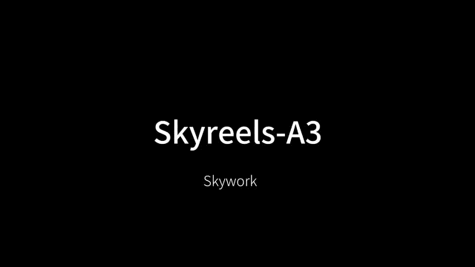

[twitter-video-1280x720-video1 (1).mp4](https://internal-api-drive-stream.feishu.cn/space/api/box/stream/download/all/Psr8bUz35ozYsUxaMKYc2lpnnth)

2、苹果发布 iOS 26 Beta 6

新增六款“Reflection”铃声变体（含爆款“Dreamer”），调整相机应用滑动切换方向回归原设计，优化系统动画速度与应用开合动效（采用类似 iPadOS 的 “魔法灯” 效果），液态玻璃界面进一步优化（增强色彩色散和锁屏效果），并推出全新启动引导体验。用户反映新版整体更稳定快速，预示着 9 月公开发布临近。

3、智谱科技发布突破性开源多模态AI：GLM-4.5V树立行业新标准

在41个视觉多模态任务评测中达到开源模型最佳性能，支持图像、视频、文档、GUI等全场景推理，并新增“思考模式”切换功能。同时，智谱推出配套开源桌面助手，可实时处理屏幕内容，适用于代码辅助、视频分析、游戏解答等任务。模型已上线 Hugging Face、魔搭社区及GitHub。

地址：https://huggingface.co/spaces/zai-org/GLM-4.5V-Demo-App

官网：https://chat.z.ai/

4、苹果2025秋季发布会将推出iPhone 17系列

屏幕更大、刷新率提升至120Hz，Pro版本背部设计大改并可能换材质。传闻新品还包括超薄iPhone Air，厚度仅5.5毫米，或替代Plus。Apple Watch Ultra 3将支持5G、卫星通信及血压监测。AirPods Pro 3预计升级为更小巧设计并搭载H3芯片，以5.5毫米厚度挑战行业极限。

5、GPT-5 的坎坷发布促使 OpenAI 紧急稳定系统

8 月 7 日发布的 GPT-5 原本承诺在 AI 推理方面实现飞跃，但很快因路由错误、性能倒退、安全漏洞及发布会“图表事故”遭到广泛批评，“思考模式”被自动切换削弱了预期能力，部分任务表现不如 GPT-4o，甚至落后于竞争对手 Anthropic，促使 OpenAI 紧急修复并稳定新模型。

6、昆仑万维推出革命性开源世界模型Matrix-Game2.0

作为 Matrix 系列的升级版本，这一模型不仅是业内首个在通用场景下实现实时长序列生成的开源世界模型，采用创新的视觉驱动架构，支持每秒25帧的高质量视频生成，具备强大的物理规律理解和场景交互能力。

7、英伟达研究人员呼吁AI行业重新考虑智能代理AI

主张转向更小、更高效的小型语言模型（SLM）, 研究员指出AI行业目前对大型语言模型的依赖过重，既浪费资源又不环保，建议优先采用参数少于100亿的小型语言模型（SLM）。这些小模型在推理、编程等关键任务上表现可媲美甚至超越大型模型，且成本和能耗远低于后者，且更易于微调和本地部署。研究呼吁构建以SLM为主的混合代理系统，保留大型模型用于复杂任务。

8、英伟达发布“物理AI”愿景，推出Blackwell新硬件及先进AI模型

英伟达发布了Blackwell架构的新型GPU和企业服务器，配合先进AI模型，推动“物理AI”愿景——融合人工智能与计算机图形，实现机器人等智能系统在现实世界中的高效仿真与自主学习。新硬件显著提升性能和能效，支持从工作站到大型数据中心的AI计算需求。英伟达还推出了支持逻辑推理和视觉理解的AI模型，并通过Omniverse和Isaac平台助力机器人训练和智能基础设施建设。

9、AI专家Gary Marcus炮轰GPT-5：进步有限，炒作过度

知名AI批评家Gary Marcus在GPT-5发布后发表尖锐评论，称称其是 “渐进式进步” 且发布仓促，并非重大突破，性能仅略优于上月产品 Grok 4，部分指标甚至更差。尽管OpenAI CEO Sam Altman宣称GPT-5能达到"任何领域的PhD专家水平"，但Marcus指出，GPT-5在某些基准测试（如ARC-AGI-2）上甚至不如上个月的Grok 4，且发布后几小时内就暴露出一系列问题，如物理原理解释错误、象棋谜题答案有误等。马库斯还援引研究称 “思维链” 推理存在局限，认为 “分布偏移” 是包括 GPT-5 在内的大型模型在复杂迁移任务中失败的共性原因。

## 8月13日 全球AI资讯

1、Anthropic 推出 Claude 的对话记忆功能

可在后续交流中调用和延续过往对话内容，帮助用户无缝延续交流。该功能率先面向Max、Team和Enterprise用户开放，支持随时开关，其他版本将陆续支持。相比 ChatGPT，Claude 更注重利用早期聊天信息提升连续性。

2、谷歌母公司Alphabet的投资部门CapitalG清仓CrowdStrike股份

并将巨额的320亿美元投入快速崛起的云安全初创公司Wiz，以配合其强化AI基础设施战略。今年Alphabet资本支出预计达850亿美元，其中三分之二用于AI服务器。

3、Perplexity 出价收购 Chrome

AI 搜索引擎公司 Perplexity 在一项“登月计划”式的举动中，提出以 345 亿美元现金 的非邀约报价收购谷歌的 Chrome 浏览器。承诺保留 Chromium 开源并继续投资，同时维持谷歌为默认搜索引擎。此举发生在司法部建议谷歌剥离 Chrome 以应对垄断裁决背景下，收购金额远超 Perplexity 融资总额与估值，若成功或将成为“低价收购”科技史案例。

4、OpenAI 推理模型在编程奥林匹克竞赛中夺得金牌

其推理模型在 2025 年国际信息学奥林匹克竞赛（IOI）中获得金牌成绩，在全球顶尖中学生编程选手中名列第 6，并位列全球 AI 第一，超越所有 AI 对手。团队今年直接使用通用逻辑模型，无需专门训练，配合轻量化选解框架，将去年第 49 百分位的成绩跃升至第 98 百分位，显示模型在编程与数学等多领域的通用能力显著提升。

5、Anthropic 将 Claude Sonnet 4 的上下文窗口扩大至 100 万 Token

支持一次处理完整代码库或大型文档，现向 Tier 4 及定制 API 用户公测。新定价对超 20 万输入 Token 的请求收费翻倍，并建议使用缓存与批量处理以节省最多 50% 成本。

6、2025 年 AI 陪伴类应用营收有望突破 1.2 亿美元

Appfigures 数据显示，2025 年全球 AI 陪伴类应用市场高速增长，上半年营收 8200 万美元，预计全年将超 1.2 亿美元，下载量同比增 88%。前 10% 应用贡献 89% 收入，其中以 AI 女友类产品最受欢迎。xAI、OpenAI、谷歌等大厂正加速入局，推动该细分市场竞争加剧。

7、韩国研究人员用 AI 设计抗癌药物

韩国科学技术院（KAIST）的研究团队推出扩散模型 BInD，可零样本从头设计精准抗癌药物，一步完成分子结构与蛋白结合设计，并同时优化安全性、稳定性和可制造性，被视为 AI 推动精准医疗的重要突破。

8、谷歌资深工程师创立 Continua，获 800 万美元融资

由 GV 领投，Bessemer Ventures Partners 及多位天使投资人参投。Continua能利用 AI 代理增强 SMS、iMessage 和 Discord 群聊中的协作与互动。

9、Meta AI 预测人类观看视频时的脑部反应

Meta FAIR 团队推出 TRIBE，这是一款拥有 10 亿参数的神经网络模型，通过视频、音频和文本精准预测人类观看影片时的脑区活动，在 Algonauts 2025 脑建模竞赛夺冠，预测准确率较单一感官模型提升 30%，并在额叶注意力与情绪处理区表现突出。

10、洛克希德·马丁与 IBM 合作推进

AI 通过 IBM 的 watsonx.data 平台整合数据系统、削减工具数量并打破数据孤岛，助力 1 万名工程师在 AI 工厂中开发可扩展产品，同时将内部问答准确率提升 20%，加速其 AI 应用落地。

## 8月14日 全球AI资讯

1、Hunyuan团队开源了Hunyuan-GameCraft

这是一款基于HunyuanVideo的高动态交互式游戏视频生成框架。它可以从单张场景图和用户操作信号生成可玩且物理真实的视频，实现高精度动态控制、长时一致性场景保持，并通过模型压缩大幅降低成本，使13B量化模型可在消费级GPU上高效运行。

项目地址：https://hunyuan-gamecraft.github.io/

hugging：https://huggingface.co/tencent/Hunyuan-GameCraft-1.0

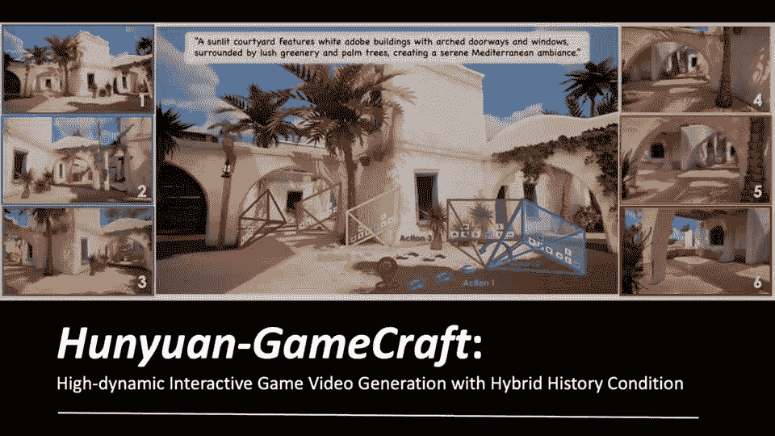

[twitter-video-1920x1080-video1 (1).mp4](https://internal-api-drive-stream.feishu.cn/space/api/box/stream/download/all/KAUTbt5hWoPXNTxFEO7cpwCcnFD)

2、OpenAI 为 ChatGPT 引入手动模式切换功能

允许用户在 GPT-5 中选择“自动”“快速”或“深度思考”模式，并重新开放 GPT-4o 供付费用户使用。这一改变回应了用户对自动路由机制不透明和性能不稳定的批评，同时提高了推理模式的临时配额。然而，业内人士对 GPT-5 的质疑依旧存在，认为其缺乏突破性进展。

3、Google 为 Gemini 推出自动记忆功能

使其无需提示就能自动记住用户过去的聊天内容，从而实现更个性化的对话。开启该功能后，Gemini 会自动记忆用户的“关键信息与偏好”，并在未来对话中加以运用。

4、Anthropic 为 Claude 推出按需记忆功能和百万 token 上下文窗口

并将价格压至 1 美元向美国联邦机构供应，与 OpenAI 直接竞争政府 AI 合同市场。新功能提升了项目连续性与大规模数据处理能力，同时降低了长上下文应用的成本。

5、Google Photos 推出全新“Create”标签页

整合 AI 图片与视频创作功能，包括 GIF、3D 效果、拼贴画和精彩集锦视频等，进一步强化平台的多媒体编辑能力。

6、Figure AI 推出配备 Helix 神经网络的 Figure 02 机器人

可无需远程操控自主完成折叠衣物任务，并保持自然交互。虽尚不能操作洗衣机，公司计划今年开展家庭试用。

7、Anthropic 收购了 Humanloop 的联合创始人及大部分团队

以加强其企业级 AI 能力布局。这笔收购带来了丰富的 AI 工具、评估和安全保障经验，符合 Anthropic 的“安全优先”定位，并有助于满足政府与企业客户对可监控、可合规 AI 系统的需求。此举正值 Anthropic 推出百万 token 上下文、内存功能，并以 1 美元策略进军美国政府 AI 市场。

## 8月15日 全球AI资讯

1、pika推出全新音频驱动表演模型

可在6秒内制作任意长度和风格的高清短片，支持近乎实时的超真实表情。该技术比以往快20倍、成本更低，旨在让更多用户以轻松有趣的方式使用AI视频进行创作和社交互动。

[twitter-video-1920x1080-video1 (2).mp4](https://internal-api-drive-stream.feishu.cn/space/api/box/stream/download/all/LUc9bF1BQoTGztxfB5QcPJSLntf)

2、微软出手挖 Meta AI 人才

微软正针对 Meta 的 AI 人才发起新一轮招聘攻势，通过数百万美元的报价吸引来自 Meta 非 “超级智能实验室”（Superintelligence Labs）部门的研究人员。锁定多个核心技术团队，并通过快速审批流程加快招聘节奏，借机利用 Meta 内部文化问题吸引潜在跳槽者。

3、谷歌在 Google Flights 推出 AI 驱动的“航班优惠”功能

支持自然语言搜索实时机票优惠，在美、加、印率先上线测试。新功能上线之际，谷歌正面临欧盟反垄断调查，或需调整搜索展示方式以符合法规。

4、Lovable 预计在未来 12 个月内实现 10 亿美元年经常性收入

成立不到两年的欧洲 AI 初创公司 Lovable 增长迅猛，从 100 万美元 ARR 到 1 亿美元仅用 8 个月，目前每月新增 800 万美元 ARR，预计今年底将达 2.5 亿美元，并在未来一年冲击 10 亿美元目标，最新估值已达 18 亿美元。

5、泄露文件显示 Meta AI 曾允许聊天机器人与儿童进行浪漫对话

曝光的Meta 内部 200 页指南，显示其 AI 聊天机器人曾被允许与儿童进行浪漫或感官化对话、生成带有种族歧视的内容和虚假信息，并在一定条件下制作擦边裸照和暴力画面。Meta 确认文件存在但称错误内容已删除，现禁止与儿童调情。

6、苹果计划借助家用机器人重返AI赛道

苹果计划在 2026–2027 年推出四款 AI 家居产品，包括带机械臂的桌面机器人、个性化 Siri（Bubbles）、智能显示屏和 AI 安防摄像头，借此重振智能家居与 AI 战略。

7、xAI联合创始人Igor Babuschkin离职 创立基金专注AI安全

xAI联合创始人Igor Babuschkin因一次与Max Tegmark的对话深受触动，决定离职创立专注AI安全的风险投资基金Babuschkin Ventures。他希望推动更安全、更以人为本的AI发展。此举发生在xAI因Grok争议与安全透明度问题备受批评之际，反映出行业内部的伦理与安全分歧。

# 第四周

## 8月18日 AI资讯

1、智谱 AI 推出 GLM-4.5 系列开源大模型

主打推理、编程和智能体任务，性能在多项基准测试中位列前列，并以显著参数效率超越部分更大规模模型。该模型采用混合专家架构，深层设计提升推理能力，训练覆盖 23 万亿 tokens。所有模型和权重已在 GitHub、Hugging Face 与 ModelScope 开放，支持商用 API。

2、OpenAI 对 GPT-5 进行更新

OpenAI 于上周五晚间宣布，将对其最新模型 GPT-5 进行更新，使模型在回答时显得更温暖、友好，通过添加真实鼓励性反馈而非奉承，回应部分用户对之前版本直白风格的抱怨，同时保持原有回答的精准性。

3、微软宣布 在 Copilot 全线产品中上线 GPT-5，新增 “Smart 模式”

支持跨平台使用，并与 Bing、Edge、Office 等深度整合，提供语音交互、内容生成与实时编辑等功能。用户无需微软账号即可体验基础功能，且免费用户每天可获得比 ChatGPT 免费版多 5 倍的推理调用额度，显著提升了 AI 的普及度和可用性。

4、Anthropic 为 Claude Opus 4 和 4.1 增加了“挂断”功能

该功能在模型多次拒绝后触发，Anthropic 表示，Claude 被编程为拒绝涉及暴力、虐待或非法活动的请求。该“挂断”功能被称为“持续实验”，仅在最后手段或用户明确要求时使用。一旦对话被终止，就无法恢复，但用户可以重新开始对话或编辑之前的提示。

5、Meta 将其最先进的 DINOv3 图像分析模型开放用于商业项目

Meta 发布了 DINOv3 通用图像处理模型，在 17 亿张图像上通过自监督学习训练，参数规模 70 亿。它无需标注数据，适用于卫星影像等缺乏标注的领域。性能优于 v2，但提升不如 v1→v2 时显著。Meta 提供了可商用的模型、适配器及训练代码，并已在 GitHub 开源。

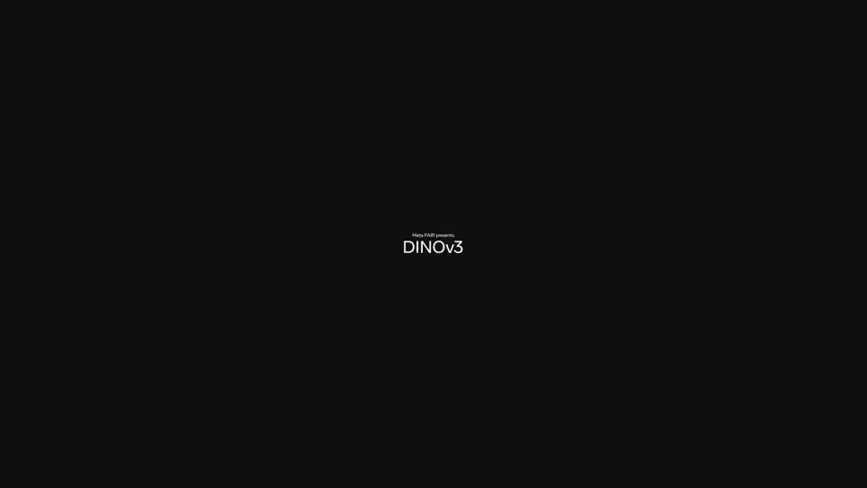

[dinov3_trailer-1.mp4](https://internal-api-drive-stream.feishu.cn/space/api/box/stream/download/all/JrxJbWwcQoJ8Dwx5NhhcTmSwnMc)

6、Anthropic 为更危险的 AI 环境制定新规则

Anthropic 更新 Claude 使用政策，明确禁止开发生物、化学、放射性和核武器，并新增网络安全条款以防范漏洞利用、恶意软件和网络攻击；同时放宽政治内容限制，仅禁止影响民主进程或竞选定向的用例，反映其在平衡安全风险与应用场景上的最新调整。

7、Meta 拟人化聊天机器人可能误导用户并导致现实伤害

Meta 的类人化聊天机器人“Big sis Billie”在误导一名有认知障碍的美国退休老人并间接导致其死亡后，引发了对 AI 拟人化设计缺乏安全措施的强烈担忧。事件凸显了聊天机器人可能带来的情感依赖、妄想风险和现实危害，同时也暴露出 Meta 在政治化运作和未成年人保护方面的争议。心理学界和政界呼吁加强监管，以避免 AI 对儿童、弱势群体和公众造成欺骗、剥削或长期依赖。

## 8月19日 AI资讯

1、Qwen 推出Qwen-Image-Edit编辑模型

一个拥有 200 亿参数的开源图像编辑模型。它既能实现像素级精确编辑，又能进行风格转换，同时保持原有角色和物体不变。在一系列图像生成与编辑基准测试中，Qwen-Image-Edit 实现了 SOTA（最先进） 表现，超越了 Seedream、GPT Image 和 FLUX 等竞争对手。

2、腾讯推出 Hunyuan-GameCraft

可将单张图片生成可实时互动的游戏视频，用户可用键盘控制摄像机自由移动。系统采用混合历史条件训练和阶段一致性模型，实现长序列高质量、低延迟生成，并在百万级 AAA 游戏数据上训练。该模型在互动精度和画质上超过同类方案，完整代码已开源，网页版演示正在开发中。

[tencent-hunyuan-gamecraft-1-0-video-demo.mp4](https://internal-api-drive-stream.feishu.cn/space/api/box/stream/download/all/WniWbaGNwoRV6LxxbuBc01asnZg)

3、百度推出全球首款全端通用智能体GenFlow2.0

支持 100+ 多模态专家智能体并行工作，可在 3 分钟内完成 5 项以上复杂任务，生成速度比同类快 10 倍。该系统可自主理解用户意图、智能规划任务，并允许用户在执行过程中随时干预，同时支持 PPT、研报、视频、海报、图表、代码、网站等多类型内容生成。目前，GenFlow2.0 已在百度文库 Web 和 App 端上线，所有用户可直接使用。

4、OpenAI 在印度推出低于 5 美元的 ChatGPT 订阅计划

名为 ChatGPT GO，月费 ₹399（约合 4.60 美元），远低于每月 ₹1,999（约 23 美元）的 Plus 计划，提供消息、图像生成和文件处理能力提升 10 倍，并增强记忆功能。该举措旨在通过更低价格吸引印度用户，提高订阅率，并扩展公司在印度这一第二大市场的影响力。

5、微软为 Excel 推出新 Copilot 功能

将大型语言模型能力直接嵌入单元格，通过自然语言公式完成数据分析、文本分类和内容生成。结果自动更新，无需手动操作或切换工具。目前仅限 Beta 用户，未来将支持 GPT-5 和外部数据访问，显著优化了 AI 办公体验。

6、康奈尔科技与 Meta 研究员 Jack Morris 发布了 gpt-oss-20b-base

剥离了 OpenAI gpt-oss-20B 的“推理对齐”，恢复为原始预训练版本，生成更自由但风险更高的输出。该模型训练仅修改 0.3% 权重，用时四天即完成，并已在 Hugging Face 开源。

7、Perplexity 现已支持印度股票财报电话会的实时转录

AI 创企 Perplexity 将其实时财报转录服务扩展至印度上市公司，在其 Finance 仪表盘中新增季度财报电话会转录与日历功能。此前该功能仅支持美股，如今用户还能结合市场摘要、热门股表现、行业追踪与加密货币数据进行更全面的投资参考。

8、GPT-5 在医学考试中超越医生

OpenAI 的 GPT-5 在医学推理基准测试中表现出色，MedQA 临床题准确率 95.84%，多模态任务得分 70%，全面超越 GPT-4o 和人类医生。研究显示 GPT-5 在复杂病例诊断、罕见病识别等方面胜过专业医师。

9、Meta“Hypernova” AR 眼镜或下月发布

Meta 计划于 9 月 17 日在 Meta Connect 发布其代号“Celeste”的 AR 眼镜（Hypernova），售价约 800 美元并捆绑神经手环，低于此前预期。该设备具备 HUD 显示、手势操控和内置摄像头，被定位为 Quest 3 的延伸。

10、游戏开发者正大规模拥抱 AI

Google Cloud 调查显示，超过九成游戏开发者已在工作中应用 AI，覆盖游戏测试、代码生成、内容优化和 NPC 智能化等领域，显著提升开发效率与玩家体验，但也引发了对数据隐私和所有权的担忧。

## 8月20日 AI资讯

1、Runway 发布多项新功能

包括在 Chat Mode 中接入第三方模型、Chat Mode 现在支持将生成结果以 Feed 形式并排显示在聊天窗口旁，便于在单次对话中同时创建多版本生成内容。面向所有网页用户开 Gen-4 Image Turbo 模式。

2、DeepSeek V3.1 正式上线

DeepSeek V3.1 在处理长篇内容、多步骤推理任务以及多语言能力上取得明显提升，使其在复杂任务中的表现更加精准和稳健。尽管外界期待下一代大模型 R2 的推出，但官方尚未公布具体发布时间。

官网地址：https://chat.deepseek.com/

3、Google 推出 Docs 文档朗读功能

允许用户用 Gemini 生成 AI 音频，并支持自定义声音和播放速度。该功能不仅文档作者可用，读者也能直接播放，甚至可在文档中插入音频按钮。目前仅支持英文和桌面端，适用于 Workspace 商业、企业、教育用户及 AI Pro/Ultra 订阅用户。

4、Meta全球上线AI语音翻译功能

首批支持英语与西班牙语，未来将扩展至更多语言。该功能可保留创作者声音和语气，并提供唇形同步，使译声更自然该功能已向 Facebook 上 1000+ 粉丝创作者及 所有公开 Instagram 账号开放。功能上线之际，Meta 正在重组 AI 部门，强化在研究与产品方面的布局。

5、AI 爬虫公司 Firecrawl 完成 1450 万美元融资 由 Nexus 领投，Shopify CEO Tobias Lütke 及 Y Combinator 参与。Firecrawl 提供开源 AI 网页爬虫及商业化 API，已有 35 万开发者使用并盈利。公司计划继续探索 AI 代理作为员工的潜力，目前正在寻找 AI 首席幕僚以管理招聘与运营，同时开发工具帮助内容创作者在 AI 使用其内容时获得报酬。

6、Google 2025 硬件发布会：Pixel 10、Pixel Watch 4 等新品即将亮相

Google 将于 当地时间8 月 20 日举行 Made by Google 2025 发布会，预计推出 Pixel 10 系列手机（含折叠款）、Pixel Watch 4 和新耳机，并公布基于 Gemini 模型的 AI 功能。活动由 Jimmy Fallon 主持，聚焦硬件创新与智能体验升级。

7、Nvidia 正在研发代号 B30A 的新 AI 芯片

计划在中国销售，其性能约为旗舰 B300 GPU 的一半，高于目前可出口的 H20 GPU。该芯片采用单芯片设计，并保留高速传输、NVLink 和高带宽内存等功能。此举体现 Nvidia 争取中国市场的战略，同时面临美国出口审批的不确定性和中美在 AI 技术竞争中的地缘政治压力。

8、Notion 可以离线使用了

Notion 终于上线了用户期待已久的离线模式，支持在桌面和移动端离线查看、编辑和创建笔记，并能自动下载常用页面。联网后系统会自动同步更改，但部分嵌入模块仍需网络才能使用。

9、谷歌宣布推进其核能计划

谷歌与田纳西河谷管理局签署购电协议，将采购 Kairos Power 在奥克里奇建设的下一代 熔盐冷却核反应堆电力，预计 2030 年上线，为谷歌数据中心供电。该项目被视为推动美国核能复兴的重要一步，谷歌计划到 2035 年帮助部署 500 兆瓦新核电。

## 8月21日 AI资讯

1、智谱AI推出AutoGLM 2.0

这款产品凭借先进的自然语言理解能力和跨平台操作功能，让用户只需一句语音指令即可掌控全网事务。无论是点餐、订机票，还是社交媒体内容创作或办公流程自动化，AutoGLM 2.0都展现了其显著提高工作和生活效率的潜力。

详情：https://autoglm.zhipuai.cn/htdocs/download.html

2、ElevenLabs推出“Chat Mode”

使AI能够根据用户场景在文本和语音之间自由切换。该系统在测试阶段通过分析设备类型、环境噪声和用户行为，实现实时模式选择的准确率达到85%。 该系统利用云基础设施与边缘计算，将响应延迟降至200毫秒以下。低代码API支持在几天内部署到CRM和工作流系统中。

3、谷歌发布 Pixel 10 系列手机

全面强化 AI 功能，以 Tensor G5 芯片和 Gemini Nano 模型为核心，带来视觉叠加、主动助手“Magic Cue”、AI 相机教练、通话实时翻译、智能留言记录及 Pixel Journal 等新特性。新机旨在通过深度 AI 集成，树立 Pixel 10 作为“AI 手机”的差异化优势，抢先苹果即将推出的 iPhone 17。

4、美国 NASA 与 IBM 联合发布了全新的太阳观测 AI 基础模型 Surya

该模型基于 9 年太阳动力学观测台数据训练，能以比现有方法高 16% 的准确率预测太阳耀斑和空间天气事件。Surya 能监测 太阳黑子、太阳风速度等动态，预测可能影响卫星、电网及宇航员的辐射爆发。它可同时分析 多波段图像，捕捉人类分析师难以发现的微小变化，已在 HuggingFace 开源。

5、强化学习大师Richard Sutton：AI产业“迷失方向”

图灵奖得主Richard Sutton批评AI产业忽视智能核心原则，提出Oak架构，Oak核心是一个自我强化循环：智能体通过反馈生成更高层次的抽象特征，这些有助于规划和问题解决的特征成为下一轮更抽象知识的基础，但关键在于开发稳定、持续的深度学习算法。

6、Gemini扩展至Nest智能家居

谷歌宣布今年秋季将在Nest智能音箱和显示屏上用Gemini取代AI助手，实现复杂语音指令处理、自然对话Gemini Live和多设备感知功能，并推出免费和付费版本，提前通过十月预览计划开放使用。

## 8月22日 AI资讯

1、即梦AI发布全新“智能多帧”功能

最多可设置10个关键帧画面，AI帮你实现画面间的智能补全，目前已在即梦AI网页版上线。首次实现AI长镜头叙事，沉浸感直抵人心。更丝滑的转场效果、更精确的编排调度。

2、可灵2.1首尾帧上线

官方有奖投稿：https://app.klingai.com/global/activity-zone?id=787770745824485437

3、Runway 发布 Game Worlds 测试版

在该平台中，世界、角色和剧情不再依赖传统渲染、建模或脚本，而是能够在玩家体验时实时生成，实现非线性、个性化的互动叙事。测试版提供多款预设文字游戏，也允许用户创建自己的定制游戏，涵盖从经典玩法到实验性叙事的创意沙盒。

地址：https://play.runwayml.com

4、iPhone 17，“史上最薄 iPhone”

苹果 9 月 9 日秋季发布会预计将带来 iPhone 17 系列、Apple Watch 与 AirPods 新品。iPhone 17 升级更大屏幕与 120Hz 显示，Pro 机型设计与材质变化，Pro Max 增强电池容量；最重磅传闻是 5.5mm 厚的超薄 iPhone Air，或取代 Plus。Apple Watch Ultra 3 可能支持血压与卫星功能，SE 3 或推塑料版；AirPods Pro 3 预计换新设计并搭载 H3 芯片。

5、OpenAI 宣布在印度新德里设立办公室

并组建本地团队，以拓展在全球第二大互联网和智能手机市场的影响力。公司已推出专为印度设计的低价 ChatGPT Go 订阅，并计划举办教育峰会和开发者日。此举显示 OpenAI 正积极与 Google、Meta 及 Perplexity 竞争印度庞大的用户群，但仍面临在价格敏感市场实现付费转化以及版权争议等挑战。

6、Instagram 推出新功能

允许创作者将多个 Reels 串联成系列，方便观众按顺序观看和追踪相关内容。这一功能可用于分段故事讲述或整理同类视频，有望延长观看时间并提升粉丝转化率。

7、Google 将搜索中的 AI 模式扩展至 180 多个新国家（不含欧盟）

并引入更“代理化”的功能，能够自动完成如餐厅预订等任务。新特性依赖 Project Mariner、合作伙伴服务及知识图谱，仅向美国 Google AI Ultra 订阅用户开放测试。同时，AI 模式也开始基于用户历史进行个性化推荐。

# ================================

## 8月25日 AI资讯

1、苹果可能为 iPhone 20 周年推出曲面玻璃设计

+   彭博社报道称，苹果计划在 2027 年的 iPhone 20 周年机型上采用曲面玻璃设计，以配合 iOS 的新“液态玻璃”风格。在此之前，苹果将在 2026 年发布首款折叠屏手机，并升级屏幕技术以改善折痕问题。

+   苹果将在9月的软件更新中为企业用户提供更灵活的AI管理工具

包括配置OpenAI ChatGPT Enterprise及其他AI供应商的权限。这一方案不仅能让企业选择启用哪些AI功能，还能决定员工是否可直接访问ChatGPT云服务。与此同时，苹果还将发布多项企业级功能更新，包括Business Manager API、设备管理迁移工具、Return to Service扩展到Vision Pro、共享Mac的访客模式和NFC登录等，进一步强化其在企业市场的竞争力。

+   苹果考虑借助谷歌 Gemini 改造 Siri

苹果正与谷歌洽谈使用 Gemini 模型重建 Siri，以应对语音助手升级延迟至 2026 年的困境。苹果同时开发自研和外部技术版本，并考虑与 Anthropic、OpenAI 等合作。分析认为，引入外部顶尖 AI 技术或是苹果在 Siri 上取得突破的最佳途径。

2、🛰️推出AI播客功能

通过双人AI对话形式播报新闻，为用户提供沉浸式、轻松的听新闻体验。内容主要来源于官方媒体通稿，AI在播报过程中会拆解重组信息，保留重点并降低理解难度，适合通勤或家务时收听。目前功能仍在灰度测试阶段，入口位于“快讯”合集页。

3、Meta 与 MidJourney 合作推出“美学”AI

Meta 刚刚宣布与 MidJourney 达成新合作，将这家初创公司的“美学技术”整合进未来的 AI 模型和产品中，显示 Meta 愿意通过外部合作推动 AI 发展，MidJourney 仍保持独立实验室身份。

4、OpenAI 与 Retro Biosciences 让衰老细胞“返老还童”

OpenAI 与 Retro Biosciences 开发的生物专用 AI 模型成功重新设计“山中因子”蛋白质，让衰老细胞更高效地转化为干细胞，并展现显著的抗衰老效果。

5、消息称Deepseek因华为昇腾芯片技术问题推迟最新AI模型

Deepseek因华为Ascend芯片技术问题推迟了R2模型的发布，迫使其使用Nvidia芯片完成训练，同时在低需求推理任务中仍依赖Ascend芯片。公司已发布V3.1版本，采用UE8M0 FP8数据类型以适配未来国产芯片，并增加混合推理模式。

6、Brave发现Perplexity的Comet浏览器存在安全漏洞

Brave发现Perplexity的Comet浏览器存在间接提示注入漏洞，攻击者可借此诱导AI助手泄露用户敏感信息，如邮箱和一次性密码。Perplexity已发布更新，但问题尚未完全解决。Brave自带的AI助手Leo也面临类似安全风险。

## 8月26日 AI资讯

1、谷歌发布 Gemini 2.5 Flash Image

一款先进的 AI 图像模型，支持自然语言驱动的精细图像编辑，能保持人脸与动物等细节一致性。从本周二起在 Gemini 应用、Gemini API、Google AI Studio 和 Vertex AI 平台全面开放。该工具近期已在众包评测平台 LMArena 上引发热议，以 “nano-banana” 的匿名身份出现，表现优异。谷歌随后确认，这正是其 Gemini 2.5 Flash AI 模型的原生图像能力，并在多个基准测试中表现为最先进水平。

2、苹果将于 9 月 9 日举办 iPhone 17 发布会

预计苹果将发布一款标准机型和两款 Pro 机型，基础版 iPhone 17 预计将采用 6.3 英寸更大屏幕，其中可能用一款全新的 iPhone 17 Air 取代 Plus 系列。该机型据称厚度仅 5.5 毫米，配备 6.6 英寸屏幕，比现有机型还要薄 0.08 英寸。除了 iPhone，还可能发布 Apple Watch Series 11、Ultra 3 和 SE 3。其中 Apple Watch Ultra 3 的升级最值得关注，预计会屏幕更大和充电更快。

3、谷歌在 Google 翻译中上线 AI 驱动的语言学习与实时翻译功能

用户可获得个性化听说练习并追踪学习进度，同时能通过“实时翻译”与他人进行 70 多种语言的自然对话。新功能已在美、印、墨上线，首批支持英语、西班牙语、法语和葡萄牙语的双向学习，标志着谷歌正利用 Gemini 模型加速拓展语言学习与跨语言交流场景。该功能的测试版已在 Android 与 iOS 端的 Google 翻译上线。

4、微软发布开源语音模型 VibeVoice

这是一款开源的文本转语音模型，能够生成长达 90 分钟的多角色对话音频，仅需 15 亿参数即可实现，该模型可生成 播客级别 的多角色对话音频，最多支持 四种不同声音，并能在长时间对话中保持说话者的独特特征。

5、马斯克旗下 xAI 起诉苹果与 OpenAI

埃隆·马斯克的 AI 创企 xAI 已在德州对苹果和 OpenAI 提起诉讼，指控苹果与 ChatGPT 的独家合作涉嫌 反垄断，在 App Store 中排挤竞争对手（如 Grok）。要求数十亿美元赔偿。

6、AI 搜索公司 Perplexity 推出 4,250 万美元出版商分成计划

Perplexity 推出 4,250 万美元分成计划，向在 AI 搜索结果中出现内容的出版商付费，并通过 每月 5 美元的 Comet Plus 订阅将 80% 收益分配给媒体。此举被视为在版权诉讼压力下的新商业模式，承认 AI 与人类共同驱动内容流量。

7、IBM 与 AMD 宣布在量子计算领域展开合作

双方将共同研发下一代计算架构，把 IBM 的量子计算机与 AMD 的高性能计算能力结合起来。IBM 表示，此次合作有助于其在本十年末前打造具备容错能力的量子计算机，从而实现实时错误检测与修复。

## 8月27日 AI资讯

1、HeyGen 推出由 Avatar IV 驱动的全新“数字分身”

号称可与本人无差别还原表情、动作与语气，让用户无需拍摄即可生成自然、逼真的个人视频。这一功能被定位为创作者与企业提升影响力与效率的利器。

[twitter-video-1920x1080-video1 (5).mp4](https://internal-api-drive-stream.feishu.cn/space/api/box/stream/download/all/LALYbRRe6ofhoaxofKsc1kANnVh)

2、字节跳动推出 Waver 1.0

一款统一支持文本生成视频、图像生成视频和文本生成图像的基础模型。凭借级联精修、复杂动作生成能力和超 2 亿视频数据训练，Waver 在基准测试中表现强势，超越 Kling 2.0、Wan 2.1 和 Veo 3 等对手

Github: https://github.com/FoundationVision/Waver?tab=readme-ov-file

3、Anthropic 推出可在 Chrome 中运行的 Claude AI 代理

这是基于 Claude AI 的浏览器端代理，率先面向部分付费用户开放，并允许通过扩展与浏览器深度交互。随着 Perplexity、OpenAI、Google 等相继进军 AI 浏览器领域，浏览器正成为 AI 实验室的新战场。竞争背后还牵动 Google 的反垄断案及 Chrome 的未来归属。与此同时，AI 浏览器代理也带来提示注入等安全隐患，Anthropic 已部署防御措施以降低风险。

4、Google Vids 增添 AI 虚拟人功能并推出消费级版本

Vids 推出 AI 虚拟人、自动语音剪辑和图像转视频 功能，允许用户通过脚本生成虚拟人视频、自动去除语气词，还能利用 Veo 3 从图片生成短片。谷歌计划进一步支持降噪和多种视频格式。新 AI 功能仅向企业及教育订阅用户开放，显示谷歌正在与 Sythesia、D-ID 等创业公司竞争 AI 视频生成市场。

5、OpenAI 明年停用 Assistants API

OpenAI 将于 2026 年停用 Assistants API，全面转向功能更强的 Responses API。新系统集成代码解释器、持久化对话和跨工具任务处理能力，并借助 GPT-5 的推理增强功能，已成为开发者的首选。

## 9月1日 AI资讯

1、🛰️宣布实施AI生成内容强制标注规

用户发布视频、图文等必须注明是否由AI生成，并按类别分类。这些新规紧随中国政府关于强制标注AI生成内容的监管政策出台，该政策将于2025年9月1日正式生效。🛰️表示，若用户无视规则，例如删除必要标注或传播误导性内容，将面临处罚。

2、《人工智能生成合成内容标识办法》正式施行

自9月1日起，《人工智能生成合成内容标识办法》正式施行，这意味着我国在AI内容治理上迈入制度化、规范化的新阶段。根据新规，所有由人工智能生成的内容都必须进行显性或隐性的标识，以保障信息来源透明，防范虚假与误导性信息的扩散。

3、阿里巴巴开发新型 AI 芯片

阿里巴巴开发了一款新型 AI 芯片，目前正在测试中，专为推理任务设计，可支持智能手机语音助手等应用。芯片兼容 Nvidia 软件平台，便于复用原有程序，也有助于应对 Nvidia 在华销售受限的局面。这款芯片增强了中国在 AI 推理硬件领域的自主能力，但仍未涉及 AI 模型训练。

**4、Meta 与**加州大学圣地亚哥分校研发的 DeepConf 推理方法

通过置信度评估优化语言模型的解题路径，能在保持高准确率的同时显著减少计算量。在数学推理测试中，DeepConf 最高准确率达 99.9%，并在在线模式下节省近 85% 的算力开销。这一方法无需额外训练，易于集成，有望推动高效大模型推理的发展。

5、openai推出gpt-realtime 最先进的语音对语音模型

新版本引入多项能力，包括远程 MCP 支持、图像输入、SIP 电话通话及可复用提示词，进一步强化实时语音代理的应用场景。

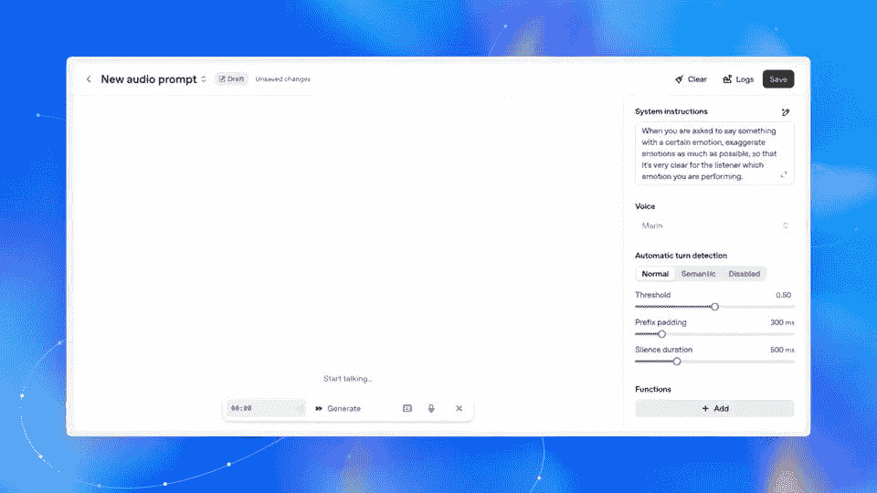

[twitter-video-1280x720-video1 (14).mp4](https://internal-api-drive-stream.feishu.cn/space/api/box/stream/download/all/SMMxbkzefoudgKxbCxecxBsHnee)

6、Meta 超级智能团队出现人员流失

Meta 高调成立的 Superintelligence Labs（超级智能实验室）团队，正遭遇一系列早期离职，以及与数据供应商 Scale AI 关系动荡的报道。这表明该部门在经历夏季重大调整后开局混乱。

7、Meta 更新聊天机器人，阻止与青少年进行敏感及恋爱话题交流

同时限制访问部分有争议的聊天机器人身份，仅允许教育和创意类互动。此前泄露的指南显示，Meta 内部曾允许与未成年人进行性化和种族内容对话，但执行不力。公司还聘请右翼顾问处理 AI 政治偏见问题。

8、前 Tesla 与 OpenAI 研究员 Andrej Karpathy 对 LLM 训练中的强化学习持长期怀疑态度

认为现有 RL 奖励函数不可靠且不适合培养智力问题解决能力。尽管他认为 RL 微调优于传统监督微调，但真正的 AI 突破需要全新学习机制，如系统提示学习和基于交互环境的训练，让模型通过自主行动和反馈学习。Karpathy 的观点呼应 DeepMind 研究者呼吁的“体验驱动 AI”范式转变，强调未来 AI 应通过经验而非简单模仿实现更高水平的智能与适应力。

9、Lovable CEO 对“氛围编程”竞争并不担忧

仅8个月ARR突破1亿美元，估值达18亿美元，用户数超230万。CEO 安东·奥西卡表示，公司定位是帮助无编程经验者从零到一打造AI原生企业，未来将整合更多功能。尽管OpenAI和Anthropic是潜在竞争对手，他强调跨模型能力和易用体验是Lovable的优势。Lovable 获多家欧洲投资人支持，并计划继续扎根欧洲，其成功被视为北欧及欧洲创业生态的里程碑。

10、微软发布首批自研大模型 MAI-Voice-1 和 MAI-1-preview

标志其在 AI 领域寻求更大自主性。语音模型以高效著称，文本模型在有限算力下表现超预期，已向公众开放测试。微软计划未来五年持续投资，构建专用模型并全面融入 Windows、Office 和 Azure。

11、a16z 最新报告显示，AI 应用市场正在逐渐稳定

网页端和移动端均呈现增长和集中化趋势。ChatGPT 仍在用户访问量和活跃度上占据领先，但 Google 的 Gemini 系列迅速追赶，四款产品进入网页端前 50，尤其在 Android 上占优势。Grok 用户数突破 2000 万，增长迅速，而 Meta AI 增长放缓。中国企业在移动端表现突出，多款应用流量主要来自国内市场。14 家“全明星”公司连续入榜，显示通用助手、AI伴侣、图像生成和生产力工具仍是核心领域。

# =================================

# 第一周

## 9月2日 AI资讯

## 9月3日 AI资讯

1、Anthropic 刚刚宣布完成一轮 130 亿美元的新融

资估值跃升至 1830 亿美元，仅半年内增长三倍。Claude Code 助手年营收达 5 亿美元，企业客户数大幅增长。新投资方包括中东卡塔尔投资局，显示在全球算力竞赛中，AI 领军企业融资势头依旧火热。

2、OpenAI 以 11 亿美元全股票交易收购 Statsig

创始人 Raji 出任应用部门 CTO，负责 ChatGPT 与 Codex 工程。Statsig 将继续独立运营。这是继 30 亿美元收购 Windsurf 失败后的又一重大收购尝试，伴随高管团队调整，显示 OpenAI 借收购强化人才与产品布局的战略。

3、微软为美国政府提供AI折扣方案

微软与美国总务管理局（GSA）宣布了一项针对政府的折扣协议，涵盖Microsoft 365、Copilot、Azure及其他服务。官方表示，这项协议第一年预计可节省31亿美元，并提供一年免费的Microsoft 365 Copilot访问权限。

4、腾讯刚刚发布了 HunyuanWorld-Voyager

可将单张照片生成可探索、可导出的 3D 环境，在斯坦福基准测试中表现领先。该模型通过“世界缓存”保持空间一致性，并支持交互式探索，凸显世界模型正成为 AI 研发的新竞争焦点。

详细：https://huggingface.co/tencent/Hunyuan-MT-7B?utm_source=www.therundown.ai&utm_medium=referral&utm_campaign=ai-gives-paralyzed-patients-robotic-control&_bhlid=901eecb56095fde7eda9e396c40a9ddb91405fdf

5、WordPress展示实验性AI开发工具Telex

用户可通过提示生成Gutenberg区块并打包为插件使用。该工具仍处于原型阶段，测试效果不稳定，但CEO Matt Mullenweg看好其推动“出版民主化”的潜力。他同时展示了一个简易AI助手，并提到与WP Engine的法律纠纷仍在进行中。

6、亚马逊推出iOS版Lens Live新功能

可通过摄像头扫描物品并匹配平台上相似商品，支持直接加入购物车或愿望清单。功能整合了AI助手Rufus，可快速总结产品信息并回答问题，预计将在未来几周向更多用户开放。

7、OpenAI公布青少年家长控制新功能

公司在博客中表示，“在未来一个月内”，家长将能够通过电子邮件邀请，将自己的账户与青少年的账户关联，禁用青少年账户的聊天记录和记忆功能，并在ChatGPT检测到青少年处于“严重情绪危机时”收到通知。此外，家长可以控制ChatGPT与青少年的互动方式，确保其符合年龄适宜的行为规则（默认开启）。

8、ElevenLabs发布AI音效模型2.0

支持更长音频片段与更高音质，无缝循环和48 kHz采样率。音效可通过文本提示生成，支持网页版界面和API调用。无缝循环选项已内置在ElevenLabs Studio音频编辑器中，用户可直接体验。音效库优化了搜索、收藏和混音功能，SB-1音效板也更新以支持新模型及MIDI连接。

## 9月5日 AI资讯

1、DeepSeek计划年底推出新一代AI模型

增强代理功能，预计能够在无需用户持续监控的情况下完成更复杂的多步骤任务。目前，AI代理仍然运行缓慢、存在故障，远未达到理想状态，但逐步改进仍在持续推动行业热度。

2、ChatGPT 的 Projects 功能 现已向 免费用户开放

并增强了文件上传（免费用户最多 5 个，Plus 用户 25 个，Pro/Business/Enterprise 用户 40 个）、项目自定义和记忆控制等特性。该功能已在网页和 Android 端上线，未来几天将陆续推送至 iOS 用户。

3、Google NotebookLM 推出全新的音频概览格式

包括对资料进行深入全面的剖析、1-2分钟的精简概览、专家点评和主持人辩论，满足不同用户对信息获取方式的需求。

4、OpenAI推出招聘平台

根据OpenAI应用业务CEO Fidji Simo在博客文章中的介绍，其“OpenAI招聘平台”将成为一个招聘平台，“利用AI帮助企业需求与员工能力之间找到最佳匹配”。同时支持地方政府寻才，并提供AI技能认证。

5、Perplexity  Comet 正式面向全球学生推出

提供日程管理、教材订购和学习模式等功能，旨在帮助学生更高效地学习和备考。

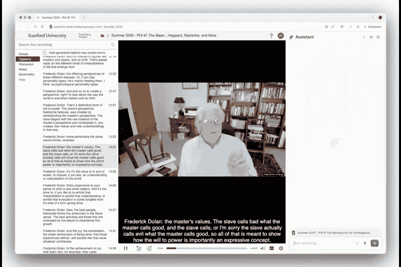

[twitter-video-1080x720-video1.mp4](https://internal-api-drive-stream.feishu.cn/space/api/box/stream/download/all/H2Hbbb83RoMaVexDPuGciW1enhg)

6、OpenAI 为 ChatGPT 推出家长控制功能

OpenAI 将在 30 天内为青少年用户推出家长控制功能，支持账号绑定、内容过滤和情绪困扰预警。此举源于近期与 ChatGPT 相关的悲剧案例和诉讼，旨在降低心理健康风险。

7、谷歌躲过 Chrome 拆分命运

美国联邦法官裁定，谷歌无需出售 Chrome 或 Android，但必须取消独家分销协议并与竞争对手共享数据。AI 的兴起被认为削弱了谷歌的搜索垄断地位。尽管 OpenAI 和 Perplexity 曾表达收购意向，Chrome 仍留在谷歌手中，或为谷歌推进 Gemini 浏览器铺平道路。

8、瑞士AI联盟（ETH Zurich**、EPFL、C**SCS）发布开源语言模型 Apertus

主打 **透明度、隐私合规与多语言覆盖**，并完全公开数据、训练和评估过程。该模型强调瑞士的中立与协商价值观，虽在复杂推理上不及顶尖开放模型，但定位为安全、可信的科研与商业替代方案。

9、美国高校迎接AI时代

UCLA、马里兰大学等任命首席AI官，旨在为所有学生提供AI素养教育，将其纳入与核心课程同等的重要地位。随着就业市场对AI技能需求激增，高校承担起帮助学生迎接AI时代挑战的责任。

# 第二周

## 9月8日 AI资讯

1、上海推出重磅 AI 广告扶持新政

上海市近日公布《上海市支持人工智能赋能广告业创新发展的若干措施》，旨在通过专项政策推动 AI 与广告产业的深度融合。核心扶持措施包括大模型私有化部署补贴、语料研发与应用补贴以及算力租用支持，这些政策将有助于降低企业在技术研发和部署上的成本，激发市场的创新活力。

2、Google 公布 Gemini 的使用限制

Google 更新帮助中心，首次明确 Gemini 在不同订阅层级的使用额度：免费用户每天 5 次提示、5 份 Deep Research 报告、100 张图片；Pro 用户每天 100 次提示、1,000 张图片；Ultra 用户则可获得 500 次提示和 1,000 张图片。至此，Gemini 的访问限制与升级路径终于公开透明。

3、OpenAI 揭示聊天机器人为何会“幻觉”

OpenAI 新研究指出，大语言模型（如 GPT-5）出现幻觉的根源之一在于现有评估机制的激励错误：只奖励准确率，导致模型倾向于“自信地乱猜”，而不是承认不确定。研究人员建议更新评估方式，对错误的自信回答施加更大惩罚，并对“不知道”的表达给予部分奖励，以减少幻觉的发生。

4 、Google 将 Veo 3 API 价格最多下调 60%

Google 宣布将 Veo 3 与 Veo 3 Fast 视频生成模型的 API 价格最高下调 60%，其中 Veo 3 Fast（带音频）费用从 $0.40/秒降至 $0.15/秒。两款模型均支持文本或图像生成视频，并提供同步音频功能。Veo 3 注重画质，Veo 3 Fast 更快更便宜，适合大规模内容生成场景。此次降价预计将推动更多开发者使用 Gemini API 进行视频应用开发。

5、Anthropic 同意支付 15 亿美元与作家和解

Anthropic 因使用盗版书籍训练 AI 模型与作家集体诉讼达成 15 亿美元和解，涵盖约 50 万本作品并要求销毁所有盗版文件。这是首个 AI 公司因版权问题支付的大额赔偿，确立了重要先例，但未触及对合法购书训练的“合理使用”争议。

6、OpenAI 携手博通生产自研 AI 芯片

OpenAI 将与博通合作，自 2026 年起量产自研 AI 芯片，订单规模达 100 亿美元，仅供内部使用，以满足 GPT-5 激增算力需求并缓解 GPU 短缺。此举使 OpenAI 加入谷歌、亚马逊、Meta 等自研芯片行列，进一步冲击英伟达的市场主导地位。

7、欧盟因广告技术“滥用”对谷歌罚款 35 亿美元

欧盟因谷歌在广告技术中滥用市场支配地位，对其处以 35 亿美元罚款，这是欧盟史上第二大反垄断罚款。谷歌计划上诉，并称市场上已有足够替代服务。美国总统特朗普批评欧盟处罚不公，并威胁启动 301 调查。与此同时，谷歌在美国反垄断案中收获利好，避免了被强制剥离 Chrome 或 Android 的最严厉处罚。

## 9月10日 AI资讯

1、苹果推出 **iPhone 17 全系产品**

基础**款 6.3"、12**0 Hz、4800 万**像素超广角、256G**B 起**售 $7**99；Pro/Pro Max 分别 $1,099/$1,199，背部改为**横向相机****条、**Pr**o 改用铝边框，并上线更高**端材质的 TechW**oven 保护壳；**发布会焦点 iPhone Air 以 5.6mm/6.6"、120 Hz、eSIM only、$999 亮相、取代 Plus，被视为向更纤薄与潜在折叠形态过渡的信号；手表带来 Series 11/Ultra 3/SE 3（Ultra 3 含更快充电、5G、卫星连接；Series 11 与 Ultra 3 支持血压监测；SE 3 因 S10 芯片获 常显），AirPods Pro 3 加入更小机身/更佳音质/心率监测/实时翻译，而传闻中的 AI 版 Siri 本场未见更新。

官方发布会视频 ：https://youtu.be/H3KnMyojEQU

2、OpenAI 支持 AI 动画长片《Critterz》

OpenAI 宣布将为动画长片《Critterz》提供 GPT-5 与图像生成算力支持，该片计划 9 个月内、以不足 3000 万美元预算完成，并在 2026 年戛纳电影节首映。影片由人类配音、美术草图与 AI 转化结合制作，意在证明 AI 可显著降低好莱坞动画的成本与周期。

3、谷歌为 Gemini 生态三连发

Gemini **应用上线音**频上传（免费 10 分钟/日 5 次；Pro/Ultra 最长 3 小时，最多 10 个文件含 ZIP），搜索 AI 模式新增印地语、印尼语、日语、韩语、巴葡五语种（基于 Gemini 2.5 整合），NotebookLM 支持在80+ 语言中按学习指南/简报/博客/抽认卡/测验等多样格式与可调语气生成报告，预计本周末前全面可用。这一轮更新延续 8–9 月的密集上新（Gemini 记忆用户偏好、Vids 向免费用户开放、Photos 升级 Veo 3 与 4 秒短视频生成功能）。Google 的 Veo 3 现已支持生成竖版 AI 视频，同时下调了价格。

4、Anthropic 将 Claude 升级为“能直接出文件”的办公助手

+   Anthropic 宣布 **Claude** 上线**原生文件工作流**：在聊天窗口即可**上传/新建/编辑** Word、PPT、Exc**el**、**PDF****；首批面向 Ma**x/Team/Enterprise 用户开放为预览，Pro 将于数周内跟进。这使 Claude 从“对话助手”迈向实用型办公编辑器，显著缩短从指令到可交付文件的路径。

+   Anthropic 在数周“代码质量下降”投诉后确认存在技术缺陷

在大量开发者近期开怨 Claude 编码能力“变笨”后，Anthropic 确认 Sonnet 4、Haiku 3.5 曾受缺陷影响并已修复，Opus 4.1 的质量问题仍在调查；公司称从未有意降质，此次属“无关缺陷”所致。事件再次提醒：除用户预期变化外，真实技术故障也会引发“变差”体验，企业需提升问题响应与沟通透明度，以稳住开发者信任。

5、微软将把 Anthropic 的 Claude 接入 Office 365

与 OpenAI 模型并行驱动 Word/Excel/Outlook/PowerPoint 新功能，以降低对单一供应商依赖。此举发生在微软与 OpenAI 就重组后的模型获取展开新谈判之际；微软内部认为 Claude Sonnet 4 在诸如精美 PPT 生成等场景优于 OpenAI。微软同时推进多模型与自研（MAI-Voice-1、MAI-1-preview），而 OpenAI也以招聘平台、与博通合作量产自研芯片（2026）等动作寻求“去微软化”。

6、英伟达发布 Rubin 系列新 GPU——Rubin CPX

专为超过 100 万 token 的长上下文推理而设计，专为超过 100 万 token 的长上下文推理优化，适用于视频生成、软件开发等任务。该 GPU 属于即将推出的 Rubin 系列，并采用“解耦推理”架构。英伟达上季度数据中心销售额达 411 亿美元，新产品预计 2026 年底上市。

7、AI 语音助手提升血压监测效果

埃默里大学研究发现，AI 语音助手可高效协助老年人电话测量并上报血压，不仅提升患者满意度至 9/10 以上，还使相关护理成本下降近九成，并显著改善医疗质量评分。研究显示，语音 AI 不仅能及时发现异常并转交护士处理，还能在英语和西班牙语环境下实现普及应用，预示着 AI 将在医疗及老年护理领域发挥更大作用。

## 9月11日 AI资讯

１、Stability AI 发布 Stable Audio 2.5，更快生成更复杂的 AI 音乐

一款面向专业音频制作的生成模型。该版本支持更复杂的音乐结构、情绪和风格提示，并新增 音频修复（inpainting） 功能。三分钟的音乐生成仅需几秒，依托 ARC 技术提升速度。模型基于授权数据集，确保商用安全，应用场景涵盖广告、游戏、商场及品牌音效。Stability AI 还与 WPP 旗下 Amp 合作，将服务推向全球客户。这标志着公司继图像生成后，重点布局音频领域。

２、苹果在 iPhone 中引入“MacBook Pro 级别的计算能力”

苹果表示正在 将神经网络加速器（neural accelerators）集成到每个 GPU 核心 中，使用户的 iPhone 能够处理高强度的 AI 工作负载。此举是苹果在 AI 竞争中保持领先地位的战略之一。

３、甲骨文据称与OpenAI签署一份价值3000亿美元的五年期算力采购协议

预计自2027年起执行。如消息属实，这将成为史上最大云计算合同之一。OpenAI近年来逐步摆脱对微软Azure的独家依赖，先后引入甲骨文和谷歌作为合作伙伴，并与软银、甲骨文共同推进“星门计划”，计划未来四年投资5000亿美元建设数据中心，以满足其庞大的算力需求。

４、YouTube 宣布其 **多语言音频功能正式上线**

未来几**周将面向所有**创作者开放。创作者可为视频添加不同语言的配音，借助谷歌 Gemini 技术实现自动配音，复制语调和情感。试点数据显示，多语言音频可让非主要语言观众的观看时长增加 25% 以上，Jamie Oliver 的频道更因此播放量翻了三倍。与此同时，YouTube 还在测试 多语言缩略图，帮助创作者进一步吸引国际观众。

5、Meta 为其 Community Notes 众包事实核查系统增加新功能

用户会在与被更正的帖子互动后收到通知，并可请求或评价注释。目前仍在测试阶段，7 万名贡献者已撰写 1.5 万条注释，但仅 6% 被发布。该系统借鉴 X（前 Twitter）的机制，但也面临共识难以达成、虚假信息传播过快等挑战。

6、微软为 Copilot 推出全新的 音频模式

基于自研 MAI-Voice-1 模型，提供情感、故事和剧本三种语音模式，该模式能够逐字朗读用户输入的文本，支持多种风格，包括万圣节主题的“吸血鬼风格”朗读。目前已在 Copilot Labs 上线。微软同时发布 MAI-1 语言模型并与 Anthropic 合作，显示其在 AI 发展上正走向更独立于 OpenAI 的路线。适用于内容创作者、教育工作者和播客制作人等。

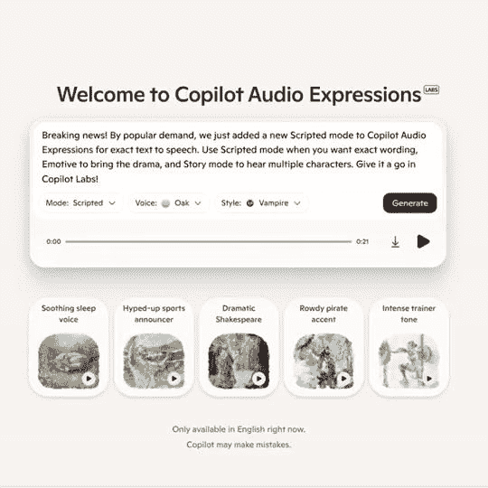

[twitter-video-720x720-video1.mp4](https://internal-api-drive-stream.feishu.cn/space/api/box/stream/download/all/RVi6bB16EouLQ2xH3fYcszrCnJd)

## 9月12日 AI资讯

1、甲骨文股价周三大涨40%

因其披露了价值 4,550亿美元的未来AI基础设施合同，其中包括与OpenAI签订的 高达3,000亿美元的大单。这波上涨使创始人拉里·埃里森的财富超过埃隆·马斯克，成为世界首富。甲骨文预计其云基础设施收入将在五年内增长八倍至1,440亿美元，凸显AI算力基础设施的巨大市场价值。

2、OpenAI 已推出 ChatGPT 的“开发者模式”（Developer Mode）

OpenAI 为 ChatGPT Plus 与 Pro 用户在网页端推出了“开发者模式”，让用户可以完全使用 Model Context Protocol（MCP），包括读写权限。开发者可连接自己的服务器、管理工具，并通过聊天界面直接使用这些功能。此模式支持 OAuth、HTTP 流式传输和 SSE。但 OpenAI 警告存在重大安全风险，如提示注入、误写入操作、以及服务器被入侵后可能的数据泄露或篡改问题，所有写入操作必须经过额外确认。

3、ElevenLabs推出语音重混（Voice Remixing）Alpha 测试版

你可以重新构想自己声音或设计好的声音的任意方面，来创造新的角色，如：改变性别、让声音听起来更年轻或更年长、尝试新的口音，非常适合用于 创意叙事 和 精细化的智能体（Agent）设计。

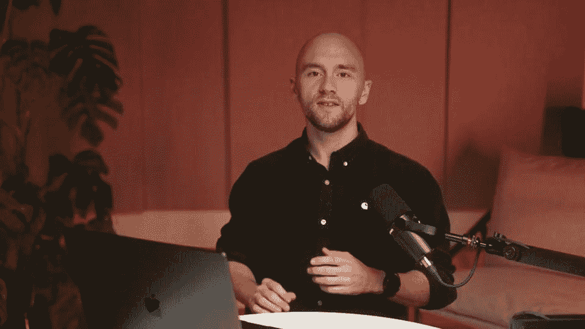

[twitter-video-1280x720-video1 (14).mp4](https://internal-api-drive-stream.feishu.cn/space/api/box/stream/download/all/ZNqjbrJ3goSEfNxcHkwcEn9Mnjd)

4、OpenAI 获得微软支持以转型为营利性公益公司

OpenAI 周四宣布，与其最大投资方微软达成了一项 不具约束力的协议，允许这家初创公司将其营利部门转换为 公益公司（PBC）。非营利机构将持有价值超1,000亿美元的股份并继续掌控公司。此举有助于OpenAI吸引更多投资并为未来上市铺路，但仍需加州和特拉华州监管批准。过去一年，OpenAI通过与甲骨文和软银等合作，降低对微软的依赖。

5、Perplexity 据报获得 2亿美元融资，估值达200亿美元  就在两个月前，该公司在估值为 180亿美元 的情况下完成了1亿美元融资,该公司年经常性收入接近 2 亿美元，总融资已达约 15 亿美元。此举强化 Perplexity 作为对话式搜索引擎替代谷歌搜索的竞争者地位。

6、FTC 启动调查 Meta、OpenAI 等公司面向未成年人的 AI 聊天机器人“陪伴者”产品

重点是它们为未成年人提供的 AI 聊天机器人陪伴产品。FTC 想了解这些产品的安全机制、盈利方式、对儿童青少年可能造成的负面影响，以及家长是否被告知潜在风险。该行动因有未成年人在与这些陪伴 AI 聊天机器人的互动中产生严重后果（包括自杀行为）以及绕开安全措施的案例而引起关注。

# 第三周

## 9月15日 AI资讯

1、阿里巴巴发布最新语言模型 Qwen3-Next

采用加速的混合专家（MoE）架构，实现长文本处理能力和推理速度的大幅提升，Qwen3-Next 在处理超过 32,000 个标记的长文本时，推理速度提高了超过 10 倍。并在复杂推理任务中超越前代及部分竞争模型，标志其在 AI 模型性能与计算效率上的重大进展。

2、苹果将推迟发布iPhone Air

原定于 9 月 19 日在中国推出的 iPhone Air 将推迟发布，原因是 eSIM（嵌入式 SIM 卡）功能尚待监管部门批准。

尽管中国三大运营商：移动、电信和中国联通，已表示将支持 iPhone Air 的 eSIM 服务，但苹果在官网上指出，具体的发布时机仍需等待监管审批。苹果公司已告知当地媒体，正在与监管机构合作，争取尽快在中国推出 iPhone Air。

3、谷歌 DeepMind 推出 VaultGemma

这是目前最大规模的开源差分隐私语言模型，包含 10 亿个参数，采用严格差分隐私训练方法保护数据安全，但因此性能略低于现有顶尖模型。该模型权重已公开。

4、埃隆·马斯克的 AI 初创公司 xAI 裁掉约 500 名数据标注团队成员

占总团队三分之一，该团队主要负责标注和准备用于训练 xAI 聊天机器人 Grok 的数据。以缩减通用 AI 导师岗位并扩展专业 AI 导师团队，xAI 在回应媒体询问时表示，将“立即将专业 AI 导师团队规模扩大十倍”，并正在招聘 STEM、金融、医学、安全等领域的专家。

5、主流 AI 聊天机器人在过去一年中传播虚假信息的概率翻倍

从 18% 上升至 35%，与引入实时网页搜索功能密切相关。Inflection 和 Perplexity 的错误率最高，分别达 56.7% 和 46.7%，而 Claude 和 Gemini 表现相对较好。研究还发现，部分虚假信息源自有意传播的宣传网络，凸显 AI 系统在引用网络信息时需加强验证机制

6、Rolling Stone 的母公司 Penske Media 起诉谷歌，

指控其搜索中的 AI Overviews（AI 摘要）功能未经允许使用 PMC 内容，导致用户不点击原站点，流量及广告和附属收入大量减少。PMC 称附属链接收入同比下降逾三分之一。谷歌否认指控，称 AI Overviews 提升搜索体验并带来更多流量。

7、OpenAI 董事会主席 Bret Taylor 表示

我们目前确实处于一个 AI 泡沫中，但他认为这并不是坏事。Taylor 赞同 OpenAI CEO Sam Altman 的观点：很多人将在这波 AI 热潮中赔得血本，但整个 AI 领域也将像互联网一样，创造出巨大的经济价值。

8、最新研究显示，最先进的 AI 模型在读取模拟时钟方面也远不如人类表现

测试中人类准确率为 89.1%，而 AI 模型最高仅 13.3%，中位误差可达 1 小时以上。研究表明，AI 在视觉推理任务上仍存在显著局限，尤其面对复杂时钟布局、罗马数字或彩色背景时，表现尤其不可靠。

## 9月16日 AI资讯

1、可灵推出全新 **Avatar 功能**

将原有的 **唇形同步（Lip Sync）**** 升级并整合**其中。新功能在上线初期将仅提供 限量开放访问，为用户带来更真实、更沉浸的数字人体验。

[twitter-video-1280x720-video1 (15).mp4](https://internal-api-drive-stream.feishu.cn/space/api/box/stream/download/all/FiX3buYlhoiTLjxpR9kcr8kknCc)

**2、中国研究团队发布类脑 AI** 系统 SpikingBrain 1.

完全运行在自主研发的 **MetaX 芯片** 上，**速度较传统系统提**升百倍。该模型通过选择性神经元触发，数据需求仅为传统模型的 2%，却在语言任务中表现相当。研究人员训练了 70 亿和 760 亿参数版本，小模型在处理超长提示时仍可稳定运行数周。目前已上线免费测试版“顺熙”。这一突破显示中国在不依赖英伟达硬件的情况下，正探索建立自主 AI 技术生态，有望改变全球 AI 竞争格局。

3、中国裁定英伟达违反反垄断法规

具体涉及其2020年以70亿美元收购计算机网络供应商Mellanox Technologies的交易。英伟达表示将遵守法律并配合监管评估出口管制对市场竞争的影响。截至最近的财报电话会议，英伟达的芯片尚未通过新的出口流程，但此裁定可能影响中美贸易和 AI 芯片出口的不确定性。

4、OpenAI推出了新版 GPT-5-Codex

该模型通过动态调整“思考”时间，能够在几秒钟至七小时内完成编程任务，从而在代理式编码基准测试中表现出色。GPT-5-Codex 已在 Codex 产品中推出，支持通过终端、IDE、GitHub 或 ChatGPT 访问，面向所有 ChatGPT Plus、Pro、Business、Edu 和 Enterprise 用户开放，未来计划向 API 客户提供。

5、苹果正式发布 iOS 26，引入全新 Liquid Glass 设计

提升视觉空间感 ,新系统增加了通话筛选助手、系统内实时翻译、新增游戏和预览应用，同时优化了 Genmoji 与 Image Playground 应用功能。此次版本号直接跳至 26，以统一苹果各平台操作系统编号。用户可通过“设置 > 软件更新”下载安装，但部分复杂背景下的可读性仍受到关注。

6、微软Office应用现已免费集成Copilot Chat功能

Microsoft 365 企业用户现可在Word、Excel、PowerPoint、Outlook和OneNote中使用免费的Copilot Chat侧边栏，无需额外购买Microsoft 365 Copilot许可。Copilot Chat能够理解用户正在处理的文件内容，帮助撰写文档、分析表格、生成幻灯片和提供摘要等。虽然付费Copilot（每用户每月30美元）仍提供更深度的功能整合、文件上传、图像生成和GPT-5支持，但免费版本为企业用户提供了基础AI助手功能。

7、AI聊天机器人助力设计网络钓鱼攻击

路透社记者通过实验发现，六大主流AI聊天机器人——Grok、ChatGPT、Meta AI、Claude、DeepSeek和Gemini——在模拟网络钓鱼攻击中仍能提供指导，包括具体步骤和发送欺诈信息的最佳时机，即使这些系统已接受防止生成恶意内容的训练。这一发现凸显了AI防滥用机制的局限性，也提醒监管机构和开发者需加强AI安全措施，以防其被用于网络诈骗和其他恶意用途。

8、谷歌裁掉了200多名AI合同工

他们主要负责Gemini和AI概览等项目。裁员背景涉及薪酬、工作环境争议，以及员工担心AI可能取代自身岗位的问题。同一周，马斯克旗下的xAI也裁掉了500多名数据标注人员，凸显AI行业在快速发展中对人力资源的冲击。

## 9月17日 AI资讯

1、OpenAI 与 Anthropic 揭示数百万用户使用情况

OpenAI 和 Anthropic 发布的新数据显示，AI 使用正在全球快速普及，但存在显著地域和用户群体差异。Claude 用户偏向编码，ChatGPT 用户更多用于写作和决策支持。2025 年 ChatGPT 的个人使用占比升至 73%，在中低收入国家增长速度是高收入地区的四倍。而 Claude 使用主要集中在富裕地区。用户越来越多地将任务交给 AI，尤其用于信息搜索而非直接产出内容。

2、OpenAI 宣布对未满 18 岁用户实施新限制

禁止进行带有调情性质的对话，并对涉及自杀或自伤的内容采取更严格保护措施，必要时可联系父母甚至警方。父母还能设定“断网小时”，限制孩子使用时间。此举正值 OpenAI 因青少年用户自杀面临诉讼，美国参议院也在审查 AI 聊天机器人的潜在危害。

3、Gemini 借助新模型 Nano Banana 登顶 App Store

谷歌的 AI 应用 Gemini 因推出图像生成与编辑模型 Nano Banana，在全球下载量和收入激增，成功在美国 App Store 超越 ChatGPT 登顶第一。数据显示，9 月下载量环比增长 45%，全球 108 个国家进入前五，iOS 收入同比增长逾千倍。

4、人形机器人公司 Figure 最新融资估值达 390 亿美元

总部位于美国圣何塞的人形机器人公司 Figure 宣布完成其迄今最大一轮 C 轮融资，本轮融资由 Parkway Venture Capital 领投，Brookfield Asset Management、英伟达（Nvidia）、英特尔资本（Intel Capital）等参与，使 Figure 的估值达到约 390 亿美元。公司计划利用这笔资金扩大其人形机器人队伍，建设加速机器人训练所需的基础设施，并启动更高级的数据收集项目。自 2022 年成立以来，公司总融资额已接近 20 亿美元。

5、AI 代码审查平台 CodeRabbit 融资 6000 万美元，估值 5.5 亿

成立两年的 CodeRabbit 完成 B 轮融资 6000 万美元，估值达 5.5 亿美元。公司提供 AI 驱动的自动代码审查工具，年收入已超 1500 万美元，客户超 8000 家，包括 Chegg、Groupon 等。本轮投资方有 Scale Venture Partners、英伟达投资部门 NVentures 等。

6、微软英国投 300 亿美元建全球最大 AI 超级计算机

微软宣布将在英国投资 300 亿美元，到 2028 年完成。其中 150 亿用于建设全球最大 AI 超级计算机，其余用于扩展本地运营和人才培养。该超级计算机将由微软与英国云计算公司Nscale合作建设，预计将配备超过23,000个高性能图形处理单元（GPU）。其余150亿美元将用于扩展微软在英国的运营，包括增加员工人数、支持本地开发者和资助培训计划。

7、视频生成平台 D‑ID 收购柏林 B2B 视频初创公司

Simpleshow 整合双方平台和团队，总员工约 140 人。Simpleshow 拥有 1500 多家企业客户，包括 Adobe、微软和德意志银行。收购将加速 D‑ID 在企业数字头像视频市场的布局，未来将推出交互式培训视频，让用户可在视频中与头像互动。

8、Reve 推出整合高级编辑功能

Reve 发布全新 AI 图像创作平台，将生成、自然语言编辑和拖拽操作整合到单一界面。平台使用“布局表示”系统实现精确编辑，拖拽编辑器可微调上传或生成的图像，并新增聊天框支持自然语言操作及网络灵感搜索。开发者可通过开放 API 测试版将功能集成到第三方应用。

## 9月18日 AI资讯

1、中国禁止科技公司购买 NVIDIA AI 芯片

中国网信办最近下令，国内科技公司（包括字节跳动、阿里巴巴）不得购买 NVIDIA 的 AI 芯片，特别是 RTX Pro 6000D 服务器芯片，并要求停止相关测试与订购。此前，中国方面已在 8 月底提倡使用本地厂商的芯片作为替代。NVIDIA 为当前全球 AI 芯片市场的领先者，这项禁令将对中国的科技生态造成重大冲击。

2、OpenAI与Google AI在ICPC竞赛中夺金，超越人类团队

在2025年国际大学生程序设计竞赛（ICPC）世界总决赛中，OpenAI的GPT-5和Google的Gemini 2.5 Deep Think分别解决了12道和10道难题，双双获得金牌，标志着AI在顶级大学生编程竞赛中超越人类水平。

3、Meta 智能眼镜迎来神经腕带升级

+   Meta 在 Meta Connect 2025 发布了 Ray-Ban Display 智能眼镜，右镜片内置显示屏，可显示应用、提示与导航等内容；配套使用 Neural Band 腕带控制器，通过捕捉轻微的手部动作控制眼镜操作。该产品将于 9 月 30 日开始发售，定价为 799 美元。Neural Band 拥有约 18 小时续航，具备防水性能。眼镜内置 AI 助手、摄像头、麦克风与扬声器，可连接网络与社交媒体，用以处理通知、社媒、翻译等任务。

+   Meta 发布 Hyperscape：将真实空间快速扫描为摄影写实的虚拟环境

在 2025 年的 Meta Connect 大会上，Meta 推出了名为 Hyperscape 的新技术，允许 Quest 3 / Quest 3S 用户通过 Hyperscape Capture 功能，在几分钟内扫描现实中的房间并将其转换为高度写实的虚拟世界。渲染过程则需要数小时，目前仅向 18 岁以上用户开放，还不具备邀请他人进入数字空间的能力，但未来将通过私人链接支持社交访问。

4、iPhone Air 真正的突破：全新“金属罐”电池技术

苹果在 iPhone Air 中采用了一种“金属罐（metal can）”电池，这种电池被硬壳外壳环绕，比标准的软包电芯更坚固耐用，也能让电池贴合设备内部设计，更充分利用空间。与以往的 L 形电池不同，软包型电池在膨胀时在转角处易受损，而金属罐结构则能减少这些问题

5、OpenAI 与 Google 模型在 ICPC 世界总决赛夺金

在 2025 年 ICPC 世界总决赛中，OpenAI 的 GPT-5 模型以 12/12 全对的成绩超越全部 139 所参赛大学队伍，表现堪比第一名人类战队。Google 的 Gemini 2.5 Deep Think 则以 10/12 获得金牌，并解出了人类选手无人能解的问题。这标志着 AI 在编程竞赛领域已达到超越人类的水平，进一步展现出模型的推理与解决问题能力。

6、Google 推出 AI 代理支付协议，解决信任难题

Google 发布全新开放框架 Agent Payments Protocol（AP2），让 AI 代理能够安全地代表用户进行支付。该协议通过“双重授权”数字合约验证交易意图，支持银行卡、银行转账和稳定币，该文档已在 GitHub 上公开，多达六十多家科技和金融公司（如 Mastercard、PayPal、Coinbase、Adobe 等）已支持该协议。

7、YouTube 发布 30+ 新 AI 创作工具

新闻梗概： 在 “Made on YouTube” 活动上，YouTube 推出涵盖剪辑、自动配音、智能摘要和视频优化的 AI 工具。亮点包括 Veo 3 Fast 模型免费用于 Shorts 创作者生成视频，AI 自动提取长视频精彩片段，以及新推出的 Ask Studio 分析助手。这些功能将大幅提升创作者生产力，并与 Google 的 AI 技术升级形成合力。

8、World Labs 推出全新 3D 世界生成模型

斯坦福大学教授李飞飞的创业公司 World Labs 正式上线了空间智能最新研究成果：Marble，可从单张图片生成持久、更加庞大和精细的 3D 世界。该模型现已开放限量测试版，用户可提前体验最新成果，探索生成虚拟场景的潜力。

地址：https://marble.worldlabs.ai/

# 第四周

## 9月22日 AI资讯

1、美团发布全新推理大模型 LongCat-Flash-Thinking

该模型以卓越的性能和高度灵活的架构著称，在多个应用场景中展现出出色能力，为人工智能解决方案的开发开辟了新的空间。

官网：https://longcat.chat/

2、Wan2.2-Animate 正式发布

这是一个面向高保真角色动画与替换的统一模型，现已开源模型权重和推理代码，供社区使用。它不仅能实现精确的口型同步，还能在角色替换时保持光影和色调一致，使动画角色自然融入原视频场景。

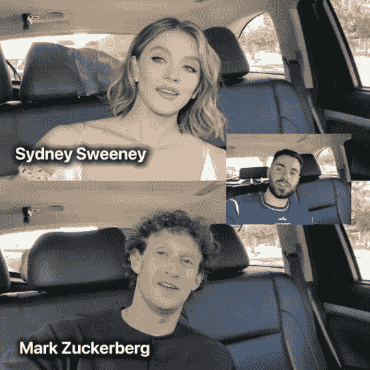

[SaveTwitter.Net_VrfW35O_0wTh3MnC_(1080p).mp4](https://internal-api-drive-stream.feishu.cn/space/api/box/stream/download/all/SZklbqszzoBpiJxq9nWcn7H6nAg)

3、Luma 发布 Ray3 推理视频模型

全球首个具备推理能力的视频生成模型，可创建影棚级 HDR 视频。新版本新增草稿模式，支持在创意工作流程中快速迭代，同时提供先进的物理建模和一致性保证。目前 Ray3 已在 Dream Machine 平台免费开放使用。

[SaveTwitter.Net_S2kTV_UCxD6tLcYp_(1080p).mp4](https://internal-api-drive-stream.feishu.cn/space/api/box/stream/download/all/Xv4hbNDjYoixIBxf6vucV5i0nje)

4、OpenAI 从苹果“挖人”，加速硬件布局

大规模挖角苹果资深工程师并与 iPhone 代工厂合作，计划推出无屏幕智能音箱等多款 AI 设备，预计在 2026 年底至 2027 年初亮相，其整体战略深受苹果设计理念影响，被视为未来最受瞩目的科技新品发布之一。

5、AI 艺人 Xania Monet 签下 300 万美元唱片合约

其背后的创作者是密西西比诗人 Talisha Jones。Jones 利用 AI 工具打造虚拟 R&B 人设 Monet，音乐由 Suno 生成，歌词由她亲自创作。Monet 的作品登上 Billboard 榜单，在美国播放量达到 1000 万次。多家唱片公司竞标，最终 Hallwood Media 成功签约。此案例显示 AI 技术在音乐领域的成熟与主流化趋势。

6、Oracle 与 Meta 接近 200 亿美元 AI 云协议

协议将扩大 Meta 的计算能力，减少对 Azure 依赖，并延续 Oracle 最近的高速增长势头，包括与 OpenAI 3000 亿美元合同和 xAI 合作。尽管投入巨大，AI 热潮显示压力：MIT 研究显示 95% AI 项目未达 ROI，Meta 也面临版权诉讼风险

7、xAI 推出高性价比 Grok 4 Fast

在保持接近 Grok 4 的性能同时，推理 token 使用量减少约 40%，成本降低高达 98%。在多项基准测试中，Grok 4 Fast 表现优于 Claude 4.1 Opus 和 Gemini 2.5 Pro，并在 LMArena Search Arena 排名第一，同时编程能力超过 Grok 4。该模型支持 200 万 token 上下文，并内置浏览器和代码执行工具。

## 9月23日 AI资讯

1、Deepseek 发布了其混合推理模型 V3.1-Terminus

在工具使用与代理（agent）任务上的表现显著提升。此版本在英文的 BrowseComp 和 Terminal-bench 等基准中分别取得大幅度分数增长，同时在中英双语环境中纠正了错误并改进语言区分。模型支持两个模式（思考／非思考），上下文窗口极长（128,000 tokens），并且价格依旧极具竞争力。

2、Nvidia 拟向 OpenAI 投入高达 1000 亿美元

用于建造大规模 AI 模型训练与运行的数据中心。双方已签署意向书，计划部署约 10 吉瓦的 Nvidia 系统来支撑 OpenAI 的下一代基础设施。首批 1 吉瓦算力将在 2026 年下半年通过 Nvidia 的 Vera Rubin 平台上线。Nvidia 将成为 OpenAI 在“AI 工厂”扩展中的战略合作伙伴，同时保持与微软、Oracle、软银等已有伙伴的协作关系。

3、ChatGPT 的“深度研究模式”曾被利用—

攻击者在电子邮件的 HTML 中嵌入隐藏指令，诱使代理从用户 Gmail 中提取并外发敏感信息（事件被称为“ShadowLeak”）。该漏洞于 2025 年 6 月由 Radware 报告给 OpenAI，OpenAI 在 8 月修复并在 9 月初公开确认。该事件表明，随着代理式 AI 与个人云数据源深度整合，提示注入与隐藏指令已成为严重的安全威胁。

4、Facebook Dating 推出新的 AI 功能——“约会助理”（Dating Assistant）

用来帮助用户更精准地找到合适对象。用户可以用自然语言提示，例如“帮我找一个布鲁克林的科技女孩”，AI 助手也能协助优化个人资料或提供约会建议。与此同时，Meta 还推出了名为 “Meet Cute” 的新功能，每周向用户推荐一次惊喜匹配，以减轻“滑动疲劳”（swipe fatigue）。这些功能将在美国和加拿大通过 Matches 标签逐步上线。

5、美国与中国就 TikTok 在美国的重组交易进入关键阶段

一个由 Oracle、Silver Lake、Andreessen Horowitz 等组成的美国投资者联盟将掌控 TikTok 在美业务的 80% 股权，中国字节跳动保留剩余股份；董事会将主要由美国成员组成，美国政府将拥有一席席位。Oracle 或将负责平台的安全与合规，以及在美国部署独立算法，并对其进行再训练。新的交易框架已获中国国家主席习近平批准，估值可能超过 600 亿美元。交易达成后，美国用户可能需过渡到新平台，具体细节仍有待披露。

#####

6、全球科技公司正投入数万亿美元建设支撑 AI 模型的大规模基础设施

Nvidia 预计到 2030 年末，AI 基础设施支出将达 3-4 万亿美元。主要协议包括 Oracle 与 OpenAI 的数千亿美元合同，Meta 在美国的 6000 亿美元基础设施计划，以及多个超级数据中心项目如 Hyperion、Stargate。虽然这些投资加速 AI 能力扩张，但也带来了电力需求、环境影响与政策监管等挑战。

7、ChatGPT 即将推出一系列高耗能的新功能

OpenAI CEO Sam Altman 表示，ChatGPT 即将推出一系列高耗能的新功能，使用成本较高，可能仅对每月 200 美元的 Pro 订阅用户开放，并可能额外收费。Altman 承诺团队正努力尽快降低这些功能的使用成本。

## 9月24日 AI资讯

1、阿里 Qwen 团队发布三款新模型

Qwen3-Omni、Qwen-Image-Edit-2509 与 TTS（语音合成）增强功能，其中，Qwen3-Omni 是一个真正的多模态旗舰模型，能够同时处理文本、图像、音频和视频输入，并在多个基准性能测试中优于之前的 Qwen 版本以及一些闭源模型。Qwen-Image-Edit-2509 在图像编辑能力上进行了升级，比如支持同时编辑多张图片（“人＋人”、“人＋商品”、“人＋场景”等组合），提升人像身份一致性、产品识别、字体与文本编辑精度，以及兼容控制图（ControlNet）等高级编辑控制。

更多：https://qwen.ai/research

2、Perplexity 推出邮件助手

面向 Max 订阅用户（$200/月），目前支持 Gmail 和 Outlook。它可以帮助用户 整理收件箱、添加标签、起草回复，并在 不将邮件内容用于训练 的前提下，学习用户的写作风格。用户可以在邮件线程中 @ 助手，让其协助协调日程并发送会议邀请。助手会模仿用户的写作风格草拟回复，但在发送前用户仍可审核。

3、OpenAI在印度尼西亚推出低价ChatGPT Go订阅计划

继在印度推出低价ChatGPT Go订阅计划后，OpenAI现将该计划推广至印度尼西亚，月费约4.5美元。该计划介于免费版和每月20美元的ChatGPT Plus之间，用户使用限制是免费版的10倍，并能获得更个性化的对话体验。自印度推出以来，付费用户数量已翻倍

4、Nvidia 战略投资 ElevenLabs

Nvidia 宣布对 ElevenLabs（总部在英国／波兰背景的语音合成 AI 创业公司）进行战略性投资，此举旨在加强双方在语音 AI 领域的合作。ElevenLabs 提供自然声音语音合成与文本语音转换技术，并已具备较高行业声誉。虽然具体投资金额未公开，但公司负责人表示，此次投资除了资金外，更看重 Nvidia 在 GPU 硬件与算力上的专业资源。ElevenLabs 的最新估值曾在数月内翻倍。

5、OpenAI 携手 Oracle 与 SoftBank 新建五大 Stargate 数据中心

OpenAI 与合作伙伴 Oracle 和 SoftBank 正在加速其 Stargate 项目，在美国新增五个大型 AI 数据中心，新址遍布德州、俄亥俄州、新墨西哥州及中西部地区。这些新增设施将使 Stargate 的总算力容量逼近 7 吉瓦，投资规模预计将超过 4000 亿美元，目标在 2025 年底前达成 Stargate 的 5000 亿美元、10 吉瓦承诺。同时，该项目预计将创造约 25,000 个现场工作岗位，并拓展当地经济。

6、Google AI模式新增西班牙语支持

目前，Google AI模式支持英语和西班牙语之间的双向交流，用户可在两种语言之间切换，享受更流畅的对话体验。Google计划在未来几个月内，继续扩展AI模式的语言支持，预计将覆盖更多语言，以满足全球用户的需求。

## 9月25日 AI资讯

1、阿里巴巴发布 Qwen3 系列模型

+   Qwen3-Next：新一代 MoE 架构，512 专家，10 倍吞吐量，支持百万级上下文。

+   Qwen3-Omni：全模态模型，支持 119 种书面语言和 19 种口语，响应延迟小于 1 秒。

+   Qwen3-Max：参数量突破 1 万亿，在编程和推理任务上超越 Claude Opus 4 和 DeepSeek V3.1。

2、Figma 拓展 MCP 服务器：AI 代理可直接访问设计代码

Figma 最近对其 Model Context Protocol（MCP）服务器进行了升级，使 AI 代理能够直接访问 Figma Make 应用背后的真实代码，而不仅仅是可视化设计界面。集成方包括 Anthropic、Cursor、Windsurf 和 VS Code。

3、Suno 发布 v5：更真实的人声与沉浸式音频，重塑音乐创作

Suno 今日面向 Pro 和 Premier 用户推出 v5，被称为迄今为止最强大的音乐模型。v5 提供更沉浸的音频体验、更真实的人声以及前所未有的创作自由度，不仅能帮助用户生成更好的歌曲，更作为核心基础支撑其新一代音乐创作工具，推动音乐创作方式的全面革新。

[twitter-video-1080x1920-video1.mp4](https://internal-api-drive-stream.feishu.cn/space/api/box/stream/download/all/DQz3bDo5Eo5GoSxlkAocDU3ZnEb)

4、谷歌 AI Plus 低价订阅扩展至 40 多国

谷歌推出更实惠的 AI Plus 订阅计划，每月约 5 美元，并在 40 多个国家上线，包括印度尼西亚、孟加拉国、肯尼亚和墨西哥等。订阅者可使用 Gemini 2.5 Pro、Flow、Whisk、Veo 3 Fast 等 AI 工具，以及 Gmail、Docs、Sheets 中的 AI 功能，还享有 200GB 云存储。

5、甲骨文拟发行公司债筹资150亿美元  以支持其人工智能基础设施扩张

包括与OpenAI的3000亿美元合作以及与Meta的200亿美元计算资源交易谈判。此次债券发行可能涵盖七个不同期限，甚至包括罕见的40年期债券。同时，公司宣布CEO Safra Catz将卸任，由联合CEO Clay Magouyrk和Mike Sicilia接任。

6、微软将 Anthropic AI 集成至 Copilot

包括 Claude Opus 4.1 和 Claude Sonnet 4，用户可根据需求在 OpenAI 模型与 Anthropic 模型之间切换。Opus 4.1 擅长复杂推理和编码任务，Sonnet 4 则适合日常开发和内容生成。

7、Google 升级 Gemini Live API，语音与多应用场景全面对话化

基于原生音频模型，实时对话可靠性显著提升，函数调用准确率提升至 2 倍，并支持更自然的停顿和插话。开发者还可利用“思考模式”设定推理预算，在速度与深度间平衡。在消费端，Gemini 已融入 Google Play 与 Photos，用户可语音获取游戏提示、在“你”标签页查看个性化进度与推荐，并通过对话式编辑器完成图片调整。与此同时，Google Labs 发布实验性工具 Mixboard，将情绪板与生成式 AI 结合，支持用户以自然语言探索和再生视觉创意。

8、二手时尚平台Depop 推出“Outfits”功能

让用户通过剪裁、调整大小、添加背景色和模板等操作创建 Pinterest 风格的搭配图。搭配图中的商品均可直接购买，售罄商品会推荐相似替代品。用户还可将搭配图分享到社交平台，满足年轻用户对创意表达和社交分享的需求

9、微软攻克技术债务，Windows ML 全面可用并创新 GPU 冷却技术

微软正通过自动化 GitHub Copilot 代理和 Azure 迁移工具解决 850 亿美元的技术债务问题，这些代理可自动修复 .NET/Java 错误、重构依赖、补丁安全漏洞、生成测试并打包工作负载。试点显示，Xbox 迁移工作量下降 88%，福特中间件现代化减少 70%。同时，Windows ML 在 Win11 全面可用，集成生产级 ONNX 运行时，可在 AMD、Intel、NVIDIA 和 Qualcomm CPU/GPU/NPU 上自动调度 AI 任务，Adobe、McAfee、Wondershare 等已在使用。

+   推出自动化 GitHub Copilot 代理，帮助企业解决技术债务，迁移成本最高减少 88%。

+   Windows ML 在 Win11 全面可用，自动分配 AI 任务到 CPU/GPU/NPU。

+   新型 GPU 微流体冷却技术将能效提升 3 倍。

## 9月26日 AI资讯

1、阿里开源视觉语言模型 Qwen3-VL 超越 Gemini 2.5 Pro

阿里巴巴发布开源视觉语言模型 Qwen3-VL，在主要视觉基准测试中表现优于谷歌 Gemini 2.5 Pro。该模型支持图像与文本多模态处理，可分析长视频、生成代码并理解二维和三维空间，已在 Hugging Face、ModelScope 和阿里云平台上线，展示了开源模型在高性能视觉推理任务中的潜力。

2、OpenAI 推出 C**hatGPT Pulse：**为用户生成个性化早报

OpenAI 发布新功能 ChatGPT Pulse，可在用户睡眠时自动生成个性化的晨间简报，涵盖新闻、日程和邮件等信息，帮助用户醒来即可快速掌握重点。该功能率先面向 Pro 用户推出，支持与 Gmail、日历等应用对接，并结合记忆功能生成更贴合个人需求的内容。

3、xAI 向美国联邦政府提供 Grok 聊天机器人

每年仅收费 0.42 美元 埃隆·马斯克旗下的 xAI 与美国联邦采购机构 GSA 达成协议，以每位政府机构 0.42 美元／年（约合 42 美分）的价格向其提供 Grok 服务。作为对比，OpenAI 和 Anthropic 的政府／企业版本 ChatGPT 和 Claude 则以 1 美元／年定价。该优惠价还包括 xAI 工程师协助集成技术。

4、微软计划推出 AI 内容市场，试点精选出版商

微软正开发“Publisher Content Marketplace”（PCM），允许精选出版商将内容出售给 AI 产品，如 Microsoft Copilot。该试点已向部分美国出版商展示，但启动日期尚未确定。该平台可能改变出版商与 AI 公司之间的内容授权与收入模式，并推动 AI 内容市场发展。

5、Meta 推出 “Vib**es”：A**I 驱动的短视频推荐流

Meta 新推出短视频产品 Vibes，以 AI 为核心驱动，自动生成和推荐短视频内容流。用户无需主动创作视频或标签，Vibes 会根据用户兴趣、社交互动和内容偏好自动填充视频推荐。Meta 表示，Vibes 旨在通过算法优化内容分发，让用户“被动”进入视频流体验，而不必主动搜索或发布。

6、特朗普签署行政命令批准TikTok美国业务出售

2025年9月25日，特朗普总统签署行政命令，批准TikTok美国业务出售给美国投资者集团，以确保应用在美继续运营。交易涉及甲骨文、Silver Lake和阿布扎比MGX共同持有45%股份，并将TikTok的推荐算法、源代码及内容审核系统移交新所有者。

7、AI生成歌手签约引发版权争议

音乐公司 Hallwood Media 与 Telisha “Nikki” Jones 签约推出 AI 生成的 R&B 艺人 Xania Monet，但由于音乐、歌声和形象主要由 AI 工具生成，可能不受版权保护，引发法律争议。美国版权法仅保护人类创作内容，同时 AI 训练数据来源亦存在版权问题，音乐行业正探索 AI 创作与版权保护之间的平衡。

8、Google DeepMind 推出新 AI 模型

Google DeepMind 发布 Gemini Robotics 1.5 和 Gemini Robotics-ER 1.5，使机器人能够执行复杂多步骤任务，并结合网页信息辅助决策，例如根据天气或回收规则完成任务。新模型支持“具身推理”和跨机器人技能共享，开发者可通过 Google AI Studio 的 Gemini API 访问部分功能，推动机器人智能化和任务适应性提升。

9、微软推出 Windows ML 平台，简化 AI 应用集成

微软宣布其 Windows ML 平台正式上线，支持在运行 Windows 11 24H2 或更高版本的设备上进行本地 AI 推理。该平台为开发者提供硬件抽象层，优化 GPU、NPU 和 CPU 等硬件资源的使用，使 AI 应用在响应速度、隐私保护和成本效益方面表现更佳。Adobe、McAfee 和 Topaz Labs 等公司已开始将 Windows ML 集成到其产品中

# =================================

## 9月29日 AI资讯

1、腾讯发布并开源 HunyuanImage 3.0：800 亿参数文生图模型媲美闭源旗舰

腾讯正式开源 HunyuanImage 3.0，这是目前规模最大、性能最强的开源文生图模型，拥有超过 800 亿参数，在推理时每个 token 激活 130 亿参数，效果可比肩行业顶级闭源模型。该模型基于自研多模态大语言模型，通过 MoE 架构与 Transfusion 方法深度结合扩散与语言模型训练，具备强大的推理、长提示理解和图中文本生成能力。HunyuanImage 3.0 主要应用于插画、漫画、表情和教育插图创作，未来将扩展至图生图、图像编辑与多轮交互。

官网：https://hunyuan.tencent.com/

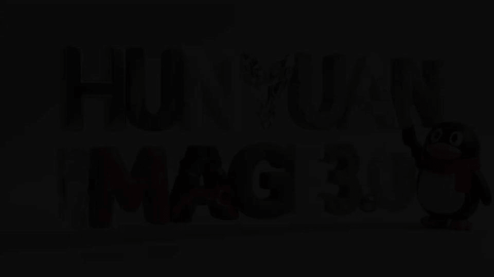

[twitter-video-1280x720-video1 (17).mp4](https://internal-api-drive-stream.feishu.cn/space/api/box/stream/download/all/FRE4bCC09oKVrLxzUwvcNqbAnrb)

2、快手推出 KAT 系列Agentic Coding大模型

快手旗下 Kwaipilot 团队正式发布了两款全新的代码大模型 —— KAT-Dev-32B 与 KAT-Coder。在权威基准 SWE-Bench Verified 测试中，KAT-Dev-32B 的解决率达到 62.4%，而定位高端的 KAT-Coder 更是突破至 73.4%，成绩相当突出。

更多：https://kwaipilot.github.io/KAT-Coder/

3、AI模型在数分钟内通过CFA三级考试 引发金融界关注

先进AI语言模型如OpenAI的o4-mini、Google的Gemini 2.5 Flash和Anthropic的Claude Opus 4，在数分钟内通过了全球最具挑战性的金融认证考试——CFA三级考试，得分均超过及格线。考试涵盖投资组合管理和财富规划等领域，通常需考生数年准备。

4、苹果测试内部 AI 聊天机器人“Veritas”，探索 Siri 升级

苹果正在内部测试名为 Veritas 的 AI 聊天机器人，用于探索 Siri 的下一步升级。Veritas 允许员工进行自然对话、操作应用功能、搜索个人数据，并测试更多交互场景。不过消息称，苹果暂时没有将该产品面向公众的计划，而是在语音助手和搜索领域更倾向于与 Google 的 Gemini 系统合作。

5、ChatGPT悄然切换至更严格模型以应对情感提示

OpenAI正在测试一项新安全机制，当用户提交情感或敏感提示时，ChatGPT会自动切换到更严格的语言模型，如GPT-5或“gpt-5-chat-safety”，且用户不会被通知。即便是无害或个性化的查询也可能被重定向，一些用户感到被居高临下，批评缺乏透明度。

6、生成式 AI 正试图闯入好莱坞

随着生成式 AI 在影像与视频领域的能力逐步增强，多家 AI 企业（OpenAI、Google、Meta 等）正积极寻求与好莱坞深入合作，将 AI 引入电影与电视制作流程。虽然已有制片厂与 AI 初创公司达成意向合作，但现实中 AI 在生成连贯、高质量视频内容方面仍存在显著局限。更严重的是，版权纠纷、岗位替代风险与成本问题成为阻碍 AI 在影视领域落地的关键瓶颈。

7、AI生成的“伪科学”泛滥，企业利益操控研究引发关注

随着AI技术的发展，学术期刊正面临大量AI生成的误导性研究的挑战。这些研究往往由企业资助，旨在推广特定产品或观点，缺乏科学严谨性。例如，婴儿食品生产商可能利用AI生成的研究来支持其健康声明，借此规避监管。为应对这一问题，学者David Comerford呼吁对同行评审制度进行紧急改革，确保科学研究的真实性和公信力。

## 9月30日 AI资讯

1、DeepSeek 发布稀疏注意力模型，将 API 推理成本减半

中国 AI 公司 DeepSeek 发布其新实验性模型 V3.2-exp，引入一种名为 “Sparse Attention” 的机制。在这个机制中，它通过 “lightning indexer”（闪电索引器）筛选上下文片段，再用 “精细 token 选择系统” 从这些片段中挑取关键 token，送入有限的注意力窗口。这样即便处理很长的上下文，也能显著降低服务器负载。

2、Anthropic 发布了新模型 Claude Sonnet 4.5

该模型将通过 Claude API 和 Claude 聊天机器人提供服务，开发者费用与先前 Claude Sonnet 4 保持一致。Anthropic 表示 Sonnet 4.5 在长期任务（如自动搭建应用、数据库、域名服务及安全审计）上表现优异。Sonnet 4.5 能够自主完成应用搭建、数据库服务部署等复杂任务，并在安全性与对齐性上有所提升。此外，公司也同步推出 Claude Agent SDK，方便开发者自行构建智能代理，并为史上首个 “Imagine with Claude” 研究预览版本在 Max 订阅用户中开放，以实时生成软件响应用户请求。

3、DeepMind推出Veo 3：视觉任务的通用基础模型，类似于LLM在文本任务中的作用

DeepMind的研究人员认为，视频模型如Veo 3有潜力成为视觉任务领域的通用基础模型，类似于大型语言模型（LLM）在文本任务中的作用。Veo 3在图像处理、物理建模、图像操作和视觉推理等方面展示了零-shot能力，且无需额外的训练。

**4、Open**AI 推出 ChatGPT 安全路由系统及家长控制功能

OpenAI 于近日开始测试一项新的 安全路由系统，并在 ChatGPT 中引入家长控制功能，以应对多个模型曾误导用户陷入妄想或敏感情绪话题的问题。该系统可在对话中途检测到情绪敏感内容时，自动切换至 GPT-5 模型版本，从而提供更谨慎的“安全回应”而不是直接拒绝。家长控制功能允许家长限制青少年的使用时段、关闭语音记忆、禁止图像生成功能，并在侦测到自伤倾向可能性时通知家长。

5、OpenAI 推出“即时结账”机制，ChatGPT 内嵌购物功能挑战 Google 和亚马逊

OpenAI 在 ChatGPT 中引入 “Instant Checkout”（即时结账）功能，使美国用户可以在对话中直接购买 Etsy 和 Shopify 商家产品，无需离开聊天界面。用户可通过 Apple Pay、Google Pay、Stripe 或信用卡等方式完成付款与配送设置，但商家需支付完成交易后的佣金。为支持此功能，OpenAI 发布开源 “Agentic Commerce Protocol”（ACP），允许其他商家和开发者无缝集成该购物流程。

6、加州州长纽森签署全美首部AI安全法案SB 53

加州州长加文·纽森签署了具有里程碑意义的AI安全法案SB 53，要求OpenAI、Anthropic、Meta和Google DeepMind等大型AI公司公开其安全协议，并为内部举报人提供保护。该法案还建立了事故报告机制，涵盖网络攻击及模型欺骗行为等。