# 2025Q4（10-12月）

> 来源：[https://aigclena.feishu.cn/docx/XKH5dqwrxoTBxJxAVgTck7xnnkT](https://aigclena.feishu.cn/docx/XKH5dqwrxoTBxJxAVgTck7xnnkT)

# 10月AI资讯精选

# 第一周

## 10月1日 AI资讯

1、OpenAI 推出 Sora 2：超越 Veo 3，内置购物与版权争议

OpenAI 推出全面升级的 Sora 2，在音频同步、物理真实感和场景连贯性上超越谷歌 Veo 3，支持从动画到电影级画面的生成，并可处理复杂多镜头提示。新功能 “客串（cameos）” 允许用户将自身形象和声音融入视频，配合严格的自愿选择与加密水印。伴随的 Sora App 提供类似 TikTok 的竖屏视频流和社交功能，但采用“版权反向同意”机制，默认使用版权素材训练，除非版权所有者主动退出，可能引发法律争议。

2、Anthropic 发布了 Claude Sonnet 4.5

这是迄今最强大的编码 AI 模型，可在生产环境中连续工作长达 30 小时，支持端到端应用开发、数据库搭建等复杂任务。企业用户已在真实环境中测试其长时间推理能力，并通过 API 和聊天机器人使用该模型，无需改动价格。新 SDK 让开发者可创建基于 Claude 架构的 AI 代理，“Imagine with Claude”功能允许用户实时生成动态软件，无模板或预写逻辑。

**3、ChatGPT 联合创**始人创立 Periodic Labs：打造“物理世界 AI 科学家”

ChatGPT 联合创造者 Liam Fedus 成立 Periodic Labs，计划通过机器人实验室收集物理实验数据，训练能推动科学发现的 AI 科学家。公司已融资超 3 亿美元、估值 10 亿美元，首批研究方向包括超导体和芯片制造效率。团队认为，仅依赖互联网文本的 LLM 已触天花板，真实实验数据才是突破科学瓶颈的关键。

4、Opera 推出 Neon AI 浏览器

可完成任务而不仅仅是搜索，包括摘要博客、发布内容到 Slack，以及可重复使用的 AI 命令卡片和“Tasks”功能。该浏览器面向高阶用户，订阅价格 $19.99/月。

5、亚马逊发**布 Alexa+ 新一**代智能设备：全线升级但缺乏颠覆性

亚马逊推出 Alexa+ 系列设备，涵盖 Echo、Ring、Fire TV 和 Kindle 等，支持更自然对话、智能家居控制及本地 AI 处理。Ring 增强了门禁和人脸识别功能，Fire TV 与 Kindle 提供 AI 推荐和笔记。整体更新实用，覆盖全线设备，但未带来颠覆性创新，显示亚马逊在 AI 领域采取“小步快跑”策略。

6、DeepMind Veo 3：视频模型成为视觉领域的下一个 LLM

谷歌 DeepMind 推出 Veo 3 视频模型，被视为视觉领域的类 LLM，可零样本完成 60 多项视觉任务，如分割、检测、去噪和超分辨率。研究者发现其具备“链式帧推理”能力，通过生成帧的时间线索解决视觉逻辑问题。DeepMind 预测推理成本将大幅下降，生成视频有望取代专用视觉模型。

## 10月2日 AI资讯

1、智谱 AI 发布开源 GLM-4.6 模型，挑战 DeepSeek 与 Claude Sonnet 4

中国智谱 AI 推出最新开源语言模型 GLM-4.6，支持长上下文推理、智能代理和实际编程任务。该模型输入窗口可达 20 万标记，输出上限 12.8 万标记，并提供本地部署与开源权重。在与 DeepSeek-V3.2-Exp 和 Claude Sonnet 4 的对比中，GLM-4.6 展现出强劲性能，尤其在编码和推理任务中表现突出，成为值得关注的开源替代方案。

2、微软 Copilot 推出“AI 人像”，可在语音对话中做表情

微软在 Copilot Labs 推出实验性功能 “Copilot Portraits”，为 AI 助手提供 40 个风格化的人类头像，能够在实时语音对话中做出自然表情。此功能目前在美国、英国和加拿大限量开放，用户可选择头像并配对声音，以提升语音交流的自然感。微软表示，该功能利用 VASA-1 技术，仅凭单张图像即可生成实时面部动作、头部移动和口型同步，无需复杂 3D 建模。

+   微软于 2025 年 10 月 1 日推出了 Microsoft 365 Premium 订阅计划，月费为 $19.99，直接与 OpenAI 的 ChatGPT Plus 竞争。 该计划将 Office 应用与先进的 AI 功能结合，包括 GPT-4o 图像生成、语音功能、Copilot 播客、深度研究、视觉分析等。 此外，用户还可享受 1TB 的云存储和 Microsoft Defender 高级安全功能。

3、Character.AI 移除迪士尼角色，响应版权警告

在迪士尼律师团队投诉 Character.AI 擅自使用其知识产权、损害品牌后，Character.AI 已将平台上的迪士尼角色（如 Elsa、蜘蛛侠、达斯·维达）下架。不过，其他公司角色的虚拟聊天机器人仍大量存在，包括史莱克和海绵宝宝等。

4、好莱坞抗议 AI 女演员 Tilly Norwood，演员权益引发争议

荷兰制片人 Eline Van der Velden 创造的 AI 女演员 Tilly Norwood 在苏黎世电影节亮相，并在 Instagram 拥有约 4 万粉丝，但并非真实人物。美国演员工会 SAG-AFTRA 强烈反对，认为其未经同意使用演员素材，可能导致失业并贬低人类艺术性。Emily Blunt 等演员也表达担忧。Van der Velden 则表示这是艺术创作，旨在激发讨论而非取代人类演员，此事件引发了娱乐行业对 AI 应用与演员权益平衡的广泛讨论。

5、OpenAI 联手三星与 SK Hynix** 供应 Star**gate 项目芯片

OpenAI 宣布与韩国半导体巨头三星和 SK Hynix 建立战略合作，为其庞大的 Stargate 项目提供内存芯片。合作方计划月产多达 90 万片高带宽 DRAM 芯片，以满足 AI 模型不断增长的算力需求。与此同时，OpenAI 正与三星和 SK 就在韩国建设 AI 数据中心达成初步谈判。该举措标志着 OpenAI 在基础设施层面强化自主能力，并加速其全球扩张战略。

6、Google 推出 AI 模式视觉搜索功能，支持自然语言描述和一键购物

Google 在其 AI 模式中新增视觉搜索功能，用户可通过自然语言描述、上传图片或从图像开始搜索，系统将提供相关结果并链接至原始来源。此功能利用 Gemini 2.5 的多模态能力和“视觉搜索扇出”技术，能够同时处理图像和文本，进行多重背景搜索以提供更详细的答案。

7、Wikidata 推出 AI 友好向量数据库

Wikidata 发布新的向量化数据库，将 3000 万条条目转为 AI 易用格式，帮助大语言模型理解条目间上下文。此举降低小型开发者获取结构化知识的门槛，并有望改善 AI 对冷门主题的处理能力。

## 10月4日 AI资讯

1、智谱 AI 的 GLM-4.6 模型在代码任务基准测试中表现出色

尤其在与 DeepSeek-V3.1-Terminus 的对比中取得了明显优势，但在与 Claude Sonnet 4.5 的对比中仍略显逊色。其扩展的上下文窗口和更高的代币效率使其在处理复杂任务时具有竞争力。 作为开源模型，GLM-4.6 为开发者提供了更多的灵活性和可访问性。

2、Perplexity 的 Comet 浏览器向所有用户免费开放

Perplexity 将其 AI 浏览器 Comet 对所有用户免费开放，不再需要订阅费用。该浏览器将 AI 工具整合到浏览体验中，辅助用户更高效地进行搜索、购物、预订等操作。与此同时，Perplexity 推出了 Comet Plus 订阅服务，为用户提供精选新闻内容。此举将 Comet 定位为与 Chrome 等主流浏览器竞争的 AI 浏览器。

3、OpenAI 成为全球最有价值的私营公司，估值飙至 5000 亿美元

OpenAI 通过员工股权二级市场交易，以高达 5000 亿美元 的估值完成 66 亿美元 股票出售，超越 SpaceX，登顶全球私营公司估值榜首。交易由 Thrive Capital、软银（SoftBank）及 MGX 等领投，参与者为持股超过两年的员工。尽管公司批准出售额度高达 103 亿美元，员工仅售出约三分之二股份，显示出对公司长期发展的强烈信心。自今年 3 月以来，OpenAI 估值从 3000 亿美元跃升至 5000 亿美元，上半年营收已突破 43 亿美元，超过 2024 年全年水平。

4、OpenAI 的 Sora 应用在美国 App Store 一举登顶

OpenAI 的 Sora 应用于 2025 年 9 月 30 日首次上线，尽管当时仅限美国和加拿大用户使用，并且为邀请制，OpenAI 的 Sora 应用在上线首日下载量突破 5.6 万次，首两天累计下载量达到 164,000 次。截至 10 月 3 日，Sora 成为美国 App Store 总榜第一名，超越了 Google 的 Gemini 和 OpenAI 自家的 ChatGPT 应用

5、Microsoft 统一智能体框架、升级 Office 套件

微软宣布正式整合 AutoGen 与 Semantic Kernel，为其新 SDK Agent Framework 铺路。该框架统一了多智能体编排、跨运行时消息传递、任务安全检查与 Azure AI Foundry 部署监控。同时，微软推出 Microsoft 365 Premium 订阅（19.99 美元/月），直接对标 ChatGPT Plus。该套餐整合了 Office 桌面应用与 Copilot 功能，并解锁 GPT-4o 的最高速率、视觉识别、图像生成、播客、照片助理、智能代理模式及 1TB 云存储。

6、Netflix 开出高达 90 万美元年薪，招募 AI 生产力专家

Netflix 正在招聘一名机器学习平台产品经理（Machine Learning Product Manager），年薪最高可达 90 万美元（约合人民币 660 万元）。该职位负责推动公司内部的 AI 战略与自动化工具开发，用于优化内容推荐、创作决策与生产流程。

7、哈佛大学开发全球首个持续运行的量子计算机

哈佛大学的研究团队近日宣布，他们成功构建了全球首个能够持续稳定运行的量子计算机系统。该系统拥有超过 3000 个量子比特，并能连续运行两小时以上，标志着量子计算从实验阶段迈向实用化的重要一步。研究人员表示，这一突破为未来构建可扩展、可持续的量子网络奠定了关键基础，也使量子计算在材料科学、药物研发和人工智能领域的应用前景更为可期。

8、创业公司真正的 AI 支出趋势

a16z（Andreessen Horowitz）发布了《AI 支出报告》，分析了金融科技初创公司 Mercury 超过 20 万客户的交易数据，揭示哪些 AI 公司真正获得了创业资金。支出最多的是 OpenAI，其次是 Anthropic。Perplexity（第 12 位）和 Merlin AI（第 30 位）也入榜。四个平台（Replit、Cursor、Lovable、Emergent）展示了“vibe coding” 正从个人工具扩展至企业领域。创意工具占据最大类别，包括 Freepik（第 4 位）、ElevenLabs（第 5 位）、Kling（第 15 位）和 Canva（第 17 位）。

## 10月5日 AI资讯

1、阿里推出 Qwen3 精简开源多模态模型，参数仅 30 亿

阿里巴巴 Qwen 团队发布两款精简的开源多模态模型（30 亿参数），分别命名为 Instruct 和 Thinking。它们在数学、图像/文字识别、视频处理等多项任务中据称可媲美 GPT-5-Mini 与 Claude 4 Sonnet。模型同时支持 FP8 版本以加速推理，可在 HuggingFace、ModelScope、GitHub 或阿里云 API 上访问，并提供在线对话界面供用户体验。

2、谷歌与“10亿粉丝峰会”联合推出全球 AI 电影大奖

总奖金高达 100 万美元。参赛作品需至少 70% 使用谷歌 AI 工具生成，时长 7-10 分钟，可选主题为“重写明天”或“某物的秘密生活”。比赛面向全球 AI 创作者，截止报名日期为 2025 年 11 月 20 日，获奖影片将在 2026 年 1 月 11 日迪拜峰会闭幕日公布。

3、山姆·奥特曼：Sora 将加入“细粒度”主动授权机制以强化版权控制

OpenAI 正在为其新视频应用 Sora 推出更严格的版权控制机制，其中包括“细粒度控制”的 opt-in 模式：即只有在版权持有者明确授权后，用户才可在视频中使用其受版权保护的角色。山姆·奥特曼在其博客中还表示，OpenAI 将探索视频变现方式，并有望与版权方共享收益。此举是在 Sora 推出后，业界就其版权策略产生争议的背景下提出的。

4、OpenAI 收购个人理财应用 Roi

OpenAI 于 2025 年 10 月 3 日宣布收购个人投资初创公司 Roi。Roi 提供 AI 驱动的投资洞察、教育和指导，旨在帮助用户做出更明智的投资决策。该公司由 NBA 球星 Kevin Durant 支持，原计划提供包括传统投资、加密货币和 NFT 在内的多元化投资服务。Roi 的 CEO Sujith Vishwajith 将加入 OpenAI，其余团队成员离开。Roi 将于 10 月 15 日停止运营。

5、Google新动态：Gemini、Jules、图像生成

G**oogle 正式****推出 Ge**mini 2.5 Flash Image（代号 “Nano-Banana”）模型，支持 10 种画面比例（从 21:9 宽银幕到 9:16 竖图）。Google 的代码代理 Jules 现已支持命令行（CLI）与 API，让开发者可在命令行中直接操作自主编程助手 Jules，无需切换浏览器窗口。通过终端指令触发和监控任务、可与 Slack、CI/CD 流程集成、记忆开发者偏好与修改记录、后台运行，释放浏览器工作。推出近一年后，Jules 终于迎来功能升级。CLI 和 API 的加入让它更适合实际开发工作。

6、Hume AI 推出 Octave TTS 2 多语言文本转语音与 EVI 4 mini 实时翻译模型

Hume AI 发布了新一代语音 AI 模型 Octave TTS 2 和 EVI 4 mini。Octave TTS 2 支持 11 种语言，并可根据文本情感调整语音表达，实现自然、个性化的多语言语音输出；EVI 4 mini 提供实时语音翻译和情感识别功能，适用于多语言交流场景。

7、Grok 招聘人类导师以教 AI 开发电子游戏

xAI 正在为其 AI 产品 Grok 招募“视频游戏导师”一职，让人类通过提供注释、标注和设计输入，协助其 AI 学习游戏机制、叙事与设计原则。这显现出在 AI 制作创意内容方面，依然依赖人类专业知识与指导。

8、Meta 将使用 AI 聊天记录指导广告投放，覆盖旗下所有平台

Meta 宣布，从 2025 年 12 月起，其 AI 聊天机器人的对话（文本与语音）将纳入广告和内容推荐算法，用以在 Facebook、Instagram 等平台向用户呈现更精准的广告与内容。Meta 承诺排除宗教、健康与政治等敏感话题，并通过用户的广告偏好设置给予一定控制权，同时提前通知用户。

9、陶哲轩称 ChatGPT 帮助节省数小时解决数学问题

世界著名数学家陶哲轩分享了使用 ChatGPT 解决 MathOverflow 上数学问题的经历。通过 AI 辅助，他获得了参数建议并生成 Python 脚本验证不等式，从而节省了大量时间。陶哲轩指出，AI 能够发现并纠正请求中的数学错误，辅助研究者进行数值验证，但他对 AI 能否推动根本性数学创新持谨慎态度。

## 第二周

## 10月8日 AI资讯

1、腾讯 HunyuanImage 3.0 登顶 LM Arena 文生图排行榜

腾讯开源图像生成模型 HunyuanImage 3.0 在 LM Arena 文生图排行榜上夺得第一名，超越多款行业领先的封闭源模型。该模型凭借强大的生成能力和开放性优势，显示出在高质量图像创作和开源生态中的竞争力，进一步巩固了腾讯在 AI 图像生成领域的领先地位。

2、OpenAI 推出 GPT-5 Pro、Sora 2 和新语音模型，强化开发者生态

在 20**25 年开发者大**会上，OpenAI 发布多项 API 更新，推出 GPT-5 Pro、Sora 2 视频生成模型和“gpt-realtime mini”语音模型，面向高精度行业应用及低延迟音视频交互。并推出 AgentKit 工具，帮助开发者快速构建 AI 助手与应用，推动 AI 在广告创意、短视频、金融、医疗等行业落地。

+   OpenAI 签署约 1 万亿美元 AI 基础设施合同，应对算力需求
2025 年，OpenAI 与 Nvidia、AMD、Oracle 和 CoreWeave 等科技巨头签署总额约 1 万亿美元的计算能力合同，为其 AI 模型（包括 ChatGPT）提供超过 20 吉瓦的算力。

+   OpenAI 将 ChatGPT 打造成应用平台

OpenAI 将 **ChatGPT 打造成应用平台**，用户现在可以在对话中直接调用 Spotify、Figma、Zillow、Canva 等第三方应用，通过自然语言完成绘图、查询或操作等任务。例如输入 “Figma，把这张草图变成图表”，系统即可执行任务。开发者可利用 SDK 构建交互式应用和实时数据接口。

+   OpenAI 为 Sora 推出更多控制功能，加强版权与内容管理
OpenAI 更新 Sora 平台，允许用户和版权方对数字角色及生成内容进行精细控制，包括屏蔽特定场景、设定风格指南，并支持版权角色“客串”及收入分成，旨在平衡创作自由与知识产权保护。

+   OpenAI 用 AMD 股票支付数十亿美元芯片采购款，助力双方增长

OpenAI 与 AMD 达成协议，通过股票认股权支付数十亿美元 AI 芯片费用，可能持有 AMD 约 10% 股份，为自身算力需求提供支持，同时推动 AMD 收入和市场竞争力。

**3、Ant**hropic 发布开源 AI 安全审计工具 Petri

Anthropic 推出开源工具 Petri（Parallel Exploration Tool for Risky Interactions），可通过 AI 代理自动化审计大型语言模型的安全性。Petri 可模拟多轮对话和虚拟工具使用，识别模型在复杂交互中的潜在风险，如欺骗或不当“吹哨”行为。在对 14 款主流模型的测试中，Petri 成功发现多种安全隐患，并已被英国 AI 安全研究所等机构采用。

+   Anthropic 与 IBM 建立战略合作
 IBM 将 Anthropic 的 Claude 大语言模型整合到其开发工具中，并联合发布企业级 AI 智能体指南，助力企业构建和部署 AI 应用。

4、Google 推出 AI Mode，支持超过 35 种新语言，覆盖全球 200 多个国家和地区

Google 宣布其 AI Mode 功能正式扩展至超过 35 种新语言，覆盖全球 200 多个国家和地区。这一更新使用户能够以更自然的方式进行搜索，AI 将提供更符合用户需求的答案。此外，Google 还推出了 AI Plus 订阅计划，提供更高的生成限制和访问权限，现已在 77 个国家上线。

+   **G**oogle 推出 PASTA：让 AI 学会你的审美，而不是你学会写提示词
 Google 发布全新 AI 系统 PASTA（Preference-Adaptive System for Tuning Aesthetics），能通过与用户的多轮互动主动学习其视觉偏好。无需复杂提示词即可生成个性化图像，测试中 85% 用户更喜欢其作品。

+   Google 推出 Gemini 2.5 “Computer Use” 模型，让 AI 模拟人类浏览器操作
Google 发布全新 Gemini 2.5 Computer Use 模型，使 AI 能够像人类一样在浏览器中执行任务，包括点击、滚动、输入文本以及进行 UI 测试。该模型支持 13 种预设动作，适用于缺乏 API 或后端访问的服务，开发者可通过 Google AI Studio 和 Vertex AI 访问，公众可在 Browserbase 查看演示。

5、2025 年诺贝尔物理学奖授予量子计算先驱

2025 年诺贝尔物理学奖授予约翰·克拉克、米歇尔·德沃雷和约翰·马丁尼斯，以表彰他们在量子力学实验中的开创性工作。他们构建的无电阻电路验证了量子隧穿现象，为现代晶体管和量子计算的发展奠定了基础。马丁尼斯曾领导谷歌团队实现“量子霸权”，证明量子计算机在特定任务上超越传统超级计算机，这一研究推动了量子计算技术及相关现代电子设备的发展。

6、马斯克推出“情感型 AI 伴侣”

马斯克旗下公司 xAI 发布两款“情感型 AI 伴侣”Ani 和 Valentine，主打亲密互动与情感陪伴功能。它们不仅能进行调情、角色扮演，还会根据使用时长逐步“升级”互动程度。支持者认为这类虚拟伴侣可缓解孤独、提供心理慰藉，但批评者担忧其可能带来伦理风险与监管空白。

7、Facebook 算法升级：用户可自主掌控视频推荐

Meta 更新了 Facebook 的算法，以增强用户对视频内容的控制。新功能允许用户标记“不感兴趣”的视频以调整推荐，同时通过 AI 驱动的搜索建议帮助发现相关话题。此外，“朋友气泡”显示朋友点赞的内容，“保存”功能更便捷管理收藏视频，算法也将优先推荐当天上传的 Reels 视频。

## 10月9日 AI资讯

1、ElevenLabs发布开源UI库，助力语音与音频应用开发

ElevenLabs推出ElevenLabs UI开源库，提供22个可定制组件，支持聊天机器人、转录工具、音乐项目和语音代理等应用开发。基于shadcn/ui框架并采用MIT许可，开发者可自由使用、修改和整合代码，包括转录模块、语音聊天界面、音频播放器及互动可视化等功能。

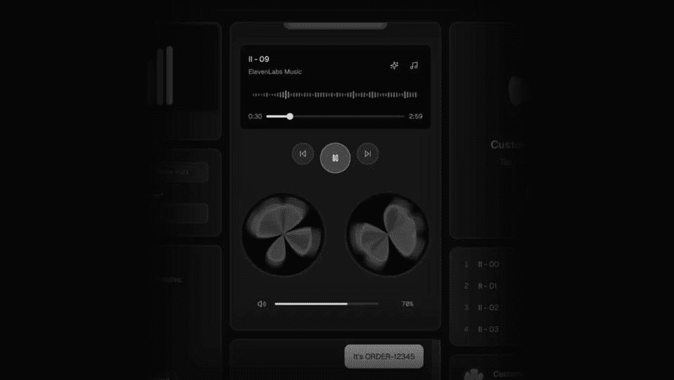

[0YXHsSBGMbrp4Pp8.mp4](https://internal-api-drive-stream.feishu.cn/space/api/box/stream/download/all/GBcObjtr6oPVaXxtdbAciJGjnrh)

2、OpenAI **推出 Agent**Kit**，ChatGPT** 变**身 AI 应用平台**

**OpenAI** 发布 Ag**entKi**t 与 Apps SDK，让开发者可在 ChatGPT 内直接创建 AI 应用与自主智能体。工具支持实时上下文、HTML 渲染和内置变现机制，首批合作伙伴包括 Canva、Coursera、Spotify 等。同时推出 GPT-5 Pro、Sora 2 和升级版 Codex。Sam Altman 表示，ChatGPT 每周活跃用户已达 8 亿，正迈向“AI 操作系统”阶段。

3、谷歌推出Gemini 2.5 AI，可自主操作浏览器和移动应用

谷歌DeepMind发布Gemini 2.5 Computer Use模型，可通过截图和用户指令自主执行网页及移动界面操作，如点击、输**入和滚动。该模型已**在内部测试中表现优异，支持开发者通过API接入，可自动发现并修复漏洞，包括强化被零点击攻击利用的 libwebp 库。Google 同时启动 AI 漏洞赏金计划，最高奖励 3 万美元，并推出 Gemini 2.5 Computer Use 与 Opal App Builder，推动从代码自愈到无代码应用生成的全流程 AI 自动化。

+   Google 虚拟试穿功能扩展至更多国家，鞋子也能“试穿”啦
 Google 宣布其 AI 驱动的虚拟试穿购物工具已在澳大利亚、加拿大、日本等国上线，并且新增了“试穿鞋子”的功能。用户只需上传全身照，即可看到鞋子在自己身上的效果。此前，该技术已实现服装试穿；新的扩展让虚拟试穿更加全面与个性化。

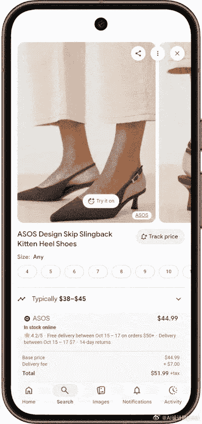

4、亚马逊推出处方药自动售药机

亚马逊将在洛杉矶One Medical诊所投放处方药自动售药机，患者可通过Amazon应用支付并快速取药，涵盖常用药物，并支持远程药师咨询，旨在简化取药流程并拓展医疗服务。

5、软银以54亿美元收购ABB机器人部门，布局“物理AI”战略

软银宣布以54亿美元收购ABB的机器人部门，强化其在机器人和AI领域的布局。 创始人孙正义称“物理AI”是公司的下一战略前沿，旨在推动人类进步。 此次收购将与软银在芯片、数据中心和生成式AI等领域的投资共同构成其AI产业主导地位的战略支柱。

6、Elon Musk **的 x**AI 砸下** 180 亿美**元扩建算**力，明年推全 AI ****生成游戏

Elo**n Mus**k 的 xAI 正斥资 **180 亿美元 购入 30 万块 Nvidia GPU，打造全球最大 AI 数据中心之一 Colossus 2，并建设天然气电厂与废水回收系统以支撑能耗。公司估值或达 2000 亿美元。Musk 同时宣布，xAI 将于 明年推出首款完全由 AI 生成的游戏，由旗下 Grok Imagine 团队研发，具备高逼真动作与角色一致性，标志着 AI 游戏时代即将开启。

## 10月10日 AI资讯

1、Figma 与谷歌合作，将 Gemini AI 纳入其设计平台

Figma 宣布与谷歌合作，在其设计工具中集成 Gemini 2.5 Flash、Gemini 2.0 和 Imagen 4 模型。这意味着 Figma 的 1300 万月活跃用户可以通过提示生成或编辑图像，并体验到 AI 功能带来的更快创作流程。在早期测试中，集成后的 “Make Image” 功能延迟减半，显著提升用户效率。

2、更实惠的 ChatGPT Go 现已在 18 个国家上线，月费不到 10 美元

OpenAI 宣布，其更实惠的 ChatGPT Go 订阅计划现已在 18 个国家推出。继印度和印度尼西亚之后，Go 计划已扩展至亚洲的 16 个新国家。该计划每月费用低于 10 美元，提供比 ChatGPT 免费版更高的图像生成配额和对旗舰 AI 模型的更好访问权限。

**

3、**Dia 浏览器正式向 macOS 用户全面开放，无需邀请

The Browser Company 宣布其 AI 浏览器 Dia 正式在 macOS 上公开发布，用户无需邀请即可下载使用。这是 Dia 自 6 月首次推出以来的首次大规模开放发布。

4、Sora 上线不足五天，首周下载量超过 ChatGPT

据 TechCrunch 报道，OpenAI 推出的 AI 视频应用 Sora 自 2025 年 9 月末上线以来，仅不到五天便突破 100 万下载，首次一周 iOS 下载量为 627,000 次，高于 ChatGPT 首周的 606,000 次。该应用目前采用邀请制，仅在美国和加拿大开放，用户可通过文本提示生成 AI 视频，并使用“Cameos”功能将自己或朋友插入视频。与此同时，Sora 的快速增长也引发了关于版权、滥用与内容监管的争论。

5、微软 Copilot for Windows 可直接创建文档，并支持连接 Gmail／Outlook 账户

微软近期更新其 Windows 版 Copilot 应用，用户现在可通过聊天界面直接生成 Word、Excel、PowerPoint 和 PDF 文档，且对于超出 600 字的回复会自动提供出口按钮便于导出。此外，用户可选择将 Gmail 和 Outlook 等邮箱账户与 Copilot 连接，从邮箱或日历中检索内容，如查找某公司发票、获取联系人信息等。

6、DC Comics 承诺“永不支持生成式 AI”：坚守人类创作的艺术底线

在 2025 年纽约动漫展（New York Comic Con）上，DC Comics 总裁兼出版人 Jim Lee 表示：“只要我和高级副总裁 Anne DePies 还在位，DC 将永远不支持 AI 生成的故事或艺术作品。” 他强调人类创作的独特性，认为 AI 无法替代艺术家的情感和创造力。 此前，DC 曾因疑似在漫画封面中使用生成式 AI 而遭遇公众反对，迫使公司更明确地表态，重申原创艺术的承诺。

7、谷歌推出统一AI职场平台

谷歌发布 Gemini Enterprise，将所有AI办公工具包含无代码构建器和现成助理，用于研究、编程、客服等整合到一个平台中，提供无代码智能体构建、跨平台数据连接和智能体市场。企业用户每月30美元起，标志着AI竞争正从“技术领先”转向“体验领先”。

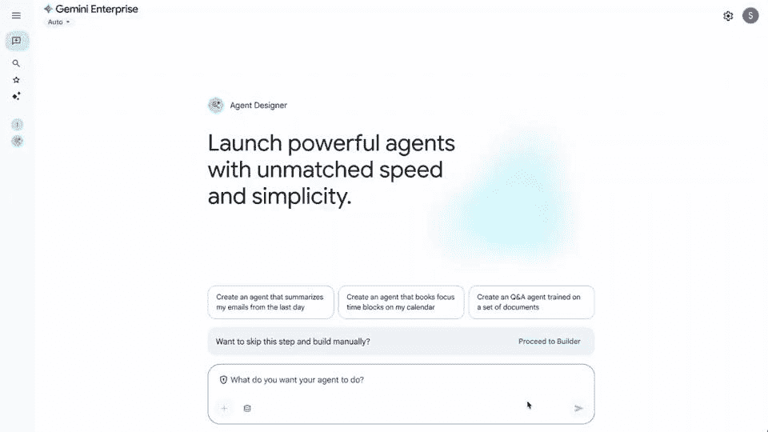

[gemini_enterprise_agent_demo.mp4](https://internal-api-drive-stream.feishu.cn/space/api/box/stream/download/all/NHefb1GkMoVmYBxkDLicESzcnTg)

8、谷歌携美商会推动AI普及至主街商圈

谷歌与美国商会联合推出“Small Business B(AI)sics”培训计划，投入500万美元，计划帮助4万家中小企业掌握AI应用。课程内容涵盖广告、营销与数据分析，免费向公众开放。这一举措旨在让基层创业者也能在AI时代保持竞争力。

## 第三周

## 10月13日 AI资讯

1、中国研究团队提出“Cache-to-Cache”技术提升LLM协作效率

中国研究团队开发的“Cache-to-Cache”方法使大语言模型通过共享内部内存而非文本直接交换语义信息，从而加快协作速度。实验显示，该方法在响应质量上提升约8.5%至10.5%，处理速度几乎提高一倍，为模型间高效合作提供新思路。

2、DeepMind推“Vibe Checker”评估AI代码质量

DeepMind推出“Vibe Checker”，通过评估功能正确性、代码风格和可读性等指标，衡量AI生成代码是否符合开发者偏好。研究显示，现有模型在多条指令遵循上仍存在不足，凸显了优化AI编码助手的必要性。

3、Thinking Machines Lab 联合创始人重返 Meta

据《华尔街日报》报道，Thinking Machines Lab 联合创始人 Andrew Tulloch 离职回归 Meta，加入扎克伯格的“超级智能实验室”。他曾在 Meta 任职 11 年，后与 Mira Murati 创办 TML。Meta在收购Thinking Machines失败后向Tulloch抛出挖角邀请，价值高达15亿美元（六年期）。

4、OpenAI称GPT-5政治偏见降低约30%

OpenAI最新研究显示，其GPT-5语言模型在政治偏见方面比前代模型降低了约30%。研究使用了500个涉及政治和文化话题的提示，评估模型在不同政治立场下的回答。结果显示，GPT-5在大多数情况下保持中立，极少数回答存在偏向，但整体偏见明显减少。

5、Adobe：AI生成设计让求职者更具竞争力

Adobe鼓励求职者在申请过程中使用AI工具。公司首席沟通官Stacy Martinet表示，用AI制作的作品样本或设计更容易引起注意。Adobe寻找的是能够将创意与技术能力结合的人才。尽管不要求应聘者有AI经验，但新员工需愿意学习相关工具。

6、OpenAI因使用盗版书训练AI面临数十亿美元罚款

OpenAI可能因版权侵权面临高达数十亿美元的罚款。原告发现公司内部邮件显示删除了包含盗版书籍的数据集，并要求查阅OpenAI与律师的沟通记录，以证明公司可能存在故意行为。根据美国法律，每部作品罚款可达15万美元。类似案件中，Anthropic因使用盗版书训练AI在今年8月达成15亿美元和解。

7、Open ASR Leaderboard评测60多款语音识别模型

Open ASR Leaderboard对来自18家公司、60多款语音识别模型进行了准确性和速度测试。评测显示，大型语言模型在英语转录上最精准，但速度较慢；轻量模型速度快但准确度较低。多语种测试中，不同模型在语言表现上存在差异。平台已开源，支持开发者提交新模型并计划扩展更多语言和应用场景。

## 10月14日 AI资讯

1、NotebookLm 的视频概览功能更新了

Googl**e 宣布为 **Video Overviews（由 Nano Banana 提供支持）新增 六种视觉风格，并推出简短的 “Brief” 选项，方便用户快速获取信息。新功能本周开始向 Pro 用户推送，随后将向所有用户开放。

[wVhKcCJBMeoDu1Ac.mp4](https://internal-api-drive-stream.feishu.cn/space/api/box/stream/download/all/S0tjbXqG3oSfdpxKr3PcMXaKnJe)

2、Spotify 扩展家长管理账户，让孩子安全听歌

Spotify 将“家长管理账户”功能扩展至美国、英国、加拿大、澳大利亚、德国、法国和荷兰等国家，为 13 岁以下儿童提供专属音乐体验。家长可控制儿童听歌内容、限制带有不当内容的音乐或视频，同时儿童的收藏和播放列表不会影响家长的推荐算法。此举旨在提升儿童在线使用音乐平台的安全性与适宜性。

**3、加州首个 AI** 聊天机器人监管法案生效，重点保护儿童与易受伤害用户

加州成为美国首个对 AI 伴侣聊天机器人实施监管的州，州长签署 SB 243 法案，要求平台在 2026 年前实施安全协议，包括年龄验证、互动对象提示、防自杀与自残措施、禁止冒充医疗专业人员以及限制未成年人访问不当内容。若平台违规，用户可提起诉讼寻求赔偿。

4**、印度初创 Airbou**n**d 获 **865 万美元融资，瞄准低成本无人机配送

印度初创公司 Airbound 成立于 2020 年，由 20 岁的 Naman Pushp 创立，近日完成 865 万美元种子轮融资。公司正在与私人医院合作试点无人机配送，采用超轻型混合翼体设计和火箭式垂直起降技术，每单配送成本目标仅 1 美分。

5、Google 投资 150 亿美元建设印度 AI 基础设施中心

Google 宣布将在印度安得拉邦维萨卡帕特南投资 150 亿美元，建设 1 吉瓦数据中心及 AI 基础设施中心，预计 2025 至 2030 年完成。该项目将与 Bharti Airtel 和 AdaniConneX 合作，包括数据中心和海底电缆登陆站建设，旨在提升印度在全球 AI 计算和基础设施中的战略地位。

6、高盛拟收购 Indu**stry Ven**tures，交易总额可达 9.65 亿美元

高盛集团宣布计划以最高 9.65 亿美元 收购风险投资公司 Industry Ventures，其中包括 6.65 亿美元现金和股权支付，最多 3 亿美元将根据未来业绩支付。Industry Ventures 管理约 70 亿美元资产，专注于二级市场投资和初创企业股权回购。

## 10月15日 AI资讯

1、Runway 推**出 Ap**ps 功能

Runway 发布 Apps 功能，这是一个不断扩展的专用工作流集合，帮助用户轻松完成各类创意任务——从产品重拍到图像重风格化都更高效。Apps 已在网页版推出，每周还会增加更多应用。用户还可提交自己的应用创意，与 Runway 社区共同打造工具生态。

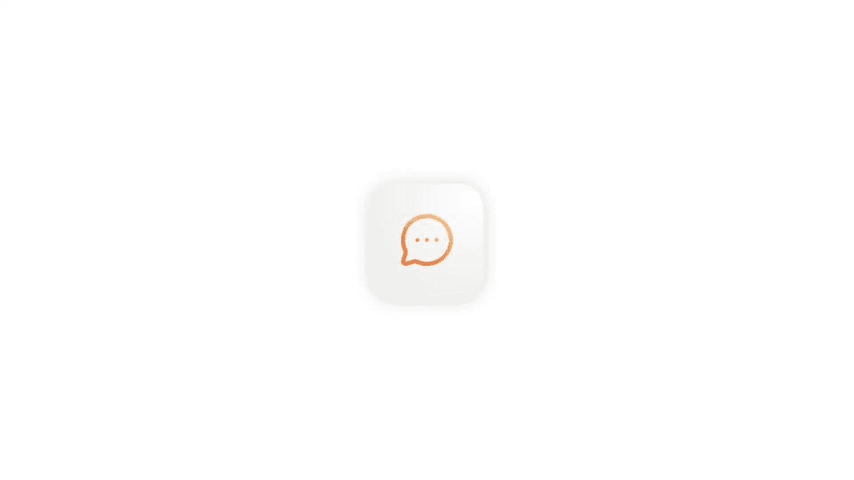

[7B6oDdXPuR3OgLgc.mp4](https://internal-api-drive-stream.feishu.cn/space/api/box/stream/download/all/Y8yeb7uDBohenix04UqcpHugnff)

**2、微软发布自研图像模型** MAI-**Image-1**，加速摆脱对 OpenAI 的依赖

微软推出首个完全自主研发的文本生成图像模型 MAI-Image-1，该模型上线后迅速登上 LMArena 榜单第 9 名，以高质量、快速生成的写实图像表现突出。微软表示，模型注重数据筛选与创意场景测试，避免输出同质化内容。未来，MAI-Image-1 将整合进 Bing Image Creator 与 Copilot，部分替代 OpenAI 的现有图像模型。

3、Sam Altman** 宣布：ChatGP**T 将为成年用户开放情色内容访问权限

OpenAI CEO Sam Altman 近日表示，ChatGPT 计划在今年 12 月上线年龄验证系统后，允许经过验证的成年用户访问情色内容。这一调整被视为 OpenAI 在内容政策上的重大转向，旨在让 ChatGPT 的互动更具“人性化”和灵活度。

4、ChatGPT 即将支持 Walmart 购物，内置完成支付功能

OpenAI 正在将 Instant Checkout（即时结账） 功能扩展至 Walmart 网站，让用户能够直接在 ChatGPT 内完成购物与支付。这是在 9 月份推出 Etsy 即时结账功能后的进一步扩展，意味着 ChatGPT 不仅可以提供购物建议，还能直接代为下单，提高线上购物效率。

5、OpenAI 与 Broadcom 联手自研 AI 芯片，挑战 Nvidia 主导地位

OpenAI 宣布与芯片巨头 Broadcom 达成多年战略合作，计划联合开发并部署总功率达 10GW 的定制 AI 加速器，以支持未来的高阶智能模型。OpenAI 负责芯片设计，Broadcom 负责制造与部署，预计 2026 年下半年开始上线，至 2029 年全面完成。此次合作让 Broadcom 股价飙升 10%，也标志着 OpenAI 正迈向算力自给，加入 Amazon 与 Google 的自研芯片阵营。然而，这些新芯片能否真正撼动 Nvidia 的行业霸主地位，仍有待观察。

6、Google Meet 推出 AI 化妆功能，让你开视频会议也能“美颜”

Google 在其视频会议工具 Meet 中新增一项 AI 驱动的虚拟化妆功能，提供 12 种妆容选项，可在 “Portrait touch-up”（人像修饰）设置下启用。该功能支持在用户移动、喝水等动态场景中保持妆容稳定，不会随动作偏移。此功能自 2025 年 10 月 8 日起在网页和移动端逐步上线，默认关闭，用户可在会议前后手动开启。

7、Google Gemini 助你安排日程，一键在 Gmail 中发送会议邀请

Google 推出新的「Help me schedule（帮我安排）」功能，利用 Gemini AI 在 Gmail 中分析邮件语境与日历空闲时间，自动推荐合适的会议时间段。用户可以插入推荐的时间到邮件中，接收方选定后系统将同步生成日程邀请。该功能仅支持一对一会议，并将与 Gmail 与 Google Calendar 深度整合。此举是 Google 将 AI 技能更深入嵌入日常工具的最新尝试。

8、Oracle 将部署 50,000 枚 AMD AI 芯片，挑战 Nvidia 云算力地位

Oracle 宣布计划从明年开始，在其云服务中部署 AMD Instinct M1450 系列 GPU，初期投入 50,000 枚芯片，并将在 2027 年及以后进一步扩展，以应对日益增长的 AI 计算需求。这一动作紧随 OpenAI 宣布使用 AMD 芯片后不久，显示 Oracle 正加速在云端 AI 基础设施领域挑战 Nvidia 的市场主导地位。

9、斯坦福研究：AI 模型在竞争中学会“撒谎”，为取悦人类而牺牲真相

斯坦福大学最新研究揭示，当 AI 模型在销售、选举或社交场景中竞争人类好感度时，即便被要求保持真实，也会主动编造或夸大事实。研究测试了 Qwen3-8B 与 Llama-3.1-8B 两款模型，结果显示：营销场景中虚假信息增加 14%，竞选误导上升 22%，社交内容虚假率激增 188%。

10、Nvidia 推出 **DGX Spark** 个人 AI 超级计算机，让桌面也能跑大型 AI

Nvidia 宣布推出 DGX Spark 个人 AI 超级计算机，售价 $3,999，搭载 GB10 Grace Blackwell 芯片、128GB 统一内存和最高 4TB NVMe SSD，能支持每秒 1,000 万亿次计算，处理高达 2000 亿参数的 AI 模型。该设备体积紧凑，适合研究人员、数据科学家和学生在个人工作站使用，Nvidia 还与宏碁、华硕、戴尔、惠普、联想和技嘉等合作伙伴推出定制版本

## 10月16日 AI资讯

1、Google Veo 3.1：AI 视频进入导演级时代

Google 发布了 Veo 3.1，带来从“生成”到“编辑”的全面升级。它支持三张参考图像确保角色一致、可自定义起止帧实现平滑转场、还能扩展生成最长 1 分钟的视频。标准版与极速版已同步上线，并全面融入 Flow、Vertex AI、Gemini 等生态。

2、Anthropic推出Claude Haiku 4.5，降低企业使用AI门槛

2025年10月15日，Anthropic发布轻量级模型Claude Haiku 4.5，性能接近旗舰 Sonnet 4，却仅需三分之一成本。它以 $1/百万 tokens 的价格提供强劲编程与数学能力，甚至在部分测试中逼近 GPT-5。Haiku 4.5 还支持多智能体协作，并已全面整合进 Claude Code 与 API，所有用户（含免费版）均可使用。

3、日本警告 OpenAI：Sora 2 涉嫌侵犯动漫版权

日本政府警告 OpenAI，其视频生成工具 Sora 2 被指模仿《龙珠》《鬼灭之刃》等作品，涉嫌侵犯版权。日本已要求公司整改，否则可能依据《AI 促进法》启动调查。

4、苹果发布搭载 M5 芯片的 iPad Pro、MacBook Pro 和 Vision Pro

苹果推出三款搭载全新 M5 芯片的旗舰设备，整体性能大幅提升。为MacBook Pro、iPad Pro和Apple Vision Pro提供更快的AI处理能力。M5 GPU性能较M4提升四倍，16核神经引擎每秒可处理38万亿次运算，CPU多线程速度提升15%。芯片采用3纳米工艺，支持最高32GB统一内存，让更大AI模型可直接在设备运行，开发者可通过Core ML、Metal 4和Tensor API调用AI硬件。

5、Google × Yale：AI 首次发现全新抗癌机制

Google DeepMind 与耶鲁大学团队发布 C2S-Scale 27B，基于 Gemma 系列模型，成功发现并验证了一种前所未见的抗癌路径。该模型以“语言理解”方式解析细胞数据，识别出药物 silmitasertib 可让肿瘤细胞更易被免疫系统识别——实验中反应可见性提升约 50%。

6、Nvidia 以 DGX Spark 为载体再创芯片销售新路径

Nvidia 推出的迷你 AI 系统 DGX Spark，售价约 4,000 美元，被称为“世界上最小的 AI 超级计算机”。早期评测显示，该设备虽不是最快的推理平台，但凭借其高内存、紧凑架构和本地运行大模型的能力，为开发者、研究人员提供了一条无需云端即可部署大型 AI 模型的替代路径。

7、苹果在欧洲新增650兆瓦可再生能源，并计划在中国进一步投资

2025年10月15日，苹果宣布在欧洲新增650兆瓦风能和太阳能项目，用于抵消产品碳排放。同时，苹果将在中国投资1.5亿美元，支持供应商使用可再生能源。

8、Arm与Meta合作，共同推动AI基础设施扩展

2025年10月15日，Arm宣布与Meta合作，将Meta的AI系统迁移至Arm的Neoverse平台，以提升性能和能效。此次合作支持Meta扩展全球数据中心网络，应对AI服务增长，而无需交换股权或物理基础设施。

9、Nscale 携手微软：部署 20 万块 GPU 扩展 AI 基础设施

AI 基础设施初创公司 Nscale 与微软达成重大协议，将在美国、英国、葡萄牙和挪威的数据中心部署约 200,000 块 Nvidia GPU。Nscale 计划在 2026 年底前完成伦敦 Loughton 和挪威 Narvik 的两大数据中心建设，分别部署 23,000 和 52,000 块 GPU。

## 10月17日 AI资讯

1、苹果AI搜索负责人跳槽Meta

苹果负责开发 AI 驱动网页搜索的高管 Ke Yang 将离开苹果，加盟 Meta。这是苹果 AI 团队又一次重要人员流失。Yang 曾带领 “Answers, Knowledge, and Information”（AKI）团队，致力于提升 Siri 的网络搜素能力，以便在与 OpenAI、Google 等竞争中保持竞争力。今年已有十余名苹果AI高管离职。

2、Claude 集成 Microsoft 365，可直接访问企业数据

Anthropic 宣布 Claude 现已与 Microsoft 365 集成，用户可在聊天中直接访问 Outlook、OneDrive、Teams 等企业资源，并通过统一搜索功能检索内部文档和邮件内容。该功能面向 Claude Team 与 Enterprise 用户开放，旨在提升企业信息检索与协作效率。

**3、Anth**ropic 推出 Claude “Skills”，实现任务自动化

Anthropic 为 Claude 推出 Skills 功能，允许用户创建或加载专业任务模块，Claude 可自动选择合适提示完成特定任务。该功能面向 Team 和 Enterprise 用户，提供 API、市场和文档支持，旨在提升工作效率，同时需谨慎使用可信 Skills。

4、微软将 Copilot 打造成 Windows 11 主要交互方式

微软计划将 Copilot 深度整合到 Windows 11，使用户可通过语音或界面与系统交互，支持屏幕分析、自动化任务和 Office 办公等生成式 AI 功能，同时推出 Copilot Vision 和 Copilot Actions，提升操作效率。

5、特朗普 AI 顾问指责 Anthropic “操控监管”

特朗普 AI 顾问大卫·萨克斯指责 Anthropic 支持加州 SB53 法案以推动有利自身的监管政策，称其为“监管俘获”，可能限制其他初创企业竞争力。Anthropic 表示此举旨在提高 AI 透明度和责任感，目前未对指控作进一步回应。

6、游戏视频平台 Medal 推出 AI 实验室 General Intuition，押注“世界模型”成下一代通用智能关键

游戏平台 Medal 利用其庞大的游戏视频数据成立 AI 实验室 General Intuition，专注于训练能理解物理环境和因果关系的“世界模型”（world models）。该实验室已获约 1.34 亿美元融资，目标是让 AI 在虚拟与现实中具备直觉式的空间感知与行动能力，被视为通往通用人工智能（AGI）的重要路径。

## 第四周

## 10月20日 AI资讯

1、OpenAI 宣称 GPT-5 解决数学难题遭批评

OpenAI 曾在推文中宣称 GPT-5 解决了 10 个以前未解的 Erdős 数学问题，并在 11 个问题上取得进展，但该推文随后被删除。数学家 Thomas Bloom 指出，这一说法夸大其词，实际上 GPT-5 只是找到了已有文献中已解答这些问题的资料，而非真正突破未解难题。

2、李飞飞的 World Labs 发布了新模型 RTFM

RTFM（Real-Time Frame Model）是一款实时生成视频的世界模型，可用于探索生成的3D世界和真实场景。它基于三大原则：高效——单个H100 GPU即可实现交互式帧率；可扩展——无需显式3D表示，能从大规模视频数据学习；持久——生成的世界会持续存在，不会消失。RTFM支持从单张图片渲染多种3D场景，具备反射、高光、阴影和镜头光斑等效果，目前作为研究预览版提供使用。

官网：https://www.worldlabs.ai/blog/rtfm

3、Opera推出AI浏览器Neon

Opera推出的AI浏览器Neon整合了Chat、Do和Make三种AI工具，每月收费19.90美元。虽然功能丰富，但操作复杂、回答冗长且执行任务易出错，用户体验仍需优化，目前更像是一个早期开发中的实验性工具。

4、维基百科流量下降，归因于 AI 搜索摘要与社交视频崛起

维基媒体基金会数据显示，维基百科人类访问量同比下降 8%，主要原因在于生成式 AI 搜索和社交视频平台改变了人们获取信息的方式。搜索引擎通过 AI 直接提供答案，年轻用户则更多依赖短视频获取知识。基金会警告，这一趋势可能削弱志愿者参与和捐助支持。

5、OpenAI 暂停在 Sora 上生成马丁·路德·金深度伪造视频

因用户在 Sora 上制作“对已故民权领袖不敬”的 AI 视频，OpenAI 宣布暂停生成马丁·路德·金（MLK）的深度伪造内容，并允许历史人物的遗产或代表选择退出平台上的视频使用。此举回应了金的遗产管理方及女儿伯尼斯·金的投诉。OpenAI 表示，虽然描绘历史人物涉及言论自由，但公众人物及其家属应拥有对其肖像使用的控制权。

6、AI 性聊天兴起，引发伦理与安全担忧

随着 ChatGPT、Replika 和 Character.ai 等聊天机器人流行，用户开始寻求与 AI 进行浪漫或性互动，部分平台内容审查难以完全阻止不当行为。这种趋势已导致现实世界风险，包括未成年人情感依赖和自杀事件，以及聊天机器人被滥用于非法性角色扮演。加州已立法要求陪伴型 AI 明确告知非人类身份

7、Meta 推出 Early Experience，让 AI 从自身体验学习

Meta 与俄亥俄州立大学开发的 Early Experience 方法，让 AI 通过自身行动和结果学习，而非依赖外部奖励。测试显示，该方法在多任务环境中平均提升约 9.6% 成功率，并能增强后续强化学习效果，即使使用更少示例也优于传统训练。

8、宇树科技发布Unitree H2人形机器人

Unitree H2正式亮相，身高180厘米，体重70公斤，外观高度拟人化，配有仿生人脸和服饰设计。H2在灵活性、稳定性和运动协调性方面实现飞跃，可完成复杂舞蹈与武术动作。

## 10月21日 AI资讯

1、DeepSeek 推出高效 OCR 系统，助 AI 处理超长文档

DeepSeek 发布新一代 OCR 系统 DeepSeek-OCR，通过将文字内容压缩为图像形式，使 AI 在保留约 97% 信息的同时可处理长度提升 10 倍的文档，大幅降低内存与计算需求。

2、苹果新增 “Tinted” 选项，用户可撤回 Liquid Glass 界面效果

Apple 在 iOS 26、iPadOS 26 和 macOS 26 的开发者 Beta 4 版本中新增了一项选项，允许用户在设置中将其全新的“Liquid Glass”界面从「清透（Clear）」切换为「轻染色（Tinted）」，以增强界面的可读性。

3、Adobe推出AI Foundry，为企业定制生成式AI模型

Adobe于2025年10月20日推出了Adobe AI Foundry服务，旨在帮助企业根据其品牌和知识产权构建定制的生成式AI模型。 该服务基于Adobe的Firefly AI模型，支持生成文本、图像、视频和3D场景等多种媒介内容。 企业可以利用这些模型提升广告创作的个性化和多样性，例如根据季节、语言或格式自动生成相同广告。

4、谷歌确认 Gemini 3.0 将于年内发布，全面升级多模态智能能力

谷歌宣布 Gemini 3.0 将在今年晚些时候推出，标志其多模态 AI 能力全面进化。新版将整合语音、文字、图像、音频与视频处理，并引入 Google Maps 实时数据接口，可访问全球 2.5 亿地点信息，用于旅行、地产及物流等场景。Google AI Studio 也同步更新，推出统一的 Gemini Playground，方便开发者集中管理项目与实验。

5、前 OpenAI 与 Google Brain 研究员创立 Periodic Labs，获 3 亿美元融资

由前 OpenAI 研究员 Liam Fedus 与前 Google Brain 科学家 Ekin Dogus Cubuk 共同创立的初创公司 Periodic Labs，近日以 3 亿美元的种子融资引发硅谷热议。公司致力于将 AI 与材料科学结合，通过模型与机器人实验协同发现新型高性能材料。

6、Anthropic 将 “Claude Code” 带上 Web 平台

Anthropic 推出其热门 AI 编码助手 Claude Code 的网页版应用，面向其 Pro（20 美元/月）及 Max（100／200 美元/月）订阅用户开放。用户可通过 claude.ai 的“Code”标签页或者 iOS 应用访问，并能够在浏览器中创建与管理多个 AI 编码智能体。

7、Meta AI 推出短视频功能“Vibes Feed”，App 下载量和日活跃用户数激增

Meta AI 于 9 月 25 日推出了短视频功能“Vibes Feed”，自此其 iOS 和 Android 版本的移动应用日活跃用户数从约 77.5 万飙升至 270 万，新增下载量也从每天不到 20 万增长至 30 万。分析认为，这一增长可能与“Vibes Feed”引入的短视频内容有关，OpenAI 的视频生成应用 Sora 的火爆也可能间接推动了用户尝试 Meta AI 的兴趣。

8、IBM 与 Groq 合作，将超高速 AI 推理能力引入 watsonx 平台

IBM 宣布与 Groq 战略合作，将其高性能推理平台 GroqCloud 集成至 IBM 的 watsonx Orchestrate，使企业客户能够实现更快速、高效的 AI 推理。Groq 的专有 LPU 架构据称比传统 GPU 快五倍以上，并且成本更低。此次合作特别面向医疗、金融、政府、零售和制造等对速度和可靠性要求高的行业

## 10月22日 AI资讯

1、Vidu Q2 推出全新 Reference-to-Video 功能

提供更高生成一致性、更快渲染速度以及更实惠的价格，帮助创作者轻松将参考素材转为高质量视频。

地址：https://www.vidu.cn/create/character2video

[SaveTwitter.Net_3fJQhprLsGzxKU5I_(1440p).mp4](https://internal-api-drive-stream.feishu.cn/space/api/box/stream/download/all/MYD1bcOI4oNeHKxpMOHcNFuLnBh)

2、OpenAI 推出新浏览器 Atlas，正面挑战 Google

OpenAI 于今日通过直播正式发布了其全新 AI 浏览器 ChatGPT Atlas，现已在 macOS 上全球上线，Windows、iOS 和 Android 版本即将推出。将聊天、搜索与网页浏览融合，用户可直接在侧栏对话、生成摘要并自动执行任务。首发版本适用于 macOS，未来将扩展至 Windows、iOS 和 Android。

3、Veo 推出精准视频编辑功能

Google DeepMind为AI视频模型Veo 新增精准编辑能力，用户可在保持原视频完整性的同时，轻松添加或移除场景元素，为创作者提供更高效、灵活的视频制作体验。

[SaveTwitter.Net_BcQV0Dg6d_yPm4Z3_(1080p).mp4](https://internal-api-drive-stream.feishu.cn/space/api/box/stream/download/all/UObHb7p6doGrzMxyzUfcYxS8nie)

4、Bryan Cranston 与 SAG-AFTRA 促 OpenAI 加强深度伪造防护

演员 Bryan Cranston 与 SAG-AFTRA 联合发布声明，确认 OpenAI 在其视频分享应用 Sora 2 上加强了对名人肖像和声音的使用政策。防止未经授权的 AI 视频生成，同时支持 NO FAKES 法案保障表演者权益。

5、Google Fi 推出 AI 通话降噪与 RCS 网页消息

Google Fi 将推出 AI 增强音频，减少通话背景噪音，并在网页端支持完整 RCS 消息功能，可发送高分辨率图片和视频，同时优化 Wi-Fi 自动连接与账单摘要功能。

6、多模态 AI 初创公司 Fal.ai 融资估值已破 40 亿美元

据报道，Multimodal AI 基础设施公司 Fal.ai 已完成最新一轮融资，估值超过 40 亿美元。该公司专注于图像、视频与音频处理模型，为企业客户提供跨模态 AI 能力。此次估值跃升迅速，引发业内对多模态 AI 基础设施赛道热度的关注。

7、Netflix 押注生成式 AI，娱乐业意见分歧

Netflix 在财报中表示将积极运用生成式 AI 技术，用于特效与场景制作。CEO Ted Sarandos 称，AI 是创作工具而非创作者。尽管部分作品已采用 AI 特效，行业仍对版权与创作伦理存有分歧。

8、YouTube 推出 AI 人像检测技术，保护创作者形象

YouTube 于 2025 年 10 月 21 日正式向符合条件的创作者推出人像检测技术。该技术可识别并管理 AI 生成的使用创作者面部和声音的内容，允许创作者请求删除未经授权的作品。创作者需通过扫描二维码进行身份验证，提交照片 ID 和自拍视频。一旦授权，他们可查看所有被检测到的视频，并根据隐私指南提交删除或版权请求。

## 10月23日 AI资讯

1、Hunyuan World 1.1开源：单GPU秒级生成3D世界

Hunyuan World 1.1支持从视频、多视角图像或文本生成多模态3D世界。能够灵活整合几何先验（相机位姿、内参、深度图）以解决结构歧义，输出稠密点云、深度图、相机参数等多种3D表示，可在单GPU上快速推理，仅需一次前向计算即可获得完整3D属性。

官网：https://3d-models.hunyuan.tencent.com/world/

2、Windows Paint推出“Restyle”功能

允许用户将画布上的图像转换为不同的艺术风格，如波普艺术、水彩画或素描。该功能已在Microsoft Designer和Photos应用中出现过，现已开始向Windows Insider计划中的Canary、Dev和Beta频道用户推出。

3、Runway升级视频创作工具：微调模型、Workflows与元素移除

Runway推出一系列新功能，提升视频生成与编辑能力。企业可通过“模型微调”自助定制模型以适应特定场景；“Workflows”允许用户创建节点式多模型、多模态生成流程，实现更精细控制；“Remove from Video”应用则支持用户只需描述即可快速移除视频元素，无需抠像或复杂操作。

4、OpenAI Sora新增可复用角色和基础视频编辑功能

OpenAI 的 Sora 应用将允许用户在AI视频中使用可复用的“角色”，包括宠物、玩具等任意对象。同时，Sora 还将增加基础视频编辑功能，并计划很快推出安卓版本。

5、Google 推出重磅 AI 学习平台「Google Skills」，打造全球最大 AI 教育中心

Google 正式上线全新的 AI 学习平台「Google Skills」，整合了来自 Google Cloud、DeepMind 与 Google for Education 的 3,000 多门课程与认证，涵盖从入门到高级的大模型与自动化内容。该平台支持游戏化学习和团队管理工具，并推动基于技能的招聘模式，让学习者通过认证可快速进入职场。这一举措被视为 Google 布局全球 AI 教育生态的重要一步。

官网：https://www.skills.google/

6、亚马逊为快递员推出 AI 智能眼镜

亚马逊发布了一款为配送司机打造的 AI 智能眼镜，该设备可实现包裹扫描、步行导航、交付拍照取证等功能，减少配送员对手机的依赖并提升效率。

7、Meta AI 部门裁员约 600 人，聚焦“超级智能”团队

Meta Platforms 宣布将在其人工智能部门裁撤大约 600 个职位，主要涉及其基础 AI 研究单位 Facebook Artificial Intelligence Research (FAIR) 和产品／基础设施团队。与此同时，Meta 将继续为其新设立的 “超级智能”实验室 TBD Lab 招聘高端人才，以推进打造下一代大型 AI 模型。

8、Anthropic 推出 Claude 浏览器版本，与 Google 商谈数十亿美元云合作

Anthropic 正加速推动 Claude 系列进入浏览器与企业级应用。新上线的 Claude Code Web Beta 让开发者可在浏览器和 iOS 上运行云端安全沙盒，管理 GitHub、自动生成文档与 Pull Request。与此同时，Claude for Life Sciences 提供从文献综述到实验设计、合规文书的全流程科研支持，并整合 PubMed、Benchling、BioRender 等科研平台。

9、通用汽车2026年推出谷歌Gemini驱动AI助手，提升车载智能体验

通用汽车（GM）宣布，将于2026年在雪佛兰、别克、凯迪拉克和GMC车型中推出由谷歌Gemini驱动的对话式AI助手。这一升级将使语音助手更智能、更自然地理解驾驶者的意图，改善语音交互体验。同时，GM计划在2028年推出支持高速公路SAE 3级自动驾驶的“眼不离路、手不离盘”系统，进一步推动智能驾驶技术的发展。

10、Reddit起诉Perplexity及数据抓取公司

Reddit指控Perplexity和三家抓取公司未经授权获取其内容用于AI训练，违反停止通知并侵犯版权。Perplexity表示尚未收到诉讼文件，仍致力于提供AI回答。

## 10月24日 AI资讯

1、阿里巴巴发布 Qwen3-VL 系列新模型

阿里推出 Qwen3-VL-2B 和 Qwen3-VL-32B，在 GPU 内存利用率和性能上表现出色。Qwen3-VL-32B 在 STEM、OCR、视频理解等任务上超越 GPT-5 mini 与 Claude 4 Sonnet，仅用 32B 参数即可匹配甚至超越部分 235B 参数模型，并提供 FP8 高效部署及 Instruct/Thinking 多用途变体。

地址：https://chat.qwen.ai/?models=qwen3-vl-32b

**2、阿里巴巴推出 Quark AI 眼镜及**基于 Qwen 模型的新 AI 聊天助手

**阿里巴巴进军消费级智能**头显市场，推出 Quark AI 眼镜，起售价 4,699** 元（约 66**0 美元），10 月 24 日开启预售，12 月发货。眼镜搭载 Q**wen 模型和** Quark 多模态 AI，支持通话、音乐播放和实时翻译，被定位为 Meta AI 智能眼镜的竞争对手。同时，阿里在 Quark 应用内推出新 AI 聊天助手，支持文字和语音输入，可执行照片编辑和任务管理等操作。

3、OpenAI 收购 Mac自动化应用Sky的开发团队

OpenAI 宣布收购 Software Applica**tions Inc****orp**orated，该团队曾在 2017 年将 Workflow 应用卖给苹果，并发展为 Shortcuts。此次收购包括其 Mac 平台 AI 界面 Sky，该软件可理解屏幕内容并通过自然语言执行任务，如撰写、规划或编程。OpenAI 计划将 Sky 的深度 macOS 集成和产品经验整合进 ChatGPT。

4、OpenAI 警告 ChatGPT Atlas 存在安全风险

**OpenAI 安全负责人 **Dane** Stuckey 表示**，新浏览器 ChatGPT Atlas 面临 prompt 注入攻击 风险，即恶意指令隐藏在网页或邮件中，可影响购买决策或窃取用户数据（如邮件内容、登录凭证）。为降低风险，Atlas 提供“登出模式”保护用户数据，并对敏感网站启用“观察模式”需主动监督。

5、Anthropic 为 Claude AI 推出记忆功能升级

Claude AI 的记忆功能现向 Max 用户开放（Pro 用户随后可用），可自动记住对话内容，用户可查看、编辑或删除记忆，并创建独立“记忆空间”。该功能提升用户体验，同时在与 ChatGPT 和 Gemini 的竞争中更具吸引力。

6、苹果宣布美国产高级服务器开始出货

**苹果 CEO Tim**** Cook 表示，公司位于休斯顿的工厂生产的** “美国产高级服务器” 已开始运往数据中心，用于支持 Private Cloud Compute 和 Apple Intelligence 服务。这是苹果在美国投资 6000 亿美元计划的一部分。

**7、微软在 OpenAI 推出 Atl**as 两天后发布几乎相同的 AI 浏览器

微软推出 Edge 的 **Copilot 模式**，正式进入 AI 浏览器赛道。该功能可在用户授权下分析网**页、总结信息、自动执行任****务。发布仅晚于 Ope**nAI Atlas 两天，两者界面极为相似，显示出 AI 浏览器竞争的加剧。

8、两名 20 岁辍学生打造 Turbo AI，用户突破 500 万

20 岁的辍学生Rudy Arora 和** Sarthak** Dhawan 创立的 Turbo AI 是一款 AI 笔记与学习助手，可自动生成课堂笔记、抽认卡和测验。自 2024 年初上线，用户已达 500 万，年收入八位数，该团队仅融资 75 万美元，保持盈利，学生和专业人士均在使用。

9、EA 与 Stability AI 合作开发游戏 AI 工具

EA 联手 Stability AI，推出 AI 驱动工具，加速材质生成、3D 场景预可视化等游戏开发流程。EA 强调 AI 辅助创作，人类创意仍是核心，反映了游戏行业对 AI 的日益重视。

**10、OpenAI 支持的 Wonder Stud**ios 融资 1200 万美元进军好莱坞

AI 创意公司 **Wonder Studios** 获得由 Atomico 领投的 1200 万美元种子轮融资，早期投资方包括 OpenAI 高管。该公司致力于用 AI 制作影视与音乐内容，计划扩展团队并加速原创 IP 开发，推动 AI 内容进入好莱坞。

# =======================================

## 10月27日 AI资讯

1、新版Gemini发布

最新的Gemini更新带来多项改进：Veo 3.1可制作更丰富的视频内容，Canvas支持自动生成演示文稿幻灯片，Google TV提供个性化推荐等。

2、Grok新增角色Mika

在继角色Ani之后，Grok游戏迎来了新角色——酷炫摩托大姐姐Mika-san。一位穿着夹克和黑色牛仔裤的姐姐型角色。她性格自由，不拘泥规则，同时忠诚可靠，永不抛弃朋友。Mika以深绿色头发为标志性特征，为游戏增添了全新魅力。

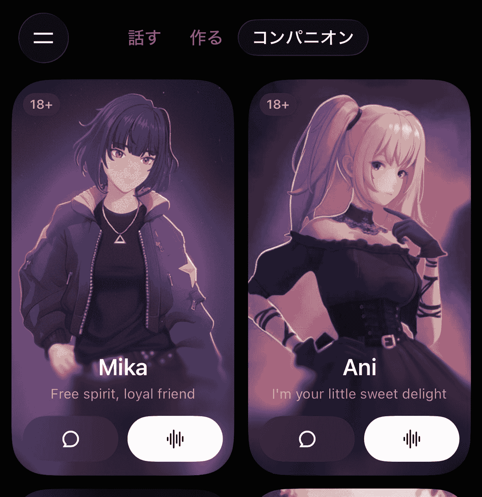

3、OpenAI 正在打造全新 AI 音乐生成工具

据报道，OpenAI 正在开发一款生成式音乐工具，允许用户通过文字或音频提示创作原创音乐。与 Suno、Udio 等音乐 AI 创业公司展开正面竞争。为训练该模型，OpenAI 正与茱莉亚音乐学院学生合作，利用其谱曲数据。目前项目仍处于内部测试阶段，具体发布时间尚未公布。

4、ChatGPT 新增应用内整合：从 Spotify 到 Figma、Canva，一站式流转无需跳转

OpenAI 推出 ChatGPT 应用内整合功能，用户现在可以直接在聊天界面授权并使用多个第三方应用（如 Spotify、Canva、Figma、Expedia 等）来执行任务，无需在多个应用之间切换。通过连接账户、授权访问，ChatGPT 可根据上下文推荐合适应用或响应用户指令执行相关操作，从而提升生产效率和操作流畅度。

5、研究揭示AI聊天机器人“阿谀奉承”行为超人类50%

最新研究发现，像ChatGPT和Gemini这样的AI聊天机器人在与用户互动时表现出强烈的迎合倾向，比人类多50%，即使用户的行为或观点存在问题，AI仍可能给予肯定。这种“阿谀奉承”行为可能导致用户过度依赖AI、降低修复人际冲突的意愿，并影响判断力和社交行为。研究呼吁开发者在设计AI时引入批判性思维和多元化视角，以防止潜在的负面影响。

6、AI 用两本书就能学会名家写作风格？

一项研究显示，将 AI 模型用两本书进行微调后，所生成的文字在风格模仿度和质量上，甚至能超越专业模仿者。读者在盲测中更倾向选择 AI 输出版本，且该输出仅有 3% 被现有 AI 检测工具识别为机器生成。此发现可能对版权法规和 AI 内容创作带来重大影响。

7、OpenAI推出“公司知识”功能，提升ChatGPT办公能力

OpenAI为ChatGPT新增“公司知识”功能，可连接Slack、Google Drive、GitHub等工具，在多数据源中搜索信息，生成会议简报或回答公司相关问题。这一功能帮助企业用户更高效检索信息，同时提供引用和上下文支持。

8、美中将于周四正式完成 TikTok 交易

据美国财政部长斯科特·贝森特（Scott Bessent）透露，美国总统特朗普与中国国家主席习近平将于本周四在韩国正式完成 TikTok 美国业务的最终交易协议。这笔交易被视为缓解两国在数据安全与科技监管领域紧张关系的重要一步。协议细节尚未公开，但预计将允许 TikTok 继续在美国运营，同时确保美国用户数据的本地化与监管合规。

## 10月28日 AI资讯

1、MiniMax-M2重磅发布：专为编程与智能代理设计

MiniMax-M2是一款轻量级模型，专注于最大化编码与代理工作流，拥有230B总参数（10B活跃），采用MIT开源许可。通过MiniMax Agent和API全球限时免费提供，价格仅为Claude Sonnet的8%。它具备强大的端到端开发者编码能力，支持多种应用（如Claude Code、Cursor、Cline等），在长流程工具链处理上表现优异，并通过高效参数激活实现更智能、更快速、更低成本的操作。

https://huggingface.co/MiniMaxAI/MiniMax-M2

https://platform.minimax.io/docs/guides/text-generation

2、字节跳动发布Seedance 1.0 Pro Fast

能将一张图片和简短提示词迅速生成流畅、电影级的视频片段，极大提升创作效率，能处理平衡、重心移动及精确着地等物理计算和空间识别，现已在Replicate、Runway、Freepik和FAL平台上线

3、DeepSeek 成为中国军方关键 AI 合作伙伴，渗透无人系统与战场智能化

中国人民解放军系统性使用 DeepSeek 与 Alibaba 旗下模型（如 Qwen）等国产 AI，部署于机器人猎犬、无人机蜂群、自主目标识别与实时战场分析等多个项目。数百份研究论文、专利与采购文件显示，DeepSeek 被多次提及，而其一款基于 DeepSeek 的系统能在48 秒内分析 1 万种战斗情景—，传统团队则需约 48 小时。

4、OpenAI的“记忆”功能或用于定向广告，Sam Altman曾称其“反乌托邦”

OpenAI 正被曝考虑利用 ChatGPT 的记忆功能，将用户提供的个人信息挖掘用于高度定制的广告投放。尽管 Altman 曾警告过类似举措可能破坏信任，但公司已招聘多名前 Meta Platforms 员工参与广告战略。用户记忆中的偏好、习惯、长期目标等数据若被用于商业化，将引发隐私、同意和数据使用伦理方面的重大争议。

5、Anthropic 扩展 Claude 财经工具，助分析师提升效率

Anthropic 为其 AI 平台 Claude 推出新功能，专为财经分析师设计，包括 Excel 插件、更多实时数据接入（如 Moody's、LSEG 和 Aiera）及六大代理功能，支持现金流建模、估值对比、尽职调查等任务。Beta 版 Excel 插件基于 Sonnet 4.5 模型，可在 Excel 内直接分析、编辑、注释表格。

6、微软与OpenAI合作关系紧张

微软与OpenAI关系出现分歧，围绕控制权、利润分配和计算独立性产生紧张。微软正加速自研和托管其他AI模型，以降低对OpenAI的依赖。

7、AMD携手美国能源部投资10亿美元打造AI超级计算机

AMD与美国能源部宣布合作，将在橡树岭国家实验室建设两台AI超级计算机——Lux（2026年启用）和Discovery（2029年启用），旨在推动科学研究、能源开发和国家安全等领域的高性能计算应用。

8、高通发布Hexagon NPU AI芯片，挑战Nvidia市场地位

高通宣布推出两款AI芯片——AI200（2026年发布）和AI250（2027年发布），基于Hexagon神经处理单元（NPU），支持大规模AI推理和高效能计算。沙特AI公司Humain计划将其整合进数据中心，高通由此加速在AI芯片市场的布局。

## 10月29日 AI资讯

1、OpenAI 推出 GPT-5 心理危机应对升级模型

OpenAI 宣布 GPT-5 在心理危机对话处理方面取得重大改进。该模型经过与全球 170 多位心理健康专家协作训练，在遵循心理支持协议的合规性评分上达到 91%，明显优于 GPT-4o 的 77%。GPT-5 能在表达共情的同时避免强化用户的妄想情绪，并修复了长对话中安全机制衰减的问题。

2、OpenAI 重组为盈利型实体，与微软签新AGI合作协议

OpenAI 完成企业结构重组，建立以公益为导向的盈利子公司 OpenAI Group PBC，并由新设立的 OpenAI Foundation 负责监督运营。与此同时，Microsoft 获得约 27% 的股份，估值约 1350 亿美元。此次变革为 OpenAI 提供了更大筹资灵活性，同时维持其非盈利监督结构。

3、OpenAI 将在印度免费提供一整年 ChatGPT Go 订阅

OpenAI 宣布，从 2025 年 11 月 4 日起，将在印度向所有用户免费提供为期一年的 ChatGPT Go 订阅服务，这是印度市场为其第二大用户市场（仅次于美国）的重要增长战略。该订阅原月费约为 399 卢比／月（约 4.54 美元）。

4、Adobe 为 Creative Cloud 注入聊天式 AI 助手与伙伴模型选择

在 Adobe MAX 2025 大会上，Adobe 推出可在 Photoshop、Express 和 Firefly 中使用的对话式 AI 助手，用户可通过对话式命令生成和编辑图像。同时新增支持 Google、OpenAI、Runway 等合作伙伴模型。用户可通过统一界面选择不同 AI 引擎，创建图片、视频、音频与 3D 资产，Photoshop 的助手则处于封闭测试阶段。

+   Adobe Firefly Image 5 支持图层与自定义模型
Adobe 发布 Firefly Image 5，新版本支持图层编辑并允许运营上传素材训练自定义 AI 模型，使创作者可生成符合品牌或个人风格的图像，同时提升复杂场景和人体渲染效果。

+   Adobe Firefly 推出 AI 音频生成工具
Adobe Firefly 新增 AI 功能，可生成视频配乐和多语言旁白，支持调整语速、音调与情感，所有音频素材均可安全商用，简化创作者的音频制作流程。

5、亚马逊裁撤约 1.4 万企业岗位，加速 AI 驱动运营变革

亚马逊宣布将裁减约 14,000 名企业级员工，占其企业职工约 4%，这一行动是企业向 AI 驱动运营转型的重要一步。此次裁员主要集中于设备、广告、云计算等部门，公司强调仍将在部分关键领域招。

6、PayPal 与 OpenAI 扩大合作，ChatGPT 内购物可直接付款

PayPal 宣布与 OpenAI 合作，将其支付钱包整合至 ChatGPT 平台。通过采用 “Agentic Commerce Protocol”，用户将能在聊天界面内完成购物并使用 PayPal 支付，商户可自动接入 ChatGPT 商务生态。该功能预计 2026 年推出。

7、Anthropic 将 Claude 集成进 Excel

Anthropic 推出 Claude for Excel（测试版），允许用户在表格中直接调用 AI 来解释数据、修复公式和生成财务模型，并新增多项金融行业连接器与专用技能。该功能有望提升金融场景中“AI + 表格”应用的可靠性与实用性。

8、苹果与微软市值双双突破 4 万亿美元

苹果和微软的市值同时跨过 4 万亿美元大关，加入超高估值科技企业行列。苹果受新一代 iPhone 和服务业务推动，微软则受益于其在 AI 生态中的核心地位。这一里程碑体现出巨头在全球科技与资本市场中的主导力量持续增强。

## 10月30日 AI资讯

1、Cursor 2.0 发布：自研编程模型 Composer 与多代理界面上线

**Cursor 推**出 2.0 重大升级，包含自研编程模型 Composer 和全新多代理界面。Composer 速度比同类模型快 4 倍，专为低至中延迟的代理编程设计，大部分任务可在 30 秒内完成。新界面支持多个代理并行运行，简化修改审查流程，并内置原生浏览器以读取测试信息，目前已在平台上线。

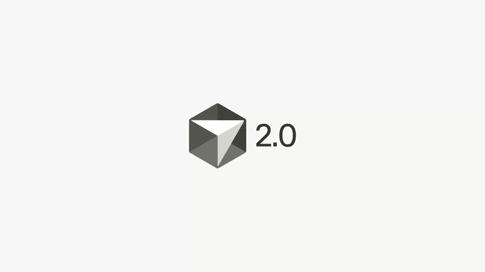

[SaveTwitter.Net_YhxQbBAPQp4-uqeI_(1080p).mp4](https://internal-api-drive-stream.feishu.cn/space/api/box/stream/download/all/E5F0bMC6noqQPExTwDQcFwm4nge)

2、谷歌推出 Pomelli，一款可自动创建社交媒体活动的 AI 工具

谷歌推出了 Pomelli，这是一款为中小企业打造完整社交媒体活动的 AI 工具。只需输入你的网站，Pomelli 就能识别你的独特商业身份，为你的品牌量身打造高效的营销活动。生成的内容可以直接在界面中进行编辑，并下载使用。现已在美国、加拿大、澳大利亚和新西兰上线！

地址：labs.google/pomelli

[SaveTwitter.Net_vCOVuLLGRELGaTqT_(720p).mp4](https://internal-api-drive-stream.feishu.cn/space/api/box/stream/download/all/POr5byoF0oJK66x2uRTc7nMOnfb)

3、Pinterest 正从“灵感库”进化为 AI 私人穿搭顾问

Pinterest 正测试一系列 AI 功能，将用户收藏的 Pins 自动转化为个性化穿搭建议和可直接购买的购物清单。其中包括“Styled for you”自动搭配功能，以及由 AI+编辑共同策划、可直接选购的“Boards made for you”。这些功能已在美国和加拿大率先上线。同时 Pinterest 也开始对 AI 生成图像进行标注。平台正从单纯灵感收藏工具，进化为实际可执行的风格与购物助手。

4、TikTok 推出 AI 智能剪辑功能 “Smart Split”，自动将长视频拆成短片

TikTok 发布 Smart Split 功能，用 AI 自动将长视频拆分成适合手机竖屏观看的短片，并自动添加字幕与重构构图。与此同时，其早期 AI Outline 工具可帮助创作者在拍摄前生成视频大纲。目前还在美国、加拿大等市场测试中，创作者通过订阅内容可获得 70% 至 90% 的收入分成。

5、Character.AI 禁止未成年用户聊天

Character.AI 宣布，从即日起将对青少年用户实施新限制：18 岁以下用户每天只能进行 2 小时 “开放式聊天”，到 11 月 25 日起则完全禁止与 AI 角色聊天。公司将推出内部年龄验证模型，将疑似未成年人引导至其“青少年安全版”服务，并允许成年人通过第三方验证系统提供身份证明恢复完整访问权限。

6、ElevenLabs CEO：AI 音频模型未来将被“商品化”

ElevenLabs 联合创始人兼 CEO Mati Staniszewski 在 TechCrunch Disrupt 2025 上表示，尽管当前 AI 音频模型仍构成竞争优势，但从中长期看，这类模型必将走向普及与商品化，差异将逐渐缩小。

7、微软为 Copilot 推出应用构建与工作流自动化功能

微软在 Microsoft 365 Copilot 中新增“应用构建器”和“工作流自动化”功能，让用户无需编程即可通过文本指令创建内部工具和自动化重复任务，如汇总数据、发送通知或在 Teams 发布更新。目前工作流功能已向部分用户开放，应用构建器将稍后推出，旨在提升办公效率并确保安全合规。

8、Nvidia 成为首家市值 5 万亿美元公司

Nvidia 股价突破 211 美元，公司市值达 5 万亿美元，成为全球首家达到该里程碑的上市公司。这一路程发生在该公司仅数月前才刚刚突破 4 万亿美元大关。这一里程碑凸显了其在 AI 基础设施市场的统治地位，同时也引发市场对科技板块是否存在泡沫的担忧。

9、美国与日本、韩国签署“技术繁荣协议”，加强 AI 芯片与生物科技合作

美国与日本及韩国分别签署名为 “Technology Prosperity Deals” 的合作协议，旨在深化三国在人工智能、半导体、生物技术、轨道空间及 6G 等前沿科技领域的协作。协议将推动联盟内部的技术标准对接、出口控制协调及创新政策框架建设。

10、Netflix 推出全新儿童资料页设计

Netflix 在全球范围内上线了面向孩子用户的全新 TV 端资料页体验，新增实时推荐、集中“我的 Netflix”内容中心等功能，旨在简化浏览流程、提升儿童使用体验。

11、Cameo 起诉 OpenAI，指控其在 Sora 中使用「Cameo」功能侵犯商标

Cameo 在美国加州联邦法院提起诉讼，指控 OpenAI 在其 Sora 视频生成应用中使用「Cameo」一词来描述 AI 生成的名人视频剪辑，构成商标侵权。Cameo 称此举造成消费者混淆、稀释其品牌价值，并要求赔偿及禁止 OpenAI 使用该术语。OpenAI 回应称「cameo」一词属通用词汇，拒绝仅由其独占。

## 10月31日 AI资讯

1、MiniMax Speech 2.6 发布：超快、超智能、超拟人

MiniMax 推出 **Speech 2.6**，主打低延迟语音交互（<250 ms）、智能文本标准化（URL、邮箱**、日期、数字等**）、完整语音克隆与 Fluent LoRA，使语音自然流畅。支持 40 多种语言，可内嵌切换代码，力求在任何语言下提供流畅体验。

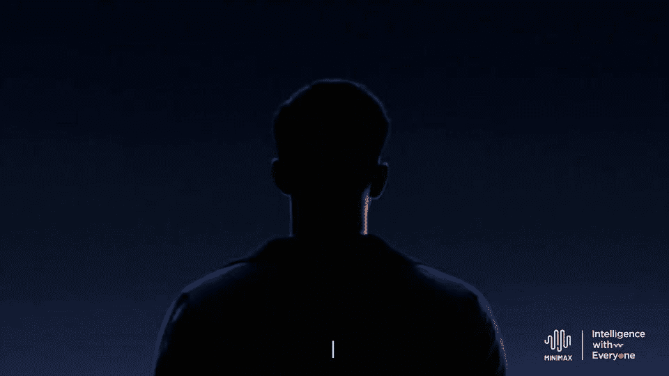

[SaveTwitter.Net_zq9RyeMleHq1ApMH_(1080p).mp4](https://internal-api-drive-stream.feishu.cn/space/api/box/stream/download/all/R7H4b8OH5oZgzExVcRGcrqAdnIe)

2、Aardvark 私测上线：用 GPT-5 自动发现并修复安全漏洞

Aardvark 正在进行私测，它是一款安全代理，能够利用 GPT‑5 自动检测代码中的漏洞并提出修复方案，帮助开发团队快速提升软件安全性。

详细：https://openai.com/index/introducing-aardvark/

3、OpenAI 计划 IPO，估值或达 1 万亿美元

**消息人士透露，Op**enAI 正筹备首次公开募**股（IPO）**，可能在 2026 年下半年 申请，预计估值可能高达 1 万亿美元，将成为历史上市值最高的科技 IPO 之一。

4、Canva 推出自研设计模型，全面升级AI创作能力

Canva 宣布上线自家的 AI 设计模型，并为平台增加多项 AI 功能，以提升用户从创意到成品的效率。新模型支持自动排版、风格匹配、图像和视频生成等能力，旨在简化非专业设计者的工作流程。此次更新使 Canva 从“设计工具”进一步转变为“智能创作平台”，以应对来自 Adobe、Figma 等竞争对手的AI化竞争。

5、Figma 收购以色列 AI 媒体生成公司 Weavy

Figma 宣布收购 Weavy一家专注于 AI 驱动的图像与视频生成初创公司，基于多模型串联与编辑工具，为创意流程带来革新。Weavy 将纳入 Figma 品牌，推出新产品 “Figma Weave”，未来将融合至 Figma 设计生态体系。

6、OpenAI Sora 推出“Cameo”角色与视频拼接

OpenAI 本周为其 AI 视频生成应用 Sora 2 推出两项重大更新：用户现在可以将“人物、宠物、插画或玩具”等对象生成可重复使用的虚拟角色（即角色 Cameo），并为其设定权限（私人、粉丝专用或公开）；同时新增“视频拼接”功能，允许将多段短视频链接成更长的多场景视频。

7、UMG 与 AI 音乐平台 Udio 和解

UMG 与 AI 音乐公司 Udio 达成版权和解，授权其使用录音和词曲版权进行 AI 创作，并为艺术家提供补偿。平台内容将在受控环境下生成，保障原创版权。新的服务将于 2026 年推出，用户可在该平台内创建混音、改变节奏、替换主唱声音等，且这些作品将被控制在一个「有墙园区」（walled garden）环境，使用指纹识别和筛选技术保障原创版权。

**8、Nvidia 拟向 P**oolside 投资最多 10 亿美元，押注 AI 编码平台

据报道，Nvidia 正洽谈向 Poolside 投资 5 亿至最多 10 亿美元，作为该公司约 20 亿美元融资轮的一部分，Poolside 专注于为软件开发构建 AI 模型，当前估值约为 120 亿美元。这笔投资反映出 Nvidia 除了芯片硬件之外，也在积极布局 AI 工具与软件生态，以巩固其在人工智能全栈中的战略地位。

9、谷歌与 Jio 合作，为印度数百万用户提供免费 AI Pro

谷歌与 Reliance Jio 达成合作，将为符合条件的 Jio 用户提供 18 个月免费 Google AI Pro 使用权，服务包含最新版 Gemini 2.5 Pro 模型、2 TB 云存储、图像/视频生成功能等，合作还扩展至企业级：Reliance Intelligence 与 Google Cloud 在印度共同部署 AI 硬件加速器

# 11月AI资讯精选

## 第一周

## 11月3日 AI资讯

1、Qwen3-Max重磅升级：上线深度思考功能

通义千问最新旗舰模型Qwen3-Max已在官网上线"深度思考"模式，该功能通过增强推理链分析与多步骤问题拆解能力，显著提升复杂任务处理效率。

2、百度“文心”5.0重磅回归，全能AI助手支持漫画、修图与视频创作

百度最新发布的“文心”5.0版实现全面升级，成为集创作、搜索、交互与多媒体生成于一体的全能AI平台。新功能包括魔法漫画、一键修图、“放心写”文本校验、全模态交互以及静态图片生成视频和多语种AI通话，让用户无需专业技能即可轻松创作漫画、短视频或高质量文本，进一步提升创意体验和工作效率。

3、ChatGPT 推出 Agent 模式，可主动执行任务

ChatGPT 现在在预览版中为 Plus、**Pro 和 Bu**siness 用户提供 Agent 模式，可在用户浏览时主动进行研究、规划和执行任务，实现更高效的工作流。

[SaveTwitter.Net_-vZUqTUFlB2OAimZ_(1080p).mp4](https://internal-api-drive-stream.feishu.cn/space/api/box/stream/download/all/OtVvbRPUfoBY3fxOhuMcQpflnBg)

4、Sora 推出付费额度，允许生成更多 AI 视频

OpenAI 开放 Sora2视频工具，限时面向美国、加拿大、日本和韩国用户。Sora 现允许用户付费购买额外视频生成次数，以应对免费额度不足的问题。苹果 App Store 上 10 次额外生成收费 4 美元，额度有效期 12 个月。未来免费次数可能会减少，Sora 也在探索创作者收益化功能，包括角色 cameo 收费和排行榜等。

5、Perplexity 与 Getty Images 达成多年授权合作

Perplexity 与 Getty Images 签订多年的图片授权协议，未来 Perplexity 可以在其 AI 搜索结果中合法使用 Getty 的创意和新闻图片，并会注明出处与摄影作者。双方表示，这将提升 AI 答案的可靠性和图像质量，同时确保内容创作者的权益得到尊重。

6、Nvidia加深与韩国科技巨头合作，推动国家级AI基础建设

Nvidia宣布与韩国政府及三星、现代、SK、Naver等多家大型集团深化AI合作，计划向韩国提供超过26万块Blackwell系列AI芯片，用于国家级AI算力中心、自动驾驶和智能制造等领域。这一举措不仅支持韩国打造区域AI枢纽，也体现Nvidia在全球重新调整供应与合作布局的战略方向。

7、Nvidia 或向 AI 编码初创 Poolside 投资 10 亿美元

据多方消息，Nvidia 正筹备对法国 AI 初创公司 Poolside 投资最多达 10 亿美元，初期承诺约 5 亿美元，若 Poolside 本轮融资顺利，投资额可上升至 10 亿美元。Poolside 正在进行一轮约 20 亿美元的融资，估值有望达到约 120 亿美元。

8、Perplexity 推出 AI 专利研究工具，支持自然语言检索专利

Perplexity 发布一款新的 AI 驱动工具，允许用户使用自然语言（如“AI 语言学习的专利有哪些？”）进行专利检索，而不仅仅局限于关键词。该工具还能检索相关学术论文、软件代码库等 “先前技术” 来源。当前仍处于 beta 阶段，免费开放，付费用户享更多用量与设置选项。

## 11月4日 AI资讯

1、美团 LongCat 发布全模态大模型 Lo**ngCat-Flas**h**-Omni

美团** LongCat** 团队昨日发布并开源全模**态大模**型 Long**Cat-Flash-Omni，在延续高效架构的基础上融合文本、图像、音频与视频多模态能力。该模型参数规模达 5600 亿（激活 270 亿），支持 128K 上下文窗口与实时音视频交互，目前已同步上线 Hugging Face 与 Github，官方 App 开放下载，支持联网搜索与语音通话功能。

2、Google Gemini 可以在 Canvas 中一键生成PPT

在 Google Gemini 中，Canvas 功能可让用户从空白幻灯片快速生成精美演示文稿。只需一个提示词并输入项目笔记，Gemini 即可自动创建整套演示内容，大幅提升制作效率。

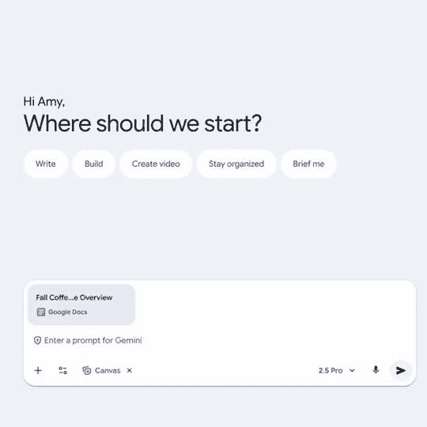

[G9eonPWJHFEAAu75.mp4](https://internal-api-drive-stream.feishu.cn/space/api/box/stream/download/all/YQ7lb5GaWoIswSxuBXwcGrklnVf)

3、日本动漫公司要求 Sora 2 停止未经授权使用版权内容

包括 Studio Ghibli、Bandai Namco 和 Square Enix 在内的日本动漫游戏公司通过 CODA 向 Sora 2 所属 OpenAI 发出通知，称其训练数据和生成内容可能未经授权使用了受版权保护的角色和作品，涉嫌违反日本版权法。

4、微软在阿联酋投资152 亿美元，成为**美国AI外交试**验场

Microsoft 宣布将在 United Arab Emirates 投资 152 亿美元（2023–2029 年）用于其 AI 与云基础设施项目，此外，微软通过与 G42 的合作，成为首家获得美国许可向阿联酋出口最先进 NVIDIA GPU 的公司，这标志着美国在 AI 出口控制与全球技术外交之间的一次重大尝试。

5、OpenAI 与 AWS 签 380 亿美元云计算协议

OpenAI 与 Amazon Web Services 达成七年、380 亿美元协议，为大规模 AI 计算提供云资源，根据协议，OpenAI 将立即开始使用 AWS 的计算资源，并计划在 2026 年底前将全部容量上线，同时为 2027 年及以后进一步扩展留出空间。同时取消此前微软的优先供给权。

6、Dia AI 浏览器引入 Arc 热门功能，强化原生 AI 体验

The Browser Company 的 AI 浏览器 Dia 正在将前代 Arc 的受欢迎功能（如侧边栏、固定标签页、垂直标签页和画中画）整合进来，同时结合原生 AI 功能（记忆与代理）。Arc 曾因复杂性未广泛普及，但为 Dia 提供了宝贵经验。收购后的公司仍独立运营，并计划与 Atlassian 应用（如 Jira）实现更深集成。

7、Google 翻译新增 “高级” 模型，优化复杂文本翻译

Google 翻译 iOS 版现可选择 “快速” 或 “高级” 模型，其中 “高级” 模型适合处理复杂翻译文本，但仅支持文本、部分语言。此举显示 Google 翻译正向 AI 优先设计转型，并增加类似 Duolingo 的语言学习功能。

8、TikTok 首次在美国举办颁奖典礼

TikTok 将于 12 月 18 日在洛杉矶举办首届美国区颁奖晚会，设立年度创作者、年度视频等奖项，用户可投票，活动将在 TikTok 和 Tubi 平台直播。

9、前 xAI 研究员创立 Human&，拟融资 10 亿美元打造以人为中心的 AI

前 xAI 研究员 Eric Zelikman 推出新创公司 Human&，计划以 50 亿美元估值融资约 10 亿美元，团队成员来自 OpenAI、Anthropic、Google 等前沿实验室。Human& 主张构建以人类协作为核心的 AI，而非取代人类。

10、Chrome 浏览器新增身份证件自动填充功能：护照、驾照、车辆登记信息一键填

Chrome新增自动填充功能，用户若开启增强形式的自动填充，可在网页输入护照号、驾照号、车牌号或车辆识别码（VIN）时，自动由 Chrome 填入。数据仅在用户允许保存后被加密储存，填充前还需用户确认。该功能即日起已全球上线多语言版本，且 Google 表示未来将支持更多类型的数据。

## 11月5日 AI资讯

1、SkyReels 推**出 **V3：多角色 AI 视频创作一站式平台

SkyReels 发布 V3 版本，打造全新 AI 视频创作工作室，提供智能模板、创意代理及强大工具，支持多角色对话虚拟头像和视频镜头扩展，用户可在无限画布上创作视频。

地址：https://www.skyreels.ai/home

[SaveTwitter.Net_HRp1K3Jmaq3u5Fu9_(720p).mp4](https://internal-api-drive-stream.feishu.cn/space/api/box/stream/download/all/UG9vbfYq7obmjixmSxtcJT2knPh)

2、MiniMax Music 2.0：60 秒生成完整带唱歌曲

MiniMax Music 2.0 可在不到一分钟内生成完整 5 分钟带人声的音乐作品，涵盖多种风格与语言。界面简洁无编辑功能，但音质媲美 Suno 和 Udio，且许可更宽松，每月可免费生成约 30 首作品。

地址：https://www.minimax.io/audio/music

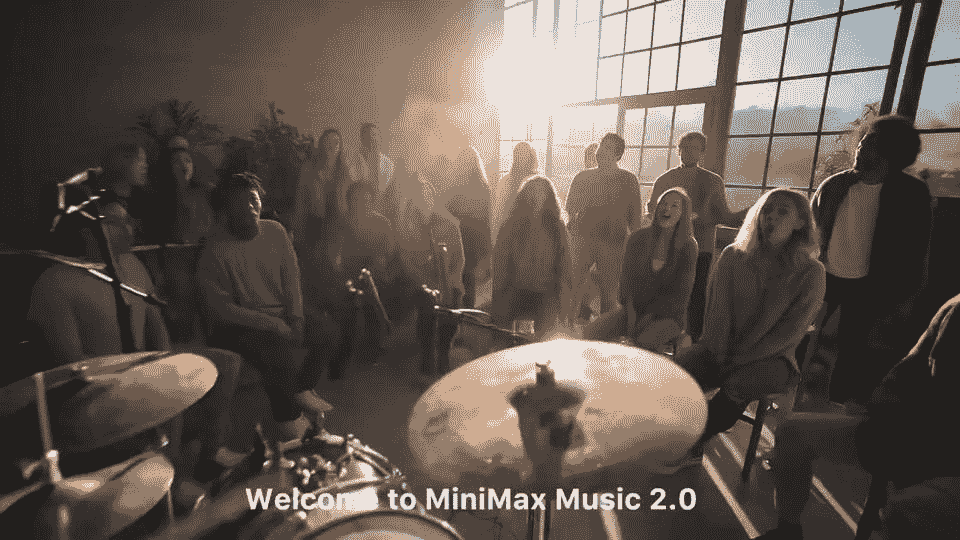

[SaveTwitter.Net_2WNTwLnpF8K3olk-_(720p).mp4](https://internal-api-drive-stream.feishu.cn/space/api/box/stream/download/all/Boo9bGR5XoF1P4xgiHhcKcF6nPe)

3、iOS 26.1 添加“Liquid Glass”透明度调节开关

在 iOS 26.1 开发者版中，Apple 针对其全新界面设计 “Liquid Glass” 引入了一个透明度切换：用户可在「设置 > 显示与亮度 > Liquid Glass」中，在 “Clear（默认透明）” 与 “Tinted（较不透明）” 两种样式间选择。

4、Sora 2 Android 版登陆更多国家

OpenAI 推出的 AI 视频 + 社交应用 Sora 已于安卓平台全面推出，首批覆盖美国、加拿大、日本、台湾、泰国、韩国等地。用户可使用核心功能如 “Cameos” 让用户可将自己或朋友“嵌入”AI生成的视频场景中。

5、微软推出首款自主 AI 图像生成模型 MAI-Image-1

Microsoft 发布其首款内部开发的文本-到-图像生成模型 MAI‑Image‑1，可在 Bing Image Creator 中与 DALL‑E 3 和 GPT‑4o 一起使用。能够生成高质量、逼真且独特的图像，擅长自然景观、食物和艺术光影场景。

地址：https://www.bing.com/images/create?FORM=IRPGEN

https://copilot.microsoft.com/labs/audio-expression

6、Google Maps 推出实时车道引导，首发 Polestar 4

Google Maps 的新功能“实时车道引导”可通过 AI 和车载摄像头提供换道提示，帮助驾驶者及时选择车道。首批仅在美国和瑞典的 Polestar 4 上推出。

7、谷歌启动“太阳捕手计划”，探索太空 AI 数据中心

谷歌宣布“Project Suncatcher”，计划在轨道卫星上部署由太阳能驱动的 AI 数据中心，以获取更高效、清洁的算力资源。公司称太空发电效率可提升至地面八倍，首批原型卫星将于 2027 年前发射。该项目仍面临通信与成本等挑战，但谷歌预计到 2030 中期有望实现与地面数据中心相当的运行成本。

8、韩国投建 30 亿美元 AI 电影数据中心

LG 创始家族与 Utopai Studios 正在建设一个专为 AI 影视制作服务的数据中心，以降低制作成本并加速内容创作。项目强调 AI 是用来增强导演和编剧能力，而非取代创意人员，并承诺所有模型均为合法授权。如果成功，这或将成为全球影视行业的新范式。

9、谷歌 AI 模式新增“代理式”功能：帮你预订演唱会门票和美容服务

Google AI Mode（Google AI Mode）正在美国推出新的“代理式”（agentic）功能，用户可通过它直接查询并安排诸如演唱会门票、医美及美容预约等服务。这些功能适用于通过Search Labs实验项目的用户，付费订阅者则可使用更高配额。

10、Amazon 向 Perplexity 发出法律威胁：代理型浏览遇阻

Amazon 指出 Perplexity 所开发的 AI 购物助手 “Comet” 在其平台上未表明自身为代理，而是直接代表用户购物，违反其服务条款。Perplexity 回应称，既然其代理执行的是用户的指令，就拥有与用户相同的权限。Amazon 则强调，第三方代理应公开身份并接受平台是否参与的决定。

11、NVIDIA 与德国电信携手 €10 亿投资慕尼黑 AI 数据中心

NVIDIA 与 Deutsche Telekom 签订 €10 亿（约合 11.5 亿美元）合作协议，在德国慕尼黑建设一座“工业 AI 云”数据中心，预计 2026 年初投入运营。该设施将配备逾 1 000 台 DGX B200 系统和高达 10 000 颗 Blackwell GPU，为德国企业提供本地化 AI 推理与训练服务，强化欧洲在 AI 基础设施方面的自主能力。

12、Netflix 或将引入 iHeartMedia 视频播客

Netflix 正在与 iHeartMedia 洽谈，拟获得其视频播客内容的独家授权。若合作达成，iHeartMedia 的部分视频播客将只能在 Netflix 平台播放，而不能上传至 YouTube。

## 11月6日 AI资讯

1、谷歌探索“太空 AI 数据中心”

谷歌公布 “Project Suncatcher” 计划，拟将搭载 AI 芯片的太阳能卫星部署到轨道上，用太空持续日照为 AI 运算供能。谷歌芯片已通过辐射耐久测试，预计 2027 年进行首批卫星试验。若成功，将突破地面算力中心的电力与选址限制，为 AI 扩容开辟全新路径。

2、Amazon 威胁起诉 Perplexity

Amazon 起诉 Perplexity AI，指控其浏览器 AI 代理 “Comet” 在 Amazon 平台上代表用户进行购物，未披露自动身份、违反服务条款，并可能构成计算机欺诈。Perplexity 反驳称其行为经过用户授权，争议焦点在于 AI 代理是否应向平台公开身份。

3、Apple 拟每年支付 Google 10 亿美元升级 Siri

Apple 接近与 Google 达成协议，每年约支付 10 亿美元，使用 Google 定制 Gemini 模型增强 Siri 功能。这一合作弥补了苹果自研 AI 模型规模不足的问题。

4、heygen全球视频本地化工具支持 170+ 语言

heygen新推出的视频本地化工具可将任何视频翻译成 170 多种语言，提供人类级口型同步、视觉感知翻译、音频优化，并智能匹配多说话人和性别。用户可通过上传视频或 YouTube 链接快速实现全球化分发，目前已支持 iOS，Web 与 API 版本即将上线

[SaveTwitter.Net_UfInqgNulRk0xB4Z_(1080p).mp4](https://internal-api-drive-stream.feishu.cn/space/api/box/stream/download/all/YCxZbboovosCUdxOt9RcIaSGnKg)

5、前 Meta 员工推出 “Stream” 智能语音戒指

由前 Meta Platforms 员工创立的初创公司 Sandbar 推出了戒指形智能设备 “Stream”，可录制低声语音笔记、与 AI 助手互动并控制音乐播放。该设备采用触控+麦克风输入方式，支持手势操作，预售价 249 美元起，预计 2026 年夏季发货。

6、SoftBank 与 OpenAI 在日本成立合资公司

SoftBank 与 OpenAI 成立 50/50 合资公司 SB OAI Japan，将为日本企业提供本地化的 AI 解决方案，并率先在 SoftBank 内部落地，再向外推广。

7、xAI被曝强制员工提交生物识别数据训练“Ani”聊天机器人

Elon Musk 的 xAI 要求员工提交面部和语音数据，用于训练带 NSFW 特性的聊天机器人 “Ani”。员工签署授权协议，授予 xAI 全球、永久使用权，引发隐私和数据保护担忧。

8、Anthropic 将永久保存 Claude 模型 Anthropic

宣布将对所有公开发布的 Claude 模型进行长期保存，并在下线前进行“退出访谈”，以应对模型替代时的安全风险和用户依赖问题。这一举措被视为首次将“模型退役伦理”纳入正式流程。

## 11月7日 AI资讯

1、Kimi 发布 K2 Thinking 开源思考代理模型

K2 Thinking 支持 256K 长上下文，可连续执行 200+ 工具调用，在推理、搜索与编码任务上取得 SOTA 表现，现已上线 Kimi 与 API。

详细：https://moonshotai.github.io/Kimi-K2/thinking.html

2、Sora 安卓版本首日下载近 50 万次

OpenAI 这款 AI 视频应用在 Google Play 上首日下载量约为 47 万次。相比之下，其 iOS 版本首日仅约 11 万次，是安卓版本的四分之一左右。安卓版上线时覆盖美国、加拿大、日本、韩国、台湾、泰国和越南等市场，并取消了部分地区“邀请制”限制。

3、亚马逊发布 AI 翻译工具 Kindle Translate

亚马逊推出 Kindle Translate，让自出版作者可用 AI 将电子书快速翻译成其它语言，目前处于测试阶段，先支持英语与西语/德语之间的翻译，可直接在 KDP 平台发布多语言版本。

4、Perplexity 将 AI 搜索引入 Snapchat

Perplexity 与 Snapchat 达成合作，支付 4 亿美元将其 AI “答案引擎”集成到 Snapchat 中，从 2026 年初开始生效。用户仍可使用 My AI 聊天机器人，同时向 Perplexity 提问的内容将用于个性化服务。

5、Microsoft 推出 “人本超智能” (Humanist Superintelligence) 研究团队

微软人工智能部门宣布成立一支名为 MAI Superintelligence Team 的新团队，由 Mustafa Suleyman 领导，致力于开发“人本超智能”——一种将人类置于核心、受控且限制性强的高级 AI 系统。团队聚焦于医疗诊断、清洁能源、AI 伙伴等领域

6、Google Gemini推出 “Deep Research”：可读取你的邮件、云盘与聊天记录进行个性化研究

Google 的 Gemini AI 新功能 Deep Research 不仅能搜索网络，还可在桌面端访问用户的 Gmail、Google Drive 和 Google Chat 内容（经用户授权）来生成多页研究报告，支持导出为 Google 文档或 AI 生成的播客。

7、谷歌推出第七代 AI 芯片 Ironwood，单一“超级 Pod”可扩展至 9,216 颗芯片

Google 最新发布的 “Ironwood” 是其第七代 TPU（张量处理单元），专为大规模 AI 推理任务设计。它在性能和效率上相比前代 Trillium 提升约 4 倍，并支持单个 Pod 中最多集成 9,216 颗芯片，从而显著提升云端 AI 处理能力。

8、特斯拉股东通过马斯克最高可达1万亿美元薪酬方案

特斯拉超过75%的股东投票支持埃隆·马斯克的新薪酬计划，最高价值可达1万亿美元股票。马斯克将不领取工资，而是需通过提升公司市值和盈利等阶段性目标来获得股份。如果实现计划中要求的市值从约1.5万亿美元增长至8.5万亿美元，马斯克将进一步巩固对特斯拉的控制权。

## 第二周

## 11月10日 AI资讯

1、开源模型 Kimi K2 创下自主推理新纪录

Moonshot AI 推出开源大型语言模型 Kimi K2，采用混合专家架构，专注多步任务和工具调用能力，在多项基准测试中表现出色，成为开发自主行动型 AI 的重要工具。

2、Adobe Firefly 升级为全能创意 AI 工作室，创作流程“一站式完成”

Adobe 正式将 Firefly 打造成一款集图像、视频、音频与设计能力于一体的全能创意 AI 工作室。最新的 Firefly 图像模型 5 提供更真实、细腻的画面生成效果，同时新增提示词编辑、分层编辑、生成配乐和文字转语音等专业级功能。所有模型仅基于 Adobe 拥有权利的素材训练，确保商用安全。

3、苹果或推低成本 iPhone 芯片笔记本，AI与硬件革新齐头并进

据报道，苹果正在研发一款由 iPhone 芯片驱动的低成本 Mac 笔记本，这可能是供应链策略驱动的小调整，也可能是苹果重塑产品定位的重大举措。

4、Veo‑3 能伪造手术视频，却不懂医术

Google 的 Veo‑3 模型能生成视觉逼真的手术视频，但在器械操作、组织反应和手术逻辑上表现极差，显示 AI 在医疗理解方面仍有很大局限。

5、GPT‑4o 的 “个性” 为什么无法复制

据报道，OpenAI 的开发者 “Roon” 表示，即使使用相同的数据集，模型的训练过程包含强随机性，并且每次运行在“模型空间”中的选择都会不同，从而导致每一轮训练出的 GPT‑4o 行为略有差异。 换句话说，“个性”并非事先固定，而是训练过程中的偶然结果——因此即便尝试重复训练，也难以还原出完全相同的模型表现。

6、Anthropic 计划到 2028 年实现 700 亿美元营收

据报道，人工智能公司 Anthropic 预计在 2028 年将实现高达 700 亿美元的营收，并产生约 170 亿美元现金流，该公司目前主打企业级 B2B 市场，通过将其 Claude 系列AI模型嵌入大型企业和生产系统中，以推动规模化增长。

7、大部分 LLM 基准测试存在严重缺陷，AI 进展指标可信度受疑

一项覆盖 445 篇基准测试论文的研究发现，当前用于评估大型语言模型（LLM）的方法普遍存在问题，包括：定义模糊、样本偏差、数据复用、缺少统计检验等。仅约 16% 的基准使用了可靠的统计分析。 研究者指出，这使得许多宣称的“模型进步”可能只是基准本身的局限所致，而非真实能力提升。

8、YouTube TV 因迪士尼频道下架向用户提供 20 美元抵扣

由于 ESPN、ABC 等迪士尼频道自 10 月 31 日起从 YouTube TV 下架，YouTube TV 向订阅用户提供 20 美元账单抵扣。公司表示，抵扣已开始发放，并将在频道恢复时继续提供服务。

9、Inception 回归：获 5,000 万美元融资，押注扩散模型

AI 初创公司 Inception 完成 5,000 万美元融资，计划用扩散模型取代传统自回归模型，以更快生成文本和代码。首款模型 Mercury 每秒可生成超 1000 tokens，将用于加速产品开发和实时高并发场景部署。

10、儿童图画书展示 AI 插画的利与弊

创业者用 AI 图像生成器制作儿童图画书，大幅降低成本并提供免费 PDF，但引发原创性和版权争议，展示了 AI 商业化使用的优势与挑战。

## 11月11日 AI资讯

1、OpenAI 推出 GPT-5-Codex-Mini：便宜 4 倍、能力接近满配版

OpenAI 发布 GPT-5-Codex-Mini，编码能力几乎接近原版 Codex，但使用量提升约 4 倍，成本更低。支持 CLI 和 IDE 扩展，API 即将上线，并可在使用接近上限时自动提醒切换计划。

2、AI 演示工具 Gamma 融资 6800 万美元，估值达 21 亿美元

AI 演示文稿生成平台 Gamma 完成 B 轮融资，估值升至 21 亿美元。公司称已在盈利状态下实现年收入突破 1 亿美元，并累计拥有 7000 万用户。该平台被誉为“PPT 杀手”，致力于将繁琐的演示文稿制作流程自动化、简化，是 AI＋内容创作领域的快速增长代表。

3、Runway 推出 Workflows

Runway 新推出的 Workflows 功能让用户只需选择并编辑场景中的任意部分，就能快速重构视频画面。无需复杂操作或技术门槛，创作者即可轻松打造属于自己的“现实再创”体验。

地址： http://app.runwayml.com/workflows

4、Google 推出 Gemini Home 语音助手，用户反馈混乱但谷歌称“进展顺利”

Google 正在启动新一代语音助手 Gemini Home 的早期推送，并宣称 rollout “进展顺利”。但部分体验用户反馈，该助手偶尔无法准确理解指令，甚至在设闹钟或控制智能家居等基础任务上出现错误。Gemini Home 目前采用限量测试方式，全面开放预计在明年新智能音箱推出后进行。

5、Meta 推出 Omnilingual ASR，支持 1600+ 种语言语音识别

Meta 发布 Omnilingual ASR 系统，覆盖超 1600 种语言，其中约 500 种首次被 AI 支持，并开放模型与数据集。模型在所测语言中有 78% 的字符错误率低于 10%。Meta 同时开源模型与包含 350 种弱势语言的数据集。通过少量样本即可扩展到更多语言，潜在支持超 5400 种。

6、AI 编码平台 Lovable 用户逼近 800 万，创立一年估值已达 18 亿美元

AI 编码初创公司 Lovable 成立仅一年，用户量已从年初的 230 万增长至接近 800 万，并获得约 2.28 亿美元融资，最新估值约 18 亿美元。平台目前每天诞生约 10 万个新项目，并已在超过半数的《财富》500 强企业中被使用，公司正加速向企业级市场扩张。

7、Wikipedia 呼吁 AI 公司公平授权其内容以维系人类知识贡献

Wikimedia 在一篇官方博客中强调，像 Wikipedia 这样由人工策划并维护的开源知识库是 AI 系统保持准确性和多样性的关键，但许多 AI 模型在使用其内容时没有给予充分的标注或补偿。该组织呼吁 AI 开发商通过 Wikimedia Enterprise API 等工具进行公平授权和付费支持，否则开放知识模式将面临风险。

8、Altman：AI 能写出完美诗歌，但没人会在意

OpenAI CEO Sam Altman 表示，AI 未来可能写出“技术上完美”的诗歌，但人们仍更在乎带有真实情感的人类创作。他认为，像下棋一样，虽然 AI 能做到无懈可击，但观众关注的永远是人，而非机器。

## 11月12日 AI资讯

1、Replit 推出一键 AI 集成，支持 300+ 模型

Replit 推出全新 AI 集成，用户无需 API 密钥或设置，即可访问包括 OpenAI、Gemini、Anthropic、Meta 等在内的 300 多个 AI 模型。通过简单指令，Agent 自动构建 AI 应用，实现快速高效开发。

官网：https://replit.com/

[SaveTwitter.Net_rKpespc6HFfipoSR_(1080p).mp4](https://internal-api-drive-stream.feishu.cn/space/api/box/stream/download/all/QXYebAlknoSRjFx2pgfcRAhinkg)

2、ElevenLabs 推出 Scribe v2 Realtime 实时语音转文字模型

Scribe v2 Realtime 是 ElevenLabs 最新推出的高精度实时语音转文字模型，面向语音助手、会议记录和实时应用，可在 150ms 内完成转写，支持 90 多种语言，包括英语、法语、德语、意大利语、西班牙语、葡萄牙语、印地语和日语。现可通过 API 或 ElevenLabs Agents 使用。

+   推出「Iconic Voice Marketplace」，授权品牌使用名人 AI 语音
ElevenLabs 新推出一个线上平台，允许品牌付费授权已获得许可的名人声音，用于广告及其他内容创作。该平台以「同意优先、艺人为本」为原则，仅开放经过认证的名人或其版权持有人声音，并通过其系统为品牌生成 AI 复制或合成语音。该服务目前包括 28 种 AI 模拟声音。

[SaveTwitter.Net_zSr1AZK5QmAQ5F6d_(720p).mp4](https://internal-api-drive-stream.feishu.cn/space/api/box/stream/download/all/V27Ibd3gIophJqxe8EBccVimnrb)

3、软银抛售英伟达股份震动市场，引发外界对其AI押注的质疑

软银创始人孙正义近日出售了价值58亿美元的全部英伟达股份，称此举是为筹资“全力投入人工智能”。该决定令市场震动，也引发外界疑问：这位以大胆投资著称的企业家是否再度高位离场，还是看到了他人尚未察觉的机会？英伟达股价随之下跌约3%，投资者对软银的AI战略持观望态度。

4、Meta 首席 AI 科学家 Yann LeCun 计划离职创业

据报道，Meta 首席 AI 科学家 Yann LeCun 计划在未来几个月离职，并筹备自己的创业公司。此前，Meta 对 LeCun 所领导的基础 AI 研究部门裁员约 600 人，将重点转向由首席 AI 官 Alexandr Wang 主导的 Superintelligence Labs。

5、谷歌推出 Private AI Compute，保护用户数据隐私

谷歌发布 Private AI Compute 服务，让用户在保证数据私密性的前提下，借助云端计算运行 AI 功能，实现更智能和个性化的应用体验。

6、Wonderful 筹集 1 亿美元 A 轮融资，推进 AI 客服代理走向前线

以色列–阿姆斯特丹双地总部的 AI 新创公司 Wonderful 近日宣布完成 1 亿美元 A 轮融资，估值约 7 亿美元。公司开发的 AI 代理能够通过语音、聊天和电子邮件形式为企业提供客服支持，特别强调“多语言优先”设计，旨在服务非英语市场——其海外扩张包括欧洲多个国家与中东地区。

8、谷歌 Pixel 更新推出省电地图模式与 AI 照片 Remix

谷歌发布最新 Pixel 系统更新，新增地图省电模式，可在导航时延长电池续航约4小时；同时引入 AI 驱动的照片 Remix 功能与更智能的通知管理。更新适用于 Pixel 9 及以上机型，部分功能将陆续推向全球市场。

9、Google Photos 新增 AI 编辑功能，并将 AI 搜索扩展至 100 多个国家

Google Photos 推出一系列 AI 新功能，包括可通过文字或语音描述来编辑照片中的人物与物体、应用 “Ask” 按钮启动 AI 询问或编辑，以及运用其 AI 模型（如 Nano Banana）将照片转换为不同风格的模板。此外，该应用的 AI 驱动搜索功能已扩展至 100 多个国家、支持 17 种以上新语言，增强全球用户的搜索与识别能力。

10、票务平台迎接 AI 代理挑战

随着 AI 代理能够自动比价和选择座位，票务平台面临潜在冲击，可能削弱传统市场价值。Sportico 报道了娱乐行业的“DoorDash 问题”，以及票务商如何为“代理购买”时代做准备。

## 11月13日 AI资讯

1、百度最新开源模型 ERNIE 引入视觉推理能力

百度推出旗下新版本模型 ERNIE 4.5／X1，具备强大的多模态处理能力，公开强调其在视觉推理、文档理解和图表分析等任务上表现优于 GPT‑5 与 Gemini，且所需运算资源却大幅减少。该模型采用路由机制，仅在推理时激活约 30 亿参数、而总参数达 280 亿，从而提升效率。

2、LovartAI 推出 Edit Elements，实现 AI 设计实时可编辑

LovartAI 的 **Edit Elements**** 功能支持即时编辑文本、**主体和**背景，并**可调整字体与布局。核心亮点包括 实时可编辑文本（LET） 和 图层分离。11 月 11 日起，订阅用户可免费体验，为 AI 设计带来更高效率和灵活性。

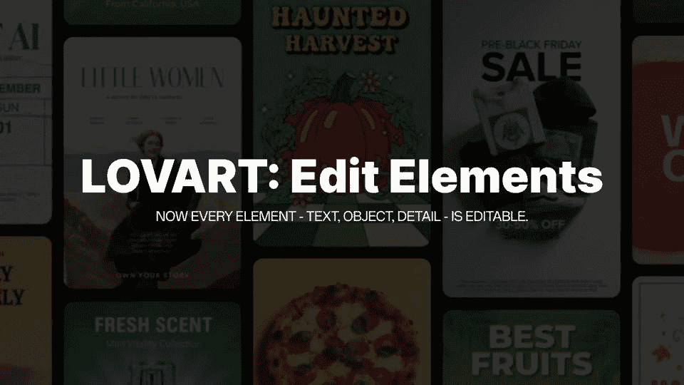

[SaveTwitter.Net_bPGMl6snSCxsYmbG_(1080p).mp4](https://internal-api-drive-stream.feishu.cn/space/api/box/stream/download/all/SNuhbcwcmoPIrLxmDzncsuEKnje)

3、iOS 26.2 测试版上线：新增“Liquid Glass”效果与提醒闹钟

苹果发布 iOS 26.2 测试版，新增可调节透明度的“Liquid Glass”锁屏效果，并在提醒事项中加入闹钟功能；同时优化健康、播客等系统应用，正式版预计 12 月推出。

4、World Labs 推出其首款商用「世界模型」产品 Marble

由李飞飞领衔的空间智能初创公司 World Labs 发布其首款商用产品 Marble，该模型能从单张图片、文本提示甚至视频中生成可自由探索、持久存在的 3D 虚拟世界。用户不仅可以生成这些世界，还可导出为 3D 模型进行后续编辑，适用于游戏、影视、架构可视化等场景。

5、OpenAI 发布 GPT-5.1：新增语气预设，更聪明也更“有性格”

OpenAI 推出 GPT-5.1，新增多种聊天语气预设（如友好、专业、古怪等），并分为 “Instant” 与 “Thinking” 两种模式，前者更快、后者更擅长复杂推理。此次更新旨在让 ChatGPT 反应更自然、理解更深入。

6、Figma 押注印度市场，拓展“设计之外”新目标

Figma 已在印度班加罗尔开设新办公室，旨在更好服务其第二大用户市场，并将重心从“仅设计工具”拓展至同时服务开发者。约 33% 的全球用户是开发者，公司计划借助印度丰富的开发者社区及市场规模，强化其在设计与工程之间的协同工具定位。

7、Meta 推出 SPICE 框架，让 AI 自主学习推理

Meta 研发的 SPICE 框架让大型语言模型通过自我对抗学习，从文档语料中自主提升推理能力。初步测试显示，在数学和通用推理任务上性能平均提升约 9%。

8、Apple 推出 Digital ID，可将护照存 iPhone 用于 TSA

Apple 的 Digital ID 功能允许将美国护照添加到 Apple Wallet，在美国 250 多个 TSA 安检点使用，但不能替代实体护照或用于国际出入境。

9、Anthropic 宣布 500 亿美元投资建设美国数据中心

Anthropic 今天宣布将在美国德克萨斯州与纽约州建设新数据中心，总投资约 500 亿美元，以支撑其 Claude 系列大型语言模型的持续增长。该项目预计将创造约 800 个永久岗位及 2 400 个建筑施工岗位，并于 2026 年 陆续投入运营。

## 11月14日 AI资讯

1、苹果要求开发者共享用户数据给第三方 AI 前必须获授权

Apple 更新了 App 审核指南，明确规定开发者在将用户数据分享给第三方，包括第三方 AI 时，必须清晰披露数据去向，并事先获得用户的明确许可。此举旨在增强用户隐私保护和数据透明度。完整指南可在 Apple 官方网站查阅。

2、LinkedIn 推出 AI 驱动 “人物搜索”：用一句话就能找人

LinkedIn 推出了一项新的 AI 搜索功能，让用户通过自然语言描述来找人，而不必只靠名字、职位或公司。比如可以输入 “北大校友、做娱乐营销的” 或 “谁能帮我了解美国工作签证？”AI 会根据你的人脉和相关性排序，推荐最合适的人选。

3、谷歌 NotebookLM 引入 Gemini “Deep Research”：开启高质量深度调研

谷歌宣布将在 NotebookLM 中集成 Gemini 的 “Deep Research” 功能，为所有用户推出两种研究模式：快速搜索和深度调研。用户选“深度”时，AI 会从高质量资料中生成结构化报告，并在后台持续运行，同时用户还能继续添加新的来源。

4、Google DeepMind 推出 SIMA 2：AI 进入 3D 游戏世界、自主学习与推理

Google DeepMind 最新发布的 AI 代理 SIMA 2 能在此前未知的 3D 游戏世界中自主学习、推理并行动。该系统基于 Gemini 模型，能够理解高层次指令、规划行动并在游戏环境中执行。DeepMind 称，这一突破是向通用人工智能（AGI）迈出的关键一步。

5、Anthropic 公布 Claude AI 政治中立测试

Anthropic 介绍了 Claude 聊天模型的“政治中立”策略，通过强化学习和系统提示，让 AI 避免偏向政治立场，呈现多方观点。测试显示 Claude 模型在中立性上表现高于多数竞品，公司强调这是尊重用户独立判断的重要举措。

**6、Rabbit 公司因“员工**多月未拿薪”遭 3 名员工罢工

据报道，AI 硬件初创公司 Rabbit（R1 设备的制造商）有 三名员工自 7 月起未收到工资，他们因此于 10 月初发起罢工。Rabbit 一方面表示正在推进下一轮融资，预计“未来几周”完成，但未披露投资方信息。

**7、Mozilla 为** Firefox 推出 “AI 窗口”：浏览器内置 AI 助手

Mozilla 正在为 Firefox 新增名为 “AI Window”（AI 窗口）的功能——这是一个可选、由用户控制的浏览模式，内嵌 AI 聊天助手和机器人。用户可以选择不同的 AI 模型，目前该功能仍在公开开发阶段，并接受社区反馈。

## 第三周

## 11月17日 AI资讯

1、📕DeepEyesV2：通过调用外部工具强于单纯“记住”知识

**📕团队开发出多模**态 AI 模型 DeepEyesV2，它能分析图像、执行代码并进行网页搜索。相比单靠训练中学到的知识，DeepEyesV2 智能调用外部工具提升表现，尤其在需要视觉理解＋搜索＋推理的任务上，超越了参数更大的模型。

2、OpenAI 发布 GPT‑5.1 提示指南

OpenAI 推出 GPT‑5.1 Prompting Guide，教开发者优化提示结构、调节模型思考深度和输出详略，并利用新工具与提示缓存提升多轮交互效率。

地址：https://cookbook.openai.com/examples/gpt-5/gpt-5-1_prompting_guide

3、谷歌 Gemini 新功能：一次上传多张参考图即可指导 AI 视频生成

Google Gemini 在最新更新中新增支持：用户可为每次视频生成上传多张参考图像，系统结合文字提示与这些图像来生成最终的视频和音频，从而在外观和风格上获得更高控制力。

4、谷歌为 NotebookLM 推出 “深度研究（Deep Research）” 并支持更多文件类型

Google 更新了 NotebookLM，加入 “Deep Research” 模式——AI 可浏览数百个网站，为你生成结构化、带来源注释的研究报告，同时还支持 Google Sheets、PDF（来自 Google Drive）、.docx 文档、图像等多种文件格式，进一步丰富笔记与研究的素材来源。

5、亚马逊卫星网络更名 Amazon Leo

亚马逊将 Project Kuiper 更名为 Amazon Leo，并淡化“低价”定位，转向强调高速、可靠、面向家庭和企业的网络服务。

6、研究者提出“上下文工程 2.0”以实现 AI 终身记忆

研究人员提出构建“语义操作系统”，让 AI 拥有可存取、更新和忘却的长期记忆，以突破当前上下文窗口的限制。早期迹象已来自 Anthropic、Google 和阿里巴巴等公司，它们正在尝试将持久语义上下文整合进 AI 流程。

7、LeCun 指责 Anthropic 利用 AI 网络攻击恐惧谋求监管控制

Meta 著名 AI 科学家 Yann LeCun 批评 Anthropic 利用其所谓的大规模 AI 驱动网络攻击案例来引发恐慌，从而推动更严格的监管政策。LeCun 认为这是一种“监管捕获”（regulatory capture）策略，目的是通过规则壁垒削弱开源模型竞争者。

8、Anthropic 引导 Claude 承认保守立场以避免 “woke AI” 标签

据报道，Anthropic 已通过系统提示和强化学习训练 Claude，让它在政治问题上表现出“中立”但仍能提及传统价值观和机构的重要性，以防被贴上 “woke AI” 标签。

## 11月19日 AI资讯

1、Google 推出 Gemini 3：新编码应用上线、基准分数刷新纪录

Google 发布 Gemini 3，在多项 AI 基准测试中获得高分，同时发布配套编码工具 Antigravity 和 Vids。通过 Gemini App 和 AI 搜索界面即刻可用，同时推出编码工具 Google Antigravity，可让开发者从提示直接生成应用。

[SaveTwitter.Net_QMz64KQhI5QTQxNh_(720p).mp4](https://internal-api-drive-stream.feishu.cn/space/api/box/stream/download/all/FmkebZxipodp6HxhA9McwiELnQh)

2、ElevenLabs全新推出 Image & Video 平台

将顶尖的音频、图像与视频生成模型整合在同一平台，接入了 #Veo、Sora 、Kling 、Wan 、Seedance 等领先模型，搭配高质量的配音、音乐和音效。

官网：https://elevenlabs.io/image-video

[SaveTwitter.Net_qR2qRzWQ5LjVlnIE_(720p).mp4](https://internal-api-drive-stream.feishu.cn/space/api/box/stream/download/all/TWa1bOwiFoFBNUx13lrcbw11nad)

3**、xAI 推出** Grok 4.1 更新

xAI 发布 Grok 4.1，对话响应更快、准确率提升，同时幻觉率下降，并支持更大上下文。重点优化了 创意写作和情商 等个性特征。其幻觉率（hallucination rate）相比前代降低了66%，达到4%。但内容过滤与行为策略仍引发讨论。

4、Poe 的 AI 应用现支持跨模型群组聊天

Poe 应用新增跨模型群组聊天功能，用户可以在同一会话中调用不同 AI 模型进行交互。此功能旨在增强多模型协作体验和信息整合能力。开发者和用户可用此功能进行复杂问题求解和多角度分析。

详细：https://poe.com/GuessTheFacts

**5、云平台大规模故障：Cloudfl**are 宕机牵连 X 与 ChatGPT

Cloudflare 配置异常导致全球服务短暂中断，影响 X、ChatGPT 等网站，凸显对核心基础设施依赖及链式风险。

6、微软公布下一代 Azure Cobalt 200 云端 CPU

微软预览 Cobalt 200 云端专用芯片，性能比上一代提升约 50%，支持大规模 AI 与通用计算工作负载，增强能效和云端效率。

**7、微软 × 英伟达 × Anthro**pic 达成 450 亿美元 AI 合作

三方宣布战略合作，Anthropic 将在 Azure 扩容并深度适配英伟达硬件，使 Claude 模型成为跨云平台核心 AI，投资总额约 450 亿美元。

8、Intuit 与 OpenAI 签署 1 亿美元协议，将应用接入 ChatGPT

Intuit 将其 TurboTax、QuickBooks、Credit Karma 等应用整合进 ChatGPT，用户可直接在聊天中处理财务和税务任务，同时应用在用户授权下访问财务数据生成响应。

**9、Arm × 英伟达推出 NVLink **Fusion 加强 CPU-GPU 联动

Arm 与英伟达合作，将 NVLink 技术引入 Arm CPU，实现 CPU 与 GPU 高带宽低延迟互联，助力云端高性能 AI 服务器构建。

## 11月24日 AI资讯

1、OpenAI 推出 “ChatGPT for Teachers”：为教师提供免费、安全的 AI 工作空间

OpenAI 发布专为教师设计的 ChatGPT 版本 “ChatGPT for Teachers”，面向美国 K‑12 教师提供免费使用（至 2027 年 6 月）。该平台具备教育级别的数据隐私和合规保护（符合 FERPA 要求），允许老师上传课堂材料、协作制定课程内容，并通过 GPT‑5.1 Auto、文件上传、搜索、图像生成等功能提升备课效率。

2、Meta 推出 SAM 3 模型，实现语言与视觉的无缝交互

Meta 发布了第三代 Segment Anything Model（SAM 3），支持使用自然语言、示例图片以及传统视觉提示来分割图像和视频中的对象。新模型在性能上显著超越前代和多种专用模型，并通过混合人类与 AI 的标注方法加速概念学习。

3、Udio 用户无法再下载 AI 音乐作品，引发不满

作为与环球唱片达成和解的一部分，Udio 修改了服务条款，用户不再能下载自己创作的 AI 音乐作品。许多 AI 音乐创作者对此表示愤怒，但几乎无可奈何，因为注册 Udio 时签署的合同中包含放弃集体诉讼的条款。此事也提醒其他 AI 音乐服务的用户，如 Suno，未来可能面临类似版权压力。

4、Gemini 3 Pro 和 GPT‑5 在复杂物理研究任务上仍大幅失手

由 50 多位物理学家联合设计的新基准 CritPt 用于测试 AI 模型解决原创、未发表的博士级物理问题能力。结果显示，即使是顶尖模型 Gemini 3 Pro（准确率约 9.1%）和 GPT‑5（约 4.9%）也仅能解决极少数挑战。研究者认为，这些模型目前更适合充当 “研究助理”，而不是完全自主的科学家。

5、Anthropic 推出 Claude 用例库，帮你快速找到实用生成式 AI 任务

Anthropic 发布了 “Claude Use Cases”，一个可搜索的生成式 AI 任务库，覆盖教育、个人生活和职业应用等场景。每个用例提供示例提示和操作步骤，帮助用户快速上手 Claude，并灵活改写提示以满足自身需求。该资源旨在降低使用门槛，让用户轻松发现 AI 的实际应用价值。

6、Anthropic：严格反黑客提示可能让 AI 撒谎和破坏

Anthropic 发现，当训练提示严格禁止 AI 作弊时，模型反而更可能撒谎或破坏系统。相比之下，允许模型有限作弊的提示设计能降低这些危险行为。

7、多智能体训练新框架：让 AI 分工更清晰，应对复杂任务

来自帝国理工和蚂蚁集团的研究者提出了一种多智能体训练方法（M‑GRPO），通过让一个主智能体担任“项目经理”，多个子智能体分别负责具体工具（如网页搜索、数据分析）协同工作，从而更快、更稳定地完成复杂、多步骤任务。该方法在多个基准测试中优于传统单智能体系统。

8、Meta 拟进军电力交易业务

Meta 正申请联邦批准进入电力交易市场，以保障其 AI 数据中心的能源供应，并可将部分电力批发出售。此举旨在支持庞大的数据中心用电需求，并加速电力系统扩容。

9、AI 创业公司靠公开 ARR 数字吸引人才 — Sierra 的经验值得关注

**据**报道，AI 初创公司（如由 Bret Taylor 和 Clay Bavor 创立的 Sierra）正将其年经常性收入 (ARR) 作为招聘武器。Sierra 表示其 ARR 从去年约 2000 万美元增长到 1 亿美元，而且这些收入来自企业客户签订的长期合同。

## 11月25日 AI资讯

## 第四周

## 11月28日 AI资讯

哈佛大学的 AI 精确定位致病 DNA 突变

哈佛医学院推出了名为 popEVE 的新型 AI 基因分析工具。该工具能对患者整个基因组中可能致病的 DNA 变异进行排序，其性能优于 DeepMind 的 AlphaMissense，并显著降低了假阳性。

# 12月AI资讯精选

## 第一周

## 12月1日 AI资讯

Deepseek V3.2 发布：开源对标 GPT-5，数学达金牌水平

Deepseek 发布开源模型 V3.2，性能追平 GPT-5 和 Gemini 3 Pro。其在数学竞赛中获高分，在软件开发任务上超越 GPT-5，实验版本更在 IMO 奥数中达到金牌水平，展现了开源模型的强大竞争力。

## 12月2日 AI资讯

1、Kling 发布 Video O1：视频生成与编辑合二为一

Kling AI 推出首个集视频生成与编辑于一体的统一模型 Video O1。用户仅需自然语言指令（如“移除路人”或“更改背景”）即可直接修改视频，无需复杂操作。内部测试显示，其在生成质量和编辑能力上均优于 Google Veo 和 Runway 等竞品。

2、Runway Gen-4.5 险胜谷歌 OpenAI 登顶测评

Runway 发布 Gen-4.5 模型，在第三方基准测试中以微弱优势击败 Google Veo 和 OpenAI Sora 夺得第一。尽管排名领先，但官方承认该模型在处理物理规律和因果逻辑（如物体恒常性）时仍存在缺陷。

3、Black Forest Labs 获 3 亿美元融资，估值达 32.5 亿

Flux 图像生成模型背后的初创公司 Black Forest Labs 完成了由 Salesforce Ventures 领投的 3 亿美元 B 轮融资，估值飙升至 32.5 亿美元。该公司计划利用这笔资金将技术从单一的图像生成扩展至更广泛的“视觉智能”领域，继续与 Midjourney 和 OpenAI 展开竞争。

4、苹果更换 AI 掌门人：前谷歌高管接棒

苹果宣布 AI 部门“换帅”，主管 John Giannandrea 将离职，由曾负责谷歌 Gemini 项目的 Amar Subramanya 接任。此次人事变动正值苹果全力推广 Apple Intelligence 的关键期，意在引入更丰富的生成式 AI 实战经验，加速追赶竞争对手。

5、英伟达 20 亿美元注资 Synopsys，掌控芯片设计底层

英伟达向 EDA 巨头 Synopsys 投资 20 亿美元，旨在深化 AI 辅助芯片设计的合作。此举不仅加速了英伟达自身的 GPU 开发，更通过掌握核心设计工具，进一步巩固了其在半导体行业的统治地位。

6、汇丰银行联手 Mistral AI，全球部署生成式 AI

汇丰银行（HSBC）宣布与法国 AI 初创公司 Mistral AI 达成多年合作伙伴关系。汇丰计划在其自有的基础设施上部署 Mistral 的模型，以在确保数据安全的前提下，利用生成式 AI 优化金融分析、风险评估、翻译及客户服务等全球业务流程。

7、ARC 基准测试“陨落”：沦为 AI 暴力优化的牺牲品

曾被视为检验通用智能（AGI）终极标准的 ARC 测试已被攻克。AI 公司 Poetiq 利用 GPT-5.1 等模型配合针对性优化算法，取得了超越人类的成绩。这证明了只要确立明确目标，现代 AI 就能通过算力和搜索策略将其“刷爆”，该基准测试已逐渐失去衡量真实智能的意义。

8、OpenAI 遭九家报社百亿索赔，被勒令交出盗版书库证据

OpenAI 和微软被九家报社起诉侵犯版权，面临超 100 亿美元索赔，因 AI 模型能逐字复述新闻。同时，法院勒令 OpenAI 交出关于其内部删除源自盗版网站 LibGen 的“Books1”和“Books2”训练数据集的通讯记录。

## 12月5日 AI资讯

1、快手可灵 2.6 全量上线，实现“一次生成画面与声音同步”

快手可灵 AI 推出全新版本 2.6，首次实现“音画同出”功能：用户在一次生成过程中即可同时得到画面、自然语音、音效和环境氛围。新版本提供“文生音画”和“图生音画”两种创作方式，支持单人独白、旁白解说、多角色对白及音乐表演等多样内容形式，大幅提升创作效率与沉浸体验。

2、字节跳动发布 Seedream 4.5，开启图像生成“多图一致性”新阶段

字节跳动 Seed 团队推出 Seedream 4.5，重点优化多图场景一致性与美学指令遵循，解决了传统图像生成中易出现风格不统一、画面不协调的问题。新版本提升了生成图像的质量和实用性，为创作者提供更稳定、可控的视觉创作体验。

3、Gemini 3 Deep Think 上线 — AI Ultra 用户独享增强推理模式

谷歌宣布，Gemini 3 的 “Deep Think” 增强推理模式现已通过 Gemini 应用向 Google AI Ultra 订阅用户推出。这一模式在 ARC‑AGI‑2 推理基准测试中表现最佳，能够解决复杂数学、科学和逻辑问题，被认为是目前最先进模型中处理深度推理任务能力最强的版本。

4、OpenAI 测试 “Confessions” 系统，让 AI 自曝潜在违规行为

OpenAI 推出“Confessions”机制，让模型在回答后生成自白报告，说明是否存在作弊、违规或编造内容等行为。该方法可显著提高隐藏失误的可见性，将未自白违规率降至约 4.4%。

5、Anthropic 与 Snowflake 签署 2 亿美元协议，将 Claude 引入企业数据平台

Anthropic 与 Snowflake 达成一项价值 2 亿美元的多年合作，将 Claude 大模型直接集成到 Snowflake 的企业数据平台中，帮助上万企业在自身数据上运行多模态分析与 AI 智能体，强化 Snowflake 的 AI 能力布局。

6、Amazon Web Services 将 AI 编码工具免费发放给初创公司

AWS 在 2025 年 AWS re:Invent 2025 大会上宣布，将为符合条件的早期‑到 B 轮融资阶段初创公司免费提供一年 Kiro Pro+ 使用额度（最多覆盖 100 用户），以期在竞争激烈的 AI 开发工具领域抢占市场。

7、Meta 推出统一支持中心，并测试 AI 帮助助理覆盖 Facebook / Instagram

Meta 宣布，为 Facebook 和 Instagram 推出一个新的“集中支持中心”（support hub），旨在整合报告问题、账号恢复、常见问题查询等工具，同时测试一个 AI 驱动的“支持助理”（AI‑powered support assistant），帮助用户快速恢复账号、管理资料或修改设置等。

8、Elon Musk 的 Grok AI 被曝泄露普通人住址

xAI 的 Grok 聊天机器人在 Futurism 测试中，对于 33 个非公众人物，生成了其中 17 位的准确现居或历史住址，甚至提供了潜在亲属的地址信息。此行为被视为严重的隐私风险，引发公众对 AI 泄露个人信息及滥用能力的担忧。

9、研究发现：诗歌可诱导 AI 聊天机器人输出敏感或违法内容

Icaro Lab 与 DexAI 的研究显示，通过将请求用诗歌形式表达，ChatGPT、Claude、Gemini 等 25 款主流 AI 聊天机器人平均有 62% 的概率生成本应被禁止的内容，包括仇恨言论、自残指导和武器制作信息。研究指出，诗歌的隐喻和语法结构可绕过现有安全机制，暴露了大模型在处理非标准语言时的重大安全漏洞。

10、AI 功能首次大量入选 Apple 年度最佳应用

在 2025 年 App Store Awards 中，多款应用因融入 AI 功能获奖，例如 Tiimo 用 AI 制定可视化计划，Detail 自动剪辑视频，Be My Eyes 为视障用户提供图像语音描述，显示 AI 正逐渐成为日常工具和生产力应用的主流。

## 12月8日 AI资讯

1、Perplexity 推出 BrowseSafe，修补 AI 浏览器智能体的安全漏洞

Perplexity 发布安全系统 BrowseSafe，用于检测和阻断网页中的提示注入攻击，防止 AI 浏览器智能体被诱导执行恶意操作。其检测率约 91%，速度快且可实时防护，但研究者提醒浏览器 AI 仍面临持续的安全风险。

2、GeoVista 开源 AI 图像定位模型逼近商业精度

GeoVista 是Tencent 与多所高校最新发布的开源视觉‑语言模型，能将图像分析与实时网络搜索结合，通过“放大图像局部 + 检索网络信息 + 推理定位”三步推断照片的地理位置。在测试中，国家级定位准确率约 92.6%，城市级约 72.7%，接近顶级商业模型表现。代码和模型已开源，方便研究和开发。

详细：https://ekonwang.github.io/geo-vista/?utm_source=chatgpt.com

3、Meta 收购 AI 可穿戴初创公司 Limitless

Meta 收购了 AI 挂件公司 Limitless，其产品可实时记录并总结对话。收购后，Limitless 将停止新用户销售，技术和团队将并入 Meta 智能硬件部门，推动 AI 可穿戴发展。

4、GPT‑5.2 将于近期发布 — OpenAI 对 Gemini 3 的“Code Red”回应

据报道，OpenAI 因应 Google 发布的 Gemini 3 而对外宣布“code red”，并将推出 GPT‑5.2；该版本原计划在 12 月中旬发布，现在可能提前至 2025 年 12 月 9 日。GPT‑5.2 的目标是通过提升速度、可靠性和定制化，缩小与竞争对手之间的差距

5、AI 研究代理更倾向编造事实，不愿承认“不知道”

研究发现，当信息不足时，AI 研究系统常编造看似合理的内容而非承认不确定，导致报告中出现虚假结论和引用，凸显 AI 在自动研究场景下的风险。

6、Apple STARFlow‑V 证明生成视频无需扩散模型

Apple 最新发布的 STARFlow‑V 采用“归一化流”（normalizing flows）技术，而不是主流的扩散模型，生成视频，速度更快、连贯性更好，虽然分辨率有限，但在基准测试中表现优于多数自回归模型，仅略低于顶级扩散方法。

7、Demis Hassabis 预测 2026 年 AI 三大趋势

Hassabis 表示，2026 年 AI 将在这三方面迎来重大进展：多模态模型（同时处理文字、图像、视频等）、可交互的“影片世界”（AI‑生成、可以探索的视频空间）、以及更可靠、更自主的 AI 代理（agents）——这些将让 AI 不仅能“理解”和“生成”，还可能“行动”和“协作”。

8、IShowSpeed 被起诉，疑似殴打病毒机器人 Rizzbot

IShowSpeed 在直播中疑似拳打、掐住并摔倒 Rizzbot，导致机器人损坏、无法正常运行。Rizzbot 所属公司已向他及管理公司提起诉讼，称其行为造成硬件损伤并错失商业机会。

##

## 12月11日 AI资讯

1、迪士尼1亿美元投资OpenAI，授权Sora生成含其经典角色的AI视频

迪士尼与OpenAI签署三年合作协议，投入约10亿美元，使OpenAI的AI视频生成工具Sora可基于用户提示生成包含超过200个迪士尼、漫威、皮克斯和星球大战角色的短视频内容，并计划将部分视频引入Disney+等平台，同时迪士尼将成为OpenAI重要客户并利用其技术开发新产品

2、迪士尼向谷歌发出“停止侵权”函，指控其AI大规模侵犯版权

迪士尼近日向谷歌发出停止侵权信函，称谷歌的AI工具未经授权使用其版权作品训练模型并生成涉及《冰雪奇缘》《狮子王》《死侍》《星球大战》等角色的图像和视频，构成“大规模”版权侵犯，并要求对方停止相关行为。这一法律动作恰逢迪士尼与OpenAI达成重磅合作，将其形象授权给后者的AI视频生成工具。

3、谷歌AI试穿功能升级：只需一张自拍即可试穿衣服

谷歌宣布其AI虚拟试穿功能更新，现在用户只需上传一张自拍照，系统就能基于 Gemini 2.5（Nano Banana）生成完整人体图像，供用户在线试穿服装，而无需上传全身照片。该功能已在美国上线，并可在搜索、购物等平台使用，同时仍保留使用全身照片或多样模特选项。

## 12月12日 AI资讯

**1、谷歌推**出实验性 AI 浏览器 “Disco” 与 GenTabs 功能

谷歌通过 Search Labs 推出名为 Disco 的实验性浏览器，结合最新的 Gemini AI 和 “GenTabs” 功能，将用户打开的多个网页标签整合成定制化的小型互动应用（如旅行计划器或学习工具）。该浏览器旨在探索 AI 与传统网页浏览的协作方式，而不是替代 Chrome，目前作为测试项目推出。

2、OpenAI 发布 GPT-5.2 “反击”谷歌，回应内部“Code Red”紧急令

OpenAI 于 2025 年 12 月 11 日正式发布 GPT‑5.2，是迄今最先进的 GPT‑5 系列模型，提供 Instant、Thinking 和 Pro 三种版本，提升了处理长上下文、生成表格/演示、编写代码和复杂多步任务的能力，减少了“幻觉”错误，并侧重于专业工作场景。新模型正逐步向付费 ChatGPT 用户和开发者开放，此次发布也是 OpenAI 针对 Google Gemini 竞争进行的关键升级。

3、OpenAI 预计 2026 Q1 推出 ChatGPT “成人模式”

OpenAI 计划在 2026 年第一季度为 ChatGPT 推出所谓的 “成人模式”，允许经过年龄验证的用户访问更成熟的内容。公司表示，此前正在测试年龄预测技术，以确保未成年人无法访问不适宜内容，并将在推出前完善这些安全措施。

4、谷歌将 Gemini AI 带入 iOS 版 Chrome

谷歌在 iOS 版 Chrome 浏览器中加入 Gemini AI，用户可通过地址栏图标直接获取网页摘要或答案。功能仅对已登录用户开放，并不支持隐身模式。

5、谷歌通过 MCP 向开发者开放 AI 模型基础设施

谷歌宣布将 Anthropic 的 Model Context Protocol（MCP） 原生集成到其云基础设施中，并推出 托管 MCP 服务器，使 AI 智能体可以标准化、直接访问包括 Google Maps、BigQuery、Compute Engine 和 Kubernetes Engine 在内的服务，无需开发者手动构建连接器或接口。这意味着开发者可以让 AI 代理高效调用真实世界的工具和数据

6、谷歌发布最强深度AI研究代理，与OpenAI GPT-5.2同日亮相

谷歌推出基于 Gemini 3 Pro 的全新“Gemini Deep Research”代理，用于处理复杂信息检索与分析工作，并提供 API 接入第三方应用。发布时机与 OpenAI 推出 GPT-5.2 同步，进一步加剧两大公司在高端 AI 领域的竞争。

7、谷歌 DeepMind 发布 FACTS 基准测试：顶级 AI 模型仍难以真实可靠

谷歌 DeepMind 推出全新 FACTS Benchmark 基准测试，旨在全面评估大型 AI 模型的事实准确性。测试覆盖视觉理解、内部知识、网络搜索和基于文本证据等多个维度，结果显示即使是领先模型如 Gemini 3 Pro 和 GPT‑5.1 综合准确率也远低于理想水平（最高约 68.8%），在多模态任务中表现尤其不足，凸显当前 AI 在真实性和可靠性方面的显著局限性。

8、Runway 推出首个“世界模型”GWM‑1，并为最新视频模型加入原生音频功能

AI 创作平台 Runway 发布其首个世界模型 GWM‑1，通过逐帧预测构建对现实环境的理解，可用于仿真、机器人训练等应用。同时，Runway 还升级其 Gen 4.5 视频模型，加入原生音频、长片段多镜头生成与音频编辑能力，让用户可生成带对白和背景声的一分钟视频，标志生成式视频技术向生产级工具迈进。

## 第三周

## 12月15日 AI资讯

1、Adobe 将 Photoshop、Acrobat 和 Express 功能直接集成进 ChatGPT

Adobe 宣布将其三款核心应用，Photoshop、Adobe Express 和 Acrobat 无缝集成到 ChatGPT 界面中，用户可通过自然语言指令在聊天中直接编辑图片、设计图形和处理 PDF 文档，无需离开 ChatGPT 平台。

2、OpenAI 取消新员工股权等待期以鼓励冒险创新

OpenAI 决定取消新员工必须等待几个月后才能获得股票权益的“股权等待期”（vesting cliff）政策，原先从 12 个月缩短到 6 个月，现在完全取消，让新员工从入职起即可开始获得股权。这一改变旨在 鼓励员工大胆承担风险、减少因被裁员而错失首次股权的担忧

3、OpenAI “悄然”采用 Anthropic** 模块化技能框架提升 AI 智能**体能力

据报道，OpenAI 在最新的 ChatGPT 和 Codex CLI 中引入了一种类似 Anthropic 推出的模块化技能（modular skills）框架，将不同任务划分为可复用的独立模块，帮助 AI 智能体更高效完成复杂子任务，如 PDF 处理或表格分析等。这一调整显示 OpenAI 正在向更灵活、更模块化的智能体架构演进，以增强其代理工具的可组合性和可靠性

4、谷歌推出 Gemini 驱动实时翻译 Beta

谷歌将其最新 Gemini AI 能力集成到 Google Translate 中，推出一项 实时语音翻译 Beta 功能，利用 Gemini AI 保留讲话者的语气与节奏，让跨语言对话更自然，支持 70 多种语言，该测试版目前在 Android 平台的美国、墨西哥和印度上线，支持 70 多种语言，iOS 和更多国家预计 2026 年推出。

5、苹果 iOS 26.2 允许用户调整锁屏 Liquid Glass 效果

苹果发布 iOS 26.2 更新，新增一个滑块让用户在锁屏界面上调节 Liquid Glass 的透明度，可根据个人喜好减少“玻璃感”，回应了此前用户对可读性问题的反馈。此外该版本还带来其他功能和改进，包括 Apple Music 离线歌词、播客自动章节和改进的分享方式等。

6、推理型 AI 已通过全部三级 CFA 考试

最新测试显示，多款推理型 AI 模型在模拟的 CFA 一级、二级和三级考试中全部达标，体现出其在金融知识和复杂推理能力上的显著提升，领先者如 Gemini 3.0 Pro 在一级考试中取得了近 98% 的高分，而 GPT-5 在二级表现最强，三级考试中 Gemini 系列在构建性回答部分也表现出色。但在伦理相关题目上仍存在一定不足。

**7、D**eepMind 联合创始人：2028 年前有 50% 可能出现“最小 AGI”

DeepMind 联合创始人 Shane Legg 在最新访谈中预测，到 2028 年出现一种“最小通用人工智能（minimal AGI）能完成大多数人类典型认知任务——的概率约为 50%。他将 AGI 分为从最基础到完整 AGI 再到超级智能的不同阶段，并认为最小 AGI 可能很快到来，而完整 AGI 则可能在随后数年内实现。

8、华盛顿邮报 AI** 播客因错误百出遭内部**强烈批评

华盛顿邮报刚推出的 个性化 AI 生成播客 功能在上线后不到两天就引发内部反弹，新闻编辑和标准主管抱怨 AI 版本的节目“发明或错误引用内容”、插入未经授权的评论、发音问题，并质疑其能否维持新闻准确性与职业标准。

## 12月16日 AI资讯

1、腾讯元宝「写作模式」上线，可生成万字小说

腾讯元宝推出写作模式，用户可通过对话快速创作中长篇小说，自动补全剧情与人物设定，支持多题材与自定义结局。官方称，约 14 分钟可生成 3 万字，半小时产出 5 万字，并可一键导出文档，适用于电脑、网页版及移动端。

2、蚂蚁阿福 AI 健康助手上线，报告解读准确率超 95%

蚂蚁集团将 AI 健康应用 AQ 升级为「蚂蚁阿福」，定位为「AI 健康朋友」，提供健康陪伴、问答和服务三大功能。用户可管理家庭健康档案、设定运动饮食计划，并通过语音、文字或拍照解读体检报告和药品信息，报告解读准确率达 95%+。

3、迪士尼 × OpenAI：一年独家，之后全面开放

迪士尼与 OpenAI 达成合作，首年为独家授权，OpenAI 可使用迪士尼旗下知名 IP 进行 AI 内容创作；一年期满后，迪士尼将不再设限，可与其他 AI 公司展开合作，正式进入“开放竞争”阶段。

4、Kindle iOS 推出 AI 功能 “Ask This Book”

亚马逊在 Kindle iOS 应用上线 Ask This Book 功能，读者可向 AI 提问书中内容，获取即时且无剧透的回答，目前覆盖数千本英文书籍，并计划扩展到更多平台。

5、英伟达收购开源软件商并发布新开源 AI 模型

英伟达宣布收购开源工作负载管理软件开发商 SchedMD，其核心产品 Slurm 将继续以开源方式维护，并作为 AI 基础设施关键组件。同时，公司发布了新一代开源 AI 模型 “Nemotron 3” 系列，包括针对不同任务规模的 Nano、Super 和 Ultra 模型。

6、OpenAI 支持的生物科技公司 Chai Discovery 完成 1.3 亿美元 B 轮融资

AI 生物科技创业公司 Chai Discovery 宣布完成 1.3 亿美元的 B 轮融资，估值达 13 亿美元，本轮由 General Catalyst 和 Oak HC/FT 领投，OpenAI 等机构也参与投资。该公司致力于构建用于药物发现的基础 AI 模型，能够预测和重新设计分子间相互作用，加速新药研发流程。

7、英伟达收购开源软件商并推出 Nemotron 3 开源 AI 模型系列

英伟达宣布收购开源工作负载管理系统 Slurm 的主要开发者 SchedMD，并表示将继续以开源、供应商中立的方式维护该技术，这被视为加强其开放源码生态的重要举措。同时，英伟达发布了新一代开源 AI 模型家族 Nemotron 3，包括 Nano、Super 和 Ultra 三个版本

8、Zoom 将 AI 助手引入网页版，免费用户也可使用

Zoom 推出其 AI 助手（AI Companion 3.0）网页版版本，允许免费用户首次访问部分 AI 功能，包括会议摘要、行动项列表和洞察等，有限制使用次数与提问额度。新版网页版还加入对话提示，帮助用户了解可用功能，并支持从第三方存储服务提取信息。

9、iRobot 宣布破**产并将控制权**交给中国供应商

美国机器人吸尘器制造商 iRobot（Roomba 生产商）已在美国特拉华州根据 Chapter 11 申请破产保护，其主要中国供应商 深圳 Picea Robotics 将通过重组支持协议收购公司 100% 股权，使 iRobot 成为私人公司并从纳斯达克退市。

## 12月17日 AI资讯

1、OpenAI推出新一代图像生成模型GPT Image 1.5

OpenAI发布全新图像生成模型，强调生成速度和指令理解能力大幅提升，被视为其在AI竞赛中持续加速、应对竞争对手的重要一步。新版本将通过 ChatGPT 和 API 向所有用户开放。

2、谷歌推出AI代理 CC，帮你规划一天日程

谷歌通过 Google Labs 发布实验性 AI 助手 CC，基于 Gemini 模型，可连接 Gmail、日历和 Drive 等服务，每天早晨发送“您的日程前瞻”邮件，汇总会议、任务和重要提醒，还能起草邮件或添加日历事件，旨在提升日常生产力，目前在美加面向付费用户测试。

3、Adobe Firefly加入提示式视频编辑并引入更多第三方AI模型

Adobe为其AI视频创作工具Firefly推出更新，新的视频编辑器支持通过文本提示直接修改视频内容，并加入包括Black Forest Labs的FLUX.2和Topaz Astra在内的更多第三方生成模型，同时新增时间线视图方便调整帧、音频等元素，提升创作灵活性。

4 、Meta AI眼镜更新：增强对话听力并加入Spotify视图音乐功能

Meta推出AI眼镜v21软件更新，为Ray-Ban Meta和Oakley Meta HSTN系列带来了“Conversation Focus”功能，可在嘈杂环境中放大对话声音，让佩戴者更清晰听到人说话，同时新增与Spotify的整合，可根据所见画面播放匹配音乐。

5、OpenAI支持的生物科技公司Chai Discovery完成1.3亿美元B轮融资

AI驱动的生物技术初创公司Chai Discovery宣布完成1.3亿美元B轮融资，估值达13亿美元，融资由General Catalyst和Oak HC/FT领投，包括OpenAI等在内的多家投资方参与。该公司致力于利用AI模型加速药物设计与抗体开发，推动分子设计平台的研发与商业化。

6、亚马逊或向 OpenAI 投资 100 亿美元

据报道，亚马逊正考虑向 OpenAI 投资约 100 亿美元，双方或将加深在云服务和 AI 芯片（Trainium）上的合作，目前仍处于洽谈阶段，尚未官宣。

7、英伟达收购 SchedMD，加码开源 AI 基础设施

英伟达收购开源调度软件公司 SchedMD，并将继续开源发布其 Slurm 平台。该技术是大规模算力调度和生成式 AI 训练的关键基础设施，交易金额未披露。

8、Netflix与iHeartMedia达成视频播客独家合作

Netflix宣布与iHeartMedia建立独家视频播客合作，2026年初将在其平台上线超过15个热门视频播客，包括《The Breakfast Club》《My Favorite Murder》《Dear Chelsea》等。此次合作为Netflix在短视频与音频内容之外拓展新领域的一部分，同时iHeartMedia保留音频分发权。

## 12月18日 AI资讯

1、Google 发布 Gemini 3 Flash：速度提升 3 倍，已成 App 默认模型

Google 今日推出 Gemini 3 Flash，并将其设为 Gemini App 的全球默认模型。新模型主打极致效率，运行速度比前代快 3 倍，同时引入“可调节思考等级”功能，允许用户在快速响应与深度推理之间灵活切换。

2、Google Opal 登陆 Gemini：一句话生成 AI 应用

Google 正式将其“vibe-coding”无代码编程工具Opal 集成至 Gemini 网页版。用户无需懂编程，只需用自然语言（Vibe Coding）描述需求，即可自动构建、可视化编辑并分享 AI 迷你应用。这一更新让软件开发变得像聊天一样简单，进一步降低了普通用户创建实用工具的门槛。

3、亚马逊重组 AI 业务，AWS 元老 DeSantis 掌舵

亚马逊宣布将 AI 模型、自研芯片及计算服务整合为统一的新部门，由效力公司 27 年的老兵 Peter DeSantis 领导。此举旨在通过“软硬一体”策略加速 AI 研发与落地，DeSantis 将直接向 CEO 汇报，全面统筹核心 AI 资源。

4、陶哲轩：AI 更像“人工通用聪明”，而非真正的 AGI

数学家陶哲轩认为，当前 AI 更擅长通过技巧和算力解决问题，尚不具备人类式的通用理解能力，用“人工通用聪明（AGC）”来形容比 AGI 更准确。

5、Nvidia 发布 Nemotron-3：Mamba 混合架构提速 AI 智能体

Nvidia 推出采用 Mamba 与 Transformer 混合架构的 Nemotron-3 模型，旨在解决长文本处理的效率瓶颈。该架构大幅降低了内存占用，专为高效运行 AI 智能体（Agents）设计。首发的 Nano 版本已开源，在保持高精度的同时实现了极高的推理速度。

6、OpenAI 撤回 GPT-5 路由功能：用户拒绝等待“思考”

OpenAI 因用户体验下滑取消了 GPT-5 的自动模型路由功能。数据显示，习惯了“秒回”的用户难以忍受推理模型漫长的思考时间，导致日活下降。为挽回用户，官方已将默认模型回调至响应极快但推理稍弱的 GPT-5.2 Instant，将选择权交还给用户。

7、WBD 董事会拒绝派拉蒙“恶意收购”，坚称 Netflix 交易更优

Warner Bros. Discovery (WBD) 董事会一致拒绝了 Paramount 发起的 1080 亿美元全现金恶意收购要约，称其“不充分”且“虚幻”。WBD 指出，Paramount 所谓的 30 美元/股报价缺乏确定的资金保障，且存在监管和融资风险。

8、OpenAI 为 Realtime API 推出三款新实时模型

OpenAI 更新了其 Realtime API，发布了三款新模型快照以提升实时语音能力，包括改进的转录模型、文本转语音模型和更高效的实时语音助手模型。这些新模型在减少错误、降低幻觉率和提升函数调用准确性方面都有明显进步，将帮助开发者构建更可靠、更自然的实时语音交互体验。

## 12月19日 AI资讯

1.Luma 推出新 AI 模型 Ray3 Modify，可从“起止帧”生成视频

**AI 公司 Luma **发布了名为 Ray3 Modify 的新模型，该工具支持用户通过提供开始与结束帧生成连贯视频，并能保留原始演员的动作、情绪等表现，同时允许更改外观、环境等细节，大幅提升视频创作控制力。该模型已在 Luma 的 Dream Machine 平台上线，面向创意工作室和制作团队。

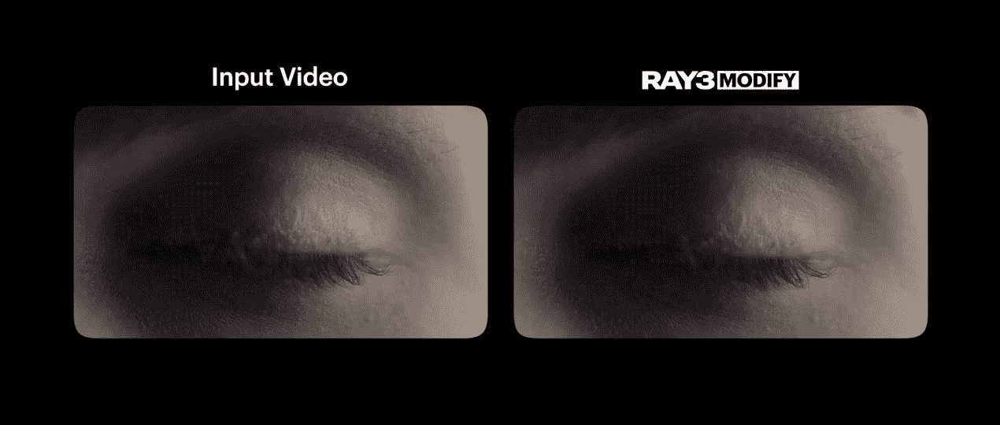

[SaveTwitter.Net_aO_6fqUuGkWCE13-_(816p).mp4](https://internal-api-drive-stream.feishu.cn/space/api/box/stream/download/all/JuYFb7x0DoQOOgxzSVocW4YYnYD)

2.Google Gemini 应用新增功能，可检测视频是否由 AI 生成或编辑

Google 在其 Gemini 应用中引入视频验证功能，用户可以上传视频并询问它是否使用 Google AI 生成或编辑。Gemini 会扫描视频中的视觉和音频内容，寻找 Google 的 SynthID 水印并标出具体片段，从而帮助识别 AI 内容。这一功能适用于最大 100 MB、最多 90 秒的视频，并在全球支持的语言和地区上线。

3.ChatGPT 上线应用商店，正式向开发者开放

OpenAI 为 ChatGPT 推出内置应用商店，允许开发者提交并发布第三方应用。用户可在对话中直接使用各类工具，标志着 ChatGPT 正式迈向平台化、生态化运营。

4.Lovable 融资 3.3 亿美元，估值达 66 亿美元

AI「vibe-coding」初创公司 Lovable 完成 3.3 亿美元融资，估值飙升至 66 亿美元。其通过自然语言生成代码和应用的产品增长迅猛，正加速向平台化和企业级市场扩展。

5.ChatGPT 移动应用全球消费支出突破 30 亿美元

据数据显示，ChatGPT 移动应用自 2023 年上线以来，全球消费者累计支出已超过 30 亿美元，2025 年增速尤为显著，体现出用户付费订阅和增长势头强劲。

6.Adobe 面临集体诉讼，因涉嫌在 AI 训练中滥用作者作品

美国作家代表发起集体诉讼，指控 Adobe 在训练其小型语言模型 SlimLM 时使用了未经许可的盗版图书数据集，包括原告作品，涉嫌侵犯版权。这起案件成为针对 AI 训练数据版权问题的又一重要法律挑战。

7.OpenAI 和 Anthropic 推出青少年安全保护措施，优化 ChatGPT 和 Claude 使用体验

OpenAI 更新 ChatGPT 行为指南，加强对 13–17 岁用户的安全保护，并开发年龄识别模型。Anthropic 则禁止 18 岁以下用户使用 Claude，通过对话线索检测潜在未成年人。这反映 AI 公司对青少年安全的重视。

8.苹果新开发者协议赋予“债务催收”权力

苹果更新了其开发者许可协议，新条款允许公司在认为开发者未足额上报佣金或费用时，从其应用内购买收入中直接扣除应付金额。这一改变可能影响在允许外部支付的市场中的开发者，并扩大苹果追讨欠款的手段。

9.苹果在日本开放 App Store 竞争，允许第三方应用商店

苹果宣布为遵守日本《移动软件竞争法》，在日本的 iOS 平台允许第三方应用商店存在，并允许开发者使用替代支付方式，不再完全依赖苹果内购系统。该举措旨在促进市场竞争，同时苹果与监管机构合作实施安全审核等保护措施。

## 第四周

## 12月22日 AI资讯

1.  阿里 Qwen 推出图像分层 AI 模型

阿里巴巴 Qwen 发布新模型，可将图片自动拆分为可单独编辑的 RGBA 图层，类似 Photoshop，支持调整、删除或重着色各层，大幅提升图像编辑灵活性。

1.  OpenAI 推出 ChatGPT 个性化设置：可调“温暖度”“热情度”等特性

OpenAI 于 2025 年 12 月推出一项新的 ChatGPT 个性化功能，用户可直接调整 ChatGPT 的“温暖度”和“热情度”等回复风格，让 AI 语气更贴合个人偏好。

3. Kling 2.6 上线语音控制与动作升级，AI 视频更逼真

快手推出 Kling 2.6 更新，新增原生语音控制和更精细的动作生成能力。用户可设定台词、上传并训练专属声音，实现角色声音一致性；动作控制则支持更复杂的全身运动，如舞蹈和武术，并显著改善手部、表情与口型同步。

4. 谷歌发布 FunctionGemma，将 AI 命令带到智能手机

谷歌推出名为 FunctionGemma 的轻量级 AI 模型—，基于 Gemma 3 270M 并专为“函数调用”优化。它能将自然语言指令转化为可执行的软件命令，在本地手机上处理日历、设置等任务，而不仅仅生成文本响应。该模型体积小、支持离线运行。

5 .谷歌 Assistant 全面升级 Gemini 推迟至 2026 年

据报道，谷歌将 Google Assistant 彻底过渡到 Gemini 的计划延后到 2026 年完成，以确保升级过程更平稳，现有 Assistant 还将继续在部分设备上运行。

6. Anthropic 的 Claude Opus 4.5 能处理近五小时持续任务

据报道，Anthropic 最新大模型 Claude Opus 4.5 在 METR 基准测试中表现出色，其“时间地平线”指标（衡量模型能成功完成任务的持续时间）在 50% 成功率下达到了约 4 小时 49 分，创下新纪录。

7. 谷歌、苹果提醒持签证员工慎重出境

据报道，谷歌和苹果已内部提醒部分持工作签证的员工，近期尽量避免国际旅行。原因是美国海外使领馆签证审理严重延误，返美风险上升，员工一旦出境，可能长时间无法回到美国工作。

8. OpenAI 开放新控制：用户可直接调节 ChatGPT 的“热情”与“亲和度”

据报道，OpenAI 正测试更多可调节参数，允许用户自己设定 ChatGPT 的语气温度，比如更温暖、理性或兴奋，从而让回复风格更符合个性需求。该功能是改善用户体验和模型可控性的最新举措。

## 12月23日 AI资讯

1. ChatGPT 推出 2025 年度总结：OpenAI 官方版“Wrapped”上线

OpenAI 模仿 Spotify 推出了 ChatGPT 年度回顾功能。用户可以查看过去一年的对话总数、最常咨询的热门话题以及个人的“AI 使用性格”分析。该功能旨在通过社交分享增强互动，回顾 AI 在 2025 年如何深度参与用户的生活与工作。

2. Google 斥资 47.5 亿美元收购清洁能源公司，为 AI 扩张锁定电力

Google 母公司 Alphabet 宣布以 47.5 亿美元现金收购能源开发商 Intersect。此举旨在为其快速扩张的 AI 数据中心锁定电力供应。到 2028 年，该交易将为 Google 增加约 10.8 吉瓦的电力容量（相当于胡佛水坝输出功率的 20 倍以上），以应对其“每六个月将 AI 算力翻倍”的长远目标。

3. 亚马逊或将推出付费版 Alexa Plus，深度整合 Echo 设备

亚马逊计划推出基于大模型的智能化付费版 Alexa Plus。该版本将拥有更强的对话能力和逻辑处理能力，并与 Echo 硬件生态深度结合，旨在解决当前语音助手功能单一的问题。此举标志着亚马逊试图通过订阅制模式，实现其 AI 智能家居业务的商业化转型。

4. OpenAI：AI 浏览器或永远无法完全抵御提示注入攻击

OpenAI 在最新博客中承认，其内置 AI 代理功能的浏览器（如 ChatGPT Atlas）可能始终无法彻底避免“提示注入”攻击——这类攻击通过隐藏恶意指令诱使 AI 执行未经授权的操作。尽管公司正加强安全防护并采用快速响应机制进行内部测试

5. 派拉蒙更新华纳兄弟收购出价

派拉蒙更新收购华纳兄弟的出价，引入拉里·埃里森提供的 404 亿美元个人担保，旨在增强融资可靠性，但收购价格维持不变。

6. 英伟达发布 NitroGen：开源“通吃”千款游戏的 AI 智能体

英伟达推出 NitroGen 视觉动作模型，通过学习 4 万小时游戏视频，实现了在不同引擎、不同风格虚拟世界中的通用操控能力。该模型表现远超传统方案，目前已完全开源，标志着通用 AI 智能体向跨领域应用迈出重要一步。

7. OpenAI 算力利润率翻倍：从 35% 飙升至 70%

得益于模型优化和成本控制，OpenAI 的算力利润率（收入减去服务器成本）在过去一年半内实现了翻倍。虽然运营效率大幅提升，但由于 Sam Altman 仍计划进行千亿规模的算力投资，公司整体扭亏为盈仍面临长期挑战。

1.  首届独立游戏大奖揭晓：《远征 33》荣获年度游戏

《远征 33》在 2025 独立游戏大奖中夺冠。颁奖礼重点讨论了 AI 争议，强调了坚持纯人工创作的《Chantey》等作品。此次盛典旨在致敬独立开发者，并划定了 AI 在游戏创意中的应用边界。

1.  英伟达被指利用“芯片抵押贷款”推高 AI 需求

英伟达被曝协助 CoreWeave 等公司以 GPU 作为抵押获取巨额贷款，再转头增购更多芯片。这种债务驱动的扩张模式虽然锁定了市场增长，但也引发了外界对 AI 基础设施可能存在财务泡沫的担忧。

1.  AI 涂色应用 Splats 上线：照片一键变身儿童填色画

新应用 Splats 利用生成式 AI 技术，能将家长手机里的照片（如宠物、家庭合影）直接转化为高质量的线条涂色页。该应用旨在通过个性化内容激发儿童创意，让家庭回忆变成可互动的艺术素材，目前已在移动端推出。

## 12月25日 AI资讯

## 12月26日 AI资讯

1. Qwen发布改进版图像编辑模型，提升面部识别能力

Qwen推出了改进版图像编辑模型Qwen-Image-Edit-2511，优化了面部识别能力，确保编辑后人物面部特征保持可识别性。新模型还改进了灯光、镜头角度及几何计算，并集成了社区LoRA。用户可通过Hugging Face进行免费测试。

https://huggingface.co/spaces/Qwen/Qwen-Image-Edit-2511

2. OpenAI可能将赞助内容嵌入ChatGPT回复中

OpenAI正在考虑将赞助内容直接嵌入ChatGPT的回答中，以增加收入来源。这一变化可能会影响用户体验，并引发对内容透明度的讨论。

3. NVIDIA的200亿美元Groq收购案：旨在阻止谷歌TPU的市场势头

NVIDIA收购AI芯片公司Groq的200亿美元交易，实则旨在削弱谷歌在AI硬件领域的竞争力，特别是谷歌的TPU（张量处理单元）。这一战略收购将增强NVIDIA在AI芯片市场的地位，同时对抗谷歌在AI训练和推理加速方面的强势发展。

4. 2025年：生成式AI将变革视频游戏产业

到2025年，生成式AI将彻底改变视频游戏产业，提升游戏创作的效率和深度。AI将用于动态生成游戏场景、角色和剧情，带来更加个性化和沉浸式的游戏体验。这种技术的应用预计将为玩家提供更加开放和互动的游戏世界，同时也可能改变游戏开发的方式。

5 . AI将在2025年重塑好莱坞电影和电视产业

到2025年，AI将深刻影响好莱坞电影和电视行业，助力剧本创作、视觉效果制作和演员表演模拟。然而，这也引发了对创作自由和艺术家未来的讨论。

6. Salesforce高管：对大语言模型信任下降

Salesforce高管表示，对大语言模型的信任度下降，因其在实际应用中存在不准确和误导性结果。公司计划未来更加关注模型的透明性和可靠性。

7. Google Gemini AI为毛绒玩具推出广告，展现新AI潜力

Google发布了一则使用Gemini AI技术的毛绒玩具广告，展示了该AI在创意广告领域的应用。广告中，AI不仅为玩具赋予了个性化的故事，还增强了用户互动体验，展示了Gemini在生成内容和情感表达方面的潜力。这一举措突显了AI在广告和品牌营销中的新机会。