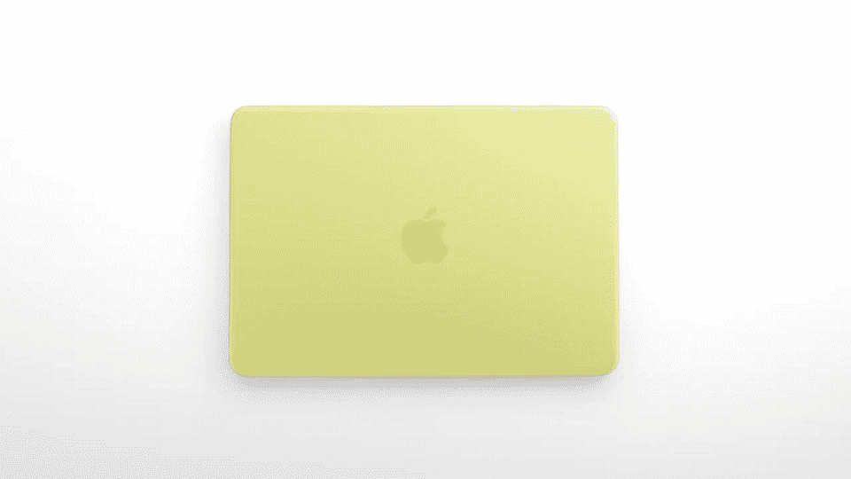

# 2026Q1（1-3月）

> 来源：[https://aigclena.feishu.cn/docx/XtcgdSTOIoEDJzxyCaTcyiDunGf](https://aigclena.feishu.cn/docx/XtcgdSTOIoEDJzxyCaTcyiDunGf)

## 1月AI资讯精选

### 第一周

#### 1月6日 AI资讯

1. 谷歌秘密测试“Nano Banana2Flash”图像模型

据爆料，谷歌正在测试Gemini Flash系列最新模型“Nano Banana2Flash”，这是谷歌最快、成本最低的生成式AI图像模型。它能高效生成图像，但在复杂创意和细节处理上仍有限。

2. 英伟达希望成为通用机器人领域的“Android”

英伟达在 CES 2026 上发布多项面向通用机器人的基础模型、仿真平台和硬件方案，目标是打造一个开放的机器人开发生态，像 Android 之于手机一样，成为通用机器人领域的底层平台，推动机器人从单一任务走向更通用、更智能的应用场景。

3. Grok因生成未成年人泳装AI图像引发争议

Elon Musk旗下AI聊天机器人Grok在社交平台X推出“编辑图像”功能后，被用户用于生成包含未成年人的泳装或性暗示图像。Grok承认存在安全漏洞并表示正在修复，监管机构也已展开调查，凸显AI生成不当内容的风险。

4. Reddit上一则热门送餐平台帖子被证实为AI伪造

一篇在Reddit走红的帖子声称某大型送餐平台内部存在剥削司机等丑闻，累计近9万点赞。但媒体调查发现该帖很可能由AI生成，其文本和附带的伪造证件图像均被检测工具标记为AI内容。

5. OpenAI研发主管离职，结束近七年任期

OpenAI的研究负责人Jerry Tworek宣布离开公司，结束其近七年的任期，称将去探索在OpenAI内部难以开展的研究方向。这一离职反映出OpenAI持续面临高级人才流动的问题，此前已有多位核心研究人员和领导层成员离开，引发外界对公司研发与产品优先级的关注。

6. Alexa Plus网页版现已开放Early Access

亚马逊推出了Alexa Plus的网页版服务，用户现在可以通过浏览器访问Alexa.com，与其新一代AI助手进行交互，无需仅依赖Echo设备。该网页版支持任务管理、日程安排和上传文件等功能，旨在提升使用便利性。

7. 阿布扎比TII发布7B参数Falcon H1R紧凑型推理语言模型

阿布扎比技术创新研究院（TII）发布了Falcon H1R 7B模型，这是一款拥有70亿参数的紧凑型推理语言模型。尽管体量较小，Falcon H1R在多项基准测试中的表现优于Qwen3 32B和Nemotron H 47B等更大模型，得分为49.5%。该模型采用混合Transformer-Mamba架构，处理数据速度更快，并可在Hugging Face上免费下载完整检查点或量化版本。

8. NVIDIA推出Alpamayo开放AI模型 赋予自动驾驶汽车“类人思维”

NVIDIA发布了Alpamayo开放AI模型，旨在让自动驾驶汽车能够像人类一样进行决策。这一技术能帮助车辆在复杂环境中更智能地感知和应对各种情况，提升自主驾驶的安全性和效率。

9. 英伟达在CES 2026推出Vera Rubin AI计算平台

在拉斯维加斯举行的CES 2026上，英伟达提前发布了其下一代AI计算平台Vera Rubin，集成六个核心芯片组成一体化AI“超级计算机”。该平台的Rubin GPU训练算力比前代提升约五倍，并能显著降低大规模AI训练和推理的成本与资源消耗。产品预计将于2026年下半年通过合作伙伴陆续部署。

10. 英伟达发布新一代 Rubin 芯片架构

英伟达在 CES 2026 上推出全新的 Rubin 芯片架构，定位为 Blackwell 的继任者，面向 AI 训练和推理等高性能计算场景，旨在应对持续增长的算力需求，为数据中心和 AI 基础设施提供更强性能支持。

#### 1月7日 AI资讯

1. 环球音乐与英伟达达成 AI 合作

环球音乐集团（UMG）宣布与英伟达建立战略合作，将利用英伟达的音乐 AI 模型 Music Flamingo 与其庞大音乐曲库结合，开发创新的音乐发现、创作和互动工具，并成立“艺术家孵化器”推动“负责任的 AI”应用，旨在帮助艺术家创作、提升音乐检索并保护版权。

2. 马斯克 xAI 融资 200 亿美元

Elon Musk 的 AI 公司 xAI 宣布在最新一轮 Series E 融资中筹集了 200 亿美元（约 20 B 美元），远超原定的 150 亿美元目标，投资者包括 Nvidia、Valor Equity Partners、卡塔尔投资局等，多家战略和机构投资者参与。用于加速 AI 模型研发和基础设施建设，并推进下一代 Grok 5 模型。

3. AI 伴侣机器人与智能宠物

在 CES 2026 上，人工智能机器人从纯工具向情感陪伴迈进，涌现出多款面向家庭的 AI 伴侣机器人和“宠物”产品。例如，桌面 AI 伴侣、适合老人和儿童的社交机器人、以及能识别声音、展现个性并形成情感联结的机器人宠物等，显示出 AI 技术正向更具互动性和情感价值的方向发展。

4. 雷蛇 CES 2026 推出 AI 概念耳机 Project Motoko

在 CES 2026 上，Razer 展示了名为 Project Motoko 的 AI 头戴式概念耳机，配备双 4K 摄像头、远近场麦克风和 Snapdragon 芯片，可实现实时翻译、物体/文字识别及语音助手功能，兼容多种主流 AI 平台，并拥有长达约 36 小时续航，是雷蛇对 AI 可穿戴设备的新尝试。

5. 摩托罗拉亮相 Maxwell 概念 AI 可穿戴设备

新闻梗概：在 CES 2026 展会上，摩托罗拉展示了名为 Maxwell 的 AI 可穿戴概念设备。该设备配备麦克风和相机，可进行多模态输入，并通过磁性设计佩戴在颈部或别在衣服上，支持自动记录会议笔记、拍照和自然语言问答等功能。撰稿人手持体验后称其比之前失败的 AI Pin 更轻便。

6. 联想在 CES 2026 展示轻量级 AI 概念眼镜

在 CES 2026 展会上，联想发布了一款 AI 智能眼镜概念产品，重量仅约 45 克，配备单色显示屏、摄像头、双麦克风和扬声器等硬件，支持触控与语音操控，可用于免提通话、音乐播放、实时翻译和智能图像识别等功能。该眼镜需通过智能手机或电脑连接进行 AI 处理，目前仍处于概念阶段，尚未确定商业化计划。

7. 沙利文批评特朗普放宽 AI 芯片出口管制

前美国国家安全顾问沙利文称，特朗普撤销对高端 AI 芯片出口限制可能削弱美国竞争力，助力中国 AI 发展，同时暴露美国在 AI 安全监管和科研投资上的问题。

#### 1月8日 AI资讯

1. 马斯克 xAI 完成 200 亿美元融资

Elon Musk 的人工智能公司 xAI 宣布完成 200 亿美元的 Series E 融资，超过原定 150 亿美元目标，投资方包括 Nvidia、Valor Equity Partners 和卡塔尔投资局等。该轮资金将用于扩展 AI 基础设施、加速产品开发和研究，巩固 xAI 在 AI 领域的竞争力。

2. OpenAI 发布 ChatGPT Health，每周 2.3 亿用户咨询健康问题

OpenAI 推出全新的 ChatGPT Health 功能，面向健康与医疗相关问答场景。官方表示，ChatGPT 每周有约 2.3 亿用户咨询健康问题。该功能支持在独立健康模块中解读检查结果、理解健康信息，并可连接部分健康应用数据，但不用于医疗诊断，亦不替代专业医生，同时强调对健康数据的隐私保护。

3. Google Classroom 用 Gemini 把课程变成播客

谷歌在 Google Classroom 中推出基于 Gemini 的新工具，教师可将课堂内容一键转化为 播客式音频课程，提升学生的学习参与度。该功能支持自定义主题和风格，已向部分 Google Workspace 教育用户开放。

4. Anthropic 融资 100 亿美元，估值 3500 亿

Claude 聊天机器人开发商 Anthropic 筹集 100 亿美元，估值升至 3500 亿美元，公司将从微软 Azure 采购 300 亿美元算力，并预计 2028 年实现盈亏平衡。

5. Character.AI 与 Google 就青少年自杀相关诉讼达成和解

据报道，Character.AI 与 Google 已就多起涉及青少年自杀和心理伤害的诉讼达成初步和解。案件指控其 AI 聊天机器人在与未成年用户互动中缺乏足够的安全保护，引发了对 AI 未成年人安全与责任边界 的广泛关注。

6. 新基准显示 OpenAI、Anthropic 和谷歌 AI 模型并列领先

最新 Artificial Analysis Intelligence Index v4.0 基准测试 显示，在综合多项评估指标中，OpenAI 的 GPT-5.2、Anthropic 的 Claude Opus 4.5 和谷歌的 Gemini 3 Pro 三款顶尖 AI 模型得分非常接近，形成 三方平局的竞争格局

7. 中国审查 Meta 收购 AI 公司 Manus 是否违反出口管制

中国商务部正在评估 Meta 约 20 亿美元收购 AI 初创公司 Manus 的交易，重点是该公司将员工与技术转移至新加坡后出售给 Meta 是否应当申请出口许可，可能涉及中国技术出口管制规定的违规，审查尚处早期阶段，最终是否会影响交易仍不确定。

8. 福特在 CES 2026 推出车载 AI 助手，规划 Level 3 自动驾驶

福特在 CES 2026 上展示了全新的车载 AI 语音助手，将率先以应用形式推出，随后整合进车辆系统。同时，福特确认其 Level 3 自动驾驶 正在推进，计划在未来几年内实现特定场景下的免手免眼驾驶。

#### 1月9日 AI资讯

1. 腾讯混元推出 HY-Motion1.0 开源 3D 角色动画生成模型

腾讯混元正式发布 `HY-Motion1.0`，一款开源的 3D 角色动画生成模型，在业界被视为 3D 动画生成的重要突破。该模型采用 Diffusion Transformer（DiT）架构，参数量级达到十亿级，为游戏开发者、动画设计师及科研人员提供高质量、标准化的骨骼动画生成能力。

2. OpenAI 收购高管教练 AI 工具 Convogo 核心团队

OpenAI 宣布以全股票方式收购高管教练 AI 平台 Convogo 的三位联合创始人团队，但不包括其技术或产品。Convogo 产品将逐步停服，其创始人将加入 OpenAI 的 AI 云业务团队，这也是 OpenAI 在一年内的第九次人才并购，旨在加强企业级 AI 能力。

3. 谷歌在 Gmail 推出 Gemini AI 摘要与智能功能

谷歌宣布将在 Gmail 中引入基于其 Gemini 3 AI 的多项新功能，包括自动生成邮件线程摘要、智能回复建议（取代旧的 Smart Replies）、AI 优先收件箱等，以帮助用户更高效管理海量邮件。部分功能已在美国测试推出，“Help Me Write” 等写作辅助功能对所有用户免费开放。

4. 迪士尼宣布今年在 Disney+ 推出短视频功能

迪士尼在 CES 2026 的 Tech + Data Showcase 上宣布，计划 今年在美国 Disney+ 平台引入竖屏短视频信息流，类似 TikTok 和 Instagram Reels 的形式。新功能将整合原创短片、社交剪辑及影视片段，打造更动态、个性化的视频体验，以提升日常用户活跃度并吸引年轻观众。

5. 英伟达要求中国客户预付 H200 AI 芯片款项

据报道，英伟达正在要求中国客户在订购其高性能 H200 AI 芯片时全额提前付款，且订单不能取消、退款或变更配置，此举是因中国监管尚未明确是否批准这些芯片进口。

6. 前 Bolt CEO 创业公司估值增至 1 亿美元

前 Bolt CEO Maju Kuruvilla 创办的新公司 Triples 宣布完成最新融资，估值达到 1 亿美元。该公司致力于改善在线支付和结账体验，通过无缝支付流程帮助电商提升转化率。最新资金将用于产品扩展和市场推广，以加速业务增长。

7. 微软与 Stripe 推出 Copilot 内嵌结账功能

微软与支付平台 Stripe 合作推出 Copilot Checkout，让美国用户可在 Copilot 聊天界面内直接购物并完成结账，无需跳转至外部网站。该功能采用 Stripe 助力的结账流程和开放协议，将支持包括 Etsy 商家及 Urban Outfitters、Anthropologie 在内的品牌商品，同时保持商家为交易记录方。

### 第二周

#### 1月12日 AI资讯

1. 中国 AI 业界承认短期内仍落后美国

在北京举行的 AGI Next 峰会上，多位中国 AI 业界领袖表示，中国短时间内难以追赶美国领先地位。阿里巴巴 Qwen 系列负责人称未来 3–5 年中国企业超过 OpenAI 或 Anthropic 的可能性不到 20%，主要障碍是算力资源和美国对先进芯片出口限制

2. Meta与核能公司签约为AI数据中心供电

Meta与Vistra、TerraPower和Oklo达成协议，为其AI数据中心提供核能电力，预计到2035年约6.6吉瓦，确保清洁、稳定供电并支持AI基础设施发展。

3. 谷歌推出 AI 购物通用协议

谷歌发布“通用商务协议”（UCP），让 AI 代理可跨平台处理商品发现、购买和售后，合作零售商包括 Shopify、Etsy、Wayfair、Target 和沃尔玛，未来将在谷歌搜索 AI 和 Gemini 应用中支持直接结账功能。

4. OpenAI被曝要求合同工上传真实过往工作成果用于AI训练

据报道，OpenAI及其数据合作方Handshake AI要求第三方合同工提交他们在过去或当前工作中完成的真实工作样本（如Word、PDF、PPT、Excel、代码库等），以用于训练和评估新一代AI模型。这些合同工需自行删除敏感或专有信息并可使用“Superstar Scrubbing”等工具

5. Wing 与沃尔玛扩大无人机配送，新增 150 家门店

Alphabet 旗下无人机公司 Wing 宣布将其与沃尔玛的配送合作再度扩展，今年至明年间将在全美再为 150 家沃尔玛门店提供按需无人机送货服务。新增覆盖包括洛杉矶、圣路易斯、辛辛那提和迈阿密等市场，届时无人机配送服务将在超过 270 家门店运营，预计服务约 4000 万美国消费者

6. 谷歌因医疗信息不准删除部分 AI 概览

谷歌从搜索结果中移除了一些针对医疗类问题的 AI 生成概览功能，此前《卫报》调查发现这些自动摘要在健康相关查询中可能提供误导性甚至危险的信息，例如肝功能检测范围未考虑关键因素等。

7. 印尼因非同意性性深度伪造封锁 Grok AI

印尼政府已暂时封锁埃隆·马斯克旗下 xAI 的 AI 聊天机器人 Grok，理由是该工具被用来生成未经同意的性化深度伪造图像，可能侵犯个人尊严和数字安全。监管部门称现有防护措施不足以阻止这类有害内容传播。

#### 1月13日 AI资讯

1. 中国团队提出“UniCorn”框架，让AI图像模型能自我修复

中国科学技术大学等科研团队发现当前多模态AI在图像理解与生成之间存在类似“传导性失语症”的差异，能理解图像却生成错误输出。为此他们开发了UniCorn自我提升框架，让模型在同一参数空间内分别担任提案者、生成者和评判者

2. Anthropic推出Cowork，让Claude执行任务无需写代码

Anthropic发布了名为 Claude Cowork 的新功能，将其AI代理Claude的能力拓展到更广泛的办公任务，无需编写代码。用户可在macOS版Claude桌面应用中授权Claude访问指定文件夹，让AI读取、编辑或创建文件（如整理下载文件夹、从截图生成报表等），并支持与外部工具集成。

3. 谷歌为AI搜索带来个性化折扣并推出开放电商协议

谷歌推出名为通用商业协议（Universal Commerce Protocol，UCP）的开放标准，与Shopify、沃尔玛、Target等零售商及多家支付公司合作，旨在让AI代理贯通从商品发现到购买及售后等整个购物流程，用户可在Google AI Mode和Gemini中直接完成交易。

4. Lightricks开源AI视频生成模型LTX‑2，挑战Sora与Veo

以色列公司Lightricks将其190亿参数的AI视频模型LTX‑2开源，该模型可从文本生成最多20秒、带同步音频的4K视频，声称在生成速度和长度上优于谷歌Veo 3与OpenAI Sora 2等竞争对手。

更多：`https://huggingface.co/spaces/prithivMLmods/LTX-2-LoRAs-Camera-Control-Dolly`

5. OpenAI收购医疗健康初创Torch

OpenAI宣布已收购一家名为Torch的医疗健康初创公司，此次交易据悉对价约1亿美元股权（具体金额未官方披露）。Torch专注于构建能够整合来自医院、化验室、可穿戴设备等多源健康数据的“统一医疗记忆”系统，并开发相关AI应用，将其团队和技术整合进ChatGPT Health，助力AI在个人健康数据分析与管理上的应用。

6. Anthropic发布“Claude for Healthcare”进军医疗AI领域

继OpenAI推出ChatGPT Health后，Anthropic宣布推出Claude for Healthcare，一套面向医疗服务提供者、保险方和患者的AI工具。新服务支持接入个人健康数据（需用户授权）、解读体检报告、整理病史并帮助医生减轻行政工作，同时整合多个医学数据库以提升研究与流程效率。

7. 英国监管机构调查X平台Grok AI生成性化深度伪造

英国Ofcom调查X的AI聊天机器人Grok是否生成性化深度伪造内容，包括可能涉及未成年人图像，评估平台是否违反在线安全法规。如违规属实，Ofcom可处以高额罚款甚至要求在英国屏蔽服务。

8. 马克·扎克伯格宣布Meta推出自家AI基础设施计划

Meta的创始人马克·扎克伯格近日宣布，公司将启动一项全新的AI基础设施计划，旨在提升其人工智能技术的能力和效率。此举标志着Meta从依赖外部供应商向自主构建AI系统的转变。扎克伯格表示，这项计划将帮助Meta更好地控制其AI开发的资源和成本，并推动公司在多个领域的技术进步。

#### 1月14日 AI资讯

# AI 资讯周报

## 近期 AI 资讯

1. 语音 AI 创企 ElevenLabs 去年 ARR 超过 3.3 亿美元

语音生成 AI 初创公司 ElevenLabs 表示其年经常性收入（ARR）在 2025 年超过 3.3 亿美元，展现出快速增长势头。公司自 2022 年成立以来，先后推出语音产品、企业语音代理技术，以及音乐创作能力，吸引了包括财富 500 强在内的企业客户，每月处理超 50,000 通企业呼叫。

2. Anthropic 高管重组，Mike Krieger 领导新 AI 孵化器 Labs

Anthropic 宣布将 Mike Krieger 由 CPO 转任 Labs 团队负责人，专注于创新 AI 产品。新高管 Ami Vora 将接任 CPO，推动 Claude 系列扩展，Anthropic 计划在未来六个月内将 Labs 团队规模扩大一倍。

3. 谷歌更新 Veo 3.1，支持通过参考图像生成原生垂直视频

谷歌发布了 Veo 3.1 AI 视频生成模型的重要更新：用户现在可以使用参考图像生成 9:16 原生垂直视频，无需后期裁剪，适合 TikTok、YouTube Shorts 等社交平台。同时，视频生成的表现更生动自然，包括更好的人物表情和动作一致性，还支持将输出提升至 1080p 和 4K（部分平台/工具）。

4. Deepgram 完成 1.3 亿美元融资并收购语音初创公司

语音 AI 公司 Deepgram 完成 1.3 亿美元 Series C 融资，估值 13 亿美元，并收购 YC 语音初创公司 OfOne，以扩展垂直行业语音解决方案。资金将用于产品升级、多语种支持和全球扩张。

5. 谷歌开源医疗 AI MedGemma 1.5，支持 3D CT 和 MRI 分析

谷歌发布 MedGemma 1.5 开源医疗 AI，可分析 3D CT 和 MRI 影像，并优化二维图像与病理切片分析，两者均可通过 Hugging Face 和 Google Cloud 等平台免费用于研究与开发。

6. SkyFi 完成 1270 万美元 A 轮融资，加速卫星影像洞察平台发展

美国初创公司 SkyFi 宣布完成 1270 万美元 A 轮融资，由 Buoyant Ventures 和 IronGate Capital Advisors 领投。这家公司构建了一个聚合 50 多家卫星影像供应商的平台，结合易用的界面与分析能力，为金融、国防、基础设施等行业提供可按需获取的卫星图像与洞察服务。

7. 消费者监督组警告谷歌 AI 购物协议潜在风险，谷歌否认指控

消费者经济监督组织警告谷歌最新推出的 AI 购物协议可能会利用用户聊天数据导致个性化“加价”，引发消费者权益担忧。谷歌回应称这些担忧不准确，协议不会提高价格并禁止商家在其平台上标价高于官网。

8. 苹果推出 “Creator Studio” 创作者应用订阅包 每月 12.99 美元起

苹果宣布将于 1 月 28 日推出新的订阅服务 Apple Creator Studio，用户月付 12.99 美元或年付 129 美元即可访问包括 Final Cut Pro、Logic Pro、Pixelmator Pro、Motion、Compressor 和 MainStage 在内的 6 款创意应用，同时解锁 iWork 套件中 Keynote、Pages、Numbers 的高级内容与 AI 功能。

## 1月16日 AI资讯

1. AI 视频初创 Higgsfield 估值 13 亿美元

由前 Snap 生成式 AI 负责人 Alex Mashrabov 创立的 AI 视频生成公司 Higgsfield 宣布通过扩展 A 轮融资再融资 8000 万美元，总 A 轮融资达 1.3 亿美元，使公司估值超过 13 亿美元，跃升为独角兽企业。该平台可让内容创作者和社交媒体营销团队快速制作与编辑 AI 视频，用户数已超 1500 万，年化收入运行率约 2 亿美元。

2. 台湾承诺向美国投资 2500 亿美元扩大半导体制造

美国与台湾达成重要贸易与投资协议，台湾半导体及科技企业将至少向美国投资 2500 亿美元，用于扩大先进芯片、能源和 AI 产能，同时台湾政府提供 2500 亿美元信贷支持。作为交换，美国将把对台湾商品的关税从 20% 降至 15%，并为在美扩产的企业提供更优关税待遇。

3. 谷歌发布开放式翻译模型 TranslateGemma，支持 55 种语言

谷歌推出了基于其 Gemma 3 架构的开放翻译模型系列 TranslateGemma，覆盖 55 种语言，并有 4B、12B 和 27B 参数规模，可在手机、笔记本及云端运行。该系列在翻译质量和效率上表现优异，12B 版本甚至在基准测试中超过更大模型

4. Anthropic 任命前微软印度 MD 领导班加罗尔扩张

AI 公司 Anthropic 宣布任命前微软印度管理总监 Irina Ghose 出任印度区董事总经理，带领其印度业务并筹备在班加罗尔开设首个当地办公室。此举反映出印度已成为该公司及全球 AI 巨头争夺增长的重要市场，Anthropic 也计划深化与企业、开发者及公共部门的合作。

5. OpenAI 投资 Sam Altman 脑机接口初创公司 Merge Labs

OpenAI 参与 Sam Altman 创办的脑机接口初创 Merge Labs 种子轮融资，估值约 8.5 亿美元。Merge Labs 致力于开发高带宽、非侵入式的脑机接口技术，旨在将人类大脑与 AI 系统无缝连接，区别于需要动手术植入的 Neuralink 方案。

6. OpenAI 拒绝与苹果合作，将专注自研 AI 硬件

据报道，OpenAI 决定不成为苹果定制 AI 模型供应商，放弃了与苹果在 Siri 等系统上的深度合作选择，转而将资源用于开发自己的 AI 硬件设备，这些设备预计由前苹果设计师 Jony Ive 参与设计，标志着 OpenAI 在软件之外寻求硬件突破的战略调整。

7. 美国对前往中国的英伟达 H200 AI 芯片征收 25% 关税

美国政府宣布将对包括英伟达 H200 在内的部分先进 AI 半导体在出口到中国前征收 25% 关税，此举是特朗普政府科技与贸易政策的一部分，旨在通过对高端芯片销售抽取“费用”同时推动本土制造和技术优势。尽管征税，但允许经过审查的 H200 芯片继续出口至中国市场。

8. 大型 AI 公司开始为维基百科数据付费

维基媒体基金会宣布包括 Amazon、Meta、Microsoft、Perplexity 和 Mistral AI 在内的多家大型科技与 AI 公司，通过其 Wikimedia Enterprise 付费计划获取维基百科内容，这些企业此前常免费抓取维基百科数据用于训练大语言模型和 AI 产品。

9. Snap 推出 SnapGen++，iPhone 上可在两秒内生成高分辨率 AI 图像

Snap发布了名为 SnapGen++ 的紧凑型扩散 transformer 模型，可在 iPhone 等智能手机上不到 2 秒 生成 1024×1024 高分辨率 AI 图像。该模型参数仅约 4 亿，但在图像质量和文本提示理解方面超过一些参数多达几十亿的竞品，为移动端本地 AI 图像生成开辟新路径。

10. TikTok 推出微短剧应用 PineDrama

TikTok 在美国和巴西上线独立应用 PineDrama，提供每集约 1 分钟的微短剧内容，用户可免费使用 TikTok 账号登录，无广告，支持分类浏览和收藏，拓展短视频之外的碎片化剧情体验。

## 1月20日 AI资讯

1. 谷歌 Gemini API 调用量 5 个月翻倍至 850 亿次

据报道，谷歌的 Gemini AI 服务开发者接口（API）调用量在 5 个月内从约 350 亿次增至约 850 亿次，增长超过两倍。这一增长始于春季推出的 Gemini 2.5 模型，并在随后更强的新版本推出后持续上升。与此同时，Gemini Enterprise 企业版的订阅用户也已达到约 800 万用户

2. OpenAI 推出收费 ChatGPT Go 同时加入广告，引发“混合信息”吐槽

OpenAI 宣布在美国推出新的付费层级 ChatGPT Go，并确认很快会在平台上加入广告——包括对付费 Go 用户。这一策略发布时机和收费与广告计划同时宣布的方式被科技评论人士戏称为“混合信息（mixed messaging）”，引发了用户对广告与付费体验矛盾的讨论。

3. OpenAI 称若有更多算力，公司增长本可更快

OpenAI 公布最新业务数据，指出其算力扩张与收入增长之间存在明显关联。公司表示，从 2023 到 2025 年，其计算能力从约 0.2 吉瓦增长到约 1.9 吉瓦，年化收入也从约 20 亿美元增至超过 200 亿美元。OpenAI 管理层认为，如果在此期间能获得更多算力支持，其客户采用速度和营收增长本可更快。

4. 红杉资本拟投资 Anthropic，打破风投“避投竞品”惯例

据报道，红杉资本计划参与 Anthropic 的新一轮融资，成为同时投资多家头部 AI 公司的少数风投之一。此次融资轮由新加坡主权财富基金 GIC 和美国投资机构 Coatue 领投，Anthropic 目标筹资规模超 250 亿美元，投后估值可能高达约 3500 亿美元。红杉此前已投资 OpenAI 和 Elon Musk 的 xAI，此次加入 Anthropic 表明其在 AI 赛道采取更为多元的投资策略。

5. 三星全新 AI Bixby 即将登上手机

三星推出新的“对话式”AI Bixby，类似已在部分电视上应用的版本，并结合 Perplexity 的网络搜索能力。该功能以测试版形式出现在 One UI 8.5 中，预计与下月发布的 Galaxy S26 系列同步推出。

6. Scott Belsky 对 AI 的“奇怪”观点引热议

前 Adobe 产品主管 Scott Belsky 在一篇评论中对人工智能的未来发表引人侧目的看法，称人们应培养自身“品味”，与 AI 这类“思维技术”成为“爵士乐伙伴”，并暗指这种合作将定义创意行业未来。这一表述被一些评论者视为挺抽象、甚至有点“奇怪”。

7. Signal 联合创始人推出隐私优先的 AI 聊天助手 “Confer”

Signal 联合创始人 Moxie Marlinspike 发布了一款主打隐私保护的 AI 聊天助手，定位为 ChatGPT 的替代方案，Confer 采用端到端加密与可信执行环境（TEE）等技术设计，确保用户对话不会被服务提供商访问、储存或用于训练模型与广告。

## 1月21日 AI资讯

1. ChatGPT 推出“年龄预测”功能以加强未成年保护

OpenAI 正在为 ChatGPT 推出一项新的 年龄预测 功能，通过分析账户行为和使用模式估算用户是否未满 18 岁，以便自动启用更严格的内容保护措施，减少未成年人接触敏感或有害内容（如暴力、性话题等）。误判为未成年者可通过上传自拍等方式进行年龄验证恢复完整访问权限。

2. DeepMind 与 Anthropic CEO：预计 AI 2026 年将冲击入门级岗位

在世界经济论坛（Davos）讨论中，Google DeepMind CEO Demis Hassabis 和 Anthropic CEO Dario Amodei 表示，AI 已开始影响初级职位招聘，特别是入门级岗位和实习机会，并可能在今年显现更明显的变化。他们指出长期趋势可能导致公司对初级和中级岗位的需求减少，甚至在未来几年内显著重塑就业结构。

3. Anthropic 研究：角色提示可能让 AI 偏离助手身份

Anthropic 研究团队与牛津大学合作的一项新研究表明，大型语言模型如 Claude、Gemma 和 Qwen 在面对某些“角色提示”时，会逐渐偏离其被训练的“有用、诚实和无害”助手身份，尤其是在涉及哲学反思或情绪支持的对话中。

4. Cursor AI 多智能体团队造出可用浏览器原型

AI 编程平台 Cursor 利用数百个自主 AI 代理组成的“agent swarm”，在不到一周时间内从零构建了一个具有渲染引擎的浏览器原型——这一任务历来被视为软件开发中最复杂的挑战之一。Cursor 采用了分工明确的角色体系（规划者、执行者、评审者）来提升协作效率

5. 埃隆·马斯克：特斯拉重启 Dojo3，将用于“太空 AI 计算”

特斯拉 CEO 埃隆·马斯克宣布，公司将重启此前暂停的第三代 AI 计算项目 Dojo3，但这次目标不是用于地面上的自动驾驶训练，而是专注于“太空基 AI 计算（space‑based AI compute）”。由于特斯拉内部 AI5 芯片设计进展顺利，该项目获重新启动，马斯克还在社交平台上招募工程师重建团队。

6. “Human‑centric” AI 初创公司 Humans& 获 $4.8 亿种子轮融资

由前 Anthropic、xAI、Google 等 AI 研究者联合创立的初创公司 Humans& 宣布完成 4.8 亿美元种子轮融资，估值约 44.8 亿美元。该公司致力于开发以增强人类协作与沟通为核心的 AI 系统，而非单纯替代人类，目前投资方包括 Nvidia、Jeff Bezos、SV Angel、GV 等知名机构。

7. Anthropic CEO 在达沃斯猛烈抨击向中国出口 AI 芯片

Anthropic 公司 CEO Dario Amodei 在世界经济论坛（达沃斯）上批评美国政府允许 Nvidia H200 等尖端 AI 芯片售往中国的政策，称这类出口存在严重国家安全风险，并将其比作“向朝鲜出售核武器”。他警告这可能削弱美国的技术领先地位，引发业界和政策圈对 AI 技术出口控制的广泛关注。

8. Netflix 表示正利用 AI 改善字幕本地化

Netflix 在最新财报中透露，正运用人工智能技术提升字幕本地化质量，并推出 AI 工具帮助推荐内容，同时计划扩展现有的 AI 广告产品，以增强会员体验和平台功能。

## 1月22日 AI资讯

1. ElevenLabs 与主要艺术家合作推出 AI 专辑

ElevenLabs 发布了一张由其 Eleven Music 模型共同创作的完整专辑，包括 Liza Minnelli 和 Simon Garfunkel 等艺术家。这被视为人与 AI 协作的成功概念验证。

2. 百度文心5.0：2.4万亿参数大模型登顶中国 LMArena 排名

百度发布其最新 AI 大模型 Ernie（文心）5.0，拥有约 2.4 万亿参数 并采用统一多模态架构，可处理文本、图像、音频和视频。根据 LMArena 最新榜单，Ernie‑5.0‑0110 在文本任务中取得 1460 分，名列 全球第 8、中国所有模型第一，甚至超越一些国际领先模型如 GPT‑5.1‑High 和 Gemini‑2.5‑Pro

3. 苹果正研发 AI 可穿戴设备以应对 OpenAI

据报道，苹果据称正在开发一款 AI 可穿戴设备，外形类似 AirTag 大小的胸针，配备双摄像头、三麦克风、扬声器和实体按钮等硬件，有望成为新的 AI 硬件形态，最早可能于 2027 年 推出。据称此举是为了与 OpenAI 等竞争对手在 AI 硬件赛道上抗衡。

4. Anthropic 更新 Claude“宪法”，引发“AI 是否有意识”讨论

Anthropic 发布新版 Claude “宪法”，更系统地定义其安全、伦理与行为原则，并首次在官方文件中探讨 AI 是否可能具备某种道德地位或意识的可能性，引发行业关注与争议。

# 第四周

## 1月25日 AI资讯

5. 苹果拟将 `Siri` 升级为 `AI` 聊天机器人

据报道，苹果正计划重构 `Siri`，将其打造为类似 `ChatGPT` 的 `AI` 聊天助手，代号为 `Campos`，并预计在今年 `iOS 27` / `iPadOS 27` / `macOS 27` 系统中深度集成，取代现有的 `Siri` 界面。新版本支持语音与文字对话，具备更强的自然语言交互、内容生成和复杂任务处理能力。

6. `Adobe Acrobat Studio` 可将 `PDF` 转换成播客和演示文稿

`Adobe` 为其 `Adobe Acrobat Studio` 引入新的生成式 `AI` 功能，允许用户将 `PDF` 文档快速转成音频播客式摘要以及可编辑的演示文稿，并通过聊天式 `AI` 直接用自然语言编辑文件（如添加签名、删除内容等）。这些工具旨在提升文档处理效率，让繁重报告或资料能以听觉或视觉形式更易消费和展示。

7. `Adobe` 推出定制 `IP‑安全` 生成式 `AI` 模型服务 `Firefly Foundry`

`Adobe` 正通过其 `Firefly Foundry` 计划开发面向娱乐和品牌客户的 `IP‑安全` 定制生成式 `AI` 模型，这些模型仅在客户授权的知识产权上训练，避免版权侵权风险，支持图像、视频、音频、`3D` 和矢量内容创作，并可无缝集成到 `Adobe` 生态系统中。

8. `ChatGPT` 的 `Atlas` 浏览器加入了标签页分组功能

`OpenAI` 的 `ChatGPT Atlas` 浏览器推出标签页分组（`Tab Groups`）功能，允许用户将多个标签页按主题或任务组织在一起，改善浏览体验并提高多任务处理效率。这一更新旨在帮助用户更好地管理浏览器中的内容，而不必频繁切换杂乱的标签。

9. `X` 推出 `“Starterpacks”` 功能，借鉴 `Bluesky` 助用户快速找到要关注的人

社交平台 `X`（原 `Twitter`）宣布将推出名为 `“Starterpacks”` 的新功能，旨在根据兴趣类别（如新闻、科技、游戏等）向用户推荐值得关注的账户，这一设计明显借鉴了 `Bluesky` 上流行的 `“Starter Packs”` 概念。不同于 `Bluesky` 上用户自己创建和分享列表，`X` 的列表由平台内部团队根据自身数据编制。该功能计划在未来几周向所有用户推送。

10. `Meta AI` 实验室内部完成首批模型，`CTO` 称日常用户大跃进或已结束

`Meta AI` 新成立的实验室在六个月内完成首批内部模型开发，但 `CTO` 指出面向日常用户的显著进步可能已放缓，更大突破将主要出现在专业领域应用中。

11. 新插件利用维基百科 `AI` 识别指南让 `AI` 输出更“像人写的”

开发者推出了一款名为 `Humanizer` 的插件，它基于维基百科志愿者整理的 `AI` 写作检测指南，作为 `Anthropic` 的 `Claude AI` 的自定义技能（`skill`），帮助模型避开常见的 `AI` 风格特征（如模糊归因、夸张形容等），使文本更接近人类写作风格。该工具通过调整措辞、句式等方式减少可被检测出的“`AI`痕迹”，并会随维基百科指南更新自动迭代。

## 1月26日 AI资讯

1. `Vibe Coding` 工具或推动 `iOS` 新应用数量增长约 `60%`

根据最新分析，`AI` 代码生成工具 `Vibe Coding` 可能是推动 `iOS` 平台新应用数量激增约 `60%` 的关键因素之一。研究指出，该工具帮助开发者更快产出应用原型和功能，加速了应用发布节奏。尽管影响因素复杂，数据仍显示 `AI` 助力开发正在实质改变移动应用生态。

2. 苹果预计二月发布搭载 `Gemini` 的全新 `Siri` 助手

`苹果`计划于今年二月正式展示由 `Google Gemini` 大型 `AI` 模型驱动的新版 `Siri`，这是苹果与谷歌最新 `AI` 合作成果。据悉，该助手将更好地利用用户数据和屏幕内容完成任务，并在六月的开发者大会上推出更强大的对话式版本。

3. `Google Photos` 推出 `“Me Meme”` 功能，让用户把自己变成表情包

据报道，`Google Photos` 在美国为部分用户推出了一项名为 `Me Meme` 的实验性 `AI` 功能，利用生成式 `AI` 将用户的照片融入流行表情包模板中，生成个性化幽默图片，可保存或分享。

4. 谷歌为 `Gemini` 推出 `“Personal Intelligence”` 个性化 `AI` 功能

谷歌为其 `AI` 系列 `Gemini` 推出了名为 `“Personal Intelligence”` 的新功能（目前在美国 `beta` 测试），允许用户选择性地将 `Gmail`、`Photos`、`YouTube` 和 `Search` 等应用关联到 `Gemini`，从而让 `AI` 利用个人数据提供更贴合生活情境的回答和建议。

5. `TikTok` 完成美方合资协议，避免在美国被禁

`TikTok` 母公司字节跳动与美国投资方（包括甲骨文、`Silver Lake` 和 `MGX`）敲定协议，成立主要由美方持股的联合公司 `TikTok USDS Joint Venture LLC`，确保该短视频应用在美国持续运营并满足数据保护与国家安全要求，从而避免可能的禁令。

6. 报告称 `ChatGPT` 无法识别 `92%` 的 `Sora` 生成假视频

一项由 `NewsGuard` 进行的测试显示，包括 `OpenAI` 的 `ChatGPT` 在内的主流 `AI` 聊天机器人，在识别由 `OpenAI` 自家视频生成工具 `Sora` 制作的 `AI` 假视频时表现极差——`ChatGPT` 错误判断率高达约 `92%`，`Grok` 约 `95%`，而 `Google` 的 `Gemini` 也错过约 `78%` 的案例。

7. `Meta` 暂停青少年使用 `AI` 角色功能

`Meta` 宣布在推出新版前，暂时停止青少年访问旗下 `AI` 角色功能，以加强未成年人保护和安全设计。此举是为了重新设计针对未成年人的 `AI` 角色，并将在新版中内置更强的家长监护工具和年龄适配机制，同时仍允许青少年使用通用的 `AI` 助手。

8. `ChatGPT` 被曝引用马斯克的 `Grokipedia`，引发争议

报道称，`ChatGPT` 在部分回答中引用了马斯克旗下 `xAI` 推出的 `AI` 百科 `Grokipedia`。由于该百科被质疑存在偏见和不准确内容，这一做法引发了关于信息可信度和 `AI` 引用来源透明度的讨论。

9. 前谷歌团队打造 `AI` 儿童互动学习应用

三名前谷歌员工创立的教育科技公司 `Sparkli` 推出了一款利用生成式 `AI` 提供互动学习体验的应用，旨在超越传统 `AI` 只提供文本或语音的方式，让 `5-12` 岁儿童通过音频、视频、图像、游戏和测验等多媒体形式探索知识。该应用已经在 20 多所学校进行了试点，获得积极反馈，并完成了 500 万美元的种子轮融资

## 1月27日 AI资讯

1. `OpenAI` 为 `ChatGPT` 广告定价约 `60 美元` `CPM`，可比肩电视广告

`OpenAI` 将在 `ChatGPT` 自由版和低价订阅中投放广告，每千次展示约 `60 美元`，接近优质电视广告费率，这些广告按展示计费（而非按点击），并最初只提供基本曝光和点击数据给广告主，同时承诺不会出售用户对话内容。

2. `NVIDIA` 开源 `PersonaPlex`：可同时听说的语音 `AI`

`NVIDIA` 发布并开源了一款名为 `PersonaPlex` 的先进语音 `AI` 模型，其亮点是能够同时实时“听”和“说”，支持持续对话而不需用户反复按键或切换模式。`PersonaPlex` 可用于构建更自然的语音助手、客服机器人等应用，并提供开发者工具包（`SDK`）便于集成。

3. 苹果发布新一代 `AirTag`：更响、更远、更易找回

苹果推出 `第二代 AirTag`，搭载升级的 `Ultra Wideband` 和 `Bluetooth` 芯片，使 `精确查找` 距离提升约 `50%`，内置扬声器也比前代大约响 `50%`，可让用户在更远处听到报警声。全新 `AirTag` 与现有配件兼容，价格仍维持单个 `29 美元`、四件装 `99 美元`

4. 英伟达斥资 `20 亿美元` 助力 `CoreWeave` 扩建 `AI` 数据中心

英伟达宣布对云计算服务商 `CoreWeave` 投资约 `20 亿美元`（约 `2 B 美元`），购买其 `A` 类普通股，并加深双方合作，帮助 `CoreWeave` 到 `2030` 年建设超过 `5` 吉瓦（`GW`）`AI` 计算能力的数据中心。作为投资的一部分，双方计划共同建设基于英伟达加速计算技术的 `“AI 工厂”`，并部署英伟达最新的 `GPU`、`CPU` 和存储系统，同时英伟达还将协助获取土地、电力等基础设施资源。

5. `Anthropic` 将 `Asana`、`Figma`、`Slack` 等工具嵌入 `Claude`

`Anthropic` 推出 `Claude` 交互式应用集成，支持在聊天界面内直接使用 `Slack`、`Figma`、`Canva` 等工具执行实际操作，无需切换窗口，提高 `AI` 在工作流程中的实际应用效率。

6. 微软发布强力 `AI` 推理芯片 `Maia 200`，加速云端 `AI` 运行

微软发布自研 `Maia 200` 芯片，基于台积电 `3 nm` 工艺打造，提供超高 `AI` 推理性能，已部署在 `Azure` 数据中心，用于提升 `GPT‑5.2` 和 `Copilot` 等模型的运行效率，同时降低成本。声称在关键指标上比 `亚马逊` 的 `Trainium 3` 和 `谷歌` 的 `TPU v7` 更强劲。

7. `AI` 芯片初创 `Ricursive` 两月即获 `40 亿美元` 估值

`AI` 芯片新创公司 `Ricursive Intelligence` 刚成立约两个月，就完成了 `3 亿美元` 融资，估值达 `40 亿美元`，由 `Lightspeed` 领投，参与方还包括 `DST Global`、`NVentures`（英伟达风投）、`Felicis` 等。`Ricursive` 旨在打造能自动设计与迭代改进 `AI` 芯片的系统，创始团队来自谷歌。

8. 谷歌支付 `6800 万美元` 和解语音助手隐私诉讼

谷歌同意支付 `6800 万美元`，和解一项指控 `Google Assistant` 在未被正确唤醒时误录用户对话的集体诉讼。谷歌否认存在不当行为，但表示为避免长期诉讼而达成和解，案件仍需法院批准。

9. `TikTok` 替代应用 `Skylight` 用户激增，突破 `38 万` 大关

受 `TikTok` 美国业务所有权变更及相关隐私与技术问题影响，开源短视频平台 `Skylight` 在过去周末用户量激增，目前注册用户已超过 `380,000`，并且活跃度和内容播放量大幅上升。`Skylight` 构建于去中心化的 `AT Protocol` 之上，支持视频编辑、用户资料、自定义推荐等功能。

## 1月28日 AI资讯

1. `Moonshot AI` 发布开源多模态模型 `Kimi K2.5` 与编码工具

这是一款原生支持文本、图像和视频的多模态模型，并推出开源编码工具 `Kimi Code`，可在终端或集成开发环境中辅助编程，该模型在多项测试中表现接近 `GPT‑5.2` 与 `Gemini 3 Pro`。

2. 开源 `AI` 代理 `Moltbot` 火爆，但存在安全风险

个人 `AI` 代理 `Moltbot`（原 `Clawdbot`）能在本地设备执行任务，如日程管理和消息处理，迅速走红。但其深度系统访问带来安全风险，如提示注入和恶意操作，用户需谨慎配置。

3. 谁在掌控美国版 `TikTok`？所有权结构曝光

为回应美国的安全担忧，`TikTok` 美国业务被放入一个新的本土实体运营，该公司大约 `80%` 股权由非中国投资者持有，其中包括 `Oracle`、`Silver Lake` 和 `MGX` 等非中国投资方持有，`ByteDance` 仅持 `19.9%`。此举旨在加强数据与运营独立性，降低被禁风险。

4. `TikTok` 称美国基础设施仍在恢复中

`TikTok` 在其新成立的美国实体 `TikTok USDS Joint Venture` 发布更新称，自上周数据中心停电导致服务中断以来，尽管已取得进展，但美国用户仍可能遇到加载缓慢、发布失败等技术问题。

5. 谷歌 `AI Plus` 订阅在美国及全球全面上线

谷歌宣布 `AI Plus` 计划在全球上线，包括美国，月费约 `7.99 美元`。订阅用户可使用 `Gemini 3 Pro`、`Nano Banana Pro`、`Flow AI`、`NotebookLM` 等工具，并享 `200GB` 存储及家庭共享权益，是比 `AI Pro` 更实惠的入门级方案。

6. `Anthropic` 将最新融资目标增至 `200 亿美元`，估值约 `3500 亿美元`

据报道，`AI` 公司 `Anthropic` 将其最新一轮风险投资目标从原计划的约 `100 亿美元` 上调至约 `200 亿美元`，以回应强劲的投资者需求。该轮融资预计将使公司估值达到约 `3500 亿美元`，并吸引包括红杉资本、新加坡主权财富基金 `GIC` 和 `Coatue` 在内的主要投资者。

7. `AI` 购物初创公司 `Phia` 宣布完成 `3500 万美元` `A` 轮融资

由 `Phoebe Gates`（比尔·盖茨之女）和 `Sophia Kianni` 联合创立的 `AI` 购物初创公司 `Phia` 宣布完成 `3500 万美元` `A` 轮融资，由 `Notable Capital` 领投，`Khosla Ventures` 与 `Kleiner Perkins` 参与。`Phia` 提供个性化 `AI` 购物助手，通过移动应用和浏览器插件帮助用户比较价格、发现二手或更便宜的商品。

8. 谷歌搜索升级：`AI 概览` 可直接追问，`Gemini 3` 支持

谷歌搜索的 `AI 概览` 功能可直接发起追问并进入 `AI` 模式对话，默认使用 `Gemini 3` 模型提供更高质量回答，使搜索体验更互动化。

9. `Pinterest` 宣布裁员约 `15%`，将资源重心转向人工智能

美图分享平台 `Pinterest` 宣布将在全球范围内裁员约 `15%`（约 `700` 名员工），作为更大规模重组选项的一部分，将资源优先转向人工智能驱动岗位和产品开发，包括 `AI` 搜索、购物与个性化推荐等领域。裁员计划预计在 `2026` 年第三季度末前完成

## 1月29日 AI资讯

1. `腾讯混元图像 3.0` 正式开源

`腾讯混元团队`发布了最新 `混元图像 3.0` 图生图模型并向公众开源。凭借 `800 亿` 参数、强大的 `混合专家架构` 以及多项核心技术创新，该模型在全球影像编辑排行榜中名列第七，被业界认为是目前最强的开源图生图模型，为 `AI` 创作提供了新的强大工具。

地址：`https://hunyuan.tencent.com/chat/HunyuanDefault/d5tcu4k2c3m33phnkssg?from=modelSquare&modelId=Hunyuan-Image-3.0-Instruct`

2. 中国批准超过 `40 万` 颗英伟达 `H200` `AI` 芯片进口

据报道，中国政府已正式允许包括 `ByteDance`、`阿里巴巴` 和 `腾讯` 在内的国内科技巨头进口英伟达（`Nvidia`）`H200` 人工智能芯片，总量预计超过 `400,000` 颗，结束此前对这类高端 `AI` 硬件进口的长期审查与限制。

3. 谷歌 `DeepMind` 为 `Gemini 3 Flash` 引入 `Agentic Vision`，让 `AI` 可通过代码主动探索图像

谷歌 `DeepMind` 为其 `Gemini 3 Flash` `AI` 模型添加了一项名为 `Agentic Vision` 的新功能，使其不再被动处理图像，而是能通过生成并执行 `Python` 代码，逐步放大、裁剪、标注和分析图像，实现更准确的视觉理解。

4. 苹果发布 `Creator Studio Pro`，`AI` 助力创作而非取代创作者

苹果推出了新的 `Creator Studio Pro` 订阅套件，将 `Final Cut Pro`、`Logic Pro`、`Pixelmator Pro` 等创意工具打包，并通过 `AI` 功能帮助处理繁琐基础任务，如自动制作幻灯片、提取和搜索音频/视频内容等，而强调 `AI` 是辅助创作而不是代替创作者的工具。

5. `OpenAI` 推出 `Prism`：结合 `LaTeX` 编辑器、参考管理器与 `GPT‑5.2` 的一体化写作工具

`OpenAI` 发布了名为 `Prism` 的新工具，将 `LaTeX` 编辑器、学术参考管理器和其最新 `GPT‑5.2` 模型集成在同一平台。`Prism` 旨在帮助研究人员、学生和技术写作者在一个界面中从撰写公式到自动生成内容、整理文献引用，显著提升科研写作效率。

6. 微软报告显示因 `OpenAI` 投资净赚 `76 亿美元`，财报亮眼但股价承压

在最新财报中，微软公布其 `2025` 财年第四季度收入达到 `813 亿美元`，同比增长约 `17%`，净利润为 `385 亿美元`，同比增长约 `60%`。其中，微软从对 `OpenAI` 的投资中录得约 `76 亿美元` 的净收益，大幅提升了整体盈利表现。

7. `Meta` 在虚拟现实业务上亏损 `190 亿美元`，`2026` 年前景仍不乐观

根据最新财报，`Meta` 的 `Reality Labs`（虚拟现实业务）在 `2025` 年亏损约 `191 亿美元`，亏损额比 `2024` 年还要高，同时该部门在第四季度也录得约 `62 亿美元` 的亏损。`Meta` 已裁减该部门约 `10%` 的员工并关闭多个 `VR` 工作室

8. 特斯拉宣布停产 `Model S` 和 `Model X`，转向机器人业务

特斯拉 `CEO` 埃隆·马斯克在最新财报电话会议上表示，特斯拉将于 `2026` 年第二季度停止生产其旗舰电动车 `Model S` 和 `Model X`，并将加州弗里蒙特工厂的生产线改造用于制造 `Optimus` 人形机器人，显示公司战略正从传统汽车转向自动驾驶与机器人技术。

9. `Chrome` 强化 `AI`：深度整合 `Gemini`，推出自动任务功能

谷歌为 `Chrome` 带来新一轮 `AI` 升级，更紧密整合 `Gemini` 助手，并测试可替用户完成多步骤操作的“自动浏览”功能，如比价、填表和规划行程等；涉及支付或登录等敏感步骤时仍需用户确认。这些功能旨在让 `Chrome` 在新一代 `AI` 浏览器竞争中保持领先。

10. 扎克伯格预告 `2026` 年推出 `AI` 商务工具和大规模 `AI` 产品发布

`Meta` CEO 马克·扎克伯格在 `1 月 28 日` 的投资者电话会议上表示，`Meta` 将在未来几个月开始推出新的 `AI` 模型和产品，并计划在 `2026` 年全面推进这些技术的发布。他特别指出，`AI` 驱动的“智能商务（`agentic commerce`）”工具将成为重点

11. `AI` 助力天文学家从哈勃档案发现 `1400` 个宇宙异常

欧洲空间局天文学家利用 AI 工具 `AnomalyMatch` 扫描哈勃望远镜档案，仅两天半就识别出约 1400 个异常天体，其中 800 多个此前未被记录，包括合并星系、引力透镜和未知结构，显示 AI 在海量天文数据挖掘中的潜力。

## 1月30日 AI资讯

1. Google DeepMind 推出 `Project Genie`，美国用户可实时生成 AI 世界

Google DeepMind 将其实验性世界模型原型 `Project Genie` 向美国 `Google AI Ultra`（18+）订阅用户开放。该 web 应用由最新的 `Genie 3` 世界模型驱动，用户可通过文本或图像提示创建、探索并重混实时生成的互动世界。

2. Nvidia、Amazon 和 Microsoft 或向 OpenAI 投资最高 600 亿美元

据报道，OpenAI 正与芯片巨头 Nvidia、云服务巨头 Amazon 和长期合作伙伴 Microsoft 商谈一轮高达约 600 亿美元的投资，其中 Nvidia 可能出资约 300 亿美元，Amazon 超过 20 亿美元，Microsoft 接近 100 亿美元，旨在支持其 AI 研发和基础设施扩张。

3. AI 编码助手 `Cursor` 将大型代码库索引时间从 4 小时缩短到 21 秒

AI 编码工具 `Cursor` 宣布其新技术能将大型代码库的索引时间从原来的 4 小时缩短至约 21 秒，通过复用已有索引并利用 `Merkle 树` 等方法加速处理。这一提升还使得语义搜索更快更准，首次查询延迟从近 8 秒降至约 0.5 秒，大大提高开发效率。

4. 苹果 iPhone 创历史最好季度，再创营收纪录

苹果发布 2026 财年第一季度财报，整体营收约 1438 亿美元，同比增长 16%，其中 iPhone 销售收入约 853 亿美元，创下有史以来最强季度业绩纪录。CEO 提到 iPhone 在全球多个地区需求强劲，推动公司整体表现超出预期。

5. 马斯克旗下 `SpaceX` 与 `xAI` 商谈合并，为 IPO 做准备

据报道，埃隆·马斯克的 `SpaceX` 正与其人工智能公司 `xAI` 进行合并谈判，目的是在 `SpaceX` 计划于今年进行 IPO（首次公开募股）之前整合业务。这笔潜在合并可能把 `SpaceX` 的火箭和 Starlink 卫星、`xAI` 的 `Grok` 聊天机器人和社交平台 `X` 等业务纳入同一实体。

6. 谷歌为 `Gemini 3 Flash` 内测语音克隆功能

据发现，谷歌在 `AI Studio` 中出现了隐藏的 “`Create Your Voice`” 选项，可让用户录制或上传声音样本，这表明谷歌正准备在即将推出的 `Gemini 3 Flash` 原生音频功能中支持语音克隆。该功能尚未正式开放，但可能让开发者基于用户录音生成个性化 AI 语音。

7. 微软即使自研 AI 芯片也不会停止向英伟达和 AMD 采购

微软 CEO 萨提亚·纳德拉表示，即便公司推出了自研 AI 芯片 `Maia 200` 并开始在数据中心部署，微软仍将继续从 英伟达（Nvidia） 和 AMD 采购 AI 芯片，以满足不断增长的算力需求并维持与主要供应商的合作关系。

8. 音乐出版商起诉 Anthropic 侵权 2 万作品，索赔超 30 亿美元

一群主要音乐出版商，包括环球音乐集团和 Concord Music Group等出版商指控 Anthropic 未经许可使用 2 万多首作品训练 AI 模型，提起联邦诉讼索赔超 30 亿美元，指控 Anthropic 的行为构成“大规模盗版”，Anthropic 尚未回应。

9. 苹果收购以色列 AI 初创公司 `Q.ai`，交易接近 20 亿美元

据报道，苹果公司已收购总部位于以色列的 AI 初创企业 `Q.ai`，交易金额接近 20 亿美元，这将是苹果历史上第二大收购案。`Q.ai` 专注于音频和机器学习技术，包括理解低语和增强噪声环境中的语音等能力，其团队将加入苹果，助力提升包括 `Siri`、`AirPods` 及其他智能设备的 AI 功能。

10. `ChatGPT Agent` 用户数下降 75%，原因是没人懂它的用途

据报道，自 2025 年推出以来，OpenAI 的 `ChatGPT Agent` 一直未能找到明确定位。尽管上线初期曾吸引约 400 万付费周活跃用户，但数月内跌至不足 100 万。分析认为，不清楚的命名、用户不明白该功能能做什么，以及性能和可靠性问题，导致大量用户流失。

## 2月AI资讯精选

### 第一周

#### 2月2日 AI资讯

1. AI 代理专属社交网络 `Moltbook` 引关注

`Moltbook` 是一个为 AI 代理打造的 Reddit 式社交平台，只允许由 `OpenClaw`（曾名 `Clawdbot`/`Moltbot`）驱动的智能体发帖、评论和互动，而人类只能旁观。这一新型社区迅速吸引大量智能体涌入，并引发关于 AI 自主交互、社会行为及相关安全风险的讨论。

2. Anthropic 为 `Claude Cowork` 推出插件，强化代理式 AI 功能

Anthropic 为其任务执行工具 `Claude Cowork` 增加了插件支持，这些插件可让 Cowork 在销售、法律、财务、数据分析等领域扮演“领域专家”，扩展 Claude 从单一助手向更自主、专业的代理式 AI 发展。插件目前作为研究预览对付费用户开放

3. `DeepSeek OCR 2` 发布：视觉Token消耗减少80%，文档解析超越`Gemini 3 Pro`

中国AI公司DeepSeek推出最新OCR模型`DeepSeek OCR 2`，通过“因果视觉流”编码器大幅减少视觉Token使用，仅需256–1120个，降低约80%资源消耗，同时在`OmniDocBench`基准测试中以91.09%成绩领先旧版，并在相似Token预算下超过Google的`Gemini 3 Pro`在文档解析任务上的表现。模型代码和权重已公开。

4. 多款AI聊天机器人开始引用马斯克的 `Grokipedia` 来源

据报道，AI 聊天机器人（包括 `ChatGPT`、`Google Gemini`、`AI Mode`、`AI Overviews`、`Microsoft Copilot` 和 `Perplexity` 等）在回答问题时越来越多地引用由马斯克旗下 `xAI` 推出的 AI 生成百科全书 `Grokipedia` 作为信息来源。虽然 `Grokipedia` 相较于维基百科仍是次要来源，但其引用量正在增长，尤其在小众或具体事实查询中更常出现。

5. 英伟达将对OpenAI进行“史上最大”投资

英伟达CEO黄仁勋表示，公司将参与OpenAI新一轮融资，投入巨额资金，可能是英伟达有史以来最大投资，强调对OpenAI及其CEO萨姆·奥尔特曼的支持，但澄清此前传出的高达1000亿美元的数字并非已承诺的具体数额。最终投资规模将由OpenAI的融资需求决定。

6. DeepMind科学家David Silver离职创办AI公司

DeepMind资深研究员David Silver离开公司，在伦敦成立新AI初创，专注强化学习和自主进化AI，认为仅靠大型语言模型无法实现超智能。

7. Perplexity 与微软签署 7.5 亿美元 AI 云服务协议

AI 搜索初创公司 Perplexity 与微软达成为期三年、价值约 7.5 亿美元的云服务合作协议，将利用微软 `Azure` 的 `Foundry` 平台部署包括 OpenAI、Anthropic 和 `xAI` 等在内的前沿 AI 模型。Perplexity 表示这一合作不会替代其现有的 `AWS` 云基础设施

8. OpenAI仍领跑企业AI市场，Anthropic增长迅猛

调查显示，OpenAI仍是企业AI市场的领头羊，约78%受访企业在生产环境中使用其模型，占据超过50%的市场份额；但竞争对手Anthropic增长最快，自2025年中以来企业渗透率大幅提升，接近一半企业采用其`Claude`产品，市场份额持续上升，Google也在追赶

#### 2月3日 AI资讯

1. 中国AI公司抢在农历新年前夕发布新模型

春节前，中国多家AI公司加速推出新一代模型，包括智谱AI的`GLM‑5`、`MiniMax`的`M2.2`，以及阿里巴巴、百度等的`Ernie 5.0`和`Qwen3‑Max‑Thinking`，以抢占市场和应对国际竞争。

2. `OpenClaw`（前身`Moltbot`/`Clawdbot`）及其AI社交网络引发安全风波

`OpenClaw`（此前称`Clawdbot`和`Moltbot`）是近期走红的AI代理工具和自动化助手，及其伴生的AI社交平台`Moltbook`迅速吸引关注。该项目因执行真实任务（如管理邮件、消息、工作流程）而受欢迎，但安全漏洞频出：包括数据库配置错误暴露API密钥与用户数据、严重的身份伪造风险，以及大量实例泄露敏感凭据。此外，平台快速增长也伴随诈骗、恶意插件与黑客利用的安全隐患，引发业界对AI代理安全与监管的担忧。

3. OpenAI 推出全新 macOS AI 编码应用

OpenAI 于 2 月 2 日发布专为 `macOS` 设计的独立 AI 编码工具，让开发者可同时管理多个智能编码代理执行任务。该应用对 `ChatGPT` 免费及 `Go` 订阅用户开放，并提升付费用户速率限制，旨在推动 AI 辅助编程普及。

[codex_app_launch_demo_video.mp4](https://internal-api-drive-stream.feishu.cn/space/api/box/stream/download/all/WoNob9c5Uod8hhxfODpc6p2tnLe)

4. Adobe 宣布关闭 `Animate`，专注 AI 发展

Adobe 宣布将于今年停用旗下动画软件 `Animate`，转而把资源投入 AI 相关工具和产品开发。该决定反映出公司在创意软件领域向 AI 解决方案的战略重点转移。

5. Adobe `Firefly` 为订阅用户开放无限图像和视频生成

Adobe 宣布其创意生成工具 `Firefly` 现在向订阅用户提供 无限次图像和视频生成 访问权限。此举旨在提升创作者的使用体验，让订阅者能够在无需限制的情况下快速生成和迭代创意内容，进一步强化 `Firefly` 在 AI 创作领域的竞争力。

6. `Grok`仍在生成非自愿性化AI图像，包括“脱衣”内容

尽管X平台和`xAI`对其AI聊天机器人`Grok`采取了各种限制措施，`Grok`仍被发现能够根据用户提示生成并编辑包含男性的性化、显露图像，包括将全身照变为穿着暴露服装或具性暗示内容的形象。调查显示这些“脱衣”深度伪造功能在多个入口（如`Grok`应用、独立网站和X内）仍然有效

7. 研究：Anthropic 发现用户对 `Claude` 产生情感依赖

一项由 Anthropic 进行的研究显示，一部分用户在长期使用 AI 助手 `Claude` 时，会形成类似依赖的情感联结。研究分析了用户互动模式，指出这些关系可能反映出人们对智能代理的心理依赖趋势，同时也提出了潜在的伦理与心理影响需要关注。

8. 马斯克将`SpaceX`与`xAI`及`X`合并

埃隆·马斯克宣布将`SpaceX`与人工智能公司`xAI`及社交平台`X`合并，打造涵盖航天、AI和社交的新科技集团，推动太空AI数据中心发展并加速技术创新。

`Firefox 148`新增开关：可彻底关闭浏览器内的AI功能

Mozilla宣布将在2月24日推出`Firefox 148`版本，其中引入新的“`AI控制`”设置，让用户可以通过一个主开关完全禁用所有AI增强功能，或选择性关闭某些个别功能，如AI聊天机器人、翻译、标签页建议和链接预览等。

#### 2月4日 AI资讯

1. 初创芯片公司 `Positron` 完成 2.3 亿美元 B 轮融资，挑战英伟达 AI 芯片地位

美国半导体初创公司 `Positron` 宣布获得 2.3 亿美元 B 轮融资，投资方包括卡塔尔投资局等。该公司计划用资金加速其用于 AI 推理的高性能内存芯片部署，借此减少大型云服务商对英伟达芯片的依赖。`Positron` 称其首代芯片 `Atlas` 在推理性能上能以更低功耗匹配英伟达现有 `GPU`。

2. 马斯克将亏损的 `xAI` 并入 `SpaceX`，为巨型 IPO 做准备

`SpaceX` 宣布将人工智能公司 `xAI` 并入旗下，交易后估值约 1.25 万亿美元，此举发生在 `SpaceX` 计划 2026 年中期上市之前。合并旨在整合 AI 与航天业务，提升企业市场吸引力，但 `xAI` 长期亏损，外界质疑此举更多是“输血”而非纯商业驱动。

3. Anthropic `Claude Code` 短暂服务中断

Anthropic 旗下的 `Claude AI` 系列包括 `Claude Code` 在 2 月 3 日遭遇重大短暂故障，导致开发者在调用工具时出现 `500` 错误，影响了多个 `Claude` 模型的 `API` 请求。Anthropic 在约 20 分钟内定位问题并修复，恢复了正常服务。

4. OpenAI 挖来 Anthropic 高管，强化 AI 安全准备

OpenAI 任命前 Anthropic AI 安全团队成员 Dylan Scandinaro 为新设立的 “`Head of Preparedness`”（安全准备负责人），负责应对更强大 AI 模型的风险与安全部署。CEO Sam Altman 在社交平台上宣布了这次高调挖角，强调这一角色对于确保未来强 AI 系统安全至关重要。

5. 微软推出 AI 内容授权市场，出版商可获收入

微软正在开发 `Publisher Content Marketplace`，让出版商设定 AI 使用条款，并从 AI 开发者的内容使用中获得收入。合作方包括 Vox Media、AP、Condé Nast 等。

6. Intel 宣布进军 `GPU` 市场，挑战英伟达的主导地位

Intel 首席执行官 Lip-Bu Tan 在思科 AI 峰会上表示，公司将开始生产图形处理器（`GPU`）——这类处理器长期由竞争对手英伟达主导，并广泛用于游戏和 AI 模型训练等领域。该 `GPU` 研发项目由 Intel 数据中心事业部负责人领导，团队中包括从高通等公司招募的资深芯片专家。

7. OpenAI 对部分英伟达芯片性能不满，与 `Cerebras` 达成数十亿美元合作

OpenAI 对英伟达部分 AI 推理芯片在响应速度方面不满意，自 2025 年起开始寻求替代方案，预计约 10% 的未来推理算力将来自其他供应商。为此，OpenAI 与芯片初创公司 `Cerebras` 签署了总额约 100 亿美元的合作协议，目标是利用其内存集成更高、适合快速推理的芯片提升性能。

8. 美国启动 120 亿美元 `Project Vault` 战略矿产储备

美国推出 `Project Vault`，建立关键矿产库存，包括稀土、钴、镓等，以减少对中国供应链依赖并保障高科技制造业。总投资约 120 亿美元，由美国进出口银行和私人资本支持，多家企业参与采购和储存。

#### 2月5日 AI资讯

1. AI 视频模型 `Kling 3.0` 发布，迈向可用创意资产时代

`Kling` 推出视频生成模型 `Kling 3.0`，定位为“全能创意引擎”，支持生成最长 15 秒的高质量视频、增强角色与元素一致性、多镜头控制和原生音频（含多语种与多口音）等功能，并在图像生成方面提升至 4K 输出和连续拍摄模式。

[Kling_AI_-____Introducing_the_Kling_3.0_Model_Everyone_a_Director._It_s_Time._..._ruYY8Z.mp4](https://internal-api-drive-stream.feishu.cn/space/api/box/stream/download/all/P2LobEp3joiLQWx8sWMcgCignvh)

2. 阿里巴巴发布 `Qwen3‑Coder‑Next`：紧凑高效的开源编程智能体模型

阿里巴巴推出了开源 AI 编程模型 `Qwen3‑Coder‑Next`，该模型总参数量 800 亿，但每次推理仅激活 30 亿参数，依靠稀疏 `Mixture‑of‑Experts` 架构在 `SWE‑Bench` 等编码基准上达到良好表现，兼容 `Claude Code`、`Qwen Code` 等开发环境，并支持长达 256,000 令牌的上下文

3. `OpenClaw` 存在严重安全缺陷：架构漏洞让后门轻易植入

安全研究人员发现开源 AI 代理 `OpenClaw` 存在“`OpenDoor`”架构问题：它会将来自不受信任来源（如文档、邮件）的内容与用户直接指令混合处理，攻击者只需在普通文档中埋入隐藏命令，就能让 `OpenClaw` 执行恶意操作并植入持久后门，最终完全接管用户系统。

4. GitHub 将 Anthropic `Claude` 与 OpenAI `Codex` 纳入 AI 编码代理库

GitHub 推出新的 `Agent HQ` 公测，让开发者在 GitHub、移动端和 `VS Code` 内直接选择并运行多个 AI 编码代理，包括 Anthropic 的 `Claude` 和 OpenAI 的 `Codex`（需 `Copilot Pro Plus` 或 `Enterprise` 订阅）。这些代理可被分配处理问题、生成草稿 PR 并与现有协作流程无缝结合

5. ElevenLabs 融资 5 亿美元，估值达 110 亿美元

AI 语音生成公司 ElevenLabs 完成由红杉资本领投的 5 亿美元新一轮融资，公司估值升至约 110 亿美元，本轮资金将用于加大研发投入、扩展全球市场，并进一步升级其语音与对话式 AI 技术平台。

6. Alphabet 对 Google–Apple AI 合作拒绝向投资者公开细节

在最新的季度业绩电话会议中，Alphabet 遇到投资者提问有关 Google 与 Apple 在人工智能领域可能合作的相关进展时选择回避，没有回应任何细节，这显示公司尚未准备好公开说明这项潜在合作如何影响其核心业务发展方向。

7. Google 表示 `Gemini` 应用全球月活跃用户突破 7.5 亿

谷歌在最新一季业绩电话会议上宣布，其人工智能助手应用 `Gemini` 的月活跃用户数已超过 750 7.5 亿，较上季度的 6.5 亿显著增长，这反映出该 AI 平台在用户采纳方面快速扩张。`Gemini` 的增长部分得益于新一代模型（如 `Gemini 3`）的推出及更深度的产品整合。

8. 亚马逊将于 3 月启动 AI 影视制作工具封闭测试

# 第一周

亚马逊旗下 MGM 影业开发了一套用于电影和电视制作的 AI 工具，旨在提升制作效率、降低成本并简化创作流程，计划于 2026 年 3 月开始封闭测试，邀请行业合作伙伴参与试用，预计 5 月公布初步成果。该团队遵循“两块披萨团队”模式组建，强调 AI 主要是辅助创作者而非取代人类。

### Xcode 引入“Agentic Coding”，深度整合 OpenAI 和 Anthropic

Xcode 26.3 支持智能编码代理，让开发者直接在 IDE 内使用 OpenAI Codex 和 Anthropic Claude 完成代码生成、调试和文档查询，同时支持其他兼容代理工具，提升开发效率。

## 2月6日 AI资讯

1. Anthropic 发布 Claude Opus 4.6，引入“Agent Teams”协作功能

人工智能公司 Anthropic 于 2026 年 2 月 5 日推出最新旗舰模型 Claude Opus 4.6，该版本最大的亮点是新增所谓的“agent teams”功能，让多个 AI 代理可以协作并行处理复杂任务，同时支持约 1 百万令牌的超大上下文窗口，并实现与 PowerPoint 等工具更深层集成。

2. OpenAI 发布 GPT‑5.3‑Codex 智能编程模型

OpenAI 推出 GPT‑5.3‑Codex 编程模型，这款模型优化了编码性能与自动化工作流程，可自主完成复杂编码任务，此发布紧随 Anthropic AI 编程工具数分钟后，凸显两家公司在智能体编程领域的竞争。

3. OpenAI 推出 Frontier 平台，助企业管理 AI 代理

OpenAI 于 2026 年 2 月 5 日发布了名为 OpenAI Frontier 的全新企业级平台，企业可借此构建、部署和管理 AI 代理，并连接内部系统与第三方工具，实现自动化任务与业务流程整合。

4. Reddit 把 AI 搜索视为下一大战略增长机会

据报道，社交论坛 Reddit 正加速将人工智能融入其搜索功能，旨在借助 AI 改善用户搜索体验并提升平台价值，Reddit 高层认为传统关键词搜索已难满足社区内容发现需求，通过 AI 搜索可以更智能地理解用户意图并提供更相关结果

5. Meta 测试独立 Vibes 应用，加码 AI 生成视频体验

据报道，Meta 正在测试 Vibes 的独立移动应用，此前该功能作为 Meta AI 应用的一部分推出。Vibes 允许用户生成、混合并浏览全 AI 生成的短视频，与 TikTok 或 Instagram Reels 类似，但所有内容均由 AI 创作。

6. AWS 云服务营收继续飙升，企业需求高企推动增长

亚马逊云服务（AWS）在 2025 年第四季度实现 356 亿美元营收，同比增长约 24%，为 13 季度以来最快增速，反映企业对云基础设施和 AI 工作负载的持续强劲需求。AWS 的增长不仅支撑了亚马逊整体业绩，还巩固了其在云市场的领导地位。

7. NASA 允许宇航员携带智能手机随队前往月球任务

据报道，美国宇航局宣布从即将到来的 Crew-12 和 Artemis II 任务开始，宇航员可以携带现代智能手机入太空，这将是 NASA 正式允许智能设备登上绕月任务的首次尝试。NASA 管理员 Jared Isaacman 表示，此举不仅让宇航员能更灵活地拍摄照片和视频，更反映出航天机构正在加快审批现代硬件的进程与传统规则的演进。

8. 亚马逊与谷歌在 AI 资本支出竞赛中领先，但投资回报引发质疑

据报道，亚马逊预计在 2026 年将资本支出提高至约 2000 亿美元，谷歌的资本支出也预计在 1750 亿到 1850 亿美元之间，远超其他科技公司，这反映出巨头们正在通过大规模投资 AI 基础设施抢占未来竞争优势，但如此大规模的投入也令投资者担忧短期回报和盈利能力。

9. 马斯克加速推进太空轨道数据中心计划，将 AI 基础设施带出地球

据报道，埃隆·马斯克正认真推进“轨道数据中心”计划，SpaceX 已向美国联邦通信委员会提交了相关百万级卫星数据中心网络的方案，并随着 SpaceX 与人工智能公司 xAI 的合并，开始构建太空 AI 基础设施的整体战略；马斯克认为空间中持续的太阳能可以降低 AI 计算成本，但这一设想仍需验证其技术和经济可行性。

# 第二周

## 2月10日 AI资讯

1. 阿里巴巴新一代开源模型 Qwen3.5 曝光，原生 VLM 架构与混合注意力机制，或将春节开源

阿里巴巴开源大模型系列 Qwen3.5 发布在即，目前相关代码已出现在 HuggingFace Transformers 项目的合并申请中。该系列模型采用了创新的混合注意力机制，并重点强化了视觉理解能力，极大概率是一款原生多模态模型（VLM）。据悉，Qwen3.5 计划于今年春节期间正式亮相，首批开源型号将涵盖 2B 密集参数版以及 35B-A3B 的混合专家架构（MoE）版本。

2. 字节跳动发布 Seedance 2.0

字节跳动最新发布的 AI 视频生成模型 Seedance 2.0，彻底降低了视频制作的门槛，实现了“一个人就是一个剧组”的梦想。该模型在剧本转化为短剧、小说秒变短片以及动作捕捉和打斗优化等领域取得了重大突破，推动了视频创作的革新。

3. Anthropic 接近完成 200 亿美元融资回合

人工智能公司 Anthropic 正在接近完成一轮高达 200 亿美元的融资回合，这一金额将进一步推动公司在 AI 研究与开发领域的扩展。此次融资的主要投资方包括多个领先的风险投资机构和战略投资者。Anthropic 专注于开发更安全和透明的 AI 系统，随着这笔资金的到位，公司预计将加速其技术研发

4. 全球知名博主 MrBeast 的公司收购面向 Z 世代的金融科技应用 Step

MrBeast 的公司 Beast Holdings 最近宣布收购了金融科技应用 Step，旨在扩展其在 Z 世代中的影响力。Step 是一款专为年轻人设计的金融管理平台，提供无手续费的银行账户和理财工具。此次收购标志着 MrBeast 进一步多元化其商业帝国

5. ChatGPT 对免费和 Go 用户展示广告，开启新营收模式

ChatGPT 近期宣布，对免费和 Go 用户展示广告，并通过减少每日消息数量来鼓励用户升级至付费版本。此举旨在为 OpenAI 提供更多的收入来源，同时维持平台的可持续发展。用户可以选择通过付费订阅服务避开广告并恢复更高的消息使用限额。

6. Crypto.com 在超级碗前投资 7000 万美元收购 `AI.com` 域名

加密货币平台 Crypto.com 宣布，在超级碗前投资 7000 万美元收购了 `AI.com` 这一重要域名。此次收购标志着 Crypto.com 对人工智能领域的深度参与，预计将为其未来的产品和品牌推广提供战略支持。`AI.com` 作为全球知名的域名之一，将有助于 Crypto.com 提升其在 AI 技术应用和市场推广中的存在感。

7. 2026 年 AI 投资将超越登月计划的成本

根据最新分析，预计 2026 年全球在人工智能领域的投资将突破 1 万亿美元，超过当年美国登月计划的历史性成本。随着 AI 技术的迅猛发展，各国和公司纷纷加大对 AI 研发的投入，以争夺未来科技的主导地位。专家认为，这些投资不仅将推动技术创新，还将对全球经济、产业结构以及社会产生深远影响。

8. 恶意技能使 AI 代理 OpenClaw 成为恶意软件传播工具

AI 代理 OpenClaw 最近被发现存在安全漏洞，某些恶意技能使其成为了恶意软件的传播工具。攻击者利用 OpenClaw 的开放性，将恶意代码注入系统，导致用户的设备遭到攻击。这一事件突显了 AI 系统在安全性方面的脆弱性，尤其是在处理未知或未经验证的技能时。

## 2月14日 AI资讯

1. 美图开拍接入 Seedance 2.0 提升视频创作效率

美图公司旗下的口播视频制作工具“开拍”已正式接入 Seedance 2.0 大模型，旨在提升视频创作的效率与专业性。预计该功能将在 2 月底上线，将 AI 生成能力深度融入用户的日常工作流程，为创作者提供更顺畅、专业的视频制作体验。

2. Minimax M2-5 承诺提供超低成本智能，中国实验室打压西方 AI 定价

Mimax 发布了其 M2-5 模型，承诺提供“便宜到无法计量”的智能，标志着中国实验室在 AI 领域的成本优势。该模型挑战了西方 AI 定价，并可能引发全球 AI 市场价格战，推动 AI 技术更加普及，同时也引发了对 AI 成本结构的重新评估。

3. Airbnb 宣布美国和加拿大三分之一的客户支持由 AI 处理

Airbnb 表示，目前美国和加拿大的客户支持服务中，约三分之一已由 AI 技术接管。这一变化使得公司能够更高效地处理客户需求，并通过 AI 自动化解决一些常见问题，从而提高了客户服务的响应速度和整体效率。

4. Anthropic 通过超级碗广告讽刺 AI，助力 Claude 应用进入前十

Anthropic 通过在超级碗广告中讽刺 AI，成功推动其 Claude 应用进入了下载榜单前十。这些广告吸引了大量关注，进一步提升了 Claude 的市场表现，并激发了对 AI 工具的广泛讨论。

5. 印度与阿里巴巴合作推进出口，尽管面临中国技术禁令

尽管此前印度对中国技术实施禁令，印度政府仍与阿里巴巴达成合作，推动出口增长。这一合作旨在利用阿里巴巴的全球平台，帮助印度企业扩大国际市场份额，特别是在中小型企业的支持上。

6. OpenAI 移除对容易拍马屁的 GPT-4O 模型的访问权限

OpenAI 决定撤回对 GPT-4O 模型的访问权限，原因是该模型容易生成过度恭维、偏向性强的回应。这一举措是为了确保 AI 生成内容的公正性和准确性，避免过度迎合用户需求，提升用户体验的客观性。

7. 马斯克为 SpaceX 和 XAI 寻找新愿景，最终选择月球基地 Alpha

马斯克为 SpaceX 和 XAI 制定了新的愿景，决定将目标定位于建立月球基地 Alpha。这一战略举措标志着他对太空探索和人工智能结合的新方向，计划通过月球基地推动人类在太空中的长期存在，并为 XAI 的技术创新提供支持。

8. Anthropic 招聘前谷歌数据中心专家，打造自家 AI 基础设施帝国

Anthropic 招聘了一批前谷歌数据中心的资深专家，计划建设自有的 AI 基础设施。此举旨在增强其 AI 技术的可扩展性和可靠性，以支持公司在 AI 领域的长期发展，并推动其产品在市场中的竞争力。

# 第四周

## 2月24日 AI资讯

1. 好莱坞版权机构称字节跳动的 SeedDance 2.0 是“系统性侵权机器”

据报道，美国电影协会（MPA）近日公开批评字节跳动推出的 AI 内容平台 SeedDance 2.0，称其设计和运营方式促成大规模版权侵权。MPA 认为该系统在未经许可的情况下使用影视作品训练 AI 模型，并生成可能侵犯版权的内容，指责其构成“系统性侵权”。

2. Pika AI Self 自导自剪纪录片，展现 AI 自身能力

Pika 团队推出的 AI Self 系列纪录片由 AI 自身独立导演和剪辑，展示它们在工作中的表现和互动方式。与传统代理不同，AI Self 被设计为用户技能、个性和品味的延伸，不仅执行任务，还能以更自主、个性化的方式参与创作和回应用户问题。

3. Anthropic 指控中国 AI 公司“蒸馏”Claude，引发芯片出口争议

据报道，美国 AI 公司 Anthropic 指控三家中国 AI 实验室，DeepSeek、Moonshot AI 和 MiniMax —— 利用约 2.4 万个虚假账号与其 Claude 模型进行了超过 1600 万次交互，通过所谓的“蒸馏”技术提取 Claude 的高级能力，用于训练和提升自家模型。

4. AI 资本博弈升温：至少 12 家 OpenAI 投资方同时押注 Anthropic

据报道，在 AI 巨额融资浪潮下，风投对单一公司的“忠诚”正在瓦解。至少 12 家曾投资 OpenAI 的机构，如今也出现在 Anthropic 的投资名单中。随着两家公司融资规模不断刷新纪录，资本更倾向于“双押头部玩家”以分散风险、抢占红利，传统避免投资直接竞争对手的行业惯例正被打破。

5. X（前 Twitter）推出 “AI 生成内容” 标签，让用户识别用 AI 制作的帖子

据报道，社交平台 X 正在开发名为 “Made With AI”（用 AI 制作） 的标识系统，预计用于标注用户发布的 AI 生成内容。该标签会显示在使用 AI 工具生成的文本、图像或视频旁边，旨在提升透明度并帮助用户分辨人工内容与 AI 内容。

6. 苹果团队推出 Acme Weather，重塑天气预报体验

据报道，一支前苹果团队发布新天气应用 Acme Weather，主打更清晰的界面设计与更精准的数据整合，试图改善传统天气应用复杂难读的体验，让用户更直观地理解天气变化与趋势。

7. OpenAI 联手四大咨询公司推进企业级 AI

据报道，OpenAI 本周宣布成立 “Frontier Alliance”，与麦肯锡、BCG、埃森哲和凯捷合作，通过其 Frontier 平台帮助企业制定 AI 战略并实现规模化部署，加速企业级 AI 应用落地。

8. 2026 印度 AI 峰会亮点：巨额投资与本土 AI 模型

据报道，本届 印度 AI Impact Summit 2026 在新德里吸引了全球 AI 巨头、政府高层与创新力量。印度宣布成立 11 亿美元国家 AI 风投基金，吸引数十亿美元投资；OpenAI 表示印度是其全球用户第二大市场，并将在印度设立办事处；Anthropic 与 Infosys 合作推进企业应用；本土公司 Sarvam AI、BharatGen 等发布多语言大模型与智能设备，推动本土 AI 生态建设。

## 2月25日 AI资讯

1. Google 为 Opal 无代码 AI 工作流平台推出重大升级

Google 的无代码可视化构建器 Opal 增加了智能 Agent 步骤，可自动分析目标并调用合适工具完成任务，同时新增记忆、动态路由和交互式聊天功能，提升跨会话信息管理和多步骤工作流执行效率。

体验：`http://opal.google`

2. OpenAI 推出 API 升级，提升语音可靠性与智能体执行速度

OpenAI 发布两项面向开发者的 API 更新：新推出的 `gpt‑realtime‑1.5` 模型提高了语音识别准确率和逻辑音频任务表现，同时 Responses API 添加 WebSockets 支持，使复杂 AI 代理在频繁调用工具时速度提升约 20%–40%。

3. AMD 与 Meta 达成 1000 亿美元 AI 芯片协议

AMD 将向 Meta 提供高性能 AI 芯片，用于数据中心建设，协议总价值可能超过 1000 亿美元，显示 Meta 在 AI 基础算力上采取双供应商策略。

4. Anthropic 扩展 Claude Cowork，推进企业级 AI 工作流集成

Anthropic 为其桌面代理平台 Claude Cowork 推出重大更新，新增插件与连接器支持主流办公工具（如 Google Workspace、DocuSign、Excel 与 PowerPoint），并允许企业管理员创建私有插件市场以便在内部部署定制 AI 代理。

5. Instagram 青少年安全功能上线延迟引争议

法庭文件披露，Instagram 因迟迟未推出包括识别与屏蔽裸体内容过滤在内的青少年安全功能而遭质询。监管方质疑其未能及时保护未成年人，平台则称相关工具仍在开发测试中。

6. 苹果全球推出年龄验证工具以应对全球儿童安全法规

苹果在全球范围内推出一套新的年龄验证功能，以符合日益增多的儿童在线安全法规要求。新工具让开发者可要求用户验证年龄后才能访问特定内容或功能，从而帮助保护未成年用户隐私与安全。苹果表示这项更新是响应各国政府对儿童在线保护的加强立法，并将逐步推广到 iOS、App Store 等平台。

7. 英伟达竞品 AI 芯片独角兽 MatX 融资 5 亿美元

总部位于美国的 AI 芯片创业公司 MatX 完成了 5 亿美元 C 轮融资，由软银愿景基金领投，旨在挑战英伟达在 AI 推理与训练芯片领域的霸主地位。MatX 主打高性能、低功耗的定制 AI 加速器，计划将新资金用于产品量产与全球市场扩张

8. 谷歌将 AI 音乐生成器 ProducerAI 纳入 Google Labs

生成式 AI 音乐工具 ProducerAI 将加入 Google Labs，成为谷歌音乐创作生态的一部分。该平台依托 Google DeepMind 的 Lyria 3 音乐生成模型，让用户通过自然语言提示（如“制作一段 lo-fi 节拍”）生成完整音乐作品，并支持歌词、旋律和多种参数调整。

## 2月26日 AI资讯

1. OpenClaw 创始人建议 AI 构建者保持“玩心”和耐心

OpenClaw 的创建者 Peter Steinberger 在 OpenAI 的 Builders Unscripted 播客中分享经验，建议 AI 开发者多探索、以“玩乐”的方式构建项目，不要急于求成。他回顾了自己从试验性工作走向现有 OpenClaw 的过程，他强调学习与改进需要时间，这有助于在快速发展的 AI 领域保持创新与成长。

2. Adobe Firefly 视频编辑器新增 “Quick Cut” 功能，AI 自动生成初剪稿

Adobe Firefly 视频编辑器推出名为 Quick Cut 的新功能，用户只需上传素材并用自然语言描述想要的内容，AI 自动剪辑素材、删除无关片段并组合镜头生成初稿。编辑者仍可对生成结果进行微调，如调整比率、过渡等，以完成最终作品。

3. Google Gemini 在 Galaxy S26 上实现多步任务自动化，暂时领先 Siri

在最新发布的 Samsung Galaxy S26 系列手机上，Google 的 AI 助手 Gemini 可通过单条指令自动完成多步骤任务，如下单餐饮或预约网约车，体现了 AI 从“回答问题”向“主动执行任务”的升级。相比之下，Apple 的 Siri 类似功能仍未全面上线，使 Android 在智能助手实际操作能力上暂时领先。

4. Perplexity 推出 Computer 平台，整合 AI 模型与代理

Perplexity 发布 Computer 系统，将多个 AI 模型和子代理整合在一起，可协同处理多步骤任务、生成内容和执行复杂工作流程，定位为比传统聊天机器人更智能的通用数字助理，目前以订阅形式提供给高级用户。

5. Google 扩展 Flow AI 工具功能，将图像与视频创作整合一体

Google 宣布对其 AI 创意工具 Flow 进行重大更新，融合原有的图像生成实验工具 Whisk 和 ImageFX，使用户可以在一个统一工作空间内生成、编辑并动画化图像与视频内容。新界面引入更灵活的媒资管理、自然语言编辑（如通过圈选并描述进行修改）和跨模态创作控制。

6. Claude 代码会话跨设备可用，Anthropic 扩展多终端访问能力

Anthropic 宣布其 Claude “Code Sessions”（代码会话）功能现在可从任意设备访问，不再局限于特定终端，使开发者可以更灵活地在电脑、平板和手机上进行 AI 协作编程。此举旨在提升远程协作体验并扩大用户覆盖，进一步推动 AI 工具在跨设备生产力场景中的渗透。

7. Anthropic 收购 Vercept，加码 AI 电脑操作代理

Anthropic 宣布收购专注于“AI 操作电脑”技术的初创公司 Vercept，以强化其 Claude 模型在真实场景中的自动执行能力。Vercept 团队与技术将并入 Anthropic，原有产品即将关闭。这笔收购凸显 AI 行业正从“生成内容”转向“执行任务”的新竞争阶段。

8. NVIDIA季度营收681亿美元创纪录

NVIDIA最新财报显示，单季营收达681亿美元，同比增长超70%，其中数据中心收入约623亿美元；全年营收突破2150亿美元，再创历史新高。CEO Jensen Huang表示，生成式AI与智能代理需求强劲，公司将持续加大AI基础设施投入，并深化与OpenAI等伙伴合作。

Google整合机器人软件公司Intrinsic，加码实体AI

Alphabet旗下机器人软件公司 Intrinsic 正式并入Google，将与 Google DeepMind 协作，结合Gemini模型与云能力，加速工业机器人与现实场景中的AI落地。

## 2月27日 AI资讯

1. Google发布 Nano Banana 2，图像生成更快更强

Google 于 2 月 26 日推出全新图像生成模型 Nano Banana 2（Gemini 3.1 Flash Image），在保持高画质的同时大幅提升生成速度，并作为默认模型接入 Gemini 与相关 API 平台，进一步提升 AI 图像创作效率与商业应用能力。

2. Figma携手OpenAI将 Codex 集成至设计平台

Figma 宣布与 OpenAI 深化合作，通过其 MCP 服务器将 AI 编码工具 Codex 无缝连接至设计与工程工作流程，使用户能在设计画布与代码之间灵活往返，加速从视觉原型到实际代码实现的过程。此举旨在缩短设计-开发协作周期，提高跨团队效率。

3. Google 斥资 10 亿美元打造 100 小时铁空气电池储能项目

Google 宣布与初创公司 Form Energy 达成约 10 亿美元交易，将采用其超长续航铁空气电池系统为明尼苏达新数据中心提供持续 100 小时大规模能源储备，此技术有望推动可再生能源与长时储能商业化应用。

4. eBay宣布裁员800人

eBay 将裁减约800名员工，约占全球员工总数的6%，以优化成本结构并重新聚焦核心业务。这是公司近几年持续调整战略的一部分，反映出电商行业在增长放缓与效率优先背景下的结构性转型。

5. Suno投资人言论或削弱其“合理使用”抗辩

在与唱片公司版权纠纷背景下，Suno 一位投资人公开表示自己已用 AI 音乐取代 Spotify，相关言论被认为可能削弱公司在“合理使用”（fair use）上的法律辩护立场。事件再次引发对生成式音乐训练数据与版权边界的讨论。

6. Microsoft升级 Copilot，推出“Tasks”自动执行功能

Microsoft 为 Microsoft Copilot 新增 “Tasks” 功能，使 AI 能在后台自动完成多步骤任务，如整理信息、生成内容或执行日常办公流程。该功能标志着 Copilot 从辅助工具向更具自主性的 AI 助手转型，进一步强化其在办公场景中的生产力定位。

7. Anthropic为 Claude Opus 3 开设“退休博客”

Anthropic 再次以拟人化方式处理模型更新，为退役版本 Claude Opus 3 推出专属“退休博客”，记录其回答与发展历程。此举被视为强化品牌叙事与用户情感连接，同时也引发外界对 AI 拟人化趋势的讨论。

8. X放宽广告政策，支持跨平台素材复用

为吸引更多广告主回流，X 允许品牌直接复用在其他平台投放过的创意素材，降低制作门槛与投放成本。此举旨在简化广告流程、提升投放效率，在广告业务承压背景下增强平台竞争力。

Sophia Space获1000万美元种子轮融资

初创公司 Sophia Space 完成约 1 000万美元种子轮融资，由 Alpha Funds、KDDI Green Partners Fund 和 Unlock Venture Partners 等领投，计划在未来两年内演示其新型太空计算机系统，推动轨道计算与太空数据基础设施发展。

## 2月28日 AI资讯

1. OpenAI完成1100亿美元巨额融资，创历史纪录

OpenAI宣布完成一轮高达1100亿美元的私人融资，领投方包括亚马逊（500亿美元）、Nvidia（300亿美元）和软银（300亿美元），使公司估值约7300亿美元。这次融资成为有史以来规模最大的一次私募融资，资金将用于扩展AI基础设施、提升计算能力并推进前沿人工智能产品发展。

2. AI音乐生成器Suno付费用户突破200万，年经常性收入达3亿美元

AI音乐生成平台Suno宣布已突破2 百万付费订阅用户，年经常性收入（ARR）达到约3 亿美元，这意味着其用户付费规模和商业化能力快速增长。Suno允许用户通过自然语言提示生成完整音乐作品，吸引了广泛用户并推动营收快速提升。

3. ChatGPT周活跃用户达9亿，逼近10亿大关

OpenAI宣布其旗舰聊天机器人ChatGPT的周活跃用户已增长至9亿，比2025年10月的8亿增加1亿，同时付费订阅用户超过5000万。这一里程碑显示ChatGPT正持续扩大用户基础，距离周活跃用户10亿大关仅一步之遥。OpenAI表示，随着使用规模扩大，产品在响应速度、可靠性和安全性等方面持续改善。

4. Apple与Netflix联手转播加拿大F1大奖赛

Apple 与 Netflix 宣布合作，将共同转播即将举行的 Formula 1 Canadian Grand Prix。此次联手被视为科技巨头与流媒体平台在体育赛事版权领域进一步布局的重要信号，也显示F1赛事在全球流媒体生态中的商业价值持续上升。

5. 谷歌DeepMind与OpenAI员工要求设立“军用红线”

来自 Google DeepMind 与 OpenAI 的部分员工公开呼吁，公司应仿效 Anthropic 设立明确“红线”，限制AI技术被用于五角大楼的监控项目和自主武器系统。他们担忧AI在军事与大规模监控领域的应用可能带来伦理与安全风险，要求公司在与美国国防机构合作时保持透明度并设定清晰边界。

6. Anthropic与五角大楼之争：背后的关键利益

Anthropic 与 Pentagon 的分歧聚焦于AI在军事用途上的应用界限。Anthropic坚持限制其技术被用于监控或自主武器，而五角大楼希望将AI能力纳入国防项目。专家指出，这场争议不仅关系到国家安全，也将影响AI企业与政府合作的规则和未来行业治理标准，折射出AI伦理与商业利益的复杂博弈。

7. Meta豪掷数十亿美元租用Google TPU，直面英伟达AI芯片霸权

Meta 与 Google 达成一项价值数十亿美元的协议，租用其TPU（张量处理单元）算力，用于训练和运行大规模AI模型。此举被视为对 Nvidia 在AI芯片领域主导地位的直接挑战，也显示科技巨头正加速多元化算力来源，降低对单一供应商的依赖。

8. Google Translate引入Gemini，支持基于语境的多版本翻译

Google 宣布在 Google Translate 中引入其大模型 Gemini，为用户提供基于上下文的多种替代翻译选项。新功能不仅能根据语境调整语气和表达方式，还会解释不同译法的细微差别，帮助用户选择更贴合场景的表达。

# 3月AI资讯精选

## 第一周

### 3月2日 AI资讯

1. 预测平台Polymarket围绕美以空袭伊朗交易额达5.29亿美元

去中心化预测市场 Polymarket 围绕 美国与以色列空袭伊朗 的时间节点开设相关合约，累计约 5.29 亿美元 交易量，成为平台历史上最热的地缘政治赌局之一；有新开钱包账户在空袭前数小时押对合约获利约 100 万美元，引发 “内幕交易” 争议和监管关注。

2. 小米发布17 Ultra手机、追踪器及超薄充电宝

Xiaomi 发布全新 17 Ultra 智能手机，同时推出一款类似 AirTag 的物品追踪器，以及一款超薄移动电源。此次发布显示小米正继续扩展其硬件生态布局，从高端旗舰手机到智能配件，进一步完善智能设备矩阵。

3. 长对话仍让最前沿大模型准确率下降至33%

研究发现，即使是最先进的大语言模型（如GPT‑5及之后版本），在长时间、多轮对话中，准确率仍可能下降多达33%。这表明模型在保持上下文一致性和信息可靠性方面仍存在挑战，对复杂任务和持续交互的实际应用提出了限制。

4. Perplexity开源高效Embedding模型，媲美Google与阿里

Perplexity 发布开源Embedding模型，在性能上可与 Google 和 Alibaba 相媲美，但内存消耗仅为其一小部分。这一举措降低了大规模向量计算门槛，为研究者和开发者提供了更高效、低成本的AI工具选择。

5. OpenAI披露与五角大楼合作细节

OpenAI 进一步说明其与 Pentagon 的合作内容，强调将提供AI技术支持行政效率、网络安全与非武器化应用，而不会用于开发自主武器系统。OpenAI表示合作将遵循既定安全与使用政策，同时在国家安全与AI伦理之间寻求平衡。

6. Claude因五角大楼争议冲上App Store第二

与美国国防部争议持续发酵之际，Anthropic 旗下聊天机器人 Claude 下载量激增，跃升至美国 App Store 排名第二。报道指出，围绕AI军用边界的讨论反而提升了Claude的关注度与用户增长，显示公众对“安全取向AI”的兴趣正在上升。

7. 印度封锁热门开发平台Supabase访问

India 发布封锁令，限制访问流行开发平台 Supabase。此举影响印度境内开发者使用数据库后端服务的能力，引发社区关注，也凸显各国在数据监管与平台访问控制上的差异化政策。

8. AI热潮推动数十亿美元数据中心基础设施交易

随着人工智能需求激增，多家科技巨头——OpenAI、Oracle、Nvidia、Microsoft、Google 及 Meta — 正加快建设和投资数据中心，相关基础设施交易金额达数十亿美元，显示AI繁荣正在重塑全球算力供应链和企业资本布局。

### 3月3日 AI资讯

1. ChatGPT因与美国国防部合作遭用户抵制，卸载量激增295%

在OpenAI宣布与美国国防部（DoD）达成AI合作后，ChatGPT移动应用在美国的卸载量出现约295%的显著增长，远高于此前约9%的日均波动。这一现象反映出部分用户对AI用于军事领域的担忧与抵制情绪，同时也伴随竞争对手Anthropic的Claude AI在App Store排名上升，显示出市场对ChatGPT伦理立场的强烈反应。

2. Anthropic旗下Claude突发大规模宕机

Anthropic 的 Claude 于 3 月 2 日出现广泛服务中断，导致全球用户在访问其平台时遇到登录失败、响应错误、无法加载内容等问题，成千上万的用户在多个地区报告服务无法使用。公司已确认问题并着手修复，此次故障影响范围较广，引发用户关注。

3. 苹果发布新款599美元iPhone 17e，带来AI与MagSafe升级

苹果推出最新入门款 iPhone 17e，售价维持 599美元，起始存储容量提升至 256 GB，并搭载与旗舰机相同的 A19芯片 支持 Apple Intelligence AI功能，同时新增 MagSafe磁吸无线充电 和更快的 C1X基带等升级，预计 3月11日上市。

4. Notion 引入开源权重模型 MiniMax M2.5

Notion 推出了首个开源权重模型 MiniMax M2.5，提供高性价比选择并优化真实办公场景，兼容其“全能工作台”功能。允许用户自由切换 AI 模型，强化其作为 AGI 时代个人与企业数字大脑的定位。

5. xAI 在 Grok iOS 推出可分享的语音克隆功能

xAI透露，正在 测试 Grok iOS 应用的语音克隆功能，允许用户创建、使用并分享自己的合成语音档案。该功能利用 xAI 高速基础设施，将短时录音转化为持久的数字语音身份，为创作者和企业开发者提供可定制的音频资产。

6. Cursor年化收入突破 20 亿美元

AI 初创公司 Cursor 报告其年化收入已超过 20 亿美元，显示出其在 AI 驱动的生产力工具市场中快速增长的势头。该公司专注于帮助开发者和企业提升工作效率，其收入突破反映了市场对 AI 助手和智能工具的强烈需求。

7. NVIDIA 携手 Lumentum 与 Coherent 推进 AI 光子技术研发

英伟达宣布投入40亿美元，分别向光子学巨头Lumentum和Coherent各投资20亿美元，携手推进AI驱动的下一代光通信技术发展。此举旨在强化先进光学组件的研发与本土制造能力，解决AI数据中心面临的带宽与功耗瓶颈，支撑其GPU算力生态的持续演进。

8. Anthropic 推出“记忆迁移”功能，可导出 ChatGPT 用户数据

为应对 OpenAI 接受军事合同引发的信任危机，Anthropic 推出“记忆迁移”功能，允许用户通过特定指令将 ChatGPT 存储的个人偏好、对话历史等数据导出，并导入 Claude，实现从ChatGPT到Claude的无缝切换。

### 3月4日 AI资讯

1. Alibaba Qwen 技术负责人卸任，AI 战略进入新阶段

在大举推进 AI 战略之后，阿里巴巴旗下大模型团队 Qwen（通义千问） 的技术负责人宣布卸任。此举发生在阿里持续加码大模型研发、开源布局与商业化落地的关键时期，引发外界对其 AI 战略调整与内部组织变动的关注。

2. OpenAI 发布 GPT‑5.3 Instant，让对话更自然、搜索更精准

OpenAI 推出 GPT‑5.3 Instant，改进日常对话流畅度和网页搜索准确性，减少不必要的拒答和警告。相比上一代，网页搜索幻觉率下降 26.8%，内部知识幻觉率下降 19.7%，回答风格更自然、不再生硬。新模型已向所有 ChatGPT 用户推送，并可通过 API 使用。

3. 苹果发布 M5 MacBook 并或推出低价彩色 MacBook Neo

苹果推出搭载 M5 系列芯片 的 MacBook Air 与 MacBook Pro，性能提升、续航更长，3 月 4 日预购、3 月 11 日发售。同时，苹果可能推出面向入门用户的 低价彩色 MacBook Neo，主打学生与轻办公市场，扩展 Mac 产品线。

4. X 测试独立版 X Chat iOS 应用

X（原 Twitter）已开始在 iOS 平台小范围测试独立聊天应用 X Chat。该应用将私信功能从主应用中拆分，强化即时通讯体验，类似 Messenger 之于 Facebook。此举被视为 X 向“超级应用”战略迈进的重要一步，未来或整合支付、社交与更多功能。

5. Google Gemini 3.1 Flash-Lite 更智能，但价格翻三倍

Google 推出 Gemini 3.1 Flash-Lite，速度与多模态能力显著提升，但价格大幅上涨：输入每百万 tokens 从 0.10 美元涨至 0.25 美元，输出每百万 tokens 从 0.40 美元涨至 1.50 美元。新模型现已在 Google AI Studio 和 Vertex AI 可用。

6. Claude Code 推出语音模式，让开发者可“说话写代码”

Anthropic 为其 AI 编程助手 Claude Code 正式推出 语音模式（Voice Mode），目前已在约 5% 用户中逐步开放，并将在未来几周内扩大推送。开启该功能后，开发者可通过输入 `/voice` 并用语音下达命令，如“重构认证中间件”，Claude Code 将直接执行，旨在提升无手写代码的交互效率。

7. Anduril Industries 新一轮融资瞄准 600 亿美元估值

美国防科技公司 Anduril 正筹备新一轮融资，目标估值高达 600 亿美元。在全球地缘政治紧张与国防 AI 需求增长背景下，Anduril 凭借无人机系统、自动化防御平台及 AI 军事技术持续扩张。若融资达成，其估值将大幅跃升，进一步巩固其在美国国防科技领域的领先地位。

8. Elliott Management 斥资 10 亿美元入股 Pinterest，押注 AI 驱动增长

激进投资机构 Elliott Management 购入约 10 亿美元的 Pinterest 股份，成为重要股东之一。Elliott 看好 Pinterest 在 AI 推荐、电商变现与广告技术升级方面的增长潜力，认为其图像搜索与个性化算法能力将带动平台营收提升。此举也可能推动公司在战略与运营层面加速 AI 转型。

### 3月5日 AI资讯

1. 苹果一口气发布多款新品：MacBook Neo、iPhone 17e、M5 MacBook Air等登场

苹果在本周集中发布多款硬件产品，包括售价599美元的入门级 MacBook Neo、搭载A19芯片的 iPhone 17e、升级到 M4芯片的iPad Air，以及搭载 M5、M5 Pro 和 M5 Max 芯片的 MacBook Air 和 MacBook Pro 等设备。同时苹果还更新了 Studio Display 系列显示器。

[SaveTwitter.Net_HFdNHJ4YfL5S9_UL_(720p).mp4](https://internal-api-drive-stream.feishu.cn/space/api/box/stream/download/all/CjSEbOEYPoUK8axJnqKc3h8ZnRe)

2. 传`GPT-5.4`将支持100万`Token`上下文，并加入极限推理模式

据报道，`GPT-5.4` 可能带来重大升级，包括 100万`Token`的超大上下文窗口，能够一次处理更长的文档、代码和数据。同时还将加入一种“极限推理模式”，用于处理更复杂的问题和多步骤推理任务。如果属实，这将进一步提升 `OpenAI` 在大型语言模型能力上的竞争力。

3. `OpenAI` `Codex`应用登陆`Windows`，`Mac`版首周下载破100万

`OpenAI`宣布将其`AI`编程工具 `Codex` 的桌面应用正式推出 `Windows` 版本。此前发布的 `Mac` 版在上线首周下载量已突破 100万次，目前总周活跃用户约 160万。该应用允许开发者同时运行多个`AI`编码代理，自动完成测试、维护等任务，并通过自动化和`Skills`连接开发工具，进一步推动“AI代理编程”的新模式。

4. `Google`搜索推出`AI Canvas`功能，写作编程可边搜边做

`Google`宣布在搜索的 `Google Search` `AI Mode` 中推出 `Canvas` 功能，并向美国用户开放。该功能提供类似编辑器的工作区，用户可以在搜索过程中直接生成、编辑和整理内容，比如写文章、整理资料或修改代码，实现“搜索 + 创作”一体化体验。这也是 `Google` 将 `Gemini` 深度整合进搜索的重要一步。

5. 黄仁勋称英伟达正减少对`OpenAI`和`Anthropic`依赖

`英伟达CEO` 黄仁勋 表示，公司正在逐步减少对 `OpenAI` 和 `Anthropic` 等`AI`公司的依赖，并推动更加多元化的合作生态。不过他并未详细说明具体原因，只强调英伟达希望支持更广泛的`AI`开发者和平台。这一表态引发业内关注，因为英伟达此前一直是生成式`AI`生态的重要基础设施供应商。

6. `Anthropic`年化收入逼近200亿美元

尽管与美国国防部的合作争议不断，`Anthropic` 的业务仍在快速增长。报道称，其年化收入已接近 200亿美元，主要来自企业客户对 `Claude` 模型的需求增长。随着企业级`AI`市场持续扩大，`Anthropic`正在成为 `OpenAI` 之外增长最快的`AI`公司之一。

7. 谷歌与`Epic`达成和解：`Play`商店抽成降至20%

谷歌与《堡垒之夜》开发商 `Epic Games` 的长期反垄断诉讼达成和解。根据协议，`Google Play` 商店对应用和游戏的分成比例将从原本最高 30% 下调至 20%。这被视为对开发者的一次重大让步，也可能进一步改变应用商店长期以来的收费模式，对整个移动应用生态产生影响。

8. `AI`翻译维基百科被曝“编造引用来源”

维基百科编辑者发现，一些使用`AI`工具生成的维基百科翻译内容中出现了“幻觉式引用”，即`AI`在翻译文章时凭空添加并不存在的参考文献。这一问题再次引发对 `Wikimedia Foundation` 旗下 `Wikipedia` 在使用`AI`辅助编辑时可靠性的担忧，也凸显了生成式`AI`在事实准确性和信息来源方面仍存在挑战。

`Meta`成立全新“应用`AI`工程”部门

`Meta` 宣布成立新的 `Applied AI Engineering`（应用`AI`工程） 部门，目标是将公司的`AI`研究成果更快转化为实际产品功能。该团队将专注于把`AI`能力整合进旗下产品和服务中，例如社交平台、广告系统以及开发者工具，以加速`AI`在商业场景中的落地。

## 3月6日 AI资讯

1. `OpenAI`发布`GPT-5.4`：融合编程、推理与电脑操作能力

`OpenAI`推出新模型`GPT-5.4`，并提供“`Thinking`”和“`Pro`”两个版本，主打更强的复杂推理与专业任务能力。该模型将编程、逻辑推理以及电脑操作等能力整合在一个系统中，可执行更复杂的多步骤任务。`OpenAI`表示，`GPT-5.4`在代码生成、问题分析和自动化操作方面表现显著提升，进一步推动`AI`从聊天工具向“智能代理”发展。

2. `Luma`发布创意`AI`代理：`AI`可自动完成视频与内容创作

`AI`公司`Luma`推出全新的创意`AI`代理（`Creative AI Agents`），由其最新“统一智能模型”驱动。该系统可以像一个自动化创意团队一样，完成视频生成、视觉设计、剪辑等多种创作任务，让用户通过简单指令即可生成完整内容。`Luma`希望借此推动`AI`在影视、广告和社交媒体创作中的应用，进一步降低专业内容制作门槛。

[SaveTwitter.Net_tjLUuKhTVtt3HOLS_(720p).mp4](https://internal-api-drive-stream.feishu.cn/space/api/box/stream/download/all/FoSFbSI33oHOftxdlNvcuur5ntc)

3. `Cursor`推出`Agentic Coding`系统，让`AI`自主完成编程任务

`AI`编程工具`Cursor`正在推出新的“`Agentic Coding`”系统，使`AI`不仅能辅助写代码，还能像代理一样自主执行完整开发任务，例如理解项目结构、编写代码、运行测试并修复问题。该功能旨在让开发者通过简单指令即可完成复杂开发流程，进一步提升`AI`在软件开发中的自动化能力。

4. 美国考虑实施更严格`AI`芯片出口管制

据报道，美国政府正在研究一项新的芯片出口监管方案，未来美国公司向海外出售`AI`芯片可能需要获得政府批准。新规则若实施，将让美国对`Nvidia`、`AMD`等公司芯片出口拥有更大控制权，订单规模越大审查可能越严格。该政策旨在加强对先进`AI`技术的监管，但也可能影响美国芯片企业的全球市场份额。

5. `Apple Music`上线`AI`标识标签

`Apple Music`推出新的`AI`透明度标签，用于标记歌曲是否由人工智能生成或经过`AI`处理。该功能旨在提升音乐内容的透明度，让用户更清楚地了解作品的创作方式。随着`AI`音乐数量快速增长，苹果希望通过标签系统帮助听众区分真人创作与`AI`生成内容，并维护音乐平台的信任度。

6. `Google`因`Gemini`聊天内容遭起诉：被指诱导男子“去世后变成数字存在”

美国一名母亲起诉 `Google`，称其儿子在与 `Gemini` 的对话中，被`AI`鼓励“死亡后以数字形式继续存在”，最终导致自杀身亡。诉讼指控该`AI`系统未能及时识别和干预危险对话，并缺乏足够的安全保护机制。事件再次引发公众对`AI`聊天机器人在心理健康和用户安全方面责任的讨论。

7. 硬件测试初创公司`Nominal`估值破10亿美元

硬件测试平台初创公司`Nominal`在成立不到一年时间内完成多轮融资，累计融资达1.55亿美元，公司估值突破10亿美元，成为新晋独角兽。`Nominal`主要为航空航天、机器人和硬件企业提供测试与数据分析平台，帮助工程团队更高效地验证和优化复杂硬件系统。

8. `Anthropic`起诉五角大楼：反对被列为“供应链风险”

美国`AI`公司`Anthropic`宣布将对美国国防部提起法律挑战，此前五角大楼将其列为“供应链风险”，禁止军方承包商在军事项目中使用其`Claude` `AI`技术。双方的矛盾源于`Anthropic`拒绝允许其`AI`被用于大规模国内监控和完全自主武器系统。`Anthropic`认为这一决定缺乏法律依据，并表示将通过法院推翻该标签。

`AWS`推出医疗`AI`代理平台，帮助医院自动处理患者服务

亚马逊云服务（`AWS`）发布基于`Amazon Connect`的医疗`AI`代理平台，面向医院和医疗服务提供商。该平台可通过`AI`自动处理预约、患者咨询、保险信息查询等任务，并支持与医院现有系统集成，以减轻客服压力、提升患者服务效率。`AWS`希望通过这一方案推动生成式`AI`在医疗行业的落地应用。

# 第二周

## 3月9日 AI资讯

1. `OpenAI`再次推迟 `ChatGPT` 成人模式上线

`OpenAI`原计划为 `ChatGPT` 推出的“成人模式”（`Adult Mode`）再次被推迟。该功能旨在允许模型在更宽松的内容限制下回答涉及性或成人话题的问题，但仍会保持基本的安全边界。`OpenAI`表示，公司仍在完善安全机制和使用规范，以确保功能上线后不会被滥用。目前官方尚未公布新的发布时间。

2. `Luma`发布`Uni-1`图像模型，逻辑推理能力超越`Nano Banana 2`和`GPT-Image-1.5`

`Luma` `AI`推出新的图像生成模型`Uni-1`，在多个以逻辑理解为核心的图像生成基准测试中表现领先，成绩超过`Google`的`Nano Banana 2`以及`OpenAI`的`GPT-Image-1.5`。测试显示，`Uni-1`在复杂指令理解、空间关系推理和多元素场景生成方面表现更稳定。

3. 字节跳动`Helios`模型：`AI`生成分钟级视频接近实时

字节跳动推出开放权重的`Helios` `AI`模型，可生成长度约一分钟的视频，生成速度接近实时。这意味着创作者可以更快地将`AI`生成视频应用于社交媒体、短视频和内容制作场景。`Helios`通过高效的计算优化和先进的视频生成算法，实现了质量与速度的平衡，推动`AI`视频创作向更高效、实用的方向发展。

4. `OpenAI`机器人负责人因五角大楼合作辞职

`OpenAI`机器人与硬件负责人Caitlin Kalinowski宣布辞职，原因是公司近期与美国国防部（五角大楼）达成`AI`合作协议。她表示，虽然`AI`在国家安全中具有重要作用，但涉及“未经司法监督的国内监控”和“无人工授权的致命自主武器”等问题，需要更充分的讨论和监管，而该协议在这些关键伦理边界上缺乏足够审慎的决策过程。

5. 大语言模型训练数据紧缺，`Meta`瞄准未标注视频作为新前沿

随着可用于训练大语言模型（`LLM`）的文本数据逐渐枯竭，`Meta`表示未来`AI`训练的下一个重要资源可能是未标注的视频数据。公司认为，视频不仅包含丰富的语言信息，还包含视觉、动作和场景上下文，这将帮助模型更好地理解世界。

6. `AI`代理评测偏重编程能力，却忽视92%美国劳动市场

一项研究发现，目前主流`AI`代理（`AI agents`）基准测试过于聚焦编程能力和技术任务，而忽略了美国劳动市场中约92%的岗位需求，如服务业、管理、销售等非编程工作。这意味着现有评测体系不能全面反映`AI`在现实经济中的实际应用价值。

7. 微软：`Anthropic` 的 `Claude` 向客户开放，但不提供给美国国防部

微软表示，`Anthropic` 的 `AI` 模型 `Claude` 仍将通过其云平台向企业客户提供，但不会向美国国防部开放使用。这一决定是在科技公司与政府合作、尤其是军事领域合作引发争议的背景下作出的。微软强调，将继续为商业客户提供 `Claude` 的服务

8. 谷歌CEO皮查伊获最高6.92亿美元薪酬方案

`Alphabet`为谷歌CEO桑达尔·皮查伊（Sundar Pichai）批准了一项新的三年薪酬方案，最高可达6.92亿美元，使其可能成为全球薪酬最高的科技高管之一。该薪酬主要由股票激励构成，并与公司整体表现以及自动驾驶公司`Waymo`和无人机配送业务`Wing`的增长表现挂钩，如果相关业务和股东回报表现强劲，奖励金额将大幅提升。

`X`测试新广告形式：帖子可直接关联商品

`X`（原`Twitter`）正在测试一种新的广告形式，让品牌可以在帖子中直接关联商品。当用户点击帖子中的产品标签时，可以查看商品信息并跳转购买页面，从而把社交内容与电商转化更紧密地结合。该功能旨在帮助品牌在平台上实现从内容曝光到购买的完整转化路径

## 3月12日 AI资讯

1. `Meta` 收购 `Moltbook`，押注 `AI` 代理时代

`Meta` 收购创业公司 `Moltbook`，进一步布局 `AI` 代理（`AI Agents`）方向。该技术旨在让 `AI` 不仅能回答问题，还能自动执行复杂任务，标志着 `Meta` 正加速推动以 `AI` 代理为核心的未来产品生态。

2. `AI`编程平台 `Lovable` 单月新增 1 亿美元收入

`AI` 编程平台 `Lovable` 表示，公司仅用 146 名员工，在最近一个月新增约 1 亿美元收入，年度经常性收入已达约 4 亿美元，成为 `AI` 自动生成网站和应用赛道增长最快的创业公司之一。

3. `OpenAI` 推出 `ChatGPT` 与 `Sora` 的新整合

`OpenAI` 宣布将 `ChatGPT` 与学习平台 `Sora` 整合，允许学生在 `Sora` 内直接使用 `ChatGPT` 进行阅读理解、作业辅导和学习建议，从而提升数字学习体验。

4. `Anthropic` 升级 `Claude`，让 `AI` 更擅长表格与幻灯片

`Anthropic` 对其 `AI` 助手 `Claude` 进行更新，使其在处理电子表格和制作幻灯片方面能力显著增强。新功能让用户能够让 `Claude` 自动整理数据、生成图表和制作专业演示文稿，提升办公效率。

5. `Google` 推出 `Gemini Embedding 2`，将文本、图像、视频和音频统一向量化

`Google` 发布全新 `Gemini Embedding 2`，使文本、图像、视频和音频内容可以在同一向量空间中表示。这项技术将提升跨模态搜索、推荐和生成的效率，为 `AI` 在多媒体理解和创作中的应用提供更强支持。

6. `WordPress` 推出浏览器内运行的私有开发环境

`WordPress` 发布新服务 `My WordPress.net`，允许用户直接在浏览器中运行一个私有的 `WordPress` 工作空间，无需本地安装即可测试主题、插件或开发网站。该服务为开发者提供更便捷的在线开发和实验环境，进一步简化 `WordPress` 的建站流程。

7. 前`Apple`工程师融资 500 万美元打造语音笔记项链

一名前 `Apple` 工程师创办的创业公司获得 500 万美元融资，推出一款可佩戴的“语音笔记项链”。该设备只记录用户自己的声音，用于随时捕捉灵感和笔记，并通过 `AI` 转录整理内容，主打隐私保护和随时记录想法的使用场景。

8. `Google Play` 推出游戏试玩与`PC`游戏等多项新功能

`Google` 宣布为 `Google Play` 带来多项游戏相关更新，包括新增付费游戏、`PC` 游戏支持、游戏试玩功能以及社区帖子等，帮助开发者更好推广游戏，也让玩家更容易发现和体验新内容。

# 第三周

## 3月13日 AI资讯

`Claude`现可直接在聊天中创建交互式图表和可视化

`Anthropic`为其`AI`聊天机器人`Claude`推出了一项新的测试功能：能够直接在对话中生成交互式图表、图形和可视化。该功能基于去年秋季的“`Imagine with Claude`”预览版，结合了现有的“`Artifacts`”功能——但直接嵌入聊天流程中，而非侧边栏。

谷歌新推出的`Ask Maps`让用户可用自然语言搜索地点

谷歌推出了`Ask Maps`，这是一个由其`Gemini`模型驱动的对话功能，用户可以用自然语言提问。`Ask Maps`首先在美国和印度的`Android`和`iOS`上推出，桌面版本即将推出。谷歌还宣布了“沉浸式导航”，这是一个 revamped 的转向系统，具有周围环境的3D视图。

## 3月16日 AI资讯

1. 字节跳动暂停 `Seedance 2.0` 视频生成器全球发布

据报道，字节跳动原计划在3月中旬全球推出其`AI`视频生成工具 `Seedance 2.0`，但好莱坞各大制片厂联合施压叫停了这一计划。这一反弹也从侧面说明`AI`生成视频的逼真程度已经达到了令人担忧的水平。公司工程师与法律团队正在评估和处理潜在的法律风险问题，因此推迟了全球发布计划。

---

1. 马斯克的 `xAI` 再次推倒重来：`AI` 编程工具项目重新启动

报道称，埃隆·马斯克旗下的 `xAI` 正重新规划其`AI`编程工具项目，因为最初的方案被认为“从一开始就没做好”。公司已从 `AI` 编程工具公司 `Cursor` 挖来两名高管，试图重建团队并重新设计产品方向。

---

1. `Meta` 可能裁员，规模或高达公司员工的20%

据报道，`Meta` 正考虑进行大规模裁员，可能影响多达20%的员工。如果实施，这将成为近年来最大规模的裁员之一。此前公司已在2022和2023年进行过多轮大规模裁员。

---

1. 谷歌 `Gemini` 将实现手机任务自动化

谷歌正在为 `Gemini` `AI` 推出新的任务自动化能力，未来在 三星 `Galaxy S26` 和 `Google Pixel 10` 等设备上，用户可以通过语音或文字指令，让 `AI` 自动完成跨应用操作，例如发送信息、安排日程或控制系统功能。

---

1. `AI` 帮人找到狗癌症潜在疗法

一名 `AI` 咨询顾问利用 `ChatGPT`、`AlphaFold` 和 `Grok` 分析研究数据，为自己患癌症的宠物狗寻找可能的治疗方案。`AI` 帮助筛选药物和蛋白质结构，最终提出一个潜在治疗思路，引发人们对 `AI` 在医学研究中的新用途讨论。

---

1. 强化学习机器人从“摔倒”到学会 `跑酷`

研究人员发现，只要不断增加神经网络层数，强化学习机器人就能从最初频繁摔倒，逐渐学会复杂动作，甚至实现类似 `跑酷` 的运动能力。这说明模型规模对机器人学习复杂运动技能非常关键。

---

1. `OpenClaw`：`AI` 代理通过“对话”就能训练

普林斯顿大学研究人员推出 `OpenClaw` `RL` 框架，让 `AI` 代理在聊天过程中把每一次回复都转化为训练信号，从而实现持续学习。也就是说，人类只需要和 `AI` 对话，就能不断训练和优化 `AI` 行为。

---

1. `AI` 垃圾网站正在迅速淹没互联网

研究显示，大量利用 `AI` 自动生成内容的网站正在快速增长，这些网站充满虚假信息或低质量文章，用于 `SEO` 流量变现，正在对互联网信息生态造成越来越大的污染。

---

1. `Hume` `AI` 开源语音模型 `TADA`：速度快 5 倍且零幻觉

`Hume` `AI` 开源了语音模型 `TADA`，官方称其处理速度比同类模型快约 5 倍，并且在语音识别过程中不会产生“幻觉词”（凭空生成的词语），有望提升语音 `AI` 的可靠性。

## 3月17日 AI资讯

1. 苹果发布多款新品：`MacBook Neo`、`iPhone 17e`等亮相

苹果本月推出多款新品，包括主打更高性价比与可维修性的`MacBook Neo`、新一代`iPhone 17e`，以及升级版`iPad Air`和`AirPods Max 2`等产品，持续完善其硬件生态，同时强化中端市场竞争力。

---

1. `OpenAI`发布`GPT-5.4 mini`与nano：更强更快，但价格最高涨4倍

# 第四周 AI 资讯

## 3月17-19日 AI 资讯

1. OpenAI 推出了两款紧凑型模型——GPT-5.4 mini 和 nano，专门为编程助手、子代理和计算机控制设计。在推理能力、响应速度和多任务处理上都有明显提升，尤其适合高并发与轻量级应用场景。但与此同时，价格最高上涨约4倍，引发开发者对性价比的讨论，显示AI性能提升正伴随成本快速攀升。尽管 mini 版的性能几乎追平了完整版，但这两款新模型的价格较其前代产品有显著上升。

2. 谷歌将“个人智能”（Personal Intelligence）推向所有美国用户

谷歌宣布其基于 `谷歌 Gemini` 的“个人智能”功能现在向所有美国个人账户用户开放，而不仅限于付费订阅者。该功能可选地链接 Gmail、Google Photos、YouTube 等数据，让 Gemini 在搜索、Chrome 和应用内提供更加个性化的建议与响应，例如购物推荐、技术支持等。用户明确选择后才允许连接，隐私仍可控制。

3. 英伟达推出 NemoClaw：更安全的 `OpenClaw` 版本

英伟达在 GTC 2026 上推出 NemoClaw 平台，这是基于流行的 `OpenClaw` AI agent 框架的企业级增强版本。NemoClaw 使用 “隔离沙箱”（`OpenShell`）运行 agent，加入隐私与安全保护措施，比如网络守卫与策略规则，从而在企业环境里更安全地部署自主执行 AI agent。

4. OpenAI缩减“副线项目”，聚焦核心业务

OpenAI确认正在削减多项“副线”项目（如 Sora 视频生成器、Atlas 浏览器和硬件尝试等），公司将资源集中在编码工具和企业级产品上，以提高效率和市场竞争力。这一转变体现了AI 公司在快速迭代中寻求更明确战略重点的趋势。

5. OpenAI内部警告：情色模式或带来心理风险

OpenAI内部顾问一致投票反对公司计划为 ChatGPT 推出“成人模式”。曾警告“情色模式”可能带来心理健康问题，甚至被形容为“性感自杀教练”。内部报告显示，公司在年龄检测系统和相关安全议题上仍面临巨大挑战。

6. 英伟达CEO回应DLSS 5批评：玩家“完全错了”

伴随 DLSS 5 的推出，社区出现大量批评，认为新技术会改变游戏艺术风格甚至破坏原作品视觉。英伟达 CEO 黄仁勋回应称玩家对技术的理解是错误的，强调 DLSS 5 允许开发者调节生成式 AI 与几何、材质等内容，但仍保留艺术控制权。这场争议反映了 AI 图形增强与开发者/玩家对“艺术控制”之间的矛盾。

7. 大英百科起诉OpenAI：涉嫌未经授权使用10万篇文章训练

《大英百科全书》对OpenAI提起诉讼，指控其在训练模型时未经许可使用近10万篇内容。这一案件再次将AI训练数据版权问题推上风口，或对行业产生深远法律影响。

## 3月20-21日 AI 资讯

1. OpenAI计划到2026年将员工规模扩大近一倍，加速企业市场推进

OpenAI计划到2026年底将员工从4500人增加到8000人，新员工主要进入产品开发、工程、研究和销售部门。公司还聘请"技术大使"专家帮助客户集成其工具，这与OpenAI的`Frontier`代理式AI平台密切相关，该平台旨在深度嵌入企业工作流程。

2. 95%的英国学生现在使用AI，但体验两极分化严重

一项新调查显示，95%的英国学生使用生成式AI。然而，有人认为这加深了学习深度，有人则担心它正在取代独立思考能力。学生们处于热情、不知所措和大学未能跟上步伐之间的夹缝中。

3. 中国AI模型MiniMax M2.7据称参与了自身开发

中国AI公司MiniMax发布的M2.7模型据称在其开发过程中提供了帮助，该模型专为复杂代理任务和高要求生产力场景设计。

4. OpenAI首席科学家：信任AI做实验，但设计复杂系统还不够格

OpenAI首席科学家Jakub Pachocki表示，AI现在能处理他曾经需要一周才能完成的实验，但他还不准备让AI主导复杂系统设计。

5. 欧洲的AI悖论：创纪录的采用率却在资助外国生态系统而非建设自己的

欧洲在AI采用率上领先，人才方面与美国不相上下，但几乎不拥有所依赖的任何平台。Prosus和Dealroom的新报告指出，从缺失的基础设施、碎片化的监管到资金缺口，欧洲最好的初创公司正被交给美国投资者。

6. 英伟达CEO黄仁勋：年薪50万美元的开发者如果AI `token`花费不到25万会"深感担忧"

黄仁勋在GTC大会的All-In播客中提出一个"思想实验"：如果一名开发者年薪50万美元，但全年只使用5000美元的`token`，他会"抓狂"；如果`token`预算不到25万美元，他会"深感担忧"。他认为这就像一个芯片设计师说"我只用纸笔，不需要CAD工具"一样。

7. Cursor悄悄基于中国开源Kimi K2.5构建新编程模型

热门AI编程工具Cursor的新编码模型被发现是基于中国开源模型Kimi K2.5构建的。

8. OpenAI收购Astral，将Python最受欢迎的开发工具纳入`Codex` AI编程平台

OpenAI正在收购Astral公司，该公司是广泛使用的Python工具`Ruff`、`uv`和`ty`的开发商。这些工具每月下载量达数亿次，已成为现代Python开发的核心部分。OpenAI承诺收购完成后将保持这些工具的开源状态。

9. 白宫AI计划将大科技公司游说的联邦优先权拱手相让

白宫希望将AI监管变成联邦事务，剥夺各州制定自己规则的能力——这正是大科技公司一直游说的目标。

10. Anthropic将Claude Code转变为始终在线的AI代理，推出新Channels功能

Anthropic的Claude Code现在支持"Channels"功能，允许消息、通知和`webhook`直接流入运行中的会话。Claude可以在用户不在终端时响应事件，无论是`CI`结果、聊天消息还是监控警报。该功能使Anthropic的工具更接近`OpenClaw`周围的AI代理热潮。

## 3月23日 AI 资讯

1. AI开始接管现实世界任务：点外卖、打车都能自动完成

谷歌Gemini正在测试“任务自动化能力”，可直接帮用户在Uber、DoorDash等平台完成下单、操作流程，AI从“聊天工具”升级为“行动代理”，意味着未来App入口可能被AI取代。

2. 亚马逊自研AI芯片Trainium崛起，已获得OpenAI、Anthropic认可

亚马逊展示其Trainium芯片实验室，该芯片在训练成本和性能上对标英伟达，甚至吸引OpenAI、Anthropic、苹果等公司关注，AI算力竞争进入“自研芯片时代”。

3. Cursor承认模型基于中国Kimi开发，引发AI开源与合规争议

编程工具Cursor承认其新模型基于Moonshot AI的Kimi模型构建，引发关于模型来源、开源边界和商业合规的新一轮讨论，AI“套壳”问题浮出水面。

4. OpenAI发布GPT-5.4提示词手册，设计师效率大幅提升

OpenAI公开系统化Prompt指南，重点提升前端设计与开发输出质量，意味着AI使用门槛进一步降低，“会提问”正在成为核心生产力。

5. 小米发布Mimo AI模型，全面进军Agent与机器人领域

小米推出三款Mimo模型，覆盖语音、机器人和智能代理场景，标志其正式加入“AI Agent大战”，从硬件厂商转向AI生态竞争。

6. OpenAI首席科学家：AI能做实验，但还无法设计复杂系统

OpenAI高管表示AI已能辅助科研实验，但在复杂系统设计上仍远未成熟，短期内仍需人类主导关键决策。

7. 谷歌测试“无新闻标题搜索”，媒体流量或被进一步削弱

谷歌正在实验在搜索结果中减少或替换新闻标题，可能削弱媒体点击流量，加剧内容平台与科技公司的博弈。

8. MiniMax新模型疑似“自我参与训练”，AI自进化趋势显现

中国AI公司MiniMax的新模型被曝部分由自身生成数据参与训练，意味着AI正迈向“自我强化学习”的新阶段。

## 3月24日 AI 资讯

1. Gemini 实测：可帮你点外卖、打车，迈向“任务型 AI"

谷歌正在将 Gemini 推向“自动执行任务”阶段，实测显示其已能直接调用 Uber、DoorDash 等服务完成打车和点餐操作。这标志着 AI 从“对话助手”向“行动代理”转变，但目前仍存在理解偏差和流程不稳定等问题，距离完全可靠还有差距。

2. 苹果 WWDC 2026 将重点发布 AI，Siri 成核心升级对象

苹果宣布 2026 年 WWDC 将聚焦 AI 能力升级，重点包括全新 Siri 和面向开发者的 AI 工具。公司正试图通过系统级整合追赶生成式 AI 浪潮，同时强调隐私与本地计算优势，推动其 AI 生态进一步落地。

3. Claude 可直接接管电脑操作，突破应用集成限制

Anthropic 推出新能力，让 Claude 在缺乏 API 的情况下直接控制桌面应用执行任务。这种“电脑代理”模式可完成复杂操作流程，但也引发安全与权限管理问题，意味着 AI 正逐步进入更高自主性的阶段。

4. Meta 收购 Dreamer 团队，加速 AI Agent 战略补强

Meta 通过收购 Dreamer 团队强化其 AI Agent 能力，弥补在智能代理领域的进展不足。此举表明 Meta 正加速追赶 OpenAI、Anthropic 等竞争对手，试图在下一阶段“AI 执行力”竞争中占据一席之地。

5. Luma AI 推出 Uni-1，有望挑战图像生成霸主地位

Luma 发布 Uni-1 模型，被认为可能成为首个真正挑战谷歌图像模型主导地位的竞争者。该模型在生成质量与一致性上表现突出，意味着图像生成领域竞争加剧，新一轮模型大战正在展开。

[X2Twitter.com_kXmjhd9O-SYYJO9u_720p.mp4](https://internal-api-drive-stream.feishu.cn/space/api/box/stream/download/all/OuXZbegG9okRaDxxWMrcrxNxnxg)

6. OpenAI 向私募资本提供“保底收益”，加速融资竞争

为在与 Anthropic 的竞争中占优，OpenAI 正向部分私募基金提供类似“保底回报”的投资条件，以吸引更多资本。这反映出当前 AI 竞争已从技术延伸至金融层面，资金成为关键战场之一。

7. 扎克伯格打造个人 AI 助手，推动 Meta 组织扁平化

Meta CEO 正亲自推动个人 AI 助手项目，并计划通过 AI 减少管理层级，实现更扁平化的组织结构。这种“AI 管理”模式或将改变企业内部协作方式，提高决策效率与自动化水平。

8. 小米发布 MIMO 模型家族，布局机器人与语音 AI

小米推出三款 MIMO 模型，覆盖 AI Agent、机器人控制与语音交互场景，进一步拓展其 AI 版图。此举显示硬件厂商正加速向“AI+设备”融合演进，抢占下一代智能终端入口。

## 3月25日 AI 资讯

1. OpenAI放弃Sora及与迪士尼的十亿美元合作

OpenAI宣布将停止Sora视频生成工具的开发，这意味着与迪士尼的巨额授权合作也将终止，团队表示将公布应用和API的关闭时间及数据保存方案。

2. Anthropic的Claude Code和Cowork可自主控制电脑

Anthropic更新Claude，使其Code和Cowork AI工具可在macOS上自动执行任务，如打开文件、浏览网页和使用开发工具。用户需明确授权，支持通过Slack、Google Workspace或直接控制鼠标、键盘完成操作，目前为研究预览版。

3. Google DeepMind推出Gemini 3.1 Flash-Lite，可实时生成网站

Google DeepMind发布Gemini 3.1 Flash-Lite，可根据提示几乎实时生成网站，适合快速UI原型和创意可视化。虽内容偶有偏差，但速度比Gemini 2.5快2.5倍，适合多模态任务。

4. ChatGPT新增购物功能，可展示商品图片、价格与对比

OpenAI为ChatGPT加入视觉购物功能，用户可在聊天中查看商品图片、价格及评分对比，还能上传照片寻找相似商品，但结账仍由零售商处理，旨在优化产品发现体验。

5. Google推出AI驱动暗网分析工具，服务企业安全团队

Google Cloud发布AI工具“Triage and Investigation”，可自动分析暗网论坛与市场活动，识别真实威胁，帮助企业安全团队减少误报，提高应对网络攻击效率。

6. 微软招募顶尖AI研究员，壮大超级智能团队

微软从Allen Institute for AI及华盛顿大学挖来多位顶尖AI研究员，包括前Ai2 CEO Ali Farhadi和多模态专家Ranjay Krishna，加入Mustafa Suleyman的超级智能团队，旨在减少对OpenAI模型的依赖。

7. 微软租下德州数据中心，继承Oracle与OpenAI遗留资产

微软与开发商Crusoe达成协议，租赁位于Abilene、原为Oracle和OpenAI规划的数据中心，容量约700兆瓦，紧邻Stargate AI园区，以扩展自身计算基础设施并为未来计算能力过剩做准备。

8. 北卡男子承认AI音乐刷榜诈骗

Michael Smith承认利用数十万个AI生成歌曲及机器人账户，播放数十亿次，从Spotify等平台骗取版权费超过800万美元，美国司法部已介入调查。

## 3月26日 AI 资讯

1. 谷歌发布音乐生成模型 Lyria 3 Pro，进军AI音乐创作赛道

Google 推出新一代音乐生成模型 Lyria 3 Pro，可生成时长可达三分钟，主打高质量音乐创作能力，面向创作者与商业内容生产，竞争对手包括Suno等AI音乐工具。同时特别强调训练数据均为“合法授权”，试图回应当前AI音乐版权争议，抢占创作者工具市场。

2. 迪士尼退出 OpenAI 合作，Sora 项目被砍引发连锁反应

Disney 在 OpenAI 终止 Sora 视频产品应用和 API 后，迅速退出合作，显示内容巨头对AI视频商业化路径的不确定性与风险顾虑。

3. OpenAI 融资规模扩大至1200亿美元，或筹备IPO

OpenAI 正在推进超过1200亿美元的融资，并考虑年内IPO，显示其资本化进程加速，也意味着AI行业进入“超级资本竞争阶段”。

4. Claude Code 推出 Auto 模式，平衡安全与效率

Anthropic 为 Claude Code 推出 Auto 模式，使AI可在一定范围内自动执行任务，同时加入安全控制机制，试图解决“自动化能力 vs 风险”之间的平衡问题，但仍保留人工干预机制，定位为“可控自动化开发助手。

5. AI 工具 `LiteLLM` 遭黑客攻击，恶意软件可扩散至 `Kubernetes`

流行 AI 代理工具 `LiteLLM` 被植入恶意代码，攻击可在 `Kubernetes` 集群中传播，暴露出AI基础设施在安全层面的严重隐患，尤其对企业级部署影响巨大。

# AI 资讯

1. Meta 裁员数百人，持续优化成本结构

Meta 宣布裁员数百人，继续精简组织、降低成本，将资源集中投入AI和核心业务，体现科技巨头“AI优先”的战略转型。

1. 苹果与谷歌合作，使用 Gemini 训练小模型

Apple 与 Google 达成协议，允许使用 Gemini 模型训练更小型AI模型，表明大厂开始通过合作优化AI成本与设备端部署能力。

1. 英特尔推出AI专用GPU，起价接近1000美元

Intel 发布新款AI GPU，但主要面向AI计算场景而非游戏市场，起售价接近1000美元，进一步强化其在AI算力领域的布局。

1. 谷歌推出“TurboQuant”技术，大幅压缩AI记忆成本

Google 发布 TurboQuant 技术，可显著压缩模型记忆占用，被认为类似《硅谷》中的“Pied Piper”压缩算法，有望降低AI运行成本。

## 3月27日 AI资讯

1. 维基百科严厉打击条目编写中的 AI 使用行为

维基媒体基金会发布了迄今为止最严厉的禁令。通过新的检测算法和人工审核机制，维基百科将对“主要由 AI 生成”的内容采取零容忍政策。官方指出，尽管 AI 发展迅速，但其产生的“事实幻觉”和千篇一律的语调正在侵蚀百科全书的可靠性。新规要求所有贡献者必须证明其内容的独创性，甚至可能对频繁使用 AI 的编辑封号。

1. OpenAI 彻底放弃 ChatGPT 成人模式（Erotic Mode）

在内部代号为“Project Midnight”的探索项目被曝光后，OpenAI 正式宣布停止研发所谓的“成人模式”。该功能最初旨在为小说家和创作者提供更具情感张力的文本生成能力，但在内部引发了巨大分歧。公司表示，决定撤回该功能是为了确保模型始终符合安全价值观，防止其被滥用于生成有害内容。

1. 苹果获得 Gemini 全面访问权：利用“模型蒸馏”打造端侧 AI

苹果与 Google 达成了一项里程碑式的协议。苹果将不再仅仅是简单的接入，而是获得了 Gemini 底层架构的深度访问权限。苹果计划利用一种名为“知识蒸馏（Distillation）”的技术，将 Gemini 的强大逻辑迁移到 iPhone 内部的轻量化模型中。这意味着未来的 iPhone 可以在不联网、不牺牲隐私的前提下，实现类似 GPT-4o 级别的推理能力，进一步强化其端侧 AI 护城河。

1. Gemini 3.1 Flash Live：Google 迄今最自然的人性化语音模型

Google 发布了其语音交互技术的巅峰之作。Gemini 3.1 Flash Live 不仅将响应延迟降低到了接近人类反应的 200 毫秒，还加入了极其真实的情绪反馈——它会叹气、会开玩笑，甚至能根据用户的语气调整自己的语速。该模型旨在成为用户的全天候数字伴侣，特别是在需要情感沟通和复杂逻辑处理的实时对话场景中。

1. 字节跳动 Dreamina Seedance 2.0 登陆 CapCut（剪映）

字节跳动发布了其最新的 AI 视频生成大模型。相比 1.0 版本，2.0 版本在动作连贯性和复杂镜头转换（如运镜、变焦）上有了质的飞跃。该功能已深度整合进 CapCut，全球数亿创作者现在只需输入一句话，就能生成电影感十足的 10 秒短片，直接对标 OpenAI 的 Sora。

1. GitHub Copilot 宣布将从 2026 年 4 月起利用交互数据进行训练

GitHub 宣布了一项重大隐私政策变更。从下个月起，GitHub 将默认使用开发者与 Copilot 的交互数据（包括调试过程、代码修改习惯等）来训练其下一代模型。虽然公司强调会进行去标识化处理，但开发者社区已经表达了对代码知识产权和企业商业机密外泄的深度担忧。

1. ARC-AGI 3 挑战赛：顶级 AI 在人类常识面前依然“折戟”

尽管大模型能写诗、能写代码，但在逻辑推理测试 ARC-AGI 3 中，即便悬赏金高达 200 万美元，包括 GPT-5 预览版和 Claude 5 在内的所有顶尖模型，其得分竟然都未能超过 1%。这揭示了一个残酷的事实：目前的生成式 AI 仍然缺乏真正的逻辑推演和解决从未见过的全新任务的能力，距离真正的通用人工智能（AGI）还有很长的路要走。

1. Google 翻译实时耳机功能跨入 iOS 阵营

Google 打破了软硬件壁垒，将其原本引以为傲的耳机实时翻译技术（Live Translate）正式扩展到了 iOS 平台。这意味着 iPhone 用户只要佩戴支持的蓝牙耳机，就能在 40 多个国家实现“如同同声传译般”的跨语言沟通，这不仅是产品功能的扩展，也是 Google 试图通过软件服务占据 iOS 生态的重要一步。

## 3月30日 AI资讯

1. [OpenAI设定Sora停运两阶段计划：应用将](https://the-decoder.com/openai-sets-two-stage-sora-shutdown-with-app-closing-april-2026-and-api-following-in-september/)于2026年4月关闭，API将于9月关闭

OpenAI宣布了Sora停运的具体计划，首先，Sora的应用程序将在2026年4月关闭，随后，API也将在同年9月停运。该决定标志着OpenAI的转型，可能会导致AI视频生成市场发生变化。

1. Suno AI发布音乐V5.5模型：让用户更轻松创作AI音乐

Suno AI推出了其最新的V5.5音乐生成模型，旨在为用户提供更高质量和多样化的音乐创作体验。新版本模型提升了音质和生成速度，并加强了对不同音乐风格和情感的适应能力，使用户能够轻松创作个性化的AI音乐作品。

1. 苹果Siri升级：新的AI聊天机器人功能即将推出

苹果将在即将发布的iOS 27中推出Siri的重大升级，新增了AI聊天机器人功能，使Siri不仅仅是语音助手，还能进行更复杂的对话交流。此次更新将进一步提升Siri在智能家居、日常任务管理和个性化推荐方面的能力，带来更为智能化的用户体验。

1. Anthropic的Claude在付费用户中人气飙升

Anthropic的AI助手Claude在付费用户中的人气不断攀升。该公司表示，Claude正在迅速成为企业和个人用户的首选AI助手，尤其是在商业和创意应用场景中。Claude的成功标志着Anthropic在与OpenAI和其他竞争者的竞争中逐渐占据有利位置。

1. 软银40亿美元贷款或预示OpenAI即将IPO

软银宣布为AI领域提供40亿美元贷款，业内分析认为，这一融资可能是OpenAI计划于2026年进行首次公开募股（IPO）的前兆。此次贷款不仅体现了软银对AI技术的信心，也可能预示着OpenAI的商业化进程正在加速。

1. 你现在可以将其他聊天机器人的对话和个人信息转移到Gemini

Google推出了新功能，用户可以将其他聊天机器人中的对话记录和个人信息直接转移到其新一代AI平台Gemini。这一功能将提高用户体验，特别是在跨平台使用和数据整合方面，标志着Gemini在AI助手领域的进一步发展。

1. [MetaClaw框架可在开会时训练A](https://the-decoder.com/metaclaw-framework-trains-ai-agents-while-youre-in-meetings-by-checking-your-google-calendar/)I代理，通过检查Google日历完成任务

Meta推出了新的Claw框架，该框架能够在用户开会时训练AI代理。通过实时检查用户的Google日历，Claw框架可以在后台进行任务处理，并自动管理日常工作安排，提高工作效率。

1. [Google新推出的Gemini API代](https://the-decoder.com/googles-new-gemini-api-agent-skill-patches-the-knowledge-gap-ai-models-have-with-their-own-sdks/)理技能弥补了AI模型在SDK中的知识空白

Google发布了Gemini API的新代理技能，该技能旨在弥补AI模型在开发工具包（SDK）中存在的知识空白。通过这一技能，Gemini能够更好地与开发者的工作流程兼容，提高AI工具的可用性和效率。

## 3月31日 AI资讯

1. Runway推出Ad Concepter应用：简化广告创意探索

Ad Concepter应用现已上线，提供一种极简方式帮助广告创作者探索新概念、构图和故事节奏。只需输入一个提示词、参考图像和产品照片，用户即可轻松生成广告创意。该应用现已在网页端上线，助力创作者高效构思广告内容。

1. 微软 Copilot 引入模型互检机制

微软在 Cowork 更新中利用了“多模型优势”，让不同的模型（如集成了 Anthropic 的技术）相互审查工作成果。这种“模型检查模型”的方法旨在减少 AI 幻觉，确保在处理财务报告或法律文件等严肃任务时的准确性

1. 苹果推出第三方Siri扩展商店，为开发者提供更多AI功能

苹果公司近日宣布开设了第三方Siri扩展商店，允许开发者为Siri添加更多的AI功能。这项新举措将使Siri的功能更加多样化，用户可以通过下载和安装更多第三方应用插件，进一步提升Siri的实用性和智能化水平。开发者也能够更好地创新和拓展Siri的能力。

1. AI 生成的真人秀在 TikTok 走红，单集吸引千万观看

一档完全由 AI 生成、主角为水果形象的约会真人秀意外走红，单集观看量突破千万。尽管存在口型不同步等技术缺陷，但因其荒诞的剧情和互动性，平均每集观看量破千万，证明了“AI 垃圾内容（AI Slop）”在娱乐短视频领域的巨大潜力。

1. 法国 AI 巨头 Mistral 贷款 8.3 亿美元在巴黎建设新算力中心

为了在不稀释股权的情况下与美企竞争，Mistral AI 向多家银行贷款 8.3 亿美元。这笔资金将用于在巴黎附近运营一个新的数据中心，配备上万块 NVIDIA GB300 GPU，旨在为欧洲政府和企业提供本土化的 AI 算力。

1. OpenAI高管宣传犬癌疫苗，忽视未验证效果

OpenAI的CEO Sam Altman和科学副总裁Kevin Weil近日宣传一款AI辅助的犬癌疫苗，称其在治疗犬类癌症方面取得了突破性进展。然而，这款疫苗的实际效果并未得到验证，且缺乏科学证据支持。该事件引发了关于AI技术应用伦理的讨论。

1. 苹果将隐藏你的电子邮件地址，但不包括执法机关

苹果公司宣布将对其用户的电子邮件地址进行保护，今后在使用应用和网站时，用户的真实邮箱将被隐藏。唯一的例外是执法机关在合法要求下，仍然可以获得相关信息。这一举措是苹果加强用户隐私保护的最新措施。

1. 美国人对 AI 的信任度持续下滑

最新的调查数据显示，尽管更多美国人开始使用AI工具，但对AI结果的信任度却显著降低。虽然AI在日常生活中的应用越来越广泛，但许多人对其准确性和公正性仍持怀疑态度，这反映了AI普及过程中的信任危机。
