# 微缩模型

> 来源：[https://aigclena.feishu.cn/docx/SiNKdNb04oMx6exEWuKcPq23nOe](https://aigclena.feishu.cn/docx/SiNKdNb04oMx6exEWuKcPq23nOe)

> @AI设计师Lena整理     来自@Jerrod Lew  @Erik

> 缩放关键词句式：A miniature chalet on a mountain on a table, 【camera zooms out】 to reveal the table is in a large room with icy backgrounds with mountains.

> 微缩模型关键词句式：{A first-person} shot of a 【Miniature model 】of a {bustling city with tiny moving cars}. 【Ending on a Miniature model 】of {a person walking a dog}

> 想要相同效果，修改除了【】中固定词语就可以，微缩模型关键词句式shot词前为镜头类型。

常见镜头：

| 镜头 | 英文 | 解释说明 |
| --- | --- | --- |
| 全景镜头 | （Panorama shot）Wide shot | 全景镜头通常用于展示场景的整体环境，例如城市景观、山脉风光等。 |
| 中景镜头 | Medium shot | 中景镜头通常用于展示人物的半身或全身，以及人物与周围环境的关系。 |
| 特写镜头 | Close-up shot | 特写镜头通常用于展示人物的面部表情、细节物品等，以突出特定元素并营造情感张力。 |
| 极端特写镜头 | Extreme close-up shot | 极端特写镜头通常用于展示人物的细微表情、物品的微小细节等，以营造强烈的视觉冲击力和情感感染力。 |
| 仰拍镜头 | Low-angle shot | 仰拍镜头通常用于拍摄高大的物体或人物，以使其显得更加高大、威严或神秘。 |
| 俯拍镜头 | high-angle shot | 俯拍镜头通常用于拍摄低矮的物体或人物，以使其显得更加渺小、无助或脆弱。 |
| 摇臂镜头 | Crane shot | 摇臂镜头通常使用带有升降功能的摄影机，可以拍摄到高处或低处的场景，并营造平稳流畅的运动感。 |
| 推拉镜头 | Dolly shot | 推拉镜头通常使用带有移动功能的摄影机，可以向前或向后移动，并营造动态的空间变化感。 |
| 旋转镜头 | Pan shot | 旋转镜头通常使用固定在三脚架上的摄影机，通过旋转镜头来拍摄场景的不同角度。 |
| 跟踪镜头 | 跟踪镜头 | 跟踪镜头通常使用移动摄影机跟随拍摄对象移动，并营造身临其境的视觉体验。 |
| 蒙太奇镜头 | Montage shot | 蒙太奇镜头通常将多个快速剪辑的镜头组合在一起，以营造紧张、刺激或幽默的效果。 |

1.  A first-person shot of a Miniature model of a bustling city with tiny moving cars. Ending on a Miniature model of a person walking a dog.

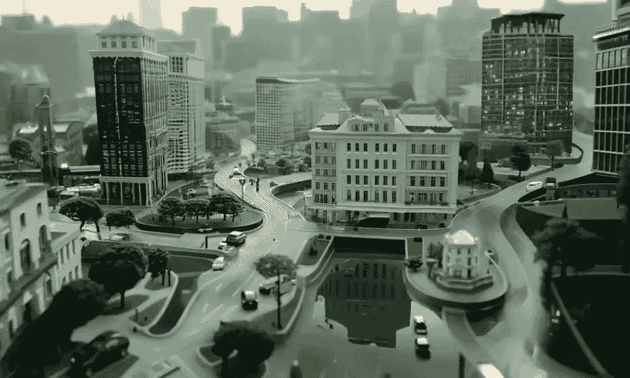

[X2Twitter.com_1815727211330322432(720p).mp4](https://internal-api-drive-stream.feishu.cn/space/api/box/stream/download/all/QRvPbWIlRo9U95x2X2AcIeK0n9e)

1.  An FPV shot of a Miniature model of a massive nuke explosion in a city. Ending on a Miniature model of an alien.

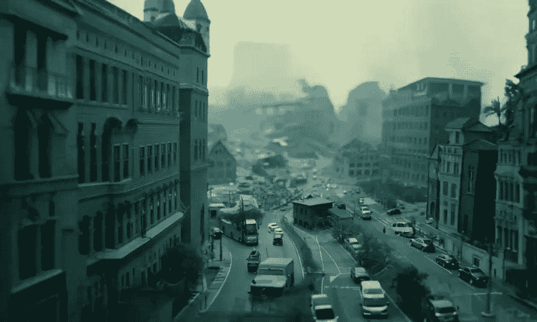

[X2Twitter.com_1815729529866063873(720p).mp4](https://internal-api-drive-stream.feishu.cn/space/api/box/stream/download/all/Kcsjblj7CoFcCHxCtYicHnbQnqe)

1.  A wide-angle shot of a Miniature model of a medieval village with detailed buildings and figures. Ending on a Miniature model of a knight.

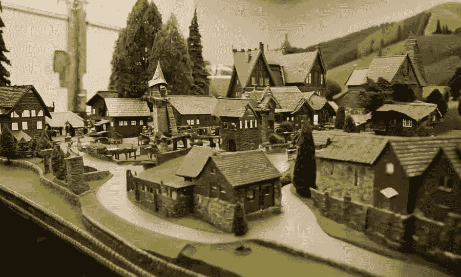

[X2Twitter.com_1815727287821897728(720p).mp4](https://internal-api-drive-stream.feishu.cn/space/api/box/stream/download/all/M3gVb64showBGyxFgctc4HySn0b)

1.  A slow panning shot of a Miniature model of a futuristic city with flying cars. Ending on a Miniature model of an alien creature.

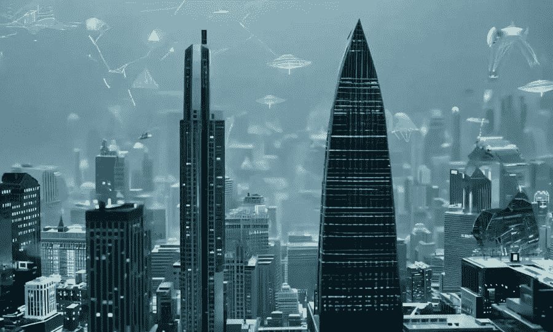

[X2Twitter.com_1815727359791939584(720p).mp4](https://internal-api-drive-stream.feishu.cn/space/api/box/stream/download/all/NROIb2wgHoKhjMxuu5qctj5mngf)

1.  A top-down shot of a Miniature model of a tropical island with tiny palm trees and huts. Ending on a Miniature model of a surfer.

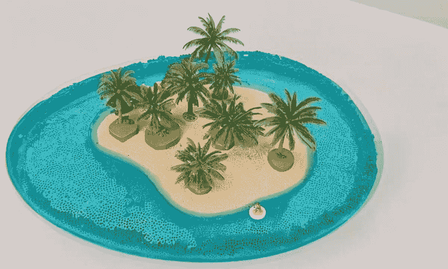

[X2Twitter.com_1815727435826266112(720p).mp4](https://internal-api-drive-stream.feishu.cn/space/api/box/stream/download/all/Fp4hb3AQkoLZkjxrsBIcbxKAnwc)

1.  A steady mid-shot of a Miniature model of a snowy mountain village with skiers. Ending on a Miniature model of a yeti.

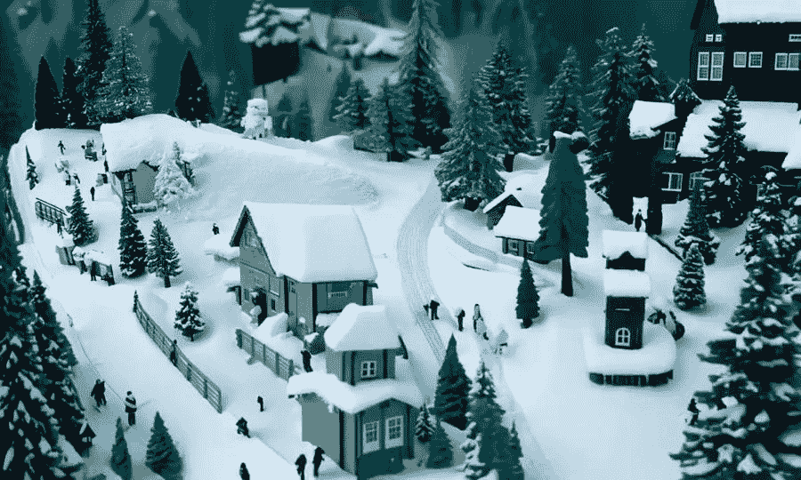

[X2Twitter.com_1815727502058467328(720p).mp4](https://internal-api-drive-stream.feishu.cn/space/api/box/stream/download/all/E7QCbEaASodVbDxOZk3cpvJWnJg)

1.  A dynamic sweeping shot of a Miniature model of a bustling harbor with ships and cranes. Ending on a Miniature model of a sailor.

[A dynamic.mp4](https://internal-api-drive-stream.feishu.cn/space/api/box/stream/download/all/FKhabvT0UoX30DxzpFtc0Ae3nIg)

1.  A zoom-out shot of a Miniature model of an ancient Roman city with detailed architecture. Ending on a Miniature model of a gladiator

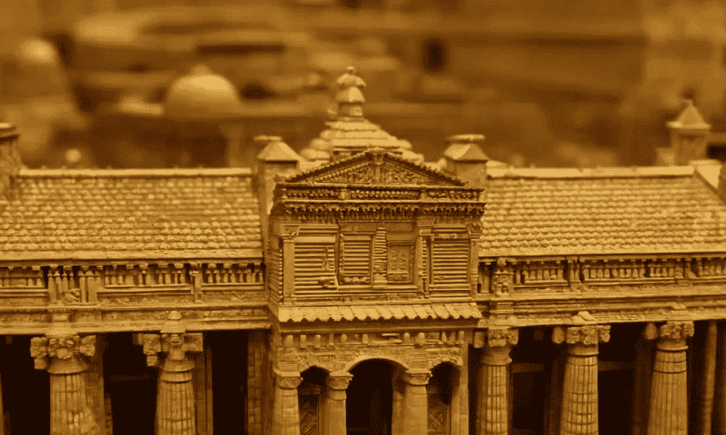

[Miniature model .mp4](https://internal-api-drive-stream.feishu.cn/space/api/box/stream/download/all/TlkcbtqeMo5p2Hx0HPocHDRRnbF)

1.  A wide-angle shot of a Miniature model of a bustling carnival with moving rides. Ending on a Miniature model of a clown juggling.

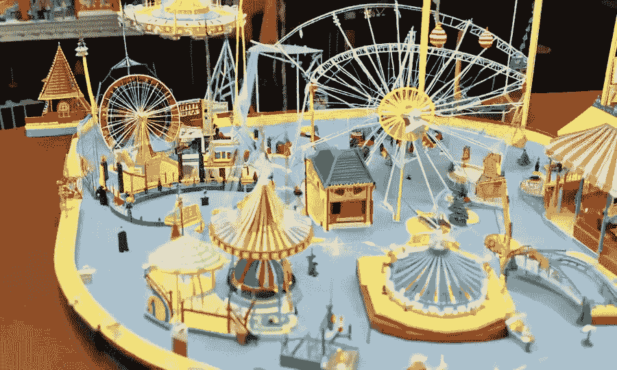

[a clown juggling.mp4](https://internal-api-drive-stream.feishu.cn/space/api/box/stream/download/all/NGLFbfJGXoRSHKxZt2Tc0LHznBg)

1.  A dynamic sweeping shot of a Miniature model of an ancient Egyptian city with detailed pyramids. Ending on a Miniature model of a pharaoh giving a speech.

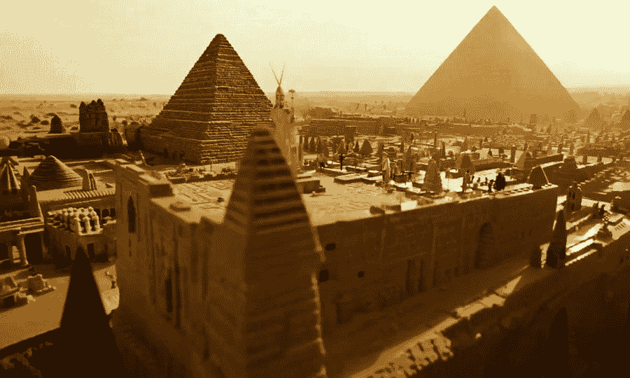

[Egyptian city.mp4](https://internal-api-drive-stream.feishu.cn/space/api/box/stream/download/all/Z9MzbN3UPoaClTxdE6NcQ5aGnTh)

1.  A fast panning shot of a Miniature model of a massive nuke explosion in a city. Ending on a Miniature model of an alien.

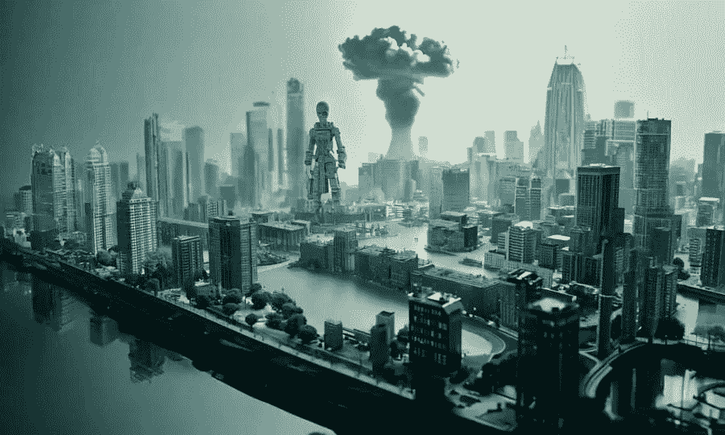

[massive nuke explosion in a city.mp4](https://internal-api-drive-stream.feishu.cn/space/api/box/stream/download/all/LATobspdGojSrPxN3DTc70dfn8b)

1.  A first-person shot of a Miniature model of a massive nuke explosion in a city. Ending on a Miniature model of an alien.

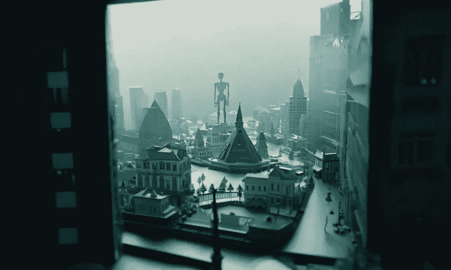

[X2Twitter.com_1815730018217254912(720p).mp4](https://internal-api-drive-stream.feishu.cn/space/api/box/stream/download/all/PCR3bwf4EoCEBpxLUhIcmqiunze)

1.  A Macro cinematography shot of a Miniature model of a Massive halo ring structure around a star.

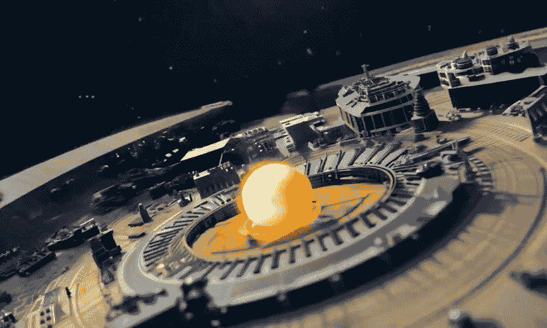

[X2Twitter.com_1815730443792396289(720p).mp4](https://internal-api-drive-stream.feishu.cn/space/api/box/stream/download/all/YMi2bOssPo0gU8xgFdJccEyfniX)

1.  A full society of little green people that live on plants. They have little buildings, little carts and little tools and they move around busy at work. macro photography

1.  A rotating shot of a Miniature model of a pirate ship on the high seas with tiny pirates. Ending on a Miniature model of a parrot holding a treasure map.

[boat.mp4](https://internal-api-drive-stream.feishu.cn/space/api/box/stream/download/all/CAYTb8Atwom8qrxHoOececJGnxd)

1.  A Macro cinematography shot of a Miniature model of a solar system.

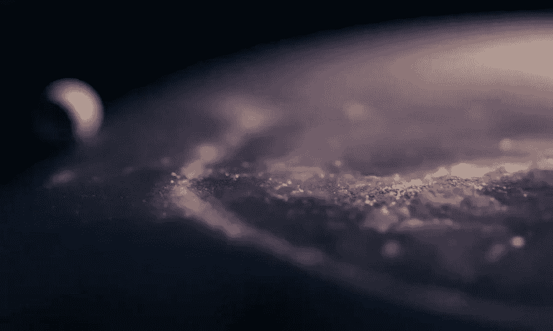

[X2Twitter.com_1815730344458596352(720p).mp4](https://internal-api-drive-stream.feishu.cn/space/api/box/stream/download/all/KwLsb1j3Ao1l6yx9343caIDgnLe)

1.  A Macro cinematography shot of a Miniature model of a massive alien structure.

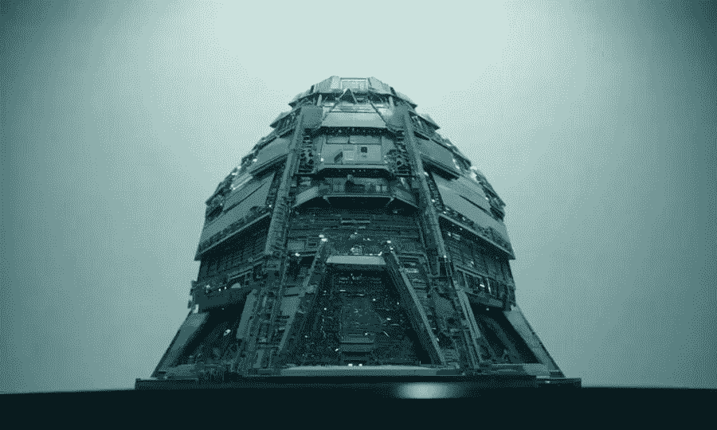

[X2Twitter.com_1815730666358865920(720p).mp4](https://internal-api-drive-stream.feishu.cn/space/api/box/stream/download/all/HLFbbp1MroI29xxpN2Mce4oSntc)

1.  A miniature chalet on a mountain on a table, camera zooms out to reveal the table is in a large room with icy backgrounds with mountains.

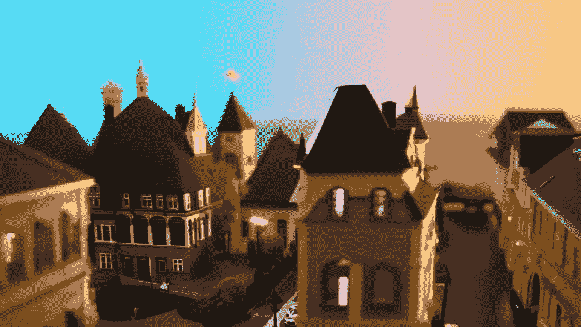

[X2Twitter.com_1815073706764275712(720p).mp4](https://internal-api-drive-stream.feishu.cn/space/api/box/stream/download/all/ZOYbbDNioozW0JxQSdPcXI9knsb)

### 联系我们

> [互联网设计](https://aigclena.feishu.cn/wiki/PD10wBb5yiRVE7kTFZdcuzUBnth)  [国际站/独立站](https://aigclena.feishu.cn/wiki/TmfowYzfMisIShkNU7ncEBMingh)  AI课程学习

