# 全网最全AI视频提示词指南合集

> 来源：[https://aigclena.feishu.cn/docx/QCgLdd3kso7g4AxaOljcHNtZncg](https://aigclena.feishu.cn/docx/QCgLdd3kso7g4AxaOljcHNtZncg)

> 点开标题左侧的三角箭头可查看详细的描述，适用于所有视频生成平台哦

> AI设计师Lena整理，转载请注明出处，仅供学习交流使用，禁止商用。

# 一、镜头语言（15）

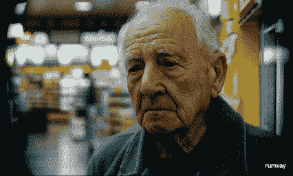

### 1-1 50mm lens

“50mm lens”（50毫米镜头）是一种定焦镜头，其焦距为50毫米。焦距是镜头的一个重要参数，决定了镜头的视角和拍摄效果。50mm镜头有以下几个特点：

1.  **标准视角**：50mm镜头通常被认为是标准镜头，因为它提供了与人眼视角相似的视野。这种焦距的镜头能够捕捉到接近自然的图像视角，适合多种拍摄场景。

1.  **较大的光圈**：很多50mm镜头具有较大的光圈（如f/1.8、f/1.4），这使得它们在低光环境下表现良好，并且能够产生浅景深效果，突出主体并模糊背景。

1.  **图像质量**：由于50mm镜头的设计简单，通常能提供非常好的图像清晰度和锐度，适合高质量的拍摄需求。

1.  **便捷性**：50mm镜头通常体积小巧、重量轻，适合日常拍摄和随身携带。

1.  **多用途**：它可以用于多种拍摄类型，包括人像、风景、街头摄影等，是一种非常通用的镜头。

总之，50mm镜头以其标准视角、大光圈和优质图像表现，成为了许多摄影师的首选镜头之一。

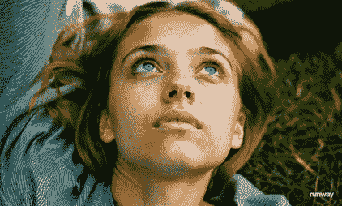

### 1-2 Close up

“Close up”（特写镜头）指的是一种拍摄风格或镜头设置，强调拍摄对象的细节。特写镜头通常具有以下特点：

1.  **靠近拍摄对象**：特写镜头通常将相机镜头非常靠近拍摄对象，以捕捉细节。比如，在人物拍摄中，特写镜头可能会只拍摄脸部特征，如眼睛、嘴巴等。

1.  **细节突出**：通过特写镜头，观众可以清楚地看到细微的细节，例如皮肤的纹理、物体的质感或其他精细的特征。

1.  **情感和重点**：特写镜头常用于突出人物的情感表现，或强调某个重要的细节，以增加戏剧性和观众的关注度。

1.  **背景虚化**：特写镜头通常会使用较大的光圈，使得背景模糊，从而将观众的注意力集中在主体上。

在电影、摄影和视频制作中，特写镜头被用来增强画面的表现力，创造更强的视觉冲击力和情感影响。

### 1-3 FPV

“FPV”指的是“First Person View”（第一人称视角），一种模拟从人物眼睛的视角拍摄的风格。具体来说，FPV的特点包括：

1.  **第一人称视角**：FPV镜头呈现的画面就像是从人物的视角观察到的，观众看到的就是人物在看什么，增强了沉浸感和代入感。

1.  **视角与移动**：这种风格通常跟随人物的动作和视线，包括眼前的景象和周围的环境，模拟人物的实际视角和移动感。

1.  **自然视角**：与传统的拍摄角度不同，FPV镜头可以展示人物的手部动作、视野中的物体，以及视线的变化，使观众感受到更真实的体验。

1.  **应用场景**：FPV广泛应用于视频游戏、虚拟现实（VR）、运动相机拍摄以及一些电影和视频中，用来提供身临其境的观看体验。

FPV镜头能够让观众从角色的视角出发，更好地体验角色的行动和环境，增强互动感和真实感。

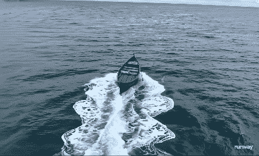

### 1-4 High angle

什么是高角度拍摄？

高角度拍摄是指相机的位置高于被摄主体，从上往下拍摄。这种拍摄角度可以产生独特的视觉效果，改变观众对被摄主体的感知。

高角度拍摄的特点与作用

+   **视觉效果：**

+   **压迫感：** 从高角度拍摄，被摄主体显得渺小，可以营造出一种压迫感或脆弱感。

+   **俯瞰感：** 可以展现被摄主体的全貌，突出其与周围环境的关系，增强画面的纵深感。

+   **疏离感：** 高角度拍摄可以增加被摄主体与观众之间的距离，营造出一种疏离感。

+   **心理暗示：**

+   **弱化主体：** 高角度拍摄可以弱化被摄主体的权威性，使其显得更加卑微或无助。

+   **强调环境：** 突出环境对被摄主体的影响，强调环境的支配地位。

+   **应用场景：**

+   **人像摄影：** 高角度拍摄可以使人物显得更加娇小可爱，或者突出人物的孤独感。

+   **风光摄影：** 高角度拍摄可以展现广阔的视野，突出地貌的宏伟壮观。

+   **建筑摄影：** 高角度拍摄可以展现建筑物的整体结构和布局，突出建筑的雄伟气势。

高角度拍摄的示例

+   **电影中：** 导演经常使用高角度镜头来表现角色的无助、绝望或者强调环境的压迫感。

+   **广告中：** 高角度拍摄可以突出产品的优势，或者营造出一种高高在上的感觉。

+   **新闻报道中：** 高角度拍摄可以展现事件的全貌，或者突出事件现场的混乱。

###

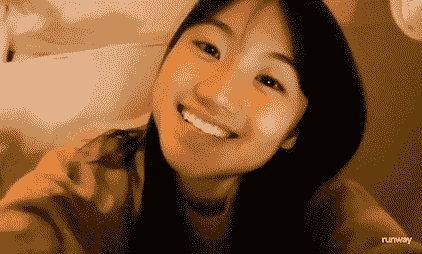

### 1-5 Camcorder

“Camcorder”（摄像机）通常指的是一种模拟传统摄像机外观的相机风格，特别是在图像生成和艺术创作领域中。这种风格可能包括以下特点：

1.  **外观设计**：模仿传统摄像机的设计，包括圆形镜头、操作按钮、显示屏等特征，使其看起来像一台经典的摄像机。

1.  **视觉效果**：可能会加入一些特效来模拟摄像机的画质和色彩特性，如颜色偏差、颗粒感、复古滤镜等，模仿摄像机录制的视频效果。

1.  **场景氛围**：这种风格可能还包括摄像机常见的拍摄角度、景别和画面构图方式，例如横向画幅、动态焦点等。

在图像生成、视频制作或艺术创作中，选择“Camcorder”风格可以帮助创造出具有复古或特定视觉效果的图像和视频。

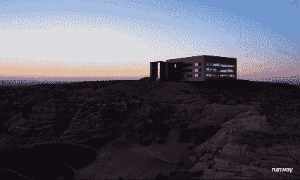

### 1-6 Establishing wide

在摄影术语中，"Establishing wide" 通常指在电影或视频拍摄中，使用广角镜头拍摄一个场景的整体画面，以建立观众对场景的初步认知。

**具体来说，“Establishi**ng wide” 有以下几个特点和作用：

+   **广角镜头：** 使用焦距较短的广角镜头，可以将更多的场景元素纳入画面，展现出场景的广阔和气势。

+   **整体画面：** 通过拍摄一个包含整个场景的宽广画面，让观众对拍摄地点、环境、人物关系等有一个整体的了解。

+   **建立场景：** 为后续的近景、特写等镜头打下基础，帮助观众建立对场景的认知，并为接下来的情节发展做铺垫。

+   **交代背景：** 可以交代故事发生的时间、地点、人物之间的关系等背景信息。

###

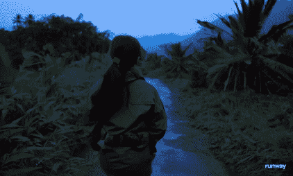

### 1-7 Hand held

“Hand held”（手持镜头）指的是一种拍摄风格，其中相机直接由摄影师手持，而不是使用三脚架、稳定器或其他支撑设备。手持镜头的主要特点包括：

1.  **移动性**：手持镜头允许摄影师自由移动，相机可以在拍摄过程中随意改变位置和角度。这种风格使得拍摄更灵活，能够快速适应不同的场景和情况。

1.  **自然和即时感**：手持镜头常常带有一定的晃动和不稳定感，这种自然的运动可以增加画面的真实感和紧迫感。它常用于模拟即时或临场感，使观众感觉更接近角色或事件。

1.  **灵活性和便携性**：手持拍摄使得摄影师能够轻松进入狭小空间或不规则的拍摄角度，适用于动态或快速变化的场景。

1.  **可能的缺点**：手持镜头可能会导致画面不稳定或抖动，尤其是在长时间拍摄或快速移动时。为了减轻这种影响，摄影师可能需要使用一些手持稳定器或防抖技术。

在电影、电视、纪录片和视频制作中，手持镜头常用于营造自然、真实和紧张的画面效果，增加观众的沉浸感。

### 1-8 Low angle

“Low angle”（低角度镜头）指的是从较低的位置向上拍摄的镜头角度。这种拍摄风格的主要特点包括：

1.  **仰视效果**：低角度镜头从地面或接近地面的高度向上拍摄，使得被拍摄对象看起来更高大、威严或具有压迫感。

1.  **增强威严感**：这种角度能够强化被拍摄对象的权威感或力量感。例如，在拍摄人物时，低角度镜头可以使人物看起来更有力量或更具影响力。

1.  **戏剧效果**：低角度镜头常用于创造戏剧性效果或强调某种情绪。它可以使观众感受到角色的巨大或强大，或使场景显得更加雄伟。

1.  **视觉引导**：这种镜头角度可以引导观众的视觉注意力向上移动，突出背景中的某些元素或强调环境的高度和纵深感。

在电影、电视和摄影中，低角度镜头常用于塑造角色的形象、增强场景的戏剧感或展现宏伟的背景。

###

### 1-9 Macro cinematography

“Macro cinematography”（微距摄影）指的是一种拍摄风格，专注于极其细小的物体或细节，通常使用微距镜头来捕捉细节。具体来说，微距摄影的主要特点包括：

1.  **细节捕捉**：微距摄影专门用于拍摄非常小的物体，如昆虫、植物细节、珠宝或其他微小的物品。它能够捕捉到通常肉眼难以察觉的细节和质感。

1.  **近距离拍摄**：使用微距镜头，可以在非常近的距离内拍摄物体，保持清晰的焦点，同时呈现出丰富的细节和纹理。

1.  **高放大倍率**：微距镜头具有高放大倍率，能够放大被拍摄对象，使其在画面中显示出清晰的细节和特征。

1.  **浅景深**：微距摄影通常具有较浅的景深，使得前景和背景可能会变得模糊，从而突出主体细节，增加视觉冲击力。

1.  **应用场景**：微距摄影广泛应用于自然摄影、科学研究、艺术创作和产品摄影中，能够展示物体的精细结构和美感。

通过微距摄影，摄影师能够展示微小世界的细致美丽和复杂性，带来独特的视觉体验。

### 1-10 SnorriCam

“SnorriCam”是一种独特的拍摄技术，得名于其发明者Snorri Sturluson。这种技术的主要特点包括：

1.  **相机固定在演员身上**：SnorriCam的相机固定在演员的身体上，通常在演员的胸部或肩部位置，通过特制的支架或装置固定。这使得相机在演员的移动过程中保持相对静止，从而捕捉到演员的视角和表情。

1.  **背景运动效果**：由于相机固定在演员身上，背景会相对较快地移动，产生一种独特的视觉效果，使得背景看起来在动态变化，而演员的表情和动作保持稳定。

1.  **增强临场感**：这种拍摄风格能够增强观众的临场感，使观众感觉像是与演员一起移动，增强了对角色感受和情感的体验。

1.  **视觉冲击**：SnorriCam创造了一种不寻常的视觉效果，常用于表现角色的内心状态、心理困扰或混乱感。它能够有效地传达角色的感受和心理状态。

1.  **应用场景**：SnorriCam通常在电影和电视剧中使用，用于表现角色的主观视角或增强戏剧性。例如，它在一些心理惊悚片或实验性影片中被用来强化视觉冲击和情感表达。

通过SnorriCam的技术，导演和摄影师可以创造出独特的视觉效果，增强叙事的深度和观众的沉浸感。

###

### 1-11 Tracking

跟踪拍摄，简单来说就是相机跟随被摄物体移动，让镜头始终对准目标。这种拍摄方式可以创造出一种动态的、流畅的视觉效果，让画面充满活力。

常见应用场景

+   体育摄影： 跟踪快速移动的运动员，捕捉精彩瞬间。

+   电影拍摄： 跟踪演员的移动，营造出沉浸式的观影体验。

+   野生动物摄影： 跟踪动物的活动，记录它们的自然行为。

+   纪录片拍摄： 跟踪人物或事件，增强故事的叙述性。

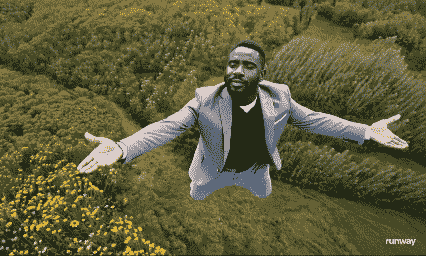

### 1-12 Overhead

“Overhead”（俯视镜头）指的是一种从上方垂直向下拍摄的镜头角度。这种风格的主要特点包括：

1.  **俯视视角**：相机从一个高于被拍摄对象的角度垂直向下拍摄，通常能看到被拍摄对象或场景的整体布局。

1.  **全面展示**：俯视镜头能够全面展示场景的空间布局和组织，帮助观众了解环境的整体结构和元素的相对位置。

1.  **清晰视图**：这种角度可以清晰地呈现场景中的所有细节，如地面上的物体分布、人物的互动或环境的整体设计。

1.  **抽象和艺术效果**：俯视镜头可以提供一种抽象的视觉效果，使观众能够从不同的角度感受场景的美感或戏剧性。

1.  **应用场景**：俯视镜头常用于展示大型场景（如城市全景、建筑内部布局等）、提供环境上下文或在视觉上创建某种效果。例如，它可以在电影中用于展示战斗场面、复杂的动作序列，或在设计和建筑领域展示布局规划。

通过俯视镜头，导演和摄影师能够提供独特的视觉视角，增强场景的表现力和理解度。

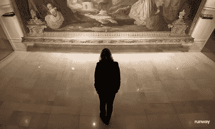

### 1-13 Wide angle

“Wide angle”（广角镜头）指的是一种使用广角镜头拍摄的风格，其主要特点包括：

1.  **广阔视野**：广角镜头具有较短的焦距（通常小于35毫米），能够捕捉更广阔的视野和更多的场景细节。它适合拍摄大范围的景象，如风景、建筑内部或拥挤的街道。

1.  **扩展空间感**：广角镜头能够创造出更深的空间感，使得画面中的前景和背景看起来更广阔。它可以有效地扩展视觉范围，增强空间的层次感。

1.  **视觉扭曲**：由于广角镜头的设计，它可能会在画面边缘产生轻微的几何畸变，例如直线变弯或物体变形。这种畸变可以用来创造独特的视觉效果，但也需要在拍摄中注意控制。

1.  **近距离拍摄**：广角镜头允许在较近的距离内拍摄大范围的画面，这使得它适合用来在狭小空间内捕捉更多的细节。例如，室内拍摄时能够将整个房间一并拍入镜头。

1.  **应用场景**：广角镜头广泛用于风景摄影、建筑摄影、室内摄影以及某些类型的动作镜头，能够捕捉大范围的场景和细节。

使用广角镜头能够提供更开阔的视觉效果，适合于需要展示大量环境信息或创造独特视觉体验的场景。

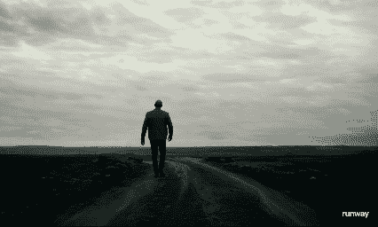

### 1-14 Tracking

“Tracking”（跟踪镜头）指的是一种相机移动技术，其中相机随着拍摄对象的运动而移动，以保持对象在画面中的位置。具体来说，跟踪镜头的主要特点包括：

1.  **相机移动**：相机与被拍摄对象同步移动，确保对象在镜头中保持相对稳定的位置。这可以是相机沿着平面移动（如前后、左右）或跟随对象在三维空间中的运动。

1.  **增强动态感**：跟踪镜头常用于展示对象的动态运动，例如人物奔跑、车辆行驶或其他快速动作。通过同步移动，观众能够感受到动作的流畅性和速度。

1.  **创建连贯画面**：跟踪镜头帮助保持画面的连贯性，特别是在动态场景中，使观众能够更好地跟随故事情节和角色动作。

1.  **使用设备**：跟踪镜头通常需要使用专业的设备，如滑轨、稳定器、摄像车或无人机，以确保镜头移动平滑、稳定。

1.  **应用场景**：这种镜头风格广泛应用于电影、电视剧、广告和纪录片中，尤其是在需要展示动作序列、运动追踪或环境变化的场景中。

通过跟踪镜头，导演和摄影师能够创造出流畅的视觉效果，使观众更容易沉浸在场景中，增强观看体验。

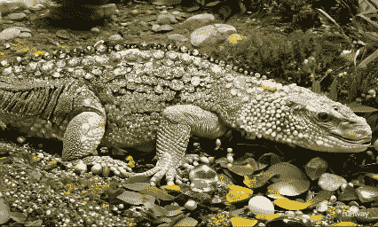

### 1-15 Realistic documentary

“Realistic documentary”（现实主义纪录片风格）指的是一种拍摄和呈现风格，旨在真实、客观地记录和展示事件、人物或环境。这个风格的主要特点包括：

1.  **真实感**：采用自然、未经修饰的方式来展示现实，避免使用过多的艺术化效果或过度设计，以确保所拍摄的内容尽可能真实地反映实际情况。

1.  **自然光源**：常使用自然光或简单的人工照明，避免过度的灯光布置，以保持画面的真实感和自然感。

1.  **手持拍摄**：经常使用手持相机来捕捉即时和自然的画面，带有轻微的晃动感，增加了观众的沉浸感和现场感。

1.  **非干预性**：尽量避免对拍摄对象施加干预，保持拍摄的客观性和中立性。纪录片风格强调记录真实事件和人物的自然行为，而非刻意编排或干预。

1.  **现场感**：注重捕捉现场的氛围和环境，包括声音、对话和背景细节，力求展现一个真实的场景和故事。

1.  **直观叙事**：通过直接和简洁的叙事方式，将观众引入故事，提供真实的视角和信息。

现实主义纪录片风格常用于纪录片、新闻报道和某些类型的剧集，以真实和客观的方式呈现内容，力求让观众感受到原汁原味的现实。

# 二、照明样式 Lighting Styles（7）

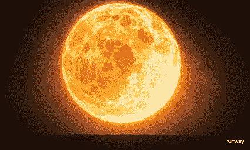

### 2-1 Silhouette

“Silhouette”（剪影）指的是一个物体或人物的轮廓或外形，只显示轮廓而不显示细节。通常，剪影是以黑色或深色呈现的，背景则通常是亮色或光源，这样轮廓会更加明显。

剪影的特点：

+   **单色：** 通常只用一种颜色，最常见的是黑色。

+   **轮廓：** 强调物体的外部轮廓，不包含内部细节。

+   **对比：** 剪影通常是在明亮的背景下呈现的，以突出轮廓与背景的对比。

###

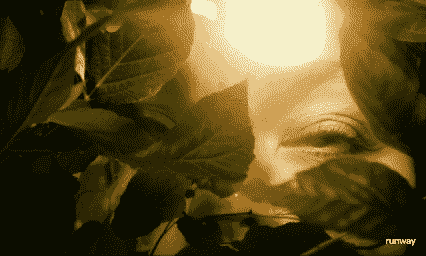

### 2-2 Diffused lighting

“Diffused lighting”（漫射光或漫射照明）是一种光线分布均匀、柔和的照明方式。与直接光源（如太阳光或聚光灯）不同，漫射光通常不会产生强烈的阴影或高对比度的光暗效果。相反，它通过散射和反射，使光线在多个方向上传播，从而减弱了光源的直接性，使得被照亮的物体表面看起来更加均匀、柔和。

漫射光常见于阴天时的自然光照，或者通过使用柔光箱、漫射罩等设备来实现。摄影、影视制作和室内设计中，漫射光常用于营造舒适、自然的光线效果。

漫射光的特点：

+   **柔和：** 光线分布均匀，没有明显的明暗对比，能使物体看起来更加柔和。

+   **均匀：** 光线照射到物体表面，不会产生明显的阴影，能使物体表面细节更加丰富。

+   **自然：** 漫射光接近自然光，能使物体呈现出更加自然、真实的效果。

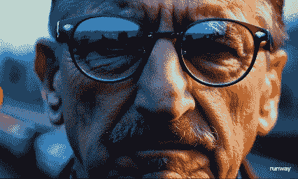

### 2-3 Side lit

“Side lit”（侧光）指的是光源从物体或人物的一侧照射过来，即光线从左侧或右侧投射到拍摄对象上。这种照明方式会在被照射的侧面形成明亮的光线，而另一侧则形成阴影，导致物体或人物的立体感和纹理更加突出。

侧光的特点和效果：

+   **立体感：** 侧光能勾勒出物体的轮廓，产生明显的明暗对比，从而增强物体的立体感和层次感。

+   **质感：** 侧光能突出物体的表面纹理和细节，使物体显得更加真实。

+   **戏剧性：** 通过调整光源的角度和强度，侧光可以营造出戏剧性的氛围，突出画面的重点。

+   **阴影：** 侧光产生的阴影能增加画面的深度和空间感。

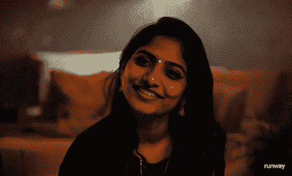

### 2-4 Lens flare

镜头光晕：在摄影图像中由于镜头内部的异常折射或反射而产生的光亮斑块，通常是由于异常明亮的光源，有时光源位于图像之外。

镜头光晕的创意运用：

+   **人像摄影：** 在人像摄影中，适当地利用光晕可以增加画面的梦幻感和唯美感。

+   **风光摄影：** 在风光摄影中，光晕可以营造出日出日落时的壮丽景象。

+   **产品摄影：** 在产品摄影中，光晕可以增加产品的质感和神秘感。

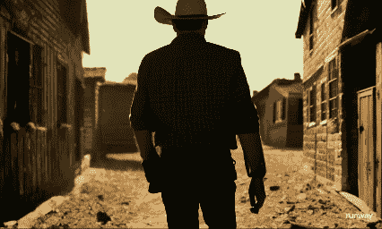

### 2-5 Back lit

“Back lit”（逆光）指的是光源从物体或人物的背后照射过来，即光线来自镜头对面或物体的后方。这种光线设置会使物体或人物的正面处于阴影之中，而轮廓部分会被光线勾勒得更加明显，通常会产生一种轮廓光效果。

背光的特点：

+   **提高亮度：** 背光可以显著提高屏幕或物体的亮度，使其在黑暗环境下也能清晰可见。

+   **改善对比度：** 背光可以增加图像的对比度，使图像更加生动。

+   **扩大视角：** 背光可以扩大可视角度，从不同角度观看图像时，图像质量不会有明显下降。

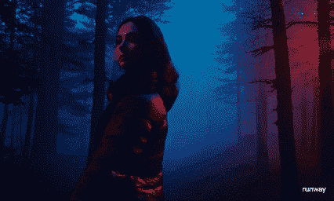

### 2-6 [color]gel lighting

“Gel lighting”（凝胶照明）指的是在照明设备上使用彩色凝胶片（gels）来改变光源的颜色。凝胶片是一种透明的塑料薄片，通常用于摄影、电影、舞台和活动中，以创造特定的氛围或视觉效果。

凝胶照明的应用：

凝胶照明在摄影、电影、舞台、建筑照明等领域有着广泛的应用：

+   **摄影：**

+   **营造氛围：** 不同的颜色可以营造出不同的氛围，比如蓝色可以营造出冷色调，红色可以营造出暖色调。

+   **突出主题：** 可以通过选择与主题相匹配的颜色来突出画面中的主体。

+   **平衡色彩：** 可以用来平衡场景中的色彩，使画面更加和谐。

+   **电影：**

+   **场景氛围：** 通过改变光线的颜色，可以营造出不同的场景氛围，比如夜晚、黎明、日落等。

+   **人物性格：** 可以通过光线颜色来突出人物的性格特征。

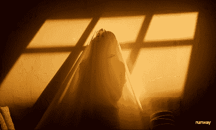

### 2-7 Venetian lighting

“Venetian lighting”（威尼斯光照）是一种特定的光线布置方式，通常用于摄影和电影拍摄。它源于对威尼斯画派中使用的光线技术的仿效，特别是对那些画作中的柔和光线和深刻阴影的表现。

**威尼斯光照**的特点包括：

1.  **柔和的光线**：这种光照方式通常使用柔和、扩散的光线，避免强烈的阴影和高对比度。

1.  **侧面光源**：光线通常从被摄对象的侧面照射，使得面部或物体的一侧明亮，而另一侧则形成柔和的阴影，从而增强深度感。

1.  **自然的光影效果**：威尼斯光照旨在模仿自然光的效果，使得画面看起来更加自然和生动，突出细节和纹理。

这种光照技术常用于艺术摄影和肖像摄影中，以创造一种古典而优雅的视觉效果。

# 三、运动速度 Movement Speeds（4）

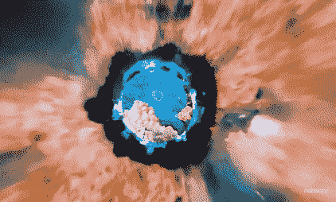

### 3-1 Dynamic motion

“Dynamic motion”（动态运动）指的是具有显著变化和活力的运动状态，通常涉及不断变化的速度、方向或强度。

这种运动具有以下特点：

1.  **活跃和变化**：动态运动表现出持续的变化，不像静态或缓慢运动那样平稳。它可能包括快速的加速、减速、转向或其他形式的运动变化。

1.  **强调运动感**：动态运动常常被用来突出物体的活力和力量。比如，在动画或电影中，动态运动可以用来增强画面的紧张感或戏剧效果。

1.  **视觉冲击力**：动态运动通常创造出视觉上的冲击力和吸引力，使得观众能够感受到动作的力度和速度。

在视觉艺术、动画、电影和运动科学等领域中，动态运动被用来表达活力、力量和变化，以增强表现力和引起观众的兴趣。

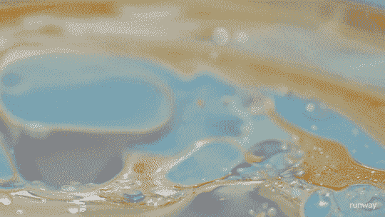

### 3-2 Slow motion

“Slow motion”（慢动作）是一种视频或电影拍摄技术，通过减缓播放速度来显示快速动作的详细过程。具体来说，慢动作的主要特点包括：

1.  **减缓速度**：在慢动作效果中，视频或电影的播放速度低于实际速度，使得快速运动的细节变得更加清晰。比如，通常的拍摄速度为每秒24帧，而慢动作可能以每秒120帧或更高的帧率拍摄。

1.  **增强细节**：通过慢动作，观众能够看到原本在正常速度下难以察觉的细节，比如运动员的肌肉动作、液体飞溅的瞬间或物体碰撞的细节。

1.  **戏剧效果**：慢动作常用于增强戏剧性或视觉冲击力。它可以用来突出关键瞬间、增强情感表达或增加动作的美感。

1.  **运动分析**：在科学研究、运动训练和分析中，慢动作被用来详细观察和分析运动过程中的每一个动作和细节。

慢动作技术可以通过专门的相机设置或后期制作来实现，广泛应用于电影、广告、体育赛事和科学研究中。

### 3-3 Timelapse

“Timelapse”（延时摄影）是一种摄影和视频技术，通过在较长时间内定期拍摄静态画面，然后将这些画面以更快的速度播放，来展示时间流逝的效果。这种技术可以清晰地显示时间变化过程，比如一天的日出日落、植物的生长、城市的繁忙等。具体来说，延时摄影的特点包括：

1.  **间隔拍摄**：在延时摄影中，相机会在固定的时间间隔内拍摄一系列静态图像，而不是持续录制视频。这些图像可以在几秒钟、几分钟或更长时间内捕捉。

1.  **快速播放**：拍摄完成后，将这些静态图像按照原定间隔合成视频，并以比正常速度快的速度播放，从而压缩时间，使得缓慢的过程变得迅速显现。

1.  **展示变化**：延时摄影常用于展示时间变化的过程，例如植物的生长、城市的繁忙、建筑的施工等，能够有效地突出时间的流逝和变化。

1.  **艺术和科学应用**：这种技术不仅用于艺术创作，也广泛应用于科学研究、天气监测、交通分析等领域，以便更清晰地观察和分析时间过程中的变化。

延时摄影能够通过简洁直观的方式将长期过程压缩到短时间内，展现时间的流动和变化。

（图有点大放不了，想看效果的朋友点我📕观看）

### 3-4 Fast motion

“Fast motion”（快动作）指的是一种视频或电影效果，通过加快播放速度来缩短时间的表现，使得慢速的动作看起来很快。具体来说，快动作的主要特点包括：

1.  **加速播放**：快动作效果使得视频或电影的播放速度高于实际速度。比如，正常播放速度为每秒24帧，而快动作可能以每秒12帧或更少的帧率播放。

1.  **时间压缩**：快动作能够将长时间的过程压缩成短时间内观看的内容，例如，将一天的活动缩短为几分钟。

1.  **突出变化**：它可以用来显示长时间变化的过程，例如植物的生长、建筑的建造或天气变化。快动作能够清晰展示这些过程中的细节和演变。

1.  **创造趣味**：快动作也常用于电影和视频中以增加趣味性和视觉效果，例如在展示人物快速移动或场景变化时。

快动作通常通过在拍摄时使用更少的帧率或在后期制作中加快播放速度来实现，广泛应用于电影、广告、纪录片和动画等领域。

（图有点大放不了，想看效果的朋友点我📕观看）

# 四、运动类型（11）

### 4-1 Ascends垂直上升

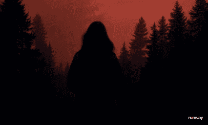

指的是画面主体或摄影机本身在垂直方向上向上移动的动作。

**关键特征：**

+   **垂直方向：** 运动的主要方向是向上。

+   **高度变化：** 画面中物体或视角的高度会增加。

+   **揭示或跟随：** 常常用于揭示上方的事物或跟随向上移动的主体。

### 4-2 Explodes炸裂

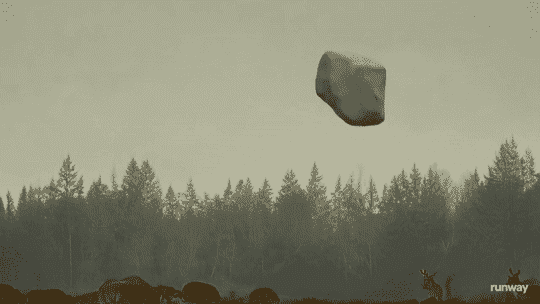

指的是画面中的主体**突然、剧烈地向四周扩散或炸裂**的动作。

**"E**x**pl**odes" 强调的是一种爆发和扩散的过程，通常伴随着巨大的能量释放和快速的碎片化。这种爆炸可以通过多种方式呈现：

+   **物体自身的爆炸：** 比如，炸弹爆炸，气球爆裂，烟花绽放等。

+   **能量的爆发性扩散：** 比如，冲击波扩散，光芒四射等。

+   **象征性的爆发：** 在一些更具艺术性的表达中，"explodes" 可以用来形容情感、想法或状态的突然爆发和扩散，不一定涉及物理上的爆炸。

**关键特征：**

+   **突然性：** 动作发生得非常迅速，几乎没有预兆。

+   **剧烈性：** 伴随着强大的力量和能量释放。

+   **向外扩散：** 碎片或能量向各个方向快速散开。

+   **通常伴随视觉特效：** 为了增强视觉冲击力，爆炸场面通常会运用各种特效，如火光、烟雾、碎片、快速的运动模糊等。

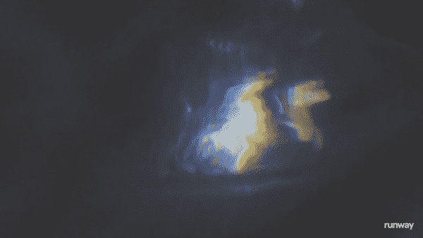

### 4-3 Ripples

指的是画面中出现的类似水面波纹那样的、连续扩散的、轻微的起伏或震荡的动作。

强调的是一种**柔和的、扩散性的波动**。这种波纹状的运动通常具有以下特点：

+   **波浪状：** 运动呈现出类似水波的形状，有起有伏。

+   **扩散性：** 波纹通常从一个中心点向四周扩散开来。

+   **轻微性：** 这种运动通常比较柔和，幅度不会很大。

+   **连续性：** 波纹是连续不断的，形成一个动态的图案。

+   **常与液体或柔软表面相关联：** 最常见的例子是水面受到扰动后产生的波纹，但也可能出现在其他柔软的表面或通过视觉特效模拟出来。

**可能的表现形式：**

+   **水面波纹：** 滴入水滴、微风吹拂、物体划过水面等引起的波纹扩散。

+   **布料或旗帜的轻微飘动：** 在微风中，布料或旗帜可能会呈现出类似波纹的起伏。

+   **热浪或空气扰动：** 通过特殊拍摄或后期处理，可以表现出空气中热量或气流引起的视觉扭曲，类似波纹的晃动。

+   **数字特效：** 在后期制作中，可以人为添加各种波纹效果，用于营造特定的氛围或视觉效果。

###

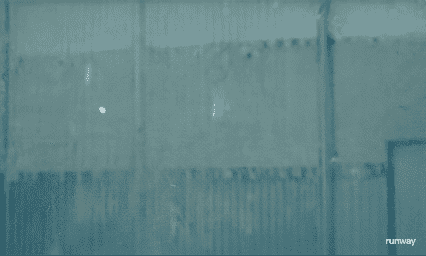

### 4-4 Undulates起伏波动

指的是画面中的主体呈现出**波浪状的、流畅的起伏运动**。这种运动通常是连续的、有节奏的，并且呈现出曲线形的轨迹。

强调的是一种**连绵不断的波浪式运动**。这种运动具有以下特点：

+   **波浪状轨迹：** 运动的路径呈现出类似正弦曲线的上下起伏。

+   **流畅性：** 这种运动通常是平滑的、连贯的，没有明显的顿挫或急停。

+   **节奏感：** 往往带有一定的规律性，起伏之间的时间间隔和幅度可能相对稳定。

+   **常与柔性或长条形物体相关联：** 比如蛇的爬行，海带在水中飘动，旗帜在风中飘扬，舞者的肢体动作等。

+   **也可以指地形或景观的起伏：** 例如连绵的山峦，波浪形的沙丘等。

**可能的表现形式：**

+   **生物的运动：** 蛇、蠕虫、鱼类等身体的弯曲和伸展。

+   **自然界的物体：** 海浪的翻滚，河流的蜿蜒，风吹麦浪。

+   **人造物体：** 旗帜、丝带、绳索在风中飘动，车辆行驶在起伏的道路上。

+   **抽象的视觉效果：** 通过数字特效模拟出的波浪状运动。

### 4-5 Warps扭曲变形

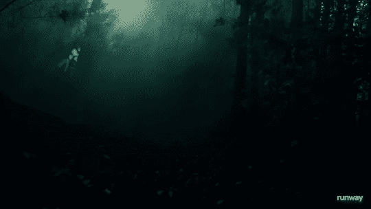

指的是画面中的主体或整个画面**发生扭曲、变形或弯曲**的动作。这种变形通常是不规则的、非线性的，并且会改变物体的原始形状和空间关系。

强调的是一种**形变**和**扭曲**的过程。这种变形可以通过多种方式呈现：

+   **主体自身的形变：** 比如，高温炙烤下的物体融化变形，柔软的物体被挤压弯曲，液体在重力作用下形成不规则形状等。

+   **通过镜头或光学效果：** 使用特殊的广角镜头或棱镜等光学器件拍摄，可以产生画面边缘的扭曲效果。

+   **后期视觉特效：** 在后期制作中，通过数字技术对画面中的元素进行变形处理，创造出各种扭曲、拉伸、挤压等效果。这常用于表现超现实场景、梦境、药物影响下的视觉、时间或空间的扭曲等。

+   **快速运动造成的视觉扭曲：** 极快的速度下拍摄的物体，由于运动模糊等原因，也可能呈现出类似扭曲的视觉效果。

**关键特征：**

+   **不规则变形：** 变形通常不是均匀或线性的，物体的不同部分可能发生不同程度的扭曲。

+   **形状改变：** 物体的原始形状和比例会发生明显的改变。

+   **空间关系扭曲：** 物体之间的相对位置和距离感可能变得不真实。

+   常用于营造特殊氛围或表达抽象概念： 扭曲的画面往往带有超现实、怪诞、迷幻、不安或时间/空间错乱的意味。

### 4-6 Emerges渐显

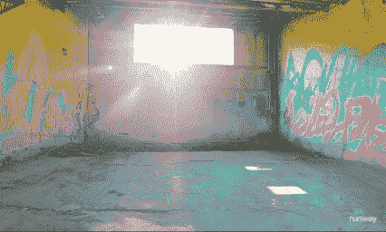

指的是画面中的主体从隐藏、遮挡或背景中**逐渐**显**露出**来，进入观众的视野的动作。强调的是一种出现和显现的过程。主体原本不完全可见，然后逐渐地被看到。

**关键特征：**

+   **从无到有/从模糊到清晰：** 主体最初是不完全可见的。

+   **逐渐显现：** 显现是一个过程，需要一定的时间。

+   **进入视野：** 最终主体会清晰地出现在画面中。

+   **带有一定的叙事性：** "Emerges" 往往带有一定的悬念或预示，暗示着新的人物、物体或信息的出现。

### 4-7 Grows

指的是画面中的主体**尺寸逐渐增大**的动作。

强调的是一个**尺寸扩张**和**体积增加**的过程。这种增长可以通过多种方式呈现：

+   **主体自身的生长或膨胀：** 比如，花朵绽放，面团发酵，生物体长大，物体被充气等。

+   **摄影机逐渐靠近主体：** 使用**推近 (Pull In)** 的摄影机运动，可以使画面中的主体看起来越来越大，产生“**生长”的视觉效果，但实际上是**视角的变化。变焦拉近 (Zoom In) 也能达到类似的效果，但透视关系会有所不同。

+   **后期特效处理：** 通过数字特效在后期制作中放大画面中的元素。

**关键特征：**

+   **尺寸增大：** 画面中可识别的主体的体积或面积逐渐增加。

+   **时间过程：** "Grows" 是一个持续发生的过程，需要一定的时间才能观察到

+   明显的变化。

+   **强调变化：** 侧重于主体从较小状态向较大状态的转变。

### 4-8 Transforms演变重塑

指的是画面中的主体在形态、外观、性质或状态上发生显著且通常是根本性的变化的动作。这种变化往往是引人注目的，并且可能涉及到视觉上的重塑。

强调的是一种**转变**和**演变**的过程。主体并非仅仅是移动或改变大小，而是经历了一个从一种形式到另一种形式的转换。这种转变可以通过多种方式呈现：

+   **形态上的改变：** 比如，毛毛虫变成蝴蝶，水变成冰，一个物体分解成多个碎片，多个物体组合成一个新物体等。

+   **外观上的改变：** 比如，通过化妆或伪装改变容貌，物体表面颜色或纹理发生变化，光线照射角度改变导致阴影和视觉效果的变化等。

+   **性质上的改变：** 比如，一个静态的物体开始运动，一个无生命的物体似乎获得了生命，一种情感状态转变为另一种情感状态（通过面部表情和肢体语言的视觉表现）。

+   **状态上的改变：** 比如，液体凝固，固体融化，清澈变得浑浊，明亮变得黑暗等。

**关键特征：**

+   **显著变化：** 变化是明显的，观众能够清晰地观察到主体在形态或性质上的不同。

+   **根本性改变：** 这种变化往往不仅仅是细微的调整，而是涉及到本质上的转变。

+   **过程性：** "Transforms" 通常是一个持续发生的过程，可能很快也可能很慢。

+   **常带有叙事意义：** 转变往往是故事发展的重要环节，可以揭示角色的变化、环境的变化或潜在的魔法/科幻元素。

###

### 4-9 Unfolds

指的是画面中的主体从折叠、卷曲或紧凑的状态逐渐展开、铺开或显露出来的动作。

强调的是一个**展开**和**显露**的过程。主体最初是处于一种收缩或隐藏的状态，然后逐渐地扩展开来，变得更加完整和可见。这种展开可以通过多种方式呈现：

+   **物体自身的展开：** 比如，折叠的纸张被打开，卷起来的地毯被铺平，花苞绽放展开花瓣，降落伞打开等。

+   **摄影机运动揭示主体：** 比如，摄影机后拉 (Pull Out/Zoom Out) 使得原本占据画面大部分的局部逐渐缩小，从而让周围原本被“折叠”或“隐藏”的整体显露出来。

+   **遮挡物移开：** 比如，覆盖的布被揭开，卷帘被拉起，使得下方或内部的主体得以展开视野。

+   **时间流逝的展现：** 通过延时摄影等手法，展现一个缓慢展开的过程，例如植物叶子的舒展。

**关键特征：**

+   **从收缩到展开：** 主体最初是处于一种较为紧凑或隐藏的状态。

+   **逐渐扩展：** 展开是一个循序渐进的过程。

+   **变得完整或可见：** 最终主体会呈现出更完整的形态或完全显露在观众面前。

+   **常带有揭示或展现的意味：** "Unfolds" 往往暗示着某些事物或信息的逐渐呈现。

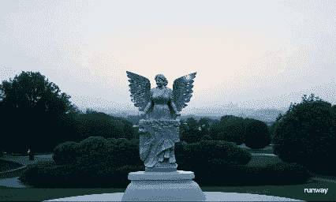

### 4-10 Shatters 碎裂

指的是画面中的主体突然、剧烈地破碎成许多细小的碎片的动作。这种破碎通常伴随着巨大的力量和速度，并且会产生明显的视觉效果。

强调的是一种**粉碎**和**分裂**的过程。主体原本是一个相对完整的物体，在瞬间分解为无数更小的部分。这种破碎可以通过多种方式呈现：

+   **物理冲击：** 比如，玻璃被击碎，陶瓷摔落地面，冰块被砸碎等。

+   **爆炸力：** 爆炸产生的冲击波可以将周围的物体震碎。

+   **内部压力：** 物体内部压力过大导致破裂。

+   **象征性的破碎：** 在一些更具艺术性的表达中，"shatters" 可以用来形容希望、梦想、关系等的突然破灭，通过视觉上的破碎来隐喻。

**关键特征：**

+   **突然性：** 破碎发生得非常迅速，几乎是瞬间完成。

+   **剧烈性：** 伴随着强大的力量和快速的分解。

+   **碎片化：** 物体分裂成大量的细小碎片。

+   **视觉冲击力强：** 破碎的画面往往具有很强的视觉冲击力，能够表达暴力、破坏、脆弱或终结等含义。

+   **常伴随音效：** 破碎的声音（如玻璃碎裂声）通常会同步出现，增强感官体验。

###

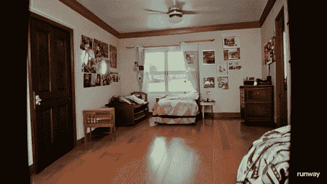

### 4-11Vortex 漩涡

指的是画面中的主体或多个元素呈现出漩涡状的、围绕一个中心点旋转并向中心或向外螺旋运动的动作。这种运动通常具有强烈的动态感和吸引力。

强调的是一种**旋转**和**汇聚/发散**的过程。这种漩涡状的运动具有以下特点：

+   **中心点：** 运动围绕着一个明显的或隐含的中心点进行。

+   **旋转：** 元素以圆周或螺旋形的轨迹围绕中心点运动。

+   **汇聚或发散：** 元素可能逐渐靠近中心点（汇聚），也可能从中心点向外扩散（发散）。

+   **动态感强：** 漩涡运动通常具有很强的动感和能量感。

+   **可以指物理现象或抽象概念：** 可以是水流形成的漩涡、空气形成的龙卷风，也可以是人群聚集形成的旋涡，甚至是抽象的能量或视觉元素的旋转汇聚。

**可能的表现形式：**

+   **自然现象：** 水流漩涡、龙卷风、星系旋臂、飓风眼。

+   **人群运动：** 人群向一个中心点聚集或从中心点散开。

+   **视觉特效：** 通过数字技术模拟出的能量漩涡、时空裂缝、抽象图案的旋转汇聚。

+   **液体或气体运动：** 搅拌液体形成的漩涡、烟雾或气流的旋转。

# 五、风格美学

动漫animation

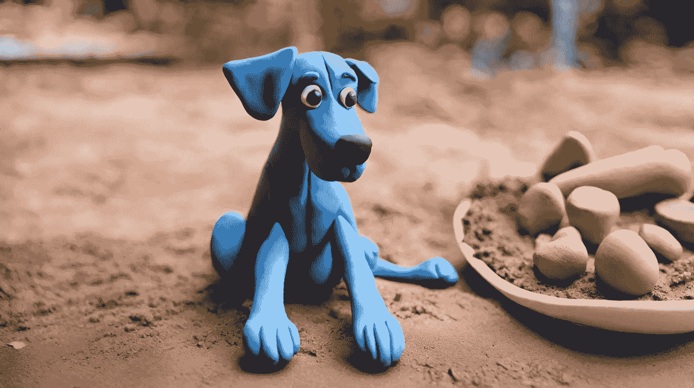

粘土clay

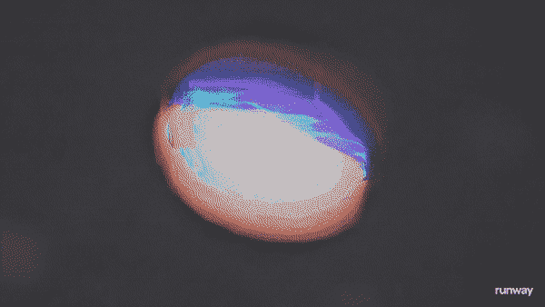

故障风Glitchcore

Home video VHS 家庭录像带 VHS 风格

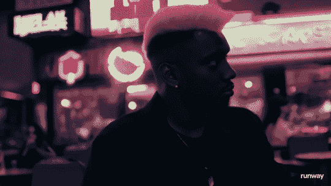

Moody 忧郁情绪不定

35mm

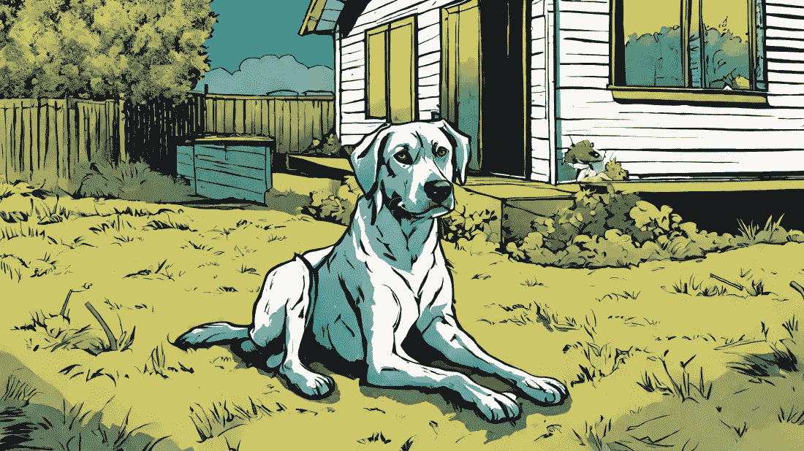

连环漫画Graphic Novel

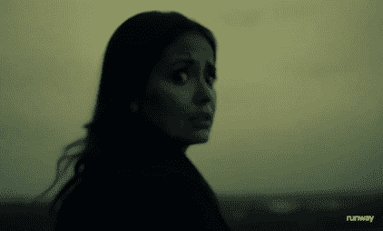

Cinematic 电影叙事

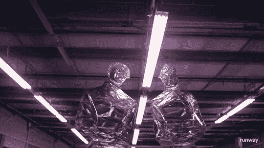

Iridescent 炫彩霓虹

Varsity校队青春活力

# 六、文字效果

Bold 文字加粗

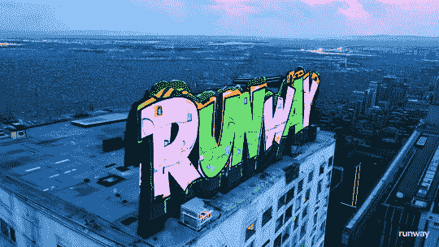

Graffiti 涂鸦风格

Embroidery刺绣

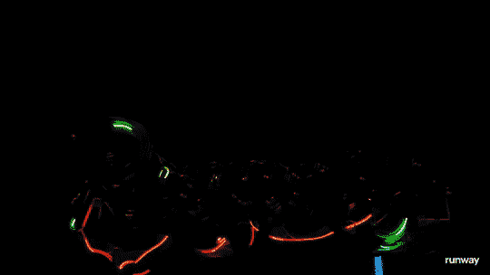

霓虹

### 联系我们

> [互联网设计](https://aigclena.feishu.cn/wiki/PD10wBb5yiRVE7kTFZdcuzUBnth)  [国际站/独立站](https://aigclena.feishu.cn/wiki/TmfowYzfMisIShkNU7ncEBMingh)  [AI商业定制](https://aigclena.feishu.cn/wiki/BsQHwI5saiYGbOkUG2mceW15nHg)