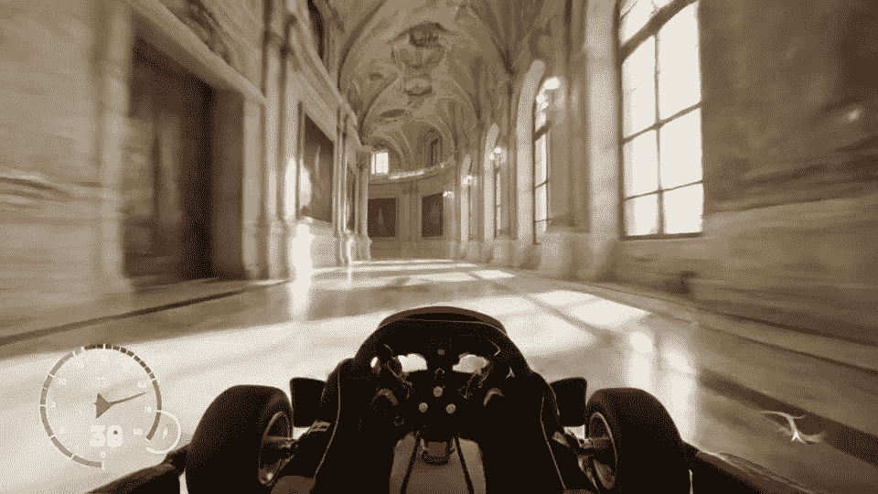
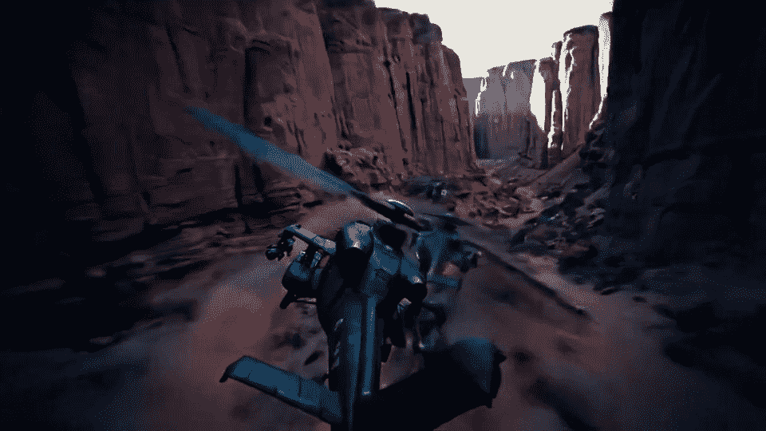
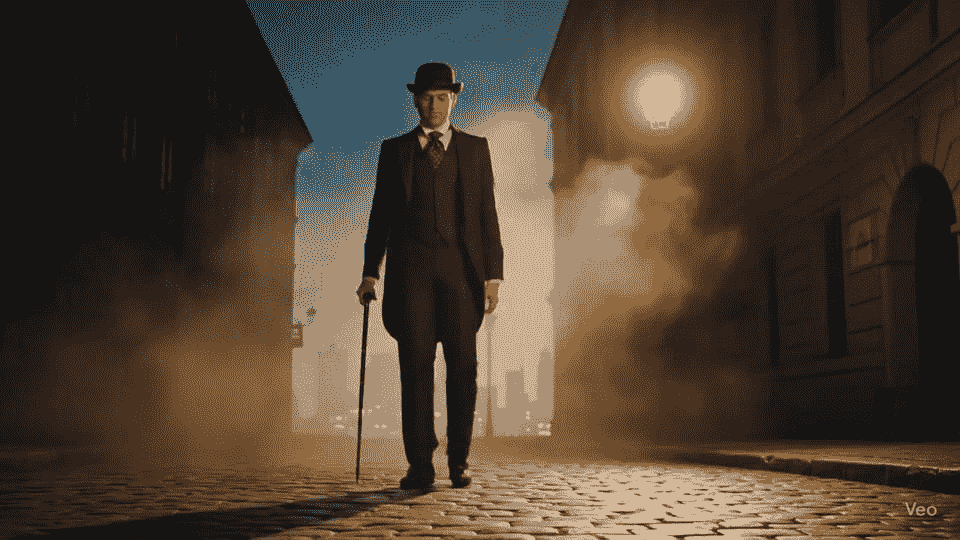
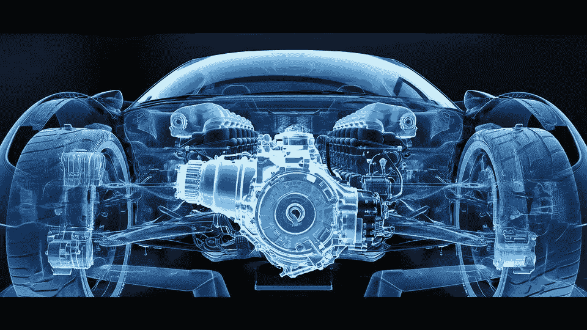

# veo3  json prompt

> 来源：[https://aigclena.feishu.cn/docx/FXugdTKy8ohMVixLzwkclq1wnxf](https://aigclena.feishu.cn/docx/FXugdTKy8ohMVixLzwkclq1wnxf)

**JSON** Pro[mpt for VEO3](https://x.com/LeonardoAi_) in @LeonardoAi_

{

"shot": {

"composition": "POV from driver’s seat weaving at full throttle through Louvre's grand halls",

"lens": "helmet-mounted wide GoPro style",

"frame_rate": "120fps slow-mo on marble reflections",

"camera_movement": "forward rush with slight head bob and rapid corner tilts"

},

"subject": {

"description": "hands gripping steering wheel tight, artworks and statues streaking past at high speed",

"wardrobe": "",

"props": "HUD speedometer overlay, gloves, kart dashboard"

},

"scene": {

"location": "inside Louvre museum galleries and corridors",

"time_of_day": "afternoon with sun shafts through tall windows",

"environment": "polished marble floor reflections, dust motes in light beams, echoing hall acoustics"

},

"visual_details": {

"action": "kart rockets past Mona Lisa gallery, drifts around columns, speeds under vaulted archways",

"special_effects": "motion blur streaks, dust whip from tires, light bloom on polished statues"

},

"cinematography": {

"lighting": "natural daylight mixed with warm interior spotlights",

"color_palette": "marble white, gold accents, racing red, deep shadow grey"

},

"audio": {

"music": "orchestral-electronic hybrid build with sudden bass drop",

"ambient": "engine roar echoing against marble walls",

"sound_effects": "gear shift click, tire screech, artifact rattle",

"mix_level": "driver's POV immersive mix"

},

"dialogue": {

"character": "",

"line": "",

"subtitles": false

}

}

[twitter-video-1280x720-video1 (2).mp4](https://internal-api-drive-stream.feishu.cn/space/api/box/stream/download/all/QNKRb4XIxogSH6xUCTOcExRgnId)

**Veo3**[ Fast JSON p](https://x.com/BasedLabsAI)rompt on @BasedLabsAI

{

"shot": {

"composition": "dynamic tracking shot from behind the lead helicopter, sweeping through tight canyon turns",

"lens": "telephoto lens with shallow depth of field",

"frame_rate": "24fps",

"camera_movement": "fast aerial dolly with sudden pans and tilts to follow the chase"

},

"subject": {

"description": "two military attack helicopters engaged in a high-speed canyon pursuit",

"wardrobe": "N/A",

"props": "rotating turret guns, missile pods, flickering cockpit lights"

},

"scene": {

"location": "rugged desert canyon with towering red rock walls",

"time_of_day": "twilight",

"environment": "dust clouds swirling from rotor wash, loose stones falling from cliff edges"

},

"visual_details": {

"action": "the lead helicopter dives and weaves through narrow turns as the pursuing helicopter fires a missile that narrowly misses",

"special_effects": "missile trail with smoke and sparks, subtle heat shimmer from engines",

"hair_clothing_motion": "N/A"

},

"cinematography": {

"lighting": "low-angle sunlight casting long shadows, rim lighting on rotor blades",

"color_palette": "muted ochres, steel grays, and shadow blues",

"tone": "intense, suspenseful, and high-stakes"

},

"audio": {

"music": "cinematic score with rising tension and percussion hits",

"ambient": "whirring rotor blades, wind rushing past canyon walls",

"sound_effects": "missile launch, echoing explosions, metal stress creaks",

"mix_level": "film standard with emphasis on midrange and impact"

},

"dialogue": {

"character": "",

"line": "",

"subtitles": false

}

}

[twitter-video-1280x720-video1 (4).mp4](https://internal-api-drive-stream.feishu.cn/space/api/box/stream/download/all/Ct77brZQ8ojWbhxBAmkcRkY1ns7)

[JSON pro](https://x.com/azed_ai)mpt from @azed_ai

{

"shot": {

"composition": "full body shot centered in frame with a slight low angle for dramatic emphasis",

"lens": "35mm prime lens",

"frame_rate": "24fps",

"camera_movement": "slow circular dolly around the subject"

},

"subject": {

"description": "charismatic man in his 30s performing energetic tap dance",

"wardrobe": "vintage 1920s three-piece suit with suspenders and a bowler hat",

"props": "cane used rhythmically as part of the routine"

},

"scene": {

"location": "dimly lit cobblestone street under an old streetlamp",

"time_of_day": "night",

"environment": "light mist drifting through the air, faint city skyline in the distance"

},

"visual_details": {

"action": "man executes rapid, precise tap footwork with flourishes using his cane",

"special_effects": "subtle golden glow from the streetlamp and faint lens flares on quick spins",

"hair_clothing_motion": "brim of hat tipping with spins, coat tails swinging with each tap"

},

"cinematography": {

"lighting": "single warm streetlamp spotlight with soft spill into the mist",

"color_palette": "warm golds and deep shadows with muted blues in the background",

"tone": "nostalgic and lively with a hint of mystery"

},

"audio": {

"music": "swing jazz with upright bass and muted trumpet",

"ambient": "soft city hum and distant chatter",

"sound_effects": "sharp, crisp tap sounds in sync with the beat",

"mix_level": "balanced with taps slightly above music for emphasis"

},

"dialogue": {

"character": "",

"line": "",

"subtitles": false

}

}

[twitter-video-1280x720-video1 (3).mp4](https://internal-api-drive-stream.feishu.cn/space/api/box/stream/download/all/AmJ5brGuSof066xIlKMcXSXgnAc)

**New **JSON prompt for Veo3 fast on

[@LeonardoAI_](https://x.com/LeonardoAI_)

Prompt:

{

"shot": {

"composition": "dynamic product showcase with close-ups and wide reveals, ending in a full 360-degree orbit around the vehicle",

"lens": "50mm",

"frame_rate": "24fps",

"camera_movement": "360-degree rotating reveal"

},

"subject": {

"description": "a high-performance black Ferrari assembled from holographic internal components to a complete, sleek car",

"wardrobe": "",

"props": "engine parts, transmission, interior electronics, body panels, wheels, digital dashboard"

},

"scene": {

"location": "reflective, minimalistic stage environment",

"time_of_day": "undefined digital space",

"environment": "hyper-clean, product showcase aesthetic with high gloss surfaces and controlled lighting"

},

"visual_details": {

"action": "holographic engine, transmission, and electronics snap into place with bursts of light; body panels form seamlessly; wheels align and dashboard lights up",

"special_effects": "glowing holograms, light bursts, electrical flares, digital UI animations",

"hair_clothing_motion": ""

},

"cinematography": {

"lighting": "spot-lit with high contrast to highlight contours and textures, emphasizing reflections and shadow play",

"color_palette": "cool tones with black and metallic accents, bright electronic highlights",

"tone": "intense, sleek, futuristic"

},

"audio": {

"music": "cinematic electronic score with deep bass and futuristic synth layers",

"ambient": "rich ambient pads",

"sound_effects": "metallic clicks, high-frequency whirs, mechanical growl, liquid whooshes, electrical ignitions, wheel whir, rapid UI beeps",

"mix_level": "high-fidelity mix with cinematic emphasis on clarity and punch"

},

"dialogue": {

"character": "",

"line": "",

"subtitles": false

}

}

[twitter-video-1280x720-video1 (5).mp4](https://internal-api-drive-stream.feishu.cn/space/api/box/stream/download/all/OoeZbHBJ8opQmzxFs3jc5Mo8n6e)