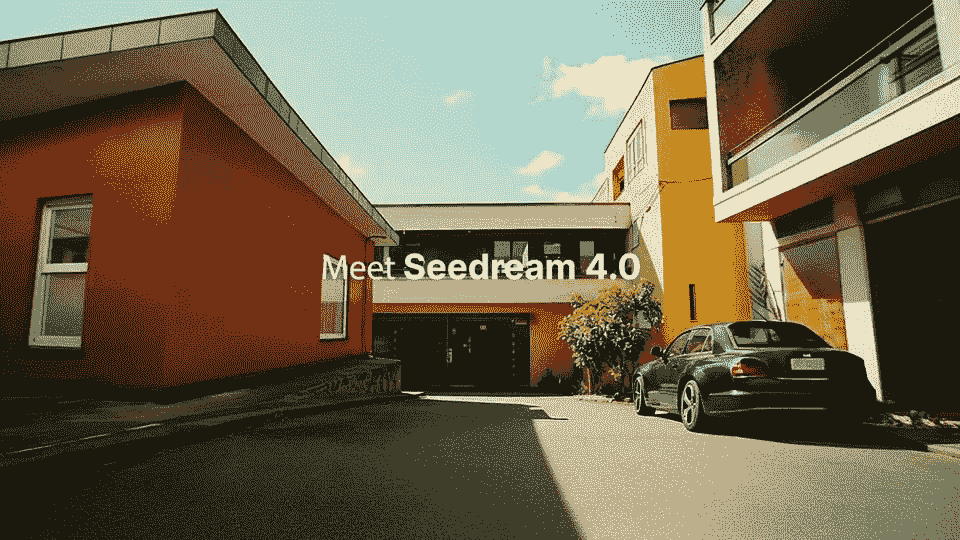
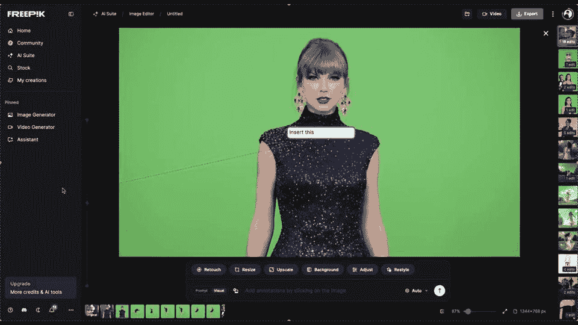
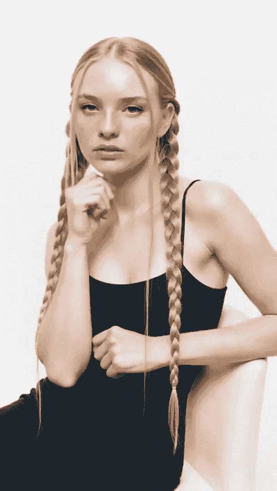
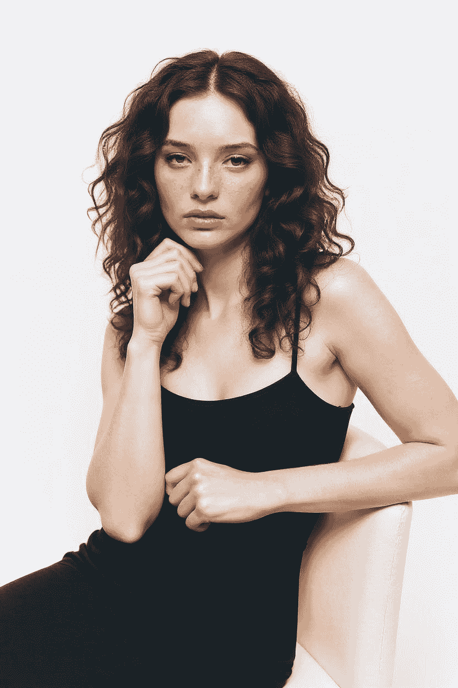
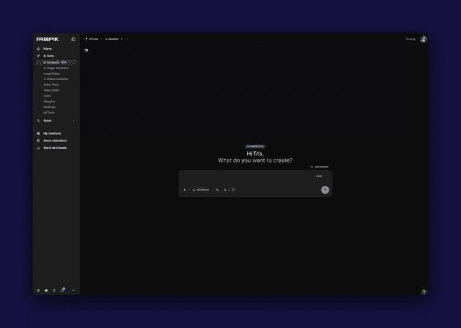
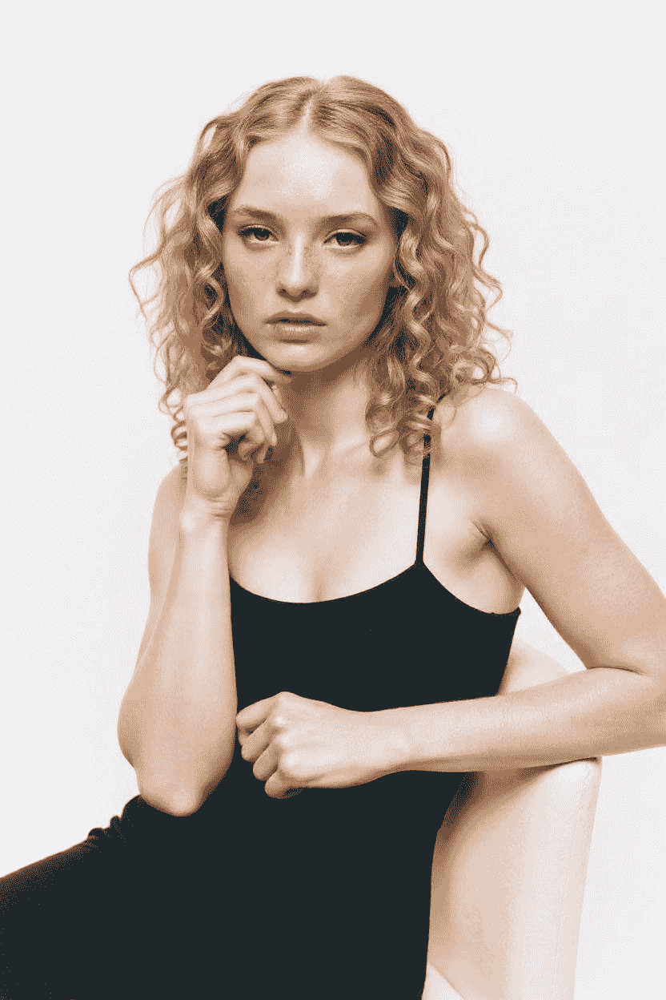

# AI工具集合平台 Freepik

> 来源：[https://aigclena.feishu.cn/docx/SUX3d5HwEoOxJCxACO9cpcIanZb](https://aigclena.feishu.cn/docx/SUX3d5HwEoOxJCxACO9cpcIanZb)

# 接入Seedream 4.0

2025.9.9

[twitter-video-1280x720-video1 (13).mp4](https://internal-api-drive-stream.feishu.cn/space/api/box/stream/download/all/Tk7SbCLXzoSgRExnT1QcVPPTn8b)

# 接入banana

2025.8.28

**Freepik 这波更**新确实把 nano banana（人物驱动/姿态控制）玩出了新高度。

你的理解完全正确：

+   **草图控制姿态** → 相当于“数字分镜”，导演可以随手画出人物动作。

+   **关键帧驱动** → 让人物“动”起来，比如舞蹈、行走、打斗都能精确设计。

+   **背景可替换** → 方便切换场景，做出完整的电影氛围。

+   **导演视角 + 摄影机运动** → 这已经接近真实的 **电影分镜+预演**（Pre-visualization，简称 Previs）流程了。

📽️ 换句话说，它不仅是“视频生成”，而是在帮导演和设计师把 “想法 → 分镜 → 动画 → 成片” 的工作流拉直，大大提升了：

**控制感**（不再完全依赖模型随机输出）；

**叙事感**（关键帧和镜头语言都能被导演化）；

**可扩展性**（换场景、调角度、改灯光都更灵活）

[twitter-video-1280x720-video1 (11).mp4](https://internal-api-drive-stream.feishu.cn/space/api/box/stream/download/all/DDY9boN8no74NOxgwv7cqh0KnId)

# 编辑多张图片

freepik更新，可以同时生成或编辑多张图片，快工作流程，保持角色一致性。

2025.6.17

[2aa3b2514a0267a6e12b289f769829b7.mp4](https://internal-api-drive-stream.feishu.cn/space/api/box/stream/download/all/LZOHbDp2boLJsex3ZGHc1oaWnce)

[abf5dbeb2108d4d115d0f4a58859bf30.mp4](https://internal-api-drive-stream.feishu.cn/space/api/box/stream/download/all/N3XhbJk5coRGOKx8xAncEpgPncf)

