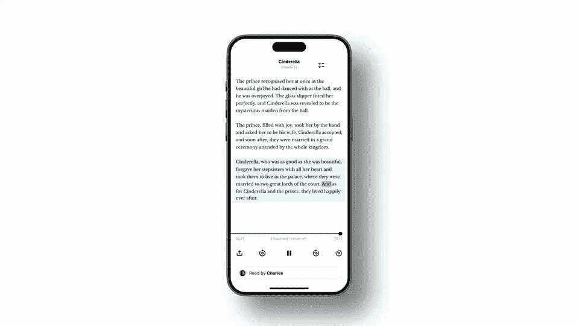

# 音频 | ElevenLabs

> 来源：[https://aigclena.feishu.cn/docx/GuqxdksSxoUus0xmbpAc4CCVn3S](https://aigclena.feishu.cn/docx/GuqxdksSxoUus0xmbpAc4CCVn3S)

# Scribe v2 Realtime

2025.11.12

ElevenLabs 推出 Scribe v2 Realtime 实时语音转文字模型

Scribe v2 Realtime 是 ElevenLabs 最新推出的高精度实时语音转文字模型，面向语音助手、会议记录和实时应用，可在 150ms 内完成转写，支持 90 多种语言，包括英语、法语、德语、意大利语、西班牙语、葡萄牙语、印地语和日语。现可通过 API 或 ElevenLabs Agents 使用。

+   推出「Iconic Voice Marketplace」，授权品牌使用名人 AI 语音
ElevenLabs 新推出一个线上平台，允许品牌付费授权已获得许可的名人声音，用于广告及其他内容创作。该平台以「同意优先、艺人为本」为原则，仅开放经过认证的名人或其版权持有人声音，并通过其系统为品牌生成 AI 复制或合成语音。该服务目前包括 28 种 AI 模拟声音。

[SaveTwitter.Net_zSr1AZK5QmAQ5F6d_(720p).mp4](https://internal-api-drive-stream.feishu.cn/space/api/box/stream/download/all/PTHGbXrvqodG4CxPlvvczz2Enxf)

# 语音助手 11ai

ELEVENLABS 推出全新语音助手 11ai

2025.6.24

能用语音控制Slack、Notion等工具完成任务，通过接入Anthropic的模型上下文协议（MCP），11ai不仅支持5000多种语音和语音克隆，还具备实际操作能力，而非只回答问题。

[6388637963862071097325065.mp4](https://internal-api-drive-stream.feishu.cn/space/api/box/stream/download/all/JfWIbvxvMovIdXxNHbdc7owinfg)

# 「Text to Bark」

ElevenLabs推出「Text to Bark」文本转狗叫

2025.4.1

AI 语音技术再升级！继推出超逼真的文本转语音（TTS）和全球最精准的语音转文本（STT）模型 Scribe 后，AI 研究团队发布了全新的 Text to Bark 技术。该功能或许能将文字转换为狗叫声，标志着 AI 在动物声音合成领域的新探索。

[X2Twitter.com_LuyTzdgAo3r6aCXq_720p.mp4](https://internal-api-drive-stream.feishu.cn/space/api/box/stream/download/all/T1fjbyeEEo3MbrxwJ2LcZenPnvb)

# GenFM功能

竞争Google NotebookLM，用于创建GenAI播客

2024.11.28

语音AI初创公司ElevenLabs于周三推出了GenFM功能，允许用户上传不同类型的内容（如YouTube视频、文本或文档），自动生成多语种播客，类似Google的NotebookLM。该功能支持32种语言，并能自动选择两种声音来制作播客，进一步为播客增添人性化元素，如“停顿”和“语气词”。

[X2Twitter.com_VeCSvf8LjKB06_yj_720p.mp4](https://internal-api-drive-stream.feishu.cn/space/api/box/stream/download/all/Sj0ebMU8rowPacxEzlLcvuPXnjb)

# ElevenlabsXhedra活动介绍

[X2Twitter.com_3BAA_nXxtl7eOuww_720p.mp4](https://internal-api-drive-stream.feishu.cn/space/api/box/stream/download/all/AuCYbzsXro4aTaxLfPVcluGbnic)