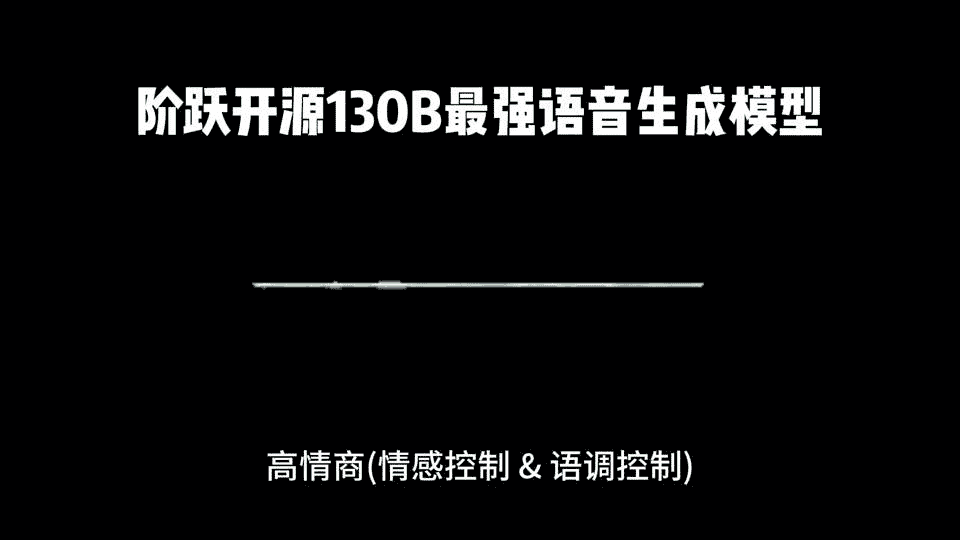
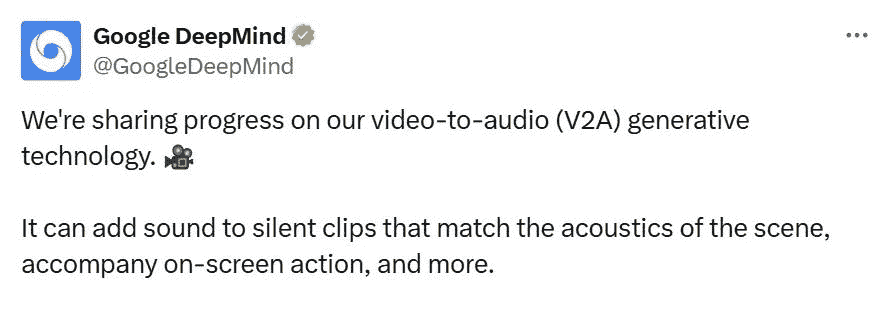
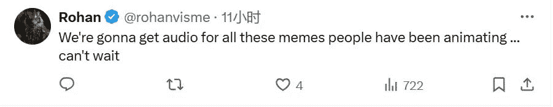
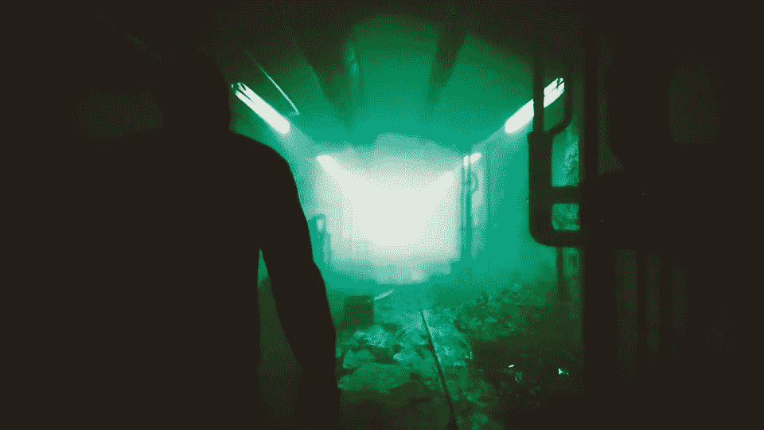
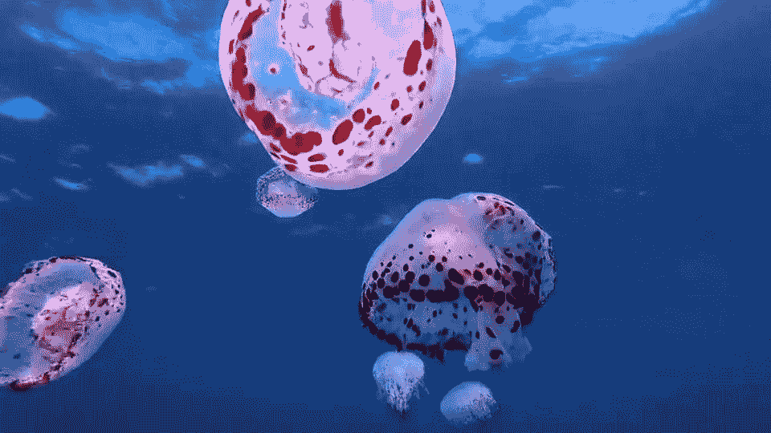
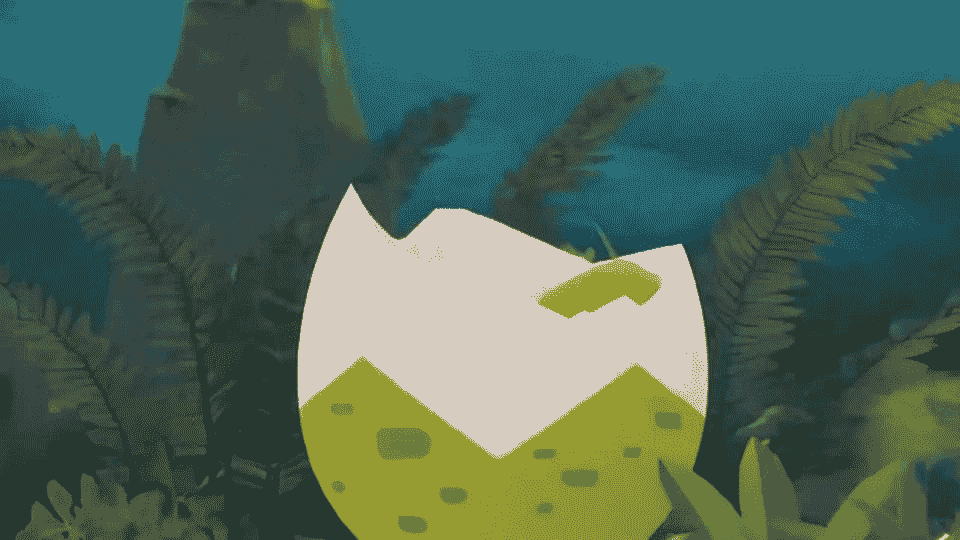
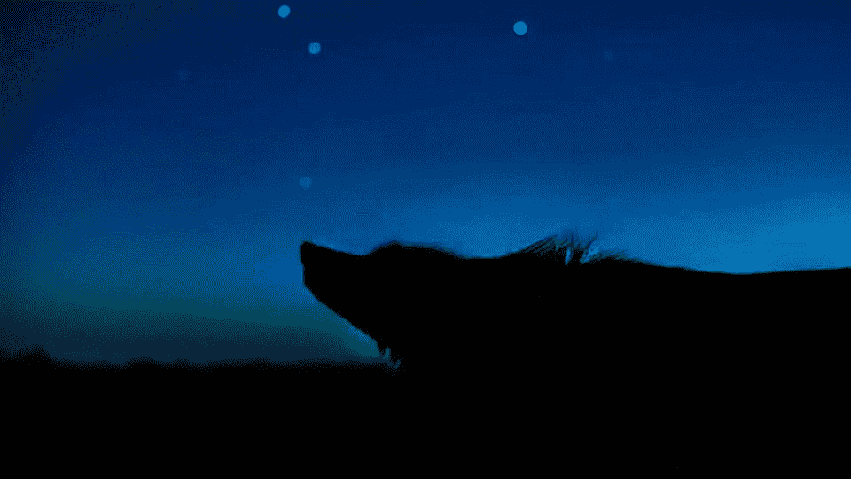
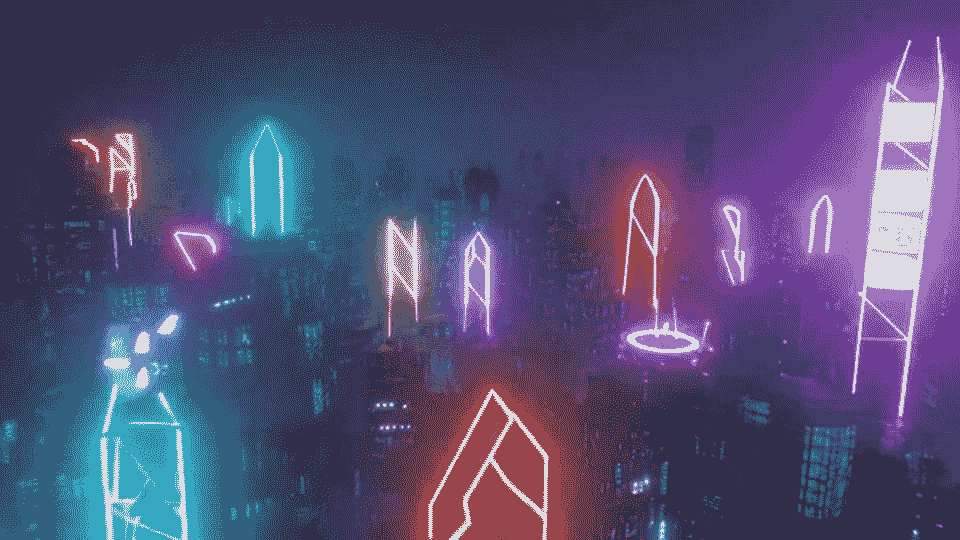

# 更多音频平台

> 来源：[https://aigclena.feishu.cn/docx/GpAQdqd27oFIAyxar6ocMFrQngh](https://aigclena.feishu.cn/docx/GpAQdqd27oFIAyxar6ocMFrQngh)

# Qwen3-TTS

2025.9.22

Qwen3-TTS 正式发布，这款全新文本转语音模型支持多音色、多语言及多方言，能够生成自然、生动的语音效果。在英语和中文上的表现尤为出色，为用户带来高质量、富有表现力的音频体验。

[twitter-video-1280x720-video1 (17).mp4](https://internal-api-drive-stream.feishu.cn/space/api/box/stream/download/all/GvG7bFty0oHRrtxuONzcgTGanJh)

# 阶跃

阶跃（Step Audio）近日推出了1300亿参数的语音模型

2025.2.18

开创了语音交互的新纪元。这款革命性模型不仅具备强大的语音理解与生成控制能力，还支持多语言和方言识别，带来了更加个性化的语音互动体验。

[6387548862534836701565044.mp4](https://internal-api-drive-stream.feishu.cn/space/api/box/stream/download/all/Rq73bXOmOoION0xXMMucQR6lnwh)

# Google V2A

V2A是什么

Runway前脚刚发布Gen-3Alpha，Google后脚就跟了个王炸。

北京时间6月18日凌晨，Google Deepmind发布了视频生成音频（Video-to-Audio，V2A）技术的进展，可以为视频创建戏剧性的背景音乐，逼真的音效，甚至是人物之间的对话。V2A技术支持为AI生成视频“配乐”，Google还特别强调了官网发布的Demo视频都是由自家在五月份发布的生成视频模型“Veo”和V2A技术合作打造。有不少网友表示，这下终于可以给用Luma生成的meme视频配上声音了!

从Google Deepmind官网发布的Blog上看，V2A技术会采用视频像素和文本提示来生成与底层视频同步的音频波形。

Demo视频

[6385432056098166285316231.mp4](https://internal-api-drive-stream.feishu.cn/space/api/box/stream/download/all/CoycbtmZmot7utxqJMGcXOKwnsb)

【Prompt for audio: Cinematic， thriller， horror film， music， tension， ambience， footsteps on concrete】

提示:电影、惊悚片、恐怖片、音乐、紧张感、氛围、混凝土上的脚步声。

[X2Twitter.com_1802731979684683776(720p).mp4](https://internal-api-drive-stream.feishu.cn/space/api/box/stream/download/all/YEjWb0Jzoo5L3zxzMFicypg1n2f)

【Prompt for audio:Jellyfish pulsating under water, marine life, ocean.】

提示：水母在水下游动，海洋生物，海洋。

[X2Twitter.com_1802732101172637696(720p).mp4](https://internal-api-drive-stream.feishu.cn/space/api/box/stream/download/all/XMv9bV5ucoENA7xNRu5cAf6Ynab)

【Prompt for audio: A drummer on a stage at a concert surrounded by flashing lights and a cheering crowd.】

提示：音乐会舞台上的鼓手，周围是闪烁的灯光和欢呼的人群

[videoplayback (2).mp4](https://internal-api-drive-stream.feishu.cn/space/api/box/stream/download/all/GVZXbWp2poWBQ6xKhNfctARonph)

【Prompt for audio: Cute baby dinosaur chirps, jungle ambience, egg cracking】

可爱的小恐龙发出叫声，丛林氛围，蛋壳破裂。

[videoplayback (1).mp4](https://internal-api-drive-stream.feishu.cn/space/api/box/stream/download/all/OEIKboWSyoqJjTxbM7DcdWQ1nlc)

【Prompt for audio: Wolf howling at the moon】

狼对着月亮嚎叫

[videoplayback.mp4](https://internal-api-drive-stream.feishu.cn/space/api/box/stream/download/all/PM6GbPpmgoRCCExVLpocIqBqnWc)

【Prompt for audio: A slow mellow harmonica plays as the sun goes down on the prairie】

夕阳西下在大草原上，一段缓慢柔和的口琴声响起

[videoplayback (3).mp4](https://internal-api-drive-stream.feishu.cn/space/api/box/stream/download/all/AFo5bSZt6oBOLFxRJq0cSmo5nje)

【Prompt for audio: Cars skidding, car engine throttling, angelic electronic music】

汽车打滑声、发动机轰鸣声、天使般的电子音乐

# Hedra

## AI 平台Hedra推出5 大重磅功能

2024.11.16

全新上线 5 大 AI 功能，包括语音隔离技术，可迅速去除背景噪音获得清晰音频；语音变声功能，上传或使用克隆/自定义声音，瞬间变声；语音设计工具，基于文本提示生成独特声音；AI创意助手，快速生成、翻译和优化脚本；以及长达12分钟的内容生成能力。

[IIOfHMhrnsn44YRX.mp4](https://internal-api-drive-stream.feishu.cn/space/api/box/stream/download/all/XddPbxEYooipvxxaSIGc0oIZnB7)

### 联系我们

> [互联网设计](https://aigclena.feishu.cn/wiki/PD10wBb5yiRVE7kTFZdcuzUBnth)  [国际站/独立站](https://aigclena.feishu.cn/wiki/TmfowYzfMisIShkNU7ncEBMingh)  [AI商业定制](https://aigclena.feishu.cn/wiki/BsQHwI5saiYGbOkUG2mceW15nHg)

