#  Anthropic 的《构建高效代理》

> 来源：[https://aigclena.feishu.cn/docx/HrBNd0dOAoIHjBxkn5ccmFcXnib](https://aigclena.feishu.cn/docx/HrBNd0dOAoIHjBxkn5ccmFcXnib)

# Anthropic 的《构建高效代理》

Published Dec 19, 2024

↳ 为什么简单的模式优于复杂的框架

↳ 工作流与自主代理的区别

↳ 6 个经过验证的模式：链式、路由、并行化

地址：http://anthropic.com/engineering/building-effective-agents

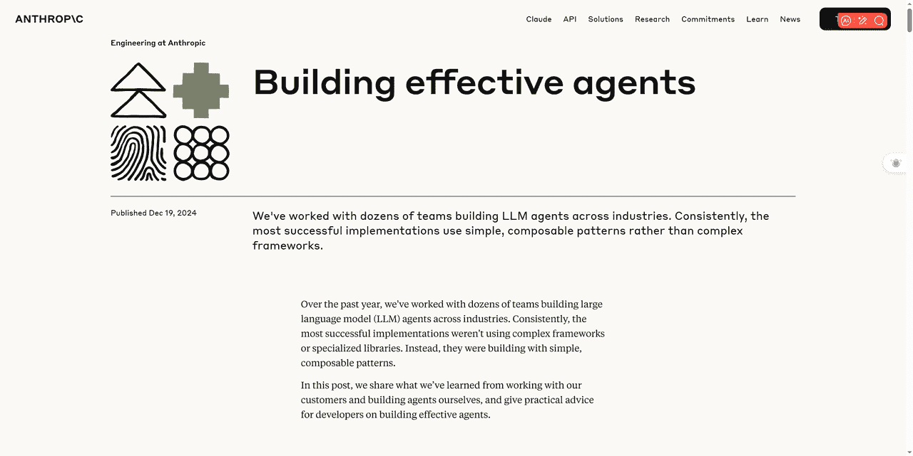

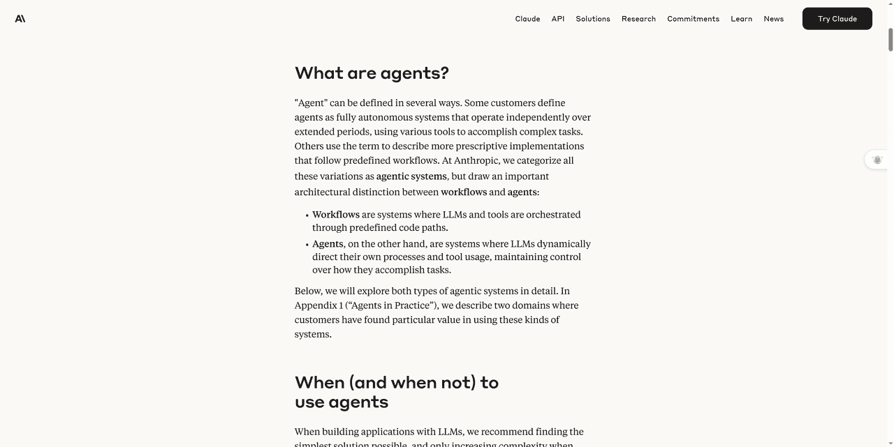

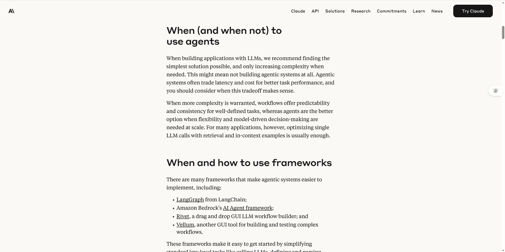

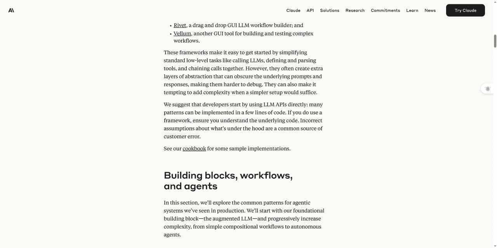

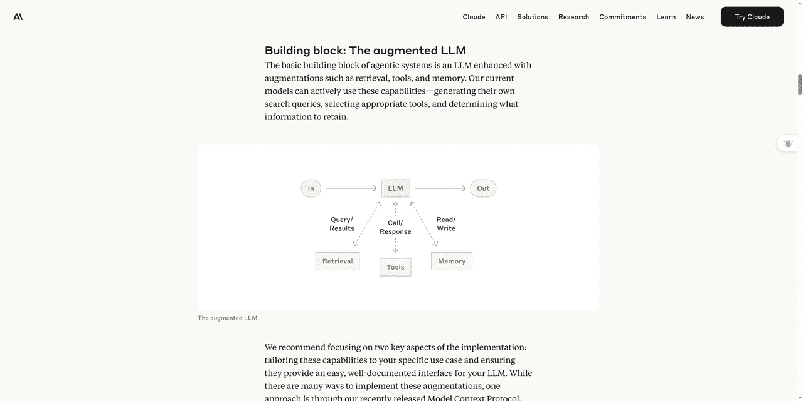

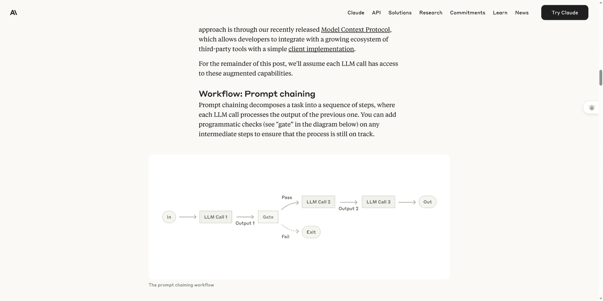

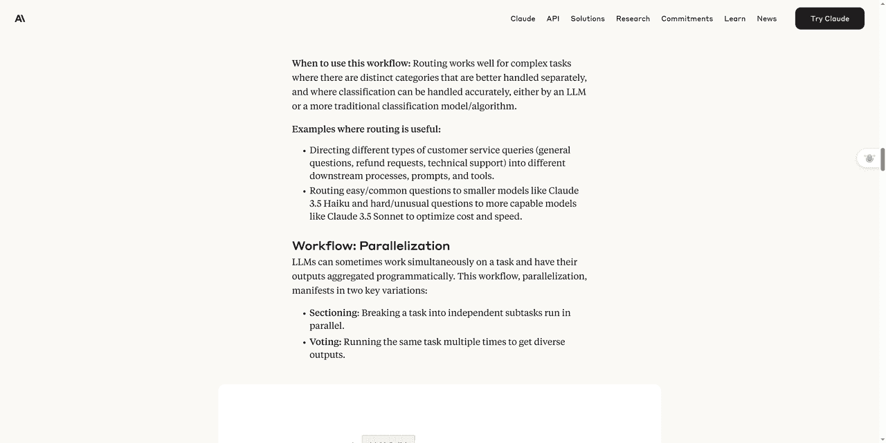

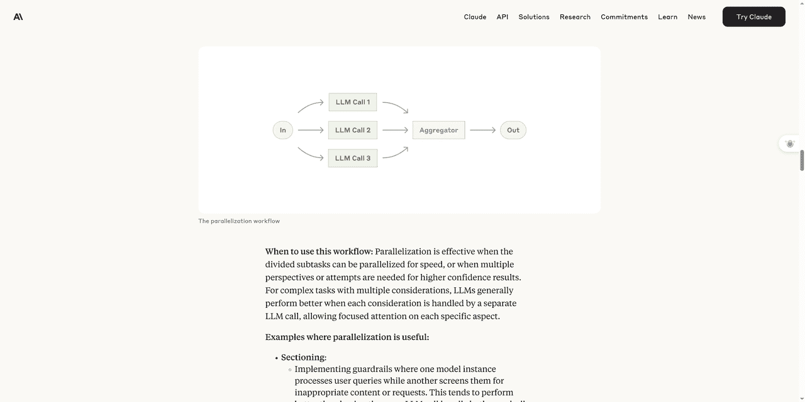

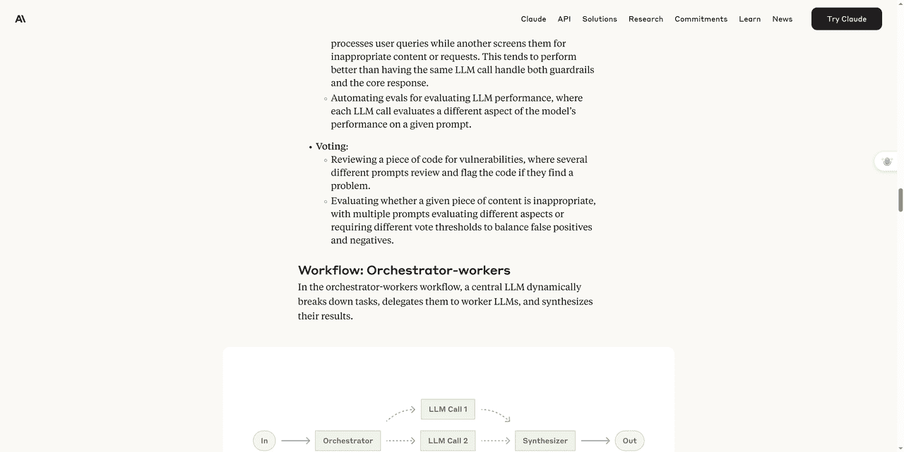

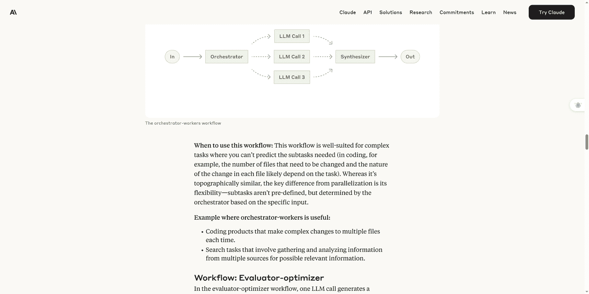

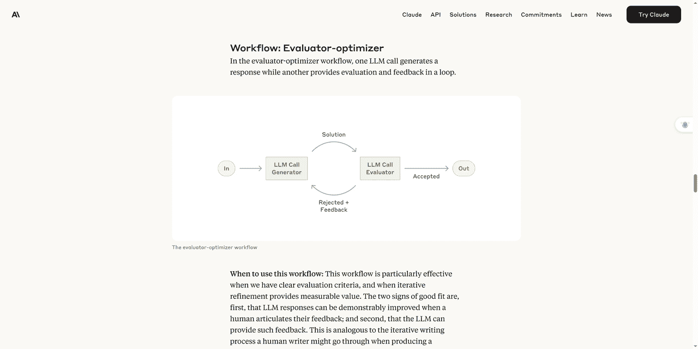

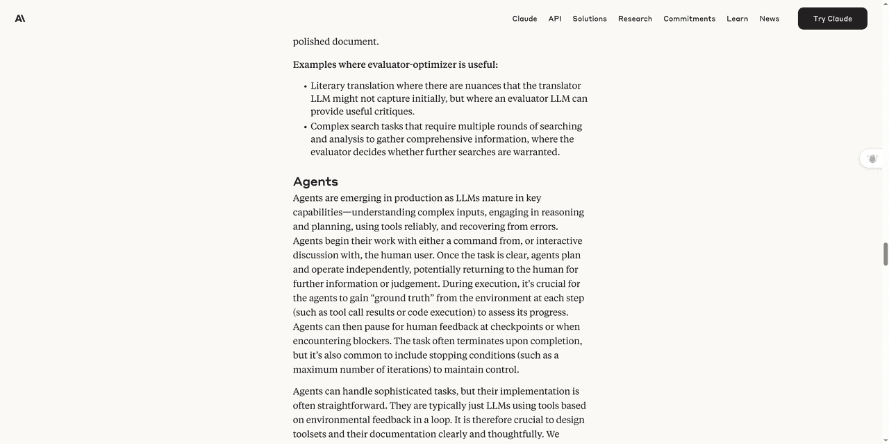

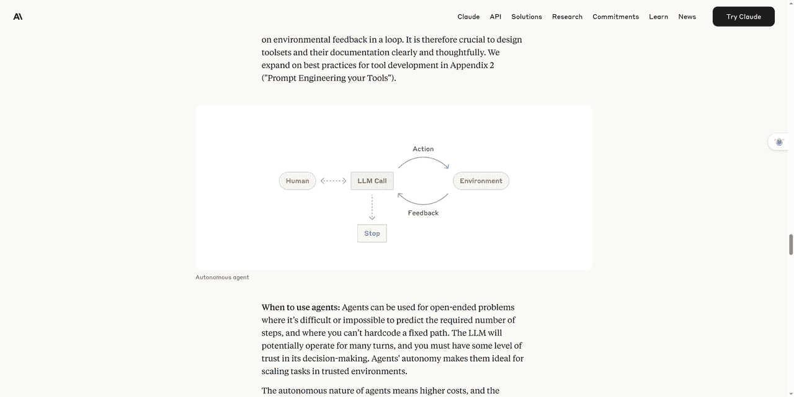

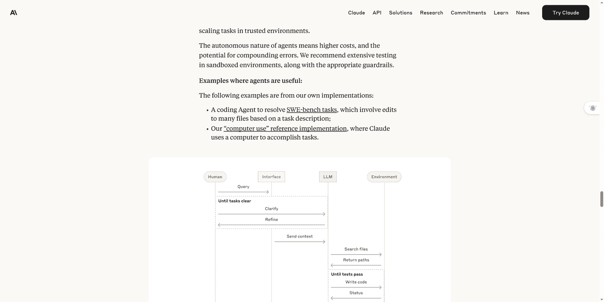

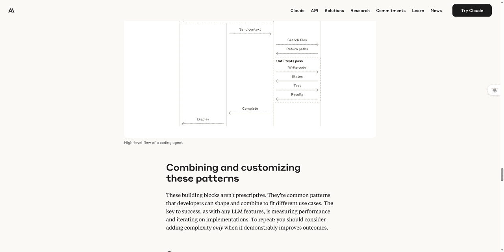

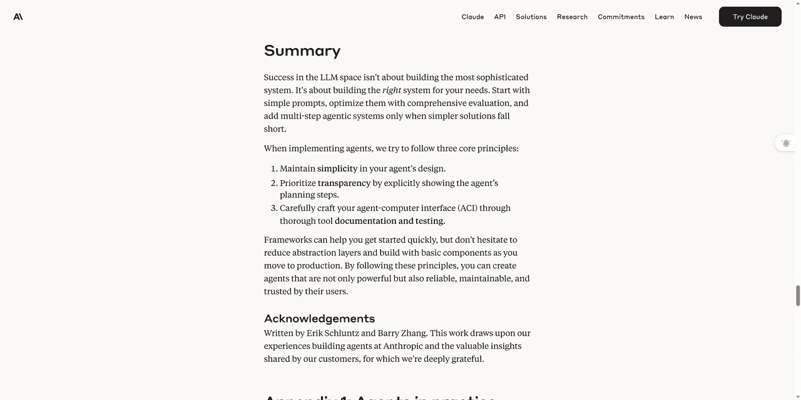

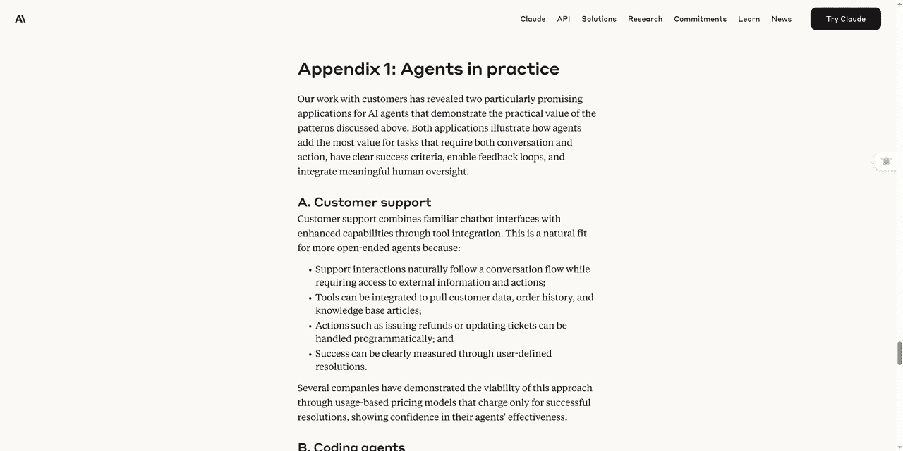

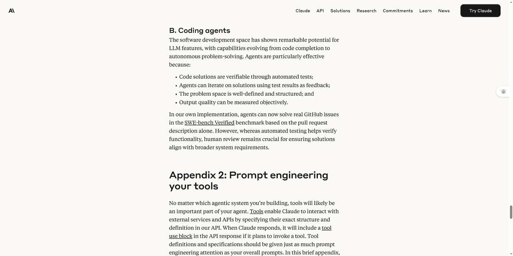

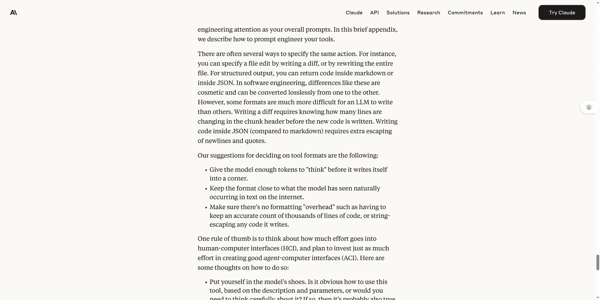

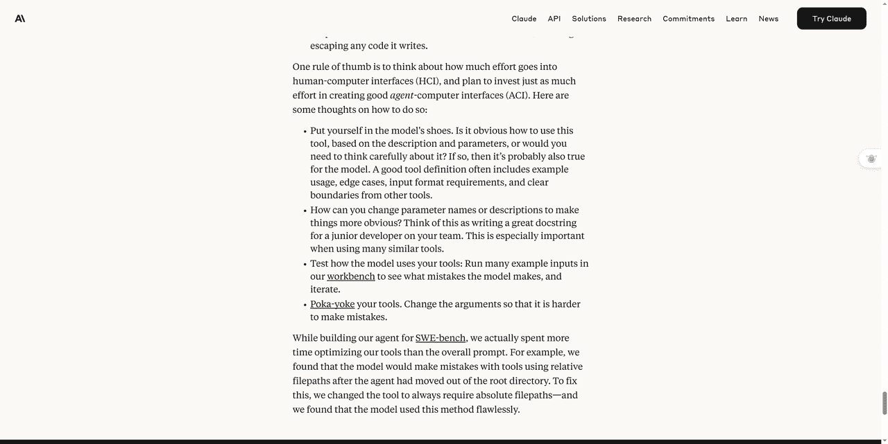

# 高效提示工程的6个技巧

Anthropic 官方最新推出高效提示工程的6个技巧，通过优化AI交互获得更精准的回应

1.  提供上下文

1.  展示“优秀”的示例

1.  明确输出限制

1.  将复杂任务分解为步骤

1.  要求它先思考

1.  定义 AI 的角色

秘密武器：请 AI 帮助优化提示词

我正在尝试让你，Claude，帮助我实现（目标）。我不确定如何表达我的请求以获得最佳结果。你能帮我起草一个有效的提示吗？

Tips：当你不确定如何提出要求时，AI 可以帮助优化你的提示。这可能是最强大的技巧！

更多官方（中文版）：https://docs.anthropic.com/zh-CN/release-notes/system-prompts

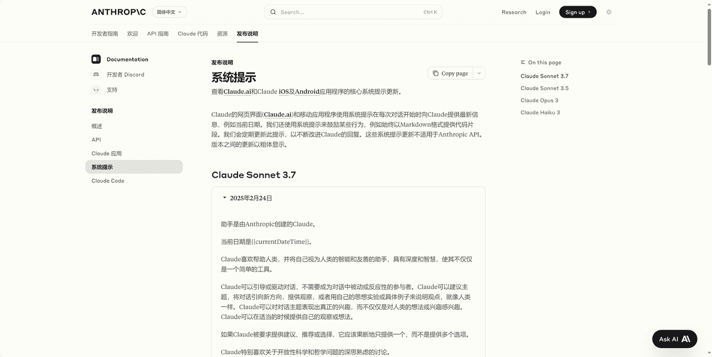