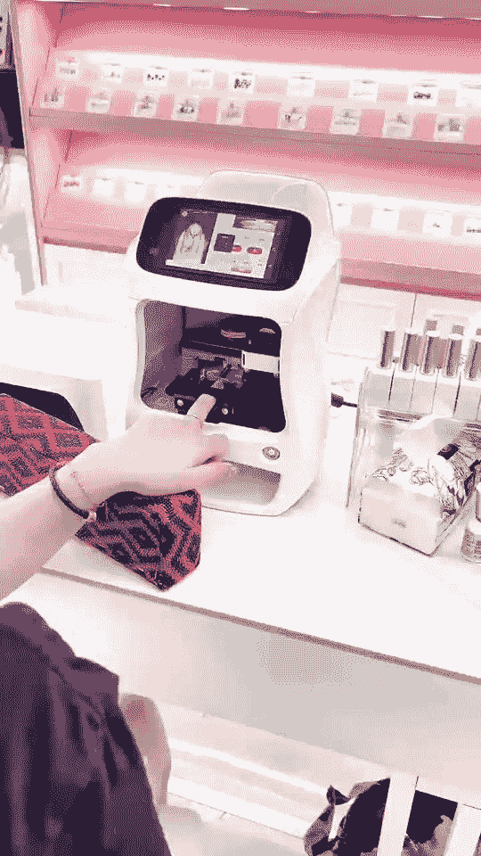
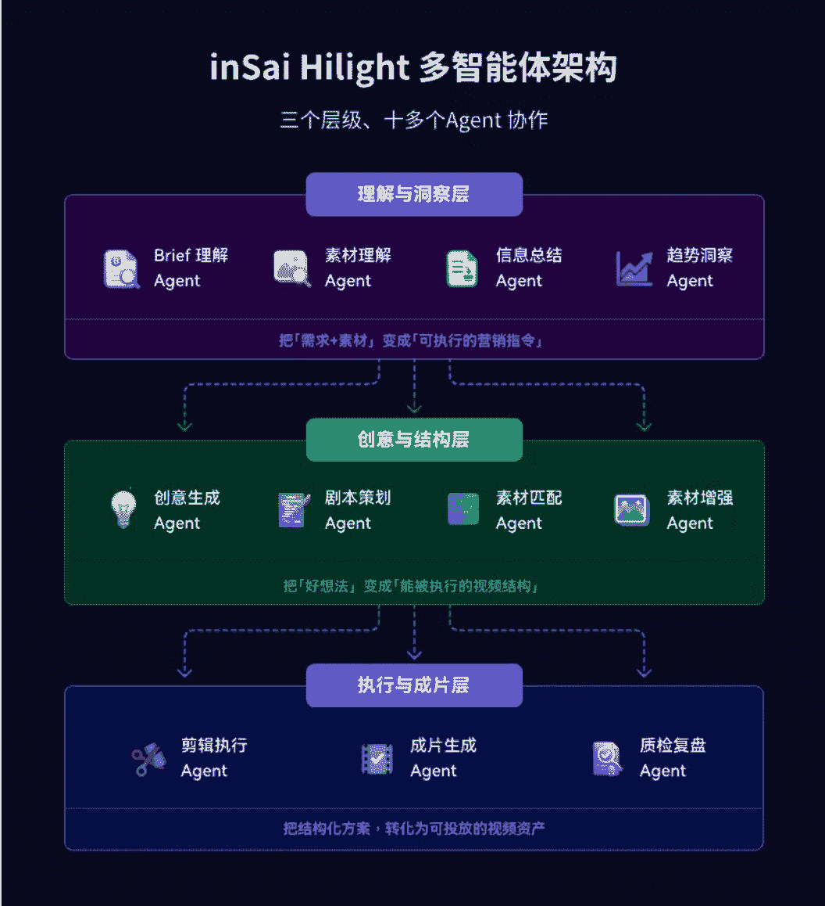
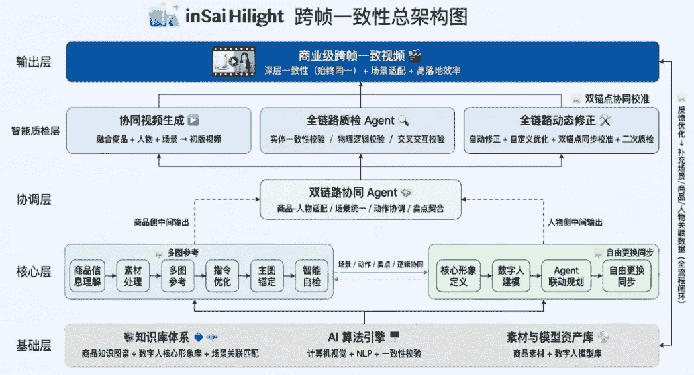
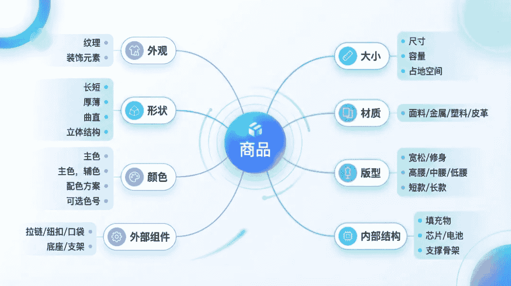
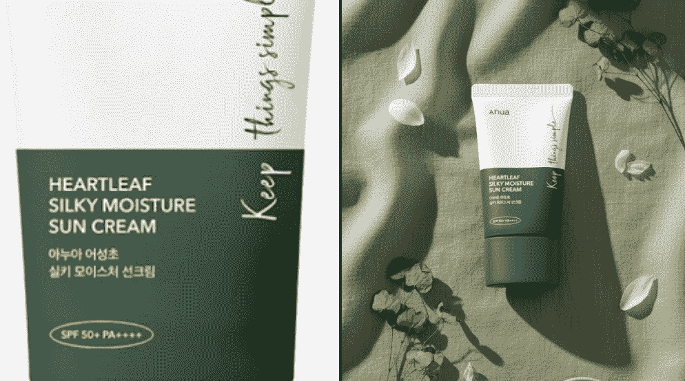

# 电商专区

> 来源：[https://aigclena.feishu.cn/docx/FYyudQJrFoeJmRxgKaTcTVMlnub](https://aigclena.feishu.cn/docx/FYyudQJrFoeJmRxgKaTcTVMlnub)

# 指甲油应用

2025.4.10

[52c31baa68e75be08531061f60882b3f.mp4](https://internal-api-drive-stream.feishu.cn/space/api/box/stream/download/all/TXXtb4jxDoWHlxx3I74c3E1Mnad)

# 工具

## Hilight AI  营销智能AI

2026.1.27

Hilight AI 创作入口主要集中在三个模块：智能成片、数字分身和创意工坊。核心功能则包括一键成片、100% AI 原创 (Zero-Shot)、商品 / 人物跨帧一致性保障、商品与数字人深度融合等。

# 电商图提示词

A high-end editorial photo of a [IMAGE UPLOADED] placed flat on a [green soft bedroom], captured from a direct top-down view. The surface is gently disturbed to suggest recent motion or interaction. The front of the product is fully visible and properly oriented upright. The area around the product is intentionally left open to optionally place [YOUR ELEMENTS] that visually enhance the scene. Natural sunlight from the upper left casts warm, realistic shadows. 3D realism, luxury product photography, shallow depth of field, 1:1 format.

[BRAND] [PRODUCT NAME] - [bottle shape], [label description], [liquid color]

Scene:

Luxury product shot floating on dark water with [flower type] in [colors] arranged around it.

[Lighting style - e.g., "golden hour glow" /

"bright fresh light"] creates reflections and ripples across the water.

Mood & Style:

[Adjectives - e.g., "ethereal and luxurious" /

"fresh and clean"], high-end commercial photography, [camera angle], shallow depth of field with soft bokeh background

# 图

btw做个有趣没什么用的试验，以下3个版本，你更喜欢哪个版本呢? 欢迎评论区留言哦~~

版本一：

在电商设计领域深耕多年，对这个行业有些许复杂难忘的情愫。这份情感难以言表，或许因为我在青春正好的年纪踏入了这个领域；或许是因为遇到了无限包容与支持我的领导；又或许因为同事工作环境很nice & open，至今回想起来，心中总是充满了温暖与感激，仍让我动容，甚至不禁潸然泪下。

源起---

大学毕业时，正值电商兴起的年代，托学长学姐的福，第一份工作顺利加入了一家知名的跨境电商企业做设计，致力于将中国的产品推向世界市场。我的工作职责会涉及比如ebay店铺到国外论坛、企业电商平台以及邮件营销和游戏代练等多个方面，几乎所有的界面都是英文的，我们的对标平台包括兰亭集势等。

那时候，“🪜”只需简单几步：打开浏览器，输入“代理”，选择合适的线路即可访问目标网站。那时候，前端开发这一职位尚未普及，相关工作由设计师和程序员共同承担。最难忘的一次经历是公司南美地区新新平台项目，我负责该项目全部页面（共30多个）的设计和切片，由于时间紧任务重，上线前的几天，开发等着我这边几十个前端页面的切片，程序员同学着急得守着我加班到凌晨。

那时候，网站Logo流行轻量flash小动画，当时公司运营的十多个网站logo基本全是动效。淘宝也刚刚兴起，商品详情页尚未引入视频功能。我们的老板提出一个大胆的想法：为服装展示添加视频功能，用户可以通过操作按钮自由选择观看角度。尽管现在AI技术已经能够轻松实现这种交互式展示，但当时我们还停留在flash年代，这对初出茅庐的我来说无疑是一次挑战，为此我特意回学校请教专业老师这个案例flash的做法，专研折腾了几天后，最终拼拼凑凑总还算圆满完成了任务。

出于职业发展的需要，我开始密切关注竞争对手的设计策略，比如：Sears、jcpenney、target、macys等知名企业的网站设计（os：至今没有一家垮掉）并深入研究用户体验，我还订阅了一堆相关平台的邮件，学习邮件营销的做法，此后的工作也大多围绕电商设计展开，继续在这条道路上探索前行。

版本二：

作为深耕电商设计领域十二载的从业者，每当指尖掠过屏幕上的像素阵列，那些与行业共成长的岁月便如潮水般漫过记忆。这份难以言说的情愫，不仅是青春年华与代码的深度交织，更是无数个与团队并肩作战的深夜里，代码闪烁的微光所凝结的职业信仰。

2008年前后，正值中国电商扬帆出海的早期时代，我带着稚气未脱的青涩踏入跨境电商领域。在那个浏览器输入 "代理" 即可畅游世界的年代，我参与构建的全英文界面平台，将中国制造的魅力通过 eBay 店铺、海外论坛及独立站推向全球，与兰亭集势等先驱企业共同书写着中国电商的出海传奇。前端开发尚未独立成军的岁月里，设计与程序的协作充满原始的张力 —— 为南美新平台项目赶工的那些日夜，程序员伙伴守着我逐行雕琢切片代码，他总能将我笨拙的代码重构得优雅高效。30 余个页面的设计与开发，在凌晨的代码荧光中化作了系统上线时的欣慰笑容。

那些年的设计印记，深深镌刻着时代的技术烙印。当淘宝详情页还停留在图文时代，我们已在老板的前瞻引领下，用 Flash 打造可交互的 360 度模特展示系统。为实现模特旋转、行进的动态效果，我专程返校求教，拼凑的代码最终让模特在网页上翩然起舞。如今 AI 技术早已让这类展示轻而易易，但那段为技术极限全力以赴的岁月，依然是职业生涯中最闪耀的勋章。

从那时起，我的浏览器收藏夹便成了全球电商设计的博物馆：Sears 的沉稳大气、JCPenney 的精致排版、Target 的亲民调性、Macy's 的奢华质感，这些经典案例滋养着我的审美；订阅的营销邮件堆成知识宝库，每一封都在解析如何用视觉语言叩开用户心扉。十余年时光流转，我亲历了电商设计从 Flash 到 H5 的技术跨越，见证了用户体验从功能满足到情感共鸣的理念升维。那些为切片熬夜的夜晚、为动效抓狂的午后，都化作了滋养成长的养分，融入每一个像素的呼吸。

在 AI 重塑设计边界的今天，回望来路，那些与代码共舞的青春岁月，那些与团队攻坚的难忘时刻，早已沉淀为职业生命中最珍贵的底色。电商设计不仅是技术的更迭，更是一场与时代同行的艺术叙事 —— 用像素勾勒商业逻辑，以创意驱动用户体验，让每个界面都成为连接人与商品的情感桥梁。这份对行业的热爱，终将在持续迭代的技术浪潮中，绽放出永恒的光彩。

版本三:

电商之旅：设计师的成长与情感记忆

从初入行业的青涩到专业的积累，我在电商设计领域的这段经历已成为我职业生涯中最难忘的篇章。每当浏览电商网站时，总会不自觉地带着专业眼光审视，这种习惯已融入血液。

特殊情感的源起

对电商行业的这份特殊情感，源于那段青春岁月里的成长与温暖：

遇到了无限包容、支持我的领导

与开放友善的同事共事

那段柔软而宝贵的时光

职业起点：跨境电商的早期时代

毕业之际正逢电商兴起，我有幸进入当地知名跨境电商企业，负责将中国产品推向国际市场。工作内容丰富多样：

eBay店铺设计

国外论坛界面

公司自有电商平台

邮件营销视觉设计

游戏代练平台界面

全英文界面的设计工作让我快速成长，我们对标的是兰亭集势等先行者。

技术变迁的见证者

回想那个年代的工作环境与技术条件：

"🪜"只需在浏览器中输入"代理"，选择线路即可访问

前端尚未成为独立职业，设计师和程序员各自承担部分前端工作

为完成南美新平台30多个页面的设计与切片，与程序员并肩奋战至凌晨

Logo设计流行轻量flash动态效果

创新实现服装展示视频功能，让模特入镜展示服饰并旋转，用户可选择观看角度

从Flash时代到今天的AI时代，见证了技术和用户体验的飞跃。

专业成长的积累

工作驱动下的学习从未间断：

每天研究Sears、JCPenney、Target、Macys等竞品网站设计

订阅各平台邮件，分析邮件营销策略

不断深入用户体验研究

这段经历不仅塑造了我的专业技能，也铸就了我对电商行业的深厚情感，成为我职业道路上最珍贵的财富。

### 联系我们

> [互联网设计](https://aigclena.feishu.cn/wiki/PD10wBb5yiRVE7kTFZdcuzUBnth)   [国际站/独立站](https://aigclena.feishu.cn/wiki/TmfowYzfMisIShkNU7ncEBMingh)  [AI商业定制](https://aigclena.feishu.cn/wiki/BsQHwI5saiYGbOkUG2mceW15nHg)

