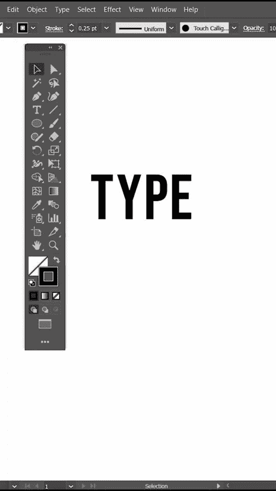

# illustrator

> 来源：[https://aigclena.feishu.cn/docx/LRIsdX97YoORKSxY8o9cSCxMnWf](https://aigclena.feishu.cn/docx/LRIsdX97YoORKSxY8o9cSCxMnWf)

[X2Twitter.com_NONsq6mxdcqLNZHI_1280p.mp4](https://internal-api-drive-stream.feishu.cn/space/api/box/stream/download/all/Kp5ybHZhEoGAJ2xlf67cP1SJn7e)

[X2Twitter.com_ipn5TLb36VBsftBt_1280p.mp4](https://internal-api-drive-stream.feishu.cn/space/api/box/stream/download/all/GpEqbZgXxocNg8xExlPcGfXgn2D)

# figma在线限时免费教程

https://www.udemy.com/course/learning-figma-in-1-hour/learn/lecture/16736030?components=add_to_cart%2Cbase_purchase_section%2Cbuy_button%2Ccacheable_buy_button%2Cdeal_badge%2Cdiscount_expiration%2Cgift_this_course%2Clifetime_access_context%2Cprice_text%2Cpurchase%2Cpurchase_tabs_context%2Crecommendation%2Credeem_coupon#overview