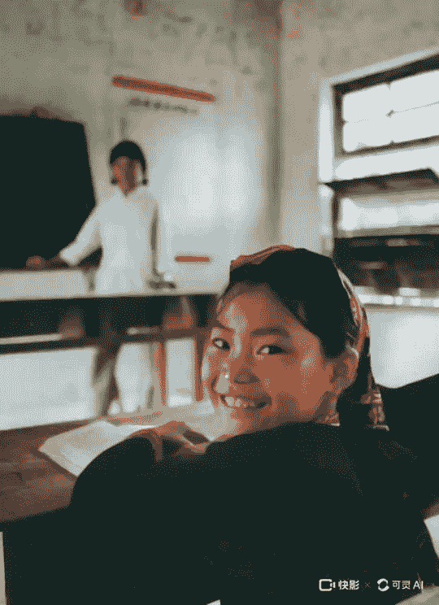
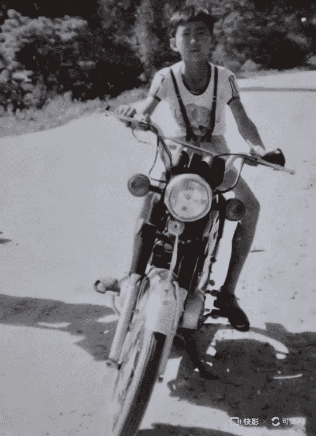
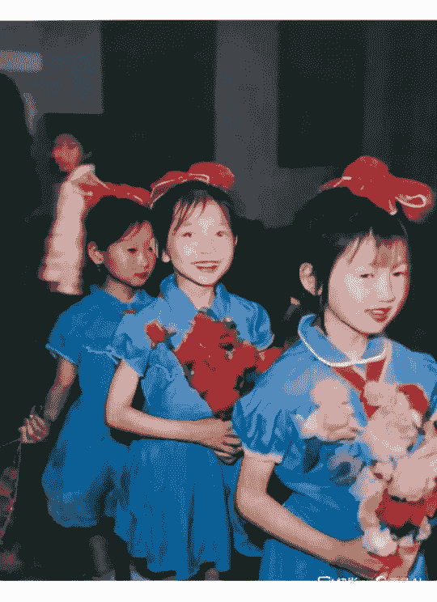
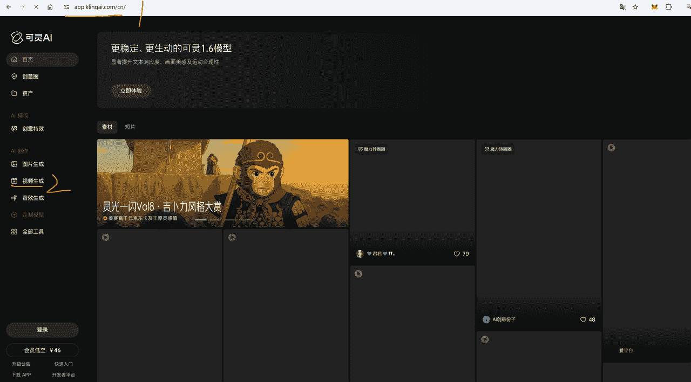
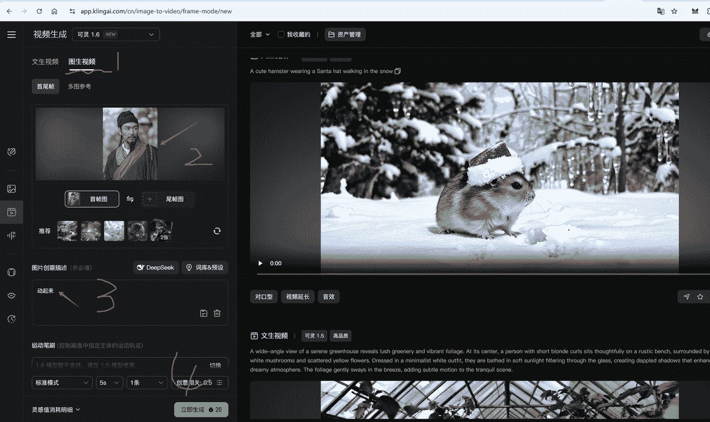
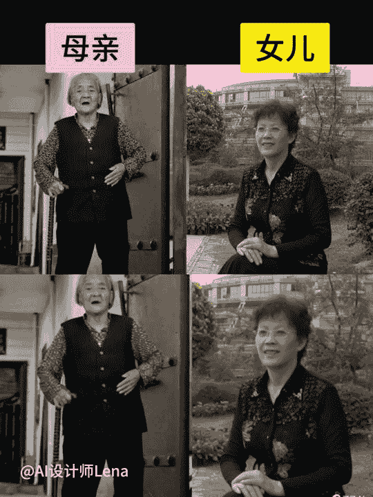
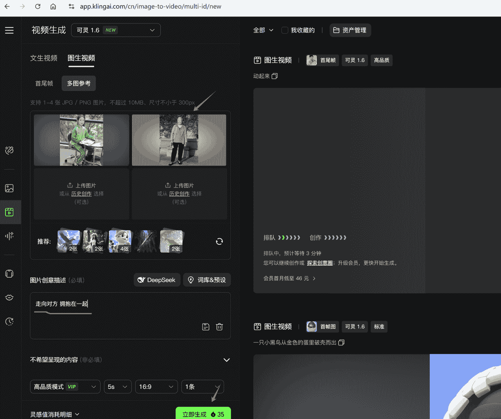

# 照片动起来

> 来源：[https://aigclena.feishu.cn/docx/RE2odqTHoo7Eqqx84ZQcZtxsnAd](https://aigclena.feishu.cn/docx/RE2odqTHoo7Eqqx84ZQcZtxsnAd)

# 一、老照片动起来

[WeChat_20240628121539.mp4](https://internal-api-drive-stream.feishu.cn/space/api/box/stream/download/all/JmiibJd6KoKRxxx7cx8cFKV0nef)

[WeChat_20240628121601.mp4](https://internal-api-drive-stream.feishu.cn/space/api/box/stream/download/all/M0Eybd73XolMa6xlURLcaxJcnib)

[WeChat_20240628121534.mp4](https://internal-api-drive-stream.feishu.cn/space/api/box/stream/download/all/GHh5bIDklov8g0xJ6ZvcEb71nPe)

[WeChat_20240628121609.mp4](https://internal-api-drive-stream.feishu.cn/space/api/box/stream/download/all/GqdobjEpBoaJc6xC8rwccWdjnxg)

制作视频的软件非常多，比如runway、luma、通义、可灵、海螺，这个例子以可灵为例

1、打开可灵官网

https://app.klingai.com/cn/，进入官网登陆以后，点击视频生成

2、选择图生视频，上传图片后点击生成即可，创意描述可写可不写，想写不知道咋写点击旁边的deepseek让它给你写也是一个不错的选择。

# 二、亲人拥抱

[7月13日 (4).mp4](https://internal-api-drive-stream.feishu.cn/space/api/box/stream/download/all/RwSPbarawoYqoBxHu0JcuRznnih)

让照片动起来的效果一样是图生视频里，点多图参考，上传图片后，输入提示词:两人走向对方，拥抱在一起，提交即可。

