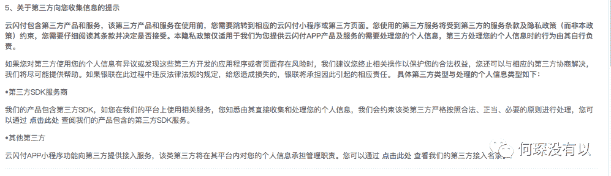

# 隐私政策中的SDK披露

> 来源：[https://docs.feishu.cn/docx/TDCDds4aAoowFHxyJgqcDpNYnWf](https://docs.feishu.cn/docx/TDCDds4aAoowFHxyJgqcDpNYnWf)

**-问**：在隐私政策中，像下图这样写SDK就可以完全把APP运营方的责任免除吗？

**-答：****和很多朋友都讨**论过SDK的问题，主要有几个实际考虑：1）SDK类型复杂，有**的是委托**处理、**有的是对外提供，放**在哪里**都不大合适；2）在没有更详**细的官**方指引的情况下，自认委托处**理、自己承担责任也不妥；3）列为对外提供的话，单独同意又难以实现；4）监管对SDK有特殊披露要求。所以折中的结果就是把SDK单列，不明确说明属于个保法下的哪种数据共享行为。

[隐私政策](https://cbe8t1r4a5.feishu.cn/wiki/wikcndbVz8DuLqHAs77Bx6bp4zd)

[SDK合规](https://cbe8t1r4a5.feishu.cn/wiki/wikcnBRo8jxV2MQwoTa63T6qfce)