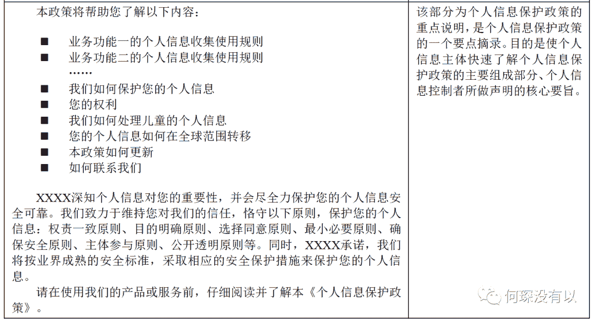
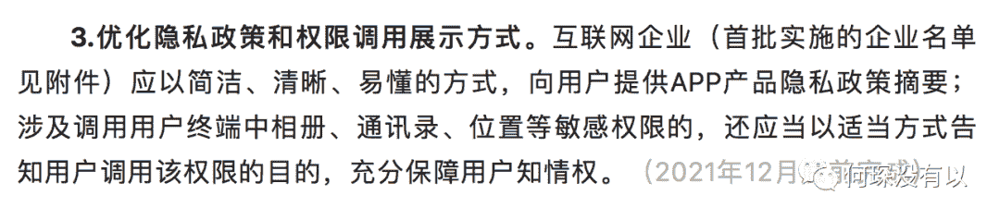
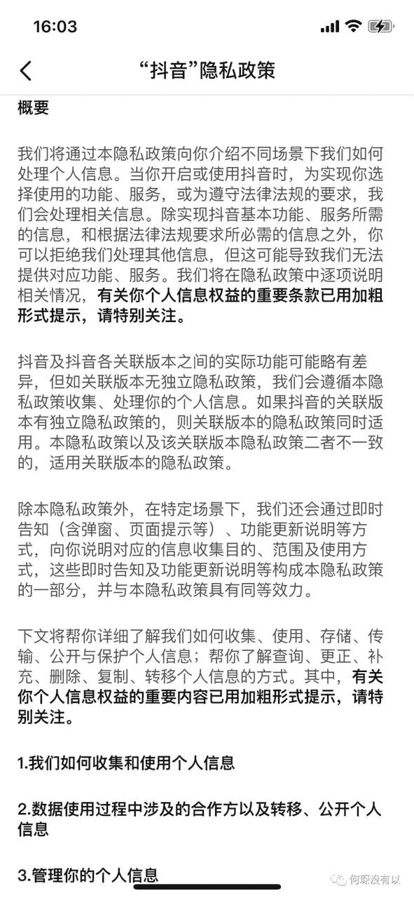
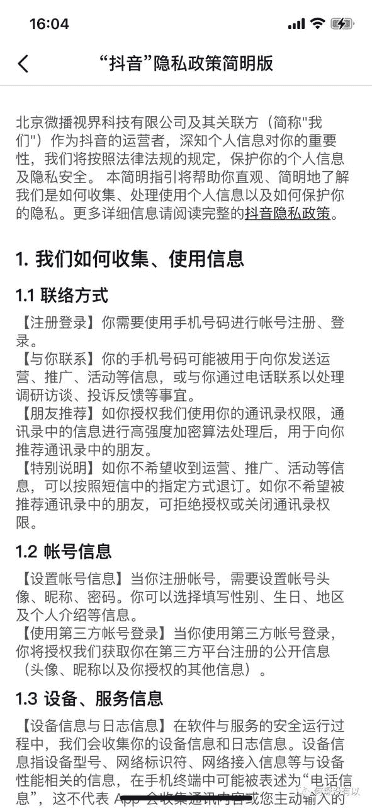

# 隐私政策的简版和摘要区别

> 来源：[https://docs.feishu.cn/docx/B7T1drZpRoz19nxuFpLckpd2n2K](https://docs.feishu.cn/docx/B7T1drZpRoz19nxuFpLckpd2n2K)

**-问**：隐私政策的简版和摘要是一个东西吗？如果不是，有哪个app可以直观感受一下吗。

**-答1：**[不是一个东](https://mp.weixin.qq.com/s?__biz=MjM5OTUwMTc2OA==&mid=2650849040&idx=1&sn=ea662886109bbf1fefb9f8c3ec6162f0&scene=21#wechat_redirect)西，分别来源于《个人信息安全规范》和“524行动”。

35273

524

**-答2：**如果要看样例，可以看看**抖音**。

概要

简明版

[隐私政策](https://cbe8t1r4a5.feishu.cn/wiki/wikcndbVz8DuLqHAs77Bx6bp4zd)