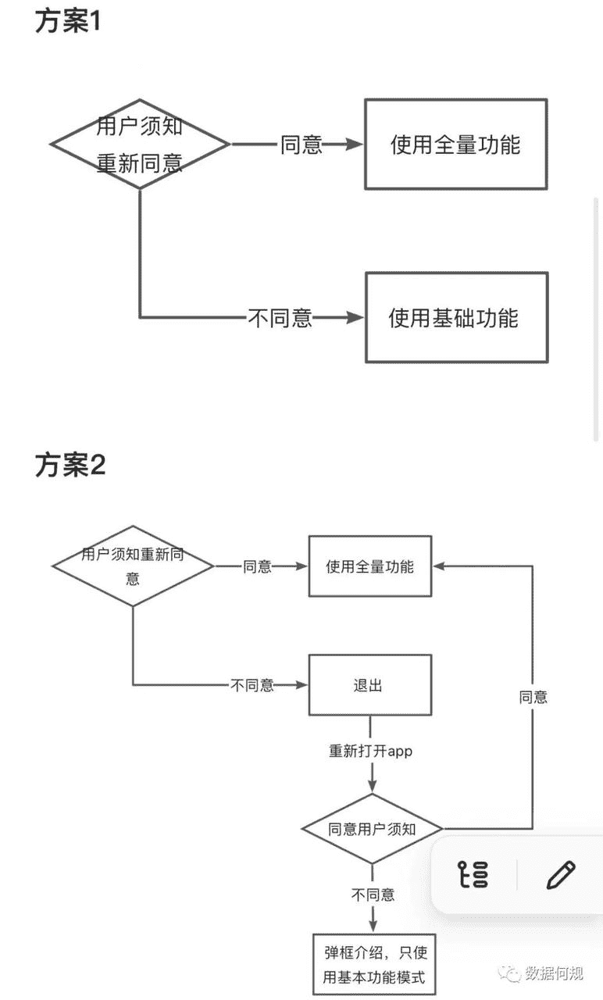

# 更新后拒绝隐私政策怎么处理

> 来源：[https://docs.feishu.cn/docx/CPD5dxZaioKEuhxi3E5cOMknnCb](https://docs.feishu.cn/docx/CPD5dxZaioKEuhxi3E5cOMknnCb)

**-问：**隐私政策更新弹窗如果用户不同意，一般是直接退出应用吗？实践中有没有比较优秀的作业可供学习？

**-答1：**

**-答2：**实践中普遍当成首次安装的弹窗逻辑来做。

**-答3：**问题重点是“更新”。这点有些问题的。没有啥很理想的合规做法。基本只能当做首次安装做了。最理想当然是根据更新的部分是否同意来处理，但实际不可能维护那么多的版本。

**-答4：**看应用类型，常见应用的基本功能一般不会变的。

**-追问：**不同意就不给用合理吗？

**-答5：**维护不同的APP成本太高了，apk没更新，更新前询问，我不同意，用旧版，自然没问题。apk更新了，更新后询问，我不同意，装都装完了，怎么退回旧版？

**-答6：**麻烦的是多次更新不同的点，就会出现排列组合的情况了。

假如现在用的app是X的状态

第一次想更新A，第二次想更新B，且都涉及到要用户同意的情况。

那么如果仅针对同意的部分去更新，就会出现不同情况吧：

X

X+A

X+B

X+A+B

这个逻辑就很奇怪了，也不现实。实际其实是要么不用，要么就是保持最新的情况。

**-答7：**而且有些时候是功能完全没变的情况下更新了隐私政策那一块（不排除因为某些热点事件倒逼的更新），这个时候怎么合规处理也是难点。

**-答8：**这种情况就不弹窗，反正处理个人信息的方式目的没有改变，不用重新同意。

**-答9：**另外，还有种退不回去的情况：嵌入的H5变了，涉及需要弹出获取用户同意的，用户拒绝了，好像也退不回去。

[隐私政策](https://cbe8t1r4a5.feishu.cn/wiki/wikcndbVz8DuLqHAs77Bx6bp4zd)