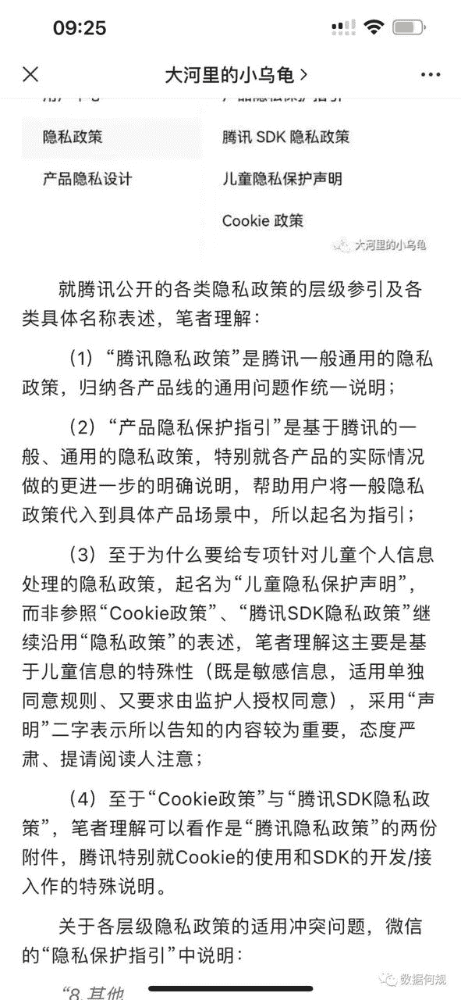

# “同意”隐私政策的性质是什么

> 来源：[https://docs.feishu.cn/docx/GByKdjqoZo6CQCx1bL1cYsWSnLe](https://docs.feishu.cn/docx/GByKdjqoZo6CQCx1bL1cYsWSnLe)

**-问：**同意隐私政策的性质是什么？

**-答1：**Einwilligung同意是事实行为，不是法律行为，是侵权法和刑法上的违法性阻却事由Rechtfertigungsgrund。也不是准法律行为，不准用法律行为规则。GDPR所称的合法性基础也来源于此。如果是法律行为，就没必要专门规定同意的条件和未成年人同意规则。

**-答2：**同意确实具有违法阻却的法律效果，但仅以此是无法论证其法律属性的。在此之外还要明确是否以意思表达为前提，以及法律效果由意思表示产生还是法律规定。何为《个人信息保护法》下的”同意“？

**-答3：**关于同意，刑法、医事法上早就已经讨论的很清楚了。中文文献、国内可参考的德语文献已经很丰富了。

**-答4：**关于除了同意的性质，还有一个点也挺有意思的，民法上将同意分为明示同意、默示同意和单纯的沉默。但是个人信息保护领域的很多国标对于“明示同意”的界定就与传统民法上的理解不同，纳入了肯定性的动作。

**-答5：**隐私政策必须点同意这个是我一直没理解的。

**-答6：**部分公司会把隐私政策改为隐私协议，具有现实意义吗。

**-答7：**35273改叫个人信息保护政策，具有现实意义吗？

**-答8：**现在叫个人信息处理规则，国内隐私和个人信息含义不一样。

**-答9：**隐私声明感觉和隐私政策也不太一样。

**-答10：**感觉声明/政策较协议更偏向大众、监管作出表态的意味，更有“公法”下意义。

**-答11：**木有……隐私政策国标起草中叫了“隐私协议这个名字，有不少是基于尊重某些人的习惯，但并没有改变该文件还是“告知个人信息处理规则”也叫做“隐私政策”，国标草案中的“注”也明确说了这是一回事儿。

**-答12：**consent, explicit consent, Willenserklaerung, Schweigen，区别是很大的。同意不可能是法律行为或准法律行为。同意只是针对处理活动，隐私协议是法律行为。形式上一个隐私政策或协议，可能在法律上评价为具备法律行为和事实行为两个法律事实。这个问题私法上可以讲的很清楚，其实在数据法上实际意义不大。

**-答13：**我本人赞成隐私政策不具有可诉性。但，如果见到隐私政策中有诉讼/制裁等纠纷解决条款（不是投诉到政府部门），也不要太过惊讶，毕竟不仅某些行政执法机构和用户这样认为，连一些司法部门也这样认为，嗯，就是认为agree一个合同和consent一个个人信息处理活动是一样一样的“同意”。

总结：我的简单理解，个保法项下的同意，可以随时撤回，不是意思表示。

[隐私政策](https://cbe8t1r4a5.feishu.cn/wiki/wikcndbVz8DuLqHAs77Bx6bp4zd)