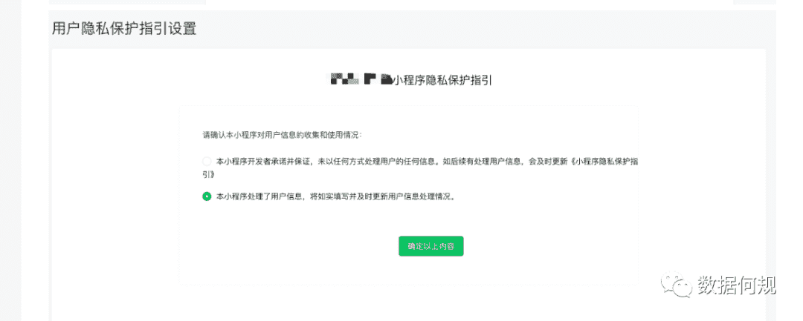

# 小程序隐私政策怎么弄

> 来源：[https://docs.feishu.cn/docx/SZOkdZSXWoG6Cyx11CPcxdwunec](https://docs.feishu.cn/docx/SZOkdZSXWoG6Cyx11CPcxdwunec)

**-问：**微信小程序现在统一要求开发者隐私政策模版和弹窗，这个大家伙哪家微信小程序多，碰到了吗？弹窗展示上，要求展示开发者统一模板的隐私政策，可是那玩意儿很粗糙，我们自己也写了隐私政策。一开始我以为只是调用头像，昵称手机号弹出，但是现在看来微信模板隐私政策覆盖手机权限，这个描述会和我们自己写的隐私政策有重复哇，但是实务上还不得不按照微信模板来还得展示，想问各位这种就是小程序应付下平台不管了还是后面老实一起展示了。

**-答1：**我理解是后者。

**-答2：**我也倾向后者，但是用户应该会迷迷的。我最近才收到产品求助，估计是迭代碰到了。

**-答3：****不用按照微信的模板展示，那个说是参考，可以展示自**己的隐私政策，他们关注的重点是通过微信隐私接口调用用户信息前需要弹窗取得同意。这点我问过，可以让你们小程序的业务同学和微信侧再确认下。

**-答4：**碰到了，2023年9月15日起，对于涉及处理用户个人信息的小程序开发者，微信要求，仅当开发者主动向平台同步用户已阅读并同意了小程序的隐私保护指引等信息处理规则后，方可调用微信提供的隐私接口。看这里：关于小程序隐私保护指引设置的公告。

**-答5：**微信小程序和支付宝小程序还不太一样，支付宝小程序支持开发者自定义隐私政策，但是微信即便开发者提供了自定义的隐私政策，在进入微信小程序之后的某些环节微信的隐私政策模板还是会出现。

**-答6：**没错，我就在想能不能省点力以后，现在用自己定制还挺累。

**-答7：**我也想问，增值电信许可哪里说必须要的啊？来源在哪里呢？

**-答8：****直接用平台模板存在一个问题就是**，相当于自家多了一个隐私政策版本，对于在线协议的更新维护又更麻烦了。

**-答9：**大家会想把小程序的揉进大协议吗，但感觉小程序**采集的字段和**功能，和APP端也不太一样，能不能揉一起，我也吃不准。业务部门就是想放一起，不然单独维护很麻烦。未来不同平台不同小程序，如果单独都一个隐私政策。确实也挺可怕的。而且不同的平台，采集的字段信息肯定也不一样吧。

**-答10：**严格就是分开写，但是你也要**考虑维护成本**，然后腾讯也给了模版，那个改不了。不同安卓版本应该SDK也是不一样的。

**-答11：****除非小程序产品非常特殊或系主营业态，市面上的普遍做法（国内外）还是统一一个隐私政策的，不会专门针对同一业务的不同客户端（APP/小程序/网站端/其他智能终端等）来开发不同版本的在线隐私政策和用户协议，只是其中对不同客户端样态有一些专有条款（例如APP端插入的SDK清单或权限问题）。如果多平台方**发布客户端应用就得写不同版本的隐私政策、布放在不同页面、不同的增强告知弹窗机制，这是要把开发者的创新精力和成本耗费在隐私合规的“形式工作”上……即使是隐私合规从业者，也要应该旗帜鲜明地反对不适当地增加开发者合规成本和负担。这个问题上挺支付宝。平台方不适宜一刀切地否定开发者的自定义隐私政策和弹窗告知，特别是平台方提供的模板并不能确保完备适当、兼容不同产品情况。

**-追问：**小程序公众号的隐私协议，大家要写SDK接入情况吗？

**-答12：**我看有写了的。

**-答13：**主要公众号小程序的SDK情况和App还不一样，有的甚至没有接入，我还想过要不要不写了。

**总结：平台越来越多，不同小程序功能、收集**字段均不同，如何写大一统统一政策，好难。

[小程序合规](https://cbe8t1r4a5.feishu.cn/wiki/wikcnp6uxtmPBkhJMrHz0EERWJc)

[隐私政策](https://cbe8t1r4a5.feishu.cn/wiki/wikcndbVz8DuLqHAs77Bx6bp4zd)