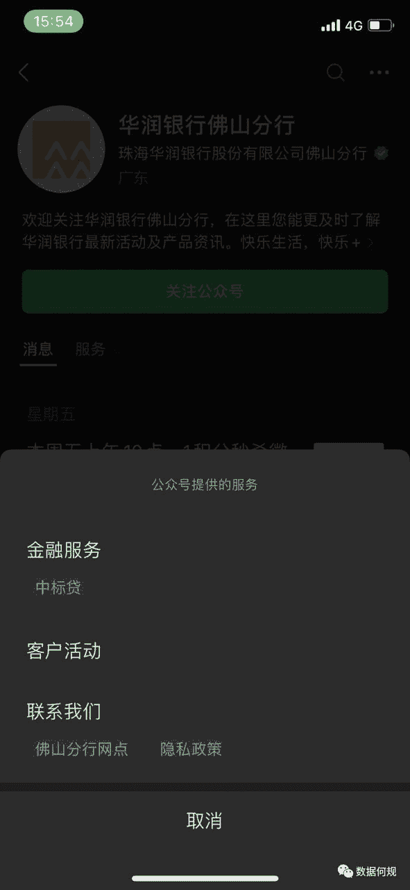

# 👸号隐私政策

> 来源：[https://docs.feishu.cn/docx/ReOydH11soJikXxOSY8c02NVnFb](https://docs.feishu.cn/docx/ReOydH11soJikXxOSY8c02NVnFb)

**-问：**搜索到一些🛰️👸号在发布专属于👸号的隐私政策，这个有什么动因吗？珠海华润银行佛山分行🛰️👸号隐私政策

**-答1：****新的监管要求**，监管核查要求扩展到👸号了。

**-答2**：你可以选择**不收集信息**，就不用写。

**-答3**：👸号后台，只要关注就能看到**follower的昵称****，如何做**到不收集？好像还可以看到地域信息？

**-答4**：虽然有人说自己不收集，“陕西移动高清电视👸号”隐私政策。

**-答5**：这个隐私政策好离谱。说自己不收集和**使用个人**信息，那为啥要履行告知义务，不是自相矛盾吗。

**-答6**：这里有个处罚案例，案例 | 停车场缴费违法违规收集个人信息被处罚，“该👸号申请获取消费者相关个人信息时，未见告知用户协议、个人隐私协议。在该👸号内显著位置亦未见用户协议、个人隐私协议链接。”

**-答7：**有一种可能是👸号开通和搭建插件的人压根就不知道**还获取这**些权限。就像有的🛰️投票还要获取地理位置，拿来也没用的，就是发出来的那方压根不知道。当然啦，不知≠豁免。

**-答8：**这个的重点还是在透明度和必要性吧，我理解这几句的关系，在👸号里明显的地方放置相关条款是一个兜底，即当你在获取信息过程中没有展示相关条款的时候，至少得要在👸号明显的地方展示以便让用户知情，但这并不是说必须要在👸号明显的地方展示，不展示就是违规。（但“👸号内显著位置”在👸号版式固定的情况下怎么实现呢，菜单栏？置顶文章？）

**-答9：**👸号**菜单栏**放隐私政策。

**

总**结：感觉👸号和小程序还是应该区分对待，不要太过了。

[隐私政策](https://cbe8t1r4a5.feishu.cn/wiki/wikcndbVz8DuLqHAs77Bx6bp4zd)