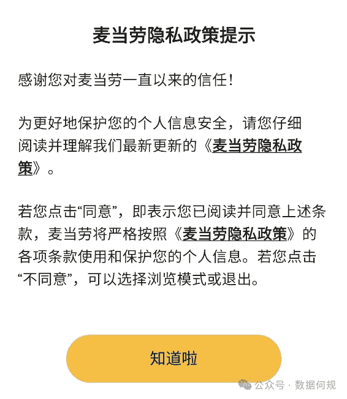
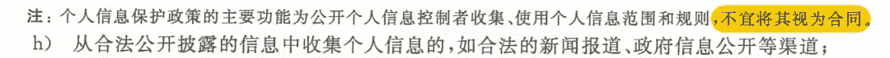

# 同意隐私政策的性质

> 来源：[https://docs.feishu.cn/docx/GMk9d2bskoVIH7xCM32cPdaPnqf](https://docs.feishu.cn/docx/GMk9d2bskoVIH7xCM32cPdaPnqf)

**-问：**麦当劳文字更新了，但UI看起来没跟上。

**-答1：**好像有个案子【（2019）京0**491民初239**42号】，里面的意见是知道了不代表同意。详见：案例笔记：杜某诉知乎隐私政策更新案。

**-答2：**点击同意只是代表知道了。

**-答3：**是的，在个人信息保护的视野下，**隐私**政策这一法律文件的核心定位和本质是履行“告知”义务且仅是全量告知义务（绝非单独同意所需的“告知），而不是双务或单务合同条款，无需点击“同意”才生效，遑论有的数据处理活动还无需“同意”。

**“**同意”隐私政策的准确表述其实应该是“知悉”隐私政策，但用户习惯如此、很多监管方也这样要求，就约定俗成都写“同意”了。

**个人信息**保护法下的“同意”（consent）也不是合同法上的agree，就是两个东东。此前很多学者论述都阐述了consent的意义。但是司法界不少法官对隐私政策和consent的理解和理论研究还不到位，相比之下，有的监管机构要求用户同意隐私政策后也不能收集全部数据or需要提供纯浏览模式 其实反而更接近“隐私政策”本意。

想象一下，一位欧盟或美国隐私律师听说“隐私政策”需要consent才能生效、基于合同法上的请求权基础而直接可诉，会不会要晕倒。

**-答4：**35273也是这么说的，**不宜视为合同**。但是监管爸爸可不一定这么理解。

**总结：隐私是否可诉，同意是否是意思**表示，同意和授权的区别，都值得好好研究。

[隐私政策](https://cbe8t1r4a5.feishu.cn/wiki/wikcndbVz8DuLqHAs77Bx6bp4zd)