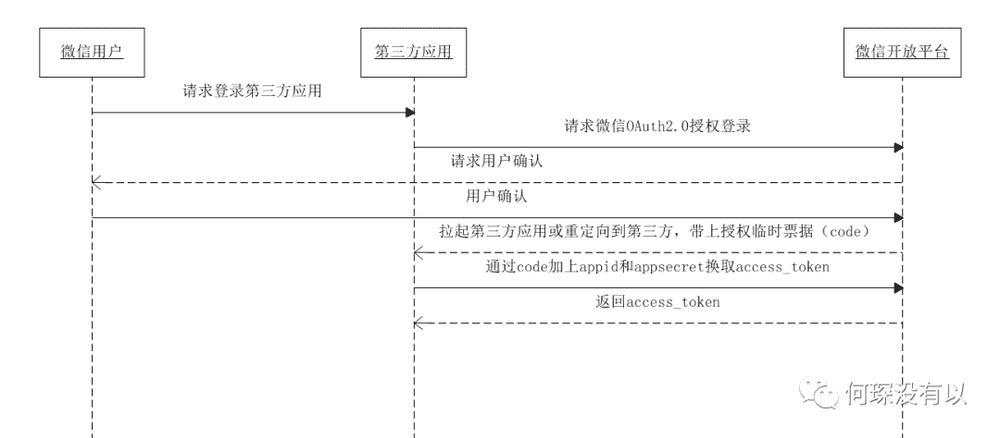

# 微信第三方APP登录中的信息流动

> 来源：[https://docs.feishu.cn/docx/W6i4dSzu4olh7DxNnY8cUjrLndd](https://docs.feishu.cn/docx/W6i4dSzu4olh7DxNnY8cUjrLndd)

**-问**：作为APP提供者，如果用户使用了本地应用--微信登陆我们的APP，拉起了本地应用（微信），是用户自己共享给了微信信息还是APP共享用户信息给了微信呢？

**-答1：**其实**没给**应**用用户信息。**拉起微信，完成登录。在技术上讲，叫三方联合登录。利用的是第三方平台的用户资源。但是微信登录基本上是不会给你用户信息的。也就一个openid。如果你想进一步获取。还会再开发一个绑定页，让用户输入注册信息或者登录信息，完成绑定。如果是新用户的话，就从绑定这一步开始获取了他的信息。

**-答2：**微信**开发者平台文档**里可以看大概的**技术逻辑**。详见：https://developers.weixin.qq.com/doc/oplatform/Mobile_App/WeChat_Login/Development_Guide.html

**-追问：**感觉这里好像是用户授权微信，以微信账号去登录第三方应用。所以应该不存在从第三方应用到微信的个人信息流动？

**-答4：**个人**认为**逻辑是用户发起登录请求——第三方应用拉起微信授权登录——用户授权后微信拉起第三方应用，并返回access_token值——第三方应用用返回的值调用微信接口——微信接口返回对应用户的固定信息字段结果。所以不会有从第三方到微信的流动。

**-答5：**还有篇相关的学术文章供参考：网络第三方账号登录活动中的法律关系及用户协议适用问题刍议。

[APP](https://cbe8t1r4a5.feishu.cn/wiki/wikcnm7SSi199OdP5q0UAot3Fsf)