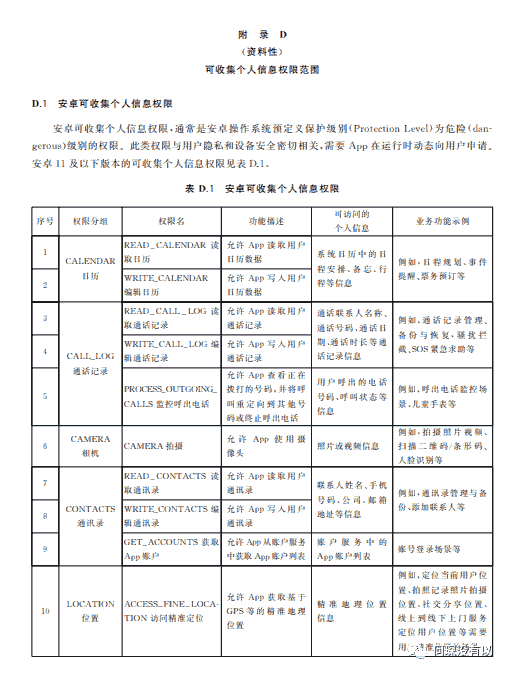

# 安卓开发权限学习

> 来源：[https://docs.feishu.cn/docx/AkbYd9hd3ogUdixuF4hcHmcUn9f](https://docs.feishu.cn/docx/AkbYd9hd3ogUdixuF4hcHmcUn9f)

**-问**：想特别细致的了解的一下安卓安全开发过程中一些细节问题，比如权限调用，比如一些权限API到底应该如何使用，但是也不是做什么开发，只是为了到时候有理、有据、有节的跟 开发人员讨论问题，大家有推荐吗？

**-答1：**我用**SDK安全指引**和**系统权限申请指南 **“怼”回去。

**-答2：**正好翻到群里发的新出国标**41391**的**附录**，这种算么？但是似乎不太全，安卓12和13的Dangerous Permission都没加进去。

**-答3：**我觉得也可以看一下**安卓的开发者指南**，了解一些权限的基础知识。详见：https://developer.android.google.cn/guide/topics/permissions/overview。

[APP](https://cbe8t1r4a5.feishu.cn/wiki/wikcnm7SSi199OdP5q0UAot3Fsf)

[权限获取](https://cbe8t1r4a5.feishu.cn/wiki/wikcn5sa8AZhNVbp1RH4oe0Msuh)